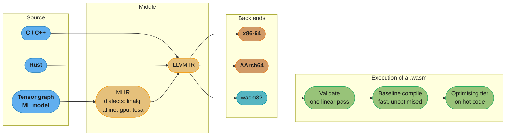

# WebAssembly and Portable Bytecode Targets

> **Version anchor (2026-08-27).** WebAssembly **1.0 is the only W3C Recommendation** (2019-12-05). The Working Group then adopted an **evergreen** process in which the Candidate Recommendation Draft *is* the living standard and never advances to REC — so **2.0** (completed 2025-03) and **3.0** (completed **2025-09-17**) are both permanently Candidate Recommendations, and "Wasm 2.0 is a W3C Recommendation" is wrong. **Wasm 3.0 is current**, folding in memory64, multi-memory, garbage collection, typed references, tail calls, exception handling, relaxed SIMD and a deterministic profile. **Threads/atomics remains a Phase 4 proposal**, shipped in engines but not merged into a numbered core release. **WASI 0.2** (Preview 2) launched 2024-01-25 (0.2.1 on 2024-08-01) and **WASI 0.3.0 was ratified 2026-06-11**, rebasing WASI on the Component Model's native async primitives; **WASI 1.0 (LTS) is not released**. **`wasi_snapshot_preview1` is legacy but not formally deprecated**, and it is still what most existing toolchains emit. Rust's `wasm32-wasi` target name was replaced by **`wasm32-wasip1`** in 1.78 and **removed in 1.84** (2025-01-05); **`wasm32-wasip2`** reached Tier 2 in 1.82.

---

## 1. Concept Overview

[how_code_runs_compilers_and_interpreters](how_code_runs_compilers_and_interpreters.md) covers the pipeline end to end: lexing, parsing, IR, code generation, linking, loading, and the three execution strategies — AOT native, bytecode interpreter, bytecode VM plus JIT. Its §8.1 tradeoff table has a row called "portability of the build artifact", and the honest answer for a bytecode VM is "one build runs wherever the VM exists".

That row hides the topic of this page. **WebAssembly is a portable bytecode with two properties no previous one had**, and both are properties of the *format*, not of any particular runtime:

- **The sandbox is a compile-time property.** A module is fully type-checked before a single instruction runs, and the checking is a linear pass. Memory safety is not enforced by a runtime guard the way a JVM `SecurityManager` was; it is a consequence of the module having validated at all. A `.wasm` file that validates cannot reach outside its own linear memory, full stop.
- **The syscall interface is a separate, capability-based, versioned contract.** Core WebAssembly can do *nothing* — no files, no clock, no network, no output. Every capability arrives as an explicit import, which is what makes **WASI** a genuinely different design from `libc` rather than a reimplementation of it.

The consequence is that WebAssembly is not "the JVM but for the browser". It is a **compilation target** in the same sense LLVM IR is, with a sandbox where LLVM IR has an ABI, and it is why the same `.wasm` binary runs in a browser tab, in a CDN edge worker, as an Envoy filter, and as a Kubernetes workload behind a `RuntimeClass`.

This page also closes two neighbouring gaps the parent leaves: **how a bytecode interpreter is actually made fast** (threaded dispatch, which §6.6 of the parent walks past when it shows CPython's `dis` output), and **MLIR**, the multi-level IR that made "one back end serving many front ends" tractable for compilers whose source language is a tensor graph rather than a C program.

---

## 2. Intuition

**One-line analogy.** A native binary is a letter written in the local language and handed to the postman. JVM bytecode is Esperanto — portable, but only where someone speaks it, and once they do they have your whole address book. WebAssembly is Esperanto written on a card that physically cannot fold, in an envelope with no return address: the recipient can read it, and it cannot reach anything you did not hand it.

**Mental model.** Hold two pictures side by side:

```
NATIVE                                 WEBASSEMBLY
  a.out                                  module.wasm
    .text  (machine code)                  code section (typed bytecode)
    .data                                  data section
    .bss                                   memory: ONE flat byte array
    dynamic symbols -> the whole OS         imports: an EXPLICIT list

  can call any syscall                   can call NOTHING it was not given
  pointer = an address in the process    pointer = an offset into ITS array
  a bad pointer reaches the kernel       a bad offset traps -- there is no
                                           address space to reach into
```

The right-hand column is not a security feature bolted on. There is no representation in the instruction set for "an address outside my memory", the same way there is no representation in a `u8` for the number 300.

**Why it matters.** Three currently-live consequences. Untrusted third-party code can run in-process at close to native speed, which is why edge platforms and plugin systems reach for it. A single artifact runs across CPU architectures without recompilation, which is why it appears in Kubernetes and in Envoy filters. And the module starts fast: validation and baseline compilation are linear passes, so cold start is close to native *before* any optimising tier has run — which is the property serverless actually cares about.

**Key insight.** **The structured control flow is what buys everything else.** WebAssembly has no arbitrary `goto`: control flow is `block`, `loop`, `if`, and branches that can only jump to an enclosing label. That single restriction makes the control-flow graph reducible by construction, which makes validation a single linear pass with a type-checked operand stack, which makes a baseline compiler a single linear pass too. The sandbox, the fast validation, and the fast cold start are all downstream of a design decision about `goto`.

---

## 3. Core Principles

- **Validate before you execute, in one pass.** Every module is type-checked — the operand stack, the function signatures, the branch targets, the memory accesses — before any instruction runs. A module either validates or is rejected; there is no partially-trusted state.
- **The sandbox is what validation *means*.** Loads and stores are offsets into a single linear memory and are bounds-checked; there is no instruction that names an address outside it. Compare JVM bytecode verification, which is a genuine analogue — see [`java/bytecode_and_classfile`](../../java/bytecode_and_classfile/bytecode_and_classfile.md) — but which sits inside a runtime that also grants the class library, and therefore the world.
- **Capabilities are imports, and nothing else.** A module with no imports can compute and return values and do nothing else. Handing it a file descriptor means passing it a handle; there is no ambient authority to reach for.
- **Structured control flow, deliberately.** `block` / `loop` / `if` with labelled breaks (`br`, `br_if`, `br_table`) and no arbitrary jumps. Compilers targeting Wasm must *relooper* irreducible source control flow back into structured form — a real cost, paid once by the toolchain, in exchange for linear-time validation everywhere.
- **Linear memory is one array, grown in pages.** A single contiguous mutable byte array, extended by `memory.grow` in **64 KiB pages**. `memory64` (64-bit addressing) reached Phase 4 in November 2024 and is merged into core 3.0; multi-memory landed in the same release.
- **The format is a target, not a language.** Nobody writes `.wasm` by hand; WAT is a debugging notation. The design question is always "can a compiler lower to this cheaply", which is why the instruction set is small and the type system is simple.
- **Layering is explicit: core, then WASI, then components.** Core Wasm is computation. **WASI** is the capability-based syscall layer. The **Component Model** is the interface-and-linking layer above both. Each is versioned separately, and conflating them is the source of most confusion about "which WASM do I need".

---

## 4. Types / Architectures / Strategies

### Where a portable bytecode sits among the execution strategies

The parent's §8.1 table compares AOT native, interpreter, and VM-plus-JIT. WebAssembly is a fourth position:

| | AOT native | Bytecode VM + JIT (JVM) | WebAssembly |
|---|---|---|---|
| Artifact portability | one build per CPU/OS | one build, any JVM | one build, any engine |
| Cold start | best | worst until warm | **near-native immediately** — validation and baseline compile are linear |
| Peak throughput | fixed at build | highest, after profiling | high; profiling tiers exist but the ceiling is lower |
| Sandbox | none — the OS is the boundary | runtime-enforced, large trusted surface | **format-enforced**, tiny trusted surface |
| Ambient authority | full syscall access | the class library | **none** — imports only |
| Language coverage | anything | JVM languages | anything that lowers to it (C, C++, Rust, Go, Zig, and via GC, Java/Kotlin/Dart) |

### The layers, and what each version means

| Layer | What it is | Current state |
|---|---|---|
| **Core 1.0** | the original instruction set and validation rules | the **only** W3C Recommendation (2019-12-05) |
| **Core 2.0** | multi-value returns, bulk memory, reference types | completed 2025-03; permanently a Candidate Recommendation |
| **Core 3.0** | memory64, multi-memory, **GC**, typed references, **tail calls**, **exception handling**, relaxed SIMD, deterministic profile | completed **2025-09-17**; current |
| **SIMD (128-bit)** | fixed-width vector instructions | finalized and shipped in engines, but as a **separate proposal**, not folded into a numbered core release |
| **Threads / atomics** | shared memory, atomic RMW, wait/notify | **Phase 4** — shipped in all three major engines behind cross-origin isolation, not merged into a numbered core release |
| **WASI 0.2** (Preview 2) | the capability-based syscall interface, component-based | launched 2024-01-25; 0.2.1 on 2024-08-01 |
| **WASI 0.3.0** | rebases WASI on native async — `async func`, `stream<T>`, `future<T>` | **ratified 2026-06-11**; supported in Wasmtime 43+ |
| **WASI 1.0** | the production-stable LTS milestone | **not released** |
| **Component Model + WIT** | interfaces, typed cross-language linking, composition | ecosystem-stable and what WASI 0.2+ is built on; the *proposal* is still early in the core-spec process |

That last row is the one to state carefully. The Bytecode Alliance describes the Component Model and WIT as stable and unlikely to change substantially before 1.0, and the entire WASI 0.2/0.3 ecosystem is built on them — but core-spec integration is not finished, so "stable" here means **ecosystem-stable, not core-spec-finalized**.

### Runtimes

| Runtime | Position | Note |
|---|---|---|
| **Wasmtime** (Bytecode Alliance) | the reference production runtime; Cranelift codegen | maintains multiple LTS release trains simultaneously |
| **WasmEdge** | edge and cloud-native focus | CNCF **Sandbox** (accepted 2021-04-28) — not incubating, not graduated |
| **Wasmer** | embeddable, multiple backends (LLVM, Cranelift, interpreter) | not under a foundation |
| **wasm3** | tiny interpreter, embedded targets | in **minimal maintenance** — PRs reviewed, no active feature work |
| **V8 / SpiderMonkey / JavaScriptCore** | the browser engines | where Wasm's cold-start design constraints came from |
| **runwasi** + containerd shims | runs `.wasm` as a Kubernetes workload | module packaged in an OCI image, scheduled via a `RuntimeClass` |

### Toolchain target triples

```
wasm32-unknown-unknown    core Wasm, no system interface at all
wasm32-wasip1             WASI Preview 1 -- what most existing binaries target
wasm32-wasip2             WASI 0.2, component-based
```

The Rust naming history is a small trap with a date: `wasm32-wasi` became **`wasm32-wasip1`** in Rust 1.78 (2024-05-02) and the old name was **removed in 1.84** (2025-01-05); `wasm32-wasip2` reached Tier 2 in 1.82. A build script pinned to `wasm32-wasi` stops working on a modern toolchain — a rename, not a spec deprecation.

---

## 5. Architecture Diagrams

The two boundaries a native process does not have:

```
                       NATIVE PROCESS
   +--------------------------------------------------+
   |  your code  |  libc  |  any syscall, any address  |
   +--------------------------------------------------+
                          |  one boundary: the kernel
                          v

                    WEBASSEMBLY MODULE
   +--------------------------------------+
   |  code section (validated bytecode)   |
   |  linear memory: [0 .. n*64KiB)       |  <- every load/store bounds-checked
   |  table: indirect call targets, typed |  <- no raw function pointers
   +--------------------------------------+
        ^ imports (the ONLY way out)      |  boundary 1: the module's own
        |                                 |             memory and types
   +--------------------------------------+
   |  host / WASI: fd_read, clock, ...    |  boundary 2: what the embedder
   +--------------------------------------+             chose to hand over
        |
        v  the kernel -- reachable only through what the embedder granted
```

*A native process has one boundary and it is enforced at run time by hardware and the kernel. A Wasm module has two, and the inner one is enforced at **validation** time by a type checker.*

The compilation and execution pipeline, and where MLIR fits above it:



*MLIR sits **above** LLVM IR, not beside it: it is a framework for defining many IRs at many abstraction levels and lowering progressively between them, ending at LLVM IR. That is the piece the parent's "one back end, many front ends" story needs once the front end is a tensor graph rather than a C program.*

Why structured control flow makes validation linear:

```
IRREDUCIBLE (C, with goto)          STRUCTURED (what Wasm allows)

     A                                   block $out
    / \                                    loop $top
   B   C                                     ...
   |\ /|                                     br_if $top
   | X |    <- two entries into the          br $out
   |/ \|       loop body: irreducible      end
   D   E                                  end
    \ /
     F                              every branch targets an ENCLOSING
                                    label, so nesting = dominance, and
  needs iterative dataflow          a single left-to-right pass knows
  to type-check                     the stack shape at every point
```

*Compilers lowering C to Wasm must restructure irreducible graphs — the "relooper" problem. The cost is paid once, in the toolchain; the benefit is that every engine, on every device, validates in linear time.*

---

## 6. How It Works — Detailed Mechanics

### 6.1 What a module actually contains

WAT is the text notation for the binary format. This module exports one function and imports one:

```wat
(module
  ;; The ONLY capability this module has. Without this import it cannot
  ;; produce an observable effect at all -- no files, no clock, no output.
  (import "wasi_snapshot_preview1" "fd_write"
    (func $fd_write (param i32 i32 i32 i32) (result i32)))

  ;; One linear memory, 1 page = 64 KiB, exported so the host can read it.
  (memory (export "memory") 1)
  (data (i32.const 8) "hello\n")

  (func $add (param $a i32) (param $b i32) (result i32)
    local.get $a
    local.get $b
    i32.add)          ;; stack machine: two operands consumed, one produced

  (export "add" (func $add))
)
```

Three things a reader should take from it:

- **`i32.add` has no operands in the encoding.** It pops two `i32`s and pushes one. Validation is exactly "walk the instructions, maintain the abstract stack shape, check every instruction's inputs are present and typed" — one pass, no fixpoint.
- **The import list is the module's entire attack surface.** Delete the `import` and the module can still compute; it simply cannot tell anyone the answer.
- **`(memory 1)` is 64 KiB.** Pages are the unit for both declaration and `memory.grow`, which returns the previous size or `-1` on failure — a return value, not a trap, so out-of-memory is something the module handles rather than something that kills it.

### 6.2 Validation, and why it is the sandbox

A conforming engine rejects a module before executing anything if the operand stack shape does not type-check, if a branch names a label that is not enclosing, if an indirect call's signature does not match the table's declared type, or if a memory access is malformed. This is the direct analogue of JVM bytecode verification, and the difference is the *size of what a validated module can reach*: a verified JVM class can call the entire class library, while a validated Wasm module can reach its own linear memory and its declared imports.

The practical consequence is worth stating plainly: **a memory-safety bug in the guest is contained by construction.** A use-after-free inside a Wasm module written in C corrupts that module's own linear memory — which is a real bug producing wrong answers — but it cannot reach the host's heap, because there is no encoding for an address outside the array. This is why running untrusted C in-process became a reasonable thing to do.

### 6.3 WASI: capabilities, not syscalls

```rust
// Compiled with: cargo build --target wasm32-wasip2
use std::fs;

fn main() -> std::io::Result<()> {
    // This works only if the EMBEDDER granted a preopened directory.
    // There is no ambient filesystem to fall back on -- the failure is
    // "you were not given this", not "permission denied".
    let contents = fs::read_to_string("/data/input.txt")?;
    println!("{} bytes", contents.len());
    Ok(())
}
```

```bash
# Nothing is granted by default. This fails.
wasmtime run app.wasm

# Grant exactly one directory, mapped to a guest path.
wasmtime run --dir ./local::/data app.wasm
```

That is the whole design in two commands. POSIX gives a process the filesystem and then takes things away with permissions; WASI gives a module nothing and the embedder hands over named handles. The security property is the default, not the configuration.

**Versions, precisely.** `wasi_snapshot_preview1` is the older, function-import-based interface and is **still what most existing toolchains emit** — legacy but not formally deprecated at the spec level. **WASI 0.2** (Preview 2, launched 2024-01-25) is built on the Component Model with typed interfaces described in **WIT**. **WASI 0.3.0**, ratified **2026-06-11**, adds native async: `async func`, `stream<T>` and `future<T>` as first-class types rather than callbacks bolted on, supported in Wasmtime 43 and later. **WASI 1.0 is not released.**

### 6.4 The Component Model: an ABI that carries types

Core Wasm's function signatures know only `i32`, `i64`, `f32`, `f64` (plus reference types). Passing a string means passing a pointer and a length and agreeing out of band on the encoding and who frees it — which is exactly the C ABI problem the parent module's §6.10 describes, reinvented.

WIT is the interface language that fixes it:

```wit
package example:image@0.1.0;

interface resize {
  record dimensions { width: u32, height: u32 }

  variant error {
    unsupported-format(string),
    too-large(dimensions),
  }

  resize: func(data: list<u8>, target: dimensions) -> result<list<u8>, error>;
}

world processor {
  import wasi:filesystem/types@0.2.0;
  export resize;
}
```

A component built against this exports a typed interface. A Rust component and a Python component can call each other across it without either knowing the other's language, because the canonical ABI defines exactly how `list<u8>`, `record` and `variant` cross the boundary. That is the same problem `extern "C"` solves for native code, solved with types instead of by convention.

### 6.5 How a bytecode interpreter is made fast: threaded dispatch

The parent's §6.6 shows CPython bytecode and stops at "the interpreter executes it". *How* it executes it is a measurable difference, and it is the one technique every serious bytecode VM uses.

A `switch` loop has a single indirect branch shared by every opcode, so the CPU's branch predictor sees one site with N targets and mispredicts constantly. **Computed goto** — the GCC labels-as-values extension, also supported by Clang — gives each opcode *its own* indirect jump, so the predictor gets one site per opcode and can learn the common successor pairs (`LOAD_FAST` is usually followed by `LOAD_FAST` or `BINARY_OP`).

```c
#include <stdio.h>
#include <stdint.h>

enum { OP_PUSH, OP_ADD, OP_MUL, OP_PRINT, OP_HALT };

/* Switch dispatch: one indirect branch shared by every opcode. */
static void run_switch(const int8_t *code) {
    int64_t stack[64]; int sp = 0; const int8_t *ip = code;
    for (;;) {
        switch (*ip++) {
            case OP_PUSH:  stack[sp++] = *ip++;                      break;
            case OP_ADD:   stack[sp-2] += stack[sp-1]; sp--;         break;
            case OP_MUL:   stack[sp-2] *= stack[sp-1]; sp--;         break;
            case OP_PRINT: printf("%lld\n", (long long)stack[sp-1]); break;
            case OP_HALT:  return;
        }
    }
}

/* Computed goto: each opcode ends with its OWN indirect jump. */
static void run_threaded(const int8_t *code) {
    static void *table[] = { &&L_PUSH, &&L_ADD, &&L_MUL, &&L_PRINT, &&L_HALT };
    int64_t stack[64]; int sp = 0; const int8_t *ip = code;
#define NEXT() goto *table[*ip++]
    NEXT();
L_PUSH:  stack[sp++] = *ip++;                      NEXT();
L_ADD:   stack[sp-2] += stack[sp-1]; sp--;         NEXT();
L_MUL:   stack[sp-2] *= stack[sp-1]; sp--;         NEXT();
L_PRINT: printf("%lld\n", (long long)stack[sp-1]); NEXT();
L_HALT:  return;
#undef NEXT
}

int main(void) {
    const int8_t prog[] = { OP_PUSH,2, OP_PUSH,3, OP_ADD, OP_PUSH,7, OP_MUL,
                            OP_PRINT, OP_HALT };
    run_switch(prog);      /* (2 + 3) * 7 */
    run_threaded(prog);
    return 0;
}
```

```
$ cc -O2 -o vm vm.c && ./vm
35
35
```

Both compute `(2 + 3) * 7`. **CPython uses this** — `ceval.c` has enabled computed goto by default on supporting compilers since **CPython 3.2**, and the project's own benchmarks cite roughly **15-20% faster** dispatch than the switch loop, with a microbenchmark on random opcode sequences reaching around 25%. The cost is that labels-as-values is a **compiler extension, not standard C**, so a portable interpreter needs both paths behind an `#ifdef`.

This is also why WebAssembly's design cares about it: an engine that cannot JIT (an embedded target, a locked-down platform) falls back to an interpreter, and a threaded-dispatch Wasm interpreter is what makes that fallback tolerable.

### 6.6 MLIR: an IR of IRs

LLVM IR has one abstraction level, roughly "portable assembly with types". That is the right level for C, and the wrong level for a tensor graph: by the time a matrix multiplication is expressed as scalar loads and stores, the information a compiler needs to tile, fuse or offload it is gone.

**MLIR** — built at Google, open sourced in 2019, now an LLVM sub-project — is a framework for defining *many* IRs and lowering progressively between them. Each IR is a **dialect**: a namespaced set of operations and types sharing one infrastructure for parsing, verification, passes and printing.

```
tosa / tf dialect       matmul as a single typed op, shapes intact
   |  lower
linalg dialect          named structured ops; fusion and tiling happen HERE
   |  lower
affine / scf dialect    explicit loop nests, still analysable
   |  lower
memref + arith          buffers and scalar arithmetic
   |  lower
llvm dialect  --------> LLVM IR  ------> x86 / AArch64 / wasm32 / NVPTX
```

The point is that optimisation happens at the level where the information exists. Loop fusion is easy on `linalg` and effectively impossible once everything is scalar loads. Notable dialects include `tosa`, `linalg`, `affine`, `scf`, `memref`, `arith` and `gpu`, and a hardware vendor adds a dialect rather than forking LLVM.

The connection back to this page: MLIR is why "one shared middle end, many back ends" — the parent's §7 claim about Clang and LLVM — extends to domains whose source language is not a programming language at all.

### 6.7 Running a `.wasm` as a Kubernetes workload

```yaml
apiVersion: node.k8s.io/v1
kind: RuntimeClass
metadata:
  name: wasmtime
handler: wasmtime               # a containerd shim built with runwasi
---
apiVersion: v1
kind: Pod
metadata:
  name: resize
spec:
  runtimeClassName: wasmtime
  containers:
    - name: app
      # An ordinary OCI image whose payload is a .wasm module, not a rootfs.
      image: ghcr.io/example/resize-wasm:1.2
```

`runwasi` is a containerd subproject providing the library that containerd shims use to hand a module to Wasmtime or WasmEdge instead of to `runc`. Nodes carrying the shim are labelled, and a `RuntimeClass` schedules onto them. The module ships inside an ordinary OCI image, so the registry, signing and admission machinery in [`../../devops/container_runtimes_and_oci/container_runtimes_and_oci.md`](../../devops/container_runtimes_and_oci/container_runtimes_and_oci.md) applies unchanged.

---

## 7. Real-World Examples

- **Browser engines.** V8, SpiderMonkey and JavaScriptCore all ship Wasm with a two-tier design — a fast baseline compiler for immediate execution, an optimising tier for hot code — which is where the cold-start design constraint originally came from and why it transfers to serverless.
- **WasmGC's shipping dates are a useful reality check on "shipped".** Chrome 119 (October 2023), Firefox 120 (November 2023), Safari 18.2 (December 2024) — over a year between the first and last, which is why "does Wasm have GC" always needs "in which engine".
- **Envoy** runs Wasm filters, so an operator can extend a proxy's data path with untrusted code in-process. See [`../../technologies/envoy_proxy/envoy_proxy.md`](../../technologies/envoy_proxy/envoy_proxy.md).
- **Kubernetes via runwasi.** A `.wasm` in an OCI image, a containerd shim, a `RuntimeClass` — Wasm workloads on ordinary clusters today, not a proposal.
- **Sandboxed code execution for LLM agents** is the newest large use: running model-generated code in-process with no ambient authority is precisely the property Wasm's import model provides. See [`../../llm/agents_and_tool_use/sandboxed_code_execution.md`](../../llm/agents_and_tool_use/sandboxed_code_execution.md).
- **The measured performance number worth citing** is Jangda et al., *"Not So Fast: Analyzing the Performance of WebAssembly vs. Native Code"* (USENIX ATC 2019): Wasm ran on average **1.45x slower in Firefox and 1.55x slower in Chrome** than native. That is the honest figure — close to native, not equal to it — and it is a 2019 measurement on then-current engines, so treat it as an order of magnitude rather than today's number.
- **MLIR in production** underpins the compilation stacks of modern ML frameworks, which is why a tensor-graph front end can reuse LLVM's back ends rather than emitting its own machine code.

---

## 8. Tradeoffs

| Dimension | Native `.so` plugin | JVM bytecode | WebAssembly |
|---|---|---|---|
| Isolation from the host | none | runtime-enforced, large trusted surface | **validation-enforced**, small trusted surface |
| Ambient authority | full | the class library | **none** |
| Cross-architecture artifact | no | yes | yes |
| Cold start | best | slow until warm | near-native immediately |
| Peak throughput | best | very high once warm | ~1.5x native on published measurements |
| Language coverage | any | JVM languages | C/C++/Rust/Go/Zig; Java/Kotlin/Dart via GC |
| Threading | native | native | Phase 4 proposal; cross-origin isolation in browsers |
| Debugging | mature (gdb, DWARF) | mature | improving, still the weakest area |

| Choice | You gain | You pay |
|---|---|---|
| Wasm over a native plugin ABI | untrusted code in-process, one artifact per release | ~1.5x on compute; a much smaller ecosystem of libraries that build cleanly |
| `wasm32-wasip2` over `wasm32-wasip1` | typed interfaces, composition, the forward path | a younger toolchain; many crates and libraries still target p1 |
| Component Model | cross-language linking with real types | ecosystem-stable, but core-spec integration is unfinished |
| A Wasm `RuntimeClass` over containers | tiny images, millisecond starts, strong isolation | no fork/exec, no arbitrary syscalls — most existing images cannot move |
| Threaded dispatch in your interpreter | ~15-20% on dispatch | non-standard C, so two code paths behind an `#ifdef` |
| MLIR over plain LLVM IR | optimisation at the level where the information exists | a large framework and a dialect to design |

---

## 9. When to Use / When NOT to Use

**Reach for WebAssembly when:**
- You must run **untrusted or third-party code in-process** — plugins, user-supplied transforms, LLM-generated code, proxy filters. This is the case it was designed for and the one where nothing else is close.
- **Cold start is the product**: edge functions, scale-from-zero, anything where a container's start time is the latency budget.
- One artifact must run on **several CPU architectures** without a build matrix.
- You want a **hard capability boundary** you can reason about from the manifest, rather than from an audit of what the code might call.

**Do NOT reach for it when:**
- The workload is **compute-bound and latency-critical at the margin**. The published measurement is around 1.5x native; if that matters, this is the wrong tool.
- The code needs **threads, `fork`/`exec`, raw sockets, or arbitrary syscalls**. Threads are still a Phase 4 proposal, and the rest are outside the model entirely.
- The dependency tree does not build for `wasm32`. This is the most common practical blocker and it is not a theoretical one.
- **You are the only one running the code.** The sandbox's value is proportional to how little you trust the guest; for your own service, a container is simpler and every tool already works.
- **Debugging maturity matters more than isolation.** The tooling is real and improving, and it is not gdb-on-native.

**Choose your WASI level deliberately.** `wasm32-wasip1` if the ecosystem you depend on targets it, which today is most of it. `wasm32-wasip2` if you want typed interfaces and composition and can absorb a younger toolchain. **WASI 1.0 does not exist yet**, so "wait for stable" means waiting past late 2026 at the earliest.

---

## 10. Common Pitfalls

**"Wasm 2.0 is a W3C Recommendation."** It is not, and neither is 3.0. Only **1.0** ever became a Recommendation (2019-12-05); the Working Group then adopted an **evergreen** process in which the Candidate Recommendation Draft *is* the standard and never advances. Worse, a page written against "2.0 is the latest" is simply stale: **3.0 was completed 2025-09-17** and folds in GC, tail calls, exception handling, memory64 and multi-memory. **Fix:** cite the completion date of a core release, not a W3C maturity level.

**"Wasm is sandboxed, so my Wasm module is safe."** The sandbox protects the **host** from the guest. It does nothing for correctness *inside* the module: a use-after-free in C compiled to Wasm still corrupts that module's linear memory and still produces wrong answers — and, because there is no ASLR, no guard pages and no `malloc` hardening inside a flat byte array, some exploitation techniques are *easier* there than natively. **Fix:** the guest's own memory safety is still the guest's problem.

**"It runs in the browser, so it runs in Wasmtime."** Only if it imports nothing browser-specific. A module targeting the browser typically imports JavaScript glue; a module targeting Wasmtime imports WASI. The *core* bytecode is portable; the **import list** is where portability is lost. **Fix:** read the import section — `wasm-tools` or `wasm-objdump -x` prints it — before claiming a module is portable.

**Mixing WASI levels.** A `wasm32-wasip1` module and a `wasm32-wasip2` component are not interchangeable, and the error is a link failure that reads like a missing symbol. Preview 1 is legacy but **not formally deprecated**, and it is still what most toolchains emit — so both live side by side and will for some time. **Fix:** pick a level per project, and record which one.

**Assuming threads.** Multithreading is a **Phase 4 proposal**, shipped in engines but not merged into a numbered core release, and in browsers it requires cross-origin isolation for `SharedArrayBuffer` to be available at all. A library that spawns threads either fails to build or silently falls back to single-threaded, and the second is worse. **Fix:** check what your runtime enables before promising a parallel speedup.

**The `wasm32-wasi` target that vanished.** Rust renamed it to **`wasm32-wasip1`** in 1.78 and **removed the old name in 1.84** (2025-01-05). A CI pipeline pinned to `wasm32-wasi` breaks on a toolchain upgrade with an error that looks like a missing target rather than a rename. **Fix:** it is a rename; update the triple.

**Treating the Component Model as finalized.** The Bytecode Alliance describes it and WIT as stable and unlikely to change substantially before 1.0, and the whole WASI 0.2/0.3 ecosystem is built on them — but the *proposal* is still early in the core-spec process. **Fix:** say "ecosystem-stable, core-spec integration unfinished", because "stable" and "standardised" are different claims and only one of them is true.

**Quoting a performance number without its source.** Figures for Wasm-versus-native circulate with no citation and vary by an order of magnitude. The citable one is Jangda et al. (USENIX ATC 2019): **1.45x slower in Firefox, 1.55x in Chrome**. **Fix:** cite that, note it is a 2019 measurement, or benchmark your own workload — do not repeat an uncited percentage.

**Expecting `goto`.** A compiler lowering irreducible control flow to Wasm must restructure it, which can add code and branches. Hand-written assembly-style tricks that depend on arbitrary jumps do not survive the translation. **Fix:** this is the price of linear-time validation, and it is paid in the toolchain, not by you — but it is why some hot loops measure worse than expected.

---

## 11. Technologies & Tools

| Tool | Purpose |
|---|---|
| Wasmtime | Bytecode Alliance's production runtime; Cranelift codegen; multiple LTS trains |
| WasmEdge | edge/cloud-native runtime; CNCF **Sandbox** |
| Wasmer | embeddable runtime with LLVM, Cranelift and interpreter backends |
| wasm3 | tiny interpreter for embedded targets; in minimal maintenance |
| `wasm-tools` | the swiss-army knife: validate, print, componentize, inspect imports |
| `wabt` (`wat2wasm`, `wasm-objdump`) | text/binary conversion and section dumping |
| `wit-bindgen` | generates language bindings from a WIT interface |
| `jco` | JavaScript/TypeScript tooling for components |
| `wasi-sdk` | a Clang toolchain preconfigured for the WASI targets |
| Emscripten | the C/C++ toolchain for browser-targeted Wasm with JS glue |
| `runwasi` + containerd shims | run `.wasm` as a Kubernetes workload behind a `RuntimeClass` |
| MLIR (LLVM sub-project) | multi-level IR framework; dialects and progressive lowering |
| Computed goto (`&&label`) | GCC/Clang extension for threaded interpreter dispatch |

---

## 12. Interview Questions with Answers

**Q: What makes WebAssembly's sandbox different from a JVM's or a container's?**
**Short:** It is enforced by validation before execution rather than by a runtime guard, and the module has no ambient authority — every capability arrives as an explicit import.
Two differences. First, the memory boundary is a **validation-time** property: a module is fully type-checked before any instruction runs, and the instruction set has no encoding for an address outside its own linear memory. There is nothing to guard at run time because there is nothing to express. Second, there is **no ambient authority**: core Wasm can do nothing — no files, no clock, no network — and every capability arrives as an explicit import the embedder chose to provide. A JVM class, once verified, can call the entire class library; a container process, once started, can make any syscall the seccomp profile permits. Both start from "everything" and subtract; Wasm starts from nothing and adds.

**Q: Why does WebAssembly forbid arbitrary `goto`, and what does that buy?**
**Short:** Structured control flow makes the CFG reducible by construction, which is what allows single-pass type-checked validation and single-pass baseline compilation.
Control flow is `block`, `loop` and `if` with branches (`br`, `br_if`, `br_table`) that can only target an **enclosing** label. That makes the control-flow graph reducible by construction, so nesting coincides with dominance, and a single left-to-right pass can know the operand stack's shape at every instruction. Linear-time validation and a linear-time baseline compiler both follow — which is exactly why cold start is close to native before any optimising tier runs. The cost is real and lands on the toolchain: a compiler lowering irreducible source control flow must restructure it, the "relooper" problem, which can add branches and occasionally makes a hot loop slower than expected.

**Q: Is WebAssembly 2.0 a W3C Recommendation?**
**Short:** No — only 1.0 is. The Working Group adopted an evergreen model in which the Candidate Recommendation Draft is the standard and never advances, and 3.0 is now current.
No, and this trips up almost everyone. **Wasm 1.0 became a W3C Recommendation on 2019-12-05** and is the only version that ever did. The Working Group then moved to an **evergreen** process in which the Candidate Recommendation Draft *is* the living standard and deliberately never advances to REC — so 2.0 and 3.0 both sit permanently at CR. The bigger correction is that 2.0 is not even current: **Wasm 3.0 was completed 2025-09-17**, folding in garbage collection, typed references, tail calls, exception handling, memory64, multi-memory and relaxed SIMD. Cite a core release's completion date rather than a W3C maturity level.

**Q: What is in Wasm 3.0 that was not in 2.0, and what is still outside a numbered core release?**
**Short:** 3.0 folded in GC, typed references, tail calls, exception handling, memory64, multi-memory and relaxed SIMD; 128-bit SIMD and threads/atomics ship in engines but are separate proposals.
Core 2.0 brought multi-value returns, bulk memory operations and reference types. **Core 3.0 (2025-09-17)** added garbage collection, typed references and subtyping, tail calls, native exception handling, `memory64` (64-bit addressing, Phase 4 since November 2024), multi-memory, relaxed SIMD, and a deterministic profile. Two things are shipped but *outside* a numbered core release: **fixed-width 128-bit SIMD**, which finalized as its own proposal and ships in engines, and **threads/atomics**, still a **Phase 4** proposal available in all three major browser engines behind cross-origin isolation. Saying "threads are core" the way tail calls now are is the precise error to avoid.

**Q: What is WASI and how is it different from a POSIX layer for Wasm?**
**Short:** WASI is capability-based — a module receives named handles the embedder chose to grant, with no ambient filesystem or namespace to fall back on.
WASI is the standard interface a Wasm module uses to reach the outside world, and the difference from POSIX is **capabilities versus ambient authority**. A POSIX process is born with the whole filesystem and namespace visible and has things taken away by permissions; a Wasm module is born with nothing and the embedder hands it named handles — `wasmtime run --dir ./local::/data` grants exactly one directory. A path outside what was granted is not "permission denied", it is unreachable, because there is no root to walk from. That default is the security property. Versions matter: `wasi_snapshot_preview1` is legacy but not formally deprecated and is still what most toolchains emit, **WASI 0.2** (launched 2024-01-25) is Component-Model based, and **WASI 0.3.0** was ratified **2026-06-11** with native async.

**Q: What did WASI 0.3 add, and is WASI 1.0 out?**
**Short:** 0.3.0, ratified 2026-06-11, rebased WASI on the Component Model's native async — `async func`, `stream<T>`, `future<T>` — and WASI 1.0 has not been released.
**WASI 0.3.0 was ratified on 2026-06-11** and its headline change is asynchrony as a first-class part of the type system rather than a callback convention bolted on: `async func`, `stream<T>` and `future<T>` become native Component Model constructs, which matters because almost every real WASI use is I/O-bound. Wasmtime 43 and later support it. **WASI 1.0 — the production-stable LTS milestone — is not released**, with the Bytecode Alliance roadmap targeting late 2026 or early 2027. The practical reading for a team: "wait for stable" is a decision to wait past late 2026, and 0.2 is what a project shipping now should target.

**Q: What is the Component Model and what problem does it solve?**
**Short:** It adds typed interfaces described in WIT above core Wasm, so components written in different languages can link with real types instead of pointer-and-length conventions.
Core Wasm function signatures know only `i32`, `i64`, `f32` and `f64` plus reference types, so passing a string means passing a pointer and a length and agreeing out of band on encoding and ownership — the exact C-ABI problem, reinvented. The Component Model adds a typed interface layer described in **WIT**, with `record`, `variant`, `list<T>`, `result<T,E>` and a canonical ABI defining how each crosses a boundary, so a Rust component and a Python component compose without either knowing the other's language. Be precise about status: the Bytecode Alliance calls it and WIT stable and unlikely to change substantially before 1.0, and the whole WASI 0.2/0.3 ecosystem is built on them, but the *proposal* is still early in the core-spec process — **ecosystem-stable, not core-spec-finalized**.

**Q: How fast is WebAssembly compared to native, and what number would you cite?**
**Short:** Roughly 1.5x slower on the citable measurement — Jangda et al., USENIX ATC 2019, found 1.45x in Firefox and 1.55x in Chrome.
The figure worth citing is **Jangda et al., "Not So Fast: Analyzing the Performance of WebAssembly vs. Native Code" (USENIX ATC 2019)**: on average **1.45x slower in Firefox and 1.55x slower in Chrome** than native. It is a 2019 measurement on then-current engines, so treat it as an order of magnitude rather than today's number, and it is workload-dependent. The reason to be disciplined here is that uncited percentages for this comparison circulate and vary by an order of magnitude. What matters more than the ratio in most decisions is the *shape*: Wasm's cold start is close to native immediately because validation and baseline compilation are linear passes, whereas a JIT VM's is slow until warm. For serverless, that difference dominates the 1.5x.

**Q: When would you not use WebAssembly?**
**Short:** When the code needs threads, fork/exec or arbitrary syscalls, when the last 1.5x of compute matters, or when you are the only one running the code.
Four cases. **Compute-bound and latency-critical at the margin** — the published measurement is around 1.5x native, and if that matters, it is the wrong tool. **Needs threads, `fork`/`exec`, raw sockets or arbitrary syscalls** — threads are still a Phase 4 proposal and the rest are outside the model entirely. **The dependency tree does not build for `wasm32`**, which is the most common real blocker and is not theoretical. And **you are the only one running the code**: the sandbox's value is proportional to how little you trust the guest, so for your own service a container is simpler and every existing tool already works. The honest summary is that Wasm's value is *isolation and portability*, and if neither is a requirement, it is added complexity.

**Q: Does the Wasm sandbox make code written in C memory-safe?**
**Short:** No — it protects the host from the guest, but a use-after-free inside the module still corrupts the module's own linear memory and produces wrong answers.
No, and this is the most dangerous misreading in the area. The sandbox protects the **host** from the guest. Inside the module, a use-after-free or buffer overflow in C still corrupts that module's own linear memory, still produces wrong answers, and is still a bug. Worse, some exploitation techniques are *easier* inside a Wasm module than natively, because a flat linear byte array has no ASLR, no guard pages and none of the `malloc` hardening a modern libc provides — a corrupted pointer lands somewhere else in the module's data rather than segfaulting. The correct framing is that Wasm changes the **blast radius** from "the host process and everything it can reach" to "this module's own data", which is a large win and is not memory safety.

**Q: What is threaded dispatch and why do bytecode interpreters use it?**
**Short:** Each opcode ends with its own indirect jump instead of sharing one switch branch, so the branch predictor gets one site per opcode and learns common successor pairs.
A `switch`-based interpreter loop compiles to a single indirect branch shared by every opcode, so the CPU's branch predictor sees one site with N targets and mispredicts constantly. **Computed goto** — the GCC labels-as-values extension (`&&label`, also supported by Clang) — puts a `goto *table[*ip++]` at the end of *each* opcode's body, giving the predictor one site per opcode so it can learn the common pairs, since `LOAD_FAST` is usually followed by `LOAD_FAST` or `BINARY_OP`. **CPython has used it by default on supporting compilers since 3.2**, with the project's own benchmarks citing roughly **15-20%** faster dispatch and one microbenchmark near 25%. The cost is that it is a compiler extension rather than standard C, so a portable interpreter carries both paths behind an `#ifdef`.

**Q: What is MLIR and how does it relate to LLVM IR?**
**Short:** MLIR sits above LLVM IR as a framework for defining many IRs at many abstraction levels, lowering progressively through dialects until it reaches LLVM IR.
LLVM IR has one abstraction level — roughly portable typed assembly — which is right for C and wrong for a tensor graph, because by the time a matrix multiplication is scalar loads and stores, the information needed to tile, fuse or offload it is gone. **MLIR**, built at Google, open sourced in 2019 and now an LLVM sub-project, is a framework for defining *many* IRs and lowering progressively between them. Each is a **dialect**: a namespaced set of operations and types sharing one infrastructure for parsing, verification and passes. A typical path runs `tosa` → `linalg` → `affine`/`scf` → `memref`+`arith` → the `llvm` dialect → LLVM IR → machine code, and the point is that each optimisation happens at the level where its information still exists. It is what extends "one shared middle end, many back ends" to front ends that are not programming languages.

**Q: A module runs in the browser but fails in Wasmtime. What is the most likely cause?**
**Short:** Its import list, not its bytecode — a browser-targeted module imports JavaScript glue while a server-side one imports WASI, and only the core bytecode is portable.
Its **imports**. Core Wasm bytecode is genuinely portable; the import section is where portability is lost. A browser-targeted module typically imports JavaScript glue functions from Emscripten or `wasm-bindgen`; a Wasmtime-targeted one imports WASI. Neither host provides the other's imports, so instantiation fails with something that reads like a missing symbol. The diagnostic is to print the import section — `wasm-tools print` or `wasm-objdump -x` — before claiming portability. The same class of confusion covers WASI level: a `wasm32-wasip1` module and a `wasm32-wasip2` component are not interchangeable, and the failure again presents as a link error.

**Q: How does a `.wasm` module become a Kubernetes workload?**
**Short:** A containerd shim built with runwasi hands the module to Wasmtime or WasmEdge instead of runc, and a RuntimeClass schedules pods onto nodes carrying that shim.
Through the runtime layer, with no change to the rest of Kubernetes. **`runwasi`** is a containerd subproject providing the library that containerd shims use to hand a module to Wasmtime or WasmEdge instead of to `runc`. Nodes carrying the shim are labelled, a **`RuntimeClass`** names the handler, and a Pod opts in with `runtimeClassName`. The module ships inside an **ordinary OCI image**, so registries, signing, admission control and the whole supply chain apply unchanged. The tradeoffs are the usual ones: images are tiny and start in milliseconds with strong isolation, and in exchange there is no `fork`/`exec` and no arbitrary syscall, so most existing container images cannot simply move.

**Q: Would you say WebAssembly is "the JVM done right"?**
**Short:** No — the JVM is a runtime with a class library and ambient authority, while Wasm is a compilation target that can do nothing until the embedder grants it something.
It is a tempting line and it obscures the real difference. The JVM is a **runtime**: it ships a class library, a garbage collector, a threading model and a reflection system, and its bytecode is designed for one language family. WebAssembly is a **compilation target**, closer in spirit to LLVM IR than to the JVM: it has no standard library, and until 3.0 no garbage collector at all, and it is designed for whatever a compiler can lower to it — C, C++, Rust, Go, Zig, and via GC now Java and Kotlin too. The security models differ in the same direction: a verified JVM class can reach the entire class library, while a validated Wasm module can reach only its own linear memory and its declared imports. Both use pre-execution verification; only one starts from zero authority.

---

## 13. Best Practices

- **Cite a core release date, not a W3C maturity level.** Only 1.0 is a Recommendation and never will more be; "3.0, completed 2025-09-17" is the precise statement.
- **Read the import section before claiming a module is portable.** That is where portability is actually decided, and `wasm-tools print` shows it in one command.
- **Pick a WASI level per project and record it.** p1 and p2 modules do not interoperate, and the failure looks like a missing symbol rather than a version mismatch.
- **Grant capabilities explicitly and minimally.** `--dir ./local::/data` rather than the host root. The default is the security property; every grant erodes it.
- **Do not treat the sandbox as memory safety for the guest.** Fuzz and sanitize the guest code exactly as you would natively — the blast radius shrank, the bugs did not.
- **Check what threads your runtime actually enables** before designing for parallelism. Phase 4, and cross-origin isolation in browsers.
- **Pin target triples and expect renames.** `wasm32-wasi` → `wasm32-wasip1` broke pipelines that assumed a target name is forever.
- **Benchmark your own workload rather than quoting a ratio.** If you need a citation, use Jangda et al. (2019) and say it is from 2019.
- **In an interpreter, implement dispatch behind an `#ifdef`** — computed goto where the compiler supports it, `switch` elsewhere. It is 15-20% for a contained amount of non-portable code.
- **Reach for MLIR only when your source has structure LLVM IR would destroy.** For a normal language front end, LLVM IR is the right level and MLIR is a framework you would be maintaining for nothing.

---

## 14. Case Study

### Replacing a native plugin ABI with WebAssembly, and what it actually cost

A media-processing SaaS lets customers upload image transformation plugins. The original design was a native `.so` loaded with `dlopen` into the worker process, against a hand-written C ABI. It worked for three years and then produced the incident that ended it: a customer plugin with a use-after-free corrupted the worker's heap, and the corruption surfaced *in a different customer's job* forty minutes later as garbled output. Two customers received each other's partially-processed images before anyone connected the two events.

**Why the obvious fixes were unattractive.** Running each plugin in its own process with seccomp works and costs a process per invocation, which at their invocation rate meant a fork-and-exec on the hot path plus IPC for every image. Running each in a container meant hundreds of milliseconds of start time against a workload measured in tens. Both were correct and both changed the product's latency profile.

**Why Wasm fit.** The requirement was precisely "untrusted code, in-process, with a hard boundary, starting in single-digit milliseconds" — the case Wasm was designed for. The plugin ABI problem also went away: instead of a hand-written C header that every customer had to match exactly, the interface became a WIT definition.

```wit
package media:plugin@1.0.0;

interface transform {
  record dimensions { width: u32, height: u32 }

  variant error {
    unsupported-format(string),
    too-large(dimensions),
    internal(string),
  }

  apply: func(image: list<u8>, target: dimensions) -> result<list<u8>, error>;
}

world plugin {
  export transform;
}
```

That single file replaced a C header plus three pages of prose about who frees the buffer — the same problem the parent module's §6.10 describes for native ABIs, solved with types rather than convention.

**The three things that went wrong.**

**Half the customers' code did not build for `wasm32`.** Not because of Wasm, but because their plugins linked ImageMagick, or spawned a subprocess, or opened a socket to a licence server. This was the largest cost of the migration by a wide margin, it took two quarters, and it was invisible in the design review because the design review looked at the ABI rather than at the dependency trees.

**A team assumed the sandbox made the plugins safe.** The original use-after-free, recompiled to Wasm, still corrupted memory — the plugin's *own* linear memory — and still produced wrong output. It could no longer touch another customer's job, which was the entire point, but the plugin was not fixed and the customer's images were still wrong. Worse, it was *harder* to debug: a flat linear byte array has no guard pages and no ASLR, so the corruption did not crash, it silently wrote somewhere else. **Fuzzing the guest stayed mandatory**, and the team had quietly assumed otherwise.

**A build pipeline broke on a Rust upgrade.** The plugin SDK's CI pinned `--target wasm32-wasi`. Rust **removed that target name in 1.84** (2025-01-05) in favour of `wasm32-wasip1`, and the error read like a missing target rather than a rename, costing an afternoon across several customer teams simultaneously.

**What was measured afterwards.** Plugin invocation went from a `dlopen` into the worker to a module instantiation — still single-digit milliseconds, so the latency profile held, which was the requirement that ruled out processes and containers. Per-invocation CPU rose in line with the published Wasm-versus-native measurement, and the team absorbed it because image transformation was not their bottleneck. Cross-tenant corruption became structurally impossible rather than a thing they monitored for.

**The decision they got right.** They stayed on `wasm32-wasip1` rather than moving to `wasm32-wasip2` and the Component Model, even though p2 is the forward path and WIT is what they wanted. The reason was ecosystem: their customers' toolchains targeted p1, and forcing a second migration on people already porting away from ImageMagick would have doubled the hardest part of the project. They used WIT as the *interface definition* — generating bindings and documentation from it — while shipping p1 modules, and planned the p2 move for after WASI 1.0 exists.

**The lesson worth generalising.** The Wasm decision was easy and correct, and it was about 10% of the work. The other 90% was that **untrusted code with no ambient authority cannot do the things untrusted code had been quietly doing** — and every one of those things was a dependency somebody's plugin had taken years earlier without anyone recording it. The capability model does not just constrain the future; it forces an audit of the past, and that audit is the project.

---

## See Also

- [how_code_runs_compilers_and_interpreters](how_code_runs_compilers_and_interpreters.md) — the parent: the full pipeline, the linker and loader, the native ABI and calling conventions, and the three classical execution strategies this page adds a fourth to
- [`java/bytecode_and_classfile`](../../java/bytecode_and_classfile/bytecode_and_classfile.md) — JVM bytecode verification, the closest analogue to Wasm validation, and a useful contrast in how much a verified artifact is then allowed to reach
- [memory_management_and_virtual_memory](../memory_management_and_virtual_memory/memory_management_and_virtual_memory.md) — what a flat linear memory gives up: paging, guard pages, ASLR
- [`devops/container_runtimes_and_oci`](../../devops/container_runtimes_and_oci/container_runtimes_and_oci.md) — the OCI packaging and containerd shim machinery a Wasm workload reuses unchanged
- [`llm/agents_and_tool_use/sandboxed_code_execution`](../../llm/agents_and_tool_use/sandboxed_code_execution.md) — the newest large use of the capability model: running model-generated code with no ambient authority
