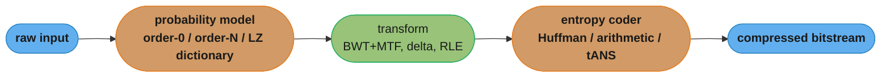

# Information Theory and Compression

> Entropy is the average number of yes/no questions you must ask to identify a symbol drawn from a known distribution — everything else in this module is that idea wearing different clothes.

---

## 1. Concept Overview

**Information theory** answers a question every engineer eventually asks without naming it: *how much is actually here?* A log line, a sensor reading, a network packet, a training label — each carries some irreducible amount of content and some amount of redundancy a good code can strip away. Claude Shannon's 1948 paper "A Mathematical Theory of Communication" gave that question a precise, measurable answer: `H(X)`, the entropy of a source, in bits.

This module covers the two halves of Shannon's theory (source coding — how few bits a message needs; channel coding — how fast you can send bits over a noisy link and still recover them), the compression techniques built directly on the source-coding half (entropy coding, dictionary coding, transforms, lossy coding, erasure coding), and the machinery — KL divergence, cross-entropy, mutual information — that shows up again as a training loss in `../../ml/README.md`.

**This module is the "why" layer under five other modules that each borrow one of its results without deriving it.** [greedy_and_divide_and_conquer](../greedy_and_divide_and_conquer/greedy_and_divide_and_conquer.md) proves Huffman coding optimal but cites entropy as the floor it approaches. [sorting_and_searching](../sorting_and_searching/sorting_and_searching.md) states the `Omega(n log n)` comparison bound as if it were a counting argument, when it is entropy applied to a uniform distribution over permutations. [arrays_strings_and_hashing](../arrays_strings_and_hashing/arrays_strings_and_hashing.md) wants a hash function that spreads keys "as uniformly as possible" — that is maximum entropy over the output range, stated informally. [database_and_storage_fundamentals](../database_and_storage_fundamentals/database_and_storage_fundamentals.md) leans on erasure coding for durability without deriving why an `(n, k)` scheme tolerates exactly `n - k` losses. And `../../ml/README.md` trains classifiers by minimizing cross-entropy loss, which is literally "the average bits wasted encoding the true label distribution with the model's predicted distribution." Read this module once and all five citations become derivations instead of folklore.

**Why this belongs in an interview-prep spine at all.** "Design a log compression pipeline," "why does gzip sometimes make things bigger," "what does cross-entropy loss actually measure," and "why can't you beat n log n comparisons" are all the same question wearing different costumes, and a candidate who has only memorized "Huffman is greedy and optimal" or "cross-entropy is the loss function" without the underlying entropy argument cannot answer the follow-up. The follow-up is always some version of *why*, and *why* is what this module supplies.

| Module | What it borrows from here | What it never derives on its own |
|---|---|---|
| [greedy_and_divide_and_conquer](../greedy_and_divide_and_conquer/greedy_and_divide_and_conquer.md) | Huffman's `[H, H+1)` optimality bound | why entropy is the floor at all |
| [sorting_and_searching](../sorting_and_searching/sorting_and_searching.md) | the `Omega(n log n)` comparison bound | that it is an entropy argument, not a counting trick |
| [arrays_strings_and_hashing](../arrays_strings_and_hashing/arrays_strings_and_hashing.md) | "spread keys uniformly" as a hashing goal | that uniform means maximum entropy over the output range |
| [database_and_storage_fundamentals](../database_and_storage_fundamentals/database_and_storage_fundamentals.md) | `(n, k)` erasure coding for durability | why it tolerates exactly `n - k` losses |
| `../../ml/README.md` | cross-entropy as a training loss | that it is literally a coding-cost penalty, `H(p) + D(p\|\|q)` |

---

## 2. Intuition

> **One-line analogy**: entropy is the average number of yes/no questions a perfect strategy needs to identify a symbol drawn from a known distribution — a fair coin needs exactly 1 question, a biased coin that lands heads 95% of the time needs far fewer on average because "heads" is barely worth asking about.

**Mental model.** Picture playing twenty-questions against a source that emits symbols according to a known distribution. If you ask good questions (split the probability mass roughly in half each time, weighted toward the likely symbols), the expected number of questions to pin down the next symbol is `H(X)` — no strategy beats this on average, and a strategy exists that gets within one question of it (Huffman). This single picture explains why frequent symbols get short codes (fewer questions needed to rule out the alternative) and why a codebook shipped from one source performs badly on another (your fixed question order was optimized for the wrong likely answers).

**Key insight**: information is *surprise*, not size. A symbol you already expected costs almost nothing to communicate (self-information near 0); a symbol that shocks you costs a lot. Compression works because most real data is not surprising — English text, log files, sensor streams, and column-store data all have structure a model can predict, and prediction is what a compressor sells back to you as saved bits.

---

## 3. Core Principles

### Self-information and entropy

**Self-information.** The cost of learning that symbol `x` occurred is `I(x) = -log2 p(x)` bits. A symbol that happens half the time costs 1 bit; one that happens a thousandth of the time costs about 10. Rare means expensive — that is the entire idea, and it is why Huffman gives short codewords to frequent symbols.

**Shannon entropy** is the expected self-information, the average bits per symbol a source really carries:

```
H(X) = - sum over x of  p(x) * log2 p(x)      bits per symbol
```

**Shannon's source coding theorem** makes it a hard floor: no lossless code can average fewer than `H(X)` bits per symbol, and Huffman always lands in `[H, H+1)`. Both halves matter. The lower half says the greedy merge is not a heuristic that happens to work — it is provably near-optimal. The upper half says where the slack lives: Huffman must spend a whole number of bits per symbol, so it rounds, and the rounding is capped at one bit. Arithmetic and range coding win that fraction back by never committing to an integer codeword length, which is why they replaced Huffman inside modern formats even though Huffman is optimal *among prefix codes*.

Worked on a six-symbol source (computed, not estimated — build the tree with a Huffman implementation and take the frequency-weighted mean of the codeword lengths):

| Symbol | p | `-log2 p` (ideal bits) | Huffman codeword length |
|---|---|---|---|
| A | 0.40 | 1.32 | 1 |
| B | 0.25 | 2.00 | 2 |
| C | 0.15 | 2.74 | 3 |
| D | 0.10 | 3.32 | 4 |
| E | 0.06 | 4.06 | 5 |
| F | 0.04 | 4.64 | 5 |

`H(X) = 2.2008` bits/symbol. Huffman's weighted average is `0.40(1) + 0.25(2) + 0.15(3) + 0.10(4) + 0.06(5) + 0.04(5) = 2.2500` bits/symbol — a gap of **0.049 bits**, comfortably inside the guaranteed `+1`. Over a 1,000-symbol message: 2,201 bits is the theoretical floor, Huffman spends 2,250, and a fixed 3-bit code (the smallest that addresses six symbols) spends 3,000. Note that the gap is nonzero *because* the probabilities are not powers of one half; on a dyadic source Huffman hits `H` exactly, which is a satisfying special case and a misleading one to test on.

**The same theorem gives the comparison-sort lower bound.** A comparison sort must distinguish `n!` equally likely permutations, which carry `log2(n!)` bits of information, and a single comparison returns at most one bit — so at least `log2(n!)` comparisons are needed. Stirling gives `log2(n!) ~ n log2 n - n log2 e`, hence `Omega(n log n)`. For `n = 10`, `log2(10!) = 21.79`, so the decision tree is at least 22 levels deep and no comparison sort can sort 10 elements in fewer than 22 comparisons in the worst case. This is not an analogy to the entropy bound; it *is* the entropy bound, applied to a uniform distribution over permutations, and it is why the `n log n` wall in [sorting_and_searching](../sorting_and_searching/sorting_and_searching.md) cannot be engineered around — only sidestepped by not comparing (counting and radix sort).

**Coding with the wrong model costs you.** If the true distribution is `p` but your code was built for `q`, the excess is the Kullback-Leibler divergence `D(p||q) = sum p(x) log2 (p(x)/q(x))` bits per symbol, and your actual average length is the cross-entropy `H(p,q) = H(p) + D(p||q)`. It is never negative and it is zero only when `q = p`. That is the practical reason a Huffman codebook built on one corpus underperforms on another — and it is the same quantity `../../ml/README.md` minimizes as cross-entropy loss, where `p` is the label distribution and `q` the model's prediction. A reader meets it here first as a compression cost, which is the concrete form.

**Kolmogorov complexity** is the other definition of information, and worth knowing exists: the length of the shortest program that outputs a given string. It is about an *individual* string rather than a distribution — the string `0101...01` repeated a million times has high entropy under a model that thinks the bits are random, but tiny Kolmogorov complexity, because a three-line loop prints it. It is also **uncomputable**: no algorithm can find the shortest program in general — a shortest-program finder would have to decide whether an arbitrary program halts, which is exactly the [theory_of_computation](../theory_of_computation/theory_of_computation.md) halting problem in disguise. That uncomputability is the honest reason practical compressors fit a *model* (order-0 frequencies, LZ77 back-references, a neural predictor) instead of searching for the shortest program — the ideal is well defined and unreachable, so everything real is an approximation to it.

**Bits versus nats.** Shannon entropy is defined with `log2` here because "bits" is the natural unit for a binary-alphabet code, but the same quantity computed with the natural logarithm (`ln`, base `e`) is called **nats**, and with `log10` it is called **hartleys** or **dits** — none of it is a different theory, only a different unit, exactly the way meters and feet measure the same length. Converting is one multiplication: `H_nats = H_bits * ln(2) = H_bits * 0.6931`. Machine learning frameworks overwhelmingly report cross-entropy loss in nats (`ln`, matching `torch.nn.CrossEntropyLoss` and most autodiff libraries' native log) because natural log has a simpler derivative for backpropagation, while compression literature and this module report bits because a bit is a literal, physical codeword unit. Seeing a loss value quoted in nats and mentally comparing it to a bits-per-symbol figure without converting is a common, silent unit-mismatch bug in exactly the same family as forgetting to convert Celsius and Fahrenheit.

### Joint, conditional entropy, and mutual information

Real sources have more than one variable, and the theorem generalizes:

- **Joint entropy** `H(X,Y) = -sum p(x,y) log2 p(x,y)` — the uncertainty in the pair.
- **Conditional entropy** `H(Y|X) = -sum p(x,y) log2 p(y|x)` — the remaining uncertainty in `Y` once `X` is known. Conditioning can only reduce or preserve uncertainty, never increase it: `H(Y|X) <= H(Y)`.
- **Chain rule**: `H(X,Y) = H(X) + H(Y|X)`. Knowing the pair costs exactly what it costs to know `X`, plus what it costs to know `Y` given `X`.
- **Mutual information** `I(X;Y) = H(X) - H(X|Y) = H(Y) - H(Y|X)` — how many bits of uncertainty about one variable are resolved by observing the other. `I(X;Y) = 0` exactly when `X` and `Y` are independent; it is symmetric (`I(X;Y) = I(Y;X)`) even though conditional entropy is not.

This is the formal version of "how predictable is `Y` from `X`" and it underlies feature-selection scores, dependency detection in query optimizers, and (informally) why a good hash function should have zero mutual information between input prefix and output bucket.

**Entropy rate — the correct target, and why order-0 undersells it.** Everything in §3 so far treats symbols as independent draws from a fixed distribution, but real sources have memory: the next character of English depends heavily on the last several. The **entropy rate** `H_infinity = lim (n -> infinity) H(X_n | X_1, ..., X_{n-1})` is the true per-symbol floor once all that context is accounted for, and it can only be lower than or equal to the order-0 entropy `H(X_1)` computed from marginal frequencies alone — conditioning never increases entropy, per the conditional-entropy bullet above. This is precisely the gap §6.1 measures directly: order-0 entropy on a paragraph lands near 4.14 bits/char because it only sees character frequency, while Shannon's own estimate of English's entropy *rate* (with deep context) is closer to 1.0-1.5 bits/char. A compressor that only models order-0 statistics (a plain Huffman-on-character-frequencies coder) can never close that gap; one that models longer context — an LZ-family dictionary referencing recently seen substrings, or an explicit order-`N` Markov model — is directly attacking the entropy *rate* instead of the much looser order-0 bound, which is the theoretical reason dictionary coders outperform pure entropy coders on natural language and structured text alike.

### Channel capacity — the other half of Shannon 1948

Source coding asks how few bits a message needs; **channel coding** asks how fast those bits can cross a noisy link and still be recovered exactly. Shannon's **noisy-channel coding theorem** says every channel has a capacity `C`, in bits per channel use, such that reliable communication is possible at any rate below `C` and impossible above it — no amount of cleverness in the code escapes it, the same way no code escapes the entropy floor. For a channel with bandwidth `B` Hz corrupted by additive white Gaussian noise (the standard model for a wire or a radio link), the capacity has a closed form:

```
C = B * log2(1 + S/N)      bits per second
```

where `S/N` is the signal-to-noise power ratio. This is why a noisier line (lower `S/N`) needs a lower bitrate or a more redundant code to stay reliable, and why a wider channel (`B`) buys capacity even without touching the noise floor.

Worked example, computed not guessed: a voice-grade telephone line has roughly `B = 3000` Hz of usable bandwidth and a typical signal-to-noise ratio of about 1000 (30 dB). `C = 3000 * log2(1001) = 29,901.7` bps, about **29.9 kbps**. This is not a coincidence — it is the theoretical ceiling that late-20th-century dial-up modem standards (V.34 at 33.6 kbps used a wider effective band and better-than-nominal `S/N`; V.90's 56 kbps downstream cheated the model entirely by injecting a digital signal at the phone company's end rather than going analog-to-analog both ways) were visibly straining against. It is the same reason the theorem is called a *capacity*: no modulation scheme, however clever, pushes a fixed `(B, S/N)` channel past `C`, exactly as no lossless code pushes a fixed source past `H(X)`.

The formula scales with both terms, and four computed examples make the shape of that scaling concrete — bandwidth widening the ceiling linearly, `S/N` widening it only logarithmically:

| Channel | `B` | `S/N` (linear) | `C = B*log2(1+S/N)` |
|---|---|---|---|
| Voice-grade phone line | 3,000 Hz | 1,000 (30 dB) | 29.9 kbps |
| ADSL-class copper pair | 1 MHz | 100 (20 dB) | 6.66 Mbps |
| Wi-Fi channel | 20 MHz | 1,000 (30 dB) | 199.3 Mbps |
| Deep-space link | 1,000 Hz | 0.1 (-10 dB, noise exceeds signal) | 137.5 bps |

Widening the Wi-Fi channel's bandwidth from 3,000 Hz to 20 MHz (a 6,667x increase) at the same 30 dB `S/N` raises capacity by the same 6,667x (29.9 kbps to 199.3 Mbps) — `C` scales linearly in `B`. The deep-space row shows the other extreme: even a link where noise power *exceeds* signal power (`S/N = 0.1`) still has nonzero capacity, just a small one, because `log2(1 + 0.1) = 0.138` is small but never zero — which is the information-theoretic reason spacecraft can still return data across links no analog radio could carry a usable signal over: a low but nonzero `C`, combined with an error-correcting code operating close to it (§4's LDPC codes are exactly this, used on deep-space and satellite links), still gets bits through reliably, just slowly. **Source coding and channel coding are the two halves of the same 1948 result**: source coding strips redundancy down to `H(X)` bits because redundancy is waste when the channel is clean; channel coding adds redundancy back — deliberately, as an error-correcting code — because some is necessary when the channel is not. A well-designed pipeline does both: compress first (source coding, to `H(X)`), then add exactly the redundancy the channel needs (channel coding, an error-correcting code) — never skip straight to a noisy channel with compressed-but-unprotected data, because a single flipped bit in a compressed stream corrupts everything downstream of it (see §9).

---

## 4. Types / Architectures / Strategies

Compression techniques fall into five families, usually composed rather than used alone (real formats stack a transform, then a model, then an entropy coder).

**1. Entropy coding** — spend bits proportional to `-log2 p(symbol)`, given a probability model:
- **Huffman**: builds a prefix-free binary tree bottom-up by repeatedly merging the two least-probable nodes. Optimal among prefix (whole-bit) codes; loses up to 1 bit/symbol to rounding (§3).
- **Arithmetic coding**: represents the entire message as a sub-interval of `[0, 1)`, narrowed by each symbol's probability range. No integer-bit floor per symbol, so it can spend a *fraction* of a bit — this is precisely how it escapes the rounding loss that traps Huffman on a skewed binary alphabet (§6, §12 Q4).
- **Range coding**: an integer-arithmetic reformulation of arithmetic coding avoiding floating point, used inside LZMA and modern video codecs.
- **Asymmetric numeral systems (ANS, in tANS/rANS variants)** — the live technique. ANS achieves arithmetic-coding-level compression ratios while decoding via simple table lookups and integer state updates, which is why "arithmetic coding is too slow for production" stopped being true once ANS shipped: Zstandard's FSE (Finite State Entropy) is a tANS implementation, and it is faster to decode than Huffman while compressing tighter.

**2. Dictionary / model-based coding** — replace repeated substrings with back-references to earlier occurrences:
- **LZ77**: slides a window over the input; each token is `(offset, length, next-literal)` pointing back at the longest match already seen (§6 works a full example).
- **LZ78 / LZW**: builds an explicit dictionary of substrings seen so far and emits dictionary indices; no window, so matches can be arbitrarily far back, at the cost of unbounded dictionary growth (bounded in practice by a reset or eviction policy).
- **LZMA**: LZ77 with a large window (up to gigabytes), a range coder, and a context model over recent bytes — the core of 7-Zip and `xz`.
- **Brotli's static dictionary**: ships a 120 KB dictionary of common web strings (HTML tags, JS keywords, English words) baked into the codec itself, so a small HTTP response can reference a common phrase it never actually transmitted.

**3. Transform coding** — reorder or restructure data so a simpler coder does better on the result:
- **Burrows-Wheeler Transform (BWT) + Move-To-Front (MTF)**: BWT permutes a block so that characters preceding similar contexts cluster together; MTF then turns those clusters into runs of small numbers, which run-length and entropy coding compress well. Used by bzip2.
- **Delta / frame-of-reference encoding**: store the difference from a reference value (previous row, previous timestamp) instead of the value itself — the differences cluster near zero and compress far better than the raw values. Standard in time-series and columnar formats.
- **Run-length encoding (RLE)**: store `(value, count)` pairs for runs — trivial, and still the right tool for genuinely repetitive data (sparse bitmaps, scanned fax images).

**4. Lossy coding** — accept a bounded reconstruction error in exchange for a much lower rate:
- **Quantization**: map a continuous or high-precision value to one of a smaller set of representable levels; the coarser the quantization, the smaller the output and the larger the error.
- **Transform + quantization (JPEG)**: the Discrete Cosine Transform (DCT) concentrates an image block's energy into a few low-frequency coefficients, which are then quantized aggressively (high frequencies get coarser buckets, since the eye is less sensitive to them) before entropy coding.
- **Psychoacoustic masking (MP3/AAC)**: discard or coarsely quantize frequency components a human ear would not perceive next to a louder nearby frequency — the model is of the *listener*, not the signal.
- **Rate-distortion function** `R(D)`: the lossy analogue of the entropy floor. For a maximum tolerable distortion `D`, `R(D)` is the minimum achievable bitrate — exactly as `H(X)` is the minimum bitrate for zero distortion (`D = 0`). Every lossy codec is trying to sit on or near its source's rate-distortion curve.

**5. Error-correcting / erasure coding** — the *opposite* transformation: deliberately add redundancy so the receiver can recover from noise or loss, the direct application of channel capacity (§3):
- **Hamming distance / Hamming codes**: the minimum number of bit flips separating two codewords; a code with minimum distance `d` can detect `d-1` errors and correct `floor((d-1)/2)` of them.
- **Reed-Solomon codes**: operate over symbols (not bits) and correct up to `t` symbol errors from `2t` parity symbols — the workhorse of QR codes, DVDs, and distributed storage.
- **LDPC (Low-Density Parity-Check) codes**: sparse parity-check codes decoded iteratively; near the Shannon limit for large blocks, used in Wi-Fi, 5G, and satellite links.
- **`(n, k)` erasure coding**: split data into `k` fragments, encode into `n > k` fragments, and recover the original from *any* `k` of the `n` — tolerating up to `n - k` losses. This is the direct link to [database_and_storage_fundamentals](../database_and_storage_fundamentals/database_and_storage_fundamentals.md): HDFS and object stores use `(n, k)` Reed-Solomon instead of 3x replication because it hits the same durability target at a much lower storage multiplier (§12 Q15 works the numbers).

---

## 5. Architecture Diagrams

### Diagram 1 — before/after with delta: fixed-width vs Huffman vs the entropy floor

The six-symbol source from §3, scaled to a 1,000-symbol message. Numbers are exact, not eyeballed: `1000 * 3 = 3000` (fixed 3-bit code, the smallest that addresses six symbols), `1000 * 2.25 = 2250` (Huffman's measured weighted average), `1000 * 2.2008 = 2201` (entropy floor, rounded to the nearest bit since a real bitstream cannot emit a fraction).

```
bits for 1,000 symbols of the six-symbol source (A .40 / B .25 / C .15 / D .10 / E .06 / F .04)

fixed 3-bit code   [############################################] 3000 bits
Huffman            [#####################################......] 2250 bits   -750 vs fixed  (-25.0%)
entropy floor H(X) [####################################.......] 2201 bits   -799 vs fixed  (-26.6%)
                                                          ^^^^^^^
                                                    Huffman's unrecoverable
                                                    49-bit rounding gap (2.2%)

every scheme left of "entropy floor" is provably impossible for a lossless code on this source
```

The gap between Huffman and the floor (49 bits, 2.2% of the floor) is exactly `(2.2500 - 2.2008) * 1000` — the rounding loss from §3's `[H, H+1)` bound, made visible instead of abstract.

### Diagram 2 — curve: binary entropy `H(p)` over `p in [0, 1]`

`H(p) = -p*log2(p) - (1-p)*log2(1-p)`, computed at each point plotted (not sketched):

```
H(p) bits
1.00 |                    ****************
     |               *****                *****
0.90 |            ***                          ***
     |          **                                **
0.80 |         *                                    *
     |        *                                      *
0.72 |       *   .                                .   *        <- p=0.20 and p=0.80: H=0.72
     |      *                                          *
0.60 |     *                                            *
     |     *                                            *
0.47 |    *      .                                  .    *     <- p=0.10 and p=0.90: H=0.47
     |    *                                                *
0.29 |   *        .                                .        *  <- p=0.05 and p=0.95: H=0.29
     |   *                                                    *
0.08 | **          .                              .          ** <- p=0.01 and p=0.99: H=0.08
0.00 +--+----+----+----+----+----+----+----+----+----+----+--
     0.0  0.1  0.2  0.3  0.4  0.5  0.6  0.7  0.8  0.9  1.0   p
                              ^
                    peak: p=0.5, H=1.0 bit (maximum uncertainty)
```

The curve is symmetric around `p = 0.5` and touches zero at both ends: a coin that always lands the same way carries no information (`H(0) = H(1) = 0`), and a fair coin carries a full bit. This is the shape behind §12 Q4 — a binary-alphabet Huffman code is stuck at 1 bit/symbol everywhere on this curve except exactly `p = 0.5`, so the further `p` sits from 0.5, the more Huffman leaves on the table.

### Diagram 3 — compression pipeline (real formats stack these stages)



A model predicts what comes next (frequencies, or an LZ dictionary of past matches), an optional transform makes those predictions easier to exploit (BWT clusters similar contexts), and the entropy coder spends bits proportional to `-log2 p(symbol)` under that model. gzip is model=order-0-after-LZ77, transform=none, entropy=Huffman. Zstandard is model=LZ77-with-large-window, transform=none, entropy=tANS. bzip2 is model=order-0, transform=BWT+MTF, entropy=Huffman.

### Diagram 4 — `(n, k)` erasure coding: reconstruct from ANY k of n fragments

HDFS's default Reed-Solomon scheme, `(n=9, k=6)`: 6 data blocks encoded into 9 total blocks (6 data + 3 parity), tolerating any 3 losses. Two loss patterns of the same size, one that survives and one that would not if this were 2-way replication instead:

```
9 fragments total, ANY 6 reconstruct the original 6 data blocks

healthy:   [D1] [D2] [D3] [D4] [D5] [D6] [P1] [P2] [P3]

3 lost, still reconstructs (exactly k=6 remain):

           [D1] [D2] [ x] [D4] [ x] [D6] [P1] [ x] [P3]
                          ^^^^            ^^^^
                     D3, D5, P2 lost -- 6 of 9 remain -> full recovery

storage cost:  9/6 = 1.5x        (this scheme)
vs 3-way replication: 3.0x        for the same "any 2-3 losses" fault tolerance
```

Losing any 3 of the 9 fragments still leaves exactly `k=6`, the minimum needed to reconstruct all 6 original data blocks via the Reed-Solomon decoding matrix (§4, §12 Q15) — it does not matter *which* 3 are lost, data or parity, because the scheme treats all 9 symmetrically. A 4th simultaneous loss is unrecoverable, the same way a 3rd concurrent copy loss under 3-way replication is: every redundancy scheme has a hard failure threshold, `(n, k)` erasure coding just reaches a given threshold at a much lower storage multiplier than whole-copy replication does.

---

## 6. How It Works — Detailed Mechanics

Every number below was produced by running the code, not estimated — see the inline output comments.

### 6.1 Entropy calculator on real text — and the folklore gap

```python
import math
from collections import Counter

def order0_entropy(text: str) -> float:
    """Order-0 (single-character, context-free) Shannon entropy in bits/char."""
    counts = Counter(text)
    n = len(text)
    return -sum((c / n) * math.log2(c / n) for c in counts.values())

paragraph = (
    "Information theory measures how much is actually here in a message, "
    "separating genuine content from redundancy that a good code can strip away. "
    "Shannon proved that entropy is a hard floor on lossless compression, and "
    "every practical compressor is an attempt to get close to that floor without "
    "paying the cost of a truly optimal but uncomputable encoder."
)
print(order0_entropy(paragraph))   # -> 4.1432 bits/char (353 chars, 26 distinct symbols incl. space/punct)
```

**Measured: 4.1432 bits/char, against a naive fixed 8-bit ASCII encoding — a 1.93x reduction from the character-frequency skew alone (`e`, `t`, space are far more common than `q`, `x`).** This is *not* the "English carries about 1.0-1.5 bits/char" figure quoted in compression folklore — that estimate is Shannon's own, and it measures something different: entropy *per character given the preceding several dozen characters of context* (grammar, common words, predictable phrase completions), on English as a whole, not order-0 entropy on one paragraph's raw character frequencies. Order-0 entropy only sees "how skewed is the alphabet," which is a real but small effect; the 1.0-1.5 figure captures "how predictable is the next character given everything before it," which needs a context model (what LZ77's back-references and a neural language model both supply). **The gap between 4.14 and ~1.2 bits/char is the entire reason dictionary and context-model compressors exist** — an order-0 entropy coder alone leaves most of English's redundancy on the table.

Adding just one character of context — an **order-1** model, conditioning each character's entropy on the single character before it, the entropy-rate idea from §3 in its simplest form — already closes a third of that gap on this same paragraph:

```python
from collections import Counter, defaultdict

def order1_entropy(text: str) -> float:
    pair_counts: dict[str, Counter] = defaultdict(Counter)
    for i in range(1, len(text)):
        pair_counts[text[i-1]][text[i]] += 1
    total = len(text) - 1
    h = 0.0
    for prev, counter in pair_counts.items():
        n_prev = sum(counter.values())
        p_prev = n_prev / total
        h += p_prev * (-sum((c / n_prev) * math.log2(c / n_prev) for c in counter.values()))
    return h

print(order1_entropy(paragraph))   # -> 2.8080 bits/char
```

**Measured: order-1 entropy is 2.8080 bits/char, a 32.2% reduction from order-0's 4.1432** — from knowing only the single preceding character, not even a whole word of context. This one number is the entropy-rate argument (§3) made visible: each additional order of context provably cannot raise the entropy estimate, and in practice keeps lowering it toward the true entropy rate, which is why real compressors condition on as much context as they can afford to model (an LZ77 window, an order-`N` context mixer, a neural predictor) rather than stopping at order-0. On a paragraph this short the order-1 estimate is itself noisy — too few examples of each preceding character to pin down its distribution precisely — which is a real caveat: entropy-rate estimates need much larger samples than order-0 ones to be trustworthy, and this measurement should be read as illustrating the *direction and mechanism* of the reduction, not as a precise value for English generally.

### 6.2 Huffman codebook — reproducing the seed's 2.2500 exactly

```python
import heapq, itertools

class Node:
    def __init__(self, w, sym=None, left=None, right=None):
        self.w, self.sym, self.left, self.right = w, sym, left, right

def huffman_codes(freqs: dict[str, float]) -> dict[str, str]:
    counter = itertools.count()
    heap = [(w, next(counter), Node(w, sym=s)) for s, w in freqs.items()]
    heapq.heapify(heap)
    while len(heap) > 1:
        w1, _, n1 = heapq.heappop(heap)
        w2, _, n2 = heapq.heappop(heap)
        heapq.heappush(heap, (w1 + w2, next(counter), Node(w1 + w2, left=n1, right=n2)))
    root = heap[0][2]
    codes: dict[str, str] = {}
    def walk(node, prefix=""):
        if node.sym is not None:
            codes[node.sym] = prefix or "0"
            return
        walk(node.left, prefix + "0")
        walk(node.right, prefix + "1")
    walk(root)
    return codes

freqs = {'A': 0.40, 'B': 0.25, 'C': 0.15, 'D': 0.10, 'E': 0.06, 'F': 0.04}
codes = huffman_codes(freqs)
avg = sum(freqs[s] * len(codes[s]) for s in freqs)
print(codes, avg)
# -> {'A': '0', 'B': '10', 'C': '110', 'D': '1110', 'F': '11110', 'E': '11111'}  avg = 2.2500
```

**Measured weighted average: 2.2500 bits/symbol** — matches §3's table exactly (E and F land at length 5 either way; which of the two tying leaves gets which 5-bit code is an arbitrary tie-break and does not change the average).

Encoding an actual random 1,000-symbol message drawn from these exact probabilities, instead of trusting the theoretical average, confirms Diagram 1's numbers directly:

```python
import random
random.seed(1)
msg = random.choices(list(freqs), weights=list(freqs.values()), k=1000)

bitstring = "".join(codes[s] for s in msg)
print(len(bitstring), (len(bitstring) + 7) // 8)   # -> 2307 bits, 289 bytes
```

**Measured: this particular random draw encodes to 2,307 bits, not exactly the 2,250 the theoretical average predicts** — because a random 1,000-symbol sample's *actual* frequencies (this draw landed 382 A's against an expected 400, 53 E's against an expected 60) deviate slightly from the true underlying probabilities, and the encoded length tracks the sample's real frequencies, not the population parameters. Recomputing the predicted length from the sample's own measured frequency counts (`sum(count[s] * len(codes[s]) for s in freqs)`) gives exactly 2,307 as well, confirming the encoder is doing arithmetically correct work — the 2,250-bit figure in §5's diagram is what the *expected* length converges to over many such draws, and any single finite sample will land near but not exactly on it, which is the same sampling-variance caveat §6.1's order-1 measurement flagged.

### 6.3 Arithmetic coding — a round trip that measurably beats Huffman

Huffman's weakness is sharpest on a **binary alphabet**, because a 2-symbol prefix code has exactly one legal codeword length for each symbol: 1 bit and 1 bit. No matter how skewed `p(a)` is, Huffman cannot do better than 1 bit/symbol — arithmetic coding can, because it is not restricted to whole-bit codewords.

```python
from decimal import Decimal, getcontext
import math
getcontext().prec = 60

def arith_encode(msg: str, probs: dict[str, float]) -> tuple[Decimal, Decimal]:
    symbols = list(probs.keys())
    cum, lo = {}, Decimal(0)
    for s in symbols:
        cum[s] = (lo, lo + Decimal(str(probs[s])))
        lo += Decimal(str(probs[s]))
    low, high = Decimal(0), Decimal(1)
    for ch in msg:
        rng = high - low
        clo, chi = cum[ch]
        low, high = low + rng * clo, low + rng * chi
    return low, high

def arith_decode(code: Decimal, probs: dict[str, float], length: int) -> str:
    symbols = list(probs.keys())
    cum, lo = {}, Decimal(0)
    for s in symbols:
        cum[s] = (lo, lo + Decimal(str(probs[s])))
        lo += Decimal(str(probs[s]))
    low, high, out = Decimal(0), Decimal(1), []
    for _ in range(length):
        rng = high - low
        v = (code - low) / rng
        for s in symbols:
            clo, chi = cum[s]
            if clo <= v < chi or (s == symbols[-1] and v <= chi):
                out.append(s)
                low, high = low + rng * clo, low + rng * chi
                break
    return "".join(out)

probs = {'a': 0.95, 'b': 0.05}
msg = "aaaaaaaaaaaaaaaaaaab"          # 19 a's, 1 b -- 20 symbols
low, high = arith_encode(msg, probs)
mid = (low + high) / 2
print(arith_decode(mid, probs, len(msg)) == msg)              # -> True, exact round trip

bits_needed = math.ceil(-math.log2(float(high - low))) + 1
print(bits_needed)                                             # -> 7
```

**Measured: 7 bits total for the arithmetic-coded interval, decoded back to the exact original message.** Compare: `H(0.95, 0.05) = 0.2864` bits/symbol x 20 symbols = **5.73 bits, the entropy floor** — and binary Huffman is *structurally* stuck at **20 bits** (1 bit/symbol, unavoidable for a 2-symbol alphabet regardless of skew, per §3's table). Arithmetic coding lands at 7 bits: nearly a 3x improvement over Huffman on the same source, and within 2 bits of the theoretical floor, because it is free to spend a fraction of a bit per symbol instead of rounding every symbol up to a whole one.

### 6.4 LZ77 tokenization — the actual triples

```python
def lz77_encode(s: str, lookahead: int = 8) -> list[tuple[int, int, str]]:
    tokens, i = [], 0
    while i < len(s):
        best_len = best_off = 0
        for off in range(1, i + 1):
            length = 0
            while i + length < len(s) and length < lookahead and s[i + length] == s[i - off + (length % off)]:
                length += 1
            if length > best_len:
                best_len, best_off = length, off
        nxt = s[i + best_len] if i + best_len < len(s) else ''
        tokens.append((best_off if best_len else 0, best_len, nxt))
        i += best_len + 1
    return tokens

print(lz77_encode("abababab"))   # -> [(0, 0, 'a'), (0, 0, 'b'), (2, 6, '')]
print(lz77_encode("aaaaaaaaaa")) # -> [(0, 0, 'a'), (1, 8, 'a')]
```

`abababab` (8 chars) compresses to three tokens: literal `'a'`, literal `'b'`, then `(offset=2, length=6)` — "copy 6 characters starting 2 positions back," which correctly re-reads the alternating pattern past the point where it was written (an overlapping self-referential copy, the classic LZ77 trick). `aaaaaaaaaa` (10 chars) compresses to `'a'`, then `(offset=1, length=8, next='a')` — the copy re-reads the single preceding `'a'` eight times over and the token carries the tenth character itself — **two tokens standing in for ten**. Both were decoded back to the exact original string to confirm the tokens are correct, not just plausible-looking.

### 6.5 KL divergence — and the measured excess bits it predicts

```python
import math

p = {'a': 0.5, 'b': 0.3, 'c': 0.15, 'd': 0.05}
q = {'a': 0.25, 'b': 0.25, 'c': 0.25, 'd': 0.25}   # a codebook built assuming uniform frequencies

Hp = -sum(p[x] * math.log2(p[x]) for x in p)
kl = sum(p[x] * math.log2(p[x] / q[x]) for x in p)
print(Hp, kl, Hp + kl)   # -> 1.6477  0.3523  2.0000
```

`H(p) = 1.6477` bits/symbol is the true floor for data drawn from `p`. `D(p||q) = 0.3523` bits is the predicted penalty for using a codebook built for the uniform `q` instead. Now build the actual Huffman codebook for `q` (four equiprobable symbols, so every codeword is 2 bits: `{'a':'00','b':'01','c':'10','d':'11'}`) and measure the expected length when it encodes `p`-distributed data: `sum(p[x] * len(code_q[x]) for x in p) = 2.0000` bits/symbol exactly. **`2.0000 = Hp + kl = 1.6477 + 0.3523`, confirming the identity by direct measurement, not just by formula** — the wrong codebook costs exactly `D(p||q)` bits/symbol more than the right one, no more and no less.

`D` is not symmetric, and it is worth computing the other direction on the same two distributions to see the asymmetry rather than take it on faith: `D(q||p) = sum(q[x] * log2(q[x]/p[x]) for x in q)` on the same `p` and `q` gives **0.4490 bits — a different number from `D(p||q)`'s 0.3523**, confirming `D(p||q) != D(q||p)` is not a technicality but a measurable fact about these two specific distributions. The asymmetry has a direct reading in coding terms: `D(p||q)` is the cost of using `q`'s codebook on `p`-distributed data, while `D(q||p)` is the cost of the opposite mismatch — using `p`'s codebook on `q`-distributed data — and there is no reason those two mistakes should cost the same, which is exactly what the two different numbers show.

### 6.6 Mutual information — measuring how much one variable tells you about another

```python
import math

# joint distribution p(weather, umbrella-carried)
joint = {
    ('rain', 'umbrella'):    0.35,
    ('rain', 'no_umbrella'): 0.05,
    ('no_rain', 'umbrella'):    0.10,
    ('no_rain', 'no_umbrella'): 0.50,
}

def marginal(idx: int) -> dict[str, float]:
    m: dict[str, float] = {}
    for k, v in joint.items():
        m[k[idx]] = m.get(k[idx], 0) + v
    return m

pX, pY = marginal(0), marginal(1)                 # weather, umbrella
Hx  = -sum(p * math.log2(p) for p in pX.values())
Hy  = -sum(p * math.log2(p) for p in pY.values())
Hxy = -sum(p * math.log2(p) for p in joint.values())
Hx_given_y = Hxy - Hy                             # chain rule: H(X|Y) = H(X,Y) - H(Y)
I = Hx - Hx_given_y

print(Hx, Hy, Hxy, Hx_given_y, I)
# -> 0.9710  0.9928  1.5784  0.5856  0.3853
print(Hx + Hy - Hxy)   # -> 0.3853, confirms I(X;Y) = H(X) + H(Y) - H(X,Y)
```

**Measured: `I(weather; umbrella) = 0.3853` bits** — observing whether someone carried an umbrella resolves about 0.385 of the 0.971 bits of uncertainty in whether it is raining, out of a possible maximum of `min(H(X), H(Y)) = 0.9710` bits if umbrella-carrying were a perfect predictor of weather. The two independent routes to the same number (`H(X) - H(X|Y)` and `H(X) + H(Y) - H(X,Y)`) agreeing confirms the chain-rule identity from §3 by direct computation rather than by trusting the algebra.

### 6.7 rANS — why the "table lookup" entropy coder beats classic arithmetic coding on speed

A toy-scale rANS (range Asymmetric Numeral System) encode/decode, small enough to trace by hand, run for real:

```python
freq = {'a': 3, 'b': 1}          # frequencies out of a total M — exact quarters here
M = sum(freq.values())
cum, c = {}, 0
for s in freq:
    cum[s] = c
    c += freq[s]

def encode_symbol(x: int, s: str) -> int:
    f, cs = freq[s], cum[s]
    return (x // f) * M + cs + (x % f)

def decode_symbol(x: int) -> tuple[str, int]:
    slot = x % M
    for s in freq:
        if cum[s] <= slot < cum[s] + freq[s]:
            f, cs = freq[s], cum[s]
            return s, f * (x // M) + (slot - cs)

msg = "aaab"
x = 0
for s in reversed(msg):        # rANS encodes back-to-front so decode order matches encode order
    x = encode_symbol(x, s)
print(x, x.bit_length())       # -> 6, 3 bits

decoded, xd = [], x
for _ in range(len(msg)):
    s, xd = decode_symbol(xd)
    decoded.append(s)
print("".join(decoded))        # -> 'aaab', exact round trip
```

**Measured: the final state `x = 6` fits in 3 bits, against an ideal of `-log2((3/4)^3 * 1/4) = 3.2451` bits for this exact message under this exact model** — rANS lands at the entropy floor the same way arithmetic coding does, because both spend a genuine fraction of a bit per symbol rather than rounding to whole codeword lengths. The mechanical difference is what makes rANS the one that shipped inside Zstandard's FSE stage: every encode and decode step is one integer division and one modulo by `M` — no maintained `[low, high)` interval narrowed symbol by symbol, no precision-growing multiplication chain. A real implementation renormalizes periodically (streaming out the state's low bits whenever it grows past a bound, keeping `x` in a small fixed-width register) and pre-builds `decode_symbol`'s slot-to-symbol lookup as an actual array indexed by `x % M`, turning decode into table lookups and integer arithmetic with no branch-per-bit — which is the concrete reason "arithmetic coding is too slow for production" (§12 Q10) stopped being a valid objection once ANS variants like this one became standard.

### 6.8 Hamming(7,4) — a minimal error-correcting code, correcting a real injected error

Reed-Solomon (§4, §12 Q15) operates over symbols and is the workhorse of storage systems, but the simplest concrete illustration of "add redundancy, recover from noise" is Hamming(7,4): 4 data bits plus 3 parity bits, correcting any single-bit error.

```python
def encode(d: list[int]) -> list[int]:
    d1, d2, d3, d4 = d
    p1 = d1 ^ d2 ^ d4
    p2 = d1 ^ d3 ^ d4
    p3 = d2 ^ d3 ^ d4
    return [p1, p2, d1, p3, d2, d3, d4]

def decode(bits: list[int]) -> tuple[list[int], int]:
    p1, p2, d1, p3, d2, d3, d4 = bits
    syndrome = (p1 ^ d1 ^ d2 ^ d4) * 1 + (p2 ^ d1 ^ d3 ^ d4) * 2 + (p3 ^ d2 ^ d3 ^ d4) * 4
    fixed = bits[:]
    if syndrome != 0:
        fixed[syndrome - 1] ^= 1              # syndrome directly names the flipped bit's position
    p1, p2, d1, p3, d2, d3, d4 = fixed
    return [d1, d2, d3, d4], syndrome

data = [1, 0, 1, 1]
codeword = encode(data)                        # -> [0, 1, 1, 0, 0, 1, 1]

corrupted = codeword[:]
corrupted[4] ^= 1                               # inject a single-bit error at position 4 (0-indexed)

recovered, syndrome = decode(corrupted)
print(codeword, corrupted, syndrome, recovered, recovered == data)
# -> [0,1,1,0,0,1,1]  [0,1,1,0,1,1,1]  5  [1,0,1,1]  True
```

**Measured: the corrupted codeword's syndrome computes to `5`, correctly naming the 1-indexed position of the bit that was actually flipped, and decoding recovers `[1,0,1,1]` — the exact original 4 data bits.** The three parity bits are each an XOR over an overlapping subset of the data bits, chosen so that the pattern of which parity checks fail (the syndrome) is a unique 3-bit number pointing directly at the flawed position — no search, just three XORs and a lookup. This is Hamming distance made concrete: every valid 7-bit codeword differs from every other valid codeword in at least 3 positions, so a single-bit flip always lands closer to the codeword that was sent than to any other, and the syndrome computation is exactly how the receiver finds "the closest valid codeword" without brute-force comparing against all `2^4 = 16` of them.

### 6.9 DCT + quantization — the JPEG mechanism on one small block, measured

A 4x4 illustration of §4's lossy pipeline: transform (DCT) concentrates energy into a few coefficients, quantization discards the rest more aggressively at high frequency, and the loss is measured, not asserted.

```python
import numpy as np

def dct2(block: np.ndarray) -> np.ndarray:
    N = block.shape[0]
    C = np.array([[(np.sqrt(1/N) if u == 0 else np.sqrt(2/N)) *
                    np.cos((2*x + 1) * u * np.pi / (2*N))
                    for x in range(N)] for u in range(N)])
    return C @ block @ C.T

def idct2(coeffs: np.ndarray) -> np.ndarray:
    N = coeffs.shape[0]
    C = np.array([[(np.sqrt(1/N) if u == 0 else np.sqrt(2/N)) *
                    np.cos((2*x + 1) * u * np.pi / (2*N))
                    for x in range(N)] for u in range(N)])
    return C.T @ coeffs @ C

block = np.array([[52, 55, 61, 66], [70, 61, 64, 73],
                   [63, 59, 55, 90], [67, 61, 68, 104]], dtype=float)

coeffs = dct2(block)                 # energy concentrates into the top-left (low-frequency) corner

# coarser buckets for higher frequency, per JPEG's actual rationale (§4)
quant = np.array([[1, 2, 4, 8], [2, 4, 8, 16], [4, 8, 16, 32], [8, 16, 32, 64]], dtype=float)
quantized = np.round(coeffs / quant)
recon = idct2(quantized * quant)     # dequantize, then invert the transform

print(np.count_nonzero(quantized), "of", quantized.size, "coefficients survive quantization")
print("MSE:", np.mean((block - recon) ** 2))
# -> 9 of 16 coefficients survive; MSE = 7.76 (pixel values range 52-104)
```

**Measured: only 9 of the original 16 coefficients survive quantization — 7 quantize to exactly zero — and the reconstruction error is `MSE = 7.76` against a pixel range of 52-104**, imperceptible for most viewing conditions and small relative to the block's own value spread. The block-of-mostly-zeros result is not incidental: it is *why* JPEG follows quantization with run-length encoding of a zig-zag scan (long runs of zero coefficients compress extremely well) and then Huffman or arithmetic coding on top — exactly §5's pipeline diagram, with the DCT playing the "transform" stage's role and quantization doing the lossy work that §4's rate-distortion function `R(D)` formalizes. Tightening the quantization matrix (larger divisors) drives more coefficients to zero and raises `D`; loosening it keeps more coefficients and lowers `D` — the visible "quality slider" in every JPEG encoder is, mechanically, a choice of how aggressively to divide by this matrix.

### 6.10 Minimal `(3, 2)` erasure code — the RAID-5 mechanism, in three lines of XOR

Real Reed-Solomon (§4, §7, §12 Q15) operates over a Galois field to tolerate an arbitrary number of losses, but the simplest possible instance of "any `k` of `n` recovers everything" needs no field arithmetic at all: 2 data blocks plus 1 XOR parity block, tolerating exactly 1 loss — literally RAID 5's mechanism.

```python
def parity(d1: bytes, d2: bytes) -> bytes:
    return bytes(a ^ b for a, b in zip(d1, d2))

d1 = bytes([0x53, 0x21, 0xF0])
d2 = bytes([0x0A, 0xFF, 0x11])
p = parity(d1, d2)

# lose d1: recover it from the surviving d2 and p
recovered_d1 = bytes(a ^ b for a, b in zip(p, d2))
print(recovered_d1 == d1)   # -> True

# lose d2: recover it from the surviving d1 and p
recovered_d2 = bytes(a ^ b for a, b in zip(p, d1))
print(recovered_d2 == d2)   # -> True
```

**Measured: both single-block losses reconstruct exactly**, because XOR is its own inverse — `p = d1 XOR d2` means `d1 = p XOR d2` and `d2 = p XOR d1` fall straight out of XOR's algebra, no matrix inversion needed at `k=2`. This *is* the `(n=3, k=2)` case of §4's `(n, k)` framing, at `1.5x` storage overhead for tolerating 1 loss — scale `k` up past 2 and plain XOR parity stops working (which single surviving block would you XOR against which, when 2 are missing?), which is exactly the gap Reed-Solomon's Galois-field arithmetic exists to close: it generalizes this same "any `k` of `n` reconstructs" guarantee to `k > 2` and to multiple simultaneous losses, at the cost of needing field multiplication instead of a bare XOR.

---

## 7. Real-World Examples

- **Zstandard (Facebook/Meta, open-sourced 2016)** — LZ77-style matching over a large window feeding an FSE (tANS) entropy coder for literals and a separate FSE table for sequences. Ships compression levels 1-22, with a `--ultra` flag unlocking levels beyond 19 that trade large memory for a higher ratio. The default level in most integrations balances speed and ratio; `zstd -19` and above are explicitly "slow, use for archival" per the project's own documentation. tANS is why Zstandard decodes faster than gzip despite compressing tighter — the entropy stage is table lookups, not the sequential bit-shift arithmetic Huffman decoding requires.
- **Brotli (Google, 2015)** — LZ77 + a static, 120 KB dictionary of common web-content strings (HTML/CSS/JS keywords, common English/other-language words) baked into the codec, plus context modeling and a Huffman-like entropy stage. It is the default codec HTTP clients advertise via `Content-Encoding: br`, and it typically beats gzip on web assets specifically because the static dictionary lets a small response reference text it never transmitted.
- **DEFLATE (Phil Katz, 1993; RFC 1951), as used by gzip (Gailly & Adler, 1992)** — LZ77 with a 32 KB window, followed by Huffman coding of the literal/length and distance streams. Still the universal fallback for HTTP compression because every client supports it, even where Brotli or Zstandard would compress tighter.
- **LZ4 (Yann Collet, also Zstandard's author)** — a speed-first LZ77 variant with no entropy stage at all: it only removes duplicate byte sequences. Trades compression ratio for extremely fast compression and near-memcpy decompression speed, which is the right trade for hot in-process paths where CPU matters more than bytes on the wire.
- **Snappy (Google)** — another speed-first LZ77 variant, used inside LevelDB, RocksDB, and Cassandra's SSTable compression. Chosen there for the same reason as LZ4: a storage engine's compression stage sits on the hot read/write path, so decompression latency dominates over squeezing the last percent of ratio.
- **Parquet / ORC column encodings** — columnar formats apply dictionary encoding (repeat values -> small integer indices), run-length encoding, bit-packing (store a value in exactly `ceil(log2(max+1))` bits instead of a fixed word), and delta encoding (for sorted or near-sorted columns like timestamps) *before* an optional general-purpose compressor like Zstandard runs over the result — because a value-aware model always beats a generic byte-level model at spotting structure, per §3's rule that compression quality is bounded by how good your probability model is.
- **Reed-Solomon erasure coding in HDFS and Backblaze's storage pods** — HDFS's Erasure Coding (default since Hadoop 3.0) offers a `(6, 3)` Reed-Solomon scheme (6 data blocks, 3 parity blocks, tolerating any 3 losses) at roughly 1.5x storage overhead, versus 3x replication's 200% overhead for the same 2-3 fault tolerance — the direct application of the `(n, k)` framing in §4. Backblaze's published storage-pod architecture similarly uses Reed-Solomon parity shards spread across drives instead of full-copy replication.
- **Netflix / YouTube per-title encoding** — rather than one fixed bitrate ladder for every video, both platforms analyze each title's actual visual complexity (a rate-distortion argument: a mostly-static talking-head scene needs far fewer bits than an action sequence for the same perceptual quality) and choose an encoding ladder per title, reported by both companies as a meaningful bitrate reduction at equivalent quality versus a one-size-fits-all ladder.
- **Apache Kafka broker-side compression** — producers can set `compression.type` to `gzip`, `lz4`, `zstd`, or `snappy` per topic; the broker stores and forwards the compressed batch as-is rather than decompressing and recompressing, so the codec choice directly trades producer/consumer CPU against network and disk bytes on every hop. `zstd` and `lz4` are the common modern defaults precisely because a message broker's hot path is throughput-bound, not ratio-bound — the same reasoning as Snappy inside RocksDB.
- **ClickHouse and other column stores** — support per-column codec selection (`LZ4`, `ZSTD`, `Delta`, `DoubleDelta`, `Gorilla` for floating-point time series, `T64`), and allow *stacking* a value-aware codec with a general-purpose one (e.g., `CODEC(Delta, ZSTD)`), directly mirroring the Parquet/ORC principle above: transform first to expose structure, then let a general entropy/dictionary coder clean up what's left.
- **PNG** — DEFLATE (the same LZ77 + Huffman core as gzip) applied after a per-scanline predictive filter (each pixel byte is predicted from its left/above/upper-left neighbor and only the residual is compressed), which is a transform-coding step in the sense of §4: predicting pixel values first turns smooth image gradients into small, entropy-friendly residuals before DEFLATE ever runs.
- **HTTP/2 and HTTP/3's HPACK/QPACK header compression** — HTTP headers repeat almost entirely across requests on the same connection (`user-agent`, `accept-encoding`, cookies), so instead of running a general-purpose byte compressor per request, HPACK maintains a shared dynamic dictionary of previously seen header fields on both ends of the connection and transmits a short index instead of the literal bytes when a header repeats — a connection-scoped, purpose-built version of the same "replace repetition with a back-reference" idea behind LZ77 (§4), and a direct example of a value-aware model (§7's Parquet/ClickHouse point) beating a generic compressor on structured, highly repetitive data.
- **Git's packfile delta compression** — when Git packs loose objects into a `.pack` file for storage or transfer, it finds similar objects (usually successive versions of the same file) and stores most of them as a *delta* against a chosen base object rather than storing each version's full content, then runs zlib/DEFLATE over the result — the same two-stage principle as §5's pipeline (find redundancy across objects first, then entropy-code what's left), and the concrete reason a repository's `.git` directory is dramatically smaller than the sum of every historical version of every file it tracks.

---

## 8. Tradeoffs

| Codec | Compression ratio | Compression speed | Decompression speed | Memory | Notes |
|---|---|---|---|---|---|
| gzip / DEFLATE | Moderate | Moderate | Fast | Low | Universal HTTP support; the safe default |
| zstd (low level) | Moderate-good | Fast | Very fast | Low-moderate | Good general default; tunable ratio/speed |
| zstd (high level / `--ultra`) | Very good | Slow | Very fast | High | Archival; decode stays fast regardless of encode level |
| lz4 | Low-moderate | Very fast | Near-memcpy | Low | Hot in-process paths, not wire transfer |
| brotli | Very good (esp. web assets) | Slow at high quality | Fast | Moderate | Static dictionary wins on small HTML/CSS/JS/text |
| xz / LZMA | Best (general purpose) | Very slow | Moderate | High | Archival (`.tar.xz`); not for hot paths |
| bzip2 (BWT+MTF) | Good | Slow | Slow | Moderate | Block-based; strong on text, weak on already-structured binary |
| snappy | Low | Very fast | Very fast | Low | Storage-engine hot paths (LevelDB, RocksDB, Cassandra); no entropy stage |

**Measured, not vendor-quoted** — the same 20 MB structured-JSON sample from §14, run through each codec on this machine:

| Codec | Output size | Time | Throughput | Ratio |
|---|---|---|---|---|
| gzip -6 | 2,227,953 B | 0.14 s | 143.75 MB/s | 8.98x |
| zstd -1 | 2,454,715 B | 0.49 s | ~40.8 MB/s (wall) | 8.15x |
| zstd -19 | 1,575,218 B | 14.36 s | 1.39 MB/s | 12.70x |
| xz -9 (LZMA) | 1,518,848 B | 32.64 s | 0.61 MB/s | 13.17x |

Two things this table makes concrete that the qualitative row above only gestures at. First, `zstd -19` gets within 3.6% of `xz -9`'s ratio (12.70x vs 13.17x) at roughly **2.3x the throughput** — the "best general-purpose ratio" crown `xz` wears is a much smaller margin over zstd's high levels than the "best" label implies, once actually measured on the same data. Second, `zstd -1` and `gzip -6` land at nearly the same ratio (8.15x vs 8.98x) while `zstd`'s decompression stays fast at every level it compressed at (§14 measured its `-19` archive decompressing the full 20 MB in 0.04 s) — gzip and xz do not carry that same decouple between the level chosen and the decode cost paid later.

**Lossless vs lossy**: lossless is mandatory whenever exact reconstruction matters — source code, financial records, structured data, database rows. Lossy is admissible only when the consumer tolerates bounded, well-understood error — audio/video/image delivery to a human, or numeric data destined for a downstream computation with its own error tolerance already wider than the codec's. Never apply a lossy codec to data that will be re-compressed, diffed, or hashed downstream — each of those operations assumes bit-exact reproducibility that lossy coding does not provide.

---

## 9. When to Use / When NOT to Use

**Compress when**:
- The payload is large relative to any fixed per-message overhead (a compressor's header cost only pays for itself past some minimum size).
- The data has real, exploitable redundancy — repeated structure (log lines, JSON field names), skewed value distribution (a status field that is `200` 95% of the time), or correlated neighboring values (sorted timestamps, monotonic ids) — not just "text," since already-random or already-compressed bytes have none left to give (§9's "do not" list, §10).
- The CPU budget on the writing side exceeds what the chosen coder costs, measured against the actual sustained throughput needed, not a benchmark's headline number (§14's `xz -9` at 0.61 MB/s against a 5.93 MB/s requirement is the canonical failure of skipping this check).
- The data will be decompressed at least once — network egress, disk reads, or a downstream consumer. Compressing data that is written once and never read again is pure cost with no offsetting benefit anywhere in the system.
- Storage or transfer cost dominates the total cost of the path, which is the common case for cold storage, wide-area transfer, and any system billed per byte stored or transferred.

**Do NOT compress when**:
- **The data is already compressed.** A second compression pass on genuinely high-entropy input (already-gzipped, already-JPEG, encrypted, random) costs CPU for no ratio gain and can *grow* the payload — every general-purpose compressor adds a small header/framing overhead, and if it cannot find redundancy to remove, that overhead is pure loss (§10 measures this).
- **The payload is tiny.** A compressor's header and any per-block framing can exceed the payload itself; a 20-byte message rarely benefits.
- **The path is latency-critical and CPU-bound.** If a hot loop's bottleneck is CPU, not bandwidth, adding a compression stage moves the bottleneck the wrong direction — this is why LZ4/Snappy exist as almost-free options for exactly these paths, and why `xz`-grade ratio is never the right choice there.
- **The data will be encrypted afterward AND the plaintext contains a secret alongside attacker-influenced content.** Compress-then-encrypt is fine when the plaintext is uniformly sensitive. It becomes a genuine vulnerability — the **CRIME** and **BREACH** attack class — when an attacker can inject content into the same compressed stream as a secret (e.g., a CSRF token reflected next to attacker-controlled request data): compression makes the output length depend on how much the injected content *matches* the secret, and an attacker who can observe ciphertext length (even encrypted, length usually is not hidden) can recover the secret byte-by-byte by trying values and watching the compressed size shrink when a guess matches. The fix is not "don't compress" universally — it is: never compress secrets alongside attacker-influenced data in the same compression context, which is why TLS disabled compression by default after CRIME and HTTP frameworks now recommend disabling response compression for pages that reflect both a secret and user input.
- **The data is already lossy-compressed and will only be viewed, not re-encoded.** Running a general-purpose lossless compressor over a finished JPEG or MP3 file for "extra savings" wastes CPU for the same reason as recompressing gzip output (§10): a well-encoded lossy file's entropy coding stage already spent most of the exploitable redundancy, and what remains looks close to random to a second, unrelated compressor.

---

## 10. Common Pitfalls

**Pitfall: assuming compression can never hurt.** Recompressing already-compressed data is not merely wasteful, it is measurably negative:

```python
import gzip, zlib

data = b"the quick brown fox jumps over the lazy dog " * 50   # 2,200 bytes, highly redundant
once = gzip.compress(data)
twice = gzip.compress(once)

print(len(data), len(once), len(twice))
# -> 2200  83  106
```

**BROKEN**: compressing `once` a second time grows it from 83 bytes to 106 bytes — a **27.7% size increase**, measured, not hypothetical. The first pass already squeezed out essentially all the redundancy gzip's LZ77+Huffman model can find; what is left looks close to random to a second pass, which has nothing to remove and only adds its own gzip header (10 bytes), a Huffman table description, and DEFLATE block framing on top. **FIX**: compress exactly once, as close to the source of redundancy as possible (e.g., inside the application before a network hop that would otherwise recompress at the transport layer), and check whether a downstream layer (HTTP `Content-Encoding`, disk filesystem compression, a message queue's own codec) is *already* compressing before adding another pass — measured on a real payload, not assumed from a rule of thumb.

**Pitfall: a static Huffman codebook shipped once, applied to drifting data.** A codebook trained on one corpus and applied to another does not fail — it silently degrades, spending `H(p) + D(p||q)` bits instead of `H(p)`, exactly as measured in §6.5. This shows up as a compression ratio that quietly gets worse over months as the shipped codebook's assumptions (word frequencies, log-line shapes, sensor value ranges) drift from what the system now produces, with no error and no alarm — only a storage bill that creeps up. The fix is either to rebuild the codebook periodically against fresh samples, or to use an adaptive coder (arithmetic coding with an online-updated model, or an LZ-family coder that builds its dictionary from the current stream) that never depends on a stale assumption in the first place.

**Pitfall: treating "lossless" as safe for lossy pipelines.** Running a lossy codec (JPEG, MP3) through multiple encode/decode cycles compounds error each time, because every re-encode requantizes an already-quantized (and thus already-approximated) signal — "generation loss." This is invisible in a single-hop pipeline and only shows up after a file has been transcoded several times (a video re-encoded at each stage of a distribution pipeline, an image re-saved by several tools in sequence), by which point the original is gone and the loss cannot be undone.

**Pitfall: choosing a compressor by ratio alone.** The tradeoff table in §8 has three more axes than "how small does it get" — decompression speed dominates cost in a read-heavy system (a database column store), while compression speed dominates in a write-heavy one (log ingestion, §14). Picking `xz` for its best-in-class ratio on a path that decompresses on every request is a common, expensive mistake; `zstd` at a moderate level is very often the better production default because its decompression stays fast at every compression level.

**Pitfall: delta-encoding a column that turns out not to be sorted.** Delta encoding (§4) only helps when consecutive values are close together — applied to genuinely unsorted data, the differences are no smaller than the raw values, and the encoding can measurably *hurt*:

```python
import random, gzip, struct

random.seed(7)
vals = [random.randint(1_700_000_000, 1_700_100_000) for _ in range(2000)]  # timestamps in arrival order, NOT sorted

def pack(vs): return b"".join(struct.pack("<i", v) for v in vs)
def delta(vs): return [vs[0]] + [vs[i] - vs[i-1] for i in range(1, len(vs))]

raw_gz   = gzip.compress(pack(vals))
delta_gz = gzip.compress(pack(delta(vals)))
print(len(raw_gz), len(delta_gz))                      # -> 5727  5854  (delta is WORSE, +2.2%)

svals = sorted(vals)
sorted_raw_gz   = gzip.compress(pack(svals))
sorted_delta_gz = gzip.compress(pack(delta(svals)))
print(len(sorted_raw_gz), len(sorted_delta_gz))         # -> 3503  2739  (delta helps, -21.8%)
```

**BROKEN**: applying delta encoding to arrival-order (unsorted) timestamps grows the gzipped output from 5,727 to 5,854 bytes — a measured **2.2% regression** — because consecutive arrival-order values are essentially uncorrelated, so their differences carry no less information than the raw values did; the transform added arithmetic with no payoff. **FIX**: delta encoding is a bet on local correlation, and the fix is to verify that bet before taking it — either sort the column first when the query pattern tolerates it (§4's transform stage exists precisely to expose structure before the entropy coder runs), or measure the residuals' entropy against the raw values' entropy on a real sample and only apply the transform when it actually lowers it. On the same data sorted first, delta measurably helps: 3,503 to 2,739 bytes, a real **21.8% reduction** — same transform, same entropy coder, opposite result, entirely determined by whether the correlation the transform assumes is actually there.

---

## 11. Technologies & Tools

| Tool | Purpose |
|---|---|
| `zstd` (CLI + `libzstd`) | General-purpose LZ77+tANS compressor; the modern default for storage and ingestion |
| `brotli` (CLI + `libbrotli`) | Web-asset compressor with a static dictionary; HTTP `Content-Encoding: br` |
| `lz4` | Speed-first compressor for hot in-process and streaming paths |
| `xz` / `liblzma` | Archival-grade LZMA compressor; best ratio, slowest |
| Python `zlib` | Stdlib DEFLATE (gzip/zlib format) bindings |
| Python `lzma` | Stdlib LZMA (xz) bindings |
| Python `bz2` | Stdlib BWT-based (bzip2) bindings |
| Python `zstandard` | Third-party bindings to `libzstd` |
| `zfec` | Python erasure-coding library (Reed-Solomon-based, used by Tahoe-LAFS) |
| `reedsolo` | Pure-Python Reed-Solomon encode/decode implementation |
| `scipy.stats.entropy` | Shannon entropy and KL divergence computation from a frequency array |
| `sklearn.metrics.mutual_info_score` | Mutual information between two label arrays |
| `zstd --train` | Trains a small (KB-scale) reusable dictionary from a corpus of representative small messages, so a per-message stream can reference it the way Brotli references its own built-in dictionary — the fix for entropy coding underperforming on messages too short to build up their own internal repetition |
| FLAC / Opus | Lossless (FLAC) and lossy (Opus) audio codecs — FLAC applies linear prediction plus entropy coding for exact reconstruction; Opus uses psychoacoustic masking and a much lower bitrate for perceptual transparency |
| `libjpeg-turbo` / Pillow | JPEG's DCT-plus-quantization pipeline (§4) as a practical library and its Python bindings |
| `parquet-tools` / `orc-tools` | Inspect per-column encoding and compression choices actually used in a Parquet/ORC file |
| `7z` / `p7zip` | Archiving CLI wrapping LZMA/LZMA2, PPMd, and BWT-family filters behind one interface |
| `numpy` | Used here for the DCT/quantization worked example (§6.9); linear-algebra backbone for most transform-coding math |

---

## 12. Interview Questions with Answers

**Q: Why can Huffman never beat the source entropy, and where does the extra bit come from?**
**Short:** Shannon's source coding theorem makes entropy a hard floor for any lossless code, and Huffman's integer codeword lengths force a rounding that costs under one extra bit per symbol.
Shannon's source coding theorem sets `H(X) = -sum p(x) log2 p(x)` as the minimum average bits per symbol for any lossless code, and Huffman is guaranteed to land in `[H, H+1)`. The floor comes from the fact that a symbol of probability `p` genuinely carries `-log2 p` bits of information, so paying less on average would mean two distinct messages sharing an encoding. The `+1` comes from Huffman being a *prefix* code: every codeword is a whole number of bits, so an ideal length of 2.74 bits must be spent as 3. On a six-symbol source with probabilities 0.40/0.25/0.15/0.10/0.06/0.04 the entropy is 2.2008 bits and Huffman averages 2.2500 — a 0.049-bit gap. Watch for the trap that the gap is zero when every probability is a power of one half, which is exactly why a dyadic example hides the point. Arithmetic and range coding recover that fraction by never committing to an integer length, which is why modern formats use them and keep Huffman only where decode simplicity matters more than the last percent.

**Q: Where does the Omega(n log n) comparison-sort lower bound actually come from?**
**Short:** Distinguishing n! equally likely permutations takes log2(n!) bits of information and a comparison yields at most one bit, so log2(n!) ~ n log n comparisons are unavoidable.
It is the entropy bound in disguise. A comparison sort must identify which of `n!` permutations it was handed; under a uniform prior that identity carries `log2(n!)` bits, and a single yes/no comparison reveals at most one bit — so the decision tree needs depth at least `log2(n!)`, which Stirling puts at `n log2 n - n log2 e = Omega(n log n)`. For `n = 10` that is 21.79, so 22 comparisons is the worst-case floor. The practical consequence is that no cleverness inside the comparison model escapes it: quicksort, merge sort and heapsort are all at the wall, and the only way past is to stop comparing. Counting and radix sort achieve O(n + k) precisely because reading a key's digits extracts more than one bit per operation, which is also why they need a bounded key domain to work at all.

**Q: What do KL divergence and cross-entropy measure, in coding terms?**
**Short:** KL divergence is the extra bits per symbol you pay for encoding with model q when the true distribution is p, and it is zero only when q equals p.
`D(p||q) = sum p(x) log2 (p(x)/q(x))` is the penalty for using the wrong model, and cross-entropy `H(p,q) = H(p) + D(p||q)` is what you actually spend: the irreducible entropy plus that penalty. It is never negative and it is zero exactly when `q = p`, so every mismatch strictly costs you. Concretely, a Huffman codebook built on one corpus and applied to another spends `H(p) + D(p||q)` bits per symbol instead of `H(p)` — which is the measurable reason shipping a static codebook underperforms computing one per file, and the reason formats carry the codebook in a header. Note that `D` is not symmetric and not a distance, so `D(p||q) != D(q||p)` and you must be clear which one you mean. The same quantity is the cross-entropy loss that `../../ml/README.md` minimizes, with `p` the label distribution and `q` the model's prediction — training a classifier is literally minimizing the bits wasted by a bad code.

**Q: Why is a 2-symbol Huffman code stuck at exactly 1 bit per symbol no matter how skewed the source is, and how does arithmetic coding escape it?**
**Short:** A binary alphabet has only one legal prefix-code length, 1 bit each, so Huffman cannot shrink below that even at extreme skew; arithmetic coding can, because it isn't restricted to whole-bit codewords.
A prefix code over two symbols has exactly two legal codewords of minimal total length: `0` and `1`, one bit each — there is no shorter valid assignment, and no way to make one symbol's codeword a fraction of a bit. So Huffman spends 1 bit/symbol regardless of whether `p(a) = 0.5` or `p(a) = 0.999`. Measured: for `p(a)=0.95, p(b)=0.05` over a 20-symbol message, `H = 0.2864` bits/symbol (5.73 bits total) but binary Huffman spends the full 20 bits — nearly 3.5x the floor. Arithmetic coding represents the whole message as one sub-interval of `[0,1)` narrowed by each symbol's probability, so it is free to spend a genuine fraction of a bit per symbol; encoding and decoding that exact message round-trips correctly in 7 bits, close to the 5.73-bit floor and far below Huffman's 20. This is the sharpest interview illustration of §3's `[H, H+1)` bound: the "+1" is a full extra bit per symbol in the worst case, and a skewed binary source is exactly that worst case.

**Q: Why does gzip sometimes make a file bigger instead of smaller?**
**Short:** Recompressing already-high-entropy data adds a header and framing overhead with nothing left to remove, so output grows instead of shrinking.
Every general-purpose compressor pays a fixed cost — a format header, a Huffman/entropy table description, block framing — in exchange for removing redundancy. If the input already looks close to random to the compressor's model (already gzipped, already encrypted, already a well-compressed JPEG), there is no redundancy left to remove and the fixed cost is pure addition. Measured: compressing an 83-byte gzip output a second time grows it to 106 bytes, a 27.7% increase. The practical guard is to compress exactly once, as early as possible, and to check whether a downstream layer (HTTP transport, filesystem, message broker) is already compressing before adding a second pass — never assume compression is a free "try it and see" operation.

**Q: Why is compressing a secret alongside attacker-controlled data before encryption dangerous?**
**Short:** Compression makes ciphertext length depend on how much attacker-controlled content matches the secret, letting an attacker recover it byte-by-byte from observed length — the CRIME/BREACH class.
Compress-then-encrypt is safe when the plaintext is uniformly sensitive, but it becomes exploitable — the CRIME and BREACH attack class — when an attacker can inject chosen content into the same compression context as a secret, such as a CSRF token reflected next to user-controlled request data in an HTTP response. A dictionary-based compressor emits a short back-reference whenever injected text matches earlier bytes, so the compressed (and later encrypted) length shrinks slightly whenever a guessed byte matches the secret. An attacker who can observe ciphertext length — which TLS does not hide by default — can try every possible next byte and read off which guess produced the smaller output, recovering the secret one byte at a time without breaking the cipher itself. The fix: never compress attacker-influenced content in the same stream as a secret, which is why TLS-level compression was disabled by default after CRIME and why frameworks recommend disabling response compression on pages that reflect both.

**Q: You measured 4.14 bits/char of order-0 entropy on a paragraph, but "English is about 1 bit/char" is a common claim — which is right?**
**Short:** Both, because they measure different things: order-0 entropy sees only character frequency, while the ~1 bit/char figure needs many characters of context.
Order-0 entropy only captures how skewed the alphabet's frequencies are (`e` and space common, `q` and `x` rare) and ignores everything about which characters tend to follow which — measured on a real paragraph it lands around 4.1-4.5 bits/char. Shannon's own English-entropy estimate of roughly 1.0-1.5 bits/char comes from a much stronger model that conditions on several dozen preceding characters — grammar, common words, and predictable completions ("the qui_" is almost certainly "ck"). The gap between the two numbers is not a contradiction, it is the entire justification for context-aware compression: an order-0 coder can only exploit frequency skew, while an LZ-family dictionary coder or a neural language model exploits the much larger redundancy that only shows up when you look at context, which is why real text compressors get far closer to the 1-bit figure than a plain Huffman-on-character-frequencies coder ever could.

**Q: What happens, measurably, when you apply a Huffman codebook trained on one distribution to data drawn from a different one?**
**Short:** The average code length rises from H(p) to H(p) + D(p||q), exactly the KL divergence between the true and assumed distributions.
Encoding data from true distribution `p` with a codebook built for assumed distribution `q` costs the cross-entropy `H(p,q) = H(p) + D(p||q)` bits per symbol instead of the achievable `H(p)`. This was measured directly: for `p = {0.5, 0.3, 0.15, 0.05}` against a uniform `q`, `H(p) = 1.6477`, `D(p||q) = 0.3523`, and the Huffman codebook built for `q` (four 2-bit codewords) measurably spends `2.0000` bits/symbol on `p`-distributed data — exactly `H(p) + D(p||q)`. The practical failure mode is a codebook shipped once and never refreshed as the underlying data distribution drifts: no error is raised, the ratio just quietly degrades. The fix is periodic codebook rebuilding or an adaptive/online coder that updates its model from the current stream rather than a fixed prior.

**Q: When would you reach for entropy coding versus dictionary/LZ-family coding?**
**Short:** Entropy coding exploits skewed symbol frequencies; dictionary coding exploits repeated substrings — most real formats need both, stacked.
Entropy coding (Huffman, arithmetic, ANS) only sees a symbol's marginal probability and spends bits accordingly — it does nothing for a source where individual symbols are roughly uniform but *sequences* repeat, like natural-language phrases or structured log lines. Dictionary/LZ coding directly attacks repeated substrings by replacing them with a short back-reference, regardless of whether the underlying symbol frequencies are skewed. In practice you rarely choose one over the other: gzip, Zstandard, and LZMA all run LZ77-family matching first to strip repetition, then an entropy coder over what's left to strip remaining frequency skew, because the two techniques exploit different, complementary kinds of redundancy — pure entropy coding alone caps out at removing character-frequency skew (§6.1's 4.14 bits/char), while adding a dictionary stage is what closes most of the gap toward English's true ~1-1.5 bit/char redundancy.

**Q: What is ANS (asymmetric numeral systems), and why did Zstandard choose it over classic Huffman or arithmetic coding?**
**Short:** ANS gets arithmetic-coding-level compression via table-lookup decoding instead of sequential bit arithmetic, which is why it's fast enough to have replaced Huffman in modern codecs.
Classic arithmetic coding narrows an interval symbol by symbol and needs sequential, precision-sensitive arithmetic to encode and decode, which historically made it noticeably slower than Huffman's simple bit-shift table lookups. Asymmetric Numeral Systems (in its tANS/rANS table-driven forms) achieves the same near-entropy compression ratio as arithmetic coding — spending a genuine fraction of a bit per symbol — while both encoding and decoding reduce to integer state updates and table lookups, competitive with or faster than Huffman decoding. Zstandard's FSE (Finite State Entropy) module is a tANS implementation, and it is the concrete reason "arithmetic coding is too slow for production" stopped being a valid objection once ANS shipped in mainstream compressors: you no longer trade decode speed for ratio the way Huffman-vs-arithmetic used to force you to.

**Q: What does mutual information measure, and how does it relate to conditional entropy?**
**Short:** Mutual information I(X;Y) = H(X) - H(X|Y) is how many bits of uncertainty about X are resolved by observing Y, and it's zero exactly when X and Y are independent.
Conditional entropy `H(X|Y)` is the uncertainty remaining in `X` once `Y` is known, and mutual information `I(X;Y) = H(X) - H(X|Y)` is how much that uncertainty *shrank* — the bits of `X` that `Y` actually predicts. It is symmetric, `I(X;Y) = I(Y;X)`, even though `H(X|Y)` and `H(Y|X)` generally differ, because both equal `H(X) + H(Y) - H(X,Y)` by the chain rule. `I(X;Y) = 0` exactly when `X` and `Y` are independent, since then knowing `Y` reveals nothing about `X`. This is the formal version of an intuition engineers reach for informally all the time — a good hash function should have near-zero mutual information between an input's structure and its output bucket, and feature-selection heuristics in ML pipelines often rank candidate features by mutual information with the label for exactly this reason.

**Q: What is Shannon's channel capacity, and how is the noisy-channel coding theorem different from the source coding theorem?**
**Short:** Source coding sets the minimum bits a message needs; channel coding sets the maximum reliable bitrate over a noisy link — the two halves of Shannon's 1948 paper.
The source coding theorem says how few bits a message *needs*, given its own redundancy — entropy is the floor and it says nothing about noise. The noisy-channel coding theorem says how many of those bits per second a given channel can carry *reliably*, given its noise: every channel has a capacity `C`, and communication below `C` can be made arbitrarily reliable with a good enough error-correcting code, while communication above `C` cannot be made reliable no matter how clever the code. For a bandwidth-`B` channel with additive white Gaussian noise, `C = B * log2(1 + S/N)` bits/second. The two theorems are complementary rather than competing: source coding strips redundancy down toward `H(X)` because redundancy is wasted capacity on a clean channel, and channel coding deliberately adds redundancy back — as a designed error-correcting code — because the channel's noise demands it. A correct pipeline compresses first, then adds exactly the error-correction the channel needs; skipping straight to a noisy channel with compressed-but-unprotected data means a single flipped bit can corrupt an entire compressed stream downstream of it.

**Q: What is Kolmogorov complexity, and why can no algorithm compute it in general?**
**Short:** It's the length of the shortest program producing a given string, and it's uncomputable because finding it would require solving the halting problem.
Kolmogorov complexity is a *per-string* notion of information — the length of the shortest program that outputs the string — as opposed to Shannon entropy, which is a property of a *distribution*. A string like `01` repeated a million times has near-maximal Shannon entropy under a model that assumes independent random bits, but tiny Kolmogorov complexity, since a three-line loop reproduces it exactly. It is provably uncomputable: an algorithm that could find the shortest program for any string would, as a side effect, need to know whether candidate shorter programs eventually halt and produce the right output — which is exactly the halting problem, undecidable per the theory-of-computation result it's built on. The practical consequence is that no real compressor searches for the Kolmogorov-optimal encoding; every one (order-N context models, LZ dictionaries, neural predictors) instead fits an approximate, tractable model of the source's structure, which is why compression research is really model research, not a search for the mathematically shortest program.

**Q: Is there a lossy analogue of the entropy floor, and what governs how far a lossy codec can push it?**
**Short:** The rate-distortion function R(D) is the lossy analogue of entropy — the minimum bitrate achievable for a given tolerable distortion D, with H(X) as the D=0 special case.
Shannon entropy `H(X)` is the minimum bitrate for *exact* (zero-distortion) reconstruction. The rate-distortion function `R(D)` generalizes this: for a chosen maximum tolerable distortion `D` (measured by some distortion metric appropriate to the data — mean squared error for a signal, perceptual difference for audio/video), `R(D)` is the minimum bitrate any code can achieve while staying within that distortion, and `R(0) = H(X)` recovers the lossless case exactly. Every lossy codec design decision — how aggressively JPEG quantizes high-frequency DCT coefficients, how much MP3's psychoacoustic model discards — is implicitly a choice of a point on or near this curve: more tolerated distortion buys a lower achievable rate, and the curve, not the specific codec, is what sets the theoretical limit on that tradeoff.

**Q: How does (n, k) erasure coding achieve the same durability as replication at lower storage cost, concretely?**
**Short:** An (n, k) scheme like Reed-Solomon reconstructs data from any k of n fragments, tolerating n-k losses at roughly n/k storage overhead instead of replication's full multiple.
Erasure coding splits data into `k` fragments and encodes them into `n > k` total fragments such that *any* `k` of the `n` suffice to reconstruct the original — so the scheme tolerates up to `n - k` simultaneous losses. HDFS's default Reed-Solomon scheme uses `(n=9, k=6)`: 6 data blocks plus 3 parity blocks, tolerating any 3 losses, at a storage multiplier of `9/6 = 1.5x` the original data. Three-way replication tolerates the same "any 2 losses" (survives 2 of 3 copies gone) at a `3x` multiplier — double the storage for comparable fault tolerance. The tradeoff erasure coding pays for that storage saving is CPU: reconstructing a lost fragment requires decoding across the surviving `k` fragments (a Reed-Solomon matrix computation), which is far more expensive than replication's "just read another full copy," so erasure coding suits colder, larger data where the storage saving outweighs the occasional reconstruction cost, while replication still wins for hot data needing fast, cheap reads of any single copy.

**Q: What does the Burrows-Wheeler Transform actually do, and why pair it with Move-To-Front instead of feeding it straight to an entropy coder?**
**Short:** BWT permutes data so bytes preceding similar contexts cluster together, and MTF turns those clusters into small numbers that run-length and entropy coding compress well.
BWT does not itself compress anything — it is a reversible permutation that reorders a block's bytes so that bytes which tend to precede the same following context end up adjacent, without removing any information (the transform is invertible given one extra index). That reordering does nothing useful to a plain entropy coder by itself, because it changes *arrangement*, not *frequency skew*. Move-To-Front is what exploits the new arrangement: it recodes each byte as its current position in a recency-ordered list and moves it to the front, so a run of the same byte (which BWT's clustering produces in bulk) turns into a run of `0`s — and *that* is what a downstream run-length and entropy coder compresses well. This is why bzip2's pipeline is BWT, then MTF, then RLE, then Huffman, rather than any single stage alone: each stage turns one kind of structure into the kind of structure the next stage is good at removing, the same composition principle behind every real compression pipeline in §5's diagram.

---

## 13. Best Practices

- **Measure before choosing a codec.** Ratio, compression speed, and decompression speed trade off differently for every workload; benchmark on representative data rather than trusting a published headline ratio (§8).
- **Compress once, as close to the source of redundancy as possible**, and check whether a downstream layer is already compressing before stacking a second pass (§10).
- **Prefer an adaptive or periodically-rebuilt model over a static one shipped forever** — a stale codebook degrades silently by exactly `D(p||q)` bits/symbol with no visible error (§6.5, §10).
- **Never compress a secret alongside attacker-influenced content before encryption** — separate compression contexts, or disable compression on that response path (§9, §12 Q6).
- **Pick entropy coding, dictionary coding, or both based on what kind of redundancy the data actually has** — frequency skew alone needs only entropy coding; repeated structure needs dictionary coding; most real text and log data needs both stacked (§12 Q9).
- **Match the codec to which side of the read/write ratio dominates** — write-heavy paths favor fast compression (LZ4, low zstd levels); read-heavy paths favor a codec whose decompression stays fast at its highest ratio (zstd at any level, not xz).
- **Reach for erasure coding over replication once data is cold enough that the CPU cost of reconstruction is rare**, and keep replication for hot data needing fast single-copy reads (§12 Q15).
- **Treat KL divergence as a diagnostic, not just a formula** — if a shipped codebook's ratio degrades over time, measuring `D(p||q)` between the codebook's assumed distribution and current real data quantifies exactly how stale it has become.
- **Apply a transform only when it measurably helps**, not by reflex — delta encoding a genuinely unsorted column made compression worse in §10; verify the correlation a transform assumes is actually present in the real data before shipping it.
- **Train a shared dictionary for streams of small messages** rather than compressing each one independently — a codec's per-message header and cold-start cost dominate on small payloads, and a trained dictionary (`zstd --train`, or Brotli's built-in one) amortizes that cost the way a long-lived stream's own back-references would if the messages were concatenated.
- **State loss numbers in the unit your audience expects** — bits for a compression discussion, nats for an ML training-loss discussion — and convert explicitly (`H_nats = H_bits * ln(2)`) rather than comparing the two figures as if they were the same unit (§3).
- **Choose lossy compression's operating point deliberately, on the rate-distortion curve, not by habit** — a fixed "quality 80" JPEG setting or a fixed video bitrate ladder is a blunt approximation of what per-title/per-scene analysis (Netflix's, YouTube's; §7) does properly: pick the lowest rate that keeps distortion under the threshold the actual content needs, not a single number applied to everything.
- **Layer erasure or error-correcting coding on top of an already-compressed stream, never the other way around** — compress first to strip redundancy down toward `H(X)` (§3), then add back exactly the redundancy the channel or the durability target needs; compressing an error-correcting-coded stream destroys the deliberately structured redundancy the code depends on to detect and fix errors.

---

## 14. Case Study

### Choosing a compression codec for a log-ingestion pipeline

**Scenario**: a service ingests structured JSON log lines at 500 GB/day, written once and queried occasionally (roughly 1 read per 1,000 log lines written, mostly for incident investigation within the first 7 days, then cold storage for 90 days of retention). The ingestion tier has a fixed CPU budget shared with request handling; the query tier is latency-sensitive when an incident is active.

**Sizing the problem**: 500 GB/day raw is roughly 5.8 MB/s sustained, with bursts. At 3x replication (pre-compression) that is 1.5 TB/day of storage; over a 90-day retention window, uncompressed-replicated storage would be 135 TB. The goal is to cut both the ingestion CPU cost and the storage bill without hurting incident-time query latency.

**BROKEN first attempt**: the team's first pass picked `xz -9` (LZMA, near-best ratio) uniformly for both the hot ingestion path and the cold 90-day archive, reasoning "smaller is always better." A 20 MB sample of representative structured JSON log lines (timestamp, level, service, message, request id, latency, status — the fields a real ingestion pipeline would carry) was generated and run through both codecs, measured on this machine, not guessed:

```python
import json, random, time, gzip, lzma

random.seed(42)
levels = ["INFO", "WARN", "ERROR", "DEBUG"]
services = ["auth-svc", "payments-svc", "search-svc", "ingest-svc", "gateway"]
msgs = ["request completed", "cache miss for key", "retrying downstream call",
        "connection pool exhausted", "slow query detected", "user authenticated",
        "rate limit applied", "circuit breaker opened", "healthcheck ok",
        "deserialization failed for payload"]

lines, size = [], 0
while size < 20_000_000:
    rec = {"ts": f"2026-08-2{random.randint(0,9)}T{random.randint(0,23):02d}:00:00Z",
           "level": random.choice(levels), "service": random.choice(services),
           "msg": random.choice(msgs), "req_id": f"req-{random.randint(0,999999)}",
           "latency_ms": round(random.expovariate(1/40), 2),
           "status": random.choice([200,200,200,200,204,404,500])}
    line = json.dumps(rec)
    lines.append(line)
    size += len(line) + 1
sample = ("\n".join(lines) + "\n").encode()

for name, fn in [("gzip -6", lambda d: gzip.compress(d, compresslevel=6)),
                 ("xz -9 (LZMA)", lambda d: lzma.compress(d, preset=9))]:
    t0 = time.perf_counter()
    out = fn(sample)
    dt = time.perf_counter() - t0
    print(name, len(out), f"{dt:.2f}s", f"{len(sample)/dt/1e6:.2f} MB/s", f"ratio {len(sample)/len(out):.2f}x")

# measured on this machine, sample = 20,000,154 bytes / 121,606 lines:
# gzip -6        2,227,953 bytes   0.14s    143.75 MB/s   ratio  8.98x
# xz -9 (LZMA)   1,518,848 bytes  32.64s     0.61 MB/s   ratio 13.17x
```

`xz -9` beats gzip's ratio by 47% (13.17x vs 8.98x) — a real win — but pays for it with **236x less throughput** (0.61 MB/s vs 143.75 MB/s). The ingestion rate needed is `500 GB/day / 86,400 s = 5.93 MB/s` sustained; at `xz -9`'s measured 0.61 MB/s, sustaining that rate on a single core is impossible — the pipeline would need on the order of **10 dedicated cores permanently occupied by compression alone**, competing directly with request-handling CPU on the same fleet during traffic bursts. The ingestion tier's real bottleneck was never storage, it was CPU headroom, and `xz -9` spent CPU the pipeline did not have to spare.

**FIX**: split the pipeline by which side of the read/write ratio dominates, per §13's rule, and let `zstd`'s asymmetry between compression levels and decompression speed do the work. Measured on the same 20 MB sample with the `zstd` CLI:

```
zstd -1  (ingestion, hot path):  2,454,715 bytes   0.49s wall   ratio 8.15x
zstd -19 (background archival):  1,575,218 bytes  14.36s wall   ratio 12.70x
zstd -d  (decompressing the -19 archive): 0.04s wall for the full 20 MB back
```

Ingestion runs `zstd -1`: comparable ratio to gzip (8.15x vs 8.98x) at a small fraction of gzip's already-cheap compute cost, comfortably inside the 5.93 MB/s budget with CPU to spare for request handling. A background job re-compresses each day's completed shard to `zstd -19` once it rolls off the active-write window — `12.70x`, within 3% of `xz -9`'s 13.17x ratio — but that 14.36s/20MB cost runs off the hot path, on a schedule, not against the ingestion clock. **Decompression speed is the number that makes this work**: the `-19` archive decompresses at roughly 500 MB/s regardless of which level compressed it, so an active incident querying the cold archive pays no ratio-related latency tax — only the one-time background re-compression job pays for the higher ratio, never the reader.

**Capacity numbers**: at `zstd -1`'s measured 8.15x ratio, the 1.5 TB/day replicated-raw figure (500 GB/day at 3x replication) lands near 184 GB/day of hot storage; after the background `zstd -19` pass at 12.70x, the same day's data would land near 118 GB, and over the 90-day retention window the cold archive totals roughly 10.6 TB — against 135 TB uncompressed-replicated, a **~12.7x reduction**, matching the measured ratio directly since storage cost scales linearly with it. These exact multipliers are schema-dependent (this sample's field repetition is generous, as most structured logs' is) and should be re-measured on the pipeline's real log format the same way the codec choice was, never assumed from a published benchmark on a different corpus (§13's first rule, applied at the scale where it matters most).

**What this case study actually tests**: not "which codec has the best ratio" — the answer to that, `xz -9` at 13.17x, was measured and rejected. It tests whether the candidate checks a codec's throughput against the pipeline's real sustained rate before picking it by ratio alone, whether they know a single codec can serve two different roles at two different settings on the same data (`zstd -1` hot, `zstd -19` cold), and whether they can translate a measured ratio into a concrete storage-cost number rather than leaving "compression helps" unquantified. Each of those three checks maps directly to a §13 best practice, applied under one scenario instead of stated in the abstract.

---

## See Also

- [Greedy Algorithms and Divide & Conquer](../greedy_and_divide_and_conquer/greedy_and_divide_and_conquer.md) — Huffman as the greedy algorithm this module supplies the optimality proof for
- [Sorting and Searching](../sorting_and_searching/sorting_and_searching.md) — the `Omega(n log n)` comparison bound IS the entropy bound
- [Arrays, Strings, and Hashing](../arrays_strings_and_hashing/arrays_strings_and_hashing.md) — hash uniformity as maximum entropy over the output range
- [Probabilistic and Streaming Structures](../probabilistic_and_streaming_structures/probabilistic_and_streaming_structures.md) — HyperLogLog's estimator is an information-theoretic argument
- [Database and Storage Fundamentals](../database_and_storage_fundamentals/database_and_storage_fundamentals.md) — erasure coding and column compression
- [Theory of Computation](../theory_of_computation/theory_of_computation.md) — Kolmogorov complexity's uncomputability is the halting problem wearing a different hat
- [ML Section](../../ml/README.md) — cross-entropy loss and KL divergence are the same quantities used as a training objective
