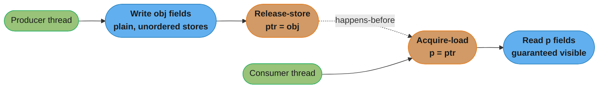

# Memory Models and Concurrency Theory

> The compiler and the CPU each reorder your code for single-threaded speed, and a memory model is the only promise either one made you about what another thread is allowed to see.

---

## 1. Concept Overview

A multithreaded program that reads correctly, top to bottom, can still be **undefined** — not "buggy" in the ordinary sense, but a program with no agreed-upon meaning at all — the moment two threads touch the same memory without an ordering contract between them. Nothing about "the compiler ran my statements in order" or "the CPU executed my instructions in order" is true across threads by default; both are only obligated to preserve the *illusion* of program order for a single thread watching itself. A **memory model** is the specification that says which reorderings are legal and which cross-thread visibility guarantees exist — it is the only document either the compiler or the hardware ever signed, and reasoning about concurrent correctness without it is reasoning about nothing.

This module owns **the model**: happens-before as a partial order, the DRF-SC guarantee, the SC/TSO/weak hardware hierarchy, the acquire/release/`seq_cst` ordering strengths, linearizability vs. sequential consistency vs. serializability, and the wait-free/lock-free/obstruction-free/blocking progress hierarchy. It does not own the OS-level or language-level *machinery* built on top of that model — those live in sibling modules, and this module cross-links to each rather than re-deriving it:

- [`deadlocks_and_synchronization`](../deadlocks_and_synchronization/deadlocks_and_synchronization.md) keeps the OS primitives — mutex, semaphore, monitor, the four Coffman conditions, Banker's algorithm, dining philosophers.
- [`java/concurrency`](../../java/concurrency/concurrency.md) keeps the JAVA spelling of the model — `volatile`, AQS, `ReentrantLock`, virtual threads.
- [`database/consistency_models_and_consensus`](../../database/consistency_models_and_consensus/consistency_models_and_consensus.md) keeps the distributed side — linearizability across nodes, consensus protocols, CAP.
- [`python/threading_and_multiprocessing`](../../python/threading_and_multiprocessing/threading_and_multiprocessing.md) — free-threaded CPython makes the memory model a live Python question for the first time; see §4.
- [`computer_architecture_and_memory_hierarchy`](../computer_architecture_and_memory_hierarchy/computer_architecture_and_memory_hierarchy.md) keeps the store buffer, MESI cache coherence, and the cache line these reorderings physically live inside.

Every executable demonstration in this module was actually run — the numbers and outputs shown are real measured or observed results, not illustrative fiction.

**Why interviewers actually ask this.** Almost nobody is asked to design a lock-free stack from scratch on the job. What they are testing, when they ask "why would this work on x86 and break on ARM" or "what's the difference between linearizable and sequentially consistent," is whether a candidate has an actual *model* for concurrent correctness or is pattern-matching from memorized rules ("always use volatile," "locks are slow, use atomics"). The rules are downstream of the model in this module; a candidate who has the model can derive the rule for a scenario they have never seen before, and an interviewer who has seen enough candidates can tell the difference in one follow-up question.

---

## 2. Intuition

> **One-line analogy**: a memory model is a contract between three parties who never talk to each other directly — the compiler, the CPU, and the other threads — and the only thing any of them promised is happens-before. Everything else is a rumor.

**Mental model.** Picture your source code as a shopping list handed to two different assistants: the compiler, who is allowed to reorder items on the list as long as *you* wouldn't notice (it has no idea a second shopper is watching your cart), and the CPU, which is allowed to grab items out of order and stash purchases in a private buffer before putting them on the shelf, again as long as *you* wouldn't notice from your own seat. Neither assistant is malicious — both reorderings exist purely for single-thread speed (dead-store elimination, register caching, store buffering, out-of-order execution) — but a second thread watching the shelf can catch the reordering red-handed, because nothing told either assistant that thread mattered. The memory model is the one instruction you can give that both assistants actually obey: "this store must be visible before that load, no matter what." Without that instruction, "what does the other thread see" is not merely hard to answer — it is a question the language and hardware never promised an answer to.

**Why it matters.** Every lock-free data structure, every `volatile` field, every "obviously safe" singleton initializer is a bet against this exact set of reorderings. Getting the bet right requires knowing the actual contract (happens-before), not vibes about what "should" be visible — and the entire rest of this module is that contract, worked out with runnable code.

---

## 3. Core Principles

### Reordering: the compiler's half and the CPU's half

Two independent actors reorder code between what you wrote and what runs, and a memory-ordering bug is always one or the other (or both) crossing a boundary the programmer assumed was safe.

**The compiler's half.** A compiler is free to apply any transformation that does not change the observable behavior of a *single* thread — it has no concept of "another thread might be reading this." Three transformations account for nearly every compiler-side memory bug:

- **Register caching.** A loop that repeatedly reads a plain (non-atomic, non-`volatile`) shared flag can have that read hoisted into a register once, outside the loop, because as far as the compiler can prove, nothing in the loop body changes the flag.
- **Dead-store elimination.** A write to a variable that is never read again *on this thread* can be deleted outright — including a write another thread was relying on to observe.
- **Loop hoisting of a non-atomic flag read.** This is the concrete, observable failure mode of register caching. Consider:

  ```c
  /* BROKEN: 'stop' is a plain bool, no volatile/atomic qualifier */
  bool stop = false;

  void worker(void) {
      while (!stop) {
          do_work();
      }
  }

  void requester(void) {
      stop = true;   /* another thread sets this */
  }
  ```

  A compiler is permitted to prove that `stop` is never written *inside* `worker`, hoist the read of `stop` out of the loop entirely, and compile `while (!stop) { do_work(); }` into `if (!stop) { while (true) { do_work(); } }` — an infinite loop that never re-reads `stop` at all. This is not a hypothetical: it is the textbook reason a `bool` "stop flag" without `volatile`, `atomic<bool>`, or a proper synchronization edge is a real, shipped class of bug. The fix is exactly the ordering primitives this module is about — a `volatile` field in Java, `std::atomic<bool>` in C++, or any acquire/release pairing — none of which the compiler is permitted to hoist across.

**The CPU's half.** Independently of what the compiler emits, a CPU core buffers stores, retires instructions out of order, and speculates past branches, all for single-thread performance, with no obligation to make any of it visible to another core in program order. §4's SC/TSO/weak hardware table and §5's store-buffer litmus test are this half of reordering made concrete with real numbers.

### Happens-before as a partial order

Happens-before is how every practical memory model states its guarantee. It is a partial order over operations, built from two kinds of edges and closed transitively:

1. **Program order** — within a single thread, each operation happens-before the next one that thread issues.
2. **Synchronization order** — an unlock happens-before the next lock of the same mutex; a release-store happens-before an acquire-load that reads the value it wrote (or a later value in a release sequence); a thread's start happens-before the first operation inside it; the last operation inside a thread happens-before another thread's successful `join` on it.

Transitive closure over these two kinds of edges is what lets a happens-before fact established on one thread become visible, correctly, on a completely different thread several hops away — that is the entire point of the relation.

### DRF-SC — the one sentence that makes this usable

*If every execution of a program is data-race-free (every pair of conflicting accesses to the same location is ordered by happens-before), the program behaves as if it were sequentially consistent.* This is why "synchronize correctly" is a complete answer to memory-ordering bugs: a correctly synchronized program never has to reason about reordering at all — reordering can only become observable in the presence of a data race, and a race-free program has none. The C++11, Java, and Rust memory models are all built around this same DRF-SC guarantee; it is what lets a language model promise strong, intuitive behavior for well-synchronized code while still letting compilers and hardware reorder aggressively underneath a data race (whose behavior the model then leaves undefined).

### Publication and safe initialization

A second consequence of the same reordering freedom: an object can be **published** — its reference made visible to another thread — before its own construction has finished, if nothing establishes a happens-before edge between "finish building the object" and "publish the reference." A reader that follows the published reference can then observe a **partially constructed object**: a field that reads as a stale or default value, or, in a language with typed slots, a field that has literally never been written. §6 builds and runs this exact failure as a double-checked-locking bug — the publish (`instance = obj`) is reordered ahead of the constructor's field write, and a racing reader dereferences the half-built object. The fix is universal across languages: never let a reference to an object escape another thread until every write the constructor performs is ordered *before* that publish by a real happens-before edge (a release-store the reader acquire-loads, a lock both sides take, or — in Java specifically — a `final` field, which the JMM gives a special freeze guarantee even without `volatile`).

### Correctness Conditions: Linearizability, Sequential Consistency, Serializability

These three words get used interchangeably in interviews and they are not the same guarantee. All three describe when a concurrent execution is "correct," but they differ in what they promise about *time* and about *how many objects* are involved.

**Linearizability** (Herlihy & Wing): every operation appears to take effect instantaneously at some single point between its invocation and its response, and that point respects real-time order — if operation A finishes (in wall-clock time) before operation B starts, A's effective point must come before B's. Linearizability is a per-object, per-operation guarantee, and it **composes**: a system built from linearizable objects is itself linearizable. This is the guarantee most people mean when they say "atomic" for a register, a CAS, or a distributed key-value store's single-key operations.

**Sequential consistency** (Lamport): the execution is equivalent to *some* interleaving of each thread's operations in its own program order, but that interleaving does **not** have to respect real-time order across threads. Two operations that are, by the wall clock, clearly sequential (A finishes, then B starts) can still be reordered in the "as-if" interleaving as long as each thread individually sees its own operations in the order it issued them. Sequential consistency does **not compose**: gluing two sequentially-consistent objects together does not give you a sequentially-consistent system, because the composition can pick a DIFFERENT valid interleaving for each object that, combined, is not achievable by any single global interleaving. This is exactly why TSO (§4, §5) is weaker than sequential consistency — the store-buffer litmus test in §5 is a concrete case of exactly this gap.

**Serializability** is the database sibling of these two, and answers a different question: given a set of *transactions*, each touching *multiple* objects, is there some serial (one-at-a-time) order of the transactions that produces the same result as the concurrent execution actually observed? Serializability says nothing about real time (that stronger version is **strict serializability**, the transactional analogue of linearizability) and nothing about single operations — it is inherently a multi-object, multi-statement guarantee. A database's `SERIALIZABLE` isolation level is a serializability guarantee, not a linearizability one, and the two should not be conflated. See [`database/consistency_models_and_consensus`](../../database/consistency_models_and_consensus/consistency_models_and_consensus.md) for the distributed-systems treatment of these same words — "linearizability" names the identical correctness condition there as here; a single-machine CAS and a distributed linearizable register are the same guarantee at different scale. §6 works a concrete history that shows exactly where sequential consistency and linearizability diverge.

| Condition | Unit | Respects real time? | Composes? | Typical guarantee for |
|-----------|------|---------------------|-----------|------------------------|
| Linearizability | single operation | Yes | Yes | atomic register, CAS, distributed KV single-key ops |
| Sequential consistency | single operation | No | No | hardware/language memory models before any stronger qualifier |
| Serializability | multi-object transaction | No | N/A (transactions, not objects) | database `SERIALIZABLE` isolation |
| Strict serializability | multi-object transaction | Yes | N/A | Spanner-style external consistency |

### Progress Guarantees

Orthogonal to correctness is *progress*: given enough scheduling, does the algorithm guarantee anyone finishes? These four levels form a strict hierarchy — each one implies every guarantee below it, never the reverse.

| Guarantee | Promise | Can one stalled thread block others? |
|-----------|---------|---------------------------------------|
| Wait-free | Every thread completes in a bounded number of its own steps | No — strongest guarantee; rarely used, expensive to construct |
| Lock-free | At all times, *some* thread in the system makes progress | No system-wide stall, but any one thread's operation can keep losing and retrying |
| Obstruction-free | A thread makes progress if it eventually runs alone (no contention) | Yes, under real contention — weakest of the non-blocking guarantees |
| Blocking | No progress guarantee if the lock holder is delayed or dies | Yes — a stalled or crashed lock holder can stop everyone |

The CAS-based lock-free stack in §10's ABA pitfall is lock-free, not wait-free: a thread whose CAS keeps losing the race retries forever in principle, but the *system* always makes progress, because every failed CAS means some other thread's operation just succeeded. §6 pins down exactly *why* CAS is the object that gets to sit at the top of the related consensus-number hierarchy.

---

## 4. Types / Architectures / Strategies

### Hardware memory models

Hardware memory models differ in how much reordering they expose:

| Model | Reordering allowed | Ships on |
|-------|---------------------|-----------|
| Sequential consistency (SC) | None — every core observes every memory op in one global order matching each core's program order | No mainstream CPU — too slow to build; used as the reasoning baseline, not a real target |
| Total Store Order (TSO) | A store can be delayed past a LATER load to a different address (StoreLoad); every other ordering — LoadLoad, LoadStore, StoreStore — is preserved | x86-64, and SPARC in TSO mode |
| Weak / relaxed | Loads and stores can be reordered almost freely unless an explicit barrier forbids it; even two stores from the same thread can become visible out of order to another core | ARM (ARMv7/ARMv8 relaxed mode), POWER |

TSO's single permitted reordering — a store sitting in the issuing core's store buffer while a later, different-address load reads straight from memory — is exactly the store-buffer litmus test worked out with real numbers in §5.

### ARM/POWER specifics: the instructions behind "weak"

Naming ARM as "weak" is not the whole story — ARMv8 (AArch64) added dedicated acquire/release *instructions*, not just full barriers, specifically because a full barrier is expensive and most code only needs the weaker guarantee:

- **`ldar`** (Load-Acquire Register) — a load that behaves as an acquire: no later memory operation in program order may be reordered before it becomes visible.
- **`stlr`** (Store-Release Register) — a store that behaves as a release: no earlier memory operation in program order may be reordered after it becomes visible.
- **`dmb ish`** (Data Memory Barrier, Inner Shareable domain) — a full two-way barrier: nothing before it may be reordered past it in either direction, scoped to the cores that share cache coherency (the "inner shareable" domain, i.e. all CPU cores in the system, as opposed to `dmb sy`'s system-wide scope that also includes non-coherent observers like some GPUs/DMA engines).

The reason this matters in practice: `ldar`/`stlr` are cheaper than a full `dmb`, because they only order the one operation they're attached to, not every memory access around them. A compiler targeting C++11's `memory_order_acquire`/`memory_order_release` on AArch64 emits `ldar`/`stlr` directly; only `memory_order_seq_cst` needs the heavier `dmb`-based sequence. This is the concrete hardware reason acquire/release is the default recommendation over `seq_cst` in performance-sensitive lock-free code on ARM server fleets (AWS Graviton, Ampere Altra, Apple Silicon) — the gap between the two is a real, measurable barrier instruction, not a stylistic preference.

### Language-level memory models

Language-level memory models give the programmer three useful ordering strengths instead of hardware's fixed contract, because a language has to run on every hardware model above with one uniform meaning:

- **Relaxed** — only atomicity is guaranteed (no torn reads/writes); no ordering constraint on surrounding memory operations at all. Used for counters where the increment itself must be atomic but nothing else needs to be published.
- **Acquire / release** — an *acquire* load prevents later operations (in program order) from being reordered before it; a *release* store prevents earlier operations from being reordered after it. A release-store paired with an acquire-load of the **same** location creates the happens-before edge that publishes everything the writer did before the release, guaranteed visible to the reader after the acquire. This is the mechanism, not a side-effect — "release publishes, acquire subscribes" is the whole pattern behind every lock-free single-writer/single-reader handoff, including the ring buffer in §14. §5's second diagram draws this edge directly.
- **Sequential consistency (`seq_cst`)** — every `seq_cst` operation, across every thread, is additionally placed into one single global total order that all threads agree on. Strongest and most intuitive; also the most expensive on weak hardware, because it forces a full barrier where acquire/release would have been enough.

**The Java Memory Model and the C++11 memory model are two spellings of one idea.** Java's `volatile` read/write pair is Java's name for acquire/release on that field; a Java `synchronized` block's unlock/lock pair is Java's name for a release/acquire synchronization edge; `AtomicInteger` exposes both a relaxed-equivalent family (`lazySet`/`getPlain`) and default volatile-strength operations. C++11's `std::memory_order_relaxed` / `_acquire` / `_release` / `_seq_cst` name the identical three strengths directly. Neither model invented a new theory — both implement the same happens-before/DRF-SC contract described in §3, tuned to each language's existing vocabulary. The applied Java spelling — `volatile`, `VarHandle`, `AtomicInteger`, AQS built on top of these primitives — lives in [`java/concurrency`](../../java/concurrency/concurrency.md); this module is where the underlying model lives. Rust names the same four strengths in `std::sync::atomic::Ordering` (`Relaxed`, `Acquire`, `Release`, `AcqRel`, `SeqCst`) — a fourth spelling of the identical contract.

**`memory_order_consume` and its deprecation in C++26.** C++11 also defined a fourth strength between relaxed and acquire: a *consume* load orders only the later operations that carry a data dependency on the loaded value (dereferencing the loaded pointer, indexing with it). On ARM and POWER that maps to a plain load, because the hardware already orders dependent loads, which is exactly what RCU readers need. The standard's definition of "carries a dependency" proved impossible to implement through compiler optimizations, so every compiler silently promoted consume to acquire. C++26 adopts Hans Boehm's P3475 ("Defang and deprecate `memory_order::consume`"): consume is deprecated, its dependency-ordering rules are gone, and `kill_dependency` is deprecated with it. Write `memory_order_acquire`; on ARMv8 an acquire load (`LDAR`, or `LDAPR` from ARMv8.3) costs close to a relaxed load in common cases. The Linux kernel keeps its own dependency ordering (`READ_ONCE()`, `rcu_dereference()`) outside the C++ model.

### Read-mostly patterns whose correctness IS a memory-model argument

**RCU (Read-Copy-Update)**, the pattern at the core of the Linux kernel's scalability, lets any number of readers traverse a data structure with **zero synchronization instructions** — no lock, no atomic, not even a memory barrier on the read side in the common case — while a writer builds a full replacement copy, publishes it with a single release-store of the root pointer, and defers reclaiming the old copy until every reader that might still be traversing it has provably finished (a "grace period"). The entire correctness argument is a happens-before argument: the writer's release-store of the new root, paired with a reader's acquire-load of that same pointer, is what guarantees a reader never observes a partially built replacement — precisely the publication pattern from §3. RCU trades read cost (near zero) for write cost (a full copy plus a deferred-reclaim wait) and reader staleness (a reader that started before the update can keep seeing the old version for its entire traversal, which is *correct*, not a bug, under RCU's semantics).

**Seqlock** targets the same read-mostly shape from a different angle: instead of copying the whole structure, the writer bumps a sequence counter to odd before mutating in place, does the writes, then bumps it to even again. A reader snapshots the counter, reads the data, then re-reads the counter — if it changed, or was caught mid-odd, the reader **retries** rather than blocking. This never blocks the writer and never blocks another reader, at the cost of readers occasionally doing wasted work. §6 builds and runs a seqlock to prove the invariant actually holds under contention.

**Both safe-reclamation schemes are in the C++26 standard library.** P2530 adds `<hazard_pointer>` and P2545 adds `<rcu>`, both derived from the production implementations in Meta's `folly`. The API maps directly onto the mechanisms above:

```cpp
#include <atomic>
#include <hazard_pointer>
#include <mutex>
#include <optional>
#include <rcu>

// RCU: readers lock a domain (no atomic RMW), writers publish a copy and retire the old one.
struct Config : std::rcu_obj_base<Config> {
    explicit Config(int t) : timeout_ms(t) {}
    int timeout_ms;
};
std::atomic<Config*> current{new Config(100)};

int read_timeout() {
    std::scoped_lock guard(std::rcu_default_domain());      // rcu_domain has lock()/unlock()
    return current.load(std::memory_order_acquire)->timeout_ms;
}

void set_timeout(int ms) {
    Config* old = current.exchange(new Config(ms), std::memory_order_acq_rel);
    old->retire();               // deleted only after every reader that could see it unlocks
}

// Hazard pointers: protect one node at a time, the reclaimer skips anything still protected.
struct Node : std::hazard_pointer_obj_base<Node> {
    int value;
    Node* next;
};
std::atomic<Node*> head{nullptr};

std::optional<int> peek() {
    std::hazard_pointer hp = std::make_hazard_pointer();
    Node* n = hp.protect(head);  // publishes the hazard, re-reads head until they agree
    return n ? std::optional<int>(n->value) : std::nullopt;
}                                // hp's destructor clears the hazard
// In pop(): after the CAS that unlinks n succeeds, call n->retire().
```

`std::rcu_synchronize()` blocks until all pre-existing readers have unlocked, and `std::rcu_barrier()` waits until retired objects have been reclaimed. The two schemes differ in what a slow reader costs: one stalled RCU reader delays reclamation of *every* object retired after it began, so unreclaimed memory is unbounded, while a stalled hazard-pointer holder pins only the one node it protects. Hazard-pointer reads cost more, because `protect()` must publish the hazard and order it before re-reading the source pointer.

### Transactional memory

**Hardware transactional memory (HTM)** lets a core speculatively execute a block of memory operations as an atomic unit, tracking every read and write, and abort-and-retry the whole block if another core's write conflicts with something the transaction read — no locks, and no manual ordering reasoning, if it works. Intel shipped this as **TSX** (Transactional Synchronization Extensions, adding the `RTM`/`HLE` instruction pairs) starting with Haswell in 2013. Its production history is a cautionary tale rather than a recommendation: Intel disabled it twice, for unrelated reasons: on Haswell and early Broadwell in **August 2014**, via microcode, for the **HSW136 functional erratum**; then on Skylake through Coffee Lake in **November 2019** for the **TAA (TSX Asynchronous Abort)** side-channel vulnerability (CVE-2019-11135). Intel then and removed the feature from the silicon entirely starting with 10th-generation Comet Lake and Ice Lake — so on current Intel hardware, TSX is not something you can plan around at all. IBM's POWER architecture and ARM's TME (Transactional Memory Extension) are the hardware TM instances actually shipping and supported today, on their respective platforms. **Software transactional memory (STM)** implements the same abort-and-retry contract purely in software — Haskell's `STM` monad and Clojure's `ref`/`dosync` are the best-known production uses — trading HTM's near-zero overhead for portability and no dependency on a specific CPU feature.

### Python and the free-threaded build

CPython's Global Interpreter Lock has meant, for its entire history, that Python code never had to reason about the memory model in this module at all — the GIL serializes bytecode execution, so a data race at the *Python object* level was effectively impossible even without any of the acquire/release discipline above (a C-extension calling into unsynchronized native code is a separate story). That changed with **PEP 703/779**: Python 3.13 shipped an experimental free-threaded build (`python3.13t`, `--disable-gil`), and **Python 3.14 promoted it to officially supported status (PEP 779)** — but officially supported is not the same as default. The standard `python3.14` interpreter still ships with the GIL enabled; only the separately-installed, `t`-suffixed `python3.14t` build runs without it, and choosing it is an explicit opt-in, not something that happens by upgrading. Every executable demonstration in §6 of this module was run under the standard GIL build, and every note about the GIL hiding a hardware reordering effect refers specifically to that default build — see [`python/threading_and_multiprocessing`](../../python/threading_and_multiprocessing/threading_and_multiprocessing.md) for the free-threaded build's actual concurrency implications once opted into.

---

## 5. Architecture Diagrams

### Store-Buffer Litmus Test — TSO vs Sequential Consistency

The classic "SB" (store-buffer) litmus test is the smallest program that separates sequential consistency from x86's TSO. Two threads each store to their own variable and then load the OTHER thread's variable:

```
  initially: x = 0, y = 0                (shared memory, both threads see these)

  Thread 1                    Thread 2
  --------                    --------
  x = 1                       y = 1
  r1 = y                      r2 = x

  Question: can the run finish with r1 == 0 AND r2 == 0 ?

  Sequential consistency: all 6 interleavings that respect each thread's own
  program order (x=1 before r1=y; y=1 before r2=x):

    #   interleaving                   r1   r2
    1   x=1  r1=y  y=1  r2=x            0    1
    2   x=1  y=1   r1=y  r2=x           1    1
    3   x=1  y=1   r2=x  r1=y           1    1
    4   y=1  x=1   r1=y  r2=x           1    1
    5   y=1  x=1   r2=x  r1=y           1    1
    6   y=1  r2=x  x=1   r1=y           1    0

    (r1,r2) = (0,0) appears in ZERO of the 6 rows -> impossible under SC

  x86-64 TSO: each core buffers its own store before it drains to memory,
  and a LATER load to a DIFFERENT address may read memory before that drain:

    core 1:  x=1  -> sits in core 1's store buffer, not yet visible
    core 2:  y=1  -> sits in core 2's store buffer, not yet visible
    core 1:  r1 = y   reads shared memory directly -> still 0 (y not drained)
    core 2:  r2 = x   reads shared memory directly -> still 0 (x not drained)

    result: r1 == 0 AND r2 == 0  -- legal on real x86-64, unreachable under SC

  StoreLoad is the ONLY reordering TSO permits: a store followed by a later
  load of a different address. LoadLoad, LoadStore and StoreStore all stay
  in program order, which is why TSO "feels" almost sequentially consistent
  until this one pattern bites.
```

This is why a program that looks race-free by inspection can still show an "impossible" result on real hardware: SC is the model most people reason in by default, TSO is what x86-64 actually gives you, and the gap between them is exactly this one reordering. A racy `x=1`/`r1=y` pair needs an explicit fence (`mfence`, or a `seq_cst` atomic in the language model) to close it — an acquire/release pair does not, because acquire/release makes no promise about a store's ordering relative to a LATER, unrelated load. §6 runs this exact litmus test as a Python harness and reports what CPython's GIL does and does not let you observe.

### Litmus-Test Comparison Grid — the Four Reorderings Across Hardware Models

The SB test above exercises exactly one of four possible reordering pairs. This grid shows all four, across the three hardware models from §4:

```
  Reordering        SC (sequential   TSO (x86-64,    Weak (ARM, POWER)
  pair               consistency)     SPARC-TSO)
  ----------------  ---------------  --------------  ------------------
  LoadLoad                ✓               ✓                  ✗
  (load;load, same
   thread, diff addr)

  LoadStore                ✓               ✓                  ✗
  (load;store, same
   thread, diff addr)

  StoreStore                ✓               ✓                  ✗
  (store;store, same
   thread, diff addr)

  StoreLoad                  ✓               ✗                  ✗
  (store;load, same
   thread, diff addr)

  ✓ = program order is PRESERVED — the hardware guarantees this pair stays
      in the order you wrote it, no barrier needed.
  ✗ = the hardware is FREE to reorder this pair; you need an explicit
      barrier (mfence / dmb / a seq_cst atomic) to force the order.
```

Reading the grid by row explains the three-tier hierarchy from §4 in one glance: SC forbids all four reorderings (the reasoning baseline nobody ships), TSO forbids three of the four and permits exactly StoreLoad (the SB test above), and a weak model permits all four — the "weak" in ARM/POWER's classification is precisely "everything TSO forbids, plus StoreLoad."

### Publishing a Constructed Object — the Release/Acquire Happens-Before Edge



**Caption.** The release-store of `ptr` and the acquire-load that reads that same value are the two ends of one happens-before edge (§3's synchronization-order rule). Everything the producer wrote *before* the release — every field of `obj` — is guaranteed visible to the consumer *after* the acquire, with nothing weaker required. Drop either half (a plain store instead of release, or a plain load instead of acquire) and the edge disappears; the consumer can then legally observe `obj`'s fields before they were written, which is exactly the bug §6 constructs and fixes.

---

## 6. How It Works — Detailed Mechanics

Every block below was executed; the printed output shown is the real output of that exact run, not a description of expected behavior.

### 1. Broken double-checked locking, and the fix

Double-checked locking's classic bug is a publication failure: the singleton reference is made visible to other threads before the object's fields are fully written. Python's GIL makes true instruction reordering unobservable, so this is an **explicit simulation** of the reordering — forced deterministically with `threading.Event`, not a spontaneous race — that reproduces the actual consequence, not just the shape of the bug:

```python
class Config:
    __slots__ = ("value",)

class BrokenSingleton:
    def __init__(self):
        self._instance = None
        self._lock = threading.Lock()
        self.published = threading.Event()
        self.let_writer_finish = threading.Event()

    def get_broken(self):
        """BROKEN DCL: reference is published before the field write completes
        (models a compiler/CPU that reordered obj.value = 42 to AFTER the
        publish of self._instance = obj -- legal without a happens-before edge)."""
        inst = self._instance
        if inst is None:
            with self._lock:
                inst = self._instance
                if inst is None:
                    obj = Config.__new__(Config)   # allocate, do NOT set .value yet
                    self._instance = obj            # publish the reference FIRST
                    self.published.set()
                    self.let_writer_finish.wait()   # hold so the reader can race in
                    obj.value = 42                  # the "reordered" write, finally
                    inst = obj
        return inst

    def reader_broken(self, results):
        self.published.wait()
        inst = self._instance               # no lock, first-check style read
        try:
            results["seen_value"] = inst.value    # races the writer's obj.value = 42
        except AttributeError:
            results["seen_value"] = "<AttributeError: slot unset>"
```

Running it against a forced interleaving (writer publishes the reference, holds, a reader thread races in before the field write finally happens):

```
BROKEN: reader observed value = '<AttributeError: slot unset>' (expected 42)
```

The reader crashed trying to read a field that was never written — because it followed a published reference before the object behind it was finished, exactly the publication failure from §3. **The fix**: never publish until construction is fully complete, so there is no window in which a reference points at a half-built object:

```python
class FixedSingleton:
    def __init__(self):
        self._instance = None
        self._lock = threading.Lock()

    def get_fixed(self):
        with self._lock:
            if self._instance is None:
                obj = Config.__new__(Config)
                obj.value = 42              # fully initialize BEFORE publish
                self._instance = obj        # publish only when complete
            return self._instance
```

```
FIXED:  reader observed value = 42
```

The real-language shape of this same bug is the historically famous one — pre-Java-5 double-checked locking without `volatile`:

```java
// BROKEN (classic pre-Java-5 DCL bug): instance is a plain field
class Singleton {
    private static Singleton instance;
    static Singleton getInstance() {
        if (instance == null) {                 // 1st check, no lock
            synchronized (Singleton.class) {
                if (instance == null) {          // 2nd check, locked
                    instance = new Singleton();  // constructor writes can be
                }                                 // reordered AFTER this store
            }
        }
        return instance;
    }
}

// FIX: volatile turns the field write into a release-store and the
// field read into an acquire-load -- the exact edge from §5's diagram
class Singleton {
    private static volatile Singleton instance;
    // getInstance() body unchanged; now correct
}
```

### 2. Store-buffer (SB) litmus test harness

Running §5's exact litmus test as a Python harness, across many trials, to see what CPython's GIL does and does not let through:

```python
x = y = r1 = r2 = 0
start_gate = threading.Barrier(2)

def t1():
    global x, r1
    start_gate.wait(); x = 1; r1 = y

def t2():
    global y, r2
    start_gate.wait(); y = 1; r2 = x
```

Result over 200,000 trials:

```
trials=200000
  (r1,r2)=(1, 0): 200000  (100.00%)
(0,0) count under CPython/GIL: 0
```

**Honest reading of this result.** Real x86-64 hardware makes `(r1,r2) == (0,0)` reachable — that is the entire point of the litmus test in §5 — but CPython's GIL serializes bytecode execution across threads, so this harness found it **zero times in 200,000 trials**, and would find it zero times in any number of trials: the GIL removes the store-buffer effect from what Python code can observe entirely, it does not merely make it rare. Notice it did not even reproduce the *other* five sequentially-consistent interleavings — CPython's default GIL-switching granularity happened to run each thread's two-line body to completion before switching, in every trial, which is a scheduling artifact of this interpreter and this run, not a memory-model guarantee of any kind. The lesson is the negative result itself: **you cannot observe a hardware memory-model effect through an interpreter that gives you implicit mutual exclusion.** Verifying a real StoreLoad reordering requires a tool that runs directly against hardware or a formal model of it — `litmus7`/`herd7`, covered in §11.

### 3. Seqlock — correctly implemented and proven under contention

A writer bumps a sequence counter odd before mutating, writes the data, bumps it even again; a reader snapshots the counter, reads the data, and re-checks the counter, retrying on any mismatch or mid-write catch:

```python
class SeqlockPoint:
    def __init__(self):
        self.seq = 0
        self.px = 0
        self.py = 0
        self._lock = threading.Lock()   # serializes writers among themselves only

    def write(self, x, y):
        with self._lock:
            self.seq += 1          # now odd: "write in progress"
            self.px = x
            time.sleep(0)            # yield point -- gives a reader a chance to race in
            self.py = y
            self.seq += 1          # now even: publish complete

    def read(self):
        retries = 0
        while True:
            s1 = self.seq
            if s1 % 2 == 1:         # writer mid-update, don't even try
                retries += 1
                continue
            x, y = self.px, self.py
            s2 = self.seq
            if s1 == s2:            # no writer ran during our read -> consistent snapshot
                return x, y, retries
            retries += 1
```

Running one writer doing 2,000 writes against two readers doing 2,000 reads each, checking the invariant `y == 10*x` on every value a `read()` returns:

```
reads completed: 4000
reader retries (writer-in-progress or torn snapshots caught and re-tried): 4315
inconsistent (torn) reads that ESCAPED the retry loop: 0
invariant y == 10*x held on every one of the 4000 returned reads
```

4,315 retries were needed to guarantee 4,000 clean reads against a contended writer — the seqlock's entire cost model in one number: readers pay in wasted retries, never in blocking, and the writer never waits on a reader at all.

### 4. Linearizability vs. sequential consistency, worked on a concrete history

Two threads operate on a single register `x`, initially 0. Each operation is shown with its real invocation and response timestamps:

| Op | Thread | Invoke | Respond | Result |
|----|--------|--------|---------|--------|
| write(x, 1) | P1 | t=0 | t=1 | — |
| read(x) | P2 | t=2 | t=3 | returns 1 |
| write(x, 2) | P1 | t=4 | t=5 | — |
| read(x) | P2 | t=6 | t=7 | returns 1 |

The second `read` starts at t=6, a full unit *after* `write(x, 2)` already completed at t=5 — in real time, there is no overlap between them at all.

**Is this history linearizable?** No. Linearizability requires each operation's effective point to respect real-time order: since `write(x, 2)` finished before the second `read` even began, that read is REQUIRED to return 2. It returned 1. No placement of instantaneous points that respects real-time non-overlap can produce this result — the history is not linearizable, full stop.

**Is this history sequentially consistent?** Yes. Sequential consistency only requires *some* interleaving that respects each thread's own program order — it does not have to respect real time across threads at all. Take the interleaving `write(x,1), read()->1, read()->1, write(x,2)`: P1's program order (write 1 before write 2) is preserved, P2's program order (read before read) is preserved, and both reads correctly see `x=1` at the moment they run *in this reordered interleaving* — even though, on the wall clock, `write(x,2)` had already finished before the second read started.

This is the textbook demonstration of §3's claim that sequential consistency does not compose and does not respect real time: a history that is perfectly valid under SC can still violate the stronger, real-time-respecting guarantee that linearizability makes, and "was this database/register/register-of-registers SC or linearizable" is never a rhetorical question — this table is the difference, worked in full.

### 5. Herlihy's consensus number hierarchy

Herlihy's 1991 result ranks concurrent objects by **consensus number**: the maximum number of threads for which that object type alone can solve wait-free consensus (every thread proposes a value; all threads that decide, decide the same one; every thread eventually decides).

| Object type | Consensus number | Examples |
|-------------|-------------------|----------|
| Atomic read/write register | 1 | a plain shared variable |
| Test-and-set, fetch-and-add, atomic swap, FIFO queue | 2 | classic two-thread primitives |
| Compare-and-swap (CAS), load-linked/store-conditional | ∞ | every mainstream lock-free structure |

**Why CAS gets infinity in one sentence:** any number of threads can race a single CAS against the same expected value, exactly one wins, and every loser can read the winner's new value and retry against it — so CAS alone lets an arbitrary number of processes agree on "whoever went first," which is consensus, for any number of participants, with no other primitive required. This is the formal reason CAS is the primitive nearly every lock-free algorithm in this repo (the stack in §10, the ring buffer in §14) is actually built on, and why a hardware architecture that ships CAS (or an equivalent LL/SC pair) is universal for lock-free construction in a way `fetch-and-add` alone never can be.

---

## 7. Real-World Examples

**Linux kernel RCU** (Paul McKenney) is the reason the kernel's most contended data structures — the routing table, the dcache, large parts of the scheduler — scale to hundreds of cores with read-side cost close to zero; the entire mechanism is the publication happens-before argument from §4 applied to a whole data structure instead of one object.

**C++26** standardizes both reclamation schemes from this section: `std::hazard_pointer` (P2530) and `std::rcu_obj_base` / `std::rcu_domain` (P2545), so portable C++ no longer needs a third-party library to retire nodes safely in a lock-free structure.

**Meta's `folly` C++ library** ships hazard pointers in production as the alternative fix to §10's ABA problem — every large lock-free structure in Facebook's C++ services that cannot tolerate a locking fallback uses this or the tagged-pointer approach worked out in this module's pitfall.

**LMAX's Disruptor**, built for the LMAX financial exchange, is a lock-free ring buffer built entirely on the single-writer-principle release/acquire pattern from §5 and §14 — no locks anywhere on the hot path, and it is the direct ancestor of §14's case study.

**Java's `java.util.concurrent`** (Doug Lea) is, underneath its public API, an implementation of exactly the JMM acquire/release vocabulary from §4 — `AbstractQueuedSynchronizer` publishes its internal state with volatile writes precisely so every `Lock`/`Semaphore`/`CountDownLatch` built on it inherits a correct happens-before edge for free. See [`java/concurrency`](../../java/concurrency/concurrency.md).

**Rust's Tokio project** ships the `loom` crate (§11) specifically to exhaustively permutation-test its `bytes` buffer and `mpsc` channel implementations under the C11 memory model before every release, rather than trusting code review to catch a reordering bug.

**Google Spanner and Amazon DynamoDB** are the production instances of strict serializability named in §3's table — Spanner's TrueTime API is what lets it place a real-time bound on transaction ordering across a globally distributed system; see [`database/consistency_models_and_consensus`](../../database/consistency_models_and_consensus/consistency_models_and_consensus.md) for the mechanism.

**AWS Graviton and Ampere Altra**, ARM-architecture server CPUs now running a large share of cloud workloads, forced a real industry-wide audit: x86-only-tested code that had quietly relied on TSO's near-SC behavior for years surfaced genuine, previously-latent memory-ordering bugs the first time it ran on weak-memory ARM silicon at scale — the exact failure mode named in §12's "why does x86 code break on ARM" question, playing out as an actual multi-year cloud migration story rather than a textbook warning.

**The Linux kernel's timekeeping code** (`jiffies_64`, the core `tk_core.seq` sequence lock behind `ktime_get`) is a production seqlock — the exact pattern built and measured in §6 — chosen specifically because the timer interrupt handler that updates the clock must never block behind a reader, and readers (every `gettimeofday`-style call, kernel-wide) vastly outnumber the one writer.

**Java's `LongAdder`** (`java.util.concurrent.atomic`, Doug Lea) exists specifically to fix the false-sharing and CAS-contention cost a plain `AtomicLong` pays under many-writer workloads: instead of one counter every thread fights over with CAS, `LongAdder` stripes the count across multiple cells on separate cache lines and sums them only when the total is read — a direct production answer to §10's Pitfall 1, ship-worthy proof that padding-for-cache-lines is a real, load-bearing production technique and not just a benchmark curiosity.

---

## 8. Tradeoffs

### Progress guarantee vs. throughput

| Guarantee | Progress promise | Typical throughput | Implementation cost |
|-----------|-------------------|---------------------|----------------------|
| Wait-free | every thread, bounded steps | usually the SLOWEST — needs a "helping" mechanism so no thread is ever stuck behind another | very high; rare in production |
| Lock-free | system-wide progress only | fast under low contention; degrades under high contention as CAS retries pile up | moderate-to-high |
| Obstruction-free | progress only with zero contention | fast when uncontended; needs an external contention manager to be usable at all under real load | moderate |
| Blocking (mutex) | none if the holder stalls | usually the FASTEST in the common uncontended case — a single fast-path CAS to acquire, nothing else | lowest; the default for a reason |

The strongest guarantee is, counter-intuitively, usually the slowest one to actually run — wait-free algorithms pay their bounded-steps promise in constant helping overhead on every single operation, even when there is no contention to help with.

### Mutex vs. lock-free, the honest comparison

| Dimension | Mutex (blocking) | Lock-free (CAS-based) |
|-----------|-------------------|-------------------------|
| Correctness to reason about | Straightforward — critical section, one thread at a time | Genuinely hard — every interleaving of every operation must be individually correct, including the ABA problem in §10 |
| Debuggability | Deadlock is visible in a thread dump | A stuck retry loop under contention often looks like nothing at all in a profiler |
| Worst case under contention | A stalled/crashed holder blocks everyone | Retry storms can burn CPU without any thread individually "hanging" |
| Uncontended fast path | Fast — one CAS to acquire | Fast — usually one CAS on the actual operation, no extra layer |
| When it's the right call | Almost always, until measurement says otherwise | Real-time contexts that cannot block (signal handlers, audio callbacks) or measured, provable lock contention |

---

## 9. When to Use / When NOT to Use

**A mutex is very often simply the right answer.** This is not a hedge — it is the actual default recommendation. A well-implemented mutex's uncontended fast path is a single CAS, indistinguishable in cost from the CAS a lock-free algorithm would have used anyway, and everything about reasoning, debugging, and onboarding a new engineer onto the code is dramatically simpler with a critical section than with a hand-rolled lock-free structure. Reach past a mutex only when:

- **Profiling, not intuition, shows lock contention is the actual bottleneck** — not "locks feel slow," a flame graph or lock-contention profiler showing real wait time on this specific lock.
- **The calling context genuinely cannot block** — a signal handler, an interrupt handler, a real-time audio callback with a hard deadline, code that must not risk priority inversion.
- **You are implementing a well-understood, published algorithm** (an SPSC/MPSC queue, a hazard-pointer-protected stack) rather than inventing a new lock-free structure from scratch — the existing literature has already found the ABA problems and the memory-reclamation edge cases you have not yet hit.

**Do not use hand-rolled lock-free structures as a default engineering style.** Lock-free code is a specialist tool with a real, measurable correctness cost: every demonstration in §6 and §10 of this module is exactly the kind of subtle, hard-to-reproduce bug that a lock-free algorithm invites and a mutex-protected critical section does not. "It's lock-free" is not a feature to reach for casually — it is a tradeoff you make when you have already measured that you need it.

### A quick signal checklist

| Signal | Lean mutex | Lean lock-free |
|--------|------------|------------------|
| Contention evidence | None yet — "it feels slow" | A profiler shows real, measured wait time on this specific lock |
| Calling context | Can block freely | Signal handler, interrupt handler, or a hard-real-time callback that must not block |
| Prior art | No published algorithm fits the exact shape needed | A well-understood published structure (SPSC/MPSC queue, hazard-pointer stack) fits directly |
| Verification tooling | TSan/JCStress/`loom` not yet wired into CI for this code | The team already runs §11's tools routinely and can add coverage for the new structure |
| Team experience | First time anyone on the team has shipped lock-free code | The team has shipped and maintained lock-free code before and knows the ABA/reclamation traps |

Any row landing in the left column is a vote for a mutex; a design needs most of the right column before "lock-free" is the responsible choice, not just one measured hot spot.

---

## 10. Common Pitfalls

### Pitfall 1 — False sharing: two independent counters, one cache line

Two threads each increment their own `int64` counter with no shared state *logically* — but if the two counters happen to sit in the same 64-byte cache line, every increment on either thread invalidates the other core's cached copy of that entire line (MESI coherence traffic; see [`computer_architecture_and_memory_hierarchy`](../computer_architecture_and_memory_hierarchy/computer_architecture_and_memory_hierarchy.md) for the coherence protocol itself). This is a real, measured C benchmark — two threads, 200 million increments each, packed vs. padded to separate cache lines:

```c
struct packed_t { volatile int64_t a; volatile int64_t b; };            // 16 bytes: same cache line
struct padded_t { volatile int64_t a; char pad[56]; volatile int64_t b; char pad2[56]; }; // 128 bytes: separate lines
```

Measured on an 8-core x86-64 host, `cc -O2 -pthread`, two threads each looping `counter++` 200,000,000 times:

```
sizeof(packed_t)=16 sizeof(padded_t)=128
packed (same cache line):   0.231 s
padded (separate lines):    0.068 s
```

Padding the two counters onto separate cache lines made the identical increment loop **roughly 3.4x faster**, with zero change to the algorithm — the entire cost was coherence traffic from two cores fighting over ownership of one cache line neither thread's logic actually shared. Java's `@jdk.internal.vm.annotation.Contended` (public API `sun.misc.Contended` before JDK 9) automates exactly this padding around a field. **Python's GIL hides this effect entirely** — the same demonstration written in Python shows no difference, because the GIL already serializes access to the underlying object at the interpreter level, long before two cores would ever race for the same cache line; that is why this measurement had to be run in C.

### Pitfall 2 — The ABA problem in a lock-free stack with node reuse

A CAS-based lock-free stack looks correct because `compare_and_swap` really is atomic — the bug is that CAS only compares *identity*, and identity can repeat. Real allocators (and any pooled-object pattern) hand back the same address for a new object after an old one is freed; a CAS that read a pointer, got preempted, and resumes later cannot tell "the top is still the node I saw" from "the top is a DIFFERENT node that happens to reuse the same address."

```python
import threading

class Node:
    __slots__ = ("value", "next")
    def __init__(self, value=None, next=None):
        self.value = value
        self.next = next

class ABAStack:
    """BROKEN: nodes are pooled and reused (mimics real allocator pointer reuse),
    and compare_and_swap only checks node IDENTITY."""
    def __init__(self):
        self.top = None
        self._free_list = []
        self._cas_lock = threading.Lock()   # emulates ONE hardware CAS instruction

    def compare_and_swap(self, expected, new):
        with self._cas_lock:
            if self.top is expected:
                self.top = new
                return True
            return False

    def _alloc(self, value, nxt):
        if self._free_list:
            n = self._free_list.pop()       # BROKEN: reused node, SAME identity
            n.value, n.next = value, nxt
            return n
        return Node(value, nxt)

    def pop(self):
        while True:
            old_top = self.top
            if old_top is None:
                return None
            new_top = old_top.next
            if self.compare_and_swap(old_top, new_top):
                self._free_list.append(old_top)
                return old_top.value
```

**Proven broken, not asserted.** Forcing the pathological interleaving with `threading.Event` (deterministic — not a timing-dependent flake) on a stack `A(1) -> B(2) -> C(3)`: thread T1 calls `pop()`, reads `old_top = A`, reads `new_top = A.next = B`, then stalls before its CAS (exactly what a context switch or a cache-miss stall does on real hardware). Thread T2 runs to completion in the meantime: pops A, pops B (both freed), then pushes `20` and `10` — the free-list is LIFO, so the first push reuses node B's slot and the second reuses node A's slot. The stack is now `A(10) -> B(20) -> C(3)`, i.e. the *object* T1 is still holding a reference to (`A`) is back at the top, just carrying a different value now. T1 resumes and runs `compare_and_swap(A, B)`: the check `self.top is A` is TRUE — same object — so the CAS **succeeds**, when it should have failed (A had already been popped out from under T1). Actually running it:

```
stack contents right before T1's stale CAS runs: [10, 20, 3]
T1's CAS succeeded (should have failed - 'a' was popped!): True
T1's pop() returned value: 10   (T1 believes it popped the ORIGINAL node A, value 1)
stack contents after T1's stale CAS: [20, 3]
```

Two real corruptions, both observed, not hypothetical: `pop()` returns `10`, a value that was never at the top when T1 called `pop()` — T1's own linearizability is violated. And the `10` T2 just pushed is now gone from the stack entirely, silently dropped, with nobody having popped it.

```python
# FIX: tag the top pointer with a monotonically increasing version counter.
# CAS now compares (node, tag); the tag has moved on even when the node's
# identity was reused, so the stale CAS is correctly rejected.
class TaggedStack:
    def __init__(self):
        self._top = (None, 0)          # (node, tag)
        self._free_list = []
        self._cas_lock = threading.Lock()

    def compare_and_swap(self, expected, new_node):
        with self._cas_lock:
            cur_node, cur_tag = self._top
            exp_node, exp_tag = expected
            if cur_node is exp_node and cur_tag == exp_tag:
                self._top = (new_node, cur_tag + 1)   # tag ALWAYS advances
                return True
            return False

    def pop(self):
        while True:
            expected = self._top
            old_node, _ = expected
            if old_node is None:
                return None
            if self.compare_and_swap(expected, old_node.next):
                self._free_list.append(old_node)
                return old_node.value
```

Re-running the identical forced interleaving against `TaggedStack`:

```
T1's stale CAS succeeded (must be False now): False
final stack (must be [10, 20, 3], nothing lost): [10, 20, 3]
```

T1's CAS now correctly fails — the tag has advanced four times (T2's two pops plus two pushes each bump it) even though the node object T1 is holding is identical — so T1 loops and retries `pop()` against the current top instead of corrupting the stack. Real implementations use a hardware double-width CAS (`cmpxchg16b` on x86-64) to update a pointer and a tag atomically together, or hazard pointers / epoch-based reclamation (§7's `folly` example) to avoid freeing a node while another thread might still hold a stale reference to it — both solve the same problem this tag does, at different cost.

### Pitfall 3 — Publishing before construction (the DCL bug, summarized)

The same identity-reuse family of bug shows up one layer earlier, before an object is even freed for reuse: a reference to a brand-new object is published to other threads before the constructor's writes are ordered ahead of that publish. §6 builds, forces, and runs this exact failure with real output — a reader observes an `AttributeError` on a field that was never written, because it followed a published reference into a half-built object. The one-line prevention rule covers every language: never let a reference escape to another thread until every write the constructor performs has a real happens-before edge — a release-store the reader acquire-loads, a shared lock, or (Java-specific) a `final` field — ordered before that publish.

---

## 11. Technologies & Tools

| Tool | What it checks | Scope |
|------|------------------|-------|
| ThreadSanitizer (TSan) | Data races at runtime, via shadow memory tracking every access | C, C++, Go, Rust (via sanitizer instrumentation) |
| JCStress | Exhaustive/randomized interleaving stress testing against the JMM, purpose-built by the OpenJDK team | Java, on the actual JVM |
| Lincheck | Automated linearizability testing for concurrent data structures | Kotlin/Java on the JVM |
| `litmus7` / `herd7` (herdtools7, the "diy" toolsuite) | Runs a litmus test like §5's SB test either directly on real hardware or against a formal operational model of it | ARM, POWER, x86, RISC-V memory models |
| TLA+ / PlusCal | Formal specification and exhaustive model checking of a concurrent or distributed algorithm's state space | Language-agnostic; used in production algorithm design at AWS and MongoDB |
| Jepsen | Black-box testing of distributed systems for linearizability/consistency violations under real network partitions | Distributed databases and coordination services |
| `loom` (the `tokio-rs/loom` crate) | Exhaustive permutation testing of concurrent code under the C11 memory model, without relying on random scheduling luck | Rust |

**A name-collision trap worth flagging explicitly.** The `loom` crate above is a Rust concurrency-testing tool with no relationship whatsoever to **Project Loom**, OpenJDK's virtual-threads and structured-concurrency feature ([`java/concurrency`](../../java/concurrency/concurrency.md)) — same word, two unrelated projects in two different languages doing two different jobs. Saying "Loom" in an interview without qualifying which one you mean is a real way to be misunderstood.

**These tools are complementary, not competing — use them at different layers.** A race detector like TSan catches "these two accesses conflicted with no ordering," which is necessary but says nothing about whether the *algorithm* is correct even when every individual access is properly ordered; a model checker like TLA+ or an exhaustive permutation tool like `loom`/JCStress catches "this specific interleaving produces the wrong answer," which is the layer §10's ABA bug and §14's ring-buffer bug actually live at. A mature lock-free codebase runs both: TSan (or the language's built-in race detector) in every CI run as a cheap, continuous check, and a targeted model-checked spec or `loom`/JCStress harness for the specific data structures where a subtle interleaving bug would be expensive to ship.

---

## 12. Interview Questions with Answers

**Q: What is happens-before, and what does the DRF-SC guarantee let you assume?**
**Short:** Happens-before is the partial order from program order plus synchronization edges; DRF-SC says a race-free program behaves as if sequentially consistent.
Happens-before is a partial order over memory operations built from two edge types — program order within a thread, and synchronization order across threads (unlock-before-lock, release-before-acquire, thread-start, thread-join) — closed transitively. DRF-SC (data-race-free implies sequential consistency) says that if every pair of conflicting accesses in every execution of the program is ordered by happens-before, the program's observable behavior is exactly as if it ran on a sequentially consistent machine, with no reordering visible at all. This is the guarantee that lets you write and reason about correctly-synchronized code without ever thinking about compiler or CPU reordering — the reordering is real, but it can only become visible across a data race, and DRF-SC promises there isn't one. The practical takeaway: a memory-ordering bug is, without exception, a missing happens-before edge somewhere — go find the racing access pair, not "why did the CPU reorder this."

**Q: What's the difference between linearizability, sequential consistency, and serializability?**
**Short:** Linearizability adds real-time order to sequential consistency, and serializability is a multi-object transaction guarantee, not a single-op one.
Linearizability is a per-operation guarantee that respects real-time order — if A finishes before B starts, A's effective point comes first — and it composes across objects. Sequential consistency drops the real-time requirement: some interleaving consistent with each thread's own program order must exist, but it need not match wall-clock order, and unlike linearizability it does not compose. Serializability is the database analogue for multi-object transactions rather than single operations, and like sequential consistency it says nothing about real time; the stronger version that does is called strict serializability, the transactional equivalent of linearizability. A classic trap: two sequentially-consistent objects glued together are not necessarily a sequentially-consistent system, because each object can pick a different valid interleaving that no single global interleaving reproduces — linearizable objects don't have this problem, which is exactly why linearizability, not sequential consistency, is the default target for a distributed key-value store's single-key API. §6 works this exact distinction on a concrete four-operation history with timestamps.

**Q: Can you show a history that is sequentially consistent but NOT linearizable?**
**Short:** Yes — reorder a real-time-separated write after a later read that already saw it, as long as each thread's own program order still holds.
§6 works the canonical example: P1 does write(x,1) then write(x,2), fully separated in real time; P2 does two reads that both return 1, with the second read starting only after write(x,2) already finished. Linearizability requires the second read to return 2, since write(x,2) completed before it began — so this history is not linearizable. But the interleaving `write(x,1), read()->1, read()->1, write(x,2)` respects both threads' own program order and reproduces exactly the observed results, so the history is sequentially consistent. The gap is entirely about real time: SC only needs SOME valid interleaving to exist, it never has to be the one the wall clock actually ran.

**Q: When do you need seq_cst instead of acquire/release?**
**Short:** Acquire/release only orders around one synchronization edge; seq_cst additionally puts every seq_cst op into one global order all threads agree on.
seq_cst is needed whenever the correctness argument depends on every thread agreeing on ONE global order of operations, not just on a single publish/subscribe pairing. Acquire/release only orders operations relative to the specific release-store/acquire-load pair that formed the edge; it makes no promise about how that store orders against a completely unrelated later load, which is exactly the gap the store-buffer litmus test in §5 exploits. Dekker/Peterson-style mutual-exclusion algorithms, and any "both flags must be checked in one consistent global order" pattern, need seq_cst (or an explicit fence) for exactly this reason — acquire/release is not strong enough to prevent the StoreLoad reordering that breaks them. In practice: acquire/release is the default for publishing a completed object (a message queue, an initialization flag) because it is cheaper on ARM/POWER (§4's `ldar`/`stlr` vs. `dmb`), and reach for seq_cst only when the algorithm needs a single total order across independent locations.

**Q: Why does code that works on x86 sometimes break when ported to ARM?**
**Short:** x86-64's TSO hides most missing synchronization that ARM's weak model exposes, since ARM reorders almost everything without an explicit barrier.
x86-64 code with a real missing-synchronization bug often "works" anyway because TSO is close to sequentially consistent — it only reorders a store past a later, different-address load (StoreLoad), and preserves LoadLoad, LoadStore, and StoreStore in program order, so most naive racy patterns happen to come out right by luck (§5's comparison grid makes this concrete). ARM and POWER are weak models: loads, stores, and even a single thread's own stores can become visible to other cores out of order unless an explicit barrier (`dmb`) or an acquire/release instruction (`ldar`/`stlr`) forbids it, so a data race x86 quietly tolerated turns into a real, reproducible bug the moment the same algorithm runs on ARM hardware. This is precisely why double-checked locking without a proper release-store/acquire-load pair was so persistent a bug in real Java and C++ codebases — it "worked" in testing on x86 for years before failing elsewhere — and it is precisely what §7 describes actually happening industry-wide as workloads moved onto Graviton and Ampere Altra. The guidance: never validate a synchronization design by testing on x86 alone; reason from happens-before, the one thing every target architecture is required to honor.

**Q: What's the difference between lock-free and wait-free progress guarantees?**
**Short:** Wait-free guarantees every thread finishes in bounded steps, while lock-free only guarantees the system as a whole keeps making progress.
Wait-free is the strongest progress guarantee: every thread completes its operation in a bounded number of its own steps, regardless of what any other thread does — no thread can ever be starved. Lock-free is weaker: the system as a whole is guaranteed to make progress (some thread's operation completes) but any individual thread's CAS can keep losing the race and retry indefinitely in principle, which is exactly the retry loop in §10's stack `pop()`. Obstruction-free is weaker still — a thread only makes progress if it eventually runs with no contention at all, a guarantee that says nothing under real contention and is mostly a stepping-stone in the literature rather than a shipped design. Wait-free algorithms are rare in production because they are expensive to construct (often requiring a "helping" pattern, where a stalled thread's work gets completed by whichever thread bypasses it, which is also why §8 shows wait-free as usually the SLOWEST option, not the fastest); almost everything called "lock-free" in a real codebase — Java's `ConcurrentLinkedQueue`, most lock-free stacks and queues — is lock-free, not wait-free, and that distinction is usually the exact thing an interviewer is testing when they ask for a precise definition.

**Q: What makes CAS special enough to earn a consensus number of infinity?**
**Short:** Any number of threads can race one CAS and every loser can retry against the winner's value, so CAS alone solves consensus for any thread count.
Herlihy's consensus-number hierarchy ranks a plain atomic register at 1 and primitives like test-and-set or fetch-and-add at 2 — each can only solve wait-free consensus for that many processes, no more. Compare-and-swap is unbounded: any number of processes can attempt a CAS against the same expected value, exactly one succeeds, and every process that loses can read the winning value and retry its own logic against it, which is a working consensus protocol for an arbitrary number of participants using nothing but that one primitive. This is the formal reason nearly every lock-free data structure — the stack in §10, the ring buffer in §14 — is built on CAS rather than on fetch-and-add or test-and-set: those weaker primitives are provably insufficient to build a general-purpose lock-free structure for more than two threads without extra help.

**Q: What's the ABA problem, and why doesn't a plain CAS catch it?**
**Short:** ABA is when a value changes away and back before a CAS re-checks it, so identity comparison alone wrongly reports "nothing changed."
CAS only compares identity (or bit pattern) against an expected value — it has no memory of the history in between. If thread T1 reads a pointer A, gets preempted, and by the time it resumes another thread has popped A, pushed something else, and then happened to push a NEW node that reuses A's freed memory address, T1's later `compare_and_swap(A, ...)` sees the same address and succeeds, even though the stack's actual state changed twice in between. §10 forces this exact interleaving deterministically on a lock-free stack and shows the real corruption: a `pop()` that returns a value it never actually held, and a concurrently-pushed value that silently vanishes from the stack. The fix is always the same shape — attach something CAS can compare that a reused address can't fake: a monotonically incrementing tag alongside the pointer (double-width CAS), or defer freeing the node at all until hazard pointers / epoch-based reclamation prove no thread can still be holding a stale reference to it.

**Q: How do you actually verify a lock-free algorithm is correct, beyond code review?**
**Short:** Run it under a race detector or exhaustive-interleaving tool — TSan, JCStress, litmus7/herd7, or a formal TLA+ spec — never review alone.
Code review cannot exhaustively check every possible thread interleaving of a nontrivial lock-free algorithm — the state space is combinatorial and the failing interleaving is usually rare and timing-dependent, exactly like §10's ABA bug, which needed deterministic event-forcing even to demonstrate on purpose. The real tools (§11): ThreadSanitizer catches data races at runtime via shadow-memory tracking; JCStress and Lincheck stress-test JVM code against exhaustive or randomized interleavings; `litmus7`/`herd7` runs an actual litmus test like §5's SB test against real hardware or a formal memory-model simulation; TLA+/PlusCal lets you model-check the algorithm's full state space before writing any code at all; and Jepsen does the same job for distributed systems under real network partitions. None of these replace understanding the memory model — they replace hoping code review caught what the model predicts is possible.

**Q: What is the ABA fix's real-world equivalent — hazard pointers — actually protecting against?**
**Short:** Hazard pointers stop a node from being freed while any thread might still hold a reference to it, avoiding both ABA and use-after-free.
A hazard pointer is a published, per-thread "I am currently touching this node" flag: before dereferencing a shared pointer, a thread publishes it as a hazard pointer; before actually freeing a retired node, the reclaiming thread scans every other thread's hazard pointers and defers the free if any of them still point at that node. This solves the same underlying problem the tagged-pointer fix in §10 solves — a reused memory address fooling a later CAS — but from the opposite direction: instead of making CAS detect that a value changed and changed back, hazard pointers simply never let the address get reused while a stale reference could still exist. Meta's `folly` library (§7) ships this as production infrastructure precisely because it composes better across multiple independent lock-free structures sharing one allocator than a per-structure tagged pointer does.

**Q: What's the difference between RCU and a seqlock, and when would you pick one over the other?**
**Short:** RCU replaces the whole structure and defers reclamation; a seqlock mutates in place and makes readers retry on a version mismatch.
RCU (§4) has a writer build an entirely new copy of the structure, publish it with a single release-store of the root pointer, and defer freeing the old copy until every reader that could still be traversing it has finished — readers pay essentially zero synchronization cost, but a writer pays a full copy plus a wait for a "grace period," and old readers may keep seeing stale data for the duration of their traversal by design. A seqlock instead mutates the data in place behind a counter that goes odd-then-even around the write, and a reader that catches an odd counter or a counter that changed mid-read simply retries — cheaper for small, frequently-updated data (like §6's two-field point) where copying the whole structure per write would be wasteful, at the cost of readers occasionally redoing work under contention. Pick RCU for large, read-dominated structures where an occasional stale-but-consistent read is acceptable (kernel routing tables); pick a seqlock for small, hot, frequently-written values where a torn read must never escape and copy-on-write would be overkill (a shared timestamp or coordinate pair, exactly like §6's demonstration).

**Q: Why was Intel's TSX effectively a dead end, and what does that teach about relying on hardware transactional memory?**
**Short:** Intel disabled TSX by microcode on many CPUs after the TAA side-channel finding, then removed it outright from newer silicon.
Intel shipped hardware transactional memory as TSX starting with Haswell, letting a block of memory operations run speculatively as one atomic unit with automatic abort-and-retry on conflict — no manual lock, no manual ordering reasoning, if it worked. In practice, Intel disabled TSX by default via microcode updates on a broad range of Haswell-through-Coffee-Lake parts after the TSX Asynchronous Abort (TAA) side-channel vulnerability was found, and removed the feature from the silicon entirely starting with Comet Lake/Ice Lake, so current-generation Intel hardware offers no path to it at all. The lesson generalizes past TSX specifically: HTM is real and shipping on POWER and ARM's TME today, but a design that depends on a specific vendor's hardware transactional memory feature being present and enabled is betting against that vendor's own future security and product decisions — software transactional memory (Haskell's STM, Clojure's refs) trades HTM's near-zero overhead for a portability guarantee that does not evaporate with a microcode update.

**Q: What's a data race, precisely, and how is it different from a "bug caused by bad timing"?**
**Short:** A data race is two threads conflictingly accessing the same location with no happens-before edge between them — undefined, not merely mistimed.
A data race is specifically two or more threads accessing the same memory location, where at least one access is a write, and there is no happens-before edge (§3) ordering the accesses relative to each other. This is a stronger and more dangerous claim than "the timing was wrong": DRF-SC only makes its guarantee for race-FREE programs, so the moment a genuine data race exists, the language memory model makes no promise about the program's behavior at all — not "it might read a stale value," but formally undefined, which in a real compiler and CPU can manifest as reads that were never any value the program ever wrote, torn reads of multi-word values, or the compiler simply assuming the race can't happen and optimizing based on that assumption (§3's loop-hoisting example). A benign-looking race that "usually returns the right answer" is not a mild bug — it is a program the memory model has no obligation to explain at all, and the fact that it worked in ten thousand test runs is not evidence.

**Q: How does a seqlock avoid ever letting a reader observe a torn (partially written) value?**
**Short:** A reader re-checks the sequence counter after reading; any writer activity during the read invalidates it and the reader retries.
The writer's protocol guarantees the counter is odd for the ENTIRE duration any field is being mutated, and even only when every field write for that update is complete. A reader records the counter before reading any field (`s1`), reads all the fields, then reads the counter again (`s2`): if `s1` was odd, a write was already in progress when the reader started, so it retries without even looking at the data; if `s1 != s2`, a write happened partway through the reader's own read, so whatever combination of old and new field values the reader saw is discarded and it retries. §6's run demonstrates this directly — 4,315 retries were needed to guarantee 4,000 fully consistent reads against a contended writer, and the `y == 10*x` invariant held on every single value actually returned, because every torn intermediate state was caught by the counter mismatch and thrown away before the caller ever saw it.

**Q: In the SPSC ring buffer pattern, why must the producer's data write happen before its index-publish write, specifically?**
**Short:** Publishing the index before the data creates a window where the consumer sees a "ready" slot whose data hasn't actually been written yet.
The consumer's only signal that a slot is ready is the tail index advancing; if that index-write is reordered ahead of (or simply issued before, with no ordering guarantee, on weak hardware) the actual data write, a consumer that observes the new tail value has no guarantee the data write has happened yet — it can read stale leftover data from a previous cycle through that slot. §14 builds and runs exactly this failure: a forced interleaving where the tail publish happens first, deterministically producing a consumer read of `'STALE-LEFTOVER'` instead of the value the producer intended to hand off. The fix is the release/acquire pattern from §5's diagram applied directly: write the data, THEN release-store the index; the consumer acquire-loads the index THEN reads the data, and the one happens-before edge that creates is what guarantees the data write is visible by the time the consumer's read runs.

**Q: Why must a ring buffer's head and tail indices sit on separate cache lines even though the algorithm is otherwise correct?**
**Short:** Even with correct ordering, packing head and tail together forces false-sharing coherence traffic between the producer and consumer cores.
Correctness (the happens-before ordering from Q15) and performance (§10's Pitfall 1) are two independent concerns, and a ring buffer needs both addressed separately: the producer thread writes `tail` on every push and the consumer thread writes `head` on every pop, so if the two indices happen to sit in the same 64-byte cache line, every single push and every single pop forces a MESI cache-line invalidation on the OTHER core, even though neither thread ever touches the other index's value. §10's measured C benchmark shows this exact effect on two logically-independent counters — roughly 3.4x slower packed than padded — and a real ring buffer implementation (LMAX's Disruptor, named in §7) pads head and tail onto separate cache lines specifically to eliminate this traffic, on top of getting the release/acquire ordering right.

**Q: What does "publish only after full construction" actually prevent, in terms of the happens-before graph?**
**Short:** It ensures every constructor write has a happens-before edge to the publish, so no reader can ever observe a field before it existed.
Publishing a reference before construction finishes leaves the constructor's field writes with NO happens-before edge to the publish operation at all — they are just plain, unordered stores from the reader's perspective, and the memory model makes no promise about when (or whether, from a caching perspective) they become visible. Publishing only after construction completes, under the SAME lock or with the field write ordered before a release-store the reader acquire-loads, means every one of those field writes is now connected to the publish by program order, and the publish is connected to the reader's access by the acquire/release edge — a complete happens-before chain from "field was written" to "field was read," which is the formal statement of "the reader can never see an uninitialized field." §6's `FixedSingleton` and §14's `FixedRing` are the same fix, applied to two different data structures.

**Q: If Python's GIL prevents real reordering, why does this module bother demonstrating these bugs in Python at all?**
**Short:** Forced deterministic interleavings model what real reordering does, proving the CONSEQUENCE even though CPython won't produce the CAUSE spontaneously.
The GIL genuinely does prevent CPython from spontaneously reordering instructions the way a compiler or a weak-memory CPU would — §6's SB litmus harness demonstrates this directly, finding zero `(0,0)` outcomes across 200,000 trials where real x86-64 hardware would show some. But every publication-failure and ABA demonstration in this module (§6, §10, §14) uses `threading.Event` to force the SAME final interleaving a real reordering would produce, deterministically, rather than waiting for it to happen by luck — which is what lets the demonstration prove the actual CONSEQUENCE (a reader crashing on an unset field, a CAS wrongly succeeding, a stale value read) with a real, reproducible, asserted result, even though the underlying CAUSE (genuine instruction reordering) is specifically the one thing CPython's execution model cannot supply. Reading a "broken" demonstration that never actually misbehaves when run is worse than not having one at all — it teaches false confidence — so forcing the interleaving explicitly is the honest way to demonstrate a hardware/compiler effect from inside an interpreter that structurally can't produce it on its own.

**Q: C++26 adds both `std::hazard_pointer` and `std::rcu`; how do you choose between them for a read-mostly lock-free structure?**
**Short:** RCU gives near-free reads but one stalled reader blocks reclamation of everything retired after it; hazard pointers cost more per read but pin only the nodes actually protected.
Both solve the same problem, freeing a node that another thread may still be reading, and both use a `retire()` call on a type derived from their base class (`rcu_obj_base`, `hazard_pointer_obj_base`). An RCU reader only locks an `rcu_domain`, which in good implementations costs no atomic read-modify-write, and a writer's retired objects are reclaimed after every reader that began earlier has unlocked. The weakness is the tail: a reader that stalls inside its critical section holds up reclamation of every object retired after it began, so memory can grow without bound. A hazard pointer's `protect()` must publish the pointer and order that store before re-reading the source, which costs more per access, but a stalled thread pins only the node it protects, so unreclaimed memory stays bounded by threads times hazards. Use RCU for configuration snapshots and routing tables with short, frequent reads; use hazard pointers when readers can block or hold references for a long time.

**Q: What happened to `memory_order_consume` in C++26, and what should code that relied on it use instead?**
**Short:** C++26 (P3475) deprecates it and drops its dependency-ordering rules because every compiler already treated it as acquire; write memory_order_acquire.
Consume was meant to order only the operations that carry a data dependency on the loaded value, which on ARM and POWER would compile to a plain load and suit RCU readers. Its definition of "carries a dependency" could not survive compiler optimizations such as replacing a value with a constant it is known to equal, so GCC, Clang and MSVC all implemented consume as acquire, and the `[[carries_dependency]]` and `kill_dependency` machinery around it went unused. Hans Boehm's P3475 deprecates consume, removes dependency-ordered-before from the memory model, and deprecates `kill_dependency`. Use `memory_order_acquire`: on x86 it is a plain load, and on ARMv8 `LDAR`/`LDAPR` cost close to a relaxed load in common cases. The Linux kernel's `rcu_dereference()` keeps dependency ordering outside the C++ model.

---

## 13. Best Practices

- **State the target memory model before writing lock-free code**, not after — decide whether the algorithm needs relaxed, acquire/release, or seq_cst on each individual operation, and write that decision down as a comment naming the specific happens-before edge each atomic is participating in.
- **Prefer an existing, published implementation over a hand-rolled lock-free structure.** The literature has already found the ABA problems and reclamation edge cases a first attempt has not; §9's guidance applies here directly.
- **Run lock-free code under a race detector or exhaustive-interleaving tool before it ships** — TSan, JCStress/Lincheck, or `loom`, from §11 — never rely on passing tests alone, since the failing interleaving is often rare by construction.
- **Test on weak-memory hardware, not just x86.** TSO hides most missing-synchronization bugs (§4's grid, §12 Q5); a design validated only on x86-64 has not actually been validated against the memory model, only against one unusually forgiving implementation of it.
- **Pad hot, independently-written fields to separate cache lines** whenever two threads write nearby fields at high frequency — §10's measured 3.4x is not a rare-case number for genuinely hot counters.
- **Never publish a reference to another thread until every write the constructor performs precedes that publish by a real happens-before edge** — §3's publication principle and §12 Q17's summary of exactly what that edge prevents.
- **Reach for RCU or a seqlock before inventing a new lock-free structure for a read-mostly workload** — both are well-understood, published patterns with known cost models (§4, §12 Q11), not novel designs to validate from scratch.
- **Treat a data race as undefined behavior, not "probably fine"** — §12 Q13's distinction between a mistimed bug and a genuine race is not pedantry; DRF-SC's guarantee simply does not apply once a race exists.

---

## 14. Case Study

### Verifying a lock-free SPSC ring buffer

**Scenario.** A single producer thread and a single consumer thread share a fixed-capacity ring buffer — the exact structure behind LMAX's Disruptor (§7) and a huge share of real inter-thread queues, because the single-writer principle (only the producer ever writes `tail`, only the consumer ever writes `head`) makes it one of the few lock-free structures simple enough to verify by hand rather than needing hazard pointers or epoch reclamation at all.

**What must be true for correctness.** Two happens-before edges, both from §5's release/acquire diagram, applied twice:

1. The producer's write of the slot's data must happen-before its release-store of the new `tail` — otherwise the consumer can see a "ready" slot before the data is actually there (§12 Q15).
2. The consumer's read of the slot's data must happen-before its release-store of the new `head` (marking the slot free again) — otherwise the producer could reuse a slot the consumer hasn't finished reading yet.

**Why head and tail must sit on separate cache lines.** Independent of the ordering above, `head` and `tail` are written by two DIFFERENT threads at high frequency; packing them into the same cache line creates the exact false-sharing cost measured in §10's Pitfall 1 (roughly 3.4x slower, measured), even once the ordering is fully correct — correctness and performance are separate failures with separate fixes here.

**BROKEN.** The producer publishes the new `tail` before the data write, modeling exactly the reordering a compiler or weak-memory CPU is legally permitted to perform absent an explicit ordering edge:

```python
class BrokenRing:
    def produce_broken(self, value):
        slot = self.tail % N
        self.tail += 1          # BROKEN: publish the new tail FIRST
        self.slot_written.set()
        self.let_producer_finish.wait()   # (forces the race window deterministically)
        self.buf[slot] = value  # the "reordered" data write happens late

    def consume_broken(self, results):
        self.slot_written.wait()
        if self.head < self.tail:
            slot = self.head % N
            results["seen"] = self.buf[slot]   # races the producer's late write
            self.head += 1
```

Forcing the interleaving deterministically (slot 0 pre-loaded with a stale leftover value, producer publishes `tail` and holds before writing the actual data, consumer races in immediately once it observes the advanced `tail`):

```
BROKEN: consumer read buf[0] = 'STALE-LEFTOVER' (should be 'FRESH')
```

The consumer trusted the tail index as its readiness signal and read a value the producer had not written yet — the exact publication failure from §3 and §6, now in the specific shape it takes inside a ring buffer.

**FIX.** Write the data first, publish the index second — the ordering §12 Q15 names directly:

```python
class FixedRing:
    def produce_fixed(self, value):
        slot = self.tail % N
        self.buf[slot] = value   # data write FIRST
        self.tail += 1           # publish (release) SECOND

    def consume_fixed(self, results):
        if self.head < self.tail:
            slot = self.head % N
            results["seen"] = self.buf[slot]
            self.head += 1
```

```
FIXED:  consumer read buf[0] = 'FRESH'
```

**In a real language**, `self.tail += 1` becomes an explicit release-store (`tail.store(tail + 1, std::memory_order_release)` in C++, a `volatile`/`VarHandle` release write in Java) and the consumer's read of `tail` becomes an explicit acquire-load — the Python version's ordinary assignment happens to be "correct" here only because this is a forced, single-shot demonstration under the GIL, not because plain assignment is a substitute for a real release-store on real hardware. That substitution — trusting an unordered store to behave like a release just because a test passed — is precisely the trap §12 Q18 warns against.

**What this bug looks like in production, not in a forced demonstration.** Nobody ships the broken version on purpose — it ships because it passed every test on x86-64, where TSO's near-SC behavior (§5's grid) makes the missing release/acquire pairing invisible almost all of the time, and it fails later as a rare, non-reproducible corrupted or stale message under real production load, often only after a deploy to ARM hardware or under a load pattern that finally widens the race window enough to hit. It gets worse under a debugger: attaching a debugger or adding a logging call changes the timing enough to close the exact window the bug needs, so the bug "disappears" under direct observation and "comes back" the moment observation stops — the single most reliable tell, in a real incident, that the actual root cause is a missing happens-before edge rather than a logic error. The fix is never "add a sleep" or "log more" — it is finding the specific publish/subscribe pair with no ordering between them and giving it one, exactly as done above.

---

## See Also

- [`deadlocks_and_synchronization`](../deadlocks_and_synchronization/deadlocks_and_synchronization.md) — the OS-level synchronization primitives (mutex, semaphore, monitor), the four Coffman conditions, deadlock prevention/avoidance/detection, and the classic synchronization problems this module's memory-model theory underlies.
- [`java/concurrency`](../../java/concurrency/concurrency.md) — the Java spelling of this same model: `volatile`, `VarHandle`, AQS, `ReentrantLock`, and virtual threads.
- [`database/consistency_models_and_consensus`](../../database/consistency_models_and_consensus/consistency_models_and_consensus.md) — linearizability, consensus, and CAP across distributed nodes rather than across threads on one machine.
- [`python/threading_and_multiprocessing`](../../python/threading_and_multiprocessing/threading_and_multiprocessing.md) — the GIL, and what free-threaded CPython 3.14 (`python3.14t`, PEP 779, not yet the default build) changes about Python's relationship to this module.
- [`computer_architecture_and_memory_hierarchy`](../computer_architecture_and_memory_hierarchy/computer_architecture_and_memory_hierarchy.md) — the store buffer, MESI cache coherence, and the cache line these reorderings physically execute inside.
- [`rust/channels_atomics_and_shared_state`](../../rust/channels_atomics_and_shared_state/channels_atomics_and_shared_state.md): the Rust atomics API
