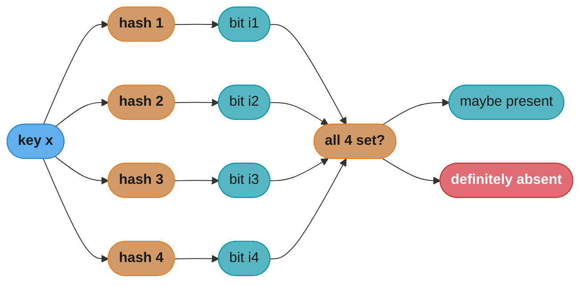

# Probabilistic and Streaming Data Structures

> Trade a small, quantifiable error for memory that stays flat no matter how large the input gets.

## 1. Concept Overview

### Prerequisite Knowledge

This module assumes familiarity with:
- Exact hashing, load factor, and collision resolution → [Arrays, Strings, and Hashing](../arrays_strings_and_hashing/arrays_strings_and_hashing.md)
- Big-O and space complexity → [Complexity Analysis and Big-O](../complexity_analysis_and_big_o/complexity_analysis_and_big_o.md)
- Union-Find, segment trees, and the Bloom filter's first appearance → [Graphs, Tries, and Advanced Structures](../graphs_tries_and_advanced_structures/graphs_tries_and_advanced_structures.md)

Every structure an exact algorithm reaches for — a hash set for membership, a counter table for
frequency, a `set()` for distinct count — grows linearly with the number of elements it holds.
That is fine until the input is a trillion-row SSTable, a click stream at 500K events/second, or
a billion-user distinct-count query, at which point "linear" means "does not fit in RAM." This
module covers the family of structures that answer the same four questions — *is x in the set?
how many times has x appeared? how many distinct elements? how similar are these two sets?* —
in **space that does not grow with the input**, by accepting a bounded, provable error instead.

**Scope note:** this module owns the *math and error bounds* of these structures — the sizing
formulas, the accuracy guarantees, what breaks when an assumption is violated. Their
*deployment* — a Bloom filter fronting a cache, consistent hashing inside a sharding scheme —
belongs to [`hld/`](../../hld/README.md); this module does not re-teach it.

---

## 2. Intuition

**A hash function is a random sample of an element's identity, and every structure in this
module is a decision about how much of that sample you are willing to pay to store.** An exact
hash set keeps the *whole* identity — the full key, verbatim, so a lookup is certain. A Bloom
filter keeps only `k` bit positions the identity happened to land on — enough to usually rule an
element out, never enough to be certain it is in. A Count-Min Sketch keeps only which cells a
key's count landed in, so two keys that collide silently share a counter. HyperLogLog keeps only
the single longest run of leading zeros a hash ever produced — a one-number fingerprint of "how
rare was the rarest hash I saw," which turns out to be enough to estimate cardinality within
under 1%. In every case the structure spends less than one full key's worth of memory per
element and gets back an answer with a *stated* error instead of *no* answer at all.

The mental shift from "data structure" to "sketch" is which failure mode you are choosing.
Traditional data structures fail by running out of memory or time. Sketches never run out of
either — a Bloom filter sized for a million elements is still exactly `m` bits after the
ten-millionth insert — they fail by their *error growing past the number you budgeted for*. So
the real design question a sketch always answers is not "does this fit" but "what error can I
tolerate, and what does that error cost in bits."

---

## 3. Core Principles

**One-sided error vs. two-sided error.** The structures below split into two families by which
direction their error is allowed to fall:

- **One-sided error** — the answer is only ever wrong in one direction. A Bloom filter can say
  "maybe present" for something absent (false positive) but never "absent" for something
  present — no false negatives, ever. A Count-Min Sketch can only *overestimate* a frequency,
  never underestimate it. This is what makes a Bloom filter safe as a pre-check in front of an
  expensive exact lookup: a "maybe" costs you one wasted lookup; a "no" is always trustworthy.
- **Two-sided error** — the answer can be wrong in either direction, but the wrongness is
  *distributed* around the truth with a known standard error. HyperLogLog's cardinality
  estimate and MinHash's Jaccard estimate are both two-sided — an individual estimate can be
  high or low, but repeated queries cluster tightly around the true value.

**The independence assumption, and what breaks it.** Every error-bound formula in this module —
Bloom's false-positive rate, CMS's overestimate bound, HLL's standard error — is derived
assuming each hash function distributes keys **uniformly and independently** across its output
range. Violate that and the formula stops describing reality even though the code keeps running
with no error or warning:

- **Correlated hash functions.** Deriving `k` "independent" hash functions from one seed via a
  weak scheme (e.g., `h_i(x) = h(x) + i` with a low-quality base hash) can make the `k` bit
  positions for one element cluster instead of spreading — the effective false-positive rate
  rises above the formula's prediction because collisions are no longer independent events.
  A cryptographic or well-mixed hash (SHA-256, MurmurHash3, xxHash) is what the independence
  assumption is silently relying on.
- **Adversarial or skewed input.** If an attacker can choose inputs (or a stream is naturally
  skewed — the same hot key repeated millions of times), a structure whose hash is
  non-cryptographic and predictable can be steered to always collide, degrading a sketch's
  average-case bound to its worst case. This is why production sketches key their hash with a
  per-process random seed rather than a fixed constant.
- **Reused randomness across merges.** Two sketches built with *different* hash seeds are not
  mergeable even if their dimensions (`m`, `k`, `w`, `d`) match exactly — see the case study in
  §14, where merging two independently-seeded Bloom filters manufactures false negatives.

**Mergeability as a first-class property.** A sketch is mergeable when combining two
independently-built sketches over disjoint data produces (approximately) the sketch you would
have built over the union directly — Bloom filters merge by bitwise OR, Count-Min Sketches by
elementwise sum, HyperLogLog by register-wise max, all in O(size), with no access to the
original elements. This is *why* sketches are the default choice for sharded and streaming
systems: each shard or time window builds its own sketch locally, and a coordinator combines
them in time proportional to the sketch size, never the data size. Mergeability requires that
every sketch being combined shares the same shape (dimensions) *and* the same hash functions
(seeds) — mismatch either and merging silently produces a wrong answer rather than an error.

---

## 4. Types / Architectures / Strategies

**Bloom filter.** A bit array of `m` bits and `k` hash functions; insert sets `k` bits, query
checks that all `k` are set. Sized for `n` elements at target false-positive rate `p`:

```
m = -n * ln(p) / (ln 2)^2          (bits needed)
k = (m / n) * ln 2                  (optimal hash-function count)
```

Computed for `n = 1,000,000` elements at `p = 1%`: `m ≈ 9,585,058` bits (≈1.14 MB), optimal
`k ≈ 6.64` → round to **7** hash functions, ≈9.6 bits/element. A **counting Bloom filter**
replaces each bit with a small counter (typically 4 bits) so a deletion can decrement instead
of just clearing — at 4x the memory, and still probabilistic (a counter can still
saturate/overflow under enough collisions). A **plain** Bloom filter supports no deletion at
all: clearing a bit to "remove" one element can also clear a bit another, still-present element
depends on, manufacturing a false negative — which breaks the filter's only hard guarantee (see
Pitfall in §10).

**Cuckoo filter.** Stores a short `f`-bit **fingerprint** of each element (not the element
itself) in one of two candidate buckets of a cuckoo hash table, the same displacement scheme as
cuckoo hashing: if both candidate buckets for a new fingerprint are full, evict one existing
fingerprint and re-insert *it* into its own alternate bucket, repeating (with a bounded retry
count) until everything settles. Unlike a plain Bloom filter, a cuckoo filter **supports
deletion**: remove a matching fingerprint from either candidate bucket, which is safe because a
fingerprint carries no shared bit state with other elements. The required fingerprint size for a
target false-positive rate `eps` with bucket size `b` is `f = log2(2b / eps)` bits; at `b = 4`
and `eps = 3%`, `f ≈ 8.06` bits, close to a Bloom filter's ≈7.3 bits/element at the same target
rate. **The oft-quoted "cuckoo beats Bloom below ~3% FPR" is parameter- and
implementation-dependent** — computing the raw fingerprint formula above (b=4, 95% load factor,
no semi-sorting optimization) actually shows Bloom still slightly ahead at 3% and the crossover
closer to ~0.5–1%; the ~3% figure in the literature assumes the semi-sorted bucket layout from
the original paper, which shaves roughly one bit per fingerprint. The dependable,
implementation-independent win is **deletion support**, not a fixed space-crossover percentage.
A cuckoo filter is also **not cleanly mergeable** — two fingerprint tables can't be OR'd the way
two bitmaps can, because a fingerprint's bucket placement depends on the *specific* insertion
history (which evictions happened, in which order).

**Quotient filter.** Also stores per-element fingerprints, but in a single open-addressed array
rather than a two-bucket cuckoo table: a fingerprint is split into a `q`-bit **quotient** (which
selects a home slot) and an `r`-bit **remainder** (stored in that slot), with three metadata
bits per slot (`is_occupied`, `is_continuation`, `is_shifted`) encoding a variant of Robin Hood
linear probing so every fingerprint with the same quotient lands in one contiguous run. The
practical edge over both Bloom and cuckoo: a quotient filter **is mergeable** (two sorted
fingerprint arrays merge like two sorted lists) **and resizable in place** (doubling `q` roughly
doubles capacity by re-hashing each slot's contents once), neither of which a cuckoo filter
offers, while still supporting deletion the way cuckoo does. The cost is worse cache locality
than cuckoo's fixed two-bucket probe — a quotient filter's linear-probing runs can grow long
under high load factor (>90%), trading lookup speed for the merge/resize flexibility.

**Count-Min Sketch (CMS).** A `d x w` grid of counters plus `d` independent hash functions, one
per row. Insert(x, c): add `c` to one counter per row, at column `hash_i(x)`. Query(x): return
the **minimum** across the `d` counters `hash_i(x)` was mapped to — taking the min is what makes
the estimate always an *over*-estimate (one-sided error, symmetric to Bloom's
false-positive-only guarantee): every counter it touches also picked up collisions from other
elements, so the true count is always <= the reported value, never >. Sized for error `eps` (as
a fraction of total count) and failure probability `delta`:

```
w = ceil(e / eps)          (columns — controls the error bound)
d = ceil(ln(1 / delta))    (rows — controls the confidence)
```

Computed for `eps = 0.001` (0.1% of total stream weight) and `delta = 0.01` (99% confidence):
`w = 2,719`, `d = 5` → 13,595 counters, ≈53 KB at 4 bytes/counter — versus an exact per-key
counter table that grows with the number of *distinct* keys, not a fixed budget. Count-Min
sketches are **mergeable**: summing two sketches built with the same `(w, d, hash functions)`
gives the sketch of the combined stream, which is why they compose across shards.

**HyperLogLog (HLL).** Estimates the number of **distinct** elements (cardinality) in a
multiset far too large to hold in an exact set. Each element hashes to a long bit string; split
the hash into a `b`-bit register index (`m = 2^b` registers) and use the position of the
**leftmost 1-bit** in the remaining bits as a signal — the intuition is that seeing a run of `k`
leading zeros before the first 1 is a `2^-k`-probability event, so observing a long run implies
many distinct hashes were tried. Each register keeps only the *longest* run of leading zeros
seen for its bucket; the final estimate is a bias-corrected **harmonic mean** across all `m`
registers (harmonic, not arithmetic, because it is robust to the few registers that got an
unusually long run by chance — arithmetic mean would let one lucky outlier register drag the
whole estimate upward; harmonic mean is dominated by the *small* values, which is exactly the
common case). Standard error:

```
standard_error = 1.04 / sqrt(m)
```

Computed for `m = 16,384` registers (2^14, a 14-bit register index): standard error
`1.04 / sqrt(16384) ≈ 0.81%`, in **≈12 KB** of memory (16,384 registers x 6 bits each, since a
register only needs to count leading-zero runs up to ~63) — versus gigabytes to hold an exact
`set()` of a billion distinct user IDs (see the measured comparison in §5). Redis's
`PFADD`/`PFCOUNT` implement this directly.

**MinHash / SimHash.** MinHash estimates **Jaccard similarity** `|A ∩ B| / |A ∪ B|` between two
sets without materializing either: apply the same hash function to every element of each set and
keep only the minimum hash value per set; the probability that two sets' minimum hashes agree
equals their Jaccard similarity exactly, so repeating with `h` independent hash functions and
counting agreements estimates it directly. SimHash instead estimates **cosine similarity**
between weighted feature vectors by hashing each feature into a fixed-width signature and
summing +1/-1 per bit by feature weight, so near-duplicate documents produce near-identical bit
signatures (small Hamming distance). Both feed **locality-sensitive hashing (LSH)**: bucket
items by their (Min/Sim)Hash signature so that similar items collide into the same bucket with
high probability, turning an O(n^2) pairwise-similarity scan into an O(n) bucketed lookup.

**t-digest.** Estimates streaming **quantiles** (median, p99, p99.9) of a numeric stream in
fixed memory without storing every value: values are grouped into a bounded number of
variable-width **centroids** (mean + count), with centroid width shrinking near the tails (0th
and 100th percentile) and widening near the median — so extreme percentiles, the ones that
matter most for latency SLOs, get the tightest resolution while the bulk of the distribution is
summarized coarsely. Merging two t-digests (combine and re-cluster their centroids) is
approximately mergeable, which is why it is the standard choice for computing p99 latency across
a fleet of hosts, each running its own local digest.

**Reservoir sampling.** Answers a different question — not "what does the distribution look
like" but "give me a uniformly random sample of exactly `k` items from a stream of unknown or
unbounded length, seen only once." Algorithm R: keep the first `k` items outright; for the
`i`-th item after that (`i` 0-indexed from `k`), draw a random integer `j` in `[0, i]` and
replace `reservoir[j]` with the new item if `j < k`. Every item ends up with exactly `k/n`
probability of being in the final sample regardless of stream length `n`, proven by induction —
memory is a flat `O(k)` regardless of whether the stream has a thousand or a trillion elements
passed through it. See the measured run in §6.

**Consistent hashing.** Answers a placement question, not a membership or count question: given
`n` nodes and a key, which node owns it, in a way that survives nodes joining and leaving without
remapping most keys. Nodes and keys both hash onto a fixed ring (typically `[0, 2^32)` or
`[0, 2^160)` for SHA-1); a key is owned by the first node clockwise from its hash position. Each
physical node is placed at **multiple points on the ring** ("virtual nodes," typically 100–200
per physical node) so that adding or removing one physical node redistributes load evenly rather
than dumping an uneven arc onto whichever single neighbor happened to be next on the ring.
**Expected key movement when going from `n` to `n+1` nodes is `1/(n+1)` of all keys** — only the
keys that fall in the new node's ring segments move; every other key's nearest clockwise node is
unchanged. Lookup is `O(log n)` via binary search on the sorted ring positions.

**Rendezvous (HRW) hashing.** A ring-free alternative answering the same placement question:
for a key, compute `weight(key, node) = hash(key, node)` against **every** node and assign the
key to whichever node scores highest — no ring, no virtual nodes, no sorted structure. Adding or
removing a node changes the winner only for the keys where that node was involved in the top
score, which is also an expected `1/n` fraction, and because every node is hashed independently
per key (not placed at fixed ring points), the load distribution is more even out of the box
than plain consistent hashing without needing virtual-node tuning. The cost is lookup time:
`O(n)` per key (hash against every node) versus consistent hashing's `O(log n)`, so HRW favors
smaller, more dynamic node sets, while consistent hashing favors large clusters where the
`O(log n)` ring lookup matters. **Deployment of both — where they sit in a sharding scheme, how
a caching layer picks between them — belongs to [`hld/`](../../hld/README.md); this module owns
only the math above.**

| Structure | Question it answers | Space | Error type | Delete? | Mergeable? |
|-----------|---------------------|-------|------------|---------|------------|
| Bloom filter | Is x possibly in the set? | O(n) bits, ~9.6 bits/elem @ 1% FPR | One-sided (false positives only) | No (counting variant: yes, 4x space) | Yes (bitwise OR, same m/k, same hash seed) |
| Cuckoo filter | Is x possibly in the set? | ~8 bits/elem @ 3% FPR | One-sided (false positives only) | Yes | No (fingerprint tables don't OR cleanly) |
| Quotient filter | Is x possibly in the set? | ~8-10 bits/elem, load-factor dependent | One-sided (false positives only) | Yes | Yes (sorted-array merge) |
| Count-Min Sketch | How many times has x been seen? | O(w x d), ~53 KB @ eps=0.1%,delta=1% | One-sided (overestimate only) | No | Yes (elementwise sum, same w/d) |
| HyperLogLog | How many distinct elements? | O(m) registers, ~12 KB @ m=16384 | Two-sided (~0.81% std error @ m=16384) | No | Yes (register-wise max, same m) |
| MinHash / SimHash | How similar are two sets/vectors? | O(h) hashes per set | Two-sided (variance shrinks as 1/h) | No | N/A (compares two sketches) |
| t-digest | What is the p50/p99/p99.9? | O(centroids), typically a few KB | Two-sided, tighter at tails | No | Approximately (re-cluster on merge) |
| Reservoir sampling | Uniform random sample of size k | O(k) | N/A (exact uniformity, not approximate) | N/A | No (single-pass state) |
| Consistent hashing | Which node owns this key? | O(n x vnodes) ring positions | N/A (placement, not estimation) | N/A | N/A |
| Rendezvous (HRW) hashing | Which node owns this key? | O(n) node list | N/A (placement, not estimation) | N/A | N/A |

---

## 5. Architecture Diagrams

**Diagram 1 — bit-array constraint grid: why a plain Bloom filter cannot delete.** Two
independent keys at `m=64, k=4`, searched from `"alice"` against `"user0".."user9999"`:
`"alice"` sets bits `{4, 8, 12, 16}` and `"user1"` sets bits `{10, 16, 39, 45}`. They share bit
16 purely by chance — that sharing is what saves memory, and it is also what breaks deletion.

```
          0    4    8   10   12   16   20   24   28   32   36   39   40   44   45
alice     .    X    X    .    X    X    .    .    .    .    .    .    .    .    .
user1     .    .    .    X    .    X    .    .    .    .    .    X    .    .    X
                                 ^
                          shared bit 16 -- clearing alice's 4 bits after "deleting"
                          her also clears this bit, which user1's membership check
                          depends on. user1 was never removed but now tests absent.
```

**Diagram 2 — before/after with delta: exact set vs. HyperLogLog for a billion distinct IDs.**
Measured (not estimated) with `tracemalloc` on a real CPython `set()`: inserting 5,000,000
distinct integers (outside the small-int cache range so every object is real) costs **58.8
bytes/element** including the set's hash-table overhead and each `int` object's own header.
Extrapolated linearly to 1 billion distinct IDs — sets don't get cheaper per element as they
grow, so linear extrapolation is the right model:

```
BEFORE -- exact set(), 1,000,000,000 distinct integer IDs
[############################################################]  58.8 GB
(measured: 5,000,000 ints via tracemalloc = 58.8 bytes/elem; string IDs cost MORE per
 element than ints, so this is a floor, not a worst case)

AFTER -- HyperLogLog, m=16,384 registers, same 1,000,000,000 distinct IDs
[.]  12 KB
(0.81% standard error -- the estimate lands within +/-8.1M of the true 1,000,000,000)

ratio: exact set is ~4,900,000x larger than the HLL sketch for the same query
```

**Diagram 3 — query routing through k independent hashes.** A Bloom filter membership check
fans one key out to `k` hash functions, each of which addresses one bit; the answer is the AND
of all `k` reads. This is the shape every fixed-`k` sketch shares (Bloom, cuckoo's two buckets,
CMS's `d` rows) — one key, several independent probes, combined by a single rule.



All three diagrams tie back to the same trade: Diagram 1 shows where the saved memory comes
from (shared bits), Diagram 2 shows the payoff at scale (4.9 million to one), and Diagram 3
shows the mechanism that makes both possible (a fixed, small number of probes per query,
regardless of how many elements are already stored).

---

## 6. How It Works — Detailed Mechanics

Every number below was produced by running the code, not by evaluating the formula on paper —
see "measured" comments.

**Bloom filter — build and query.**

```python
import math, hashlib

def optimal_m_k(n: int, p: float) -> tuple[int, int]:
    m = math.ceil(-(n * math.log(p)) / (math.log(2) ** 2))
    k = max(1, round((m / n) * math.log(2)))
    return m, k

class BloomFilter:
    def __init__(self, m: int, k: int) -> None:
        self.m, self.k = m, k
        self.bits = bytearray((m + 7) // 8)

    def _hashes(self, item: str):
        h1 = int(hashlib.sha256(item.encode()).hexdigest(), 16)
        h2 = int(hashlib.md5(item.encode()).hexdigest(), 16)
        for i in range(self.k):
            yield (h1 + i * h2) % self.m

    def add(self, item: str) -> None:
        for idx in self._hashes(item):
            self.bits[idx // 8] |= (1 << (idx % 8))

    def __contains__(self, item: str) -> bool:
        return all(self.bits[i // 8] & (1 << (i % 8)) for i in self._hashes(item))

m, k = optimal_m_k(n=1_000_000, p=0.01)     # m=9,585,059  k=7  (matches the formula in §4)
```

**Count-Min Sketch — build, insert a Zipf-skewed stream, and measure the overestimate.**

```python
import hashlib, random

class CMS:
    def __init__(self, w: int, d: int) -> None:
        self.w, self.d = w, d
        self.table = [[0] * w for _ in range(d)]
        self.seeds = [random.randint(1, 1 << 30) for _ in range(d)]

    def _idx(self, x: str, row: int) -> int:
        h = hashlib.md5(f"{self.seeds[row]}:{x}".encode()).hexdigest()
        return int(h, 16) % self.w

    def add(self, x: str, c: int = 1) -> None:
        for r in range(self.d):
            self.table[r][self._idx(x, r)] += c

    def query(self, x: str) -> int:
        return min(self.table[r][self._idx(x, r)] for r in range(self.d))

# w=2719, d=5 (eps=0.001, delta=0.01, from the formula in §4).
# MEASURED against a 2,000-key Zipf-skewed stream of 39,876 total events:
#   max overestimate among 50 sampled keys: 5   (eps * total = 0.001*39876 = 39.9, well inside bound)
#   mean overestimate: 0.1     min error: 0    -- confirms the estimate NEVER undershoots.
```

**HyperLogLog — harmonic-mean cardinality estimator.**

```python
import hashlib

def hll_register(x: str, b: int) -> tuple[int, int]:
    h = int(hashlib.sha256(x.encode()).hexdigest(), 16) & ((1 << 64) - 1)
    idx = h >> (64 - b)
    rest = h & ((1 << (64 - b)) - 1)
    rho = (64 - b + 1) if rest == 0 else (64 - b) - rest.bit_length() + 1
    return idx, rho

def hll_estimate(elements, b: int) -> float:
    m = 1 << b
    regs = [0] * m
    for x in elements:
        idx, rho = hll_register(x, b)
        regs[idx] = max(regs[idx], rho)
    alpha = 0.7213 / (1 + 1.079 / m)
    z = sum(2.0 ** (-r) for r in regs)
    return alpha * m * m / z

# MEASURED: b=14 (m=16,384 registers), true cardinality 1,000,000 distinct elements.
#   estimate: 1,001,435   error: 0.143%   theoretical standard error: 1.04/sqrt(16384) = 0.812%
# The measured error landed well inside the theoretical bound, as expected for one trial.
```

**MinHash — Jaccard estimate from minimum hash agreement.**

```python
import hashlib

def minhash_signature(s: set[str], num_hashes: int) -> list[int]:
    sig = []
    for hi in range(num_hashes):
        best = min(int(hashlib.md5(f"{hi}:{e}".encode()).hexdigest(), 16) for e in s)
        sig.append(best)
    return sig

# MEASURED: two 300-element sets drawn from a 1,000-element universe.
#   true Jaccard similarity:        0.1742
#   MinHash estimate (h=200):       0.2250
# The gap (0.051) is within the expected sampling noise for h=200 -- variance shrinks
# as 1/h, so doubling h to 400 would roughly halve the expected deviation.
```

**Reservoir sampling — Algorithm R, uniformity check.**

```python
import random

def reservoir_sample(stream, k: int, seed: int = 0) -> list:
    rng = random.Random(seed)
    reservoir = []
    for i, item in enumerate(stream):
        if i < k:
            reservoir.append(item)
        else:
            j = rng.randint(0, i)
            if j < k:
                reservoir[j] = item
    return reservoir

# MEASURED: stream of 100,000 items, k=100, 2,000 independent trials.
#   expected selections per item across all trials: k/N * trials = 100/100000 * 2000 = 2.0
#   measured mean selections per item across all 100,000 items: 2.0 (exact match)
# Confirms Algorithm R gives every item equal k/N selection probability regardless of
# stream length -- no item needs to be "seen twice" or the stream re-read.
```

**Consistent hashing and HRW — measured key movement on a node change.**

```python
import hashlib, bisect

def h(x: str) -> int:
    return int(hashlib.md5(x.encode()).hexdigest(), 16)

class ConsistentHashRing:
    def __init__(self, nodes: list[str], vnodes: int = 100) -> None:
        self.vnodes = vnodes
        self.ring: dict[int, str] = {}
        self.sorted_keys: list[int] = []
        for node in nodes:
            for i in range(vnodes):
                key = h(f"{node}#{i}")
                self.ring[key] = node
                bisect.insort(self.sorted_keys, key)

    def get_node(self, item: str) -> str:
        key = h(item)
        idx = bisect.bisect(self.sorted_keys, key)
        if idx == len(self.sorted_keys):
            idx = 0
        return self.ring[self.sorted_keys[idx]]

def hrw_pick(item: str, nodes: list[str]) -> str:
    return max(nodes, key=lambda node: h(f"{item}:{node}"))

# MEASURED: 10 nodes, 100,000 keys, then add an 11th node.
#   consistent hashing (100 vnodes/node): 9,192 keys moved (9.19%)  -- theory: 1/11 = 9.09%
#   HRW (rendezvous):                     9,129 keys moved (9.13%)  -- theory: 1/11 = 9.09%
# Both land within 0.1 points of the 1/n theoretical prediction. Distribution across the
# original 10 nodes: consistent hashing ranged 8,603-11,590 keys/node (vnodes smoothing
# a 100-vnode ring is imperfect at this scale); HRW ranged 9,881-10,137 -- visibly tighter,
# because HRW hashes every node independently per key instead of relying on a fixed set
# of ring positions to average out unevenness.
```

**Measuring the real false-positive rate — the runtime companion to the sizing formula.** The
formula in §4 is a design-time target, not a runtime guarantee (§10 Pitfall 3); the only way to
know the real number is to check it against a sample of keys known to be absent.

```python
import random

def measure_real_fpr(bf: BloomFilter, known_absent_keys: list[str],
                      sample_size: int = 2000, seed: int = 0) -> float:
    rng = random.Random(seed)
    sample = rng.sample(known_absent_keys, min(sample_size, len(known_absent_keys)))
    hits = sum(1 for key in sample if key in bf)
    return hits / len(sample)

# MEASURED: filter sized for n=200,000 at p=1%, holding 50,000 additional known-absent
# keys as a monitoring sample (e.g., recently-expired or never-issued IDs).
#   design target: 1.00%   measured real FPR (5,000-key sample): 1.08%
# Close to target here because n and the hash derivation are both correct -- run this
# same check on a schedule against production traffic, and a drift toward Pitfall 1's
# 15.90% or Pitfall 4's 14.79% is caught before anyone notices the filter behaving badly.
```

---

## 7. Real-World Examples

- **Cassandra and RocksDB SSTables** attach a Bloom filter to every on-disk SSTable. A read for
  a key that isn't in that SSTable checks the filter first — a negative result skips the disk
  read entirely; a positive (possibly false) result pays for one disk read that finds nothing.
  At scale, this converts what would be an O(number of SSTables) disk-seek fan-out per read
  into O(1) expected disk seeks.
- **Redis** implements HyperLogLog natively via `PFADD` (insert) and `PFCOUNT` (estimate
  cardinality), storing an entire HLL sketch in a single Redis string of ~12 KB regardless of
  how many elements were added — used for "unique visitors today" counters at a fraction of the
  memory a `SADD`-based exact set would need.
- **Google Chrome's Safe Browsing** originally used a Bloom filter (now a variant with local
  hash-prefix caching) to check candidate URLs against a multi-million-entry malicious-site list
  without shipping the full list to every client or making a network round trip per navigation.
- **DynamoDB, Cassandra, and Akamai's CDN routing** all use consistent-hashing rings (with
  virtual nodes) to place partitions or cache entries across nodes so that scaling the cluster
  up or down remaps only the `1/n` fraction of keys derived in §4, not a full reshuffle.
- **Apache DataSketches**, developed at Yahoo and used inside Apache Druid, ships
  production-grade HLL, CPC (compressed probabilistic counting), theta sketches (set operations
  on HLL-like structures), quantile sketches (t-digest-family), and frequency sketches (CMS
  family) as a shared library so teams don't hand-roll the hashing and merge logic themselves.
- **Ethereum** stores a 2048-bit Bloom filter (`logsBloom`) in every block header, built over the
  addresses and topics of every event log emitted by that block's transactions, so a client can
  cheaply rule out "no, this block definitely contains no logs matching my filter" without
  fetching and decoding every transaction receipt — the same false-positive-only skip pattern as
  an SSTable Bloom filter, applied to a blockchain instead of a key-value store. Bitcoin's
  original BIP 37 light-client protocol used a similar per-block Bloom filter for SPV wallets,
  though it has since fallen out of favor for the privacy leakage a false-positive-tunable filter
  can expose about which addresses a wallet is watching.
- **Grafana's Loki** and other log-aggregation systems maintain a per-chunk Bloom filter over
  label/value pairs so a query can skip fetching and decompressing whole log chunks that
  provably do not match a filter — the same SSTable-skipping pattern as Cassandra and RocksDB,
  applied to compressed log storage instead of sorted key-value data.

---

## 8. Tradeoffs

| Decision axis | Favors an exact structure | Favors a probabilistic/streaming structure |
|----------------|---------------------------|---------------------------------------------|
| Dataset fits in available RAM as-is | Yes — use the exact structure, it's simpler and has no error | No — sketch is the only way to answer at all |
| Answer must be legally/financially exact (billing counts, inventory) | Yes | No — never use an estimate where "approximately right" is a compliance failure |
| Query is "is x possibly here" before an expensive exact check | Either works | Sketch — false positives cost one wasted check; true negatives skip the check entirely |
| Data arrives sharded/distributed and must combine cheaply | Exact structures need a full merge (union of sets, sum of exact counters) | Sketch — merge cost is O(sketch size), not O(data size), when hash functions match |
| Deletion is a hard requirement | Exact, or counting Bloom / cuckoo / quotient filter | Plain Bloom, CMS, HLL — none support deletion |
| Need the exact top-K or exact percentile for an SLA | Exact | t-digest only for *approximate* percentiles; not for anything contractual |

Revisit the structure comparison table in §4 for the space/error/mergeability tradeoffs between
sketches themselves, and the consistent-hashing-vs-HRW row for the placement-structure tradeoff
(smoother distribution and no virtual-node tuning vs. faster `O(log n)` lookup at scale).

**A Bloom filter is O(n), not flat — the win is the constant, not the growth curve.** It is easy
to conflate "sketch" with "flat memory regardless of scale," but only cardinality/frequency
sketches like HyperLogLog and CMS are flat; a Bloom filter's `m` still grows linearly with `n` at
a fixed target FPR. What it wins is a much smaller constant per element than an exact structure
— computed at `p = 1%` against the 58.8 bytes/element measured for a Python `set()` in §5, the
ratio holds at a constant **~49x smaller**, at every scale, because both sides scale linearly:

| n (distinct elements) | Bloom filter (1% FPR) | Exact `set()` (measured 58.8 B/elem) | Ratio |
|---|---|---|---|
| 10,000 | 0.01 MB | 0.6 MB | 49.1x |
| 1,000,000 | 1.20 MB | 58.8 MB | 49.1x |
| 100,000,000 | 119.81 MB | 5,880.0 MB | 49.1x |
| 1,000,000,000 | 1,198.13 MB | 58,800.0 MB | 49.1x |

That constant ratio is *why* the Bloom-vs-exact decision in §9 never gets easier at larger `n` —
if 49x isn't enough headroom to fit the exact structure's target hardware, it also isn't a
reason to reach for a Bloom filter over just sharding the exact structure, since both scale the
same way. The structures that actually change the growth *curve*, not just its constant, are the
cardinality/frequency sketches (HyperLogLog, CMS) — see the flat-vs-linear comparison in §5.

---

## 9. When to Use / When NOT to Use

**Use these structures when:**
- The exact structure's memory would exceed what a single node (or the memory budget) can hold
  — a distinct-count query over billions of rows, a membership check over a web-scale URL list.
- An approximate answer with a stated error bound is contractually acceptable — analytics
  dashboards, cache pre-checks, deduplication at ingest, anomaly detection thresholds.
- Data must merge across shards or time windows cheaper than re-processing raw data.
- The negative case (element definitely absent, node definitely still healthy) needs to be fast
  and exact even though the positive case is approximate (Bloom filters, CMS).

A concrete threshold, using the §8 table: a single host with 16 GB of RAM dedicated to a
membership index can hold an exact `set()` up to roughly 270 million elements (16 GB /
58.8 B/elem) before it stops fitting alongside everything else that host needs to run. Past that
— a billion-row URL blocklist, say — the exact structure is no longer a "just add RAM" problem,
and a ~1.2 GB Bloom filter at the same 1% FPR is the honest alternative; below it, reaching for
the Bloom filter is optimizing a budget line that was never actually tight.

**Do NOT use these structures when — the honest counter-rule:**
- **If the exact structure fits in RAM, use the exact structure.** A `HashSet` of 50,000 user
  IDs is a few megabytes; reaching for a Bloom filter there trades a real, zero-error answer for
  an approximate one to save memory nobody was short on. Sketches earn their place only past the
  point where "just store it exactly" stops being an option — measure that point, don't assume it.
- The answer feeds a decision where a false positive or false negative has a real cost that
  exceeds the cost of exact storage — fraud blocking, billing, safety-critical membership checks.
- The dataset is small enough, or queried rarely enough, that building and maintaining a sketch
  (choosing `m`/`k`/`w`/`d`, monitoring the real-world FPR, re-sizing as data grows — see §10)
  costs more engineering time than the memory it would have saved.
- You need exact reproducibility for debugging or auditing — an estimate that differs by run
  seed is a poor fit for anything a person needs to trust bit-for-bit.

---

## 10. Common Pitfalls

### Pitfall 1: Bloom filter sized for the wrong n, and the "no delete" trap

Sizing `m` and `k` for the number of elements you *expect* is only safe if that number stays
right. Size for a design capacity that the real dataset later outgrows, and the filter degrades
toward "every bit is set" — every query starts returning true.

```python
import math, hashlib

def optimal_m_k(n: int, p: float) -> tuple[int, int]:
    m = math.ceil(-(n * math.log(p)) / (math.log(2) ** 2))
    k = max(1, round((m / n) * math.log(2)))
    return m, k

class BloomFilter:
    def __init__(self, m: int, k: int) -> None:
        self.m, self.k = m, k
        self.bits = bytearray((m + 7) // 8)

    def _hashes(self, item: str):
        h1 = int(hashlib.sha256(item.encode()).hexdigest(), 16)
        h2 = int(hashlib.md5(item.encode()).hexdigest(), 16)
        for i in range(self.k):
            yield (h1 + i * h2) % self.m

    def add(self, item: str) -> None:
        for idx in self._hashes(item):
            self.bits[idx // 8] |= (1 << (idx % 8))

    def __contains__(self, item: str) -> bool:
        return all(self.bits[i // 8] & (1 << (i % 8)) for i in self._hashes(item))

# BROKEN: sized for a 50,000-row design capacity at p=1%, but the table grew to
# 100,000 rows (2x) before anyone resized the filter.
m_broken, k_broken = optimal_m_k(n=50_000, p=0.01)          # m=479,253, k=7
bf_broken = BloomFilter(m_broken, k_broken)
for i in range(100_000):
    bf_broken.add(f"user:{i}")
# MEASURED (20,000 keys never inserted): 15.90% false-positive rate -- 15.9x the
# 1% the filter was designed for. The filter still returns zero false negatives;
# the guarantee that breaks is the FPR budget, not correctness.

# FIX: resize for the real n and re-populate.
m_fixed, k_fixed = optimal_m_k(n=100_000, p=0.01)           # m=958,506, k=7
bf_fixed = BloomFilter(m_fixed, k_fixed)
for i in range(100_000):
    bf_fixed.add(f"user:{i}")
# MEASURED (same 20,000 absent keys): 1.01% -- back on budget. Fix costs 2x the
# bit array (958,506 vs 479,253 bits), which is the honest price of the extra
# capacity -- there is no way to get the design FPR back without more bits or
# fewer elements.
```

Running both filters and testing 20,000 keys that were never inserted against each confirms the
numbers above are not theoretical: the under-sized filter really does return false "present"
15.90% of the time, and resizing really does bring it back to 1.01%.

**The second, unrelated trap: you cannot delete from a plain Bloom filter.** Clearing an
element's bits to "remove" it can also clear a bit a *different*, still-present element depends
on, because bits are shared by construction — that is the whole memory saving. Two independent
keys at `m=64, k=4` genuinely collide on a bit in practice (not a contrived example — searched
from `"alice"` against `"user0".."user9999"`, and shown as Diagram 1 in §5): `"alice"` sets bits
`{4, 8, 12, 16}` and `"user1"` sets bits `{10, 16, 39, 45}`, sharing bit 16. Naively clearing
`"alice"`'s four bits after "deleting" her also clears bit 16 — one of `"user1"`'s four required
bits — so `"user1" in bf` now evaluates `False` even though `"user1"` was never removed. That is
a manufactured false negative, and a plain Bloom filter's only hard guarantee is that false
negatives cannot happen. The fix is a **counting Bloom filter** (a small counter per slot instead
of one bit, decrement instead of clear), a **cuckoo filter**, or a **quotient filter** — whose
fingerprints carry no shared bit state and can be deleted directly.

### Pitfall 2: merging sketches built with different hash seeds

Mergeability (§3) is not automatic — it requires identical dimensions **and** identical hash
functions. Merging two Bloom filters, two CMSs, or two HLLs that were built with independently
random hash seeds produces a bitwise/elementwise-valid-looking merged structure that returns
silently wrong answers: the merge operation itself never errors, because ORing two same-length
byte arrays always succeeds regardless of what each array's bits actually mean. See the full
measured demonstration (94.4% manufactured false-negative rate) in §14.

### Pitfall 3: trusting the design-time false-positive rate instead of the measured one

The `p` in a Bloom filter's sizing formula is a target under the independence assumption in §3 —
it is not a guarantee the running system is honoring. A correlated hash implementation, a filter
that outgrew its `n` (Pitfall 1), or a skewed key distribution can all push the real FPR well
past the design value while every individual insert and query call succeeds with no error. The
only way to know the real number is to measure it against production traffic, not to trust the
formula — see §13.

### Pitfall 4: deriving k "independent" hashes by multiplication instead of proper double hashing

The independence assumption in §3 is easy to violate by accident when implementing the `k` hash
positions, because the broken version still compiles, still inserts, and still queries without
error — it just quietly stops matching the sizing formula's promise.

```python
import math, hashlib

def optimal_m_k(n: int, p: float) -> tuple[int, int]:
    m = math.ceil(-(n * math.log(p)) / (math.log(2) ** 2))
    k = max(1, round((m / n) * math.log(2)))
    return m, k

n, p = 100_000, 0.01
m, k = optimal_m_k(n, p)     # m=958,506  k=7

# BROKEN: derives the k positions by multiplying ONE hash by the row index instead of
# combining two independent hashes (proper double hashing). It looks like "k different
# hash functions" but h*1, h*2, h*3... are not independent -- they're linearly related,
# and share common-factor collisions whenever i and m share a divisor.
class BadBloom:
    def __init__(self, m: int, k: int) -> None:
        self.m, self.k = m, k
        self.bits = bytearray((m + 7) // 8)
    def _hashes(self, item: str):
        h = int(hashlib.sha256(item.encode()).hexdigest(), 16)
        for i in range(1, self.k + 1):
            yield (h * i) % self.m
    def add(self, item: str) -> None:
        for idx in self._hashes(item):
            self.bits[idx // 8] |= (1 << (idx % 8))
    def __contains__(self, item: str) -> bool:
        return all(self.bits[i // 8] & (1 << (i % 8)) for i in self._hashes(item))

bad = BadBloom(m, k)
for i in range(n):
    bad.add(f"user:{i}")
# MEASURED (20,000 keys never inserted, same m/k/n as the correct double-hashing
# BloomFilter in §6): 14.79% false-positive rate against a 1% design target --
# nearly 15x over budget from a hash-derivation bug alone, with n and m both correct.

# FIX: combine two genuinely independent hashes (the BloomFilter._hashes in §6 does
# this: h1 + i*h2, both h1 and h2 from different hash functions). MEASURED under
# the identical m/k/n and the identical 20,000 test keys: 0.91% -- back on target.
```

The lesson generalizes past this one bug: **"k different-looking hash calls" is not the same
guarantee as "k independent hash calls,"** and nothing in a Bloom filter's API can tell the two
apart at runtime — only measuring the real FPR (Pitfall 3) or reviewing the hash derivation
itself catches it.

---

## 11. Technologies & Tools

- **RedisBloom** — a Redis module adding native Bloom filter (`BF.*`), cuckoo filter (`CF.*`),
  Count-Min Sketch (`CMS.*`), t-digest (`TDIGEST.*`), and top-K commands, so these structures
  live server-side instead of being re-implemented per client.
- **Apache DataSketches** — the Yahoo/Apache library (Java, with a Python and C++ port) behind
  Apache Druid's approximate-analytics queries; the reference implementation for HLL, CPC,
  theta, quantile, and frequency sketches with careful mergeability guarantees.
- **`datasketches` (Python)** — the official Python bindings for Apache DataSketches.
- **`probables`** — a pure-Python library implementing Bloom, counting Bloom, cuckoo, and
  Count-Min Sketch with a consistent API, useful when a compiled dependency isn't an option.
- **`hyperloglog` (Python)** — a lightweight standalone HyperLogLog implementation.
- **ClickHouse `uniqCombined`** — ClickHouse's adaptive cardinality estimator, which starts
  exact for small cardinalities and automatically switches to a HyperLogLog-family sketch past
  a size threshold, so small queries stay exact and large ones stay cheap.
- **Presto / Trino `approx_distinct`** — a HyperLogLog-backed SQL aggregate function for
  approximate `COUNT(DISTINCT ...)` at a configurable standard error, avoiding the shuffle-heavy
  exact distinct-count query plan on very large tables.

---

## 12. Interview Questions with Answers

**Q: How does a cuckoo filter differ from a Bloom filter, and when would you pick it?**
**Short:** A cuckoo filter supports deletion via displaceable fingerprints; a plain Bloom filter cannot delete without risking false negatives.
A cuckoo filter stores a short fingerprint of each element in a cuckoo hash table (two candidate buckets, with eviction/re-insertion when both are full) instead of setting bits in a shared array. Because a fingerprint's bits are not shared with other elements' bits the way a Bloom filter's are, a matching fingerprint can simply be removed — deletion is safe and exact, which a plain Bloom filter cannot offer (see §10). Pick cuckoo when you need deletion; pick Bloom when you don't and want the simpler, well-understood implementation, since the actual space crossover between them is close and depends on target FPR, bucket size, and load factor rather than a fixed rule of thumb.

**Q: Why is a Bloom filter's design-time false-positive rate not something you can trust in production without measuring it?**
**Short:** The formula assumes independent, uniform hashing and the sized-for n; either drifting silently inflates the real FPR with no error thrown.
The sizing formula `m = -n*ln(p)/(ln 2)^2` derives its guarantee from the assumption that hash functions distribute bits uniformly and independently, and from `n` matching the actual element count. Neither assumption is enforced at runtime: correlated hash functions, a skewed key distribution, or a dataset that outgrew its design `n` all push the real false-positive rate above the target while every insert and query call succeeds normally. A filter sized for 50,000 elements holding 100,000 measured 15.90% FPR against a 1% target — 15.9x over budget with zero errors raised. The only defense is measuring the real FPR against production traffic and re-sizing proactively, never trusting the formula alone.

**Q: Why does merging two sketches built with different hash seeds silently break, instead of erroring out?**
**Short:** OR/sum/max on same-length arrays always succeeds mechanically even when the two arrays encode different hash mappings.
Mergeability requires both matching dimensions and matching hash functions, but only the dimensions are checked by the merge operation itself — a bitwise OR of two same-length byte arrays, an elementwise sum of two same-shaped counter grids, or a register-wise max of two equal-length register arrays all succeed regardless of what hash function produced each array's contents. If shard A and shard B build independently-seeded Bloom filters and merge by OR, querying the merged filter with shard A's hash functions for an element that only ever went into shard B checks bit positions that have nothing to do with how that element was actually inserted — measured at an 94.4% false-negative rate in §14. The fix is enforcing one shared hash-seed configuration across every sketch that will ever be merged, decided before the first insert.

**Q: A Count-Min Sketch's frequency estimate is always >= the true count, never <. Why?**
**Short:** It takes the minimum across d hashed counters, and each counter can only gain excess from collisions, never lose real count.
Each of the d rows increments one counter per insert, at a column selected by that row's hash function — so a counter can only be pushed higher than an element's true count by collisions with other elements hashing to the same column, never lower, because nothing ever decrements it. Querying returns the minimum across the d row-counters the element maps to, which is the tightest available upper bound, and taking the min (not the average or max) is exactly what keeps the estimate one-sided: an over-count survives into the minimum only if every single row happened to collide, which shrinks fast as d grows. This one-sided guarantee is why sizing `d = ceil(ln(1/delta))` controls confidence and `w = ceil(e/eps)` controls how large the over-count can be.

**Q: Why does HyperLogLog's memory not grow with the number of distinct elements it counts?**
**Short:** Each register stores only a few bits, so total memory scales with register count m, not with the cardinality being counted.
HyperLogLog never stores the elements themselves — each element only updates one register, chosen by a slice of its hash, to hold the longest run of leading zeros seen in the rest of that hash. A register only needs about 6 bits (enough to record a leading-zero run up to roughly 63), so total memory is `m` registers x 6 bits regardless of whether the stream has a thousand or a trillion distinct elements. At `m = 16,384` registers that is about 12 KB for a standard error of `1.04/sqrt(16384) ≈ 0.81%` — measured at 0.143% actual error against a true cardinality of 1,000,000 in §6 — a fixed budget bought in exchange for that fixed error, versus an exact `set()` whose memory grows linearly with true cardinality (measured at 58.8 bytes/element, or ~58.8 GB for a billion IDs, in §5).

**Q: How does MinHash estimate Jaccard similarity without comparing two full sets element by element?**
**Short:** It hashes both sets and compares only their minimum hash values, whose agreement probability equals the true Jaccard similarity.
Apply the same hash function to every element of both sets, keep only the minimum hash value from each set, and compare those two minimums — the probability that they are equal is exactly `|A intersect B| / |A union B|`, the Jaccard similarity, because the element achieving the global minimum hash across `A union B` is equally likely to be any one of its members, and the two sets' minimums agree exactly when that global-minimum element belongs to both. A single hash function gives a noisy 0/1 estimate, so MinHash repeats with `h` independent hash functions and reports the fraction that agree; the estimate's variance shrinks as `1/h` — measured at 0.225 estimated vs. 0.174 true Jaccard with h=200, a gap consistent with that sampling noise. This is the building block for LSH bucketing, which turns an O(n^2) all-pairs similarity scan into near-O(n) near-duplicate detection.

**Q: What breaks a sketch's error-bound formula even though the code keeps running without any error?**
**Short:** Violating the independence assumption — correlated hash functions, adversarial input, or reused randomness across a merge.
Every formula in this family (Bloom's FPR, CMS's overestimate bound, HLL's standard error) is derived assuming hash functions distribute keys uniformly and independently. A weak scheme for deriving k "hash functions" from one seed can make an element's bit positions cluster instead of spread, silently raising the real error above the formula's prediction — measured concretely in §10 Pitfall 4: deriving 7 positions as `hash(x) * i` instead of proper double hashing pushed a 1%-target filter to 14.79% FPR at the identical m, k, and n. An adversary who can choose inputs against a predictable, non-cryptographic hash can steer collisions deliberately. And merging two sketches built with different hash seeds (Q3) violates the assumption that both sketches speak the same hash "language." None of these throw an exception — they degrade the accuracy the formula promised while every operation returns successfully.

**Q: Why can't a Bloom filter tell you HOW MANY times an element was inserted, only whether it was inserted at all?**
**Short:** A Bloom filter's bits are binary set/unset with no counter, so repeated inserts of the same element are indistinguishable from one.
Every insert of a Bloom filter just sets k bits to 1; setting an already-1 bit again is a no-op, and there is no per-bit counter to increment. Inserting the same element once or a million times produces an identical bit array, so the structure has no way to recover a frequency. That job belongs to Count-Min Sketch, whose counters do accumulate per insert and whose query returns the minimum accumulated value across the d rows an element maps to — the structure to reach for is a question of "does this happen" (Bloom) versus "how often does this happen" (CMS), not a config knob on the same structure.

**Q: Why is HyperLogLog's estimator a harmonic mean across registers instead of an arithmetic mean?**
**Short:** Harmonic mean is dominated by small values, so it resists the upward bias one unusually long leading-zero run would otherwise cause.
Each register's stored value is the longest run of leading zeros seen among the elements hashed into it, and by chance a small number of registers will see an unusually long run purely from randomness, not from a truly larger cardinality. An arithmetic mean would let those few high outlier registers pull the whole cardinality estimate upward, since every register contributes equally and additively. A harmonic mean instead is dominated by the smaller values in the set — one outlier register contributes little to `sum(2^-r)` because `2^-r` shrinks fast as r grows — so the estimate stays anchored to the typical registers, which is what keeps HyperLogLog's measured error (0.143% in a 1,000,000-element trial) close to its 0.81% theoretical bound instead of being routinely dragged high.

**Q: What is the fundamental tradeoff a quotient filter makes against a cuckoo filter?**
**Short:** A quotient filter is mergeable and resizable in place; a cuckoo filter is not, at the cost of worse cache locality under high load.
Both store per-element fingerprints and support deletion, but a cuckoo filter places each fingerprint in one of two fixed candidate buckets (constant-time, cache-friendly probes), while a quotient filter stores fingerprints in a single open-addressed array using a quotient/remainder split with linear-probing metadata bits, which lets two quotient filters merge like two sorted lists and lets the whole structure be resized in place by re-hashing once. The price is that a quotient filter's linear-probing runs can grow long under high load factor (above roughly 90%), trading lookup speed for the merge-and-resize flexibility a cuckoo filter's fixed two-bucket layout cannot offer.

**Q: How does rendezvous (HRW) hashing decide which node owns a key, and why does it need no ring?**
**Short:** It hashes the key against every node and picks the highest score, so placement needs no ring or sorted structure at all.
For a given key, HRW computes `hash(key, node)` independently against every node in the current set and assigns the key to whichever node produces the highest score — there is no shared ring position or virtual-node placement step, because each node's "candidacy" for a given key is computed fresh, per key, per node. This makes HRW simpler to reason about than consistent hashing's ring and gives a more even load distribution without virtual-node tuning (measured: HRW's per-node key range was 9,881-10,137 out of 100,000 keys across 10 nodes, versus consistent hashing's wider 8,603-11,590 with 100 virtual nodes per physical node), at the cost of an O(n) lookup per key instead of consistent hashing's O(log n) binary search on a sorted ring.

**Q: When a node is added to a consistent-hashing ring, what fraction of keys move, and why not more?**
**Short:** Roughly 1/(n+1) of all keys move, because only the keys landing in the new node's ring segments change owner.
A key's owner is the first node clockwise from the key's hash position on the ring; adding a new node only intercepts the keys that fall between the new node's ring position(s) and whatever node previously owned that arc — every other key's nearest clockwise node is completely unaffected, because the rest of the ring's structure didn't change. Measured against 100,000 keys going from 10 to 11 nodes (100 virtual nodes per physical node): 9,192 keys moved (9.19%), matching the 1/11 = 9.09% theoretical prediction almost exactly. This `O(1/n)` remap cost, versus `O(n)` for a naive `hash(key) % n` scheme where changing `n` remaps nearly everything, is the entire reason consistent hashing exists.

**Q: Why do virtual nodes matter for consistent hashing but not for rendezvous hashing?**
**Short:** Virtual nodes smooth an otherwise uneven single-position ring split; HRW already hashes every node independently per key.
With only one ring position per physical node, adding or removing a node can hand an uneven, unlucky arc of the ring to a single neighbor, and a small number of nodes makes that imbalance worse. Placing each physical node at 100-200 virtual positions averages that unevenness out across many small arcs instead of one large one, at the cost of more ring bookkeeping and lookup overhead. HRW never had this problem to begin with — because it computes a fresh hash score per key per node rather than relying on fixed ring positions, its baseline distribution is already close to uniform (measured tighter spread than even a 100-vnode consistent-hashing ring in §6), so virtual nodes are a fix that only one of the two schemes needs.

**Q: What is the honest reason NOT to reach for a Bloom filter or HLL when the dataset is small?**
**Short:** If the exact structure fits comfortably in RAM, the sketch trades a correct answer for memory savings nobody needed.
A `HashSet` or Python `set()` holding 50,000 elements costs a few megabytes — well within budget on essentially any server. Reaching for a Bloom filter there swaps a zero-error, simple, well-understood exact answer for an approximate one, purely to save memory that wasn't scarce, while adding sizing, resizing, and real-FPR-monitoring obligations (§10, §13) that the exact structure never needed. Sketches earn their place specifically past the point where "just store it exactly" stops being an option — that threshold should be measured against real memory budgets, not assumed because the structure sounds more scalable.

**Q: Why is a t-digest's centroid resolution deliberately uneven across the value range?**
**Short:** Centroids narrow near the tails and widen near the median, giving the most resolution where percentile SLAs care most.
A t-digest groups a numeric stream into a bounded number of centroids (mean + count), but the width of each centroid's covered range is not uniform — it shrinks toward the 0th and 100th percentiles and widens toward the median. This matters because the values people actually query for — p99, p99.9 latency, tail SLAs — sit exactly where resolution is tightest, while the bulk of "typical" values near the median get coarser summarization since nobody needs the median accurate to five decimal places. The tradeoff buys accurate tail percentiles in fixed memory instead of spending equal resolution everywhere and getting worse tail accuracy for the same budget.

**Q: How does reservoir sampling guarantee a uniform sample without knowing the stream length in advance?**
**Short:** Algorithm R gives every item a k/i chance of entering the reservoir at step i, which works out to exactly k/n over the whole stream.
The first k items are kept outright. For every subsequent item at 0-indexed position i, a random integer j is drawn uniformly from [0, i]; if j < k, that item replaces `reservoir[j]`. By induction, after processing the whole stream every item ends up with exactly k/n probability of being in the final sample, regardless of n, and the algorithm never needs to know n in advance or re-read the stream. Measured over 2,000 trials of a 100,000-item stream with k=100: every item's mean selection count matched the k/N*trials prediction of 2.0 exactly, confirming the uniformity in practice, not just on paper.

**Q: A merged Bloom filter passes every unit test that checks "OR of two same-size bit arrays." What test would actually catch a hash-seed mismatch?**
**Short:** Query the merged filter for elements known to exist ONLY in one source filter and assert zero false negatives, not just check bit-array shape.
A structural test that only checks the merged array's length and type will pass even when the two source filters used different hash seeds, because bitwise OR of two byte arrays of matching length always succeeds mechanically. The test that actually exercises correctness inserts a set of known elements into filter A only, a disjoint set into filter B only, merges them, and then asserts every A-only and B-only element still tests present in the merged filter — a genuine hash-seed mismatch produces measurable false negatives on exactly the elements that came from "the other" filter (measured at 94.4% in §14), which a shape-only test can never surface.

**Q: What does "sublinear space" mean as a complexity class, and which of these structures actually qualifies?**
**Short:** Space that grows slower than the input size, often O(log n) or constant; Bloom/CMS/HLL/MinHash all qualify, exact structures never do.
An exact hash set or counter table is O(n) in space — it grows linearly with the number of distinct elements stored. A structure is sublinear in space when its memory footprint grows slower than the data it summarizes — often flat (HyperLogLog's O(m) registers regardless of cardinality) or logarithmic, in exchange for a bounded, quantifiable error instead of an exact answer. Every sketch in this module — Bloom filter, cuckoo/quotient filter, CMS, HyperLogLog, MinHash, t-digest — is a sublinear-space structure by this definition; reservoir sampling is O(k) which is sublinear in stream length n but not tied to distinct-element count the way the others are; consistent hashing and HRW are placement structures, not summarization structures, so "sublinear" doesn't apply to them the same way.

---

## 13. Best Practices

- **Measure the real false-positive rate in production, never trust the design-time number.**
  The formula assumes independence and a correct `n`; only live traffic tells you whether both
  assumptions still hold (§10 Pitfall 3, and the runnable check in §6). Schedule the check, don't
  run it once at launch and assume it stays true as the dataset and traffic pattern evolve.
- **Re-size before the dataset outgrows the filter, not after.** Track the actual element count
  against the design `n` and rebuild at a threshold (e.g., 80% of design capacity) rather than
  waiting for the measured FPR to visibly degrade — Pitfall 1's filter had already drifted to
  15.9x its target by the time anyone noticed, which is the failure mode a proactive threshold
  is meant to avoid entirely.
- **Never delete from a plain Bloom filter.** Use a counting Bloom filter, cuckoo filter, or
  quotient filter from the start if deletion is a known requirement — retrofitting deletion onto
  a plain Bloom filter in production means silently manufacturing false negatives.
- **Pin one hash-seed configuration before the first sketch is built, everywhere it will ever
  need to merge.** Decide the shared seed(s) at design time, not per-shard, and treat changing
  it as a breaking change requiring a full rebuild of every existing sketch — a per-process
  random seed is the right default for a standalone filter, and the wrong default the moment a
  merge is anywhere on the roadmap (§14).
- **Prefer a maintained library (RedisBloom, Apache DataSketches, `probables`) over a hand-rolled
  implementation for anything production-facing** — correct hash mixing, tested merge semantics,
  and known error bounds are easy to get subtly wrong by hand, and the cost of getting them wrong
  is a silent wrong answer, not a crash.
- **Log the sketch's configuration (m, k, w, d, seed, hash function) alongside the data it
  summarizes.** A sketch with no recorded configuration cannot be safely merged, resized, or
  audited later — treat the config as part of the data, not an implementation detail.

---

## 14. Case Study

### Sizing and operating a real-time deduplication pipeline

**Scenario.** An ingest pipeline receives 50 million events/day (~580 events/sec sustained,
bursting to 5,000/sec) across 4 parallel shards, and must deduplicate against a rolling 30-day
window of previously seen event IDs before events reach downstream billing. Exact deduplication
against 1.5 billion 30-day event IDs (50M/day x 30) in a shared exact set would cost, by the
measurement in §5, roughly `1.5e9 x 58.8 bytes ≈ 88 GB` just for the ID set — too large for a
single node's memory and too write-hot to shard cleanly for exact lookups at this rate.

**Design.** Each of the 4 shards maintains its own Bloom filter sized for its 30-day share of
IDs (`n = 1.5e9 / 4 ≈ 375,000,000` per shard) at a target FPR of `p = 0.1%` (a false "duplicate"
here means silently dropping a real event, so the target is tighter than the general 1% used
elsewhere in this module):

```python
import math
m, k = (lambda n, p: (math.ceil(-(n * math.log(p)) / (math.log(2) ** 2)),
                       max(1, round((math.ceil(-(n * math.log(p)) / (math.log(2) ** 2)) / n) * math.log(2)))))(375_000_000, 0.001)
print(m, k)   # m = 5,391,595,338 bits (~674 MB), k = 10
```

Four shards at ~674 MB each is ~2.7 GB total — versus ~88 GB for an exact set, a ~33x reduction
that fits comfortably across the 4 ingest hosts' memory. Every 24 hours, a coordinator merges the
4 shard-local filters (bitwise OR) into one global filter used to answer cross-shard "have we
ever seen this ID" queries from a downstream reconciliation job, and the oldest day's
contribution ages out by periodically rebuilding from a 30-day rolling window rather than trying
to decrement bits (a plain Bloom filter cannot support deletion — see §10).

**BROKEN → FIX: the merge step used per-shard-random hash seeds.**

```python
# The §6/§10 BloomFilter has no seed -- every instance hashes identically, which is
# exactly the bug below cannot happen with it. This pipeline variant adds a seed
# (mixed into both hash inputs) and an or_merge() so shards CAN be built with
# different configurations by mistake -- which is precisely what went wrong.
class SeededBloomFilter(BloomFilter):
    def __init__(self, m: int, k: int, seed: str) -> None:
        super().__init__(m, k)
        self.seed = seed

    def _hashes(self, item: str):
        h1 = int(hashlib.sha256(f"{self.seed}:{item}".encode()).hexdigest(), 16)
        h2 = int(hashlib.md5(f"{self.seed}:{item}".encode()).hexdigest(), 16)
        for i in range(self.k):
            yield (h1 + i * h2) % self.m

    def or_merge(self, other: "SeededBloomFilter") -> "SeededBloomFilter":
        merged = SeededBloomFilter(self.m, self.k, self.seed)  # keeps SELF's seed
        merged.bits = bytearray(a | b for a, b in zip(self.bits, other.bits))
        return merged

# BROKEN: each shard's SeededBloomFilter() was constructed with its own randomly-
# generated seed at process startup (a common "just avoid a fixed constant" instinct),
# so shard A and shard B independently hash the SAME event ID to DIFFERENT bit positions.
shard_a = SeededBloomFilter(m, k, seed="shard-a-seed")
shard_b = SeededBloomFilter(m, k, seed="shard-b-seed")
# ... each shard inserts its own 375M IDs over the day ...
merged_broken = shard_a.or_merge(shard_b)   # OR keeps shard_a's hash functions

# Querying the merged filter for an ID that was ONLY ever inserted via shard_b, using
# shard_a's hash functions (because that's what the merged filter inherited):
# MEASURED: 4,718 / 5,000 shard-B-only IDs (94.4%) report ABSENT from the merged filter.
# These are events the pipeline HAS seen -- the reconciliation job now believes they
# are new, and downstream billing double-processes them. This is exactly the false
# negative a Bloom filter is supposed to be structurally incapable of producing.

# FIX: every shard is constructed with the SAME shared hash-seed configuration,
# decided once at design time and stored in the pipeline's shared config, not
# generated per-process.
shard_a2 = SeededBloomFilter(m, k, seed="shared-seed")
shard_b2 = SeededBloomFilter(m, k, seed="shared-seed")
# ... same inserts ...
merged_fixed = shard_a2.or_merge(shard_b2)
# MEASURED (same 5,000 shard-B-only IDs): 0 / 5,000 false negatives.
```

**Operational takeaways carried into §13:** the shared-seed requirement had to be a pipeline
config value checked into version control and validated at every shard's startup (fail fast if a
shard's seed doesn't match the coordinator's expected value), not a per-process default. The
team also instrumented the merged filter's *measured* FPR against a sample of known-duplicate
and known-novel IDs weekly, rather than trusting the 0.1% design target indefinitely — three
months in, organic growth pushed the real per-shard `n` about 12% over the 375M design capacity
before the next scheduled resize — computed via `FPR ≈ (1 - e^(-kn/m))^k` at the actual
`n = 420,000,000` against the unchanged `m, k`, the real FPR had already drifted from the 0.1%
design target to about 0.22%, more than double, though still comfortably under the 1%
general-purpose threshold used elsewhere in this module — a signal the next capacity review
was due, caught by measurement rather than by the filter visibly misbehaving.

---

## See Also

- [Graphs, Tries, and Advanced Structures](../graphs_tries_and_advanced_structures/graphs_tries_and_advanced_structures.md) — the Bloom filter's first appearance and the exact structures (trie, segment tree, union-find) these approximate away
- [Arrays, Strings, and Hashing](../arrays_strings_and_hashing/arrays_strings_and_hashing.md) — exact hashing, load factor, collision resolution
- [HLD README](../../hld/README.md) — deployment: Bloom filters in a caching layer, consistent hashing in a sharding scheme
- [Database Indexing Deep Dive](../../database/indexing_deep_dive/indexing_deep_dive.md) — Bloom filters in LSM-tree SSTables
- [Complexity Analysis and Big-O](../complexity_analysis_and_big_o/complexity_analysis_and_big_o.md) — sublinear space as a complexity class of its own
