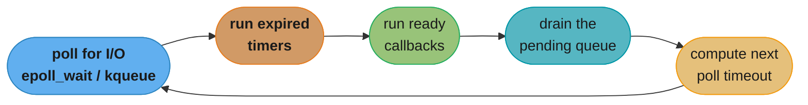

# Async I/O and Event Loops

> Every async runtime asks the kernel the same question two different ways: "tell me when I can act" or "act, and tell me when it's done."

---

## 1. Concept Overview

Every asynchronous I/O model in production reduces to one of two kernel contracts.

**Readiness** (`select`, `poll`, `epoll` on Linux, `kqueue` on BSD/macOS): you register interest
in a file descriptor, the kernel tells you *"this fd will not block right now,"* and you then
perform the read or write yourself, in a second syscall. Two syscalls minimum per operation: one
to wait, one to act.

**Completion** (`io_uring` on Linux, IOCP on Windows, POSIX AIO): you *submit* the operation —
read this many bytes into this buffer — and the kernel performs it and tells you *"it is done,
here is the result."* The data movement already happened by the time you find out. With batched
submission and kernel-side polling, the syscall count per operation can drop to zero in steady
state.

This is the model underneath every async runtime this section teaches at the API level: Python's
`asyncio`, Node's libuv, Go's netpoller, Java NIO (and the scheduler that parks virtual threads on
blocking calls), Rust's tokio. Those modules teach the call you make; this file teaches the kernel
contract those calls compile down to.

The problem both models solve is the same one: **blocking I/O plus one-thread-per-connection stops
scaling long before the CPU or the network does.** A thread that calls a blocking `read()` sits
parked, doing nothing, for the entire round trip — and the OS still has to hold its state and
consider it for scheduling. At 10,000 idle connections you have 10,000 threads doing nothing, and
the cost of *having* them, not the cost of running them, becomes the bottleneck.

The naive arithmetic for that cost is wrong in a specific, common way. On Linux, `pthread_create`
without an explicit `stacksize` uses the process's `RLIMIT_STACK` soft limit as the new thread's
stack size — commonly 8 MiB on distributions that leave the default in place (`man
pthread_create`, "under NPTL... the RLIMIT_STACK soft resource limit... determines the default
stack size"). The tempting multiplication is `8 MiB x 10,000 = 80 GiB` and a conclusion that
thread-per-connection is impossible on any reasonable box. **That number is virtual address space,
not RAM.** The 8 MiB is a reservation inside the process's ~128 TiB of 64-bit user address space;
pages inside it are demand-paged and become resident only when actually touched. An idle thread
blocked in `read()` a few stack frames deep touches perhaps 16-64 KiB of that reservation. What
*is* unconditionally resident is the kernel-side stack every thread owns for the duration it
exists — fixed at 16 KiB on x86-64 since 2014 (`THREAD_SIZE_ORDER = 2`, two page frames) — plus a
few KiB of `task_struct`/TCB bookkeeping. So 10,000 idle threads cost on the order of a few hundred
MiB resident, not 80 GiB. (A JVM platform thread reserves roughly 1 MiB by default, `-Xss`, for
the same reason virtual threads exist — see the cross-links below.)

*Caveat: authored on macOS/Darwin, so the 8 MiB / 16 KiB figures above come from the current Linux
kernel and glibc documentation, not a live Linux measurement. The macOS `ulimit -s` measured here
(8176 KiB) lands in the same neighborhood by convention, but is not evidence for the Linux numbers.*

What actually kills thread-per-connection at scale is not memory — it is the **context-switch and
scheduling cost** of 10,000 runnable/blocked threads (see
[`processes_threads_and_context_switching`](./processes_threads_and_context_switching.md) for the
~1-10 us switch cost and why it compounds). One event loop thread waiting on `epoll_wait()` and
getting a *batch* of ready descriptors back in a single syscall sidesteps that entirely: fixed
per-loop cost, no per-connection thread to schedule.

---

## 2. Intuition

> **One-line analogy**: readiness is a waiter who taps your table and says "your food is ready,
> come get it yourself"; completion is a waiter who brings the food to you and tells you when it's
> on the table.

**Mental model**: readiness asks *"can I?"* — the kernel answers, then you act. Completion says
*"I did"* — you handed the kernel the work, and it acted on your behalf while you were free to do
something else. Everything else in this file — ring buffers, futexes, the vDSO, `posix_spawn` — is
a variation on "how do we cross the user/kernel boundary as rarely as possible while still finding
out what happened."

**Why it matters**: this is the single design decision that separates a server that falls over at
5,000 connections from one that holds 500,000. It is also why "async" is not one thing — an
`asyncio` coroutine, a Go goroutine, and an `io_uring` submission queue entry all buy concurrency
by amortizing the same syscall-boundary cost differently.

**Key insight**: the event loop itself does no I/O. It is a scheduler that repeatedly asks the
kernel "what's ready / what's done," then runs exactly the callbacks or coroutines that can make
progress, and goes back to sleep. A single OS thread, run correctly, saturates a NIC that ten
thousand blocked threads could not.

---

## 3. Core Principles

**Two independent axes, not one.** "Blocking vs non-blocking" and "synchronous vs asynchronous"
are often conflated but describe different things. Blocking/non-blocking is about what a single
call does: does `read()` park the calling thread until data arrives, or return immediately with
`EWOULDBLOCK`/`EAGAIN` if there is none (`O_NONBLOCK` on the fd)? Synchronous/asynchronous is
about who does the work: does the *caller* perform the I/O (even if non-blocking, you still call
`read()` yourself), or does the *kernel* perform it and notify you (`io_uring`, IOCP)? A readiness
loop is non-blocking-synchronous: it never parks, but every byte still moves through a `read()` you
issued. A completion model is asynchronous by definition: the kernel moved the bytes before you
knew the operation was done.

**Level-triggered vs edge-triggered.** `epoll` defaults to level-triggered: as long as unread data
sits in the socket buffer, `epoll_wait()` keeps reporting the fd as ready, call after call. Edge
mode (`EPOLLET`) reports readiness exactly once, on the *transition* from not-ready to ready. Edge
mode is faster (fewer wakeups, no re-scanning of quiet fds) but comes with a hard obligation: you
must read (or write) until the kernel returns `EAGAIN`, because no second event is coming just
because bytes are still sitting there. Handle a partial read as "done" under `EPOLLET` and the rest
of that message is invisible until *new* data arrives — see the measured demonstration in ⌈6⌋.

**The C10K problem.** `select()` and `poll()` require the caller to pass the *entire* set of
watched descriptors on every call, and the kernel walks the *entire* set to find the ready ones —
O(n) per call regardless of how many fds are actually ready. `select()` additionally caps the set
at `FD_SETSIZE` (historically 1024). At 10,000 connections you re-transmit and re-scan a
10,000-entry array on every iteration of the loop, most of which are idle — this is the C10K
problem Dan Kegel named in 1999, and it is exactly what `epoll`/`kqueue` fix by moving the
interest set into the kernel and only returning what changed.

**Thundering herd.** When multiple threads or processes share one listening socket and all block
in `accept()` (or all register the same fd with their own `epoll` instance), a single incoming
connection can wake every one of them, and all but one immediately find nothing to accept and go
back to sleep — wasted wakeups that get worse as the worker count grows. `EPOLLEXCLUSIVE` (Linux
4.5+) tells the kernel to wake only one waiter per event instead of all of them.

---

## 4. Types / Architectures / Strategies

**`select` / `poll`** — the original portable readiness calls. `select` rebuilds three fd-set
bitmaps every call and is capped by `FD_SETSIZE`; `poll` removes the cap by using a growable array
of `struct pollfd`, but both are O(n) in the number of watched fds on every single call, which is
what makes them unusable much past a few thousand connections.

**`epoll` (Linux)** — a kernel-resident interest set you build incrementally with `epoll_ctl()`
(`EPOLL_CTL_ADD`/`MOD`/`DEL`) against a handle from `epoll_create1()`, then poll with
`epoll_wait()`, which returns only the fds that actually changed state. Amortized O(1) per event:
you pay to register a connection once, not to rescan it on every wait.

**`kqueue` (BSD, macOS)** — the BSD equivalent, and strictly more general: a single `kqueue`
watches not just socket/file readiness but process exit, filesystem changes (`vnode` events),
signals, and timers, all through one `kevent()` call with a filter type per entry. Python's
`selectors` module and libuv both pick `kqueue` automatically on macOS/BSD and `epoll` on Linux —
this file's runnable demos in §6 use exactly that dispatch.

**`io_uring` (Linux, 5.1+)** — the completion model, and the newest major addition to this
catalogue. The application and kernel share two ring buffers in `mmap`'d memory: a Submission
Queue (SQ) the app writes SQEs (submission queue entries — "read 4KiB from fd 7 into buffer X")
into, and a Completion Queue (CQ) the kernel writes CQEs into when the operation finishes. Two
syscalls bound the whole interface: `io_uring_setup()` once, and `io_uring_enter()` to submit new
SQEs and/or reap CQEs. With `IORING_SETUP_SQPOLL`, the kernel spins up a dedicated polling thread
that consumes the submission ring itself — a correctly-tuned application can submit and reap I/O
without a single `io_uring_enter()` call in steady state (confirmed against the current
`io_uring_setup(2)` and `io_uring_sqpoll(7)` man pages). Registered buffers and files
(`IORING_REGISTER_BUFFERS`/`_FILES`) let the kernel skip re-validating the same buffer or fd on
every operation, and linked SQEs (`IOSQE_IO_LINK`) chain dependent operations — "open, then read
from what you just opened" — without a user-space round trip between them.

**io_uring's security posture is worth stating honestly, not just its speed.** Because most of an
operation's work happens inside the kernel (or a kernel worker thread) rather than as one traceable
syscall from the calling thread, it has become a disproportionate source of Linux kernel exploits —
Google reported roughly 60% of the kernel exploits submitted to its bug bounty in 2022-2023 targeted
`io_uring` — and it sits awkwardly with seccomp-bpf sandboxes, which reason about syscall numbers on
the calling thread and can miss what io_uring does on your behalf. As a result Android blocks
`io_uring` for apps via seccomp-bpf, ChromeOS disables it pending better sandboxing, and Google
disabled it on its own production servers (Phoronix, "Google Limiting IO_uring Use Due To Security
Vulnerabilities," 2023; corroborated on the `oss-security` mailing list). Treat it as high-performance
and actively hardened, not yet as universally deployable as `epoll`.

**Windows IOCP** — the completion model's original production implementation: you associate a
handle with an I/O Completion Port, issue overlapped (asynchronous) reads/writes against it, and a
pool of worker threads dequeues completion packets as they finish. `io_uring` is frequently
described as "IOCP for Linux," a decade and a half later.

**POSIX AIO (`aio_read`/`aio_write`)** — the portable completion API predating `io_uring`, widely
considered a cautionary tale: most implementations (including Linux's glibc one) fake asynchrony
with a hidden thread pool rather than true kernel-level async I/O, giving completion-model
ergonomics without completion-model performance.

**`futex`** — the primitive every userspace mutex, semaphore, and condition variable in Linux is
built on. The fast path is pure userspace: a mutex `lock()` on an uncontended lock is one atomic
compare-and-swap instruction, zero syscalls. Only on contention does the thread call
`futex(uaddr, FUTEX_WAIT, expected_value, ...)` to actually block, and the unlocking thread calls
`FUTEX_WAKE` to rouse it. This is why an uncontended lock costs on the order of tens of
nanoseconds and a contended one costs a full context switch. `FUTEX_WAIT_BITSET` lets a waiter
filter which wakeups it accepts via a 32-bit mask, and `futex_waitv()` (Linux 5.16+) lets one
syscall wait on an array of up to 128 different futexes at once, waking on whichever is signaled
first — useful for waiting on several independent lock/event objects without an `eventfd` per one.

**`vDSO`** — the virtual Dynamic Shared Object the kernel maps into every process's address space
containing a handful of kernel functions compiled to run entirely in userspace: `clock_gettime()`,
`gettimeofday()`, and `getcpu()` on Linux. Because the kernel keeps a time source updated in a
page shared with userspace, these calls read that memory directly instead of trapping into the
kernel — no syscall, no mode switch. Measured on the authoring (Darwin) machine as a proxy for the
same idea (Python's `time.clock_gettime`, which macOS accelerates via its own userspace commpage
mechanism rather than a Linux vDSO): ~70 ns per call, against ~450 ns for a real syscall
round trip (`os.read` on a zero-length read) — see §6 for the script and full numbers.

**`eventfd`, `timerfd`, `signalfd`** — Linux mechanisms that turn things which are *not* file
descriptors by nature — a userspace counter/notification, a timer, a pending signal — into ones
that are, specifically so a single `epoll` (or `io_uring`) loop can wait on all of them uniformly
instead of needing a separate signal handler or `alarm()` path alongside the socket loop.

**`posix_spawn` vs `fork` + `exec`** — `fork()` in a large multithreaded process is dangerous: it
copies only the calling thread into the child (every other thread simply vanishes, mid-whatever it
was doing, potentially holding a lock forever), the child inherits a full copy of the page tables
(cheap with copy-on-write, but not free at scale), and the child is restricted to
**async-signal-safe** functions only until it calls `exec` — allocating memory or taking a mutex
that another (now-gone) thread held can deadlock the child immediately. `posix_spawn()` avoids all
of this: it is a single call, implemented on Linux via `clone()`/`vfork()`-family syscalls that
never fully materialize a duplicate address space for the parent's other threads to be lost from.

**`seccomp`** — kernel-enforced filtering of which syscalls (and with which arguments) a process
may issue, typically installed via a BPF program (`seccomp-bpf`) before running untrusted code.
It matters here specifically because it is the mechanism behind the `io_uring` restrictions
described above: a seccomp filter that only reasons about syscall numbers on the calling thread
has an much harder time reasoning about what an `io_uring` submission queue will actually do.

---

## 5. Architecture Diagrams

```
READINESS MODEL (epoll)                    COMPLETION MODEL (io_uring)
------------------------                   ---------------------------
1. epoll_ctl(ADD, fd)     [syscall #1]     1. write SQE to submission ring   [no syscall]
2. epoll_wait() -- blocks [syscall #2]     2. io_uring_enter(submit)         [syscall #1]
   kernel: "fd is readable, go read it"       kernel: performs the read itself
3. read(fd, buf, n)       [syscall #3]     3. reap CQE from completion ring  [no syscall*]
   kernel: copies bytes into buf              kernel: "here are n bytes, already in buf"

Per operation you issued: 3 syscalls,      Per operation: as few as 1 syscall to submit,
2 full user<->kernel round trips           0 with IORING_SETUP_SQPOLL in steady state
```
*with `SQPOLL`, a kernel thread polls the submission ring itself, so the app never calls
`io_uring_enter()` to submit; the app still needs to notice a completion landed, which can be a
poll of shared memory rather than a syscall.

*The readiness model pays a syscall to ask "can I act?" on every single operation; the completion
model pays (at most) a syscall to say "do this," batched across many operations if several SQEs
are written before one `io_uring_enter()` call.*

```
SUBMISSION QUEUE (SQ) -- app writes, kernel consumes         head/tail deltas after one
                                                               io_uring_enter(submit) call
  before:  [ R1 ][ R2 ][ R3 ][    ][    ][    ][    ][    ]
                              ^tail=3            head=0^

  after:   [    ][    ][    ][    ][    ][    ][    ][    ]
                              ^tail=3  head=3^   <- kernel consumed R1..R3

COMPLETION QUEUE (CQ) -- kernel writes, app consumes

  before:  [    ][    ][    ][    ][    ][    ][    ][    ]
                    tail=0^  ^head=0

  after:   [ C1 ][ C2 ][    ][    ][    ][    ][    ][    ]
                              ^tail=2  head=0^   <- R3 still in flight, not yet a CQE
```
*Two ring buffers, one direction each. The kernel advances the SQ's `head` as it consumes entries
you queued; you advance the CQ's `head` as you consume completions the kernel queued. Neither side
ever blocks the other's memory access — this is what lets `SQPOLL` mode avoid syscalls entirely:
both head/tail pairs live in shared memory that both sides just read and write.*


*One iteration of an event loop's cycle: block for I/O with a bounded timeout (never forever, or a
timer could never fire), run whatever timers expired while you were blocked, run the callbacks
those I/O events and timers scheduled, drain anything those callbacks scheduled for "as soon as
possible," then compute how long the next poll may safely block before the earliest pending timer.*

---

## 6. How It Works — Detailed Mechanics

All code below was executed with Python 3.13 on the authoring machine (macOS/arm64, so Python's
`selectors` module picks `KqueueSelector`; on Linux the identical code picks `EpollSelector` — the
module exists specifically to make this portable). Every number quoted is the actual measured
output, not an estimate.

### 6.1 A minimal event loop on `selectors` — a real, runnable server

```python
import selectors, socket, threading, time

sel = selectors.DefaultSelector()  # picks epoll (Linux) / kqueue (BSD, macOS) / select (fallback)

def accept(sock):
    conn, addr = sock.accept()
    conn.setblocking(False)
    sel.register(conn, selectors.EVENT_READ, data={"addr": addr})

def service(key, mask):
    sock = key.fileobj
    data = sock.recv(1024)
    if data:
        sock.send(b"echo:" + data)
    else:
        sel.unregister(sock); sock.close()

def run_loop(seconds):
    deadline = time.monotonic() + seconds
    while time.monotonic() < deadline:
        for key, mask in sel.select(timeout=0.1):
            accept(key.fileobj) if key.data is None else service(key, mask)
```
Registering the listening socket with `data=None` and every accepted connection with a small dict
is the standard `selectors` idiom for telling the two cases apart in one `select()` return list.

**Measured**: three clients connect, each sends `hello-N`, the loop (run on a background thread)
services all three off ONE `sel.select()` call per burst:
```
selector implementation: KqueueSelector
client got: b'echo:hello-0'
client got: b'echo:hello-1'
client got: b'echo:hello-2'
server saw 3 messages: [b'hello-0', b'hello-1', b'hello-2']
```

### 6.2 The edge-triggered "stranded data" bug

On Linux this is written against `select.epoll(...)` with `select.EPOLLIN | select.EPOLLET`. That
exact code is not runnable on this authoring machine (Darwin has no `epoll`), so it is shown here
as illustrative, unrun logic, not a measured result:

```python
# ILLUSTRATIVE (Linux only, not run in this session):
ep = select.epoll()
ep.register(conn.fileno(), select.EPOLLIN | select.EPOLLET)
for fd, events in ep.poll():
    data = conn.recv(2048)          # BROKEN: one read, event never re-fires for the rest
```

`kqueue`'s `EV_CLEAR` flag is the BSD/macOS equivalent of edge-triggering — the event is cleared
(not re-armed) the moment it is delivered, even if unread bytes remain — and it IS available here,
so the same bug was actually run and measured:

```python
kq = select.kqueue()
ev = select.kevent(conn.fileno(), select.KQ_FILTER_READ,
                    select.KQ_EV_ADD | select.KQ_EV_CLEAR)
kq.control([ev], 0)
# 8000 bytes are sitting in the socket buffer
kq.control(None, 1, 0.5)            # the one edge-triggered event fires
first = conn.recv(2048)             # BROKEN: "handle" it with a single read
```

**Measured**:
```
edge event fired: True
BROKEN: read 2048 of 8000 bytes, then stopped -- 5952 bytes stranded in the kernel buffer
second poll after BROKEN handling sees new event: False (remaining bytes are invisible
  until more data arrives)
FIX: drained until EAGAIN, total read = 8000 of 8000 bytes
```
The fix loops `recv()` until it raises `BlockingIOError` (`EAGAIN`) instead of stopping after one
successful read — see §10 for the full broken/fix pair.

### 6.3 The vDSO fast path, measured

```python
import time, os
N = 500_000
fd = os.open("/dev/zero", os.O_RDONLY)
t0 = time.perf_counter_ns()
for _ in range(N): os.read(fd, 0)            # real syscall every time
real_syscall_ns = (time.perf_counter_ns() - t0) / N

t0 = time.perf_counter_ns()
for _ in range(N): time.clock_gettime(time.CLOCK_MONOTONIC)  # vDSO-accelerated on Linux
vdso_ns = (time.perf_counter_ns() - t0) / N
```
**Measured**: `os.read(fd, 0)` (a real syscall round trip) = **453.4 ns/call**;
`time.clock_gettime()` = **69.6 ns/call** — roughly 6.5x faster, consistent with avoiding the
user/kernel mode switch entirely rather than merely doing less work once inside the kernel.

### 6.4 A blocking call stalling the whole event loop, measured

```python
import asyncio, time

async def ticker(name, n):
    for i in range(n):
        t0 = time.perf_counter()
        await asyncio.sleep(0.05)            # should always resume ~50ms later
        print(name, i, "gap_ms=", (time.perf_counter() - t0) * 1000)

def blocking_work():
    time.sleep(0.3)                          # stand-in for a sync DNS lookup / requests.get

async def broken():
    async def bad(): blocking_work()         # runs ON the loop thread
    await asyncio.gather(ticker("A", 3), bad())

async def fixed():
    loop = asyncio.get_running_loop()
    async def good(): await loop.run_in_executor(None, blocking_work)
    await asyncio.gather(ticker("B", 3), good())
```
**Measured, broken**: `ticker`'s first gap is **304.9 ms** instead of ~50 ms — every other
coroutine on the loop stalled for the full 300 ms `blocking_work()` took, because it ran
synchronously on the one thread the loop uses.
**Measured, fixed**: all three `ticker` gaps stay at **50.2-51.2 ms**; `run_in_executor` moved
`blocking_work()` onto a thread-pool thread, so the loop kept servicing `ticker` while it ran.

---

## 7. Real-World Examples

**nginx** runs one worker process per CPU core, each with its own `epoll` instance handling
thousands of connections — no locking between workers because each owns a disjoint set of
connections, and the kernel load-balances new `accept()`s across them.

**Redis** runs a single-threaded event loop (`ae.c`, built on `epoll`/`kqueue`/`select` depending
on platform) for all command execution, which is why single-key operations need no locking; more
recent Redis versions add background I/O threads specifically for the socket read/write syscalls
(not command execution) to reduce single-thread network overhead at very high throughput.

**Node.js / libuv** is the textbook example of the readiness-model's blind spot: `epoll` and
`kqueue` do not support regular files (`epoll_ctl` on a file fd returns `EPERM`), so libuv
dispatches all file-system I/O to a worker **thread pool** while all network I/O stays on the
single event-loop thread polled with `epoll`/`kqueue`/IOCP. This is a well-known interview trap:
Node.js "is single-threaded" is true for network I/O and callback execution and false for file
I/O, which quietly uses OS threads underneath. (Recent libuv releases experimented with routing
some Linux file operations through `io_uring` instead, then reverted to the thread pool by default
as of libuv 1.49 — the readiness/thread-pool split is still the default production behavior.)

**Go's netpoller** integrates `epoll`/`kqueue` directly into the goroutine scheduler: a goroutine
that calls a blocking network op is parked and the OS thread (M) underneath it is freed to run
other goroutines, with the netpoller waking the right goroutine when the fd becomes ready — the
same readiness mechanism as everything above, hidden entirely behind synchronous-looking code.

**ScyllaDB / Seastar** takes shard-per-core to its logical extreme: each core owns its own CPU,
memory, and NIC queue with zero cross-core locking, driven by a completion-oriented (`io_uring`
where available) event loop per shard.

**PostgreSQL 18** (released 2026) added an `io_method` setting with three options for read
operations: `sync` (the pre-18 behavior), `worker` (dedicated background I/O worker processes —
the new default), and `io_uring` (direct kernel ring submission). Testing showed `io_uring` is not
automatically the fastest option for every workload — the `worker` method can outperform it on
high-bandwidth sequential scans — which is a useful, current reminder that completion beats
readiness in theory but the right choice is always measured, not assumed.

---

## 8. Tradeoffs

| Model | Throughput at high concurrency | Tail latency | Code complexity | Debugging | Portability |
|---|---|---|---|---|---|
| Thread-per-connection | Degrades past ~1k-10k (scheduler + memory pressure) | Good until saturation, then cliff | Lowest — linear, blocking code | Easiest — real stack traces per connection | Excellent (POSIX threads everywhere) |
| Readiness event loop (`epoll`/`kqueue`) | Excellent to ~100k-1M connections | Good, one stalled callback hurts everyone | Higher — callbacks or coroutines, one blocking call anywhere is a global stall | Hard — one stack trace covers many logical connections | Very good (all major OSes have a readiness primitive) |
| Completion ring (`io_uring`/IOCP) | Best, can approach hardware limits | Best — kernel batches at the syscall boundary, not per-op | Highest — explicit buffer lifetime, submission/completion bookkeeping | Hardest — completions land out of submission order | Weak — Linux 5.1+/Windows only, evolving fast |
| Green threads / virtual threads (goroutines, Java 21+ virtual threads) | Excellent, same ballpark as an event loop | Good | Lowest of the async options — blocking-looking code, no callback color | Easier than callbacks — near-real per-task stack traces | Runtime-dependent (built into Go, opt-in in Java) |

---

## 9. When to Use / When NOT to Use

**Use an event loop or completion model** when the workload is I/O-bound with high concurrency —
tens of thousands of mostly-idle connections waiting on network or disk, where the cost of *having*
a thread per connection (scheduling, memory, context-switch churn) dominates the cost of doing the
actual work.

**Do NOT reach for async as the default answer anymore.** For a CPU-bound workload, an event loop
buys nothing — the bottleneck is compute, not waiting, and a thread pool sized to the core count is
simpler and just as fast. For a few hundred connections, thread-per-connection is simpler to write,
simpler to debug (real per-connection stack traces), and often just as fast, because you never hit
the regime where scheduling 10,000 threads actually costs more than running 10,000 event-loop
tasks. Green threads and virtual threads exist specifically to erase this tradeoff for the common
case: they give the scaling properties of an event loop while keeping the linear, blocking-looking
code of thread-per-connection, avoiding the "callback color" problem (a function's async-ness
infecting every caller) that plagues hand-rolled event loops — which is why "async everywhere" is
no longer the automatic senior-engineer answer it was a decade ago.

---

## 10. Common Pitfalls

**Pitfall 1 — a blocking call inside the event loop stalls every connection, not just the one that
made it.** This is the single most common production incident in this space: one synchronous DNS
lookup, one `requests.get()`, one `time.sleep()`, one un-awaited blocking DB driver call, anywhere
in a coroutine, blocks the *entire* OS thread the loop runs on. Every other coroutine — thousands
of unrelated requests — freezes for the duration.

```python
# BROKEN — measured: every ticker's first gap jumps to 304.9ms instead of ~50ms
async def handler():
    result = time.sleep(0.3)   # or requests.get(), or a sync DB driver call

# FIX — measured: ticker gaps stay flat at 50.2-51.2ms; the loop keeps servicing everyone
async def handler():
    loop = asyncio.get_running_loop()
    await loop.run_in_executor(None, blocking_call)   # or asyncio.to_thread(blocking_call)
```
Real numbers, from §6.4: the broken version cost every OTHER coroutine on the loop a 6x latency
spike (304.9 ms vs an expected ~50 ms wait) for something that had nothing to do with them.

**Pitfall 2 — the edge-triggered "read once and move on" bug strands data until the next write.**
Under `EPOLLET` (or `kqueue`'s `EV_CLEAR`), the event fires exactly once per transition to ready.
Treat a partial `recv()` as "handled" and the remaining bytes sit in the kernel socket buffer,
invisible, until the peer sends *more* data and re-arms the edge.

```python
# BROKEN — measured: reads 2048 of 8000 bytes, then stops; 5952 bytes stranded
first = conn.recv(2048)

# FIX — measured: drains until EAGAIN, reads all 8000 bytes in the same event
total = 0
while True:
    try:
        chunk = conn.recv(2048)
        if not chunk: break
        total += len(chunk)
    except BlockingIOError:
        break   # this is the correct exit: "no more data right now"
```
The measured proof from §6.2: a second poll after the broken handler returns **no new event**,
because no new data arrived — the bug is not "slow," it is a silent, permanent loss of that data
until the peer happens to send something else.

---

## 11. Technologies & Tools

`liburing` (the userspace `io_uring` helper library), `strace`/`ltrace` (trace syscalls — note
`io_uring` operations are notoriously hard to see this way, which is the point made in §4),
`perf`, `bpftrace`/eBPF (trace kernel-side events like futex contention or epoll wakeups directly),
`ss`/`lsof` (inspect open sockets/fds and catch descriptor leaks), Python `selectors` and
`asyncio`, `uvloop` (a `libuv`-backed drop-in replacement for asyncio's default loop), `libuv`
(Node.js), `tokio` (Rust), Netty (Java NIO), Seastar (ScyllaDB's shard-per-core framework).

---

## 12. Interview Questions with Answers

**Q: What is the difference between non-blocking I/O and asynchronous I/O?**
**Short:** Non-blocking means the call returns immediately; asynchronous means the kernel does the work for you.
They are two independent axes, not synonyms. Non-blocking (`O_NONBLOCK`) describes a single call:
it never parks the caller, returning `EAGAIN` if nothing is ready — but the caller still performs
the I/O itself, just without blocking. Asynchronous means the *kernel* performs the operation and
notifies you when it finishes (`io_uring`, IOCP) — you never call `read()` at all for that byte
range. `epoll` + non-blocking sockets is the classic "non-blocking synchronous" combination; it is
not the same thing as true async I/O, and conflating them is the most common mix-up in this area.

**Q: Why does a single `time.sleep()` or synchronous DB call inside an async handler freeze
unrelated requests?**
**Short:** It blocks the one OS thread the whole event loop runs on, stalling every coroutine.
An event loop is (usually) a single OS thread cooperatively multiplexing many logical tasks. A
blocking call does not yield back to the loop — it parks that one thread, and since every
coroutine's turn depends on that thread coming back to run the scheduler, all of them stall for the
full duration of the blocking call, regardless of whether they touch the same resource. Measured
in this file: a 300ms `time.sleep()` inside one task turned an unrelated task's expected ~50ms wait
into a 304.9ms one. The fix is `loop.run_in_executor()` (or `asyncio.to_thread()`), which moves the
blocking call to a worker thread and lets the loop keep running everything else.

**Q: What is the edge-triggered "lost data" bug in `epoll`, and how do you avoid it?**
**Short:** Reading once under EPOLLET can strand unread bytes until new data arrives.
`EPOLLET` fires an event exactly once per readiness transition, not once per byte that arrives.
Read only part of what's available and stop, and the remaining bytes sit in the kernel buffer with
no event to tell you they're there — the next event only fires when *more* data shows up, which
may be never. Measured with the `kqueue` equivalent (`EV_CLEAR`) in this file: a single `recv()`
left 5,952 of 8,000 bytes stranded, and a follow-up poll confirmed no new event fired. The fix is
mandatory: loop `recv()`/`send()` until you get `EAGAIN`/`EWOULDBLOCK`, on every edge-triggered
event, with no exceptions.

**Q: Why does Node.js need a thread pool for file I/O when it's supposedly single-threaded?**
**Short:** epoll and kqueue cannot report readiness for regular files, only sockets and pipes.
`epoll_ctl()` on a regular file's fd returns `EPERM` — the readiness model was built for sockets
and pipes, where "not ready yet" is a real state; a local disk read either completes or the syscall
blocks, there's no analogous wait-then-poll state for `epoll` to watch. libuv works around this by
running file-system calls on a background thread pool and delivering the result back to the event
loop as a normal callback, while all network I/O stays on the single `epoll`/`kqueue`-driven
thread. "Node is single-threaded" is true for your JS callbacks and network sockets and false for
file I/O underneath — a classic interview gotcha.

**Q: What's the fundamental difference between the readiness model and the completion model?**
**Short:** Readiness tells you "you can act now"; completion tells you "I already acted."
Readiness (`select`/`poll`/`epoll`/`kqueue`) is a two-step contract: the kernel notifies you a
descriptor won't block, then you issue the actual read or write yourself in a second syscall.
Completion (`io_uring`, IOCP, POSIX AIO) is one step from the caller's view: you submit the
operation, the kernel performs it, and you're notified with the result already available — no
follow-up syscall needed. Measured in §5/§6: one readiness round trip costs 3 syscalls (register,
wait, act); one completion round trip can cost 1, or 0 in `io_uring`'s `SQPOLL` mode.

**Q: Why doesn't `select()` scale past a few thousand connections — what is the C10K problem?**
**Short:** select/poll rescan the entire watched set every call, an O(n) cost regardless of readiness.
`select()` passes the full fd set to the kernel on every call and the kernel walks all of it to find
which changed, even if only one of 10,000 fds is actually ready — cost scales with the size of the
watched set, not the number of ready events. `select()` also caps the set at `FD_SETSIZE`
(historically 1024). Dan Kegel named this the C10K problem in 1999; `epoll`/`kqueue` fix it by
keeping the interest set inside the kernel and returning only the fds that changed, making the
per-call cost proportional to *ready* events, not watched ones.

**Q: How does `epoll` achieve O(1) amortized cost where `select`/`poll` are O(n)?**
**Short:** It keeps a persistent kernel-side interest set updated incrementally instead of rescanning.
You build the interest set once, incrementally, with `epoll_ctl(ADD/MOD/DEL)`; the kernel maintains
it (commonly implemented as a red-black tree plus a ready-list) and appends to a ready-list only
when a watched fd's state actually changes — driven by the same interrupt-driven wakeup that would
unblock a thread doing a blocking `read()` on that fd. `epoll_wait()` then just drains the ready
list, whose size is bounded by how many fds actually became ready, not by how many you're watching.

**Q: What is `io_uring` and how does `IORING_SETUP_SQPOLL` eliminate syscalls?**
**Short:** io_uring shares submission/completion ring buffers with the kernel; SQPOLL adds a kernel thread that polls them.
`io_uring` maps two ring buffers into both the app's and the kernel's address space: a Submission
Queue you write operations into and a Completion Queue the kernel writes results into, communicated
via `io_uring_setup()` once and `io_uring_enter()` to submit/reap. With `IORING_SETUP_SQPOLL`, a
dedicated kernel thread polls the submission ring itself, so a steady-state application can add
work and read results purely through shared memory, without calling `io_uring_enter()` at all
(confirmed against the current `io_uring_setup(2)`/`io_uring_sqpoll(7)` man pages) — the closest
thing Linux has to a truly syscall-free I/O path.

**Q: What is a futex, and why is locking an uncontended mutex almost free?**
**Short:** A futex's fast path is one userspace atomic instruction; the syscall only fires on contention.
`futex` (fast userspace mutex) is the primitive under every Linux mutex, semaphore, and condition
variable. Acquiring an uncontended lock is a single userspace atomic compare-and-swap — no syscall
at all, on the order of tens of nanoseconds. Only when the lock is already held does the thread
fall to the slow path, calling `futex(uaddr, FUTEX_WAIT, ...)` to actually block in the kernel,
which the unlocking thread later wakes with `FUTEX_WAKE`. This is why contended and uncontended
locking have wildly different costs: one is an instruction, the other is a full context switch.

**Q: What does the vDSO do, and why is `clock_gettime()` not a "real" syscall on Linux?**
**Short:** The kernel maps time data into the process so clock reads never cross into kernel mode.
The vDSO (virtual Dynamic Shared Object) is kernel code mapped directly into every process's
address space; for `clock_gettime()`, `gettimeofday()`, and `getcpu()`, the kernel keeps a
continuously-updated time source in memory the vDSO can read without ever trapping into kernel
mode — no mode switch, no syscall dispatch overhead. Measured in this file (Darwin, via the
equivalent userspace-commpage mechanism, as a stand-in for the same idea): ~70 ns for
`clock_gettime()` versus ~453 ns for a genuine syscall round trip, roughly 6.5x faster from
avoiding the boundary crossing entirely rather than from doing less work once inside the kernel.

**Q: Why use `eventfd`/`timerfd`/`signalfd` instead of a separate signal handler or `alarm()`?**
**Short:** They turn timers and signals into file descriptors so one event loop can wait on all of them.
An `epoll` or `io_uring` loop can only natively wait on file descriptors. `eventfd` exposes a
simple userspace counter as an fd (useful for waking a loop from another thread), `timerfd` exposes
a kernel timer as an fd instead of requiring `alarm()`/`SIGALRM`, and `signalfd` delivers signals
as readable bytes on an fd instead of an asynchronous handler. Together they let a single-threaded
event loop treat "a timer fired," "a signal arrived," and "a socket is readable" as the exact same
kind of event — one `epoll_wait()` call covers all of them.

**Q: Why is `fork()` dangerous inside a large multithreaded process, and how does `posix_spawn`
avoid it?**
**Short:** fork() only copies the calling thread, so any lock another thread held is now permanently stuck.
`fork()` duplicates the calling thread only — every other thread in the parent simply does not
exist in the child, including any locks (malloc's internal lock, a logging lock, anything) they
happened to be holding at that instant. The child is then restricted to async-signal-safe functions
until it calls `exec()`, so calling `malloc()` or taking a mutex in that window can deadlock the
child immediately, and unpredictably, since it depends on exactly what another thread was doing
when `fork()` ran. `posix_spawn()` sidesteps this entirely as a single call implemented without
materializing a full multithreaded child that inherits that hazard, which is why it, not
`fork()`+`exec()`, is the recommended way to launch a subprocess from a threaded program.

**Q: What is the thundering herd problem in this context, and what fixes it?**
**Short:** Many workers waking for one event, when only one can actually use it, wastes wakeups.
When multiple threads or processes block on the same shared listening socket or the same `epoll`
instance, a single ready event can wake all of them, but only one succeeds in accepting the
connection (or reading the data) — the rest wake up, find nothing, and go back to sleep, at a cost
that grows with the number of waiters. `EPOLLEXCLUSIVE` (Linux 4.5+) tells the kernel to wake only
one waiter per event instead of broadcasting to all of them, which is the standard fix for
multi-worker servers sharing one listener.

**Q: Why do Android, ChromeOS, and Google's own production servers restrict or disable
`io_uring`?**
**Short:** Because it has driven a majority of recent Linux kernel exploits and undermines seccomp filtering.
Google reported that `io_uring` accounted for roughly 60% of the kernel exploits submitted to its
bug bounty program in 2022-2023, largely because much of the actual operation happens inside the
kernel or a kernel worker rather than as one traceable syscall the calling thread issued, which
also makes syscall-number-based sandboxing (`seccomp-bpf`) far less effective at constraining it.
As a result Android blocks `io_uring` for apps via seccomp-bpf, ChromeOS disables it pending better
sandboxing, and Google disabled it on its own production fleet — a live example of a genuinely
faster interface being deliberately held back until its security story catches up.

**Q: When is plain thread-per-connection still the better engineering choice over an event
loop?**
**Short:** When the workload is CPU-bound or the connection count is small — a few hundred, not tens of thousands.
An event loop's whole advantage is amortizing the cost of otherwise-idle waiting threads; if the
workload is CPU-bound, there's no idle waiting to amortize and a plain thread pool sized to the
core count is simpler and equally fast. Even for I/O-bound work, at a few hundred connections
you're nowhere near where thread scheduling overhead dominates, and blocking code gives real
per-connection stack traces that are far easier to debug than a stalled callback graph. Virtual
threads and goroutines exist precisely to make this choice less consequential by giving
event-loop-class scaling to code that still reads like thread-per-connection.

---

## 13. Best Practices

- **Never call a blocking function on the event-loop thread.** Route it through
  `run_in_executor`/`asyncio.to_thread` (Python), a worker pool (Node/libuv), or accept that it's a
  goroutine/virtual-thread-friendly blocking call, which is fine precisely because those runtimes
  park the *logical* task, not the OS thread.
- **Under edge-triggered mode, always drain to `EAGAIN`.** There is no partial-credit event coming
  later; treat every wakeup as "read/write until the kernel says stop."
- **Set a timeout on every poll call, never block forever**, or a timer scheduled for "5 seconds
  from now" cannot fire until unrelated I/O happens to wake the loop.
- **Prefer `EPOLLEXCLUSIVE`/equivalent whenever multiple workers share one listener**, to avoid
  paying the thundering-herd cost on every accepted connection.
- **Treat `io_uring` as a measured optimization, not a default** — verify it actually wins for your
  workload (PostgreSQL 18's own benchmarks show the older worker-thread method winning on some
  workloads) and confirm your deployment target (container base image, cloud provider, mobile OS)
  doesn't restrict it before depending on it.
- **Size a completion ring's buffers for your actual concurrency**, not a guess — an undersized SQ
  forces you back onto a blocking `io_uring_enter()` call to make room, which defeats the point.
- **Close every fd you register.** A leaked fd inside an event loop is invisible until `ulimit -n`
  is hit and every new `accept()` starts failing — check with `lsof -p <pid>` under load.

---

## 14. Case Study

**Design the I/O layer of a proxy handling 50,000 concurrent connections.**

**Requirements**: terminate 50,000 persistent client connections and proxy each to one of a
smaller pool of backend connections, on commodity hardware (8-16 cores), with p99 added latency
under a few milliseconds and the ability to serve static config/cert files from disk without
stalling active connections.

**Mechanism choice**: readiness (`epoll`), not `io_uring`. At this scale the workload is dominated
by short reads/writes on many idle sockets, exactly `epoll`'s strength, and it avoids the
still-evolving security posture (§4, §12 Q14) of a completion ring for a service that likely
terminates TLS from untrusted clients — the worst place to add kernel attack surface with a young
subsystem.

**Topology — one loop per core, not one loop total.** A single `epoll` instance handling all
50,000 connections on one thread leaves 7-15 other cores idle. Instead: `SO_REUSEPORT` on the
listening socket lets the kernel load-balance new connections across N worker processes/threads,
each running its own `epoll` loop over roughly 50,000/N connections, with no cross-worker locking
because each owns a disjoint connection set — nginx's exact architecture from §7.

**File I/O is handled off the loop, deliberately.** Since `epoll` can't watch regular files (§4,
§12 Q4), any read of a certificate, a config reload, or an access log write is routed through a
small worker thread pool per process, not the `epoll` loop — mirroring libuv's split, and avoiding
the exact pitfall in §10 where a synchronous disk read on the loop thread would stall every
in-flight proxied connection on that worker for the duration of the disk I/O.

**What you measure**: p50/p99/p999 added latency per proxied byte, `epoll_wait()` calls per second
per worker (a rising trend at flat connection count signals fd churn, not real work), fds open per
process against `ulimit -n`, and — the metric that catches the thundering-herd failure mode —
accept() rate per worker under a connection burst, which should be roughly even across workers if
`EPOLLEXCLUSIVE`/`SO_REUSEPORT` load-balancing is actually working.

**BROKEN -> FIX**: the first version logged every proxied request's byte count synchronously —
`open()`/`write()` on a log file, directly in the same callback that serviced the client socket.
Under load this reproduces exactly the pitfall in §10.1: one slow disk `write()` (a few hundred ms
during a burst of log rotation contention) froze every one of that worker's ~6,000 connections for
the duration, visible as a p999 latency spike correlated with log-rotation timestamps. **Fix**:
route log writes through the same file-I/O thread pool used for config/cert reads (or an async
logging library backed by one), keeping the `epoll` loop's callbacks strictly non-blocking; the
correlated p999 spikes disappeared from the metric described above.

---

## See Also

- [`processes_threads_and_context_switching`](./processes_threads_and_context_switching.md) — the
  parent module: threads, context-switch cost, the process/thread distinction this file builds on
- [`cpu_scheduling_algorithms`](../cpu_scheduling_algorithms/cpu_scheduling_algorithms.md) — what
  the scheduler does with a thread that blocks on I/O
- [`networking_fundamentals`](../networking_fundamentals/networking_fundamentals.md) — the sockets
  these readiness/completion mechanisms wait on
- [`deadlocks_and_synchronization`](../deadlocks_and_synchronization/deadlocks_and_synchronization.md)
  — the mutex whose fast path is the futex described here
- [`python/asyncio_and_event_loop`](../../python/asyncio_and_event_loop/asyncio_and_event_loop.md)
  — the applied `asyncio` treatment of this model
- [`fastapi/README`](../../fastapi/README.md) — ASGI is this model applied to a web framework
- [`java/concurrency`](../../java/concurrency/concurrency.md) — virtual threads as the other answer
  to C10K
- [`devops/linux_and_os_fundamentals`](../../devops/linux_and_os_fundamentals/linux_and_os_fundamentals.md)
  — the boundary: this file owns readiness-vs-completion as a model, devops owns tuning and the
  kernel-version matrix
- [`rust/tokio_deep_dive`](../../rust/async_runtimes_and_executors/tokio_deep_dive.md): Tokio's scheduler and I/O driver
