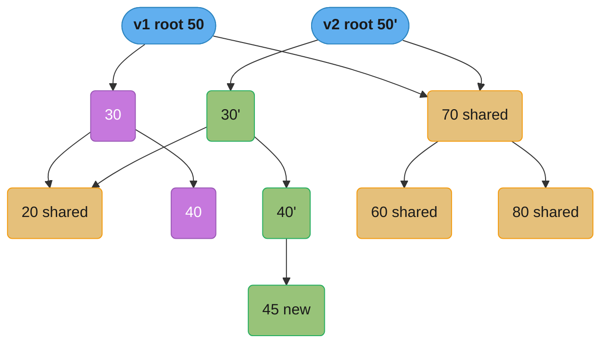
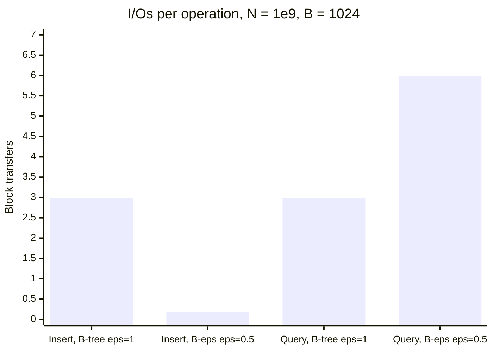

# Spatial and Persistent Data Structures

> Two questions that ordinary binary search trees cannot answer: "what is near this point?" and "what did this structure look like before the last change?" Spatial structures answer the first by organising space; persistent structures answer the second by never destroying anything.

---

## 1. Concept Overview

This module covers three families of data structures that sit just beyond the classic interview canon (arrays, hash tables, balanced BSTs, heaps), and that show up constantly in system design:

1. **Spatial (multidimensional) structures** index points and shapes so that **range**, **nearest-neighbour** and **intersection** queries avoid scanning everything:
   - **k-d trees** (Bentley, CACM 1975): binary trees that split on alternating coordinates
   - **quadtrees** (Finkel and Bentley, Acta Informatica 1974): each node splits 2-D space into four quadrants
   - **R-trees** (Guttman, SIGMOD 1984) and **R\*-trees** (Beckmann et al., SIGMOD 1990): balanced trees of bounding rectangles, the default index in spatial databases
   - **space-filling curves** (Z-order/Morton, Hilbert) and the cell systems built on them: **geohash**, Google's **S2** and Uber's **H3**, which turn 2-D locations into 1-D keys an ordinary B-tree or sorted set can index
2. **Persistent (immutable, versioned) structures** keep every past version available after an update, sharing unchanged parts between versions:
   - **path copying** (Driscoll, Sarnak, Sleator and Tarjan, JCSS 1989)
   - **hash array mapped tries** (HAMT, from Phil Bagwell's EPFL report "Ideal Hash Trees") and **bit-partitioned vector tries** (Clojure's and Scala's vectors)
   - **finger trees** (Hinze and Paterson, JFP 2006)
   - **ropes** (Boehm, Atkinson and Plass, Software: Practice and Experience 1995) for large mutable-looking strings
3. **I/O-aware structures** designed around the memory hierarchy:
   - **cache-oblivious** layouts (Frigo, Leiserson, Prokop and Ramachandran, FOCS 1999), such as the van Emde Boas layout
   - **B^epsilon-trees** (write-optimized B-trees with buffers in internal nodes), the structure behind TokuDB and BetrFS

All code is Python, type-hinted and executable. Applied usage of geospatial indexes in services (proximity search, ride matching, map tiles) lives in [Geospatial Indexing](../../hld/geospatial_indexing/geospatial_indexing.md) and the [proximity service](../../hld/case_studies/design_proximity_service.md) and [Uber](../../hld/case_studies/design_uber.md) case studies. The B-tree and LSM-tree background for Section 6's B^epsilon discussion is in [Trees and Binary Search Trees](../trees_and_binary_search_trees/trees_and_binary_search_trees.md) and [Storage Engines Internals](../../database/storage_engines_internals/storage_engines_internals.md).

---

## 2. Intuition

> **One-line analogy**: A spatial index is a map folded into sections so you only unfold the part you need. A persistent data structure is a document editor with infinite undo that costs almost nothing, because each new version stores only the paragraphs that changed and points at the old ones for the rest.

**Mental model for spatial structures**: one-dimensional ordering is what makes binary search, B-trees and sorted sets fast. Space has no natural total order: two points close on the map can be far apart in any single coordinate sort. There are two ways out:

- **Partition the space hierarchically** (k-d tree, quadtree, R-tree) and prune whole regions that cannot contain an answer.
- **Linearise the space** with a space-filling curve, so that nearby points usually get nearby 1-D keys, then reuse a 1-D index. Geohash, S2 and H3 all take this route, which is why Redis can store geo points in a sorted set.

**Mental model for persistent structures**: an update to a tree changes only the nodes on the path from the root to the changed leaf. Copy just those nodes (O(log n) of them), point the copies at the untouched subtrees, and you get a new root for the new version while the old root still describes the old version. Nothing is mutated, so old versions are safe to read from any thread, forever.

**Why it matters**: "find drivers within 500 m", "which polygons contain this point", "show me the database as of yesterday", "undo the last edit", "give every concurrent reader a consistent snapshot" are all everyday requirements. A design that answers them with full scans or deep copies fails at the first order of magnitude of growth.

**Key insight**: both families exploit **locality**: spatial structures exploit locality in space (nearby objects stored together), persistent structures exploit locality of change (an update touches a tiny part of the structure). I/O-aware structures add the third kind, locality in memory (data accessed together is stored in the same cache line or disk block).

---

## 3. Core Principles

**Pruning by bounding regions.** Every hierarchical spatial index stores, for each subtree, a region (half-plane, quadrant, bounding rectangle) that contains everything below it. A query visits a subtree only if its region can intersect the query. For nearest-neighbour search the rule is: skip a subtree if the distance from the query to its region is already larger than the best distance found so far.

**Space partitioning vs data partitioning.** k-d trees and quadtrees split **space**: the split lines are determined by coordinates (median point, or the midpoint of the region). R-trees split **data**: each node holds up to M rectangles and its bounding box is the minimum rectangle covering them. Space-partitioning nodes never overlap; R-tree nodes may overlap, which is why R\*-tree insertion heuristics work hard to minimise overlap and area.

**Curse of dimensionality.** k-d tree nearest-neighbour search is fast in 2-3 dimensions and degrades toward a linear scan as dimensions grow, because in high dimensions almost every region is "close" to the query and nothing can be pruned. This is why vector search over 768-dimensional embeddings uses approximate methods (HNSW, IVF) rather than k-d trees.

**Locality-preserving linearisation.** A space-filling curve maps a 2^k x 2^k grid to the integers 0..4^k - 1. Interleaving the bits of x and y gives the **Z-order (Morton) curve**: simple, but it jumps across the grid at quadrant boundaries. The **Hilbert curve** rotates sub-quadrants so consecutive indices are always adjacent cells, giving better locality at slightly higher compute cost. Neither curve can guarantee that nearby points have nearby keys: two points on opposite sides of a top-level boundary can be one metre apart with keys at opposite ends of the range.

**Persistence levels.** A structure is **partially persistent** if every version can be read but only the newest can be updated, **fully persistent** if any version can be updated (creating a version tree), and **confluently persistent** if versions can also be merged. Path copying gives full persistence for trees at O(log n) extra space per update. Driscoll et al. also showed **node copying** (fat nodes with a bounded number of extra pointers) gives O(1) amortised extra space per update for bounded in-degree structures.

**Structural sharing needs immutability.** Sharing subtrees between versions is safe only if no one mutates a shared node. Persistent structures therefore pair naturally with garbage collection (or reference counting): an old version's nodes are reclaimed when no version references them.

**Wide nodes beat binary nodes on real hardware.** A 32-way trie of depth 4 indexes over a million elements in four pointer hops, each fetching one node that fits in a few cache lines. Clojure's `PersistentVector` allocates `new Object[32]` per node for this reason, and HAMTs use 32-way nodes compressed with a bitmap.

**The I/O model.** In the external-memory (disk access) model, data moves in blocks of B items and the cost is the number of block transfers. A B-tree search costs O(log_B N). Write-optimized structures trade a little query cost for much cheaper inserts by **buffering** updates in internal nodes and flushing them in batches. **Cache-oblivious** structures achieve the optimal O(log_B N) without knowing B, so the same layout is good for every level of the memory hierarchy at once.

---

## 4. Types / Architectures / Strategies

### Spatial indexes

| Structure | Partitions | Balanced? | Best for | Weak at | Used in |
|-----------|-----------|-----------|----------|---------|---------|
| k-d tree | Space, by median coordinate, alternating axes | Yes if built from static data | Static point sets, k-NN in low dimensions | Many updates; high dimensions | SciPy `KDTree`, scikit-learn; Lucene's BKD tree (a block k-d tree) for numeric and geo points |
| Point quadtree / region quadtree | Space, into 4 quadrants | No (depth follows data density) | Dynamic 2-D points, adaptive resolution, collision detection | Skewed data makes deep trees | Game engines, image processing, map tiling |
| R-tree / R\*-tree | Data, into bounding rectangles | Yes (like a B-tree) | Rectangles and polygons, disk-resident spatial data | Overlap degrades queries | PostGIS (R-tree over GiST), SQLite's R\*Tree module, Oracle Spatial |
| Geohash | Space-filling Z-curve over lat/lon, base-32 strings | Fixed grid | Prefix search in KV stores, simple sharding | Cell edges; distortion away from the equator | Redis `GEO*` (52-bit interleaved integer in a sorted set) |
| S2 cells | Cube projected to the sphere, Hilbert curve on each face | Fixed hierarchy, levels 0-30 | Region coverings on the sphere, 64-bit cell IDs | Square cells of varying size and shape | Google Maps stack, many geo backends |
| H3 cells | Icosahedron-based hexagonal grid, aperture 7 | Fixed hierarchy, resolutions 0-15 | Uniform neighbour distance, aggregation, ride-hailing analytics | Children only approximately tile their parent | Uber, analytics platforms |

### Space-filling curves

| Curve | Encode cost | Locality | Range query | Notes |
|-------|------------|----------|-------------|-------|
| Row-major | Trivial | Poor in y | Many key ranges | What you get by sorting on (x, y) |
| Z-order (Morton) | Bit interleave | Good within quadrants, jumps between them | Decomposes into a few contiguous ranges | Geohash is Z-order with base-32 text |
| Hilbert | Iterative rotate-and-flip | Best: consecutive keys are adjacent cells | Fewer, longer ranges than Z-order | S2 uses six linked Hilbert curves |

### Persistent structures

| Structure | Operations | Cost per update | Used in |
|-----------|-----------|----------------|---------|
| Path-copied balanced BST | Ordered map, set | O(log n) time and space | Functional maps (Haskell `Data.Map`, OCaml `Map`) |
| Bit-partitioned vector trie | Indexed vector, append, update | O(log_32 n) nodes copied | Clojure `PersistentVector`, Scala `Vector` |
| HAMT | Hash map / set | O(log_32 n) | Clojure and Scala maps, Python's `contextvars` (an internal HAMT) |
| Finger tree | Deque, concat, split, indexed sequence | Amortised O(1) at the ends, O(log n) split and concat | Haskell `Data.Sequence` |
| Rope | Large string: concat, split, insert, index | O(log n) for balanced ropes | Text editors, SGI STL `rope` |
| Persistent (immutable) B-tree / LSM | Versioned key-value storage | Path copy per write, or append-only runs | CouchDB's append-only B-tree, LMDB's copy-on-write B+tree, git trees |

### I/O-aware structures

| Structure | Insert I/Os | Point query I/Os | Range query | Used in |
|-----------|------------|------------------|-------------|---------|
| B-tree / B+tree | O(log_B N) | O(log_B N) | O(log_B N + k/B) | Every relational database |
| B^epsilon-tree | O(log_B N / (epsilon B^(1 - epsilon))) | O(log_B N / epsilon) | Like a B-tree | TokuDB, BetrFS (nodes about 4 MB, fanout 4-16) |
| LSM-tree (leveled) | Small amortised | One run per level, helped by Bloom filters | Merges across levels | RocksDB, Cassandra |
| Cache-oblivious B-tree (van Emde Boas layout) | O(log_B N) amortised | O(log_B N) for every B | Good | Research and in-memory indexes |

---

## 5. Architecture Diagrams

### How a k-d tree partitions the plane

```
   y
  10 +-----------------+---------------------+
     |                 |          .          |
     |      .          |                     |
     |           .     |      .              |    split 1: x = 5 (root)
   6 +-----------------+                     |    split 2: y = 6 (left child)
     |                 |---------------------+ 4  split 3: y = 4 (right child)
     |    .            |   .        .        |
     |         q       |                     |
     |  .              |        .            |
   0 +-----------------+---------------------+
     0                 5                    10  x

  Query q = (2.5, 3): descend left of x = 5, then below y = 6.
  Visit the far side of x = 5 only if |q.x - 5| = 2.5 < best distance so far.
```
*Each internal node is a splitting line; each leaf region is a rectangle. Nearest-neighbour search descends to q's region first, then backtracks into a sibling only when the splitting line is closer than the best match found. On 100,000 uniform random points the search in Section 6 visits 62 nodes.*

### Z-order vs Hilbert on a 4 x 4 grid

```
  Z-order (Morton): key = interleave(x, y)       Hilbert: consecutive keys always adjacent

   y=3   10  11  14  15                           y=3    5   6   9  10
   y=2    8   9  12  13                           y=2    4   7   8  11
   y=1    2   3   6   7                           y=1    3   2  13  12
   y=0    0   1   4   5                           y=0    0   1  14  15
         x=0 x=1 x=2 x=3                                x=0 x=1 x=2 x=3

  Z jump: 7 at (3,1) -> 8 at (0,2), three columns apart.   Hilbert: every step moves one cell.
  Cells (1,1) and (2,1) are neighbours: Z keys 3 and 6, Hilbert keys 2 and 13.
```
*Both grids were printed by the code in Section 6. Neither curve keeps every pair of neighbours close (Hilbert puts neighbours (1,1) and (2,1) at 2 and 13), which is why curve-based geo queries always search several key ranges or neighbouring cells, never one prefix.*

### Path copying: inserting 45 into a persistent BST


*Only the search path 50 -> 30 -> 40 is copied (green), plus the new leaf 45. Version 2 shares the untouched nodes 20, 70, 60 and 80 with version 1, and v1 still reads exactly as before. The Section 6 code counts 4 shared and 4 new nodes for this insert.*

### Bit-partitioned vector trie (32-way)

```
  index 1500 = 0b 00001 01110 11100        (5 bits per level, 3 levels for 2,000 items)
                  |     |     |
                  |     |     +--- slot 28 in the leaf
                  |     +--------- slot 14 in the level-1 node
                  +--------------- slot 1 in the root

  root [ c0 | c1 |  .  ...  .  ]            set(1500, x) copies root, c1, and one leaf:
            |                               3 nodes of 32 slots = 96 pointers,
            v                               out of a structure holding 2,000 elements.
  c1   [ .. | l14 | .. ]                    c0 and every other leaf are shared.
                |
                v
  leaf [ 1472 .. 1500 .. 1503 ]
```
*The index itself is the path: each 5-bit chunk selects one of 32 children. Depth is log_32 n, so 2,000 elements need 3 levels and 33 million need 5. An update copies one node per level.*

### B-tree vs B^epsilon-tree insert cost

The model `insert I/Os = log_B N / (epsilon x B^(1 - epsilon))` with N = 10^9 and B = 1,024:


*With epsilon = 1/2, inserts become about 16x cheaper (0.19 vs 2.99 amortised I/Os) because each flush moves sqrt(B) = 32 buffered messages at once, while point queries become 2x costlier (5.98 vs 2.99), exactly the 1/epsilon factor the B^epsilon literature describes. In practice the top levels are cached, so the query penalty is smaller than the model suggests.*

---

## 6. How It Works: Detailed Mechanics

### k-d tree: build and nearest neighbour

```python
from __future__ import annotations

import math
import random
from dataclasses import dataclass
from typing import Optional


@dataclass
class KDNode:
    point: tuple[float, float]
    axis: int
    left: Optional["KDNode"] = None
    right: Optional["KDNode"] = None


def build_kd(points: list[tuple[float, float]], depth: int = 0) -> Optional[KDNode]:
    if not points:
        return None
    axis = depth % 2
    points = sorted(points, key=lambda p: p[axis])          # O(n log^2 n) overall
    mid = len(points) // 2
    return KDNode(points[mid], axis,
                  build_kd(points[:mid], depth + 1),
                  build_kd(points[mid + 1:], depth + 1))


def nearest(node: Optional[KDNode], target: tuple[float, float],
            best: tuple[float, Optional[tuple[float, float]]] = (math.inf, None),
            visited: list[int] | None = None) -> tuple[float, Optional[tuple[float, float]]]:
    if node is None:
        return best
    if visited is not None:
        visited[0] += 1
    d = math.dist(node.point, target)
    if d < best[0]:
        best = (d, node.point)
    diff = target[node.axis] - node.point[node.axis]
    near, far = (node.left, node.right) if diff < 0 else (node.right, node.left)
    best = nearest(near, target, best, visited)
    if abs(diff) < best[0]:                  # the splitting line is closer than the best match
        best = nearest(far, target, best, visited)
    return best


rnd = random.Random(7)
pts = [(rnd.random() * 1000, rnd.random() * 1000) for _ in range(100_000)]
tree = build_kd(pts)
visited = [0]
d, p = nearest(tree, (500.0, 500.0), visited=visited)
assert p == min(pts, key=lambda q: math.dist(q, (500.0, 500.0)))
print(f"visited {visited[0]} of {len(pts)}")     # visited 62 of 100000
```

The pruning test is the whole algorithm: `abs(diff)` is the distance from the target to the splitting line, and if it exceeds the best distance so far, no point on the far side can be closer. For uniformly distributed 2-D points, expected search cost is O(log n); in the worst case (adversarial data or high dimensions) it is O(n^(1 - 1/k)) for range queries and close to linear for nearest neighbour.

### Quadtree: adaptive subdivision

```python
from __future__ import annotations

from dataclasses import dataclass


@dataclass
class Box:
    x: float
    y: float
    w: float
    h: float

    def contains(self, p: tuple[float, float]) -> bool:
        return self.x <= p[0] < self.x + self.w and self.y <= p[1] < self.y + self.h

    def intersects(self, o: "Box") -> bool:
        return not (o.x >= self.x + self.w or o.x + o.w <= self.x or
                    o.y >= self.y + self.h or o.y + o.h <= self.y)


class QuadTree:
    CAPACITY = 4                          # points per leaf before it splits

    def __init__(self, box: Box, depth: int = 0) -> None:
        self.box, self.depth = box, depth
        self.points: list[tuple[float, float]] = []
        self.children: list[QuadTree] | None = None

    def insert(self, p: tuple[float, float]) -> bool:
        if not self.box.contains(p):
            return False
        if self.children is None:
            if len(self.points) < self.CAPACITY or self.depth >= 16:   # depth cap: duplicates
                self.points.append(p)
                return True
            self._split()
        return any(c.insert(p) for c in self.children)

    def _split(self) -> None:
        b, hw, hh = self.box, self.box.w / 2, self.box.h / 2
        self.children = [QuadTree(Box(b.x + dx * hw, b.y + dy * hh, hw, hh), self.depth + 1)
                         for dy in (0, 1) for dx in (0, 1)]
        for q in self.points:
            any(c.insert(q) for c in self.children)
        self.points = []

    def query(self, r: Box, out: list) -> list:
        if not self.box.intersects(r):
            return out                    # prune the whole quadrant
        out.extend(p for p in self.points if r.contains(p))
        for c in self.children or []:
            c.query(r, out)
        return out
```

The **depth cap** matters: without it, inserting five identical points splits forever, because no subdivision ever separates them. Dense areas (a city centre) get deep subtrees and sparse areas (the ocean) stay shallow; that adaptivity is the quadtree's advantage over a fixed grid and its weakness under skew.

### R-trees in one paragraph

An R-tree is a B-tree whose keys are **minimum bounding rectangles (MBRs)**. Each node holds between m and M entries (M chosen so a node fills a disk page); a leaf entry is (MBR, object id) and an internal entry is (MBR covering the child, child pointer). A search descends into **every** child whose MBR intersects the query, so overlapping MBRs cost extra paths. Insertion chooses the child whose MBR needs the least enlargement; a full node splits (Guttman's quadratic split picks the two entries that would waste the most area together as seeds). The R\*-tree improves this with overlap-minimising choice of subtree, a margin-based split, and **forced reinsertion** of some entries before splitting, which reorganises the tree incrementally. Static data is best **bulk-loaded** (for example Sort-Tile-Recursive): sort by x, cut into vertical slices, sort each slice by y, pack full nodes, which yields nearly no overlap. A spatial database query is a two-step **filter and refine**: the R-tree returns candidates whose MBRs match, then exact geometry tests remove false positives.

### Morton and Hilbert keys

```python
from __future__ import annotations


def morton(x: int, y: int, bits: int = 16) -> int:
    """Interleave bits: x in even positions, y in odd positions."""
    z = 0
    for i in range(bits):
        z |= ((x >> i) & 1) << (2 * i) | ((y >> i) & 1) << (2 * i + 1)
    return z


def hilbert_d(n: int, x: int, y: int) -> int:
    """Position of cell (x, y) along the Hilbert curve on an n x n grid (n a power of 2)."""
    d, s = 0, n // 2
    while s > 0:
        rx = 1 if x & s else 0
        ry = 1 if y & s else 0
        d += s * s * ((3 * rx) ^ ry)
        if ry == 0:                      # rotate/flip the quadrant so the curve stays connected
            if rx == 1:
                x, y = s - 1 - x, s - 1 - y
            x, y = y, x
        s //= 2
    return d


assert [morton(x, 0) for x in range(4)] == [0, 1, 4, 5]
assert [hilbert_d(4, x, 0) for x in range(4)] == [0, 1, 14, 15]
```

A rectangle query on a curve-indexed table becomes a small set of **key ranges**: decompose the rectangle into aligned quadtree cells, map each cell to its contiguous key range, merge adjacent ranges. This is how a plain B-tree or sorted set answers 2-D range queries.

### Geohash

Geohash alternately bisects longitude and latitude, emitting 1 for the upper half and 0 for the lower, and encodes each 5 bits as a base-32 character (alphabet `0123456789bcdefghjkmnpqrstuvwxyz`, no `a`, `i`, `l`, `o`). It was published by Gustavo Niemeyer in 2008, building on Morton's 1966 interleaving idea. Longer strings are smaller cells, and **a shared prefix means a shared enclosing cell** (but not the converse: neighbouring cells can share no prefix at all).

```python
from __future__ import annotations

BASE32 = "0123456789bcdefghjkmnpqrstuvwxyz"


def geohash_encode(lat: float, lon: float, length: int = 7) -> str:
    lat_rng, lon_rng = [-90.0, 90.0], [-180.0, 180.0]
    even, out, ch, n = True, [], 0, 0
    while len(out) < length:
        rng, val = (lon_rng, lon) if even else (lat_rng, lat)   # longitude bit first
        mid = (rng[0] + rng[1]) / 2
        if val >= mid:
            ch, rng[0] = (ch << 1) | 1, mid
        else:
            ch, rng[1] = ch << 1, mid
        even = not even
        n += 1
        if n == 5:
            out.append(BASE32[ch])
            ch, n = 0, 0
    return "".join(out)


def geohash_bbox(gh: str) -> tuple[float, float, float, float]:
    """Return (south, north, west, east) of the cell."""
    lat_rng, lon_rng, even = [-90.0, 90.0], [-180.0, 180.0], True
    for c in gh:
        v = BASE32.index(c)
        for b in range(4, -1, -1):
            rng = lon_rng if even else lat_rng
            mid = (rng[0] + rng[1]) / 2
            if (v >> b) & 1:
                rng[0] = mid
            else:
                rng[1] = mid
            even = not even
    return lat_rng[0], lat_rng[1], lon_rng[0], lon_rng[1]


assert geohash_encode(37.7749, -122.4194, 7) == "9q8yyk8"     # San Francisco
```

**Cell size.** A length-L geohash has 5L bits: ceil(5L/2) for longitude, floor(5L/2) for latitude. At the equator one degree is about 111.32 km, so:

| Length | Bits (lon, lat) | Cell width x height at the equator |
|--------|----------------|------------------------------------|
| 5 | 13, 12 | 4,892 m x 4,892 m |
| 6 | 15, 15 | 1,223 m x 611.5 m |
| 7 | 18, 17 | 152.9 m x 152.9 m |
| 8 | 20, 20 | 38.2 m x 19.1 m |

East-west width shrinks with cos(latitude): a length-6 cell in San Francisco (37.8 degrees north) is about 967 m wide, and near the poles cells become slivers. That distortion is one motivation for S2 and H3.

### S2 and H3

**S2** projects the sphere onto the six faces of a cube, subdivides each face as a quadtree, and orders cells along a Hilbert curve on each face; the six curves link into one continuous loop. Per the S2 documentation, levels run from 0 to 30, there are 6 x 4^30 leaf cells each about 1 cm across, and every cell has a 64-bit `S2CellId`, so a cell's descendants occupy one contiguous ID range. A region (a city, a delivery zone) is approximated by a **covering**: a small set of cells, possibly at mixed levels, whose ID ranges become B-tree range scans.

**H3** tiles the sphere with hexagons (plus exactly 12 pentagons at every resolution, needed to close an icosahedron-based grid). Resolution 0 has 122 cells (110 hexagons and 12 pentagons); each finer resolution has about 7x as many cells (**aperture 7**), from 0 to 15. Hexagons have one kind of neighbour, all at the same centre distance, which makes "k rings around this cell" and smoothing or aggregation clean. The price is that children only approximately tile their parent, so a parent cell's ID range is not exactly the union of its children's areas.

| Property | Geohash | S2 | H3 |
|----------|---------|----|----|
| Cell shape | Rectangle in lat/lon | Quadrilateral on the sphere | Hexagon (12 pentagons) |
| Hierarchy | 32 children per extra character | 4 children per level, exact | About 7 children, approximate |
| Key | Base-32 string or 52-bit integer (Redis) | 64-bit ID, Hilbert order | 64-bit ID |
| Neighbours | 8, varying distances | 8, varying | 6, equal distance |
| Pole and antimeridian behaviour | Poor | Good | Good |

### Persistent BST by path copying

```python
from __future__ import annotations

from dataclasses import dataclass
from typing import Optional


@dataclass(frozen=True)
class Node:
    key: int
    left: Optional["Node"] = None
    right: Optional["Node"] = None


def insert(root: Optional[Node], key: int) -> Node:
    if root is None:
        return Node(key)
    if key < root.key:
        return Node(root.key, insert(root.left, key), root.right)    # copy this node only
    if key > root.key:
        return Node(root.key, root.left, insert(root.right, key))
    return root


v1 = None
for k in (50, 30, 70, 20, 40, 60, 80):
    v1 = insert(v1, k)
v2 = insert(v1, 45)
assert v1.right is v2.right            # the whole 70-subtree is shared
assert v1.left is not v2.left          # 30 was on the path and was copied
```

`frozen=True` is not decoration: it makes accidental mutation of a shared node an error. A balanced persistent tree (red-black or AVL with path copying, or a weight-balanced tree as in Haskell's `Data.Map`) also copies the nodes touched by rebalancing, still O(log n) per update.

### Persistent vector: a 32-way trie

```python
from __future__ import annotations

from typing import Any

BITS, WIDTH, MASK = 5, 32, 31


class PVector:
    __slots__ = ("count", "shift", "root")

    def __init__(self, count: int = 0, shift: int = BITS, root: tuple = ()) -> None:
        self.count, self.shift, self.root = count, shift, root

    def get(self, i: int) -> Any:
        if not 0 <= i < self.count:
            raise IndexError(i)
        node, level = self.root, self.shift
        while level > 0:
            node = node[(i >> level) & MASK]          # 5 bits of the index pick the child
            level -= BITS
        return node[i & MASK]

    def set(self, i: int, val: Any) -> "PVector":
        if not 0 <= i < self.count:
            raise IndexError(i)

        def do(node: tuple, level: int) -> tuple:
            idx = (i >> level) & MASK
            child = val if level == 0 else do(node[idx], level - BITS)
            return node[:idx] + (child,) + node[idx + 1:]     # copy one node per level
        return PVector(self.count, self.shift, do(self.root, self.shift))

    def append(self, val: Any) -> "PVector":
        i = self.count
        if i == WIDTH << self.shift:                        # root is full: add a level
            root, shift = (self.root,), self.shift + BITS
        else:
            root, shift = self.root, self.shift

        def do(node: tuple, level: int) -> tuple:
            idx = (i >> level) & MASK
            if level == 0:
                return node + (val,)
            child = node[idx] if idx < len(node) else ()
            return node[:idx] + (do(child, level - BITS),) + node[idx + 1:]
        return PVector(i + 1, shift, do(root, shift))


pv = PVector()
for i in range(2000):
    pv = pv.append(i)
pv2 = pv.set(1500, "x")
assert (pv.get(1500), pv2.get(1500)) == (1500, "x")
assert pv.root[0] is pv2.root[0]       # the first 1,024 elements are fully shared
```

Clojure's real implementation adds a **tail**: the last up-to-32 elements live in a separate array outside the trie, so most appends copy only the small tail, and **transients** allow a batch of in-place mutations on a private copy before freezing it into a persistent value.

### HAMT: hash map in the same shape

A HAMT node stores a 32-bit **bitmap** of which of its 32 possible children exist, plus a dense array holding only those children. To find hash fragment f (5 bits of the key's hash) in a node, test bit f of the bitmap, and compute the array position as the number of set bits below f:

```python
from __future__ import annotations


def hamt_index(bitmap: int, fragment: int) -> tuple[bool, int]:
    """Is child `fragment` present, and where is (or would be) its slot in the dense array?"""
    bit = 1 << fragment
    return bool(bitmap & bit), (bitmap & (bit - 1)).bit_count()     # popcount


assert hamt_index(0b10110010, 5) == (True, 2)     # children at 1, 4, 5, 7: fragment 5 is slot 2
assert hamt_index(0b10110010, 3) == (False, 1)    # absent: would be inserted at slot 1
```

The popcount makes sparse nodes compact (a node with 3 children stores 3 pointers, not 32), and the CPU's `POPCNT` instruction makes it one cycle. Depth is about log_32 n of the hash bits, and collisions at the bottom go into small collision lists. Insert and delete path-copy exactly like the vector. `int.bit_count()` needs Python 3.10+.

### Finger trees

A finger tree keeps 1-4 elements in a **digit** at each end ("fingers") and a recursively nested finger tree of 2-3 nodes in the middle. Pushing or popping at either end touches only the digit almost all the time, giving amortised O(1) deque operations, and **concatenation** and **split** run in O(log(min(n1, n2))) and O(log n). Annotating nodes with a **monoid** measure (size, max, priority) turns the same skeleton into an indexed sequence, a priority queue or an interval tree. Haskell's `Data.Sequence` is a size-annotated 2-3 finger tree following Hinze and Paterson.

### Ropes

```python
from __future__ import annotations

from dataclasses import dataclass
from typing import Any


@dataclass(frozen=True)
class Rope:
    left: Any            # Rope or str
    right: Any
    weight: int          # total length of the left subtree


def rlen(r: Any) -> int:
    return len(r) if isinstance(r, str) else r.weight + rlen(r.right)


def concat(a: Any, b: Any) -> Rope:
    return Rope(a, b, rlen(a))               # O(1) besides the length lookup: no copying


def index(r: Any, i: int) -> str:
    while not isinstance(r, str):
        if i < r.weight:
            r = r.left
        else:
            i, r = i - r.weight, r.right
    return r[i]


def split(r: Any, i: int) -> tuple[Any, Any]:
    if isinstance(r, str):
        return r[:i], r[i:]
    if i < r.weight:
        a, b = split(r.left, i)
        return a, concat(b, r.right)
    a, b = split(r.right, i - r.weight)
    return concat(r.left, a), b


r = concat(concat("Hello, ", "persistent "), "world")
assert index(r, 7) == "p" and rlen(r) == 23
```

Inserting text in the middle of a 100 MB document is split, concatenate, concatenate: O(log n) node work and no copying of the 100 MB. Real ropes keep leaves at a few hundred bytes to a few KB and rebalance when depth grows, since naive concatenation can produce a degenerate, list-like tree.

### Cache-oblivious layout

A binary search tree stored in breadth-first (heap) order puts the root's children next to it but places deep levels far apart, so a search touches a new cache line or page at almost every level once the tree outgrows the cache. The **van Emde Boas layout** cuts the tree at half its height: the top subtree (about sqrt(n) nodes) is laid out recursively, followed by each of the about sqrt(n) bottom subtrees, each laid out recursively. Any root-to-leaf path then crosses O(log_B n) blocks **for every block size B simultaneously**, without the code knowing B. Frigo et al. (FOCS 1999) defined the cache-oblivious model in which such layouts are optimal.

### B^epsilon-trees: buffering inserts

A B^epsilon-tree node of size B spends about B^epsilon of its space on pivots (fanout B^epsilon) and the rest on a **buffer** of pending messages (inserts, deletes, "upserts"). An insert is appended to the root's buffer. When a buffer fills, the node flushes the messages destined for the child that would receive the most, moving at least about B^(1 - epsilon) messages per I/O. Each message eventually travels log_(B^epsilon) N = (1/epsilon) log_B N levels, but in batches, so the amortised insert cost is O(log_B N / (epsilon B^(1 - epsilon))). Queries walk root to leaf like a B-tree, checking buffers on the way, at O(log_B N / epsilon).

```python
from __future__ import annotations

import math


def io_per_insert(N: float, B: float, eps: float) -> float:
    return math.log(N, B) / (eps * B ** (1 - eps))


def io_per_query(N: float, B: float, eps: float) -> float:
    return math.log(N, B) / eps


for eps in (1.0, 0.5):
    print(f"eps={eps}: insert {io_per_insert(1e9, 1024, eps):.3f}, query {io_per_query(1e9, 1024, eps):.2f}")
# eps=1.0: insert 2.990, query 2.99      (an ordinary B-tree)
# eps=0.5: insert 0.187, query 5.98
```

The October 2015 USENIX ;login: article by Bender et al. describes TokuDB's and BetrFS's implementation as using nodes of about 4 MB with branching factor 4 to 16, so the tree always flushes in batches of at least 256 KB, and notes that setting epsilon = 1/2 doubles point-query I/Os relative to a B-tree of the same node size, a cost offset by using larger nodes.

---

## 7. Real-World Examples

**Redis GEO commands** (`GEOADD`, `GEOSEARCH`) store each point as a 52-bit interleaved geohash integer in a sorted set; Redis's documentation explains that a double score represents a 52-bit integer exactly, and radius queries check the 1 + 8 cells needed to cover the area, then filter by distance.

**PostGIS** builds its default spatial index as an R-tree implemented on PostgreSQL's GiST framework, and queries run filter-then-refine: the index compares bounding boxes, and exact geometry functions such as `ST_Intersects` do the precise test. **SQLite** ships an R\*Tree module that refines Guttman's 1984 design.

**Lucene, Elasticsearch and OpenSearch** index numeric and geographic points in a **BKD tree**, a block-based k-d tree whose leaves are disk blocks of points, which serves range and distance queries without a separate geo index.

**Google** uses S2 cells (open-sourced as the S2 Geometry library) to represent regions as cell coverings, turning "which stores are in this polygon" into integer range scans. **Uber** developed H3 for its data-science needs (per the H3 documentation) and open-sourced it; hexagons suit joining data sets, aggregation and flow modelling, because equal neighbour distances make smoothing over adjacent cells straightforward.

**Clojure and Scala** made persistent vectors and HAMT-based maps the default collections; Python's `contextvars` module implements its context mapping with a HAMT so that copying a context is O(1).

**git** is a persistent data structure on disk: a commit points to a tree, trees point to subtrees and blobs, and a new commit rewrites only the trees on the path to changed files, sharing everything else by hash. **LMDB** and **CouchDB** use copy-on-write B-trees, so readers keep a consistent snapshot while a writer builds a new root.

**TokuDB and BetrFS** (FAST 2015) used B^epsilon-trees (marketed as "fractal trees") to make random inserts in MySQL and in a file system orders of magnitude cheaper than in a B-tree.

---

## 8. Tradeoffs

### Choosing a spatial index

| Requirement | Best fit | Why |
|-------------|----------|-----|
| Static points, k-NN in 2-3 dimensions, in memory | k-d tree | Simple, balanced by construction, fast pruning |
| Dynamic points with uneven density | Quadtree or geohash grid | Cheap inserts, adapts to density |
| Polygons and rectangles, on disk, with updates | R\*-tree | Page-sized nodes, handles extents |
| Points in a KV store or sorted set | Geohash / Z-order key | Reuses a 1-D index, shardable by prefix |
| Global coverage, region coverings | S2 | Exact hierarchy, no pole distortion |
| Uniform neighbours for aggregation | H3 | Hexagons have one neighbour distance |
| More than about 10-20 dimensions | Approximate nearest neighbour (HNSW, IVF) | Exact trees degrade to linear scans |

### Mutable vs persistent structures

| Dimension | Mutable | Persistent |
|-----------|---------|-----------|
| Update cost | O(1) to O(log n) in place | O(log n) allocation and copying; transients amortise batches |
| Reading old versions | Requires copies or locks | Free: keep the old root |
| Concurrent readers | Locks or careful memory ordering | Safe without locks |
| Memory | Minimal | Extra garbage per update; needs GC or refcounting |
| Cache behaviour | Contiguous arrays | Pointer chasing; mitigated by 32-way nodes |
| Undo / time travel / snapshots | Must be built separately | Built in |

### Write-optimized vs read-optimized storage structures

| Structure | Inserts | Point queries | Range queries | Space amplification |
|-----------|---------|---------------|---------------|---------------------|
| B+tree | O(log_B N) random writes | Best | Best | Low (pages partly full) |
| B^epsilon-tree | Much cheaper (batched flushes) | 1/epsilon slower in the model | Like a B-tree | Low |
| LSM-tree | Cheapest, sequential | Needs Bloom filters | Merges multiple runs | Depends on compaction |

---

## 9. When to Use / When NOT to Use

**Use a spatial index when:**
- queries ask "near", "within", "intersects" or "k nearest" over thousands of objects or more
- the data has 2-3 dimensions (geography, game worlds, CAD, time plus one value)

**Do not use one when:**
- the dataset is small (a few hundred points): a linear scan with a distance check is simpler and fast
- the dimension is high (embeddings): use an approximate nearest-neighbour index instead

**Use a space-filling-curve key (geohash, S2, H3) when:** you must store geo data in a system that only offers 1-D ordered keys or hash sharding (Redis, DynamoDB, Bigtable, Cassandra), or you need a stable cell ID for aggregation. **Do not** treat a single prefix match as a radius query: always search neighbouring cells and filter by true distance.

**Use persistent structures when:**
- you need cheap snapshots, undo, audit history or time travel
- many threads read while one writes, and you want readers lock-free
- state is shared across functions in a functional or reactive architecture (Redux-style state trees)

**Do not use them when:** the hot path is a tight loop of in-place numeric updates (use arrays), or memory and allocation rate are the binding constraint.

**Use ropes or piece tables when:** strings are large and edited in the middle (editors, collaborative documents). **Use B^epsilon-trees or LSM-trees when:** the workload is insert-heavy with random keys and you can accept slightly slower point reads.

---

## 10. Common Pitfalls

### Pitfall 1: geohash prefix search misses neighbours across a cell edge

```python
# BROKEN: "nearby" = same geohash cell. A rider just inside the south edge of a
# cell cannot see a driver 111 m away who is just across the edge.
def nearby_broken(index: dict[str, dict[str, tuple[float, float]]],
                  lat: float, lon: float, radius_m: float, precision: int = 6) -> list[str]:
    cell = index.get(geohash_encode(lat, lon, precision), {})
    return sorted(d for d, pos in cell.items() if haversine_m((lat, lon), pos) <= radius_m)
```

```python
# FIX: search the cell and its 8 neighbours, then filter by true distance.
# Valid when radius_m is no larger than the smaller cell dimension at this latitude.
def nearby(index, lat, lon, radius_m, precision: int = 6) -> list[str]:
    s, n, w, e = geohash_bbox(geohash_encode(lat, lon, precision))
    dlat, dlon, clat, clon = n - s, e - w, (s + n) / 2, (w + e) / 2
    cells = {geohash_encode(clat + i * dlat, clon + j * dlon, precision)
             for i in (-1, 0, 1) for j in (-1, 0, 1)}
    return sorted(d for c in cells for d, pos in index.get(c, {}).items()
                  if haversine_m((lat, lon), pos) <= radius_m)
```

In the Section 14 simulation (20,000 drivers in San Francisco, 500 m radius, precision 6), the single-cell version returned only 49.7% of the drivers that were actually in range; the nine-cell version matched brute force on all 500 test queries.

### Pitfall 2: Euclidean distance on latitude and longitude

Treating degrees as planar coordinates makes one degree of longitude "as long as" one degree of latitude. At 60 degrees north a degree of longitude is half the length of a degree of latitude, so a `sqrt(dlat^2 + dlon^2)` radius query returns an ellipse twice as wide as it should be. Use haversine (or a proper geodesic library) for the refine step, or project to a local metric coordinate system first.

### Pitfall 3: the antimeridian and the poles

A bounding-box query from longitude 179 to -179 "wraps"; naive code computes a box from -179 to 179 covering the whole planet, or an empty one. Geohash neighbour computation near the poles produces cells that do not exist. Normalise longitudes, split wrapping boxes into two, and prefer S2 or H3 for global data.

### Pitfall 4: quadtree without a depth limit

A ride-hailing simulator crashes with `RecursionError` when 50 test drivers are placed at exactly the same coordinate. Each split puts all five points into the same child, which splits again, forever. Cap the depth (or allow oversized leaves) as the quadtree in Section 6 does.

### Pitfall 5: mutating a "persistent" structure

```python
# BROKEN: the structure shares nodes between versions, then someone mutates one.
class MNode:
    def __init__(self, key, left=None, right=None):
        self.key, self.left, self.right = key, left, right

v1 = MNode(50, MNode(30), MNode(70))
v2 = MNode(50, v1.left, MNode(70, None, MNode(80)))   # shares v1.left
v2.left.key = 31                                        # "fix" a key in v2 ...
print(v1.left.key)                                      # 31: version 1 changed too
```

```python
# FIX: make nodes immutable so sharing is safe, and produce new versions by path copying.
from dataclasses import dataclass, replace

@dataclass(frozen=True)
class INode:
    key: int
    left: "INode | None" = None
    right: "INode | None" = None

w1 = INode(50, INode(30), INode(70))
w2 = replace(w1, left=replace(w1.left, key=31))         # copy the path, share the rest
assert (w1.left.key, w2.left.key) == (30, 31) and w1.right is w2.right
```

### Pitfall 6: k-d trees for embeddings

A team indexes 768-dimensional embeddings in a k-d tree and finds queries no faster than brute force. In high dimensions the distance to every splitting plane is small compared with the distance to the nearest neighbour, so the pruning test almost never fires. Use approximate nearest-neighbour indexes (HNSW, IVF-PQ), accept approximate answers, and measure recall.

### Pitfall 7: a single Z-order range for a rectangle

Translating a query rectangle into one range `[z(min corner), z(max corner)]` returns everything along the curve between the corners, which on a Z-curve can include large regions far outside the rectangle. Decompose the rectangle into aligned cells and query each cell's range (or use a covering library), then refine.

---

## 11. Technologies & Tools

| Tool / Library | Purpose | Notes |
|----------------|---------|-------|
| SciPy `scipy.spatial.KDTree`, scikit-learn `KDTree` / `BallTree` | In-memory k-NN and range search | Ball trees handle more dimensions and metrics than k-d trees |
| `rtree` (libspatialindex), Shapely `STRtree` | R-trees in Python | `STRtree` is bulk-loaded with Sort-Tile-Recursive |
| PostGIS (GiST R-tree), SQLite R\*Tree | Spatial indexes in databases | Filter on boxes, refine with exact geometry |
| Redis `GEOADD` / `GEOSEARCH` | Geohash points in a sorted set | 52-bit interleaved integer scores |
| S2 Geometry (C++, Java, Go, Python bindings) | Sphere cells, coverings, 64-bit IDs | Levels 0-30 |
| H3 (C core, many bindings) | Hexagonal cells | Resolutions 0-15, 122 base cells |
| Lucene BKD tree (Elasticsearch, OpenSearch) | Block k-d tree for points | Numeric ranges and geo points |
| `pyrsistent`, Clojure, Scala, Immutable.js, Immer | Persistent collections | Immer uses structural sharing on plain JS objects |
| Haskell `containers` (`Data.Map`, `Data.Sequence`) | Persistent maps and finger trees | |
| TokuDB, BetrFS (research and archived products) | B^epsilon-tree storage | Fractal-tree indexes |

---

## 12. Interview Questions with Answers

**Q: Why can't you answer "find points within 1 km" efficiently with an index on latitude and an index on longitude?**
**Short:** Each 1-D index returns a long strip; intersecting a latitude band with a longitude band still scans everything in both strips, not just the small square.

A B-tree on latitude finds all points in a band crossing the whole planet, and one on longitude finds a band from pole to pole. Intersecting them touches every point in both bands, which grows with the size of the dataset, not the answer. A 2-D structure (R-tree, quadtree, k-d tree) or a space-filling-curve key prunes in both dimensions at once. That is the reason spatial indexes exist.

**Q: How does nearest-neighbour search in a k-d tree prune, and when does it stop working?**
**Short:** It skips a subtree when the distance to that subtree's splitting plane exceeds the best distance found so far; in high dimensions that test almost never fires.

Search descends to the leaf region containing the query, records the best distance, and on the way back visits a sibling subtree only if the query is closer to the splitting line than the current best. In 2-D with uniform data this visits O(log n) nodes (62 of 100,000 in Section 6). As dimensions grow, distances concentrate and nearly every splitting plane is closer than the nearest point, so search degenerates toward a full scan; above roughly 10-20 dimensions use approximate methods such as HNSW.

**Q: What is the difference between an R-tree and a quadtree?**
**Short:** A quadtree partitions space into fixed quadrants with no overlap; an R-tree partitions the data into bounding rectangles that may overlap and stays height-balanced like a B-tree.

Quadtree splits depend on coordinates, so its depth follows data density and it suits in-memory points. R-tree nodes hold up to M entries sized to a disk page, store minimum bounding rectangles of their children, and handle objects with extent (polygons, lines). Overlapping rectangles force queries down multiple paths, which is why R\*-trees minimise overlap and bulk loading (Sort-Tile-Recursive) is used for static data. Spatial databases such as PostGIS use R-trees.

**Q: How does geohash work, and what is its main pitfall?**
**Short:** It interleaves longitude and latitude bisection bits into base-32 text so shared prefixes mean shared cells; nearby points across a cell edge can share no prefix.

Each bit halves the remaining longitude or latitude range, every 5 bits become one character, and longer hashes are smaller cells (length 6 is about 1.2 km by 0.6 km at the equator). A prefix query finds everything in one cell, but a point just across a boundary, even a metre away, can have a completely different hash. Correct proximity search queries the cell plus its 8 neighbours and filters by true distance; in Section 14's simulation the single-cell version found only 49.7% of in-range drivers.

**Q: Why is the Hilbert curve preferred over Z-order for spatial locality?**
**Short:** Consecutive Hilbert keys are always adjacent cells, while Z-order jumps across the grid at quadrant boundaries, so Hilbert ranges cover regions with fewer, longer key ranges.

Z-order interleaves bits, which is trivial to compute but produces long jumps (on a 4 x 4 grid, key 7 at (3,1) is followed by key 8 at (0,2)). Hilbert rotates and reflects sub-quadrants so the curve is continuous. Range queries therefore decompose into fewer key ranges and disk reads. S2 uses Hilbert curves on each cube face; geohash and Redis use Z-order for simplicity.

**Q: How do S2 and H3 differ, and when would you pick each?**
**Short:** S2 uses an exact quadtree of square-ish cells on a cube projection with Hilbert ordering; H3 uses hexagons with equal neighbour distances but only approximate parent-child containment.

S2 cells subdivide exactly into 4 children across levels 0-30, and descendants form one contiguous 64-bit ID range, which makes region coverings and range scans clean. H3 has 122 base cells, aperture-7 subdivision across resolutions 0-15, and exactly 12 pentagons per resolution; its hexagons have six equidistant neighbours, ideal for aggregation, smoothing and movement analytics. Pick S2 for indexing and containment queries, H3 for analytics over a uniform grid.

**Q: What is path copying and what does an update cost?**
**Short:** An update copies only the nodes on the root-to-change path and shares every other subtree, costing O(log n) time and space per update in a balanced tree.

The new version gets a new root and new copies of each node along the search path, each pointing to the unchanged siblings from the old version. Old roots remain valid versions, so you get snapshots, undo and safe concurrent reads for free. Driscoll, Sarnak, Sleator and Tarjan formalised this, and also showed node copying reaches O(1) amortised space per update for bounded in-degree structures.

**Q: How does a persistent vector achieve near-constant-time indexing?**
**Short:** It is a 32-way trie where each 5-bit chunk of the index selects a child, so depth is log base 32 of n: at most 7 levels for 2^32 elements.

Indexing walks from the root using successive 5-bit slices of the index; updates copy one 32-slot node per level and share the rest. With 32-way fanout, a million elements need four levels and each node is a small contiguous array, so it behaves close to O(1) in practice. Clojure adds a tail buffer so most appends touch only a small array, and transients for batch building.

**Q: How does a HAMT find a child slot without storing 32 pointers per node?**
**Short:** Each node keeps a 32-bit bitmap of present children and a dense array; the slot is the popcount of bitmap bits below the hash fragment.

The key's hash is consumed 5 bits at a time; at each level the fragment indexes the bitmap. If the bit is set, the child's position in the compact array is the number of set bits below it, computed with one POPCNT instruction. Sparse nodes therefore store only existing children. Updates path-copy like any persistent trie, which is why Clojure and Scala maps and Python's `contextvars` use HAMTs.

**Q: What is a finger tree good for?**
**Short:** It gives amortised O(1) access to both ends and O(log n) split and concatenation, and with a size measure becomes a general persistent indexed sequence.

A finger tree keeps small buffers ("digits") at each end and a nested tree of 2-3 nodes in the middle, so deque operations rarely touch more than a digit. Annotating nodes with a monoid (size, maximum, priority) supports search by position or priority via split. Haskell's `Data.Sequence` is a size-annotated finger tree. Use it when you need a persistent deque with fast concatenation and splitting.

**Q: Why do text editors use ropes or piece tables rather than one big string?**
**Short:** Inserting into the middle of a flat string copies everything after the cursor, O(n) per keystroke; a rope splits and concatenates subtrees in O(log n) without copying text.

A rope is a binary tree whose leaves are string chunks and whose nodes store the left subtree's length, so indexing, insertion and deletion are tree operations. Old versions can be kept for undo by path copying. Leaves are kept at a few hundred bytes or more to limit pointer overhead, and the tree is rebalanced when concatenations make it deep. Piece tables, an alternative, store edits as spans over the original and an append-only buffer.

**Q: What is a cache-oblivious data structure?**
**Short:** One designed to be efficient for every cache or block size without knowing it, such as the van Emde Boas tree layout achieving O(log_B n) transfers for any B.

In the cache-oblivious model (Frigo et al., 1999) the algorithm does not know B or the cache size, yet its analysis must hold for all of them. The van Emde Boas layout recursively stores the top half of a tree followed by the bottom subtrees, so any root-to-leaf path crosses O(log_B n) blocks at every level of the hierarchy (L1, L2, RAM pages, disk) simultaneously. It matters when one layout must be fast across a deep memory hierarchy.

**Q: How does a B^epsilon-tree make inserts cheaper than a B-tree?**
**Short:** It buffers inserts in internal nodes and flushes them down in large batches, so each I/O moves many messages, at the price of a 1/epsilon slower point query.

Each node spends a fraction of its space on pivots (fanout B^epsilon) and the rest on a message buffer. Inserts land in the root buffer; full buffers flush to children in bulk. The amortised insert cost is O(log_B N / (epsilon B^(1 - epsilon))) versus O(log_B N) for a B-tree; with N = 10^9, B = 1,024 and epsilon = 1/2 that is about 0.19 I/Os per insert versus 2.99, while point queries double from 2.99 to 5.98. TokuDB and BetrFS used this design with nodes of about 4 MB.

**Q: How does a spatial database answer "which polygons contain this point" with an R-tree?**
**Short:** The R-tree filters by bounding rectangles to get candidates, then an exact point-in-polygon test refines them, because rectangles over-approximate shapes.

The query descends into every node whose bounding rectangle contains the point, collecting leaf entries whose rectangles contain it. Those are only candidates: a point can be inside a polygon's bounding box but outside the polygon. A second, exact geometry test on each candidate removes false positives. In PostGIS this is the bounding-box operator served by the GiST index, followed by `ST_Contains` or `ST_Intersects`.

**Q: How does Redis implement geospatial queries with only a sorted set?**
**Short:** It stores each point's 52-bit interleaved geohash as the sorted-set score, then answers a radius query by scanning the score ranges of the covering cell and its 8 neighbours and filtering by distance.

A double-precision score can hold a 52-bit integer exactly, so the Z-order code fits in the existing sorted set with no new data structure. A radius search picks a precision whose cells are larger than the radius, computes the 1 + 8 cells around the centre, scans each cell's contiguous score range, and discards points outside the true radius. It is the textbook "linearise with a space-filling curve, then reuse a 1-D index" pattern.

**Q: Why are persistent data structures attractive for concurrent programs?**
**Short:** Readers hold an immutable version that can never change under them, so they need no locks; writers publish a new root with one atomic pointer swap.

Because shared nodes are never mutated, any number of threads can traverse a version without synchronisation. A writer builds a new version by path copying and then atomically replaces the "current" pointer; readers that started earlier keep a consistent snapshot. The costs are allocation per update and reliance on garbage collection or reference counting to reclaim old versions. LMDB's copy-on-write B-tree applies the same idea on disk for MVCC readers.

---

## 13. Best Practices

1. **Filter, then refine.** Use the index to get candidates by bounding boxes or cells, then apply the exact test (haversine distance, point-in-polygon).
2. **Always search neighbouring cells** with geohash, S2 or H3 proximity queries, and size cells to the query radius.
3. **Use geodesic distance**, not Euclidean distance on degrees.
4. **Bulk-load static spatial data** (Sort-Tile-Recursive for R-trees, median splits for k-d trees) instead of inserting one at a time.
5. **Cap quadtree depth** and handle duplicate coordinates explicitly.
6. **Pick the cell system for the job**: S2 for coverings and containment, H3 for uniform aggregation, geohash only when a string prefix key is required.
7. **Make persistent nodes truly immutable** (frozen dataclasses, `final` fields) so structural sharing is safe.
8. **Use wide nodes** (32-way tries) and transients or builders for bulk construction of persistent collections.
9. **Prefer approximate nearest-neighbour indexes** beyond about 10-20 dimensions, and measure recall.
10. **Match the storage structure to the write pattern**: B-trees for read-heavy, B^epsilon or LSM for insert-heavy random keys.

---

## 14. Case Study

### "Drivers within 500 m" for a ride-hailing app

**Requirements.** 20,000 drivers in one city report positions every 4 seconds (5,000 updates per second). Riders open the app and see drivers within 500 m, at around 2,000 queries per second, with a p99 under 50 ms. Positions live in an in-memory key-value store sharded by cell.

**First design.** Index each driver under its precision-6 geohash (about 1.2 km x 0.6 km at the equator, about 0.97 km x 0.61 km at San Francisco's latitude). A query looks up the rider's cell and filters by distance.

```python
# BROKEN: only the rider's own cell is searched.
from __future__ import annotations

import math


def haversine_m(a: tuple[float, float], b: tuple[float, float]) -> float:
    R = 6_371_000.0
    la1, lo1, la2, lo2 = map(math.radians, (*a, *b))
    h = math.sin((la2 - la1) / 2) ** 2 + math.cos(la1) * math.cos(la2) * math.sin((lo2 - lo1) / 2) ** 2
    return 2 * R * math.asin(math.sqrt(h))


class Index:
    def __init__(self, precision: int = 6) -> None:
        self.p = precision
        self.cells: dict[str, dict[str, tuple[float, float]]] = {}

    def upsert(self, driver: str, lat: float, lon: float) -> None:
        # (a production index also removes the driver from its previous cell)
        self.cells.setdefault(geohash_encode(lat, lon, self.p), {})[driver] = (lat, lon)

    def nearby_broken(self, lat: float, lon: float, radius_m: float) -> list[str]:
        cell = self.cells.get(geohash_encode(lat, lon, self.p), {})
        return sorted(d for d, pos in cell.items() if haversine_m((lat, lon), pos) <= radius_m)


idx = Index(6)
s, n, w, e = geohash_bbox(geohash_encode(37.7749, -122.4194, 6))
rider = (s + 0.00005, (w + e) / 2)                 # just inside the cell's south edge
idx.upsert("d1", rider[0] + 0.001, rider[1])        # about 111 m north: same cell
idx.upsert("d2", rider[0] - 0.001, rider[1])        # about 111 m south: the cell below
print(idx.nearby_broken(*rider, 500))               # ['d1']  -- d2 is invisible
```

**Diagnosis.** The geohash prefix guarantees "same cell implies close", not "close implies same cell". A 500 m circle around a rider almost always crosses into neighbouring cells, because the cell is only about 611 m tall. Measured over 500 random queries against 20,000 simulated drivers, the single-cell design returned **49.7%** of the drivers that were really within 500 m: riders saw half the supply, and the dispatcher made worse matches.

**Fix: query the 3 x 3 neighbourhood and refine by true distance.**

```python
from __future__ import annotations


class FixedIndex(Index):
    def neighbors(self, lat: float, lon: float) -> set[str]:
        s, n, w, e = geohash_bbox(geohash_encode(lat, lon, self.p))
        dlat, dlon = n - s, e - w
        clat, clon = (s + n) / 2, (w + e) / 2
        return {geohash_encode(clat + i * dlat, clon + j * dlon, self.p)
                for i in (-1, 0, 1) for j in (-1, 0, 1)}

    def nearby(self, lat: float, lon: float, radius_m: float) -> list[str]:
        out = []
        for cell in self.neighbors(lat, lon):                   # 9 cells
            for d, pos in self.cells.get(cell, {}).items():
                if haversine_m((lat, lon), pos) <= radius_m:   # refine
                    out.append(d)
        return sorted(out)


fixed = FixedIndex(6)
fixed.cells = idx.cells
print(fixed.nearby(*rider, 500))                   # ['d1', 'd2']
```

Against brute force on the same 500 random queries, the nine-cell version returned exactly the right set every time. It is correct because the radius (500 m) is smaller than the cell's shortest side at this latitude (about 611 m), so the circle can never reach beyond the 3 x 3 block.

**Sizing the precision.** The cell must be at least as large as the radius in both directions, but not much larger, or each query scans too many drivers:

| Precision | Cell at 37.8 N (w x h) | Cells scanned for r = 500 m | Area scanned | Drivers scanned (simulation: 20,000 over about 250 km^2, 80 per km^2) |
|-----------|-------------------------|-----------------------------|-------------|----------------------------------------------------------------------|
| 5 | 3.87 km x 4.89 km | 3 x 3 = 9 | about 170 km^2 | about 13,600: most of the city |
| 6 | 0.97 km x 0.61 km | 3 x 3 = 9 | about 5.3 km^2 | about 425 |
| 7 | 121 m x 153 m | 11 x 9 = 99 (5 columns and 4 rows each side) | about 1.8 km^2 | about 146, but 99 key lookups |

Precision 6 is the sweet spot for a 500 m radius: 9 key-value reads and a few hundred distance computations, comfortably inside a 50 ms budget at 2,000 queries per second. If the radius varies per query, pick the precision per query, or switch to S2 coverings (`RegionCoverer` with a cap of 8-16 cells), or H3 `k`-rings, which avoid geohash's latitude distortion.

**Updates.** Each position update moves a driver between cells only when it crosses a boundary; the update path is "compute new cell, if changed remove from old cell set, add to new". At 5,000 updates per second this is two hash operations per update. Sharding by a coarser prefix (precision 4 or 5) keeps a query's 9 cells on one or two shards.

**What the theory bought.** The bug was not in the code's arithmetic; it was in an unexamined property of the space-filling curve. "Shared prefix implies proximity" is true; its converse is false, and the converse is exactly what a radius query needs. For the wider service design (dispatch, ETA, surge), see the [Uber case study](../../hld/case_studies/design_uber.md), the [proximity service case study](../../hld/case_studies/design_proximity_service.md), and [Geospatial Indexing](../../hld/geospatial_indexing/geospatial_indexing.md).

---

## See Also

- [Geospatial Indexing](../../hld/geospatial_indexing/geospatial_indexing.md): geohash, quadtrees, S2 and H3 in service design
- [Design a Proximity Service](../../hld/case_studies/design_proximity_service.md) and [Design Uber](../../hld/case_studies/design_uber.md): end-to-end systems built on these indexes
- [Design Google Maps](../../hld/case_studies/design_google_maps.md): tiles, routing and spatial data at planet scale
- [Trees and Binary Search Trees](../trees_and_binary_search_trees/trees_and_binary_search_trees.md): balanced BSTs and B-trees that these structures extend
- [Graphs, Tries and Advanced Structures](../graphs_tries_and_advanced_structures/graphs_tries_and_advanced_structures.md): tries, the shape behind HAMTs and persistent vectors
- [Computer Architecture and Memory Hierarchy](../computer_architecture_and_memory_hierarchy/computer_architecture_and_memory_hierarchy.md): cache lines and blocks, the reason for wide nodes and cache-oblivious layouts
- [Storage Engines Internals](../../database/storage_engines_internals/storage_engines_internals.md): B-trees and LSM-trees on disk
- [File Systems and Persistent Storage](../file_systems_and_persistent_storage/file_systems_and_persistent_storage.md): copy-on-write trees in ZFS and btrfs, path copying on disk
