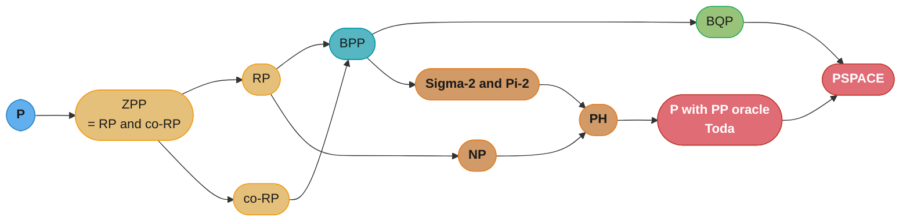

# Quantum and Randomized Complexity

## 1. Concept Overview

[theory_of_computation](theory_of_computation.md) builds the deterministic ladder: automata, decidability, P, NP, NP-completeness, the halting problem. Every machine in it is a machine that, given the same input, does the same thing.

This page asks what happens when it does not. Two extensions, both of which change the picture and only one of which is exotic:

- **Randomness.** The machine may flip fair coins. It may be wrong, but only with a probability you control, and the classes **RP**, **co-RP**, **ZPP**, **BPP** and **PP** differ precisely in *how* they are allowed to be wrong.
- **Quantum superposition.** The machine manipulates amplitudes that can cancel each other, and **BQP** is what it can decide efficiently with bounded error.

This is not decoration on the deterministic theory. It is the layer that answers questions the rest of the repo *asserts* without justifying. [cryptography_fundamentals](../cryptography_fundamentals/cryptography_fundamentals.md) §4.8 builds its entire post-quantum argument on the claim that Shor breaks RSA and ECC while Grover merely halves symmetric security — a claim about **BQP** and about a **proven query lower bound**, stated there as a fact and derived here. Every use of Miller-Rabin in TLS key generation is a bet on **co-RP**. Every hash table's average-case analysis is a randomized-algorithm analysis. The section teaches the consequences everywhere and the cause nowhere, and that gap is what this page closes.

The reason the material is worth the effort is a single, deeply unobvious result: **randomness is probably not powerful at all.** The prevailing conjecture is `P = BPP` — every efficient randomized algorithm has an efficient deterministic equivalent — and Impagliazzo and Wigderson showed it follows from a plausible circuit lower bound. Randomness buys *simplicity and constants*, not computability. Quantum, by contrast, is believed to buy something real, and the honest statement of *what* is much narrower than the popular one.

---

## 2. Intuition

**One-line analogy.** A deterministic algorithm is a proof. A randomized algorithm is a spot check you can repeat until the chance of being fooled is smaller than the chance of a cosmic ray flipping the answer bit. A quantum algorithm is neither: it is an interference pattern, arranged so the wrong answers cancel.

**Mental model for randomness.** You are testing whether a huge object has a property, and you cannot afford to look at all of it. So you sample. The whole theory is bookkeeping about *which direction you can be wrong in*:

```
one-sided (RP for the "yes" side):
   answer YES  ->  CERTAIN. You found a witness; witnesses do not lie.
   answer NO   ->  "I looked k times and found nothing." Error <= 2^-k.

two-sided (BPP):
   both answers can be wrong, but only with probability <= 1/3,
   and majority-vote over k runs drives that to exp(-ck).
```

**Mental model for quantum.** The single most useful correction: a quantum computer does **not** try all answers in parallel and pick the right one. It puts amplitude on every branch, and then arranges for the amplitudes of the *wrong* branches to destructively interfere so that a measurement is likely to land on a right one. Superposition is free; **getting the answer out is the whole difficulty**, and it is why quantum speedups exist for a handful of structured problems and not for search-like problems generally.

**Why it matters.** Two dates and one policy come out of this. Shor's algorithm makes RSA and elliptic-curve cryptography breakable *given a large enough fault-tolerant machine*, which is why NIST standardised ML-KEM, ML-DSA and SLH-DSA in FIPS 203/204/205 in August 2024 and selected HQC as a non-lattice hedge in March 2025. Grover's algorithm halves symmetric key strength, which is why AES-256 is the recommendation and AES-128 is not simply doubled to "AES-256 or bust" by panic but by arithmetic.

**Key insight.** **The interesting number is not the speedup, it is the exponent.** Shor turns a sub-exponential factoring problem into a polynomial one — a change of *class*. Grover turns `2^n` into `2^(n/2)` — still exponential, still infeasible for a well-chosen key, and provably the best any quantum algorithm can do for unstructured search. Confusing "quadratic speedup" with "broken" is the single most common error in this area, and it is an error of exponents.

---

## 3. Core Principles

- **Bounded error is what makes a class useful.** `2/3` and `1/3` in the definition of BPP are arbitrary; any constant bounded away from `1/2` gives the same class, because majority voting amplifies it. A machine correct with probability exactly `1/2` is a coin, and PP — which requires only a strict majority, possibly by `2^-n` — is enormously more powerful precisely because it drops the bound.
- **Error direction is a structural property, not a detail.** RP can only err by saying "no" to a yes-instance; co-RP only by saying "yes" to a no-instance. `ZPP = RP ∩ co-RP` is a theorem, and it says that a never-wrong algorithm with random *running time* is exactly the combination of the two one-sided ones.
- **Amplification is cheap and its cost is logarithmic.** Driving the error from `1/4` to `2^-128` costs a constant factor of repetitions, not a change of algorithm. This is why "probabilistic" almost never means "unreliable" in practice.
- **Randomness is probably free to remove.** `BPP ⊆ P/poly` (Adleman) and `BPP ⊆ Σ₂ ∩ Π₂` (Sipser-Gács-Lautemann) are proven; `P = BPP` follows from a plausible circuit lower bound (Impagliazzo-Wigderson). Nobody expects randomness to be genuinely powerful.
- **Quantum speedups need structure.** Shor exploits the periodicity of modular exponentiation. Grover exploits nothing, and gets only a square root — and the BBBV lower bound proves no quantum algorithm does better on an unstructured oracle. The absence of structure is a *proven* barrier, not an open question.
- **Containments prove less than they look like they prove.** `BQP ⊆ PSPACE` is proven, so a quantum computer cannot solve undecidable problems or beat exponential space. `BQP` versus `NP` is **open in both directions**, so "quantum solves NP-complete problems" is not merely unproven — it is contrary to what most researchers expect.
- **Hardness is worst-case; cryptography needs average-case.** NP-hardness says *some* instances are hard. A cipher needs *random* instances to be hard. This is exactly why factoring being not-NP-complete does not make RSA weak, and why lattice problems' worst-case-to-average-case reductions are prized.

---

## 4. Types / Architectures / Strategies

### The randomized classes

| Class | Yes-instance | No-instance | Reads as |
|---|---|---|---|
| **P** | always accepts | always rejects | deterministic |
| **RP** | accepts with prob ≥ 1/2 | **always** rejects | a "yes" is a proof; a "no" may be a miss |
| **co-RP** | **always** accepts | rejects with prob ≥ 1/2 | a "no" is a proof; a "yes" may be a miss |
| **ZPP** | always correct | always correct | never wrong; *expected* polynomial time |
| **BPP** | accepts with prob ≥ 2/3 | rejects with prob ≥ 2/3 | either answer may be wrong, boundedly |
| **PP** | accepts with prob > 1/2 | rejects with prob ≥ 1/2 | **unbounded** error — the margin may be `2^-n` |

`ZPP = RP ∩ co-RP` is a theorem. `P ⊆ ZPP ⊆ RP ⊆ BPP ⊆ PP`, and `RP ⊆ NP` (a witnessing run *is* an NP certificate) — but **`BPP ⊆ NP` is not known**, which surprises people. The best unconditional containment is `BPP ⊆ Σ₂ ∩ Π₂`.

PP's power is worth internalising through **Toda's theorem: `PH ⊆ P^PP`.** The entire polynomial hierarchy collapses into polynomial time with a PP oracle. Dropping the *bounded* from bounded-error is not a small relaxation.

### The quantum classes

| Class | Definition | Status |
|---|---|---|
| **BQP** | decidable by a poly-size quantum circuit with error ≤ 1/3 | `P ⊆ BPP ⊆ BQP ⊆ PSPACE`, all **proven** |
| **BQP vs NP** | — | **open in both directions**; BBBV gives an oracle separation showing `NP ⊄ BQP` relative to that oracle |
| **QMA** | the quantum analogue of NP — a quantum proof, verified by a quantum verifier | contains NP; the local Hamiltonian problem is QMA-complete |

### The two algorithms everything else references

| | Grover | Shor |
|---|---|---|
| Problem | unstructured search over `N` items | integer factoring, discrete log |
| Mechanism | amplitude amplification | period/order finding via the quantum Fourier transform |
| Speedup | `Θ(√N)` queries — **quadratic** | `O((log N)²·log log N·log log log N)` — **exponential**, a class change |
| Optimality | **proven optimal** — BBBV `Ω(√N)` lower bound | no lower bound needed; it changed the class |
| Consequence | symmetric security halves: AES-128 → ~2^64 | RSA, DH, ECDSA, ECDH all broken |
| Structure exploited | none | periodicity of `a^x mod N` |

### Derandomization: the tools for removing the coins

| Technique | Idea | Example |
|---|---|---|
| Method of conditional expectations | fix random bits one at a time, always keeping the expectation good | derandomizing MAX-CUT's 1/2-approximation |
| Pairwise independence | replace `n` truly random bits with `O(log n)`, then exhaust | small-sample-space algorithms |
| Pseudorandom generators from hardness | a function hard for circuits looks random to circuits | Impagliazzo-Wigderson: circuit lower bounds ⇒ `P = BPP` |

### Probabilistic proof checking

**The PCP theorem (Arora, Lund, Motwani, Sudan, Szegedy, 1992): `NP = PCP(log n, O(1))`.** Every NP proof can be rewritten so a verifier reading `O(log n)` random bits and querying a **constant** number of proof positions accepts a true proof always and a false one with probability at most 1/2.

Its real payload is inapproximability. **Håstad (1997/2001)** derived from it that **MAX-3SAT is NP-hard to approximate better than 7/8** — exactly the ratio a random assignment achieves, so the trivial algorithm is optimal unless `P = NP` — and that **MAX-CLIQUE is NP-hard to approximate within `n^(1-ε)`** for any `ε > 0`.

---

## 5. Architecture Diagrams

The class landscape, drawn as containment (arrow means "is contained in"):



*Every arrow shown is a **proven** containment. What is deliberately absent is any arrow between BQP and NP in either direction — that relationship is open, and drawing it is the most common way this diagram is got wrong.*

Why amplification works, as a picture of where the probability mass goes:

```
ONE-SIDED (co-RP, e.g. Miller-Rabin on a composite)
  each round independently catches it with prob >= 3/4

  round:      1        2        3       ...      k
  survives:  1/4      1/16     1/64            4^-k

  k=10  -> 9.5e-07      k=50  -> 7.9e-31      k=100 -> 6.2e-61
                                   ^ below the odds of undetected
                                     hardware error on the same machine

TWO-SIDED (BPP, correct with prob >= 2/3, majority vote over k runs)
  Chernoff: Pr[majority wrong] <= exp(-2k(1/6)^2)

  correct runs needed:  more than k/2
  expected correct:     2k/3
  the gap 2k/3 - k/2 = k/6 is what the bound exponentiates
```

Grover, as the only picture of amplitude worth drawing:

```
  amplitude on each of N = 16 basis states, one marked (*)

  start (uniform):     all bars equal, |amp| = 1/4
    . . . . . . . * . . . . . . . .
    ================================   each 0.25

  after 1 iteration:   marked grows, others shrink slightly
    - - - - - - -###- - - - - - - -

  after 3 iterations:  ~ (pi/4)*sqrt(16) = 3, near-certain
    . . . . . . .#######. . . . . . .
                    ^ measure here

  Too FEW iterations: you miss.  Too MANY: the amplitude rotates
  PAST the target and shrinks again. Grover is a rotation, and
  overshooting is a real failure mode -- this is why the iteration
  count is (pi/4)*sqrt(N) exactly and not "as many as you like".
```

---

## 6. How It Works — Detailed Mechanics

### 6.1 One-sided error, executable: Miller-Rabin

Miller-Rabin is the canonical co-RP algorithm and the one every TLS implementation runs when generating a key. The direction of its error is the part people get backwards.

```python
import random

def miller_rabin(n: int, rounds: int = 20) -> bool:
    """Probable-primality test.

    A return of False is CERTAIN: a witness to compositeness was found,
    and witnesses do not lie. A return of True may be wrong, with
    probability at most 4^-rounds.

    So for the language PRIMES this is a co-RP algorithm: it never
    rejects a true prime. For the language COMPOSITES it is RP.
    """
    if n < 2:
        return False
    for p in (2, 3, 5, 7, 11, 13, 17, 19, 23, 29, 31, 37):
        if n % p == 0:
            return n == p

    d, s = n - 1, 0
    while d % 2 == 0:            # write n-1 = d * 2^s with d odd
        d //= 2
        s += 1

    for _ in range(rounds):
        a = random.randrange(2, n - 1)
        x = pow(a, d, n)
        if x == 1 or x == n - 1:
            continue             # this base is not a witness
        for _ in range(s - 1):
            x = x * x % n
            if x == n - 1:
                break
        else:
            return False         # CERTAIN: composite
    return True                  # probable prime
```

```
>>> miller_rabin(561)      # 561 = 3*11*17, a Carmichael number that
False                      #   fools the naive Fermat test entirely
>>> miller_rabin(2**521 - 1)
True
>>> miller_rabin(2**521 - 3)
False
```

Carmichael numbers are why this matters: they satisfy `a^(n-1) ≡ 1 (mod n)` for every `a` coprime to `n`, so a Fermat test declares them prime no matter how many bases it tries. Miller-Rabin's extra square-root check catches them, and the `≤ 1/4` per-round bound holds for **every** composite, with no exceptions.

The amplification arithmetic, which is what makes "probabilistic" acceptable in a key generator:

```
rounds     error bound      comparison
    1        2.5e-01
   10        9.5e-07
   50        7.9e-31
  100        6.2e-61        smaller than the probability of an
                            undetected memory error during the run
```

Note what is **not** true: `PRIMES ∈ P` since **AKS (Agrawal-Kayal-Saxena, 2002)**. Miller-Rabin survives because it is dramatically faster in practice, which is the general shape of randomized algorithms — they win on constants, not on computability.

### 6.2 Polynomial identity testing and Schwartz-Zippel

**Schwartz-Zippel lemma.** For a nonzero polynomial `P` of total degree `d` over a field, and a finite subset `S` of that field, a uniformly random point `r ∈ Sⁿ` satisfies

```
   Pr[P(r) = 0]  <=  d / |S|
```

So to test whether two polynomials are identical — possibly given as circuits you cannot expand — evaluate their difference at random points. A single difference is a certificate; agreement everywhere you looked is evidence.

```python
import random

def poly_identity_test(f, g, nvars: int, degree: int, trials: int = 20) -> bool:
    """co-RP identity test. A False is CERTAIN (a differing point was
    found). A True has error at most (degree/|S|)^trials by
    Schwartz-Zippel."""
    S = list(range(1, 100 * max(degree, 1) + 1))    # |S| = 100d
    for _ in range(trials):
        point = [random.choice(S) for _ in range(nvars)]
        if f(*point) != g(*point):
            return False
    return True
```

```
>>> poly_identity_test(lambda x,y: (x+y)**2, lambda x,y: x*x+2*x*y+y*y, 2, 2)
True
>>> poly_identity_test(lambda x,y: (x+y)**2, lambda x,y: x*x+x*y+y*y, 2, 2)
False
```

With `|S| = 100d` the per-trial error is at most `1/100`, so twenty trials give `10^-40`. **PIT is the flagship open problem of derandomization**: no deterministic polynomial-time algorithm is known for the general circuit version, and finding one would imply circuit lower bounds — which is why "just derandomize it" is harder than it sounds.

### 6.3 Amplification, precisely

**One-sided (RP/co-RP).** Each round independently catches a wrong instance with probability ≥ 1/2, so `k` rounds leave error ≤ `2^-k`. Miller-Rabin's per-round bound is ≤ 1/4, giving `4^-k`.

**Two-sided (BPP).** You cannot just repeat — either answer can be wrong. Run `k` times and take the **majority**. With per-run correctness `2/3`, the expected number of correct runs is `2k/3` and you need more than `k/2`, so the gap is `k/6`. A Chernoff bound gives

```
   Pr[majority is wrong]  <=  exp(-2k(1/6)²)  =  exp(-k/18)
```

which is exponentially small in `k`. This is exactly why the constant `2/3` is arbitrary: any `1/2 + ε` for constant `ε` amplifies to anything you want in `O(1/ε² · log(1/δ))` runs.

**And why PP is different.** PP requires only a strict majority, and that majority may exceed `1/2` by as little as `2^-n`. The Chernoff gap is then exponentially small, so amplification would need exponentially many runs. That single relaxation is the whole distance between BPP and a class containing all of PH (Toda).

### 6.4 Grover: a rotation, not a lookup

Grover's algorithm searches `N` unstructured items with `Θ(√N)` oracle queries. The optimal iteration count for a single marked item is exactly

```
   floor( (pi/4) * sqrt(N) )
```

```python
import math

def grover_iterations(N: int) -> int:
    return math.floor(math.pi / 4 * math.sqrt(N))
```

```
>>> [(N, grover_iterations(N)) for N in (16, 256, 1024, 2**20)]
[(16, 3), (256, 12), (1024, 25), (1048576, 804)]
>>> grover_iterations(2**128)          # brute-forcing an AES-128 key
14488038916154245120                   # ~ 2^63.65
```

Two facts do the work here:

**It is optimal, and that is proven.** The **BBBV** result (Bennett, Bernstein, Brassard, Vazirani, 1997) gives an `Ω(√N)` lower bound for *any* quantum algorithm on an unstructured oracle. The square root is a wall, not the current record.

**Overshooting fails.** Each iteration rotates the state vector by a fixed angle toward the marked state. Run too many and you rotate past it and the success probability *falls*. This is the sharpest way to see that superposition is not parallel search: a parallel search cannot be run "too long".

### 6.5 Shor: the structure Grover does not have

Shor's algorithm does not factor directly. It solves **order finding**: given `a` coprime to `N`, find the smallest `r` with `a^r ≡ 1 (mod N)`. The reduction from factoring to order finding is entirely classical and predates quantum computing; the quantum part is finding the period of `a^x mod N` with the quantum Fourier transform, which is where the exponential advantage lives.

Complexity is `O((log N)²·log log N·log log log N)` — **polynomial in the number of bits**, against the best known classical algorithm (the general number field sieve) which is sub-exponential. That is a change of complexity class, not a constant-factor speedup, and it is why the consequence is "broken" rather than "weakened".

**Factoring is not known to be NP-complete**, and most complexity theorists do not believe it is. It sits in `NP ∩ co-NP` and is believed to be strictly between P and NP-complete. This is the reason Shor does not imply that quantum computers solve NP-complete problems: it exploits *periodicity*, a structure NP-complete problems are not known to have.

### 6.6 The proven containments, and what each rules out

- **`BQP ⊆ PSPACE`** — a classical machine can simulate a quantum circuit by summing over computational paths in polynomial *space* (exponential time). So a quantum computer decides nothing undecidable and nothing outside PSPACE.
- **`BPP ⊆ P/poly` (Adleman, 1978)** — amplify the error below `2^-n`, then a counting argument shows one fixed random string works for *all* `n`-bit inputs. Hardwire it as advice. Randomness is removable if you are allowed non-uniformity.
- **`BPP ⊆ Σ₂ ∩ Π₂` (Sipser-Gács-Lautemann, 1983)** — the best unconditional containment of BPP inside the polynomial hierarchy. Note it does **not** give `BPP ⊆ NP`, which remains open.
- **`P = BPP` if E requires exponential-size circuits (Impagliazzo-Wigderson, 1997)** — a hardness assumption yields a pseudorandom generator that fools polynomial-size circuits, so the coins can be replaced by its output and exhausted. This is why `P = BPP` is the expectation rather than an open bet.

---

## 7. Real-World Examples

- **Every TLS key generation** runs Miller-Rabin (typically after trial division), betting on co-RP with enough rounds that the failure probability is below the hardware's own error rate. This is the most-executed randomized algorithm in the world.
- **NIST's post-quantum standards** are the direct policy output of this theory: **FIPS 203 (ML-KEM), 204 (ML-DSA) and 205 (SLH-DSA), published 2024-08-13**, with **HQC selected 2025-03-11** as a fifth algorithm — a code-based KEM chosen specifically as a **non-lattice** hedge in case lattice problems fall. A draft standard is expected around 2026 and a final one around 2027.
- **Hybrid key exchange in production.** Browsers and servers negotiate `X25519MLKEM768`, standardised for TLS 1.3 in RFC 10024 (August 2026) and offered by default in Chrome, Firefox, OpenSSL 3.5+, Go 1.24+ and JDK 27, combining a classical and a post-quantum KEM so the session is secure if *either* holds. That is a direct hedge against both "Shor arrives" and "the new lattice assumption is wrong".
- **Google's Willow chip** (announced 2024-12-09, **105 qubits**) demonstrated **below-threshold** error correction: as the surface-code patch grew from 3×3 to 5×5 to 7×7 physical qubits per logical qubit, the logical error rate roughly halved at each step. That is the first evidence that scaling *suppresses* error rather than compounding it — the precondition for everything else.
- **IBM's roadmap** as of late 2025: **Nighthawk** (~120 qubits) unveiled November 2025, and **Loon**, an experimental chip proving out qLDPC connectivity. **Kookaburra** (2026) and **Starling**, the large-scale fault-tolerant system targeted for **2029**, remain roadmap items.
- **The RSA-2048 resource estimate is the number to quote**, and it keeps moving. **Gidney and Ekerå (2019)** estimated ~**20 million** noisy physical qubits and ~8 hours. **Gidney (2025)** brought it to **under 1 million** noisy physical qubits in under a week, via approximate residue arithmetic, yoked surface codes and magic-state cultivation. The **Pinnacle architecture** (Webster et al., arXiv 2602.11457, February 2026) replaces surface codes with quantum LDPC codes and puts it **under 100,000** physical qubits, assuming a 10^-3 physical error rate and 1 µs code cycles. For elliptic curves, **Babbush et al. (Google Quantum AI, arXiv 2603.28846, March 2026)** estimate ECDLP-256 at under 500,000 physical qubits running in minutes, and Google set 2029 as its own post-quantum migration deadline (March 25, 2026). All of these are paper estimates, not hardware. The threat model got closer without any hardware shipping, which is the argument for migrating on a schedule rather than on a headline.
- **What has actually been factored by Shor's algorithm on hardware is 21** (2012, and even that used a circuit compiled with knowledge of the answer). Larger published numbers — 56,153, or a 48-bit value — used NMR spin systems or hybrid/adiabatic methods that exploit the specific number's structure, and are **not** evidence of progress toward RSA-sized factoring. Be skeptical of any headline here.

---

## 8. Tradeoffs

| | Deterministic | Randomized | Quantum |
|---|---|---|---|
| Correctness | certain | bounded error, amplifiable to `2^-128` cheaply | bounded error, amplifiable |
| Typical benefit | — | simpler code, better constants, sometimes a better bound | exponential for periodic structure; quadratic for search |
| Believed power | — | **none extra** — `P = BPP` conjectured | genuinely more, on a narrow class of problems |
| Reproducibility | full | needs a seed | none, by nature |
| Hardware today | universal | universal | **experimental**; no cryptographically relevant machine exists |

| Class pair | The difference | Why it matters |
|---|---|---|
| RP vs BPP | one-sided vs two-sided error | an RP "yes" is a certificate; a BPP answer never is |
| BPP vs PP | **bounded** vs unbounded error margin | PP contains all of PH (Toda); BPP probably equals P |
| ZPP vs BPP | random *running time* vs random *answer* | ZPP is never wrong; you just cannot predict when it finishes |
| BQP vs NP | incomparable, both directions open | "quantum solves NP-complete problems" is not a known consequence |
| Grover vs Shor | quadratic (proven optimal) vs exponential | halves symmetric security; **breaks** RSA/ECC |

---

## 9. When to Use / When NOT to Use

**Reach for a randomized algorithm when:**
- The deterministic version is much harder to write or asymptotically worse — randomized quickselect, treaps, skip lists, Karger's min-cut, Monte Carlo integration.
- You can afford to be wrong with probability `2^-100`, which is almost always, because that is below the machine's own error rate.
- A one-sided guarantee is the natural fit: identity testing, primality, membership tests.
- The input may be adversarial and randomization removes the adversary's ability to construct a worst case — universal hashing is exactly this argument.

**Do NOT use one when:**
- The result must be **reproducible** for audit or debugging, and you have no discipline about seeding. A fixed seed makes it deterministic and re-introduces the adversarial worst case.
- The error direction is wrong for your use. A "probably prime" is fine for RSA key generation and unacceptable where a composite modulus silently produces a broken key with no detection path.
- The randomness source is weak. Every bound here assumes fair independent coins; a predictable PRNG makes the analysis vacuous, which is a security bug and not a performance one.

**Apply the quantum threat model when:**
- Data has a long confidentiality lifetime. **Harvest-now-decrypt-later** is the real threat: traffic captured today is decryptable when a machine exists, so anything that must stay secret for a decade needs post-quantum key exchange **now**.
- You are choosing signature algorithms for firmware or long-lived roots of trust, where the certificate outlives the migration window.

**Do NOT apply it when:**
- Someone claims a quantum computer will break AES-256, hash functions, or NP-complete problems. Grover halves the exponent, which leaves AES-256 at ~2^128 — fine. Nothing known breaks a well-chosen symmetric primitive.
- The argument is "quantum computers will solve our optimisation problem". `BQP` versus `NP` is open, and no quantum algorithm is known to solve NP-complete problems efficiently.

---

## 10. Common Pitfalls

**"A quantum computer tries all answers in parallel."** The most common and the most misleading. Superposition puts amplitude on every branch, but a measurement returns one outcome sampled from `|amplitude|²`, so the whole engineering problem is arranging *interference* that cancels wrong answers. If parallelism were the mechanism, Grover would be `O(1)` rather than `Θ(√N)` with a **proven** matching lower bound.

**"Grover breaks AES."** It halves the exponent: AES-128 drops to roughly `2^64` operations — the exact count being `⌊(π/4)·2^64⌋ ≈ 1.45 × 10^19`. That is a large number of *sequential* oracle calls, and Grover parallelises badly: `P` machines give only a further `√P` speedup, so a realistic attack needs either an implausible sequential runtime or implausibly many machines. AES-256 lands at ~`2^128`, which is why NIST's guidance is "use AES-256", not "symmetric crypto is doomed".

**"Shor breaks all cryptography."** Shor breaks problems with *periodic structure*: factoring, discrete log, elliptic-curve discrete log. It does not touch lattice problems, code-based problems, hash-based signatures or symmetric primitives — which is precisely why ML-KEM, HQC and SLH-DSA are built on those.

**"Factoring is NP-complete, so quantum computers solve NP-complete problems."** Both halves are wrong. Factoring is **not known to be NP-complete** and is not believed to be; it lies in `NP ∩ co-NP`. And `BQP` versus `NP` is **open in both directions** — BBBV even gives an oracle relative to which `NP ⊄ BQP`.

**Getting Miller-Rabin's error direction backwards.** For PRIMES it is **co-RP**: it never rejects a true prime, and can wrongly accept a composite with probability ≤ 1/4 per round. Stating it as "it might say a prime is composite" inverts the guarantee and makes the algorithm look unusable for key generation, when it is the reason key generation is fast.

**"BPP ⊆ NP."** Not known. The best unconditional containment is `BPP ⊆ Σ₂ ∩ Π₂`. It is easy to assume by analogy with `RP ⊆ NP`, which *is* true — an accepting run of an RP machine is a certificate, while a BPP machine's answer certifies nothing either way.

**Treating `P = BPP` as proven.** It is conjectured, and it follows from a circuit lower bound nobody has proven (Impagliazzo-Wigderson). Saying "randomness provably adds nothing" overstates a genuinely beautiful conditional result.

**Confusing worst-case hardness with cryptographic hardness.** NP-hardness says *some* instance is hard. A cipher needs *random* instances to be hard. This gap is why an NP-hard problem is not automatically a good cryptographic foundation, and why lattice problems' worst-case-to-average-case reductions are the property that made them attractive.

**Quoting a "largest number factored by a quantum computer" headline.** The honest figure for a genuine Shor circuit is **21**. Everything larger used structure-exploiting shortcuts or a different method entirely, and repeating those numbers as evidence of scaling is how a threat timeline gets built on a press release.

---

## 11. Technologies & Tools

| Tool | Purpose |
|---|---|
| Miller-Rabin / Solovay-Strassen | probabilistic primality; the co-RP algorithm inside every keygen |
| AKS primality | the deterministic polynomial-time test (2002); theoretically decisive, practically slower |
| Schwartz-Zippel / randomized PIT | polynomial identity testing; the flagship open derandomization problem |
| Chernoff and Hoeffding bounds | the quantitative core of every amplification argument |
| Qiskit, Cirq | quantum circuit construction and simulation; where Grover and Shor are actually written |
| `liboqs` / Open Quantum Safe | reference implementations of PQC algorithms for experimentation |
| OpenSSL 3.x, BoringSSL | ship hybrid groups such as `X25519MLKEM768` in production TLS |
| NIST FIPS 203 / 204 / 205 | the ratified standards: ML-KEM, ML-DSA, SLH-DSA |
| Universal hashing families | randomization as an adversarial-input defence, not a speed trick |
| Randomized data structures (treaps, skip lists) | expected-case guarantees without balancing logic |

---

## 12. Interview Questions with Answers

**Q: What is the difference between RP, co-RP, ZPP and BPP?**
**Short:** They differ in error direction — RP errs only on yes-instances, co-RP only on no-instances, BPP on both boundedly, and ZPP never errs but has random running time.
They are four answers to "how may this algorithm be wrong". **RP** may only err by rejecting a yes-instance, so an accept is a certificate. **co-RP** is the mirror: a reject is a certificate. **BPP** allows two-sided error bounded by 1/3 on each side, so neither answer certifies anything. **ZPP** is never wrong — it is Las Vegas, with random *running time* rather than a random answer — and `ZPP = RP ∩ co-RP` is a theorem, which says a never-wrong algorithm is exactly the combination of the two one-sided ones. The practical importance is that a one-sided guarantee often matches the use case exactly: Miller-Rabin never rejects a true prime, which is precisely what a key generator needs.

**Q: Why are the constants 2/3 and 1/3 in the definition of BPP arbitrary?**
**Short:** Any constant bounded away from 1/2 amplifies to any desired error by majority voting, with only a constant-factor cost in repetitions.
Because majority voting amplifies any constant advantage. Run the algorithm `k` times and take the majority: with per-run correctness `2/3`, the expected number of correct runs is `2k/3` while you need more than `k/2`, so the gap is `k/6`, and a Chernoff bound gives error at most `exp(-2k(1/6)²)` — exponentially small in `k`. Any `1/2 + ε` for constant `ε` works, costing `O(ε^-2 · log(1/δ))` runs. The definition would break only if the advantage were allowed to shrink with input size, which is exactly what **PP** allows — and that is why PP is enormously more powerful.

**Q: What is PP and why is it so much more powerful than BPP?**
**Short:** PP requires only a strict majority of accepting paths, possibly by 2^-n, so amplification would need exponentially many runs — and Toda's theorem puts all of PH inside P^PP.
PP accepts when strictly more than half of the computation paths accept — with no bound on the margin, which may be as small as `2^-n`. That single relaxation destroys amplification: the Chernoff gap is exponentially small, so driving the error down needs exponentially many repetitions. The consequence is dramatic. **Toda's theorem (1991) proves `PH ⊆ P^PP`** — the entire polynomial hierarchy collapses into polynomial time given a PP oracle. So the distance between BPP, which is probably equal to P, and PP, which subsumes PH, is entirely the word *bounded*. It is the cleanest illustration in complexity theory of a definitional detail carrying enormous weight.

**Q: Is `P = BPP` proven?**
**Short:** No — it is conjectured, and Impagliazzo-Wigderson proved it follows from the assumption that E requires exponential-size circuits.
No, it is conjectured, though most researchers expect it. What is **proven** is a conditional: **Impagliazzo and Wigderson (1997)** showed that if `E` requires exponential-size circuits — a plausible circuit lower bound — then a pseudorandom generator exists that fools polynomial-size circuits, so a BPP algorithm's coins can be replaced by the generator's output and the short seed exhausted deterministically. Two unconditional containments are also known: **`BPP ⊆ P/poly`** (Adleman, 1978) and **`BPP ⊆ Σ₂ ∩ Π₂`** (Sipser-Gács-Lautemann, 1983). The interesting philosophical upshot is that randomness is probably not a computational resource at all — it buys simplicity and constants, and *hardness* is what would buy its removal.

**Q: Explain Grover's algorithm and its speedup, precisely.**
**Short:** Grover searches N unstructured items in Θ(√N) oracle queries — a quadratic speedup that is provably optimal by the BBBV lower bound, not merely the current best.
Grover finds a marked item among `N` with `Θ(√N)` oracle queries instead of `Θ(N)`. Mechanically it is amplitude amplification: start in uniform superposition, and each iteration rotates the state vector slightly toward the marked state, so after `⌊(π/4)√N⌋` iterations a measurement is very likely to return it. Two facts matter more than the mechanism. It is **provably optimal** — the BBBV lower bound of `Ω(√N)` holds for any quantum algorithm on an unstructured oracle, so the square root is a wall. And you can run it **too long**: because it is a rotation, extra iterations rotate past the target and the success probability falls again, which is the sharpest demonstration that it is not parallel search.

**Q: What does Shor's algorithm actually solve, and why is it a class change rather than a speedup?**
**Short:** It solves order finding via the quantum Fourier transform, and the classical reduction from factoring makes it polynomial where the best classical factoring algorithm is sub-exponential.
Shor solves **order finding**: given `a` coprime to `N`, find the least `r` with `a^r ≡ 1 (mod N)`. The reduction from factoring to order finding is entirely classical and older than quantum computing; the quantum contribution is finding the period of `a^x mod N` using the quantum Fourier transform. Complexity is `O((log N)²·log log N·log log log N)` — **polynomial in the bit length** — against the general number field sieve's sub-exponential running time. That is a change of complexity class, which is why the consequence is "RSA and ECC are broken" rather than "weakened". The structure it exploits is **periodicity**, and that is exactly why the same technique does not generalise to unstructured problems.

**Q: Is factoring NP-complete? Does Shor mean quantum computers solve NP-complete problems?**
**Short:** No to both — factoring is not known to be NP-complete and sits in NP ∩ co-NP, and BQP versus NP is open in both directions.
No, twice. Factoring is **not known to be NP-complete** and most complexity theorists doubt it is; it lies in `NP ∩ co-NP`, since both a factorisation and a primality certificate are short and checkable, and is believed to be strictly between P and NP-complete. And `BQP` versus `NP` is **open in both directions** — no NP-complete problem is known to be in BQP, and BBBV gives an oracle relative to which `NP ⊄ BQP`, which is evidence against. What *is* proven is `P ⊆ BPP ⊆ BQP ⊆ PSPACE`, so a quantum computer is bounded by polynomial space and decides nothing undecidable. "Quantum computers will solve NP-complete problems" is a popular claim with no theoretical support.

**Q: How much does Grover weaken AES, and what is the standard caveat?**
**Short:** It halves the effective key strength — AES-128 to about 2^64 — but Grover parallelises poorly, so P machines give only a further √P speedup.
Quadratically: an `n`-bit key drops from `2^n` to about `2^(n/2)` operations, so AES-128 falls to roughly `2^64` — precisely `⌊(π/4)·2^64⌋ ≈ 1.45 × 10^19` oracle calls. That is why NIST's post-quantum guidance is to use **AES-256**, which lands at ~`2^128` and stays comfortable. The standard caveat, and the reason Grover is a far weaker practical threat than Shor: it is inherently **sequential**, and running it on `P` parallel quantum processors gives only a further `√P` speedup while requiring `P` times the hardware. So realising the full quadratic advantage against a well-chosen key needs either an implausibly long sequential runtime or implausibly many machines.

**Q: What is Miller-Rabin's error direction, and why does it matter for TLS?**
**Short:** For PRIMES it is co-RP — it never rejects a true prime, and may accept a composite with probability at most 1/4 per round.
For the language PRIMES, Miller-Rabin is **co-RP**: it never rejects a true prime, and can wrongly accept a composite with probability at most `1/4` per round independently. Equivalently, for COMPOSITES it is **RP** — a `False` means a witness was found, and witnesses do not lie. That direction is what makes it usable in key generation: you never discard a good prime, and forty rounds put the chance of accepting a composite at `4^-40 ≈ 10^-24`, below the probability of an undetected memory error during the computation. It also handles **Carmichael numbers** such as 561, 1105 and 1729, which satisfy Fermat's test for every coprime base and would fool a naive test regardless of how many bases it tried.

**Q: `PRIMES ∈ P` since AKS in 2002. So why does anyone still run Miller-Rabin?**
**Short:** Because AKS is polynomial but far slower in practice, and randomized algorithms usually win on constants rather than on computability.
Because "polynomial" and "fast" are different claims. **AKS (Agrawal-Kayal-Saxena, 2002)** settled the theoretical question — primality is decidable deterministically in polynomial time — but its exponent and constants make it dramatically slower than Miller-Rabin for the sizes that matter, so no production key generator uses it. This is the general shape of randomized algorithms and a good thing to say in an interview: they usually buy **constants and simplicity**, not computability, which is exactly consistent with the `P = BPP` conjecture. The randomized algorithm is not doing something the deterministic one cannot do; it is doing the same thing with a much better constant.

**Q: State the Schwartz-Zippel lemma and say what it is used for.**
**Short:** A nonzero degree-d polynomial vanishes at a random point of S^n with probability at most d/|S|, which gives a co-RP identity test.
For a **nonzero** polynomial `P` of total degree `d` over a field, and a finite subset `S`, a uniformly random point `r ∈ Sⁿ` satisfies `Pr[P(r) = 0] ≤ d/|S|`. The use is **polynomial identity testing**: to check whether two polynomials given as circuits are identical, evaluate their difference at random points — a nonzero value is a certificate that they differ, and repeated agreement is evidence they do not, with error `(d/|S|)^trials`. It is co-RP. PIT is also the flagship open problem of derandomization: no deterministic polynomial-time algorithm is known for the general circuit case, and finding one would imply circuit lower bounds, which is why "just derandomize it" is much harder than it sounds.

**Q: What is the PCP theorem and why does anyone outside theory care?**
**Short:** NP = PCP(log n, O(1)) — every NP proof can be checked with O(log n) random bits and constantly many queries — and it is the source of essentially all inapproximability results.
**`NP = PCP(log n, O(1))`**, proved by Arora, Lund, Motwani, Sudan and Szegedy in 1992: every NP proof can be rewritten so a verifier using `O(log n)` random bits and querying a **constant** number of proof positions accepts a true proof always and a false one with probability at most 1/2. The reason to care is what it implies for approximation. **Håstad (1997/2001)** derived that **MAX-3SAT is NP-hard to approximate better than 7/8** — exactly the ratio a random assignment achieves, so the trivial algorithm is optimal unless `P = NP` — and that **MAX-CLIQUE is NP-hard to approximate within `n^(1-ε)`**. That is the practical payload: it tells you when to stop looking for a better approximation algorithm.

**Q: What is proven about BQP's relationship to other classes?**
**Short:** P ⊆ BPP ⊆ BQP ⊆ PSPACE are all proven; BQP versus NP is open in both directions.
Proven: `P ⊆ BPP ⊆ BQP ⊆ PSPACE`. The first two are near-trivial — a quantum machine can simulate classical randomness — and `BQP ⊆ PSPACE` follows from simulating a quantum circuit by summing over computational paths in polynomial space at exponential time cost. That upper bound is the useful one to remember, because it immediately rules out quantum computers deciding undecidable problems or beating exponential space. **Open in both directions is `BQP` versus `NP`**: no NP-complete problem is known to be in BQP, and BQP is not known to be inside NP either. BBBV's oracle separation is evidence against `NP ⊆ BQP`. Drawing an arrow between them on a containment diagram is the most common way that diagram gets wrong.

**Q: What should a security architect actually do about the quantum threat in 2026?**
**Short:** Migrate long-lived confidentiality to hybrid post-quantum key exchange now, because harvest-now-decrypt-later makes today's captured traffic tomorrow's plaintext.
Act on **harvest-now-decrypt-later**, not on a hardware timeline. Traffic captured today is decryptable whenever a sufficient machine exists, so anything with a decade-long confidentiality requirement needs post-quantum key exchange now — in practice a **hybrid** group such as `X25519MLKEM768`, which is secure if *either* component holds and therefore hedges against both Shor and a flaw in the new lattice assumption. Signatures are less urgent for ephemeral use but urgent for long-lived roots of trust and firmware, where the certificate outlives the migration. Standards to build on: **FIPS 203/204/205, published 2024-08-13**, plus **HQC**, selected 2025-03-11 as a non-lattice hedge with a final standard expected around 2027. What not to do is spend effort on symmetric crypto: AES-256 and SHA-384 are already adequate.

**Q: How close is the hardware, and how would you evaluate a headline claiming otherwise?**
**Short:** No cryptographically relevant machine exists; the largest genuine Shor factorization on hardware is 21, and the best RSA-2048 paper estimate is under 100,000 physical qubits (2026).
Not close, and the way to evaluate a claim is to ask what was actually run. **Google's Willow** (2024-12-09, **105 qubits**) demonstrated below-threshold error correction — logical error rate roughly halving as the surface-code patch grew — which is the precondition for scaling, not a break. **IBM** shipped Nighthawk (~120 qubits) and the experimental Loon in 2025, with fault-tolerant **Starling targeted for 2029**. The largest number factored by a genuine Shor circuit on hardware is **21**; bigger published figures used NMR or hybrid/adiabatic methods that exploit the specific number's structure. The resource estimate is the number that actually moved: **Gidney and Ekerå (2019)** said ~20 million noisy physical qubits, **Gidney (2025)** brought it under **1 million**, and the qLDPC-based Pinnacle architecture (2026) under **100,000**. Google's 2026 estimate for ECDLP-256, the curve problem behind ECDH and ECDSA, is under 500,000 physical qubits in minutes. Algorithmic and error-correction improvement is shortening the timeline faster than hardware is — which is the argument for migrating on a schedule rather than on a headline.

---

## 13. Best Practices

- **Say which side the error is on.** "Probabilistic" is not a specification. "Never rejects a true prime, may accept a composite with probability ≤ 4^-k" is.
- **Amplify to below the hardware's own error rate and stop.** `4^-40 ≈ 10^-24` is smaller than the chance of an undetected memory error during the run; more rounds are theatre.
- **Seed deliberately, and know what you gave up.** A fixed seed makes a randomized algorithm reproducible for debugging *and* re-exposes it to adversarially constructed worst cases. Both matter; pick knowingly.
- **Never analyse a randomized algorithm without checking the randomness source.** Every bound here assumes fair independent coins. A predictable PRNG makes the analysis vacuous, and that is a security bug rather than a performance one.
- **Distinguish worst-case hardness from average-case hardness** whenever the conversation touches cryptography. NP-hardness is a statement about *some* instance.
- **Quote Grover as an exponent, never as a speedup.** "Halves the effective key length" is right; "breaks AES" is not.
- **Name what a quantum algorithm exploits.** Shor exploits periodicity. If a proposed speedup cannot say what structure it uses, be skeptical.
- **Migrate on a schedule, not on a headline.** The RSA-2048 estimate dropped 200-fold between 2019 and 2026 (20 million to under 100,000 physical qubits) through algorithm and error-correction research alone, with no hardware change.
- **Prefer hybrid post-quantum constructions** while the new assumptions are young. Being secure if *either* component holds is worth the extra bytes.
- **State conditionals as conditionals.** `P = BPP` is conjectured, `BQP ⊆ PSPACE` is proven, `BQP` versus `NP` is open. Blurring the three is the fastest way to lose credibility on this material.

---

## 14. Case Study

### Sizing the quantum threat for a real key-rotation policy

A payments company must decide, in 2026, what to do about post-quantum cryptography. The board has read a headline about a 105-qubit chip and wants to know whether to panic. Engineering wants to know what to change. Both questions are answerable from the theory on this page, and the answers are different for different assets.

**Step 1 — classify by what algorithm threatens it.**

| Asset | Primitive | Threatened by | Verdict |
|---|---|---|---|
| TLS session keys, 1-year card data retention | X25519 ECDH | **Shor** — exponential, class change | urgent: harvest-now-decrypt-later applies |
| Card data at rest, 7-year retention | AES-256-GCM | **Grover** — quadratic, `2^256 → ~2^128` | fine, no action |
| HMAC on internal messages | HMAC-SHA-256 | Grover on the underlying hash | fine, no action |
| Code-signing root, 15-year validity | ECDSA P-384 | **Shor** | urgent: the certificate outlives any plausible migration |
| Nightly batch signatures, 30-day validity | ECDSA P-256 | Shor | not urgent: rotate before a machine exists |

The classification is the whole analysis, and it is a complexity-theoretic one. Grover is quadratic and **provably** cannot do better on an unstructured problem, so the symmetric column is settled by arithmetic: `2^128` is out of reach and no further action is warranted. Shor is a class change against periodic structure, so everything in the asymmetric column is a scheduling problem.

**Step 2 — apply the right threat model, which is not "when does the machine exist".**

For confidentiality, the relevant question is **harvest-now-decrypt-later**: an adversary capturing TLS traffic today can decrypt it whenever a machine arrives. So the deadline for TLS is not the machine's arrival date, it is *today minus the data's confidentiality lifetime*. With a one-year retention requirement the deadline has already passed in any reasonable estimate, which is why hybrid key exchange goes first.

For signatures, the threat is different: a forged signature is only useful while the key is trusted. A 30-day batch signature is safe because the key rotates long before any machine could exist. A 15-year code-signing root is not, because the trust anchor outlives the entire migration window.

**Step 3 — read the resource estimate honestly.** The number that moved is the paper estimate, not the hardware qubit count. **Gidney and Ekerå (2019)** estimated ~20 million noisy physical qubits and ~8 hours for RSA-2048; **Gidney (2025)** brought that under **1 million** noisy physical qubits in under a week, through approximate residue arithmetic, yoked surface codes and magic-state cultivation; the Pinnacle architecture (2026) uses quantum LDPC codes to put it under **100,000**. **Algorithm and error-correction research cut the qubit estimate 200-fold with no hardware change.** That is the argument the board needs: the risk is not only "when does IBM ship Starling in 2029", it is "what does the next paper do to the estimate".

**Step 4 — the decisions.**

- **TLS: hybrid now.** `X25519MLKEM768`, which is secure if *either* the classical or the post-quantum component holds. That hedges Shor and hedges the possibility that a young lattice assumption turns out weak — a real risk, and precisely why NIST selected **HQC**, a code-based KEM, on 2025-03-11 as a non-lattice fifth algorithm.
- **Symmetric: no change.** AES-256 and SHA-384 are already post-quantum adequate. Effort spent here is effort not spent on the key exchange.
- **Code-signing root: plan a migration to ML-DSA or SLH-DSA**, with SLH-DSA the conservative choice because hash-based signature security rests only on the hash function, and hashes are exactly the primitive Grover merely dents.
- **Everything else: rotate on the existing schedule**, and record the reasoning so the decision is revisited when the estimate moves again rather than when the next headline lands.

**The mistake they avoided.** The first draft of the policy proposed migrating the AES-256 data-at-rest encryption, on the reasoning that "Grover attacks symmetric crypto". It does — and it leaves AES-256 at `2^128`, which is fine. That migration would have consumed the entire budget for the quarter and delivered nothing, while the actual exposure sat untouched in the TLS handshake. **The exponent is the analysis.** Quadratic and exponential are not two degrees of the same problem; they are the difference between "no action" and "act this quarter".

**What to say in an interview.** The threat is *not* uniform across cryptography, and being able to say which primitive is threatened by which algorithm — and why one speedup is provably capped at a square root while the other changes complexity class — is the difference between a policy and a panic.
