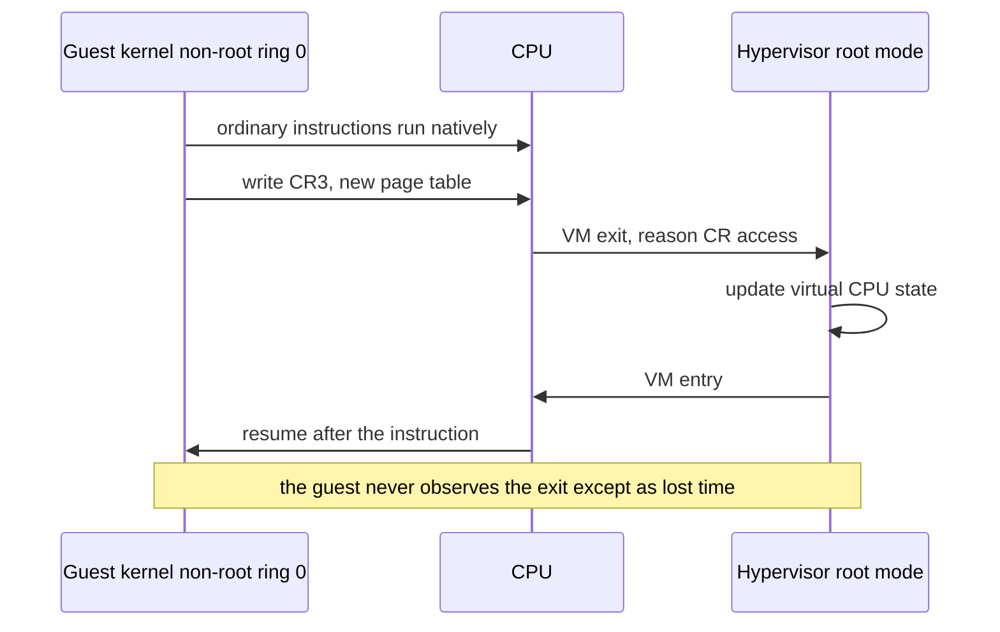
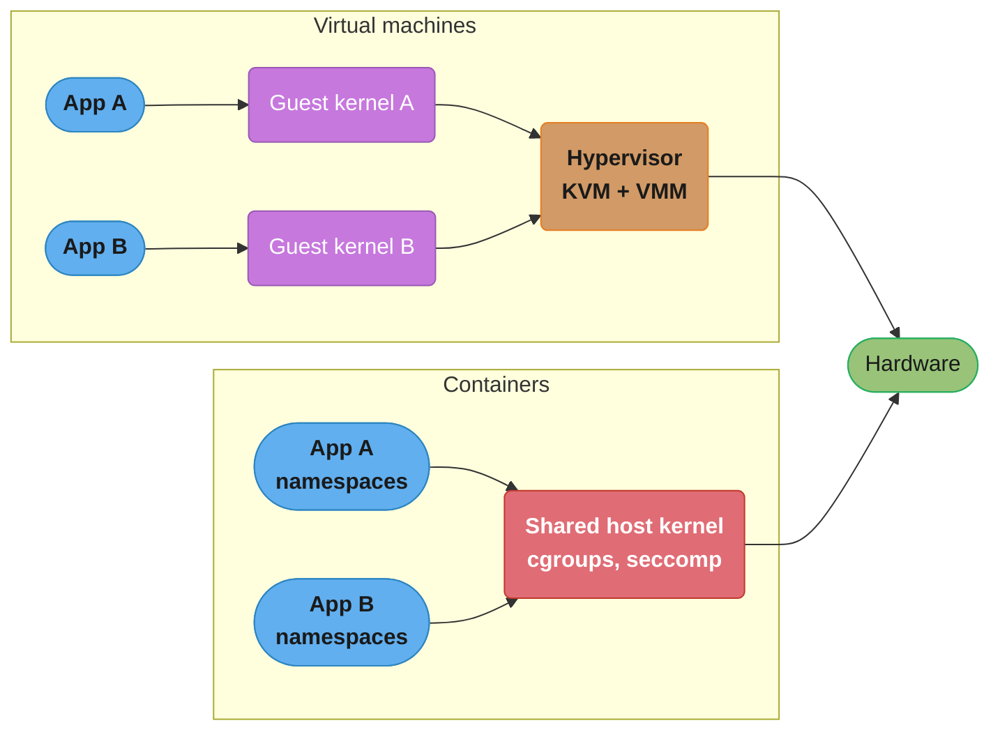
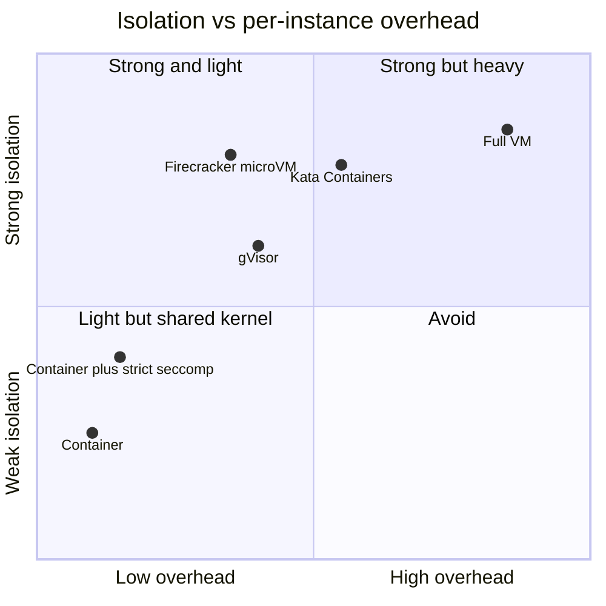
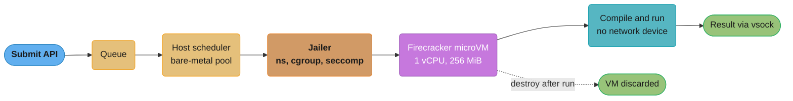

# Virtualization and Containers from First Principles

> A virtual machine lies to an operating system about the hardware. A container lies to a process about the operating system. Every isolation technology is a choice of which lie to tell, and how much it costs when the lie is caught.

---

## 1. Concept Overview

**Virtualization** runs several isolated execution environments on one physical machine. There are two fundamentally different ways to do it:

1. **Hardware virtualization (virtual machines).** A **hypervisor** (virtual machine monitor, VMM) presents each guest with a virtual CPU, virtual memory and virtual devices. Each guest runs its **own kernel**. Isolation is enforced by the CPU itself: guest code runs in a hardware mode where sensitive operations trap to the hypervisor.
2. **Operating-system virtualization (containers).** One kernel runs everything. Processes are grouped and given restricted **views** of kernel resources (namespaces), **limits** on resource consumption (cgroups) and restricted **permissions** (capabilities, seccomp, LSMs). Isolation is enforced by the shared kernel's own checks.

This module explains both from the bottom up: what makes an instruction set virtualizable (Popek and Goldberg), how x86 was virtualized before and after hardware support (binary translation, paravirtualization, VT-x and AMD-V), how memory is virtualized (shadow page tables, then two-level EPT/NPT paging), how I/O is virtualized (emulation, virtio, passthrough), how KVM and microVMs such as Firecracker are built, and how a container is assembled from namespaces, cgroups v2, capabilities and seccomp. It ends with the sandboxes in between: gVisor (a user-space kernel) and Kata Containers (containers inside lightweight VMs).

**Ownership boundary.** This page owns the *mechanisms*. Using Docker, writing Dockerfiles, OCI images and registries, runc/containerd/CRI-O and Kubernetes runtime classes live in [Containers and Docker](../../devops/containers_and_docker/containers_and_docker.md) and [Container Runtimes and OCI](../../devops/container_runtimes_and_oci/container_runtimes_and_oci.md). Linux operations (cgroup tuning, OOM handling in production) live in [Linux and OS Fundamentals](../../devops/linux_and_os_fundamentals/linux_and_os_fundamentals.md); pod security policy lives in [Kubernetes Security](../../devops/kubernetes_security/kubernetes_security.md).

---

## 2. Intuition

> **One-line analogy**: A virtual machine is a flat inside an apartment building: each flat has its own front door, kitchen and plumbing, and the building's structure (the CPU) keeps residents apart. A container is a hotel room: guests share one kitchen and one plumbing system (the kernel), and only the hotel's rules (namespaces, cgroups, seccomp) keep them out of each other's way.

**Mental model**: think in terms of **who handles a sensitive operation**.

- In a VM, a guest kernel that executes "disable interrupts" or "load a new page table" is not actually in control of the hardware. The CPU **traps** to the hypervisor, which updates the *virtual* state and resumes the guest. The guest never knows.
- In a container, a process that calls `mount()` or `sethostname()` **is** talking to the real host kernel. The kernel checks which namespace the process lives in and what capabilities it holds, and applies the operation to that namespace's view.

So the attack surface differs in kind. To escape a VM, a guest must exploit the hypervisor's small interface (VM exits, a handful of virtual devices). To escape a container, a process can probe the **entire Linux system-call interface** of the shared kernel: hundreds of system calls and millions of lines of code.

**Why it matters**: cloud computing is built on this tradeoff. Every function invocation in AWS Lambda runs in a Firecracker microVM because tenants do not trust each other; every pod in a typical Kubernetes cluster runs as a container because the workloads belong to one organisation. Choosing the wrong isolation level is either a security hole or a 10x cost overrun.

**Key insight**: virtualization is efficient only when the **common case runs directly on the hardware** and only the rare sensitive case is intercepted. Popek and Goldberg's 1974 theorem formalised this: an architecture is efficiently virtualizable if every *sensitive* instruction is also *privileged* (it traps when run in user mode). x86 violated that rule for 20 years, and the whole history of x86 virtualization (binary translation, paravirtualization, VT-x) is the story of working around it.

---

## 3. Core Principles

**Popek and Goldberg's requirements.** In "Formal Requirements for Virtualizable Third Generation Architectures" (presented at SOSP 1973, published in CACM in 1974), a VMM must provide:
- **Equivalence**: a program runs in the VM exactly as on bare hardware, apart from timing and resource availability.
- **Resource control**: the VMM is in complete control of the real resources.
- **Efficiency**: a dominant fraction of instructions executes directly on the hardware, without VMM intervention.

They classify instructions: **privileged** (trap if executed in user mode), **control-sensitive** (change system configuration, such as page tables or interrupt state), and **behaviour-sensitive** (behave differently depending on mode or configuration). **Theorem 1**: an effective VMM can be built if the set of sensitive instructions is a subset of the privileged instructions. Then **trap-and-emulate** works: run the guest kernel deprivileged, let every sensitive instruction trap, and emulate it against the virtual machine's state.

**Why classic x86 failed the test.** Some x86 instructions are sensitive but do not trap in user mode. `POPF` executed outside ring 0 silently ignores changes to the interrupt flag instead of faulting, so a deprivileged guest kernel that tries to re-enable interrupts with `POPF` simply fails without the VMM ever being told. Instructions such as `SGDT` and `SIDT` let unprivileged code read the real location of the host's descriptor tables. A pure trap-and-emulate VMM was therefore impossible on x86.

**Three ways around it.**
1. **Binary translation** (VMware): scan guest kernel code just before it runs and rewrite problematic instructions into safe sequences or explicit calls into the VMM, caching the translated blocks. User-mode guest code runs unmodified. VMware's 2006 ASPLOS paper (Adams and Agesen) argued that this made x86 virtualizable in the Popek-Goldberg sense, though not by trap-and-emulate.
2. **Paravirtualization** (Xen, SOSP 2003): modify the guest kernel to call the hypervisor explicitly (**hypercalls**) instead of executing sensitive instructions. Fast and simple, but requires a modified guest.
3. **Hardware virtualization** (Intel VT-x and AMD-V, introduced in 2005 and 2006): add a new CPU mode. The guest kernel runs in **non-root mode** at its normal ring 0; configurable events cause a **VM exit** to the hypervisor in **root mode**. The ISA is made virtualizable by adding a mode rather than changing instructions.

**Memory needs a second translation.** A guest kernel manages guest-virtual to guest-physical mappings, but guest-physical addresses are themselves virtual from the host's point of view. Early hypervisors maintained **shadow page tables** (guest-virtual straight to host-physical), trapping every guest page-table write to keep them in sync. **Second Level Address Translation** (Intel EPT from Nehalem, AMD RVI/NPT from the third-generation Opteron "Barcelona") lets the MMU walk both tables in hardware. The cost is a **two-dimensional page walk**: with 4-level guest and 4-level host tables, a TLB miss can take up to 24 memory references instead of 4.

**I/O is the expensive part.** Emulating a real device (an Intel e1000 NIC, an IDE disk) means trapping on every register access. **Paravirtual devices** (virtio, standardised by OASIS) replace register-level emulation with shared-memory ring buffers and a single notification per batch. **Device passthrough** (VFIO with an IOMMU, SR-IOV virtual functions) gives the guest a real device and removes the hypervisor from the data path.

**Containers are processes with three restrictions.**
- **Namespaces** restrict what a process can **see**: its own PID numbering, mount table, network stack, hostname, IPC objects, user and group ID mapping, cgroup root and (since 5.6) boot and monotonic clocks. The `namespaces(7)` man page lists eight types: cgroup, IPC, network, mount, PID, time, user and UTS.
- **cgroups v2** restrict how much it can **use**: CPU bandwidth (`cpu.max`), CPU weight, memory (`memory.max`, `memory.high`), I/O bandwidth, PIDs, all through one unified hierarchy.
- **Capabilities, seccomp and LSMs** restrict what it may **do**: root's powers are split into individual capabilities, seccomp-BPF filters which system calls (and arguments) are allowed, and AppArmor or SELinux enforce mandatory access control.

None of these changes the fact that every container shares the host kernel. A kernel bug reachable through an allowed system call is a container escape.

---

## 4. Types / Architectures / Strategies

### Hypervisor architectures

| Type | Where the hypervisor runs | Examples | Notes |
|------|--------------------------|----------|-------|
| Type 1 (bare metal) | Directly on hardware; a privileged management VM handles devices | Xen (dom0), VMware ESXi, Microsoft Hyper-V | Small trusted base in the hypervisor itself |
| Type 2 (hosted) | As an application on a host OS | VirtualBox, VMware Workstation, Parallels | Convenient, host OS in the trusted base |
| Kernel-integrated | A host kernel module turns the OS into a hypervisor; a user-space VMM emulates devices | KVM + QEMU, KVM + Firecracker, KVM + Cloud Hypervisor | KVM was merged in Linux 2.6.20 (February 2007) |

### Techniques for CPU virtualization

| Technique | Guest kernel modified? | How sensitive instructions are handled | Era |
|-----------|----------------------|----------------------------------------|-----|
| Trap-and-emulate | No | Hardware traps every sensitive instruction | Mainframes (IBM VM/370); not possible on pre-2005 x86 |
| Binary translation | No | VMM rewrites kernel code on the fly | VMware, late 1990s |
| Paravirtualization | Yes | Explicit hypercalls | Xen, 2003 |
| Hardware-assisted | No | VM exits from non-root mode | VT-x, AMD-V, ARM virtualization extensions |

### Techniques for memory virtualization

| Technique | Mapping maintained | Cost on guest page-table update | Cost on TLB miss |
|-----------|-------------------|--------------------------------|------------------|
| Shadow page tables | VMM keeps guest-virtual -> host-physical | Trap and resync (expensive for fork-heavy guests) | Native: up to 4 references |
| Nested / extended paging (EPT, NPT, ARM stage 2) | Hardware walks guest table, then host table for each step | None | Up to 24 references (4 x 4 levels) |
| Nested paging + huge host pages | Host uses 2 MiB or 1 GiB pages | None | Up to 19 (2 MiB) or 14 (1 GiB) references |

### Techniques for I/O virtualization

| Technique | Data path | Performance | Live migration |
|-----------|-----------|-------------|----------------|
| Full device emulation | Every register access traps to the VMM | Lowest | Easy |
| Paravirtual (virtio) | Shared-memory virtqueues, batched notifications | High | Easy |
| vhost / vhost-user | virtio data path moved into the host kernel or a user-space switch | Higher | Easy |
| Passthrough (VFIO + IOMMU), SR-IOV | Guest drives real hardware, DMA remapped by the IOMMU | Near native | Hard |

### The isolation spectrum

| Mechanism | Kernel shared with host? | Guest-visible attack surface | Startup | Overhead | Examples |
|-----------|-------------------------|------------------------------|---------|----------|----------|
| Process | Yes | Full syscall interface | Microseconds | None | Plain Unix process |
| Container (namespaces + cgroups + seccomp) | Yes | Syscalls allowed by seccomp (Docker's default profile disables about 44 of 300+) | Milliseconds | Near zero | runc, crun |
| User-space kernel | No (application's syscalls go to a sandbox kernel) | The sandbox's small set of host syscalls | Hundreds of ms | Syscall-heavy workloads pay most | gVisor |
| MicroVM | No | A few virtual devices plus VM exits | Firecracker: under 125 ms | Firecracker: under 5 MiB per VM | Firecracker, Cloud Hypervisor |
| Container in a lightweight VM | No | Hypervisor interface | Sub-second to seconds | Tens of MB per pod | Kata Containers |
| Full VM | No | Hypervisor plus emulated devices | Seconds | GBs typical | QEMU/KVM, ESXi, Hyper-V |

---

## 5. Architecture Diagrams

### Trap-and-emulate with hardware assistance


*Only configured events leave the guest. Each VM exit and re-entry costs far more than the instruction it replaces (a full save and restore of CPU state plus the hypervisor's handler), so hypervisor design is largely about making exits rare: EPT removes page-table exits, virtio batches I/O exits, posted interrupts remove interrupt exits.*

### Hypervisor and container stacks side by side


*In the VM stack each tenant has its own kernel and the shared component is the small hypervisor. In the container stack the shared component is the whole host kernel, shown red because one kernel bug reachable from an allowed system call is an escape for every tenant.*

### The two-dimensional page walk

```
  Guest: 4-level page table (gL4..gL1). Host: 4-level EPT (hL4..hL1).
  Every guest table pointer is a guest-PHYSICAL address, so it must itself
  be translated through the host table before the guest entry can be read.

               hL4  hL3  hL2  hL1  | read guest entry
  gCR3   ->     1    2    3    4   |   5   gL4 entry
  gL4    ->     6    7    8    9   |  10   gL3 entry
  gL3    ->    11   12   13   14   |  15   gL2 entry
  gL2    ->    16   17   18   19   |  20   gL1 entry
  gL1    ->    21   22   23   24   |       final guest-physical -> host-physical

  references = (guest levels + 1) x (host levels + 1) - 1
             = (4 + 1) x (4 + 1) - 1 = 24      native 4-level walk: 4
  5-level guest and host:  (5 + 1) x (5 + 1) - 1 = 35
  host on 2 MiB pages (3 host levels):  5 x 4 - 1 = 19
  host on 1 GiB pages (2 host levels):  5 x 3 - 1 = 14
```
*Each row is one guest level: four host references to locate the guest table page, then one read of the guest entry. The final row translates the data address itself. Bhargava et al. (ASPLOS 2008) studied caching this walk; huge host pages and the TLB are why VMs do not run 6x slower on TLB misses in practice.*

### How a container is assembled

```mermaid
flowchart LR
    classDef io      fill:#61afef,stroke:#2e86c1,color:#1a1a1a,font-weight:bold
    classDef frozen  fill:#c678dd,stroke:#9b59b6,color:#fff
    classDef train   fill:#98c379,stroke:#27ae60,color:#1a1a1a
    classDef mathOp  fill:#d19a66,stroke:#e67e22,color:#1a1a1a,font-weight:bold
    classDef lossN   fill:#e06c75,stroke:#c0392b,color:#fff,font-weight:bold
    classDef req     fill:#56b6c2,stroke:#0097a7,color:#1a1a1a
    classDef base    fill:#e5c07b,stroke:#f39c12,color:#1a1a1a

    rt(["Runtime<br/>runc or crun"]) --> ns("clone3 with<br/>CLONE_NEW* flags")
    ns --> cg("Join cgroup<br/>cpu.max, memory.max")
    cg --> fs("pivot_root into<br/>image rootfs")
    fs --> caps("Drop capabilities<br/>set no_new_privs")
    caps --> sc("Install seccomp<br/>BPF filter")
    sc --> ex(["execve<br/>container entrypoint"])

    class rt io
    class ns,cg,fs base
    class caps,sc mathOp
    class ex train
```


*A container is not a kernel object. It is an ordinary process that a runtime places in new namespaces and a cgroup, gives a new root file system, strips of privileges and filters, then lets execute. Order matters: the seccomp filter is installed last so the runtime's own setup system calls are not blocked.*

### Isolation versus overhead


*MicroVMs moved hardware-level isolation into the upper-left quadrant: VM boundaries at near-container density. That is why serverless platforms that run untrusted tenant code side by side use them.*

---

## 6. How It Works: Detailed Mechanics

### Trap-and-emulate, and why `POPF` broke it

A toy model makes the Popek-Goldberg argument executable. The guest kernel runs deprivileged; `cli`/`sti` are privileged and trap; `popf` is sensitive but not privileged, so in user mode it silently ignores the interrupt flag:

```python
from __future__ import annotations

from dataclasses import dataclass, field


class Trap(Exception):
    def __init__(self, instr: tuple) -> None:
        self.instr = instr


@dataclass
class CPU:
    user_mode: bool = True             # the guest kernel runs deprivileged
    interrupts_enabled: bool = True    # the real flag
    reg: int = 0


PRIVILEGED = {"cli", "sti", "out"}


def execute(cpu: CPU, instr: tuple) -> None:
    op = instr[0]
    if op in PRIVILEGED and cpu.user_mode:
        raise Trap(instr)                          # hardware traps to the VMM
    if op == "cli":
        cpu.interrupts_enabled = False
    elif op == "sti":
        cpu.interrupts_enabled = True
    elif op == "popf":                             # sensitive but NOT privileged
        if not cpu.user_mode:                      # in user mode the IF bit is ignored
            cpu.interrupts_enabled = bool(instr[1])
    elif op == "add":
        cpu.reg += instr[1]


@dataclass
class VMM:
    cpu: CPU = field(default_factory=CPU)
    virtual_if: bool = True                        # what the guest believes
    traps: int = 0

    def run(self, program: list[tuple]) -> None:
        for instr in program:
            try:
                execute(self.cpu, instr)
            except Trap as t:
                self.traps += 1
                self.emulate(t.instr)

    def emulate(self, instr: tuple) -> None:
        if instr[0] == "cli":
            self.virtual_if = False
        elif instr[0] == "sti":
            self.virtual_if = True
        elif instr[0] == "popf":
            self.virtual_if = bool(instr[1])


def binary_translate(program: list[tuple]) -> list[tuple]:
    """Rewrite every popf into an explicit call into the VMM, as VMware's translator did."""
    return [("trap_popf", i[1]) if i[0] == "popf" else i for i in program]


class TranslatingVMM(VMM):
    def run(self, program: list[tuple]) -> None:
        for instr in binary_translate(program):
            if instr[0] == "trap_popf":
                self.traps += 1
                self.virtual_if = bool(instr[1])
                continue
            try:
                execute(self.cpu, instr)
            except Trap as t:
                self.traps += 1
                self.emulate(t.instr)


guest = [("cli",), ("add", 5), ("popf", 1), ("add", 1)]   # disable, work, restore IF
v = VMM()
v.run(guest)
print("trap-and-emulate: guest thinks IF =", v.virtual_if, "| traps", v.traps)
t = TranslatingVMM()
t.run(guest)
print("binary translation: guest thinks IF =", t.virtual_if, "| traps", t.traps)
# trap-and-emulate: guest thinks IF = False | traps 1
# binary translation: guest thinks IF = True | traps 2
```

Pure trap-and-emulate leaves the guest's virtual interrupt flag stuck at "disabled" because the `popf` never trapped: the guest would never receive another timer interrupt. Binary translation fixes it by making the sensitive instruction trap explicitly. VT-x fixes it in hardware: the guest kernel runs in non-root ring 0, where `popf` behaves normally against a VMCS-controlled virtual state.

### VT-x in one paragraph

The hypervisor fills in a **VMCS** (virtual machine control structure) per virtual CPU: guest register state, host register state, and **execution controls** that say which events cause a VM exit (CR3 writes, I/O port access, specific MSRs, external interrupts, `CPUID`, EPT violations). `VMLAUNCH`/`VMRESUME` enter the guest; an exit saves guest state into the VMCS, loads host state, and jumps to the hypervisor with an **exit reason**. AMD-V's equivalent is the VMCB with `VMRUN`. With EPT enabled, the guest's own CR3 writes and page faults no longer exit at all; only accesses to unmapped guest-physical memory (an **EPT violation**) do, which is how the hypervisor lazily allocates guest memory and traps memory-mapped device registers.

### KVM: what the kernel does and what user space does

KVM is a Linux kernel module exposing `/dev/kvm`. A user-space VMM (QEMU, Firecracker, Cloud Hypervisor, crosvm) opens it and issues ioctls:

```
fd_kvm  = open("/dev/kvm")
fd_vm   = ioctl(fd_kvm, KVM_CREATE_VM)
ioctl(fd_vm, KVM_SET_USER_MEMORY_REGION, {guest_phys=0, size=512 MiB, userspace_addr=mmap(...)})
fd_vcpu = ioctl(fd_vm, KVM_CREATE_VCPU, 0)
run     = mmap(fd_vcpu)                       # shared kvm_run structure
loop:
    ioctl(fd_vcpu, KVM_RUN)                   # enter the guest until an exit KVM cannot handle
    switch run->exit_reason:
        KVM_EXIT_IO:   emulate the port access  (e.g. a serial console byte)
        KVM_EXIT_MMIO: emulate the device register (e.g. a virtio notify)
        KVM_EXIT_HLT:  guest idle
```

Each virtual CPU is an ordinary host thread blocked in `KVM_RUN`, so the host scheduler, cgroups and `top` all see VMs as processes. Guest memory is ordinary anonymous memory of the VMM process, so the host can swap it, apply cgroup memory limits, or back it with huge pages. KVM handles the hot exits (EPT faults, interrupts, timers) in the kernel; only device emulation goes to user space.

### Paravirtual I/O with virtio

A virtio device is a set of **virtqueues**: rings in guest memory holding descriptors (guest-physical address, length, flags). To send a packet, the guest driver writes descriptors, publishes them in the "available" ring, and **kicks** the device with one register write (one VM exit). The device back end (in the VMM, in the host kernel via vhost, or in a user-space switch via vhost-user) processes many descriptors and marks them in the "used" ring, then injects one interrupt. A batch of 64 packets therefore costs about one exit and one interrupt instead of dozens of trapped register accesses per packet with an emulated NIC. Firecracker exposes only virtio-net, virtio-block and virtio-vsock plus a serial console and a minimal keyboard controller, five devices in total, which is a large part of its small attack surface.

### Namespaces in practice

Python exposes the Linux namespace system calls directly (`os.unshare`, Linux only, Python 3.12+). This must run as root, or inside a new user namespace:

```python
from __future__ import annotations

import os
import socket


def demo_uts_namespace() -> None:
    """Linux only, root required: give this process its own hostname."""
    before = socket.gethostname()
    os.unshare(os.CLONE_NEWUTS)            # new UTS namespace for this process
    socket.sethostname("sandbox-01")       # visible only inside the namespace
    print(f"host sees {before!r}, process now sees {socket.gethostname()!r}")


if __name__ == "__main__" and hasattr(os, "unshare"):
    demo_uts_namespace()
```

The same pattern with `CLONE_NEWPID` (the next child becomes PID 1 of a new PID namespace), `CLONE_NEWNS` (private mount table, then `pivot_root` into an image), `CLONE_NEWNET` (an empty network stack with only a down loopback interface; the runtime adds a veth pair) and `CLONE_NEWUSER` (map container UID 0 to an unprivileged host UID) is what runc does. A **user namespace** is what makes **rootless containers** possible: a process can be root inside it, holding a full set of capabilities that apply only to resources owned by that namespace.

### cgroups v2 in practice

cgroups v2 is a single file-system hierarchy, usually mounted at `/sys/fs/cgroup`. Creating a directory creates a cgroup; writing a PID into `cgroup.procs` moves a process into it; writing to interface files sets limits:

```python
from __future__ import annotations

import os
from pathlib import Path


def limit_process(pid: int, name: str, cpus: float, mem_bytes: int, max_pids: int) -> Path:
    """Linux only, root required. Assumes the parent enables cpu, memory and pids controllers."""
    cg = Path("/sys/fs/cgroup") / name
    cg.mkdir(exist_ok=True)
    period_us = 100_000                                   # the default period in cpu.max
    (cg / "cpu.max").write_text(f"{int(cpus * period_us)} {period_us}")
    (cg / "memory.high").write_text(str(int(mem_bytes * 0.9)))   # throttle and reclaim first
    (cg / "memory.max").write_text(str(mem_bytes))               # hard limit: OOM kill above
    (cg / "pids.max").write_text(str(max_pids))                  # stops fork bombs
    (cg / "cgroup.procs").write_text(str(pid))
    return cg


if __name__ == "__main__" and os.name == "posix" and os.geteuid() == 0:
    limit_process(os.getpid(), "demo", cpus=1.5, mem_bytes=512 * 2**20, max_pids=256)
```

The kernel documentation defines the semantics used here: `cpu.max` is `$MAX $PERIOD` with a default of `max 100000`, so `150000 100000` means 1.5 CPUs of bandwidth per 100 ms period; going over `memory.high` throttles the group and puts it under heavy reclaim but never invokes the OOM killer, while `memory.max` is the hard limit. A container that bursts past its CPU quota early in a period is **throttled** for the rest of it, which is how a "1.5 CPU" service gets 100 ms tail-latency spikes while average utilisation looks low.

### Capabilities and seccomp

Linux splits root's power into about 40 **capabilities**. Docker keeps a short default list (for example `CHOWN`, `DAC_OVERRIDE`, `NET_BIND_SERVICE`, `SETUID`, `KILL`) and drops the rest, notably `CAP_SYS_ADMIN`, which the `capabilities(7)` man page itself calls "overloaded" because so many unrelated operations (mounting, namespaces, many ioctls) check it; Linux 5.8 and 5.9 split `CAP_BPF` and `CAP_CHECKPOINT_RESTORE` out of it for that reason.

**seccomp-BPF** attaches a classic-BPF program to a process; every system call runs the program on the call number and arguments, which returns allow, an errno, a kill, or a notification to a supervisor. Filters are inherited across `fork` and `execve` and can only be made stricter. Docker's default profile is an allowlist that, per Docker's documentation, disables around 44 system calls out of 300+, including `kexec_load`, `bpf`, `mount`, `ptrace` on older kernels, `keyctl` and the clock-setting calls. An OCI runtime receives the profile as JSON:

```json
{
  "defaultAction": "SCMP_ACT_ERRNO",
  "architectures": ["SCMP_ARCH_X86_64"],
  "syscalls": [
    { "names": ["read", "write", "openat", "close", "fstat", "mmap", "brk",
                "rt_sigreturn", "exit_group", "futex", "epoll_wait"],
      "action": "SCMP_ACT_ALLOW" }
  ]
}
```

### gVisor: a kernel in user space

gVisor's **Sentry** is a Linux-compatible kernel written in Go that runs as an ordinary host process. The application's system calls are intercepted (by a **platform**: the default `systrap`, which replaced `ptrace` as the default in mid-2023 and uses seccomp to make syscalls deliver `SIGSYS` to the Sentry, or the `KVM` platform) and served by the Sentry's own implementation of files, sockets, memory management and signals. File access goes through a separate **Gofer** process or a direct mount. The Sentry itself talks to the host kernel through a small, seccomp-restricted set of system calls. The result: an exploit in the application's syscall handling hits the Sentry, not the host kernel. The cost is that syscall-heavy and I/O-heavy workloads pay for the extra layer.

### Firecracker: a minimal VMM

Firecracker (NSDI 2020; built for AWS Lambda and Fargate) is a Rust VMM on KVM that deliberately omits almost everything QEMU provides: no BIOS, no PCI, no USB, no graphics, five emulated devices. Its site states a boot time under 125 ms, a memory overhead under 5 MiB per microVM, and creation of up to 150 microVMs per second per host. Each Firecracker process is additionally wrapped by a **jailer** that puts it in its own namespaces, cgroup and chroot, drops privileges and installs a seccomp filter, so an attacker who escapes the guest into the VMM process lands in a heavily restricted Linux process. That is **defence in depth**: hardware virtualization first, container-style sandboxing second.

### Kata Containers: a container interface, a VM boundary

Kata Containers runs each pod inside a lightweight VM while presenting the standard OCI/CRI runtime interface, so Kubernetes schedules it like any other pod via a `RuntimeClass`. Its documentation lists Cloud Hypervisor, Firecracker, QEMU and Dragonball as supported hypervisors. Inside the VM an agent creates ordinary containers with namespaces and cgroups; the VM boundary separates pods from the host and from each other.

---

## 7. Real-World Examples

**AWS Lambda and Fargate** run customer code in Firecracker microVMs, packing thousands of mutually untrusting tenants per server. The NSDI 2020 paper describes why containers alone were judged insufficient for multi-tenant isolation and why QEMU was too heavy.

**gVisor** (open-sourced by Google) sandboxes untrusted workloads without a VM per instance, trading syscall performance for a much smaller host-kernel attack surface, and plugs into Docker and Kubernetes as the `runsc` OCI runtime.

**VMware's binary translator** was the first commercially successful x86 VMM, virtualizing an architecture that failed the Popek-Goldberg condition. The first generation of VT-x and AMD-V (2005-2006) simplified hypervisors but offered little speed benefit over mature binary translation; the large gains came with hardware MMU virtualization (EPT/NPT) and cheaper exits. VMware's 2006 ASPLOS paper (Adams and Agesen) is the classic comparison of the two techniques.

**Xen** (SOSP 2003) introduced paravirtualization for x86, running modified guest kernels at near-native speed before hardware support existed.

**KVM** became the dominant open-source hypervisor because it reused Linux for scheduling, memory management and device drivers: a VM is a process, a vCPU is a thread. It underlies most public clouds' Linux virtualization stacks and every QEMU, Firecracker and Cloud Hypervisor deployment.

**Kubernetes RuntimeClass** lets one cluster run trusted pods with runc and untrusted ones with Kata Containers or gVisor (`runsc`), choosing isolation per workload rather than per cluster.

**Container escapes through kernel and runtime bugs** are a recurring class: a runc file-descriptor or `/proc/self/exe` bug, a kernel use-after-free reachable through an allowed system call, or an over-privileged container (`--privileged`, a mounted Docker socket, `CAP_SYS_ADMIN`). These are why multi-tenant platforms do not rely on containers alone.

---

## 8. Tradeoffs

### VMs vs containers

| Dimension | Virtual machine | Container |
|-----------|----------------|-----------|
| Isolation boundary | Hardware (VT-x/AMD-V, IOMMU) | Shared kernel's namespace and permission checks |
| Attack surface from tenant | Hypervisor exits plus virtual devices | Allowed system calls of the host kernel |
| Guest kernel | Any OS, any kernel version | Must use the host kernel |
| Startup | Seconds (full VM); under 125 ms (Firecracker) | Milliseconds |
| Memory overhead | Guest kernel + page cache per VM; under 5 MiB VMM overhead for Firecracker | Near zero |
| Density | Hundreds to thousands per host | Thousands |
| Live migration | Mature | Limited (checkpoint/restore with CRIU) |
| Performance | Near native for CPU; I/O depends on virtio or passthrough | Native |

### Sandboxing options for untrusted code

| Option | Security | Compatibility | Performance | Operational cost |
|--------|----------|--------------|-------------|------------------|
| Container + default seccomp | Moderate: shared kernel | Full Linux | Native | Lowest |
| Container + strict seccomp + user namespace + no capabilities | Better | Some apps break | Native | Profile maintenance |
| gVisor | Strong: host kernel reached only through the Sentry | Most Linux syscalls, not all | Syscall-heavy and I/O-heavy workloads slower | Moderate |
| Kata Containers | Strong: VM per pod | Full Linux in the guest | Near native CPU, extra memory per pod | Nested virtualization or bare metal needed |
| Firecracker microVM | Strong: VM + jailer | Full Linux guest, few devices | Near native CPU | You build the orchestration |

### Memory virtualization

| Approach | Best for | Weakness |
|----------|----------|----------|
| Shadow paging | Workloads with stable page tables, pre-EPT hardware | Every guest page-table write traps; fork-heavy guests suffer |
| Nested paging (EPT/NPT) | Almost everything today | TLB misses up to 24 references; mitigate with huge pages |

---

## 9. When to Use / When NOT to Use

**Use full VMs when:**
- tenants need different kernels or operating systems (Windows and Linux, a custom kernel module)
- strong isolation and mature live migration matter more than density
- compliance requires hardware isolation boundaries

**Use microVMs when:**
- you run untrusted, multi-tenant code (serverless functions, code-execution sandboxes, CI for external contributors) and need VM isolation at container-like speed and density

**Use containers when:**
- all workloads belong to one trust domain (one company's services)
- you want the fastest startup, highest density and simplest operations
- you harden them anyway: non-root user, dropped capabilities, default or stricter seccomp, read-only root file system, user namespaces where possible

**Use gVisor when:** you need stronger-than-container isolation without nested virtualization or a VM per pod, and the workload is not dominated by system calls or I/O.

**Do not use plain containers when:** tenants are mutually hostile, or the workload needs `CAP_SYS_ADMIN`, device access or a mounted Docker socket. That is root on the host with extra steps.

**Do not use VMs when:** every workload is trusted and you are paying for guest kernels, slower startup and lower density with no threat that justifies it.

---

## 10. Common Pitfalls

### Pitfall 1: "containers are VMs"

A platform team offers customers "isolated containers" for running arbitrary code with the default Docker configuration. A kernel use-after-free reachable from an allowed system call gives a tenant root on the host, and with it every other tenant's data. Containers share the kernel; multi-tenant hostile code needs a VM boundary (Firecracker, Kata) or a user-space kernel (gVisor).

### Pitfall 2: over-privileged containers

```yaml
# BROKEN: "it needed to mount a volume, so we made it privileged"
services:
  worker:
    image: worker:1.4
    privileged: true                      # all capabilities, all devices, no seccomp
    volumes:
      - /var/run/docker.sock:/var/run/docker.sock   # control of the host's Docker daemon
```

```yaml
# FIX: grant exactly what is needed and nothing else
services:
  worker:
    image: worker:1.4
    user: "10001:10001"
    read_only: true
    cap_drop: ["ALL"]
    cap_add: ["NET_BIND_SERVICE"]         # only if it must bind a port below 1024
    security_opt:
      - no-new-privileges:true
      - seccomp=./worker-seccomp.json     # default or stricter, never unconfined
    volumes:
      - data:/data                        # a named volume, not the Docker socket
```

`--privileged` disables the seccomp filter, grants every capability and exposes host devices. A container that can talk to the Docker socket can start a new privileged container with the host root mounted: full host compromise without any exploit.

### Pitfall 3: CPU limits that throttle latency-sensitive services

A service with `cpu.max = 100000 100000` (1 CPU) runs 8 threads. A burst uses 8 CPUs for 12.5 ms, exhausts the 100 ms quota and is throttled for the remaining 87.5 ms of the period. p99 latency jumps by about 90 ms while the dashboard shows 30% average CPU. Fixes: size quotas for burst parallelism, cap thread pools to the quota, watch `cpu.stat`'s `nr_throttled` and `throttled_usec`, or use weights instead of hard limits for latency-critical services.

### Pitfall 4: runtimes that are not container-aware

A JVM or Go runtime in a container with a 2 CPU quota on a 64-core host sizes its thread pools (or `GOMAXPROCS`) for 64 cores and gets throttled constantly. Modern JVMs read cgroup limits; Go before 1.25 needed `automaxprocs` or an explicit `GOMAXPROCS`. Check what your runtime detects, not what the host has.

### Pitfall 5: memory limit equals the heap size

A JVM container with `memory.max` of 2 GiB and `-Xmx2g` is OOM-killed under load. The heap is only part of the process: metaspace, thread stacks, direct buffers, the JIT code cache and the page cache charged to the cgroup all count. Leave 25-30% headroom, or set the heap as a percentage of the container limit, and use `memory.high` to get reclaim pressure before the hard kill.

### Pitfall 6: nested virtualization in production

Running Kata Containers or Firecracker inside cloud VMs requires nested virtualization: a guest hypervisor on top of the cloud's hypervisor. Each guest VM exit becomes an exit to L0, emulation of the L1 hypervisor, and re-entry, so exit-heavy workloads slow sharply. Use bare-metal instances for microVM fleets, or gVisor where nested virtualization is unavailable.

### Pitfall 7: assuming a 4 KiB host page size under VMs

A database VM shows high CPU with low throughput. Its working set is 200 GiB of random access; every TLB miss pays a two-dimensional walk of up to 24 references. Backing guest memory with 1 GiB host huge pages cuts the host dimension to 2 levels (14 references) and frees the TLB for guest translations. Measure `dTLB-load-misses` inside and outside the guest before tuning anything else.

---

## 11. Technologies & Tools

| Tool | Purpose | Notes |
|------|---------|-------|
| KVM (`/dev/kvm`) | Kernel hypervisor module | Merged in Linux 2.6.20 |
| QEMU | Full-featured user-space VMM and device emulator | Wide device and architecture support |
| Firecracker | Minimal Rust VMM for microVMs | Under 125 ms boot, under 5 MiB overhead, jailer |
| Cloud Hypervisor | Rust VMM for modern cloud workloads | Used by Kata Containers |
| Xen, VMware ESXi, Hyper-V | Type 1 hypervisors | |
| virtio | Paravirtual device standard (OASIS) | net, block, vsock, fs, balloon |
| VFIO, SR-IOV | Device passthrough with IOMMU protection | Near-native I/O, harder migration |
| runc, crun | OCI runtimes that build containers from namespaces and cgroups | Details in the devops runtimes page |
| gVisor (`runsc`) | User-space kernel sandbox, OCI-compatible | Platforms: systrap (default), KVM, ptrace |
| Kata Containers | OCI runtime that runs pods in lightweight VMs | QEMU, Cloud Hypervisor, Firecracker, Dragonball |
| `unshare`, `nsenter`, `lsns` | Create, enter and list namespaces | `lsns` shows every namespace on the host |
| `systemd-cgls`, `systemd-run --scope -p MemoryMax=` | Inspect and create cgroups | |
| `capsh`, `getpcaps`, `pscap` | Inspect capabilities | |
| libseccomp, `strace -f` | Build seccomp filters, discover needed syscalls | |
| `perf kvm stat` | Count VM exits by reason | First tool for VM performance problems |

---

## 12. Interview Questions with Answers

**Q: What is the fundamental difference between a VM and a container?**
**Short:** A VM runs its own kernel on virtualized hardware isolated by the CPU; a container is a host process isolated by the shared kernel's namespaces, cgroups and seccomp.

A hypervisor uses hardware virtualization so each guest kernel believes it owns a machine; sensitive operations trap to the hypervisor, and a tenant must exploit that small interface to escape. A container is an ordinary process that the host kernel shows a restricted view (namespaces), limits (cgroups) and permits only certain operations (capabilities, seccomp). Any kernel bug reachable through an allowed system call can break every container on the host. Use VMs or microVMs for hostile multi-tenancy and containers within one trust domain.

**Q: What are the Popek and Goldberg virtualization requirements?**
**Short:** A VMM needs equivalence, resource control and efficiency, and trap-and-emulate works if every sensitive instruction is also privileged.

Popek and Goldberg (SOSP 1973, CACM 1974) require that programs behave as on bare hardware, the VMM controls all real resources, and most instructions run directly on the CPU. They split instructions into privileged, control-sensitive and behaviour-sensitive, and proved that an efficient VMM can be built when sensitive instructions are a subset of privileged ones, because then the deprivileged guest kernel traps on everything that matters. This is the classic trap-and-emulate design.

**Q: Why was x86 hard to virtualize before VT-x and AMD-V?**
**Short:** Some x86 instructions were sensitive but did not trap in user mode, such as POPF silently ignoring interrupt-flag changes, so trap-and-emulate could not intercept them.

A deprivileged guest kernel executing `POPF` to re-enable interrupts had the change silently ignored rather than trapping, so the VMM never learned of it. Instructions such as `SGDT` and `SIDT` exposed host state to unprivileged code. VMware worked around this with binary translation of kernel code, Xen with paravirtualized guest kernels using hypercalls, and Intel and AMD finally added a non-root CPU mode in 2005 and 2006 so guest kernels run at ring 0 and configurable events cause VM exits.

**Q: What is a VM exit and why do hypervisor designers care so much about them?**
**Short:** A VM exit is a hardware switch from guest to hypervisor on a configured event; each is far costlier than the instruction it replaces, so reducing exits drives VM performance.

When the guest does something the hypervisor must see (an I/O port access, a write to certain control registers, an EPT violation, `CPUID`), the CPU saves guest state, loads host state and jumps to the hypervisor with an exit reason. Then the hypervisor emulates and re-enters. EPT/NPT removed exits on guest page-table changes, virtio batches I/O so many packets cost one exit, and posted interrupts deliver interrupts without exits. `perf kvm stat` counts exits by reason when diagnosing a slow VM.

**Q: How do EPT/NPT work and what do they cost?**
**Short:** The MMU walks the guest page table and, for each guest-physical address, the host table, removing shadow-paging traps but making a TLB miss cost up to 24 memory references.

The guest manages guest-virtual to guest-physical mappings; the hypervisor manages guest-physical to host-physical in an extended or nested page table. On a TLB miss the hardware walks both, and every pointer in the guest table is itself a guest-physical address needing a host walk: (4 + 1) x (4 + 1) - 1 = 24 references for 4-level tables. Guest page-table writes no longer trap, which is a big win for fork-heavy guests. Host huge pages (2 MiB gives 19 references, 1 GiB gives 14) and large TLBs recover most of the cost.

**Q: What is paravirtualization and where is it still used?**
**Short:** The guest is modified to call the hypervisor explicitly instead of executing sensitive operations; today it survives mainly as paravirtual devices such as virtio.

Xen's original design (SOSP 2003) modified guest kernels to make hypercalls for page-table updates and interrupt control, achieving near-native speed on x86 before hardware support existed. Hardware virtualization made CPU paravirtualization largely unnecessary, but I/O is still paravirtualized almost everywhere: virtio-net and virtio-blk drivers in the guest exchange descriptors with the host through shared-memory rings, avoiding the trap-per-register cost of emulating a real device. Paravirtual clocks and spinlock hints are other surviving forms.

**Q: Which Linux namespaces exist and what does each isolate?**
**Short:** Eight: mount, PID, network, UTS, IPC, user, cgroup and time, isolating mount tables, process IDs, network stacks, hostname, IPC objects, UID/GID mappings, the cgroup root and clocks.

The `namespaces(7)` man page lists cgroup (cgroup root directory), IPC (System V IPC, POSIX message queues), network (devices, stacks, ports), mount (mount points), PID (process IDs), time (boot and monotonic clocks), user (user and group IDs) and UTS (hostname). A container runtime creates a new instance of most of them per container. The user namespace is special: it lets an unprivileged host user be root inside the namespace, which is the basis of rootless containers.

**Q: What do cgroups v2 control, and how do memory.high and memory.max differ?**
**Short:** cgroups v2 limit CPU, memory, I/O and PIDs through one hierarchy; memory.high throttles and reclaims without OOM-killing, while memory.max is the hard limit that triggers the OOM killer.

cgroups v2 replaced v1's per-controller hierarchies with a single unified tree. Interface files set limits: `cpu.max` as quota and period (default `max 100000`), `cpu.weight` for proportional sharing, `memory.high`, `memory.max`, `io.max`, `pids.max`. Per the kernel documentation, exceeding `memory.high` throttles the group and puts it under heavy reclaim but never invokes the OOM killer, while `memory.max` is enforced with the OOM killer when reclaim fails. Set `memory.high` below `memory.max` to get back-pressure before a kill.

**Q: Why can a container with a 2-CPU limit show high latency at 30% average CPU usage?**
**Short:** CFS bandwidth control enforces cpu.max per period, so a multi-threaded burst exhausts the quota early and the whole group is throttled until the next period.

With `cpu.max = 200000 100000`, the group may use 200 ms of CPU time in each 100 ms period. Sixteen threads running in parallel consume that in 12.5 ms and are then throttled for 87.5 ms, so requests in flight stall, while averaged utilisation stays low. Check `nr_throttled` and `throttled_usec` in `cpu.stat`, size thread pools to the quota, raise the limit, or prefer weights for latency-sensitive services.

**Q: What does seccomp do in a container, and what does Docker's default profile block?**
**Short:** seccomp-BPF filters every system call against an allowlist; Docker's default profile disables around 44 of 300+ syscalls such as kexec_load, mount and bpf.

A seccomp filter is a BPF program run on each system call's number and arguments; it can allow, return an error, kill the process, or notify a supervisor. Filters are inherited and can only become stricter. Docker's documented default profile is an allowlist that disables around 44 system calls out of 300+, removing rarely needed, high-risk kernel entry points. It shrinks, but does not eliminate, the kernel attack surface: the remaining few hundred system calls are still shared-kernel code.

**Q: Why is CAP_SYS_ADMIN dangerous to grant to a container?**
**Short:** It is an overloaded capability covering mounting, namespace operations and many ioctls, so granting it gives a container near-root power over the shared kernel.

The `capabilities(7)` man page describes `CAP_SYS_ADMIN` as overloaded; Linux even split `CAP_BPF` and `CAP_CHECKPOINT_RESTORE` out of it in 5.8 and 5.9. With it a container can mount file systems, manipulate namespaces and reach many privileged kernel paths, several of which have historically led to escapes. Grant the narrowest capability that works, drop everything else, and never run multi-tenant workloads with it.

**Q: How does gVisor isolate a container differently from runc?**
**Short:** gVisor serves the application's system calls in its own user-space kernel (the Sentry), so the host kernel sees only a small, filtered set of calls from the sandbox.

runc configures namespaces, cgroups and seccomp and then lets the application talk directly to the host kernel. gVisor intercepts every application system call (with the systrap platform by default since mid-2023, or KVM) and implements Linux semantics in the Sentry, written in Go. Files are served through a Gofer or direct mounts. A bug in syscall handling compromises the Sentry, not the host. The price is extra overhead for syscall-heavy and I/O-heavy workloads.

**Q: What makes Firecracker a microVM, and why did AWS build it?**
**Short:** It is a minimal KVM-based VMM with five emulated devices and no BIOS or PCI, booting in under 125 ms with under 5 MiB overhead, giving VM isolation at serverless density.

AWS needed hardware isolation between Lambda tenants but QEMU was too large and slow to start for millions of short-lived functions. Firecracker (NSDI 2020) keeps only virtio-net, virtio-block, virtio-vsock, a serial console and a minimal keyboard controller, and its site states up to 150 microVMs created per second per host. Each Firecracker process is also confined by a jailer with namespaces, cgroups and seccomp, so escaping the guest still lands in a restricted process.

**Q: How do Kata Containers fit into Kubernetes?**
**Short:** Kata is an OCI/CRI-compatible runtime that runs each pod inside a lightweight VM, selected per workload through a Kubernetes RuntimeClass.

Kubernetes talks to Kata exactly as to runc through containerd or CRI-O, so no scheduler or manifest changes are needed beyond `runtimeClassName`. Kata boots a small VM using a supported hypervisor (Cloud Hypervisor, Firecracker, QEMU or Dragonball) and an agent inside creates the containers. Each pod gets its own guest kernel, which stops a kernel exploit in one pod from reaching the host or other pods, at the cost of extra memory per pod and the need for bare metal or nested virtualization.

**Q: Why do VMs often perform worse under nested virtualization?**
**Short:** Each VM exit in the inner guest must be reflected through the outer hypervisor, turning one exit into several, so exit-heavy workloads slow down sharply.

In nested virtualization an L2 guest runs under an L1 hypervisor that is itself a guest of L0. Hardware supports only one real root mode, so when L2 exits, L0 takes the exit, emulates enough of L1's hypervisor behaviour to deliver it, lets L1 handle it (which exits again for its own privileged operations), and re-enters L2. Timers, I/O and page faults multiply. Run microVM fleets on bare-metal instances when possible.

**Q: How are guest page-table updates handled without EPT, and why was that slow?**
**Short:** With shadow paging the hypervisor write-protects guest page tables and traps every update to keep a shadow guest-virtual to host-physical table in sync.

The real MMU walks a shadow table the hypervisor builds by composing the guest's table with its own guest-physical to host-physical map. To keep it correct, the hypervisor marks guest page-table pages read-only and handles a fault on every write, plus context switches that load a new CR3. Process-heavy guests (builds, forking servers) generated enormous numbers of these traps. EPT/NPT moved the composition into the hardware page walker.

---

## 13. Best Practices

1. **Match isolation to trust.** One organisation's services: hardened containers. Mutually hostile tenants: microVMs, Kata or gVisor.
2. **Never run `--privileged` or mount the Docker socket** into application containers.
3. **Drop all capabilities and add back only what is needed**; run as a non-root UID; set `no_new_privs`; use a read-only root file system.
4. **Keep seccomp on** (default or stricter); generate custom profiles from observed syscalls and test them.
5. **Prefer user namespaces / rootless runtimes** so container root is not host root.
6. **Set `memory.high` below `memory.max`** and leave headroom above the application's heap.
7. **Watch CPU throttling**, not just utilisation; size thread pools and runtimes to the cgroup quota.
8. **Use virtio or passthrough devices**, never emulated NICs and disks, for production VMs.
9. **Back large-memory VMs with huge pages** to shrink the two-dimensional page walk.
10. **Layer defences around VMMs**: run each VMM process jailed (namespaces, cgroups, seccomp), as Firecracker's jailer does.
11. **Avoid nested virtualization** for performance-critical microVM fleets; use bare metal.

---

## 14. Case Study

### A sandbox for running untrusted user code

**Requirements.** An online coding platform runs user-submitted programs (Python, Go, C) for interviews and practice: 2,000 executions per minute at peak, each limited to 2 seconds of CPU and 256 MiB of memory, results back within 3 seconds at p95. Code is hostile by assumption: users will try to read other users' solutions, reach the internal network, mine cryptocurrency, and escape to the host.

**First design.**

```yaml
# BROKEN: one long-lived container per language, privileged "so compilers work",
# every submission run with `docker exec` inside the same container.
services:
  runner-python:
    image: runner-python:3.13
    privileged: true
    network_mode: host
    volumes:
      - /srv/submissions:/submissions      # every user's code and output
```

Problems, in order of severity:
1. `privileged: true` disables seccomp and grants every capability: a known kernel or runtime bug becomes host root.
2. `network_mode: host` puts user code on the host's network stack, next to internal services and the cloud metadata endpoint.
3. All submissions share one container and one directory, so one user can read another's code and outputs with `ls /submissions`.
4. No per-execution cgroup, so one `while True: os.fork()` or a 16 GB allocation takes down the runner for everyone.

**Fix: one microVM per execution, built from pre-warmed snapshots.**


*Each execution gets a fresh guest kernel with no network device, talks to the host only over vsock, and is thrown away afterwards, so nothing persists between users.*

The design decisions, each traced to a mechanism from this module:

| Decision | Mechanism | Threat removed |
|----------|-----------|----------------|
| One Firecracker microVM per execution | Hardware virtualization (VT-x/AMD-V + EPT) | Shared-kernel escapes; cross-user file access |
| No virtio-net device in the VM | Minimal device model | Network access, metadata endpoint, lateral movement |
| Results over virtio-vsock | Paravirtual I/O | Need for any network stack |
| Jailer around each Firecracker process | Namespaces, cgroup, chroot, seccomp | VMM escape lands in a restricted, unprivileged process |
| Per-VM limits: 1 vCPU, 256 MiB, wall-clock kill at 3 s | VMM configuration + host cgroup | Fork bombs, memory exhaustion, infinite loops |
| Guest-side cgroup and `pids.max` inside the VM | cgroups v2 in the guest | A fork bomb wedging the guest before the timeout |
| Bare-metal hosts | No nested virtualization | Exit amplification |

**Capacity arithmetic.** Peak load is 2,000 executions per minute, about 33 per second. With an average run of 1.5 s plus 0.25 s of start and teardown, each execution occupies a slot for about 1.75 s, so about `33 x 1.75 = 58` concurrent microVMs are needed at peak, before headroom. Firecracker's documented creation rate (up to 150 microVMs per second per host) is far above 33 per second, so start rate is not the bottleneck; memory is. At 256 MiB of guest memory plus under 5 MiB of VMM overhead each, 58 VMs need about 15 GiB; with 3x headroom for bursts, about 45 GiB across the pool, which two modest bare-metal hosts cover with room for failure. Booting from a pre-warmed snapshot with the language runtime already loaded keeps start latency well inside the 3 s p95 budget.

**Why not the cheaper options?**
- *Hardened containers* (no capabilities, strict seccomp, user namespace, no network) would remove problems 1-4 but leave the shared kernel reachable through every allowed system call, from hostile code, at 2,000 attempts per minute.
- *gVisor* is a reasonable alternative if bare metal is unavailable; compile-heavy C submissions pay a measurable syscall and file-I/O overhead.
- *Full QEMU VMs* give the same isolation with seconds of boot time and far more memory per instance, which breaks the latency budget at this rate.

**Result.** The microVM design turns "a kernel bug equals full compromise" into "a kernel bug compromises one disposable guest that has no network and dies within 3 seconds; reaching the host additionally needs a KVM or Firecracker escape followed by a jailer escape". The extra cost is roughly the memory of the guest kernels and the operational work of running a microVM fleet. For hostile multi-tenant code, that is the standard trade, and it is the same one AWS made for Lambda.

**Further reading in this repository.** Container images, Dockerfiles and day-to-day Docker usage: [Containers and Docker](../../devops/containers_and_docker/containers_and_docker.md). The OCI runtime spec, runc, containerd, CRI-O and RuntimeClass: [Container Runtimes and OCI](../../devops/container_runtimes_and_oci/container_runtimes_and_oci.md). Pod security standards and policies: [Kubernetes Security](../../devops/kubernetes_security/kubernetes_security.md).

---

## See Also

- [Processes, Threads and Context Switching](../processes_threads_and_context_switching/processes_threads_and_context_switching.md): privilege levels, system calls and the process abstraction containers build on
- [Memory Management and Virtual Memory](../memory_management_and_virtual_memory/memory_management_and_virtual_memory.md): the native page walk that nested paging doubles
- [CPU Scheduling Algorithms](../cpu_scheduling_algorithms/cpu_scheduling_algorithms.md): the fair scheduler that cgroup CPU bandwidth control plugs into
- [Containers and Docker](../../devops/containers_and_docker/containers_and_docker.md): using containers
- [Container Runtimes and OCI](../../devops/container_runtimes_and_oci/container_runtimes_and_oci.md): runc, containerd, CRI-O, gVisor and Kata as runtimes
- [Linux and OS Fundamentals](../../devops/linux_and_os_fundamentals/linux_and_os_fundamentals.md): cgroups and namespaces in operations
- [Kubernetes Security](../../devops/kubernetes_security/kubernetes_security.md): pod security and runtime classes in policy
