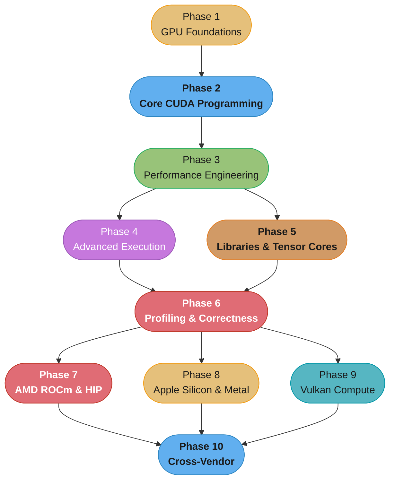
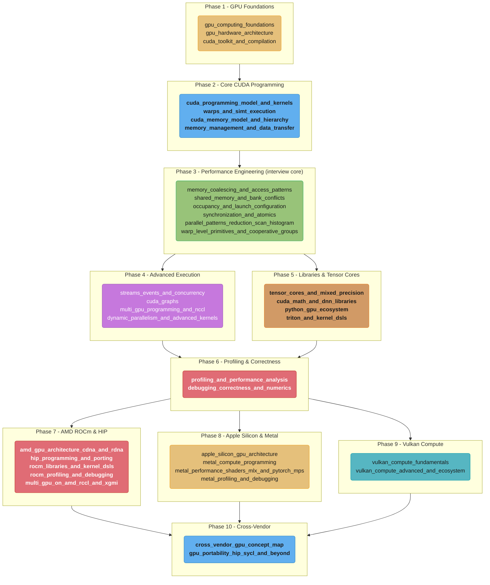

# GPGPU Programming: CUDA, ROCm, Metal and Vulkan

A comprehensive, one-stop reference for mastering **general-purpose GPU programming** — with NVIDIA CUDA as the core path and AMD ROCm/HIP, Apple Metal and Vulkan compute taught at the same kernel-author altitude. It runs from the SIMT execution model and GPU hardware architecture through the core CUDA programming model, the performance-engineering discipline that dominates senior GPU interviews (coalescing, shared-memory tiling, occupancy, warp primitives), advanced execution (streams, CUDA graphs, multi-GPU/NCCL), the library and Tensor-Core ecosystem, and the profiling/debugging toolchain, then re-applies that model to AMD Instinct and Radeon GPUs, Apple silicon and Vulkan devices, and closes with one cross-vendor vocabulary and the portability tradeoff. Covers everything a senior GPU / CUDA / ML-infrastructure / HPC engineer is expected to know in technical interviews — from the **kernel author's** viewpoint.

> **No runtime application** — all content is Markdown with executable-shaped CUDA C++, PTX, HIP C++, MSL, GLSL/Slang, Swift and Python (CuPy / Numba / Triton / PyTorch / MLX) code blocks. Phases 1-6 show concepts in CUDA C++ and Python side-by-side where both teach; in C++ alone where the concept is inherently C++ (WMMA, PTX, `__launch_bounds__`); in Python alone where inherently Python (Triton, CuPy). Phase 7 uses HIP C++ plus Python (PyTorch on ROCm, Triton), Phase 8 uses MSL plus Swift or Python (MLX), and Phase 9 uses GLSL or Slang plus a C++ host.

---

## Intuition

> **One-line analogy**: A CPU is a handful of Formula-1 cars — each astonishingly fast, latency-optimized, wrong for moving 50,000 people. A GPU is a fleet of 50,000 bicycles: individually slow, but if your problem is *"move 50,000 people one mile"* it wins by three orders of magnitude. CUDA programming is the art of restating your problem as *"50,000 people, one mile."*

**Mental model**: A GPU hides latency with parallelism instead of caches. A CPU spends its transistor budget on out-of-order execution, branch prediction, and deep caches to make *one* thread fast. A GPU spends that budget on *thousands* of ALUs and keeps them busy by oversubscribing each core with many warps: when one warp stalls on a 400-cycle memory load, the scheduler instantly swaps in another that is ready. So GPU performance is not about making any single thread fast — it is about (1) exposing enough parallel work to hide latency, and (2) feeding that work from memory fast enough that the ALUs never starve. Almost every CUDA optimization — coalescing, shared-memory tiling, occupancy tuning, using Tensor Cores — is a variation on *keep the compute units fed and busy.*

**Why it matters**: Every performance-critical workload of the last decade — deep-learning training and inference, scientific simulation, video/image processing, cryptography, ranking — runs on GPUs. The engineer who can write, read, and *optimize* a CUDA kernel is the one who turns a model that costs \$4M/year to serve into one that costs \$1M, or a simulation that takes a week into one that takes an afternoon. Interviews test whether you understand the *mechanics* underneath the speedup — why an uncoalesced access is 8× slower, what a bank conflict actually is, why occupancy plateaus — not just that "the GPU is faster."

**Key insight**: The hardest problems in GPU programming are not "how do I launch a kernel" — they are **memory movement, divergence, and occupancy**. Where does the data live (register → shared → L2 → HBM, each ~10× slower than the last), and are your 32 threads in a warp touching contiguous addresses? Do the threads in a warp all take the same branch, or does divergence serialize them? And are there enough resident warps to hide the latency you can't avoid? Master those three axes and the rest is API surface. This section is the roofline model made concrete: **is your kernel memory-bound or compute-bound, and what is the one number that would move it toward the roof?**

---

## 1. Section Overview

This section covers:

- **GPU Foundations** — why GPUs exist (throughput vs latency, SIMT vs SIMD, Amdahl/Gustafson), SM/warp/register hardware architecture across generations (Volta → Hopper → Blackwell), and the nvcc → PTX → SASS compilation toolchain
- **Core CUDA Programming** — the kernel/grid/block/thread model, warp execution and divergence, the full memory model (global/shared/local/constant/texture/register), and memory management/transfer (pinned, unified, async)
- **Performance Engineering** (the interview core) — memory coalescing, shared-memory tiling and bank conflicts, occupancy and launch configuration, synchronization and atomics, the canonical parallel patterns (reduction/scan/histogram), and warp-level primitives (shuffle, vote, cooperative groups)
- **Advanced Execution & Multi-GPU** — streams and concurrency, CUDA graphs, multi-GPU programming with NCCL/NVLink/P2P, and dynamic parallelism / advanced kernel structures
- **Libraries, Tensor Cores & Ecosystem** — Tensor Cores and mixed precision (WMMA, FP16/BF16/TF32/FP8), the math/DNN libraries (cuBLAS/cuDNN/CUTLASS/Thrust), the Python GPU ecosystem (CuPy/Numba/PyCUDA/PyTorch extensions), and kernel DSLs (OpenAI Triton)
- **Profiling & Correctness** — Nsight Systems/Compute profiling and roofline analysis, and debugging and numerical correctness (compute-sanitizer, determinism)
- **AMD ROCm & HIP** — CDNA 3/4 and RDNA architecture (XCD chiplets, wave64, LDS, MFMA Matrix Cores, Infinity Cache, `gfx` targets), HIP and hipify porting traps, the ROCm library and kernel-DSL stack (hipBLASLt, Composable Kernel, Triton on AMD), rocprofv3 / rocprof-compute, and RCCL over xGMI
- **Apple Silicon & Metal** — the integrated, unified-memory Apple GPU (SIMD-groups, threadgroup memory, Dynamic Caching), Metal compute with MSL and `simdgroup_matrix`, MPS / MPSGraph / MLX / PyTorch MPS, and Xcode's GPU profiling and validation tools
- **Vulkan Compute** — instance/device/queues, compute pipelines, descriptors, barriers and timeline semaphores, GLSL/HLSL/Slang to SPIR-V, subgroups and cooperative matrix, and the llama.cpp / IREE / ncnn backends
- **Cross-Vendor** — one vocabulary and one numbers table (warp / wavefront / SIMD-group / subgroup; shared / LDS / threadgroup / workgroup memory), and the portability survey (SYCL, OpenCL, WebGPU, CUDA-without-translation tools)

**Primary platform:** NVIDIA CUDA for Phases 1-6, which every later phase builds on. Phases 7-9 give AMD ROCm, Apple Metal and Vulkan compute their own modules; Phase 10 maps the four stacks onto one vocabulary and surveys the remaining portability layers.

---

## 2. Scope & Non-Overlap Boundary

This section is deliberately scoped to the **kernel author's** view of the GPU and **not to duplicate** the GPU material that already lives in the ML and LLM sections. Where a topic is covered elsewhere at a different altitude, this section **cross-references it and adds only the CUDA-kernel angle**:

| Already covered in... | CUDA section does NOT re-teach | CUDA section DOES cover |
|-----------------------|--------------------------------|--------------------------|
| [`llm/case_studies/design_gpu_inference_platform.md`](../llm/case_studies/design_gpu_inference_platform.md) | Multi-tenant serving, KV-cache paging, autoscaling on MBU, GPU-fleet economics | The *kernels* underneath — GEMV/attention/quantized-matmul kernel engineering |
| [`llm/optimization_and_quantization/gpu_architecture_and_roofline.md`](../llm/optimization_and_quantization/optimization_and_quantization.md) | Roofline used to reason about *transformer inference* cost | Roofline as a *kernel-optimization* loop; per-kernel arithmetic intensity |
| [`ml/gpu_and_hardware_optimization/`](../ml/gpu_and_hardware_optimization/gpu_and_hardware_optimization.md) | Training-time hardware use (gradient checkpointing, mixed-precision training recipes, multi-GPU training strategy) | Writing and optimizing the CUDA kernels themselves; the SIMT/memory/occupancy mechanics |
| [`ml/distributed_training/`](../ml/distributed_training/distributed_training.md) | Data/model/pipeline parallelism strategy, ZeRO, FSDP | NCCL collectives and NVLink/P2P from the CUDA-programming viewpoint |
| [`devops/ml_platform_and_gpu_infrastructure/`](../devops/ml_platform_and_gpu_infrastructure/ml_platform_and_gpu_infrastructure.md) | GPU Operator, MIG/time-slicing, Karpenter GPU pools on Kubernetes | On-device MIG/streams as a *programming* concern; not cluster operations |
| [`mlops/gpu_cluster_scheduling_and_quotas/`](../mlops/gpu_cluster_scheduling_and_quotas/gpu_cluster_scheduling_and_quotas.md) | AMD GPU Operator and AMD device plugins on Kubernetes, GPU fleet scheduling | ROCm, HIP and RCCL from the kernel author's viewpoint (Phase 7) |
| [`llm/small_language_models_and_edge_ai/`](../llm/small_language_models_and_edge_ai/small_language_models_and_edge_ai.md) | MLX, llama.cpp and Core ML as an on-device runtime *choice* for a product | MLX arrays, `mx.fast.metal_kernel` and MSL kernels as programming tools (Phase 8) |

**CUDA owns**: the SIMT execution model, GPU hardware architecture from the programmer's viewpoint, the CUDA C++ / PTX programming model, kernel-level performance engineering (coalescing, shared memory, occupancy, warp primitives, Tensor Cores), streams/graphs/multi-GPU as programming constructs, the CUDA library and Python-GPU ecosystems, kernel profiling/debugging, the same kernel-author view of AMD ROCm/HIP, Apple Metal and Vulkan compute, and GPU portability.

---

## 3. Module Table

| # | Module Directory | Phase | Difficulty | Key Topics |
|---|-----------------|-------|------------|------------|
| 1 | [gpu_computing_foundations](gpu_computing_foundations/gpu_computing_foundations.md) | 1 — GPU Foundations | Beginner | Throughput vs latency, SIMT vs SIMD, Amdahl/Gustafson, host/device model, PCIe vs NVLink, when the GPU wins |
| 2 | [gpu_hardware_architecture](gpu_hardware_architecture/gpu_hardware_architecture.md) | 1 — GPU Foundations | Intermediate | SM anatomy, CUDA cores, warp schedulers, register file, L1/L2/HBM, generations (Volta→Blackwell), compute capability, Tensor Cores |
| 3 | [cuda_toolkit_and_compilation](cuda_toolkit_and_compilation/cuda_toolkit_and_compilation.md) | 1 — GPU Foundations | Intermediate | nvcc pipeline, PTX vs SASS, fatbin/JIT, `compute_XX`/`sm_XX`, `__CUDA_ARCH__`, driver vs runtime API, nvrtc, CMake |
| 4 | [cuda_programming_model_and_kernels](cuda_programming_model_and_kernels/cuda_programming_model_and_kernels.md) | 2 — Core CUDA | Beginner | `<<<grid,block>>>`, thread hierarchy, `threadIdx`/`blockIdx`, 1D/2D/3D indexing, grid-stride loops, `__global__`/`__device__`/`__host__` |
| 5 | [warps_and_simt_execution](warps_and_simt_execution/warps_and_simt_execution.md) | 2 — Core CUDA | Intermediate | warp=32, lockstep, warp scheduling, divergence + predication, `__syncwarp`, active mask, independent thread scheduling |
| 6 | [cuda_memory_model_and_hierarchy](cuda_memory_model_and_hierarchy/cuda_memory_model_and_hierarchy.md) | 2 — Core CUDA | Intermediate | global/shared/local/constant/texture/register, scope + lifetime, unified virtual addressing, L1/L2/HBM, `__restrict__` |
| 7 | [memory_management_and_data_transfer](memory_management_and_data_transfer/memory_management_and_data_transfer.md) | 2 — Core CUDA | Intermediate | `cudaMalloc`/`cudaMemcpy`, pinned vs pageable, unified memory (prefetch/advise), zero-copy, async copy, error checking |
| 8 | [memory_coalescing_and_access_patterns](memory_coalescing_and_access_patterns/memory_coalescing_and_access_patterns.md) | 3 — Performance Engineering | Advanced | Coalesced vs strided, 128-byte transactions, alignment, AoS vs SoA, vectorized loads (`float4`), the transpose problem |
| 9 | [shared_memory_and_bank_conflicts](shared_memory_and_bank_conflicts/shared_memory_and_bank_conflicts.md) | 3 — Performance Engineering | Advanced | Tiling, 32 banks, conflicts + padding, broadcast, dynamic shared memory, shared-mem GEMM tile |
| 10 | [occupancy_and_launch_configuration](occupancy_and_launch_configuration/occupancy_and_launch_configuration.md) | 3 — Performance Engineering | Advanced | Occupancy, register/shared-mem limits, occupancy calculator, block-size tuning, latency hiding, register spilling, `__launch_bounds__` |
| 11 | [synchronization_and_atomics](synchronization_and_atomics/synchronization_and_atomics.md) | 3 — Performance Engineering | Advanced | `__syncthreads`, races, `atomicAdd`/CAS, memory fences, atomic contention, `cuda::atomic`, cooperative-groups intro |
| 12 | [parallel_patterns_reduction_scan_histogram](parallel_patterns_reduction_scan_histogram/parallel_patterns_reduction_scan_histogram.md) | 3 — Performance Engineering | Advanced | Reduction ladder, scan/prefix-sum, histogram, the canonical optimization walkthroughs |
| 13 | [warp_level_primitives_and_cooperative_groups](warp_level_primitives_and_cooperative_groups/warp_level_primitives_and_cooperative_groups.md) | 3 — Performance Engineering | Advanced | `__shfl_*_sync`, vote/ballot, warp-aggregated atomics, cooperative groups, grid sync, warp reduction |
| 14 | [streams_events_and_concurrency](streams_events_and_concurrency/streams_events_and_concurrency.md) | 4 — Advanced Execution | Advanced | Streams, async, events/timing, overlap compute+transfer, default vs per-thread-default stream, priorities, callbacks |
| 15 | [cuda_graphs](cuda_graphs/cuda_graphs.md) | 4 — Advanced Execution | Advanced | Graph capture, instantiate, launch-overhead reduction, graph update, when it wins |
| 16 | [multi_gpu_programming_and_nccl](multi_gpu_programming_and_nccl/multi_gpu_programming_and_nccl.md) | 4 — Advanced Execution | Advanced | P2P, NVLink/NVSwitch, GPUDirect, device selection, NCCL collectives, data/model decomposition |
| 17 | [dynamic_parallelism_and_advanced_kernels](dynamic_parallelism_and_advanced_kernels/dynamic_parallelism_and_advanced_kernels.md) | 4 — Advanced Execution | Advanced | Device-side launch, nested parallelism, persistent kernels, producer-consumer, when it helps vs hurts |
| 18 | [tensor_cores_and_mixed_precision](tensor_cores_and_mixed_precision/tensor_cores_and_mixed_precision.md) | 5 — Libraries & Tensor Cores | Advanced | WMMA/`mma`, `wgmma`/`tcgen05` + Tensor Memory, FP16/BF16/TF32/FP8, block-scaled NVFP4, loss scaling, cuBLAS/cuDNN TC paths |
| 19 | [cuda_math_and_dnn_libraries](cuda_math_and_dnn_libraries/cuda_math_and_dnn_libraries.md) | 5 — Libraries & Tensor Cores | Intermediate | cuBLAS, cuDNN, CUTLASS, cuFFT, cuSPARSE, cuRAND, Thrust; library-vs-custom-kernel; CUTLASS templating |
| 20 | [python_gpu_ecosystem](python_gpu_ecosystem/python_gpu_ecosystem.md) | 5 — Libraries & Tensor Cores | Intermediate | CuPy, Numba CUDA, PyCUDA, PyTorch custom CUDA/C++ extensions, `torch.compile`/Inductor, DLPack |
| 21 | [triton_and_kernel_dsls](triton_and_kernel_dsls/triton_and_kernel_dsls.md) | 5 — Libraries & Tensor Cores | Advanced | Triton programming model, block-level abstraction, autotuning, Triton vs CUDA C++, where Triton wins/loses |
| 22 | [profiling_and_performance_analysis](profiling_and_performance_analysis/profiling_and_performance_analysis.md) | 6 — Profiling & Production | Advanced | Nsight Systems vs Compute, roofline, achieved occupancy, DRAM throughput, warp-stall reasons, guided analysis |
| 23 | [debugging_correctness_and_numerics](debugging_correctness_and_numerics/debugging_correctness_and_numerics.md) | 6 — Profiling & Production | Advanced | cuda-gdb, compute-sanitizer (memcheck/racecheck/synccheck/initcheck), error macros, FP/FMA, determinism, fast-math |
| 24 | [amd_gpu_architecture_cdna_and_rdna](amd_gpu_architecture_cdna_and_rdna/amd_gpu_architecture_cdna_and_rdna.md) | 7 — AMD ROCm & HIP | Intermediate | CDNA 3/4 (MI300X, MI325X, MI355X), RDNA 4, XCD chiplets, wave64 vs wave32, CU/SIMD layout, LDS, MFMA Matrix Cores, Infinity Cache, `gfx` targets |
| 25 | [hip_programming_and_porting](hip_programming_and_porting/hip_programming_and_porting.md) | 7 — AMD ROCm & HIP | Advanced | HIP runtime API, `amdclang++`/hipcc, hipify-clang vs hipify-perl, `warpSize`-64 traps, 64-bit ballot masks, code objects and `--offload-arch`, HIP on NVIDIA |
| 26 | [rocm_libraries_and_kernel_dsls](rocm_libraries_and_kernel_dsls/rocm_libraries_and_kernel_dsls.md) | 7 — AMD ROCm & HIP | Advanced | hipBLASLt, rocBLAS, MIOpen, rocPRIM/hipCUB, rocWMMA, Composable Kernel, AITER, Triton on AMD, PyTorch on ROCm |
| 27 | [rocm_profiling_and_debugging](rocm_profiling_and_debugging/rocm_profiling_and_debugging.md) | 7 — AMD ROCm & HIP | Advanced | rocprofv3, rocprof-compute roofline, ROCm Systems Profiler, rocgdb, amd-smi, counters vs Nsight equivalents |
| 28 | [multi_gpu_on_amd_rccl_and_xgmi](multi_gpu_on_amd_rccl_and_xgmi/multi_gpu_on_amd_rccl_and_xgmi.md) | 7 — AMD ROCm & HIP | Advanced | RCCL, xGMI / Infinity Fabric full mesh, per-direction link bandwidth, rocSHMEM, peer access, partition modes |
| 29 | [apple_silicon_gpu_architecture](apple_silicon_gpu_architecture/apple_silicon_gpu_architecture.md) | 8 — Apple Silicon & Metal | Intermediate | Unified memory, TBDR, SIMD-groups (32 wide), threadgroup memory, Dynamic Caching, GPU vs Neural Engine vs CPU matrix units, GPU families |
| 30 | [metal_compute_programming](metal_compute_programming/metal_compute_programming.md) | 8 — Apple Silicon & Metal | Advanced | MSL, `MTLDevice`/command queues/command buffers/compute encoders, pipelines, threadgroups, SIMD-group functions, `simdgroup_matrix`, Metal 4 tensors, storage modes |
| 31 | [metal_performance_shaders_mlx_and_pytorch_mps](metal_performance_shaders_mlx_and_pytorch_mps/metal_performance_shaders_mlx_and_pytorch_mps.md) | 8 — Apple Silicon & Metal | Intermediate | MPS, MPSGraph, MLX arrays and `mx.fast.metal_kernel`, PyTorch MPS backend, Core ML hand-off |
| 32 | [metal_profiling_and_debugging](metal_profiling_and_debugging/metal_profiling_and_debugging.md) | 8 — Apple Silicon & Metal | Intermediate | Xcode GPU capture, Metal System Trace, shader profiler and cost graph, API and shader validation |
| 33 | [vulkan_compute_fundamentals](vulkan_compute_fundamentals/vulkan_compute_fundamentals.md) | 9 — Vulkan Compute | Intermediate | Instance/device/queues, compute pipelines, descriptor sets, push constants, memory types and heaps, barriers, timeline semaphores, GLSL/HLSL/Slang to SPIR-V |
| 34 | [vulkan_compute_advanced_and_ecosystem](vulkan_compute_advanced_and_ecosystem/vulkan_compute_advanced_and_ecosystem.md) | 9 — Vulkan Compute | Advanced | Subgroup ops, cooperative matrix, integer dot product, buffer device address, MoltenVK/KosmicKrisp, llama.cpp/IREE/ncnn backends, RenderDoc and vendor profilers |
| 35 | [cross_vendor_gpu_concept_map](cross_vendor_gpu_concept_map/cross_vendor_gpu_concept_map.md) | 10 — Cross-Vendor | Intermediate | warp / wavefront / SIMD-group / subgroup; shared / LDS / threadgroup / workgroup memory; matrix units; queues; barriers, atomics and scopes per API |
| 36 | [gpu_portability_hip_sycl_and_beyond](gpu_portability_hip_sycl_and_beyond/gpu_portability_hip_sycl_and_beyond.md) | 10 — Cross-Vendor | Intermediate | Portability survey: SYCL/oneAPI, OpenCL, WebGPU, ZLUDA/SCALE/chipStar, `hipify`, portability-vs-peak-performance tradeoff |

---

## 4. 10-Phase Learning Path



Phase 3 (Performance Engineering, colored green as the "active" interview core) is the hinge the CUDA path pivots on: everything before it builds the mental model, and Phases 4/5 fan out in parallel afterward before both converge on Phase 6. Phases 7, 8 and 9 then re-apply that complete CUDA model to one other vendor each and can be studied in any order; Phase 10 joins them into one vocabulary.



**Dependencies to note:**
- Phase 2 (Core CUDA) depends on the SIMT/hardware mental model from Phase 1 — you cannot reason about coalescing without knowing what a warp is.
- Phase 3 (Performance Engineering) is where interviews live and depends on the full memory model (Phase 2, module 6). Study coalescing → shared memory → occupancy in order; each builds on the last.
- Phases 4 and 5 can be studied in parallel after Phase 3; streams/graphs and Tensor Cores/libraries are independent tracks that both consume the performance fundamentals.
- Phase 6 (Profiling) is best interleaved *throughout* — the profiler is how you verify every Phase 3 optimization. It is placed after Phase 5 only so the roofline/metrics vocabulary is fully grounded.
- Phases 7 (AMD ROCm & HIP), 8 (Apple Silicon & Metal) and 9 (Vulkan Compute) each assume the whole CUDA path and teach only what changes on that vendor: lockstep width, group-local memory size and banks, matrix units, queues and the profiler. They are independent of each other; study the one your fleet runs first.
- Phase 10 (Cross-Vendor) needs at least one of Phases 7-9. The concept map is the vocabulary bridge; the portability survey that follows it is where SYCL, OpenCL, WebGPU and the portability-versus-peak decision live.
- The case studies (see [case_studies/case_studies.md](case_studies/case_studies.md)) integrate Phases 2–10 end-to-end: the tiled-GEMM case study alone touches coalescing, shared memory, occupancy, and Tensor Cores, and the three multi-vendor case studies carry a CUDA kernel to MI300X, to Apple silicon, and to all three vendors at once.

---

<!-- study-paths
     THE source of truth for this section's file inventory and study-tier membership.
     Every module, every file it owns (module page AND deep-dive sub-files), and every
     case study is listed here with the tiers it belongs to; `-` means Full path only.
     Content files carry NO structural metadata -- a deep dive holds its topic, nothing
     else. Order is never declared here: it comes from STUDY_ORDER in game/app.js.
     The tier TABLES lower in this file are generated from this block by
     `python3 game/extract.py --write-paths`. A file on disk that is missing from this
     block, or listed here and absent from disk, FAILS `extract.py --strict`.
gpu_computing_foundations
  gpu_computing_foundations.md  senior
gpu_hardware_architecture
  gpu_hardware_architecture.md  senior
  blackwell_and_rubin_architecture.md  senior
cuda_toolkit_and_compilation
  cuda_toolkit_and_compilation.md  -
cuda_programming_model_and_kernels
  cuda_programming_model_and_kernels.md  senior
warps_and_simt_execution
  warps_and_simt_execution.md  senior
cuda_memory_model_and_hierarchy
  cuda_memory_model_and_hierarchy.md  senior
memory_management_and_data_transfer
  memory_management_and_data_transfer.md  senior
memory_coalescing_and_access_patterns
  memory_coalescing_and_access_patterns.md  senior
shared_memory_and_bank_conflicts
  shared_memory_and_bank_conflicts.md  senior
occupancy_and_launch_configuration
  occupancy_and_launch_configuration.md  senior
synchronization_and_atomics
  synchronization_and_atomics.md  senior
parallel_patterns_reduction_scan_histogram
  parallel_patterns_reduction_scan_histogram.md  senior
warp_level_primitives_and_cooperative_groups
  warp_level_primitives_and_cooperative_groups.md  senior
streams_events_and_concurrency
  streams_events_and_concurrency.md  senior
  green_contexts_and_sm_partitioning.md  senior
cuda_graphs
  cuda_graphs.md  -
  conditional_nodes_and_device_graph_launch.md  -
multi_gpu_programming_and_nccl
  multi_gpu_programming_and_nccl.md  senior
  device_initiated_communication.md  senior
dynamic_parallelism_and_advanced_kernels
  dynamic_parallelism_and_advanced_kernels.md  -
tensor_cores_and_mixed_precision
  tensor_cores_and_mixed_precision.md  senior
cuda_math_and_dnn_libraries
  cuda_math_and_dnn_libraries.md  -
python_gpu_ecosystem
  python_gpu_ecosystem.md  -
triton_and_kernel_dsls
  triton_and_kernel_dsls.md  -
profiling_and_performance_analysis
  profiling_and_performance_analysis.md  senior
debugging_correctness_and_numerics
  debugging_correctness_and_numerics.md  senior
amd_gpu_architecture_cdna_and_rdna
  amd_gpu_architecture_cdna_and_rdna.md  senior
hip_programming_and_porting
  hip_programming_and_porting.md  senior
rocm_libraries_and_kernel_dsls
  rocm_libraries_and_kernel_dsls.md  -
rocm_profiling_and_debugging
  rocm_profiling_and_debugging.md  -
multi_gpu_on_amd_rccl_and_xgmi
  multi_gpu_on_amd_rccl_and_xgmi.md  -
apple_silicon_gpu_architecture
  apple_silicon_gpu_architecture.md  senior
metal_compute_programming
  metal_compute_programming.md  senior
metal_performance_shaders_mlx_and_pytorch_mps
  metal_performance_shaders_mlx_and_pytorch_mps.md  -
metal_profiling_and_debugging
  metal_profiling_and_debugging.md  -
vulkan_compute_fundamentals
  vulkan_compute_fundamentals.md  senior
vulkan_compute_advanced_and_ecosystem
  vulkan_compute_advanced_and_ecosystem.md  -
cross_vendor_gpu_concept_map
  cross_vendor_gpu_concept_map.md  senior
gpu_portability_hip_sycl_and_beyond
  gpu_portability_hip_sycl_and_beyond.md  -
case_studies
  accelerate_2d_convolution_and_stencil.md  -
  build_a_flash_attention_kernel.md         -
  implement_high_performance_reduction.md   -
  optimize_llm_inference_kernels.md         -
  optimize_matrix_multiplication_kernel.md  -
  port_a_cpu_pipeline_to_gpu.md             -
  write_a_blackwell_gemm_with_cute_dsl.md  -
  optimize_moe_expert_parallel_dispatch.md  -
  port_an_llm_kernel_to_amd_mi300.md  -
  run_llm_inference_on_apple_silicon.md  -
  ship_one_kernel_across_nvidia_amd_and_apple.md  -
-->
## Learning Paths

This section is exhaustive by design — 36 modules from the SIMT model and GPU hardware through the full performance-engineering discipline, advanced execution, the library/Tensor-Core ecosystem, profiling and correctness, the AMD ROCm, Apple Metal and Vulkan compute phases, and the cross-vendor concept map and portability survey. That is the right depth for a reference and the wrong shape for someone two weeks from an interview. So there are **two ways through it**; the browser learning game's **Study** view surfaces both as a **Full / Interview** toggle (Full is the default).

### Full Path (36 modules)

The complete curriculum in the order above — see [10-Phase Learning Path](#4-10-phase-learning-path). Use it for genuine mastery: foundations, core CUDA, the full performance-engineering phase, advanced execution (graphs, multi-GPU, dynamic parallelism), the complete library and Python/Triton ecosystem, profiling and correctness, all three non-NVIDIA vendor phases, and the cross-vendor map and portability survey. Nothing is dropped.

<!-- study-path-table senior -->
### Senior Path (23 modules)

| # | Module | Files |
|---|--------|-------|
| 1 | [gpu_computing_foundations](gpu_computing_foundations/gpu_computing_foundations.md) | module page only |
| 2 | [gpu_hardware_architecture](gpu_hardware_architecture/gpu_hardware_architecture.md) | 2 files |
| 4 | [cuda_programming_model_and_kernels](cuda_programming_model_and_kernels/cuda_programming_model_and_kernels.md) | module page only |
| 5 | [warps_and_simt_execution](warps_and_simt_execution/warps_and_simt_execution.md) | module page only |
| 6 | [cuda_memory_model_and_hierarchy](cuda_memory_model_and_hierarchy/cuda_memory_model_and_hierarchy.md) | module page only |
| 7 | [memory_management_and_data_transfer](memory_management_and_data_transfer/memory_management_and_data_transfer.md) | module page only |
| 8 | [memory_coalescing_and_access_patterns](memory_coalescing_and_access_patterns/memory_coalescing_and_access_patterns.md) | module page only |
| 9 | [shared_memory_and_bank_conflicts](shared_memory_and_bank_conflicts/shared_memory_and_bank_conflicts.md) | module page only |
| 10 | [occupancy_and_launch_configuration](occupancy_and_launch_configuration/occupancy_and_launch_configuration.md) | module page only |
| 11 | [synchronization_and_atomics](synchronization_and_atomics/synchronization_and_atomics.md) | module page only |
| 12 | [parallel_patterns_reduction_scan_histogram](parallel_patterns_reduction_scan_histogram/parallel_patterns_reduction_scan_histogram.md) | module page only |
| 13 | [warp_level_primitives_and_cooperative_groups](warp_level_primitives_and_cooperative_groups/warp_level_primitives_and_cooperative_groups.md) | module page only |
| 14 | [streams_events_and_concurrency](streams_events_and_concurrency/streams_events_and_concurrency.md) | 2 files |
| 16 | [multi_gpu_programming_and_nccl](multi_gpu_programming_and_nccl/multi_gpu_programming_and_nccl.md) | 2 files |
| 18 | [tensor_cores_and_mixed_precision](tensor_cores_and_mixed_precision/tensor_cores_and_mixed_precision.md) | module page only |
| 22 | [profiling_and_performance_analysis](profiling_and_performance_analysis/profiling_and_performance_analysis.md) | module page only |
| 23 | [debugging_correctness_and_numerics](debugging_correctness_and_numerics/debugging_correctness_and_numerics.md) | module page only |
| 24 | [amd_gpu_architecture_cdna_and_rdna](amd_gpu_architecture_cdna_and_rdna/amd_gpu_architecture_cdna_and_rdna.md) | module page only |
| 25 | [hip_programming_and_porting](hip_programming_and_porting/hip_programming_and_porting.md) | module page only |
| 29 | [apple_silicon_gpu_architecture](apple_silicon_gpu_architecture/apple_silicon_gpu_architecture.md) | module page only |
| 30 | [metal_compute_programming](metal_compute_programming/metal_compute_programming.md) | module page only |
| 33 | [vulkan_compute_fundamentals](vulkan_compute_fundamentals/vulkan_compute_fundamentals.md) | module page only |
| 35 | [cross_vendor_gpu_concept_map](cross_vendor_gpu_concept_map/cross_vendor_gpu_concept_map.md) | module page only |

**Not in this path** (13 of 36, Full Path only): `cuda_toolkit_and_compilation`, `cuda_graphs`, `dynamic_parallelism_and_advanced_kernels`, `cuda_math_and_dnn_libraries`, `python_gpu_ecosystem`, `triton_and_kernel_dsls`, `rocm_libraries_and_kernel_dsls`, `rocm_profiling_and_debugging`, `multi_gpu_on_amd_rccl_and_xgmi`, `metal_performance_shaders_mlx_and_pytorch_mps`, `metal_profiling_and_debugging`, `vulkan_compute_advanced_and_ecosystem`, `gpu_portability_hip_sycl_and_beyond`
<!-- /study-path-table -->

A ruthless cut to what a **senior GPU / CUDA / ML-infra interview** actually probes, anchored on the performance-engineering core. Same learning order, a strict subset of the Full Path. Each group below says why it earns senior time. Membership comes from the `<!-- study-paths -->` block above; order comes from `STUDY_ORDER.cuda` in `game/app.js`.

| Group | Why it's tested |
|-------|-----------------|
| Foundations | Throughput-vs-latency, SIMT, and the SM/warp/memory hierarchy are the substrate every "why is this kernel slow" question sits on |
| Core CUDA | Thread indexing, warp divergence, the memory spaces, and host/device transfer are table-stakes — you must be able to write a correct kernel before optimizing one |
| Performance Engineering | The single highest-signal CUDA topic — coalescing, bank conflicts, occupancy, atomics, reduction/scan, and warp shuffle come up in nearly every senior GPU screen |
| Concurrency | Overlapping compute with transfer, and stream semantics, are the classic "hide the PCIe cost" question |
| Tensor Cores | Mixed precision and when Tensor Cores actually engage is near-universal for any DL-infra role |
| Profiling & Correctness | "How would you find the bottleneck" (Nsight, roofline, warp-stall reasons) and "how would you catch a race" (compute-sanitizer) separate senior from mid |
| Other vendors | "Port this to MI300X" and "would this run on a Mac" are now routine: wave64 and LDS on AMD, HIP porting traps, Apple's SIMD-groups and unified memory, Metal's command model, Vulkan's explicit pipelines, and one cross-vendor vocabulary |

---

## Knowledge-Question Map

The highest-frequency CUDA *knowledge* questions mapped to the file that answers them. For *design/optimize* ("optimize this GEMM", "implement a fast reduction") questions, use the interview-prep shortcuts in [case_studies/case_studies.md](case_studies/case_studies.md).

| Interview question | Where the answer lives |
|--------------------|------------------------|
| Why is a GPU faster than a CPU, and when is it *not* worth using one? | [gpu_computing_foundations](gpu_computing_foundations/gpu_computing_foundations.md) |
| What is an SM, a warp, and the register file — and how do they bound occupancy? | [gpu_hardware_architecture](gpu_hardware_architecture/gpu_hardware_architecture.md) |
| What is the difference between PTX and SASS, and what does nvcc actually produce? | [cuda_toolkit_and_compilation](cuda_toolkit_and_compilation/cuda_toolkit_and_compilation.md) |
| Given a 1D array, write the index math to map threads to elements (and handle N not a multiple of blockDim). | [cuda_programming_model_and_kernels](cuda_programming_model_and_kernels/cuda_programming_model_and_kernels.md) |
| What is warp divergence and how does it hurt performance? | [warps_and_simt_execution](warps_and_simt_execution/warps_and_simt_execution.md) |
| Walk through the memory spaces (register/shared/local/constant/global) — latency, scope, lifetime. | [cuda_memory_model_and_hierarchy](cuda_memory_model_and_hierarchy/cuda_memory_model_and_hierarchy.md) |
| Pinned vs pageable vs unified memory — when does each matter and why? | [memory_management_and_data_transfer](memory_management_and_data_transfer/memory_management_and_data_transfer.md) |
| What is memory coalescing, and why is an uncoalesced access up to 8-32× slower? | [memory_coalescing_and_access_patterns](memory_coalescing_and_access_patterns/memory_coalescing_and_access_patterns.md) |
| What is a shared-memory bank conflict, and how does the padding trick fix it? | [shared_memory_and_bank_conflicts](shared_memory_and_bank_conflicts/shared_memory_and_bank_conflicts.md) |
| What is occupancy, is higher always better, and what caps it? | [occupancy_and_launch_configuration](occupancy_and_launch_configuration/occupancy_and_launch_configuration.md) |
| How do atomics work on a GPU, and why can atomic contention destroy throughput? | [synchronization_and_atomics](synchronization_and_atomics/synchronization_and_atomics.md) |
| Optimize a parallel reduction — walk the ladder from divergent to warp-shuffle. | [parallel_patterns_reduction_scan_histogram](parallel_patterns_reduction_scan_histogram/parallel_patterns_reduction_scan_histogram.md) |
| What does `__shfl_down_sync` do, and how does a warp-level reduction avoid shared memory? | [warp_level_primitives_and_cooperative_groups](warp_level_primitives_and_cooperative_groups/warp_level_primitives_and_cooperative_groups.md) |
| How do you overlap a `cudaMemcpy` with kernel execution using streams? | [streams_events_and_concurrency](streams_events_and_concurrency/streams_events_and_concurrency.md) |
| When do CUDA graphs help, and what overhead do they remove? | [cuda_graphs](cuda_graphs/cuda_graphs.md) |
| What is an all-reduce, and how does NCCL use NVLink/ring/tree algorithms? | [multi_gpu_programming_and_nccl](multi_gpu_programming_and_nccl/multi_gpu_programming_and_nccl.md) |
| When do Tensor Cores actually engage, and what precisions do they support (FP16/BF16/TF32/FP8)? | [tensor_cores_and_mixed_precision](tensor_cores_and_mixed_precision/tensor_cores_and_mixed_precision.md) |
| When should you write a custom kernel vs call cuBLAS/cuDNN/CUTLASS? | [cuda_math_and_dnn_libraries](cuda_math_and_dnn_libraries/cuda_math_and_dnn_libraries.md) |
| Triton vs CUDA C++ — what does Triton abstract away and what do you give up? | [triton_and_kernel_dsls](triton_and_kernel_dsls/triton_and_kernel_dsls.md) |
| Is my kernel memory-bound or compute-bound, and how would Nsight Compute tell you? | [profiling_and_performance_analysis](profiling_and_performance_analysis/profiling_and_performance_analysis.md) |
| How do you catch a data race or out-of-bounds access in a kernel? | [debugging_correctness_and_numerics](debugging_correctness_and_numerics/debugging_correctness_and_numerics.md) |
| Why is an MI300X "eight GPUs that share HBM", and what does a 64-wide wavefront change for a CUDA kernel? | [amd_gpu_architecture_cdna_and_rdna](amd_gpu_architecture_cdna_and_rdna/amd_gpu_architecture_cdna_and_rdna.md) |
| A hipified kernel passes on NVIDIA and fails on MI300X — what are the usual causes? | [hip_programming_and_porting](hip_programming_and_porting/hip_programming_and_porting.md) |
| What does unified memory change for a GPU kernel on Apple silicon? | [apple_silicon_gpu_architecture](apple_silicon_gpu_architecture/apple_silicon_gpu_architecture.md) |
| How does a Metal compute dispatch map onto a CUDA launch? | [metal_compute_programming](metal_compute_programming/metal_compute_programming.md) |
| Why does a Vulkan compute dispatch need explicit barriers between two back-to-back kernels? | [vulkan_compute_fundamentals](vulkan_compute_fundamentals/vulkan_compute_fundamentals.md) |
| Warp, wavefront, SIMD-group, subgroup — what is the same and which number differs? | [cross_vendor_gpu_concept_map](cross_vendor_gpu_concept_map/cross_vendor_gpu_concept_map.md) |

---

## Study Plan

A 6-week plan over the Senior Path. Each week pairs modules with one or two case studies to rehearse the "optimize X" format.

| Week | Focus | Modules | Case study |
|------|-------|---------|------------|
| 1 | Foundations + kernel basics | [gpu_computing_foundations](gpu_computing_foundations/gpu_computing_foundations.md), [gpu_hardware_architecture](gpu_hardware_architecture/gpu_hardware_architecture.md), [cuda_programming_model_and_kernels](cuda_programming_model_and_kernels/cuda_programming_model_and_kernels.md) | skim [Port a CPU Pipeline to GPU](case_studies/port_a_cpu_pipeline_to_gpu.md) |
| 2 | Warps + memory model | [warps_and_simt_execution](warps_and_simt_execution/warps_and_simt_execution.md), [cuda_memory_model_and_hierarchy](cuda_memory_model_and_hierarchy/cuda_memory_model_and_hierarchy.md), [memory_management_and_data_transfer](memory_management_and_data_transfer/memory_management_and_data_transfer.md) | [Port a CPU Pipeline to GPU](case_studies/port_a_cpu_pipeline_to_gpu.md) (full) |
| 3 | Performance core I | [memory_coalescing_and_access_patterns](memory_coalescing_and_access_patterns/memory_coalescing_and_access_patterns.md), [shared_memory_and_bank_conflicts](shared_memory_and_bank_conflicts/shared_memory_and_bank_conflicts.md), [occupancy_and_launch_configuration](occupancy_and_launch_configuration/occupancy_and_launch_configuration.md) | [Optimize Matrix Multiplication](case_studies/optimize_matrix_multiplication_kernel.md) |
| 4 | Performance core II | [synchronization_and_atomics](synchronization_and_atomics/synchronization_and_atomics.md), [parallel_patterns_reduction_scan_histogram](parallel_patterns_reduction_scan_histogram/parallel_patterns_reduction_scan_histogram.md), [warp_level_primitives_and_cooperative_groups](warp_level_primitives_and_cooperative_groups/warp_level_primitives_and_cooperative_groups.md) | [High-Performance Reduction](case_studies/implement_high_performance_reduction.md), [2D Convolution & Stencil](case_studies/accelerate_2d_convolution_and_stencil.md) |
| 5 | Streams, Tensor Cores, profiling | [streams_events_and_concurrency](streams_events_and_concurrency/streams_events_and_concurrency.md), [tensor_cores_and_mixed_precision](tensor_cores_and_mixed_precision/tensor_cores_and_mixed_precision.md), [profiling_and_performance_analysis](profiling_and_performance_analysis/profiling_and_performance_analysis.md), [debugging_correctness_and_numerics](debugging_correctness_and_numerics/debugging_correctness_and_numerics.md) | [Flash Attention Kernel](case_studies/build_a_flash_attention_kernel.md), [Optimize LLM Inference Kernels](case_studies/optimize_llm_inference_kernels.md) |
| 6 | Other vendors | [cross_vendor_gpu_concept_map](cross_vendor_gpu_concept_map/cross_vendor_gpu_concept_map.md), [amd_gpu_architecture_cdna_and_rdna](amd_gpu_architecture_cdna_and_rdna/amd_gpu_architecture_cdna_and_rdna.md), [hip_programming_and_porting](hip_programming_and_porting/hip_programming_and_porting.md), [apple_silicon_gpu_architecture](apple_silicon_gpu_architecture/apple_silicon_gpu_architecture.md), [metal_compute_programming](metal_compute_programming/metal_compute_programming.md), [vulkan_compute_fundamentals](vulkan_compute_fundamentals/vulkan_compute_fundamentals.md) | [Port an LLM Kernel to AMD MI300](case_studies/port_an_llm_kernel_to_amd_mi300.md), [Ship One Kernel Across NVIDIA, AMD and Apple](case_studies/ship_one_kernel_across_nvidia_amd_and_apple.md) |

---

## 5. GPU Architecture & Compute-Capability Reference

Worked examples in Phases 1-6 target recent NVIDIA data-center GPUs; this is the quick reference for the generations and their compute capabilities, referenced throughout the section, followed by the AMD and Apple parts that Phases 7 and 8 target.

| Generation | Example GPU | Compute Capability / Target | Headline features for the kernel author |
|-----------|-------------|--------------------|------------------------------------------|
| Volta | V100 | 7.0 | Independent thread scheduling; 1st-gen Tensor Cores (FP16); `__syncwarp` becomes necessary |
| Turing | T4, RTX 20xx | 7.5 | 2nd-gen Tensor Cores (INT8/INT4); improved unified memory |
| Ampere | A100, RTX 30xx | 8.0 / 8.6 | 3rd-gen Tensor Cores + TF32 + BF16; async copy (`cp.async`); 40 MB L2; MIG |
| Ada Lovelace | L4, L40S, RTX 40xx | 8.9 | 4th-gen Tensor Cores + FP8; large L2 |
| Hopper | H100, H200 | 9.0 | 4th-gen Tensor Cores + FP8; Tensor Memory Accelerator (TMA); thread-block clusters; distributed shared memory |
| Blackwell | B100/B200, GB200 | 10.0 (B300/GB300 = 10.3; RTX 50 = 12.0) | 5th-gen Tensor Cores + FP4/FP6 and dedicated Tensor Memory (`tcgen05`); 2nd-gen Transformer Engine; NVLink 5 at 1.8 TB/s bidirectional per GPU |
| Rubin | VR200, Vera Rubin NVL72 | 10.7 (`sm_107`; developer preview in CUDA 13.4, GA in CUDA 13.5) | 288 GB HBM4 per GPU at 19.2 TB/s; NVLink 6 at 3 TB/s per GPU; shipping per NVIDIA's Vera Rubin NVL72 product page (checked 2026-11-25) |
| AMD CDNA 3 | MI300X, MI325X | `gfx942` | 64-wide wavefronts; 304 CUs across 8 XCDs; 64 KiB LDS per CU (32 banks); MFMA Matrix Cores; 256 MiB Infinity Cache; MI300X 192 GB HBM3 at 5.3 TB/s |
| AMD CDNA 4 | MI350X, MI355X | `gfx950` | 256 CUs; 160 KiB LDS per CU (64 banks); OCP FP8 plus MXFP8/MXFP6/MXFP4; MI355X 288 GB HBM3E at 8 TB/s |
| AMD RDNA 4 | Radeon RX 9070 XT, Radeon AI PRO R9700 | `gfx1201` | 32-wide wavefronts under HIP; two CUs per WGP share 128 KiB LDS; WMMA, not MFMA |
| Apple GPU | M1 through M6 (Metal GPU families Apple7 to Apple11) | Apple7+ for Metal 4 | 32-wide SIMD-groups; 32 KB threadgroup memory per threadgroup; unified memory (M5 Max up to 614 GB/s, M5 Ultra 1.2 TB/s) |

Constants worth memorizing (used throughout): **warp = 32 threads** (an AMD CDNA wavefront is **64**, an Apple SIMD-group **32**, a Vulkan subgroup whatever the device reports); a coalesced global access moves data in **128-byte** transactions (32 threads × 4 bytes); shared memory has **32 banks** of 4 bytes; the register file is **64K 32-bit registers per SM** (256 KB); max **1024 threads/block**; a stall on global memory is **~400-800 cycles**; HBM3 bandwidth is **~3.35 TB/s** on H100 SXM5.

---

## 6. Top Interview Topics by Category

### Execution Model
1. **What is the difference between SIMT and SIMD?** Both execute one instruction across many data lanes, but SIMT (GPU) presents a *per-thread* programming model: each of the 32 threads in a warp has its own registers and program counter (on Volta+), and the hardware — not the compiler — manages divergence by masking inactive lanes. SIMD (CPU AVX) exposes fixed-width vector registers the programmer packs explicitly.
2. **What is warp divergence?** When threads in the same warp take different branches, the warp executes *both* paths serially with inactive lanes masked off — so a fully divergent `if/else` in a 32-thread warp can halve throughput. Minimize by making branch decisions align to warp boundaries.
3. **Why is occupancy not the same as performance?** Occupancy (resident warps ÷ max warps) is a *capacity* for latency hiding, not a throughput measure. Beyond the point where memory latency is hidden, more occupancy does nothing — and pushing for it can force register spills that make things worse. The classic result: many kernels peak at 50-60% occupancy.

### Memory
1. **What is memory coalescing?** When the 32 threads of a warp access consecutive, aligned global addresses, the hardware services them in a single 128-byte transaction. A strided or scattered access pattern issues many partial transactions, wasting bandwidth — often the single biggest cause of a slow kernel.
2. **What is a bank conflict?** Shared memory is split into 32 banks; if multiple threads in a warp access different addresses in the *same* bank, those accesses serialize. The classic fix is padding a shared array to 33 columns so the stride no longer maps rows to the same bank.
3. **Pinned vs pageable memory?** `cudaMemcpy` from pageable host memory forces the driver to stage through a pinned bounce buffer; allocating pinned memory (`cudaHostAlloc`) directly lets the DMA engine transfer at full PCIe/NVLink bandwidth and enables async overlap with streams.

### Performance Engineering
1. **How do you optimize a matrix multiply on a GPU?** Start naive (each thread computes one output, reads A/B from global) → tile into shared memory to reuse loaded data → register-block so each thread computes a micro-tile → use Tensor Cores for the mixed-precision inner product. Each step raises arithmetic intensity toward the compute roof.
2. **Walk through optimizing a parallel reduction.** From interleaved addressing (divergent, bank-conflicted) → sequential addressing → first-add-during-load → unroll the last warp → `__shfl_down_sync` warp reduction → grid-level via cooperative groups. Each rung removes a specific inefficiency.
3. **Is this kernel memory-bound or compute-bound?** Compute arithmetic intensity (FLOPs ÷ bytes) and compare to the GPU's ridge point (peak FLOP/s ÷ peak bandwidth). Below the ridge → memory-bound (optimize access patterns); above → compute-bound (optimize instruction mix / use Tensor Cores). Nsight Compute plots this directly.

### Libraries & Precision
1. **When do Tensor Cores engage?** Only for specific matrix-multiply shapes and supported precisions (FP16/BF16/TF32/FP8/INT8), invoked via `mma`/WMMA intrinsics or automatically inside cuBLAS/cuDNN when dimensions are multiples of 8/16. TF32 is the default for FP32 matmul on Ampere+ unless you opt out.
2. **Custom kernel vs cuBLAS?** cuBLAS/cuDNN/CUTLASS are hand-tuned to within a few percent of peak for standard ops — beat them only when you can *fuse* operations (e.g. FlashAttention fuses softmax into the matmul) to avoid round-trips to HBM, which is the whole point of custom kernels.

### Other Vendors
1. **What breaks when a CUDA kernel is hipified for an MI300X?** Usually nothing at compile time. The silent failures come from the 64-wide wavefront: a 32-bit ballot mask, a shuffle loop that starts at offset 16, or a block size tuned for 32-lane warps. LDS is 64 KiB per CU on MI300X, so tiles sized for Hopper's shared memory may not fit. See [hip_programming_and_porting](hip_programming_and_porting/hip_programming_and_porting.md).
2. **Why is Apple silicon a different roofline?** The GPU shares DRAM with the CPU, so there is no host-to-device copy, but the memory the model can use is shared with every other app, and decode speed is set by unified-memory bandwidth (614 GB/s on an M5 Max). See [apple_silicon_gpu_architecture](apple_silicon_gpu_architecture/apple_silicon_gpu_architecture.md).
3. **Warp, wavefront, SIMD-group, subgroup — same thing?** Same idea, different number: 32 on NVIDIA and Apple, 64 on AMD CDNA, device-defined on Vulkan. Code that queries the width is portable; code that hardcodes 32 is not. See [cross_vendor_gpu_concept_map](cross_vendor_gpu_concept_map/cross_vendor_gpu_concept_map.md).

---

## 7. Cross-Reference Map

| Module | Also See |
|--------|----------|
| [gpu_hardware_architecture](gpu_hardware_architecture/gpu_hardware_architecture.md) | [`ml/gpu_and_hardware_optimization`](../ml/gpu_and_hardware_optimization/gpu_and_hardware_optimization.md), [`llm/optimization_and_quantization`](../llm/optimization_and_quantization/optimization_and_quantization.md) |
| [occupancy_and_launch_configuration](occupancy_and_launch_configuration/occupancy_and_launch_configuration.md) | [profiling_and_performance_analysis](profiling_and_performance_analysis/profiling_and_performance_analysis.md), [case_studies/cross_cutting/roofline_and_arithmetic_intensity.md](case_studies/cross_cutting/roofline_and_arithmetic_intensity.md) |
| [tensor_cores_and_mixed_precision](tensor_cores_and_mixed_precision/tensor_cores_and_mixed_precision.md) | [`llm/optimization_and_quantization`](../llm/optimization_and_quantization/optimization_and_quantization.md), [`ml/model_compression_and_efficiency`](../ml/model_compression_and_efficiency/model_compression_and_efficiency.md) |
| [multi_gpu_programming_and_nccl](multi_gpu_programming_and_nccl/multi_gpu_programming_and_nccl.md) | [`ml/distributed_training`](../ml/distributed_training/distributed_training.md), [`devops/ml_platform_and_gpu_infrastructure`](../devops/ml_platform_and_gpu_infrastructure/ml_platform_and_gpu_infrastructure.md) |
| [triton_and_kernel_dsls](triton_and_kernel_dsls/triton_and_kernel_dsls.md) | [`llm/inference_engines`](../llm/inference_engines/inference_engines.md), [`llm/vllm_deep_dive`](../llm/vllm_deep_dive/vllm_deep_dive.md) |
| [profiling_and_performance_analysis](profiling_and_performance_analysis/profiling_and_performance_analysis.md) | [`llm/case_studies/design_gpu_inference_platform.md`](../llm/case_studies/design_gpu_inference_platform.md) |
| [cuda_math_and_dnn_libraries](cuda_math_and_dnn_libraries/cuda_math_and_dnn_libraries.md) | [`ml/gpu_and_hardware_optimization`](../ml/gpu_and_hardware_optimization/gpu_and_hardware_optimization.md), [`cs_fundamentals/computer_architecture_and_memory_hierarchy`](../cs_fundamentals/computer_architecture_and_memory_hierarchy/computer_architecture_and_memory_hierarchy.md) |
| [amd_gpu_architecture_cdna_and_rdna](amd_gpu_architecture_cdna_and_rdna/amd_gpu_architecture_cdna_and_rdna.md) | [gpu_hardware_architecture](gpu_hardware_architecture/gpu_hardware_architecture.md), [`mlops/gpu_cluster_scheduling_and_quotas`](../mlops/gpu_cluster_scheduling_and_quotas/gpu_cluster_scheduling_and_quotas.md) (AMD GPU Operator) |
| [hip_programming_and_porting](hip_programming_and_porting/hip_programming_and_porting.md) | [gpu_portability_hip_sycl_and_beyond](gpu_portability_hip_sycl_and_beyond/gpu_portability_hip_sycl_and_beyond.md), [case_studies/port_an_llm_kernel_to_amd_mi300.md](case_studies/port_an_llm_kernel_to_amd_mi300.md) |
| [multi_gpu_on_amd_rccl_and_xgmi](multi_gpu_on_amd_rccl_and_xgmi/multi_gpu_on_amd_rccl_and_xgmi.md) | [multi_gpu_programming_and_nccl](multi_gpu_programming_and_nccl/multi_gpu_programming_and_nccl.md), [`ml/distributed_training`](../ml/distributed_training/distributed_training.md) |
| [metal_performance_shaders_mlx_and_pytorch_mps](metal_performance_shaders_mlx_and_pytorch_mps/metal_performance_shaders_mlx_and_pytorch_mps.md) | [`llm/small_language_models_and_edge_ai`](../llm/small_language_models_and_edge_ai/small_language_models_and_edge_ai.md) (MLX as an edge runtime choice), [case_studies/run_llm_inference_on_apple_silicon.md](case_studies/run_llm_inference_on_apple_silicon.md) |
| [vulkan_compute_advanced_and_ecosystem](vulkan_compute_advanced_and_ecosystem/vulkan_compute_advanced_and_ecosystem.md) | [`llm/small_language_models_and_edge_ai`](../llm/small_language_models_and_edge_ai/small_language_models_and_edge_ai.md) (llama.cpp on edge devices) |
| [cross_vendor_gpu_concept_map](cross_vendor_gpu_concept_map/cross_vendor_gpu_concept_map.md) | [case_studies/cross_cutting/vendor_terminology_and_numbers_reference.md](case_studies/cross_cutting/vendor_terminology_and_numbers_reference.md), [case_studies/ship_one_kernel_across_nvidia_amd_and_apple.md](case_studies/ship_one_kernel_across_nvidia_amd_and_apple.md) |

---

## 8. Build Status & Implementation Tracker

> **BUILD COMPLETE.** All 36 modules (24 CUDA modules in Phases 1-6, 12 multi-vendor modules in Phases 7-10, with `gpu_portability_hip_sycl_and_beyond` moved to Phase 10) + 4 deep-dive sub-files + 11 principal case studies + 6 cross-cutting primitives authored. `game/extract.py` extracts the MCQs from all 36 modules and the 4 sub-files; `game/app.js` wiring (`SECTION_LABELS.cuda = "GPGPU Programming"`, `STUDY_ORDER.cuda`) and root `README.md`/`CLAUDE.md` registration are in place. No NEXT UP pointer remains. Future additions should follow the "Adding a New CUDA Module" steps in `CLAUDE.md` and flip new rows below.
>
> Authoring convention reminder for future chunks: follow the Conventions Reminder below; flip each new file `pending` → `done` on completion.

### Chunk Plan

| Chunk | Contents | Status |
|-------|----------|--------|
| **0 — Scaffold** | `cuda/README.md`, `cuda/CLAUDE.md`, `case_studies/case_studies.md` skeleton, `game/app.js` wiring, root `README.md` + `CLAUDE.md` references | done |
| **1** | Phase 1 modules 1–3 + cross-cutting roofline + memory-hierarchy reference | done |
| **2** | Phase 2 modules 4–7 + cross-cutting error-handling/launch-config | done |
| **3** | Phase 3 modules 8–13 (the core) + cross-cutting nsight-workflow + numerics | done |
| **4** | Phase 4 modules 14–17 (streams, graphs, multi-GPU, dynamic parallelism) | done |
| **5** | Phase 5 modules 18–21 (Tensor Cores, libraries, Python, Triton) | done |
| **6** | Phase 6 modules 22–24 (profiling, debugging, portability) | done |
| **7** | Case studies 1–6 + finalize `case_studies/case_studies.md` | done |
| **8** | Finalize Learning Paths / Knowledge-Question Map / Study Plan; root counts; memory; verification | done |
| **9 — GPGPU multi-vendor (2026-11-25)** | Phases 7-10: 12 new modules, 3 case studies, `vendor_terminology_and_numbers_reference.md`; "On other vendors" tables in 10 CUDA modules; portability module trimmed to the survey level and moved to Phase 10 | done |

### Module File Status

| # | Module | Phase | Chunk | Status | Q&A Target |
|---|--------|-------|-------|--------|-----------|
| 1 | `gpu_computing_foundations/gpu_computing_foundations.md` | 1 | 1 | done | 15 |
| 2 | `gpu_hardware_architecture/gpu_hardware_architecture.md` | 1 | 1 | done | 15 |
| 3 | `cuda_toolkit_and_compilation/cuda_toolkit_and_compilation.md` | 1 | 1 | done | 15 |
| 4 | `cuda_programming_model_and_kernels/cuda_programming_model_and_kernels.md` | 2 | 2 | done | 15 |
| 5 | `warps_and_simt_execution/warps_and_simt_execution.md` | 2 | 2 | done | 15 |
| 6 | `cuda_memory_model_and_hierarchy/cuda_memory_model_and_hierarchy.md` | 2 | 2 | done | 15 |
| 7 | `memory_management_and_data_transfer/memory_management_and_data_transfer.md` | 2 | 2 | done | 15 |
| 8 | `memory_coalescing_and_access_patterns/memory_coalescing_and_access_patterns.md` | 3 | 3 | done | 18 |
| 9 | `shared_memory_and_bank_conflicts/shared_memory_and_bank_conflicts.md` | 3 | 3 | done | 18 |
| 10 | `occupancy_and_launch_configuration/occupancy_and_launch_configuration.md` | 3 | 3 | done | 18 |
| 11 | `synchronization_and_atomics/synchronization_and_atomics.md` | 3 | 3 | done | 15 |
| 12 | `parallel_patterns_reduction_scan_histogram/parallel_patterns_reduction_scan_histogram.md` | 3 | 3 | done | 15 |
| 13 | `warp_level_primitives_and_cooperative_groups/warp_level_primitives_and_cooperative_groups.md` | 3 | 3 | done | 15 |
| 14 | `streams_events_and_concurrency/streams_events_and_concurrency.md` | 4 | 4 | done | 15 |
| 15 | `cuda_graphs/cuda_graphs.md` | 4 | 4 | done | 15 |
| 16 | `multi_gpu_programming_and_nccl/multi_gpu_programming_and_nccl.md` | 4 | 4 | done | 15 |
| 17 | `dynamic_parallelism_and_advanced_kernels/dynamic_parallelism_and_advanced_kernels.md` | 4 | 4 | done | 15 |
| 18 | `tensor_cores_and_mixed_precision/tensor_cores_and_mixed_precision.md` | 5 | 5 | done | 18 |
| 19 | `cuda_math_and_dnn_libraries/cuda_math_and_dnn_libraries.md` | 5 | 5 | done | 15 |
| 20 | `python_gpu_ecosystem/python_gpu_ecosystem.md` | 5 | 5 | done | 15 |
| 21 | `triton_and_kernel_dsls/triton_and_kernel_dsls.md` | 5 | 5 | done | 15 |
| 22 | `profiling_and_performance_analysis/profiling_and_performance_analysis.md` | 6 | 6 | done | 18 |
| 23 | `debugging_correctness_and_numerics/debugging_correctness_and_numerics.md` | 6 | 6 | done | 15 |
| 24 | `amd_gpu_architecture_cdna_and_rdna/amd_gpu_architecture_cdna_and_rdna.md` | 7 | 9 | done | 15 |
| 25 | `hip_programming_and_porting/hip_programming_and_porting.md` | 7 | 9 | done | 18 |
| 26 | `rocm_libraries_and_kernel_dsls/rocm_libraries_and_kernel_dsls.md` | 7 | 9 | done | 15 |
| 27 | `rocm_profiling_and_debugging/rocm_profiling_and_debugging.md` | 7 | 9 | done | 15 |
| 28 | `multi_gpu_on_amd_rccl_and_xgmi/multi_gpu_on_amd_rccl_and_xgmi.md` | 7 | 9 | done | 15 |
| 29 | `apple_silicon_gpu_architecture/apple_silicon_gpu_architecture.md` | 8 | 9 | done | 15 |
| 30 | `metal_compute_programming/metal_compute_programming.md` | 8 | 9 | done | 18 |
| 31 | `metal_performance_shaders_mlx_and_pytorch_mps/metal_performance_shaders_mlx_and_pytorch_mps.md` | 8 | 9 | done | 15 |
| 32 | `metal_profiling_and_debugging/metal_profiling_and_debugging.md` | 8 | 9 | done | 15 |
| 33 | `vulkan_compute_fundamentals/vulkan_compute_fundamentals.md` | 9 | 9 | done | 15 |
| 34 | `vulkan_compute_advanced_and_ecosystem/vulkan_compute_advanced_and_ecosystem.md` | 9 | 9 | done | 15 |
| 35 | `cross_vendor_gpu_concept_map/cross_vendor_gpu_concept_map.md` | 10 | 9 | done | 18 |
| 36 | `gpu_portability_hip_sycl_and_beyond/gpu_portability_hip_sycl_and_beyond.md` | 10 | 6 | done | 15 |

### Case Study & Cross-Cutting File Status

| File | Chunk | Status |
|------|-------|--------|
| `case_studies/cross_cutting/roofline_and_arithmetic_intensity.md` | 1 | done |
| `case_studies/cross_cutting/cuda_memory_hierarchy_reference.md` | 1 | done |
| `case_studies/cross_cutting/cuda_error_handling_and_launch_config_patterns.md` | 2 | done |
| `case_studies/cross_cutting/nsight_profiling_workflow.md` | 3 | done |
| `case_studies/cross_cutting/numerical_precision_and_determinism.md` | 3 | done |
| `case_studies/optimize_matrix_multiplication_kernel.md` | 7 | done |
| `case_studies/implement_high_performance_reduction.md` | 7 | done |
| `case_studies/build_a_flash_attention_kernel.md` | 7 | done |
| `case_studies/accelerate_2d_convolution_and_stencil.md` | 7 | done |
| `case_studies/port_a_cpu_pipeline_to_gpu.md` | 7 | done |
| `case_studies/optimize_llm_inference_kernels.md` | 7 | done |
| `case_studies/write_a_blackwell_gemm_with_cute_dsl.md` | - | done |
| `case_studies/optimize_moe_expert_parallel_dispatch.md` | - | done |
| `case_studies/cross_cutting/vendor_terminology_and_numbers_reference.md` | 9 | done |
| `case_studies/port_an_llm_kernel_to_amd_mi300.md` | 9 | done |
| `case_studies/run_llm_inference_on_apple_silicon.md` | 9 | done |
| `case_studies/ship_one_kernel_across_nvidia_amd_and_apple.md` | 9 | done |

### Conventions Reminder (for future chunk agents)

```
MODULE TEMPLATE — 14-section canonical scheme (matches the rest of the repo):
  ## 1. Concept Overview
  ## 2. Intuition     (> blockquote analogy + Mental model + Why it matters + Key insight)
  ## 3. Core Principles
  ## 4. Types / Architectures / Strategies
  ## 5. Architecture Diagrams        (Mermaid for flows/lifecycles; ASCII grids for
                                      coalescing/bank-conflict/warp-mask/tiling layouts)
  ## 6. How It Works — Detailed Mechanics   (real CUDA C++ / PTX / Python; concrete numbers)
  ## 7. Real-World Examples
  ## 8. Tradeoffs                    (comparison tables)
  ## 9. When to Use / When NOT to Use
  ## 10. Common Pitfalls             (# BROKEN -> # FIX pattern, at least 1 required)
  ## 11. Technologies & Tools        (comparison table)
  ## 12. Interview Questions with Answers  (bold Q, plain A; targets in tables above)
  ## 13. Best Practices
  ## 14. Case Study   (scenario + diagram + real kernel + BROKEN/FIX + metrics + Discussion Qs)

QUALITY BAR:
  - 950-1300 lines per module page (`<module>/<module>.md` — there is no README below a section root)
  - Q&A minimum per the tables above (18 for: memory_coalescing_and_access_patterns,
    shared_memory_and_bank_conflicts, occupancy_and_launch_configuration,
    tensor_cores_and_mixed_precision, profiling_and_performance_analysis,
    hip_programming_and_porting, metal_compute_programming,
    cross_vendor_gpu_concept_map; 15 elsewhere)
  - At least 1 BROKEN->FIX block in §10 and at least 1 in §14 (uncoalesced->coalesced;
    bank-conflict->padded; divergent->predicated; no-error-check->CUDA_CHECK)
  - Dual CUDA C++ + Python where both teach; C++-only where inherent (WMMA/PTX);
    Python-only where inherent (Triton/CuPy)
  - Concrete numbers everywhere (warp=32, 128-byte transaction, 32 banks, 64K regs/SM,
    ~400-800 cycle global latency, HBM3 ~3 TB/s, 1024 threads/block) — no "a few"/"some"
  - Diagrams: Mermaid preferred for flows/lifecycles; ASCII (fenced, no lang tag) for
    coalescing grids, bank-conflict maps, warp-divergence masks, tiling layouts.
    Validate ASCII with .claude/skills/visual-intuition-diagrams/diagram_tools.py check
  - No emojis; --- between every top-level section; em-dash in §6 heading
  - Cross-link via relative paths: ../ml/..., ../llm/..., ../cs_fundamentals/...

CASE STUDY TEMPLATE — 11-section principal template (matches llm/ml):
  Reference file: ../llm/case_studies/design_gpu_inference_platform.md
  Intuition -> 1. Requirements Clarification -> 2. Scale Estimation -> 3. High-Level Architecture
  -> 4. Component Deep Dives -> 5. Design Decisions & Tradeoffs -> 6. Real-World Implementations
  -> 7. Technologies & Tools -> 8. Operational Playbook -> 9. Common Pitfalls & War Stories
  -> 10. Capacity Planning -> 11. Interview Discussion Points (10+ Q&As)
  900-1100 lines; min 4 cross-refs to cross_cutting/; real kernel code in §4;
  broken-then-fix once; §6 names actual libraries/companies; §9 has quantified impact.

MAINTENANCE RULE when completing a chunk:
  1. Flip Status "pending" -> "done" for each completed file in the tables above
  2. Advance the NEXT UP pointer at the top of §8
  3. Update case_studies/case_studies.md if new case studies were added
  4. Re-run `python3 game/extract.py` and confirm questions/cuda.json grows
  5. Update root README.md and CLAUDE.md counts if the total changed
  6. Update the cuda-section.md memory file if structure changed
```

---

## Getting Started

Recommended order for interview preparation:

1. **Week 1 — Foundations + kernel basics**: Phase 1, then `cuda_programming_model_and_kernels`. The SIMT model and thread indexing are the vocabulary everything else uses.
2. **Week 2 — Core CUDA**: finish Phase 2 (warps, memory model, transfers). You should be able to write a correct, if unoptimized, kernel.
3. **Week 3-4 — Performance Engineering**: Phase 3 in order (coalescing → shared memory → occupancy → atomics → reduction/scan → warp primitives). This is the interview core; profile every optimization.
4. **Week 5 — Advanced + ecosystem + profiling**: streams, Tensor Cores, and Nsight profiling; skim the libraries and Triton.
5. **Review**: work the case studies end-to-end — see [case_studies/case_studies.md](case_studies/case_studies.md) for the guided path; the tiled-GEMM and reduction studies are the two most-asked.
6. **Week 6 — Other vendors**: start with `cross_vendor_gpu_concept_map`, then the phase for the hardware you will meet (Phase 7 AMD, Phase 8 Apple, Phase 9 Vulkan), and finish with `gpu_portability_hip_sycl_and_beyond` for the reach-versus-peak decision.

Each module follows the standard 14-section template. See [`../llm/foundations_and_architecture/foundations_and_architecture.md`](../llm/foundations_and_architecture/foundations_and_architecture.md) as the format reference, and [`../llm/case_studies/design_gpu_inference_platform.md`](../llm/case_studies/design_gpu_inference_platform.md) for the principal case-study format.
