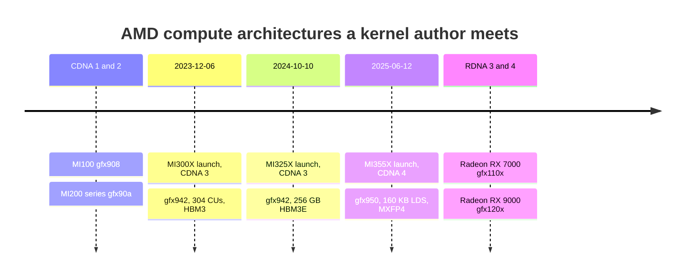
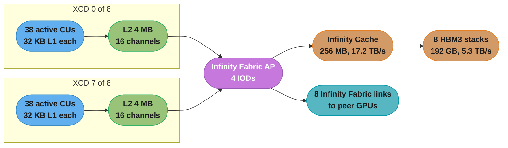
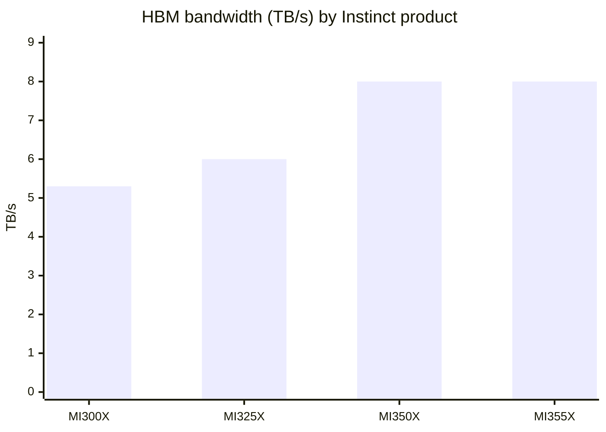
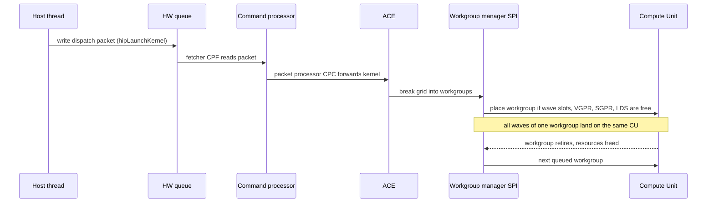

# AMD GPU Architecture: CDNA and RDNA

> **Version anchor (fetched 2026-11-25):** ROCm Core SDK 10.2.0 (released 2026-11-18, HIP 7.17.0); the legacy release stream installs to `/opt/rocm-7.2`. Supported Instinct targets: MI355X / MI350X / MI350P = CDNA 4 `gfx950`; MI325X / MI300X / MI300A = CDNA 3 `gfx942`; MI250X / MI250 / MI210 = CDNA 2 `gfx90a`; MI100 = CDNA `gfx908`. Radeon RX 9070 series and Radeon AI PRO R9700 = RDNA 4 `gfx1201`; RX 9060 series = RDNA 4 `gfx1200`. Hardware figures come from the ROCm "AMD GPU specifications" table, the AMD CDNA 3 and CDNA 4 white papers, the amd.com MI300X / MI325X / MI355X product pages and the ROCm "MI300 Series / MI350 Series workload optimization" guide.

## 1. Concept Overview

Every CUDA module in this section describes one hardware model: a Streaming Multiprocessor that runs 32-thread warps, 32 shared-memory banks of 4 bytes, and Tensor Cores reached through `mma` / WMMA. AMD ships two GPU families that a CUDA programmer meets, and neither matches that model one-for-one:

- **CDNA** ("Compute DNA") is the data-center line behind AMD Instinct accelerators. It runs **64-thread wavefronts**, has no graphics pipeline, and carries **Matrix Cores** that execute **MFMA** (matrix fused multiply-add) instructions. The generations a kernel author targets today are CDNA 3 (MI300X, MI325X, `gfx942`) and CDNA 4 (MI350X, MI355X, `gfx950`).
- **RDNA** ("Radeon DNA") is the graphics line behind Radeon and Radeon PRO cards and Ryzen APUs. HIP runs it with **32-thread wavefronts**, it groups two Compute Units into a **Workgroup Processor (WGP)**, and its matrix acceleration (WMMA instructions on RDNA 3 and RDNA 4) is a different instruction family from MFMA. The current generation is RDNA 4 (`gfx1200`, `gfx1201`).

The single largest structural difference from NVIDIA is **chiplets**. An MI300X is not one die: it is 8 **XCDs** (Accelerator Complex Dies, 38 active CUs each, each with its own 4 MB L2) stacked on 4 **IODs** (I/O dies) that hold a 256 MB **Infinity Cache** and the HBM3 controllers. An MI355X keeps 8 XCDs (32 active CUs each) but uses 2 IODs. A CUDA programmer's assumption that "the L2 is one shared cache for the whole GPU" is false on both: an XCD's L2 caches only that XCD's traffic, and the first cache all 8 XCDs share is the Infinity Cache on the IODs.

This module is the hardware half of Phase 7. It gives you the numbers you need to re-tune a CUDA kernel for AMD: wavefront width, CU and SIMD layout, register budgets, LDS (Local Data Share, AMD's name for shared memory) size and bank count, MFMA throughput, the cache hierarchy and the `gfx` target names. The programming half, HIP and its porting traps, is in [HIP Programming and Porting](../hip_programming_and_porting/hip_programming_and_porting.md). Libraries and kernel DSLs are in [ROCm Libraries and Kernel DSLs](../rocm_libraries_and_kernel_dsls/rocm_libraries_and_kernel_dsls.md), profiling in [ROCm Profiling and Debugging](../rocm_profiling_and_debugging/rocm_profiling_and_debugging.md), and xGMI / RCCL in [Multi-GPU on AMD: RCCL and xGMI](../multi_gpu_on_amd_rccl_and_xgmi/multi_gpu_on_amd_rccl_and_xgmi.md). The NVIDIA counterparts to this page are [GPU Hardware Architecture](../gpu_hardware_architecture/gpu_hardware_architecture.md) and [Warps and SIMT Execution](../warps_and_simt_execution/warps_and_simt_execution.md); the vocabulary bridge between vendors is [Cross-Vendor GPU Concept Map](../cross_vendor_gpu_concept_map/cross_vendor_gpu_concept_map.md).

---

## 2. Intuition

> **One-line analogy**: An NVIDIA H100 is one large factory floor with one shared warehouse (the L2). An MI300X is eight smaller factory floors (XCDs), each with its own stockroom (a 4 MB L2), all built on top of four warehouses (IODs) that share one giant cold store (the 256 MB Infinity Cache) and the loading docks to HBM.

**Mental model**: Take every CUDA constant you tuned against and ask "what is the AMD number, and does it change per generation?" The warp becomes a wavefront of **64** on CDNA (32 on RDNA under HIP). Shared memory becomes LDS: **64 KB per CU with 32 banks** on CDNA 3, **160 KB per CU with 64 banks** on CDNA 4. The SM becomes a CU with **4 SIMD units of 16 lanes**, so one wave64 vector instruction takes 4 cycles on its SIMD. The Tensor Core becomes a Matrix Core driven by `v_mfma_*` instructions whose operands live in VGPRs and AGPRs (accumulation registers). The L2 becomes per-XCD. Each of these numbers moves a tuning decision you made for CUDA.

**Why it matters**: A CUDA kernel ported mechanically to HIP compiles and usually produces correct results, but it was tuned for a 32-wide warp, a different shared-memory budget and one shared L2. On MI300X that kernel can leave half of each wavefront idle (a 32-thread block fills half a wave64), run out of LDS at a tile size that fit on NVIDIA, or thrash eight separate L2s with a tile order that assumed one. AMD's own MI300X tuning guide asks for at least 1,024 workgroups per kernel launch, because 304 CUs spread across 8 XCDs need that much parallelism to stay busy.

**Key insight**: On AMD the hardware unit you must design for is not "the GPU" but "the XCD". Work distribution, L2 reuse and even GPU partitioning (an MI300X can be split into 1, 2, 4 or 8 partitions along XCD boundaries) follow XCD lines. Once you see an MI300X as 8 cooperating 38-CU GPUs that share HBM, most of the surprising performance results stop being surprising.

---

## 3. Core Principles

- **Wavefront width is a per-architecture constant, not a language constant.** HIP reports `warpSize` 64 on `gfx9` targets (all CDNA) and 32 on `gfx10` and later (RDNA). HIP does not support wave64 on `gfx10+` even though the RDNA hardware can run it; the RDNA compiler option `-mwavefrontsize64` is not supported by the HIP runtime.
- **A CU is four SIMDs.** On CDNA each CU holds 4 SIMD units of 16 lanes; a wave64 instruction runs 16 lanes per cycle over 4 cycles. With 4 SIMDs the CU can issue a new vector instruction to some SIMD every cycle when enough waves are resident.
- **Register budgets are per SIMD (execution unit), not per CU.** Each CDNA EU has 512 VGPRs per lane, allocated in blocks of 16. A thread may use up to 256 vector registers plus 256 accumulation registers (AGPRs) for MFMA results. Occupancy is "waves per EU", and `__launch_bounds__` in HIP takes a minimum waves-per-EU value, not CUDA's minimum blocks per SM.
- **LDS is smaller per CU on CDNA 3 than CUDA users expect, and bigger on CDNA 4.** 64 KB per CU on MI300X / MI325X; 160 KB per CU on MI350X / MI355X; 128 KB on RDNA 3 and RDNA 4 parts, but that pool belongs to a WGP (its two CUs share one LDS) and one workgroup can allocate at most 64 KB of it. Tile sizes tuned for one do not transfer to the others.
- **Matrix Cores are a separate pipeline.** MFMA instructions run on Matrix Core units that execute alongside other VALU work. The tile shapes are encoded in the instruction name (`v_mfma_f32_16x16x4f16` is a 16x16 output tile with K = 4 over FP16 inputs and FP32 accumulation).
- **The L2 is per XCD; the Infinity Cache is per package.** Each XCD has a 4 MB, 16-way L2 with 16 channels; it is the lowest level where the hardware keeps coherence automatically. The 256 MB Infinity Cache sits on the IODs as a memory-side last-level cache in front of HBM.
- **`gfx` names are the compatibility contract.** Code objects are compiled to native ISA for a named target such as `gfx942`. A binary that contains only `gfx942` code does not run on a `gfx950` device. Generic targets such as `gfx9-4-generic` exist, with documented feature restrictions.
- **Number formats differ between generations, not only between vendors.** MI300 Series uses FNUZ FP8 variants; MI350 Series uses OCP FP8 variants and adds MXFP8, MXFP6 and MXFP4. TF32 is a hardware MFMA format on MI300X and is emulated through BF16 on MI350 Series.

---

## 4. Types / Architectures / Strategies

The AMD compute architectures arrived in two parallel lines. Only the dates below that come from AMD product pages are stated; the CDNA 1 and RDNA lines are shown by generation, not date.



Caption: Launch dates are the "Launch Date" fields on the amd.com MI300X, MI325X and MI355X product pages. The MI325X kept the MI300X compute die and changed only the memory (HBM3E, 256 GB, 6 TB/s); the MI355X is the first generation since MI300X with a new CU.

### 4.1 CDNA vs RDNA at a glance

| Property | CDNA 3 (MI300X) | CDNA 4 (MI355X) | RDNA 4 (RX 9070 XT) |
|---|---|---|---|
| LLVM target | `gfx942` | `gfx950` | `gfx1201` |
| HIP `warpSize` | 64 | 64 | 32 |
| Compute Units | 304 (38 active of 40 per XCD x 8) | 256 (32 active of 36 per XCD x 8) | 64 |
| LDS | 64 KiB per CU, 32 banks | 160 KiB per CU, 64 banks | 128 KiB per WGP (shared by its 2 CUs), 64 banks; at most 64 KiB per workgroup |
| L2 | 4 MiB per XCD (32 MiB total) | 4 MiB per XCD (32 MiB total) | 8 MiB |
| Last-level cache | 256 MiB Infinity Cache | 256 MiB Infinity Cache | 64 MiB Infinity Cache |
| Memory | 192 GB HBM3, 5.3 TB/s | 288 GB HBM3E, 8 TB/s | 16 GiB |
| Matrix unit | Matrix Cores (MFMA), 1,216 | Matrix Cores (MFMA), 1,024 | AI accelerators (WMMA) |
| Graphics pipeline | No | No | Yes |

Sources: the ROCm GPU specifications table for targets, CU counts, wavefront sizes, LDS, L2 and Infinity Cache; the CDNA 4 white paper and the HIP hardware-implementation page for bank counts; amd.com product pages for HBM capacity and bandwidth and Matrix Core counts. The RDNA memory bandwidth is not stated here because it was not fetched.

### 4.2 The Instinct product line you will compile for

| Product | Arch | Target | HBM | Peak BW | Peak engine clock | Board power |
|---|---|---|---|---|---|---|
| MI300X | CDNA 3 | `gfx942` | 192 GB HBM3 | 5.3 TB/s | 2,100 MHz | 750 W |
| MI325X | CDNA 3 | `gfx942` | 256 GB HBM3E | 6 TB/s | 2,100 MHz | 1,000 W |
| MI350X | CDNA 4 | `gfx950` | 288 GB HBM3E | 8.0 TB/s | 2,200 MHz | 1,000 W |
| MI355X | CDNA 4 | `gfx950` | 288 GB HBM3E | 8 TB/s | 2,400 MHz | 1,400 W |
| MI350P | CDNA 4 | `gfx950` | 144 GiB | not fetched | not fetched | not fetched |

The MI350P row is from the ROCm specifications table (128 CUs, 4 XCDs, 128 MiB Infinity Cache). MI300X and MI325X share the same compute die, so every kernel-level tuning number for one applies to the other; only memory capacity and bandwidth move.

Peak dense matrix throughput, from the white papers and product pages:

| Format | MI300X / MI325X | MI355X | Per CU per clock (MI300X / MI355X) |
|---|---|---|---|
| FP64 vector | 81.7 TF | 78.6 TF | 128 / 128 |
| FP64 matrix | 163.4 TF | 78.6 TF | 256 / 128 |
| FP32 vector | 163.4 TF | 157.3 TF | 256 / 256 |
| FP16 / BF16 matrix | 1,307.4 TF | 2.5 PF | 2,048 / 4,096 |
| FP8 matrix | 2,614.9 TF | 5 PF | 4,096 / 8,192 |
| MXFP6 / MXFP4 matrix | not supported | 10.1 PF | n/a |

Note the FP64 matrix column: CDNA 4 **halved** FP64 matrix throughput per CU while doubling every format at 16 bits and below. An HPC code that relied on MI300X FP64 MFMA gets about 0.5x on MI355X.

### 4.3 RDNA: the Radeon line

RDNA parts matter to a kernel author for three reasons: developer workstations (Radeon PRO W7900, Radeon AI PRO R9700), the Ryzen AI Max APUs (`gfx1151`, up to 40 CUs, RDNA 3.5) and CI runners. Key differences from CDNA:

- **Wave32 under HIP.** The hardware lists "32 or 64" in the specifications table, but HIP uses 32 on `gfx10+` and does not support 64 there.
- **Workgroup Processor.** RDNA pairs two CUs into a WGP "within which all threads can cooperate" (HIP hardware features page). HIP's `__launch_bounds__` conversion formula for RDNA in WGP mode divides by `warpSize * 4` instead of CDNA's `warpSize * 2`.
- **WMMA, not MFMA.** RDNA 3 introduced WMMA instructions (AMD GPUOpen, "How to accelerate AI applications on RDNA 3 using WMMA", 2023-01-10). rocWMMA supports `gfx11` and `gfx12` RDNA targets alongside the `gfx9` CDNA targets, so code written against rocWMMA compiles for both, but MFMA inline assembly does not.
- **No HBM, smaller memory.** 16 GiB on an RX 9070 XT, 32 GiB on an R9700.

### 4.4 Target names you will type

| `--offload-arch` | Family | Devices | Notes |
|---|---|---|---|
| `gfx908` | CDNA | MI100 | first Matrix Cores |
| `gfx90a` | CDNA 2 | MI210, MI250, MI250X | two GCDs per MI250X package |
| `gfx942` | CDNA 3 | MI300X, MI325X, MI300A | FNUZ FP8, hardware TF32 |
| `gfx950` | CDNA 4 | MI350X, MI355X, MI350P | OCP FP8, MXFP8/6/4, 160 KB LDS |
| `gfx1100` / `gfx1101` / `gfx1102` | RDNA 3 | RX 7900 / 7800 / 7600, W7900 | WMMA |
| `gfx1151` | RDNA 3.5 | Ryzen AI Max+ 395 (Radeon 8060S) | APU, carve-out memory |
| `gfx1200` / `gfx1201` | RDNA 4 | RX 9060 / RX 9070, R9700 | WMMA |
| `gfx9-4-generic` | generic | runs on `gfx942` and `gfx950` | no FP8/BF8 instructions, code object V6+ |
| `gfx12-generic` | generic | runs on `gfx1200` and `gfx1201` | code object V6+ |

The generic targets come from the LLVM AMDGPU backend documentation: "Generic processors allow execution of a single code object on any of the processors that it supports. Such code objects may not perform as well as those for the non-generic processors."

### 4.5 Partition modes (CDNA 3 and CDNA 4)

An Instinct GPU can be split into several logical GPUs along XCD boundaries. Compute partitioning and memory (NUMA) partitioning are configured separately:

| Compute mode | XCDs per partition (MI300X) | Memory per partition (MI300X) | MI355X equivalent |
|---|---|---|---|
| SPX (single) | 8 | 192 GB | 8 XCDs, 288 GB |
| DPX (two) | 4 | 96 GB | 4 XCDs, 144 GB |
| QPX (four) | 2 | 48 GB | 2 XCDs, 72 GB |
| CPX (eight) | 1 | 24 GB | 1 XCD, 36 GB |

MI300X memory modes are NPS1 or NPS4, and the memory partition count must be equal to or smaller than the compute partition count (CDNA 3 white paper). The CDNA 4 white paper shows NPS1 and NPS2 for MI350 Series. In CPX mode a kernel sees 38 CUs on MI300X and 32 CUs on MI355X, which changes every grid-size calculation that queried CU count once at startup.

---

## 5. Architecture Diagrams

### 5.1 The MI300X package: XCDs, IODs, Infinity Cache, HBM



Caption: Each XCD's L2 coalesces traffic from its own 38 CUs only; the first cache every XCD shares is the Infinity Cache on the IODs. The 17.2 TB/s figure is the CDNA 3 white paper's aggregate Infinity-Cache-to-XCD bandwidth, more than 3x the 5.3 TB/s HBM bandwidth, which is why a working set that fits in 256 MB behaves very differently from one that does not.

### 5.2 Inside one CDNA Compute Unit

```
  One CDNA 3 Compute Unit (CU)
  +-------------------------------------------------------------------------+
  |  Scheduler: wave slots, issues up to 1 VALU + 1 VMEM + 1 SALU/SMEM      |
  |             + 1 LDS + 1 branch instruction per cycle                    |
  |                                                                         |
  |  +-----------+ +-----------+ +-----------+ +-----------+                |
  |  | SIMD 0    | | SIMD 1    | | SIMD 2    | | SIMD 3    |  4 x 16 lanes  |
  |  | 16 lanes  | | 16 lanes  | | 16 lanes  | | 16 lanes  |                |
  |  | VGPR 128K | | VGPR 128K | | VGPR 128K | | VGPR 128K |  512 KiB total |
  |  +-----------+ +-----------+ +-----------+ +-----------+  (VGPR + AGPR) |
  |                                                                         |
  |  Matrix Core units (MFMA)     4 per CU  (1,216 on 304 CUs)              |
  |  Scalar ALU + 12.5 KiB SGPR   handles wave-uniform values               |
  |  LDS 64 KiB, 32 banks x 4 B   (CDNA 4: 160 KiB, 64 banks)               |
  |  L1 vector cache 32 KiB, 128 B lines                                    |
  +-------------------------------------------------------------------------+
```

Caption: The 512 KiB register file split over 4 SIMDs gives 128 KiB per SIMD, which is 512 registers x 64 lanes x 4 bytes: that is where the "512 VGPRs per execution unit" in AMD's occupancy formula comes from. Four Matrix Cores per CU is 1,216 / 304 for MI300X and 1,024 / 256 for MI355X.

### 5.3 One wave64 instruction on a SIMD16

```
  cycle:        1             2             3             4
              +-------------+-------------+-------------+-------------+
  SIMD 0      | lanes  0-15 | lanes 16-31 | lanes 32-47 | lanes 48-63 |  wave A, v_add_f32
              +-------------+-------------+-------------+-------------+
  SIMD 1      | lanes  0-15 | lanes 16-31 | lanes 32-47 | lanes 48-63 |  wave B, v_mul_f32
              +-------------+-------------+-------------+-------------+

  A 32-thread workgroup on CDNA fills lanes 0-31 of ONE wave64:
              +-------------+-------------+-------------+-------------+
  SIMD 2      | lanes  0-15 | lanes 16-31 |   masked    |   masked    |  half the cycles
              +-------------+-------------+-------------+-------------+  do useful work
```

Caption: HIP's own documentation says code that assumes a warp size of 32 "can run on devices with a warpSize of 64, it only utilizes half of the compute resources". A CUDA kernel launched with 32-thread blocks is the extreme case: every wave is half-masked.

### 5.4 LDS banks: 32 on CDNA 3, 64 on CDNA 4 and RDNA

```
  float tile[64][64];  thread t reads tile[t][col]   (column walk, row stride = 64 floats)

  CDNA 3: 32 banks x 4 B                      CDNA 4 / RDNA 2-4: 64 banks x 4 B
  bank = (t * 64 + col) mod 32 = col mod 32   bank = (t * 64 + col) mod 64 = col mod 64
  every lane hits the SAME bank -> serialized  every lane hits the SAME bank -> serialized

  fix: float tile[64][64 + 1];  (row stride 65)
  bank = (t * 65 + col) mod 32                 bank = (t * 65 + col) mod 64
       = (t + col) mod 32  -> 32 distinct            = (t + col) mod 64 -> 64 distinct
```

Caption: The CUDA padding trick from [Shared Memory and Bank Conflicts](../shared_memory_and_bank_conflicts/shared_memory_and_bank_conflicts.md) still works because a +1 stride is coprime with both 32 and 64. What changes is any swizzle that was tuned to exactly 32 banks: on CDNA 4 and RDNA it needs re-deriving for 64.

### 5.5 Bandwidth per generation



Caption: Bandwidth rose 1.5x from MI300X to MI355X while dense FP16 matrix throughput rose from 1,307.4 TF to 2.5 PF (about 1.9x). The ridge point (FLOP per byte where a kernel stops being memory-bound) therefore moved up, from about 247 to about 312 FLOP/byte for dense FP16.

### 5.6 From a host launch to waves on a CU



Caption: The HIP hardware-implementation page lists the four resources the workgroup manager tracks before it places a workgroup: wave slots, VGPRs, SGPRs and LDS. Running out of any one of them queues the workgroup, which is the AMD form of an occupancy limit. It also warns that workgroup-to-CU mapping is non-deterministic, so code must never assume which CU (or XCD) runs which workgroup ID.

---

## 6. How It Works — Detailed Mechanics

### 6.1 Querying what you are running on

Never hard-code the wavefront width, CU count or LDS size: partition mode alone changes the CU count by 8x. Query at startup.

```cpp
// query_device.hip  --  build: amdclang++ -x hip --offload-arch=gfx942 query_device.hip -o q
#include <hip/hip_runtime.h>
#include <cstdio>
#include <cstdlib>

#define HIP_CHECK(expr)                                                        \
    do {                                                                       \
        hipError_t e_ = (expr);                                                \
        if (e_ != hipSuccess) {                                                \
            std::fprintf(stderr, "HIP error '%s' at %s:%d\n",                  \
                         hipGetErrorString(e_), __FILE__, __LINE__);           \
            std::exit(EXIT_FAILURE);                                           \
        }                                                                      \
    } while (0)

int main() {
    int n = 0;
    HIP_CHECK(hipGetDeviceCount(&n));
    for (int d = 0; d < n; ++d) {
        hipDeviceProp_t p;
        HIP_CHECK(hipGetDeviceProperties(&p, d));
        int warp = 0;
        HIP_CHECK(hipDeviceGetAttribute(&warp, hipDeviceAttributeWarpSize, d));
        std::printf("dev %d  %s  arch=%s  CUs=%d  warpSize=%d  LDS/block=%zu KiB\n",
                    d, p.name, p.gcnArchName, p.multiProcessorCount, warp,
                    p.sharedMemPerBlock / 1024);
    }
    return 0;
}
```

On an MI300X in SPX mode expect `CUs=304` and `warpSize=64`; in CPX mode each of the 8 logical devices reports 38 CUs. `gcnArchName` carries the target plus its feature flags (`sramecc`, `xnack`), which is exactly the string you must compile for.

The same query from PyTorch on a ROCm build, which reuses the `torch.cuda` namespace:

```python
import torch

assert torch.cuda.is_available() and torch.version.hip is not None, "need a ROCm build"
for d in range(torch.cuda.device_count()):
    p = torch.cuda.get_device_properties(d)
    print(d, p.name, p.gcnArchName,
          "CUs:", p.multi_processor_count,
          "warp:", p.warp_size,
          "LDS/block KiB:", p.shared_memory_per_block // 1024)
```

### 6.2 Occupancy: waves per execution unit

The ROCm MI300 / MI350 workload-optimization guide gives the rule: each execution unit (SIMD) has **512 VGPRs**, allocated in **blocks of 16**. Waves per EU from registers is `floor(512 / roundup16(vgprs))`.

```
  VGPRs used   rounded   waves per EU   waves per CU (x4 EUs)
  ----------   -------   ------------   ---------------------
       64         64          8               32
      100        112          4               16
      128        128          4               16
      170        176          2                8   <- AMD's worked example
      256        256          2                8
      512        512          1                4   (256 VGPR + 256 AGPR)
```

AMD's own example: "If the current VGPR usage is 170, it will be rounded up to 176 ... the occupancy is limited to 2 waves per EU because 176 x 3 > 512." The HIP hardware-features table caps CDNA 3 at 2,048 resident threads per CU, which is 32 wave64s; registers usually bind before that cap does.

Two consequences a CUDA programmer misses:

1. **AGPRs count.** MFMA accumulators live in AGPRs (or VGPRs, compiler's choice), and the combined allocation is what the 512 budget divides. A GEMM kernel whose CUDA version used 128 registers per thread can need far more on CDNA once the MFMA accumulator tiles are allocated.
2. **The occupancy knob has different units.** CUDA's `__launch_bounds__(maxThreads, minBlocksPerSM)` becomes HIP's `__launch_bounds__(maxThreads, minWavesPerEU)`. In Triton on ROCm the same knob is `waves_per_eu`.

### 6.3 LDS budgeting

LDS is allocated per workgroup out of the CU's pool. Workgroups per CU from LDS = `floor(LDS_per_CU / LDS_per_workgroup)`:

```
  LDS per workgroup     MI300X per CU      MI355X per CU       RX 9070 XT per WGP
                        (64 KiB)           (160 KiB)           (128 KiB, 2 CUs)
  -----------------     ---------------    ----------------    ------------------
        16 KiB                 4                 10                     8
        32 KiB                 2                  5                     4
        48 KiB                 1                  3                     2
        64 KiB                 1                  2                     2
        96 KiB          does not fit              1              over 64 KiB limit
```

A double-buffered GEMM tile of `BLOCK_M = 256, BLOCK_N = 256, BLOCK_K = 64` in BF16 needs `2 stages x (256 + 256) x 64 x 2 B = 128 KiB`: it does not fit on MI300X at all and fits once on MI355X. The RDNA column counts per WGP, not per CU: the LLVM AMDGPU documentation says each WGP has a single LDS shared by the work-groups running on it, so the RX 9070 XT's 128 KiB serves two CUs, and one workgroup is capped at 64 KiB. Dividing 128 KiB per CU would overstate RDNA occupancy by 2x. The ROCm tuning guide says MI350X's 160 KB LDS "enables larger tile sizes" and "may allow higher num_stages (3 or 4)" for single-GEMM Triton kernels, and adds "Benchmark to verify."

CDNA 4 also changed how LDS is filled: the CDNA 4 white paper says the LDS "supports loading data directly from the L1 data cache, thereby reducing vector register usage and latency", and doubles LDS read bandwidth to 256 bytes per clock.

### 6.4 Matrix Cores and peak arithmetic

Peak numbers are reproducible from the per-CU-per-clock table:

```
  MI300X  FP16 matrix:  304 CUs x 2,048 FLOP/clk/CU x 2.100 GHz = 1,307.4 TFLOPS   (dense)
  MI355X  FP16 matrix:  256 CUs x 4,096 FLOP/clk/CU x 2.400 GHz = 2,516.6 TFLOPS   (AMD: 2.5 PF)
  MI300X  FP64 vector:  304 CUs x   128 FLOP/clk/CU x 2.100 GHz =    81.7 TFLOPS
  MI300X  HBM:          8,192-bit bus x 5.2 Gbps / 8              =     5.3 TB/s

  ridge point (dense FP16):  MI300X  1,307.4 / 5.3 = ~247 FLOP/byte
                             MI355X  2,500   / 8.0 = ~312 FLOP/byte
```

MFMA instructions name their shape: `v_mfma_f32_16x16x4f16 v[0:15], v[16:31], v[32:47], v[0:15]` multiplies FP16 A and B fragments held in VGPRs and accumulates a 16x16 FP32 tile. The ROCm workload guide notes that "for GEMM kernels on an MI300X GPU, mfma_16x16 typically outperforms mfma_32x32, even for large tile/GEMM sizes" (Triton exposes this as `matrix_instr_nonkdim`). The Matrix Core can also exploit 2:4 structured sparsity ("at least two values within a group of four input values are zero"), doubling peak throughput, as Tensor Cores do; see [Tensor Cores and Mixed Precision](../tensor_cores_and_mixed_precision/tensor_cores_and_mixed_precision.md) for the NVIDIA side.

Number formats change underneath the same kernel source:

| Format | MI300X (`gfx942`) | MI355X (`gfx950`) |
|---|---|---|
| FP8 | FNUZ variants | OCP variants (E4M3, E5M2) |
| TF32 | hardware MFMA, 653.7 TF dense | software emulation via BF16 |
| MXFP8 / MXFP6 / MXFP4 | no | hardware (MXFP6 = E3M2 or E2M3, MXFP4 = E2M1) |
| FP64 matrix | 256 FLOP/clk/CU | 128 FLOP/clk/CU |

### 6.5 The memory hierarchy, level by level (MI300X)

| Level | Size | Scope | Notes |
|---|---|---|---|
| VGPR / AGPR | 512 KiB per CU | one SIMD's waves | 256 + 256 registers max per thread |
| LDS | 64 KiB per CU | one workgroup | 32 banks x 4 B |
| L1 vector cache | 32 KiB per CU | one CU | 128 B lines, write-through |
| Scalar L1 / instruction cache | 16 KiB / 64 KiB per 2 CUs | CU pair | uniform data, kernel arguments |
| L2 | 4 MiB per XCD | one XCD (38 CUs) | 16-way, 16 x 256 KiB channels, coherence point |
| Infinity Cache | 256 MiB | whole package | memory-side LLC on the IODs |
| HBM3 | 192 GB | whole package | 8 stacks x 24 GB, 5.2 Gbps |

The L2 doubled its line to 128 B in CDNA 3 and serves up to 2 KB per clock per XCD (four 128 B requests per cycle from different CUs on the read side, per the CDNA 3 white paper). Because each XCD has a private L2, two workgroups on different XCDs that read the same tile each miss in their own L2 and both go to the Infinity Cache.

### 6.6 XCD-aware work distribution

The ROCm tuning guide asks for **at least 1,024 workgroups** per kernel on MI300X, and it recommends remapping program IDs "so consecutive tiles land on the same XCD", combined with a `GROUP_SIZE_M` swizzle. In AMD's tutorial GEMM this "dropped L2 misses from ~5M to ~3.1M and added ~67 TFLOPS on top of the pipelined baseline". For `P` workgroups per XCD, pick `GROUP_SIZE_M` to minimize `GROUP_SIZE_M + ceil(P / GROUP_SIZE_M)`; for `P = 32`, values 4, 6 or 8 all reach the optimum.

A Triton remap that groups tiles per XCD, written for a launch that is a multiple of 8 programs and for a dispatch order that spreads consecutive program IDs across the 8 XCDs:

```python
import triton
import triton.language as tl

NUM_XCDS: tl.constexpr = 8

@triton.jit
def remap_pid_for_xcd(pid, num_pids):
    # pid 0,8,16,... -> first block of tiles; pid 1,9,17,... -> second block, etc.
    pids_per_xcd = num_pids // NUM_XCDS
    xcd = pid % NUM_XCDS
    local = pid // NUM_XCDS
    return xcd * pids_per_xcd + local
```

The assumption is the point: this remap is only correct for the dispatch order it was written against, so measure L2 hit rate with `rocprofv3` / `rocprof-compute` before and after (see [ROCm Profiling and Debugging](../rocm_profiling_and_debugging/rocm_profiling_and_debugging.md)).

### 6.7 Code objects and targets

`amdclang++ --offload-arch=gfx942` emits a native-ISA code object (`.hsaco`) for exactly that target. Several targets are bundled by `clang-offload-bundler` into one fat binary embedded as `__hip_fatbin`. Unlike CUDA, where a PTX copy lets the driver JIT for a newer GPU, the HIP-Clang code object holds fully compiled ISA: `hipModuleLoadDataEx` ignores JIT options and behaves like `hipModuleLoadData`. A binary with only `gfx942` code launched on an MI355X fails with `hipErrorNoBinaryForGpu` ("No kernel image is available for execution on the device"). The fix is to list every target you ship for:

```bash
amdclang++ -x hip --offload-arch=gfx942 --offload-arch=gfx950 \
           --offload-arch=gfx1201 -O3 kernel.hip -o kernel
```

or to use a generic target such as `gfx9-4-generic` and accept its restriction (no FP8/BF8 instructions).

### 6.8 The scalar unit: work CUDA does not show you

Each CU has a scalar ALU with 12.5 KiB of SGPRs and a scalar memory path backed by a scalar L1 data cache shared by a pair of CUs. The compiler moves anything that is provably the same for all 64 lanes onto it: kernel arguments and pointers, grid and block dimensions, loop counters, and `__constant__` data read with a uniform index. CUDA has no programmer-visible equivalent.

Two practical effects:

1. **Uniform values are cheap; divergent ones are not.** `for (int k = 0; k < K; k += 32)` with `K` a kernel argument runs its counter and branch on the scalar unit. Make the bound depend on `threadIdx.x` and the counter moves to VGPRs and the loop exit needs an execution mask.
2. **SGPR pressure is real.** The HIP hardware-features table lists a maximum of 104 scalar registers on CDNA (106 on RDNA). Heavily unrolled kernels with many uniform pointers can run out; the compiler's resource-usage remarks show the count.

The scalar L1 does not count "hit-on-miss": a second request to a line that is still being filled is counted as another miss, unlike the vector L1 and L2. This matters only when you read profiler hit rates.

### 6.9 Coherence on CDNA

CDNA's coherence model is weaker than a CUDA programmer might assume from the shape of the hierarchy:

| Layer | Policy | What it means for kernels |
|---|---|---|
| Vector L1 (per CU) | write-through, software-managed coherence | a write from CU 0 is not visible in CU 1's L1 until CU 1 misses or invalidates |
| L2 (per XCD) | writeback, write-allocate, hardware coherent within the XCD | the coherence point for one XCD; atomics execute here |
| Infinity Cache | memory-side cache | serves all XCDs; not a coherence engine for you |

Cross-workgroup communication inside one kernel (a split-K reduction with a flag, a persistent-kernel work queue) therefore needs the same discipline as on NVIDIA: atomics plus `__threadfence()` with the right scope, or a second kernel launch. HIP's memory-fence functions exist for exactly this. The CUDA rules in [Synchronization and Atomics](../synchronization_and_atomics/synchronization_and_atomics.md) carry over; what changes is that two cooperating workgroups may sit on different XCDs with different L2s, so a release-acquire pair must reach device scope, not just an L2 that happens to be shared on a monolithic GPU.

### 6.10 Queues and concurrency

The command processor feeds kernels to the ACEs from hardware queues, and multiple ACEs let several kernels run at once. The HIP runtime caps hardware queues per device per process with `GPU_MAX_HW_QUEUES`, default **4**: "If an application allocates more HIP streams than this number, then HIP runtime reuses the same hardware queues for the new streams in a round-robin manner." Stream 5 shares a queue with stream 1, so work on the two serializes even though the API says they are independent. This is the AMD-specific twist on [Streams, Events and Concurrency](../streams_events_and_concurrency/streams_events_and_concurrency.md): more than 4 streams per device buys nothing and can create false dependencies. AMD's own FSDP guidance goes the other way and sets `GPU_MAX_HW_QUEUES=2` with high-priority RCCL streams.

---

## 7. Real-World Examples

- **AMD's MI300X / MI350X tuning guide (ROCm docs).** The XCD remap plus `GROUP_SIZE_M` swizzle in AMD's tutorial GEMM cut L2 misses from about 5M to about 3.1M and added about 67 TFLOPS on top of the pipelined baseline. The same guide recommends a minimum of 1,024 workgroups per launch on MI300X.
- **AMD's multi-GPU guidance for MI300X.** The tuning guide advises avoiding 2-GPU and 4-GPU collectives on MI300X and using either 1 GPU or 8-GPU collectives, because of the bandwidth between 2 and 4 GPUs. It also recommends 4 or fewer HIP streams and `GPU_MAX_HW_QUEUES=2` with high-priority RCCL streams for FSDP overlap. The link-level detail is in [Multi-GPU on AMD: RCCL and xGMI](../multi_gpu_on_amd_rccl_and_xgmi/multi_gpu_on_amd_rccl_and_xgmi.md).
- **PyTorch on ROCm.** ROCm 10.2.0 lists PyTorch 2.15.0, JAX 0.11.2, vLLM 0.32.0 and SGLang 0.5.21 as supported. PyTorch's HIP notes document TF32 on MI300 (`gfx942`) through hipBLASLt and state that the TF32 path "has hardware-level numerical differences from the NVIDIA implementation".
- **hipBLASLt on ROCm 10.2.0.** Complex GEMM (CGEMM, ZGEMM) was added for `gfx950` and `gfx942`, and the `gfx942` solution catalogs now stay compressed on disk (about 194 MB instead of about 3.8 GB). Per-architecture catalogs are one visible cost of native-ISA code objects: every target ships its own tuned kernels.

---

## 8. Tradeoffs

### 8.1 CDNA 3 vs CDNA 4 for one kernel

| Concern | MI300X / MI325X (`gfx942`) | MI355X (`gfx950`) |
|---|---|---|
| Dense FP16 / BF16 | 1,307.4 TF | 2.5 PF |
| FP64 matrix | 163.4 TF | 78.6 TF |
| LDS per CU | 64 KiB | 160 KiB |
| CUs | 304 | 256 |
| FP8 encoding | FNUZ | OCP |
| TF32 | hardware | emulated via BF16 |
| HBM | 192 GB / 256 GB | 288 GB |
| Best for | FP64 HPC, existing tuned kernels | low-precision LLM inference, larger tiles |

### 8.2 Design choices forced by chiplets

| Choice | Option A | Option B | Rule of thumb |
|---|---|---|---|
| Tile order | row-major program IDs | XCD-grouped program IDs | group when the same operand tile is reused by neighbouring tiles |
| Partition | SPX (1 GPU of 304 CUs) | CPX (8 GPUs of 38 CUs) | CPX for many small isolated inference jobs, SPX for one large job |
| Memory mode | NPS1 | NPS4 | NPS4 only with 4 or 8 compute partitions |
| Wave tuning | keep CUDA block sizes | multiples of 64 threads | always multiples of 64 on CDNA |

### 8.3 Portability of matrix code

| Approach | Runs on CDNA | Runs on RDNA | Runs on NVIDIA | Peak on CDNA |
|---|---|---|---|---|
| `v_mfma_*` inline asm / builtins | yes | no | no | highest |
| rocWMMA | yes (`gfx9`) | yes (`gfx11`, `gfx12`) | no | high |
| Composable Kernel / hipBLASLt | yes | partial | no | highest for GEMM shapes it covers |
| Triton | yes | yes | yes | high, tune `matrix_instr_nonkdim`, `waves_per_eu` |

### 8.4 Where to develop and test

| Machine | Target | Good for | Misses |
|---|---|---|---|
| MI300X / MI325X node | `gfx942` | production tuning, FP64, hardware TF32 | OCP FP8, MXFP4, 160 KiB LDS |
| MI355X node | `gfx950` | production tuning for low precision | hardware TF32, FP64 matrix speed |
| Radeon AI PRO R9700 / RX 9070 XT | `gfx1201` | correctness on wave32, portable code paths, CI | wave64 bugs, MFMA, HBM bandwidth, XCD effects |
| Ryzen AI Max+ 395 | `gfx1151` | laptop development, large unified memory | wave64, MFMA, HBM |

The row to remember is the RDNA one: a kernel that passes every test on a wave32 Radeon card can still carry the wave64 bugs from section 10, because those bugs only appear when `warpSize` is 64. Run correctness tests on at least one CDNA device.

---

## 9. When to Use / When NOT to Use

**Use this architecture knowledge when:**
- Porting a CUDA kernel to MI300X or MI355X and the hipified version runs but is slow. The first suspects are 32-thread blocks, LDS tiles sized for NVIDIA, and tile orders that assume one L2.
- Choosing between MI300X and MI355X for a workload: FP64-matrix-heavy HPC favours MI300X; FP8/MXFP4 inference favours MI355X.
- Writing a build system that must ship one binary to several AMD generations (list every `gfx` target, or use a generic target).
- Deciding on GPU partitioning for multi-tenant inference.

**Do not lean on it when:**
- Your code lives entirely in PyTorch eager ops and vendor libraries. hipBLASLt, MIOpen and Composable Kernel already encode the CU, LDS and MFMA details; see [ROCm Libraries and Kernel DSLs](../rocm_libraries_and_kernel_dsls/rocm_libraries_and_kernel_dsls.md).
- You are tempted to hard-code the numbers on this page into a kernel. Query them (section 6.1), because partition mode, generation and RDNA vs CDNA all change them.
- You target a consumer RDNA card for production FP64 or very large models: no HBM, and 16 to 32 GiB of memory.

---

## 10. Common Pitfalls

**Pitfall 1: Hard-coded warp of 32 in a CUDA-ported reduction.** The classic `for (offset = 16; offset > 0; offset /= 2)` shuffle reduction sums only lanes 0-31 of a wave64. On MI300X every block's partial sum silently drops half of its values. No error, no crash, wrong answer.

```cpp
// BROKEN: CUDA-era warp reduction, assumes 32 lanes
__device__ float warp_sum(float v) {
    for (int offset = 16; offset > 0; offset /= 2)
        v += __shfl_down(v, offset);          // stops after lanes 0..31
    return v;                                  // on wave64, lanes 32..63 are never added
}

__global__ void block_sum(const float* x, float* out, int n) {
    __shared__ float partial[32];              // sized for 1024 / 32 warps
    int i = blockIdx.x * blockDim.x + threadIdx.x;
    float v = (i < n) ? x[i] : 0.0f;
    v = warp_sum(v);
    int lane = threadIdx.x % 32, wid = threadIdx.x / 32;   // wrong lane / warp ids on wave64
    if (lane == 0) partial[wid] = v;
    __syncthreads();
    if (threadIdx.x == 0) {
        float s = 0.0f;
        for (int w = 0; w < blockDim.x / 32; ++w) s += partial[w];
        atomicAdd(out, s);
    }
}
```

```cpp
// FIX: derive everything from warpSize (early-folded by the compiler since ROCm 7.0)
__device__ float warp_sum(float v) {
    for (int offset = warpSize / 2; offset > 0; offset /= 2)
        v += __shfl_down(v, offset);
    return v;
}

__global__ void block_sum(const float* x, float* out, int n) {
    __shared__ float partial[1024 / 32];       // big enough for the narrowest wave (32)
    int i = blockIdx.x * blockDim.x + threadIdx.x;
    float v = (i < n) ? x[i] : 0.0f;
    v = warp_sum(v);
    int lane = threadIdx.x % warpSize, wid = threadIdx.x / warpSize;
    if (lane == 0) partial[wid] = v;
    __syncthreads();
    if (threadIdx.x == 0) {
        float s = 0.0f;
        int nwarps = (blockDim.x + warpSize - 1) / warpSize;
        for (int w = 0; w < nwarps; ++w) s += partial[w];
        atomicAdd(out, s);
    }
}
```

**Pitfall 2: An LDS tile that fit on NVIDIA does not fit on MI300X.** A kernel that requests 96 KiB of dynamic LDS launches on MI355X (160 KiB per CU) and fails on MI300X (64 KiB). Worse, a kernel tuned to exactly 64 KiB on MI300X leaves 96 KiB idle per CU on MI355X, where AMD suggests 3 or 4 pipeline stages for single-GEMM kernels. Query `sharedMemPerBlock` and pick the tile per target.

**Pitfall 3: Assuming one shared L2.** A GEMM with a row-major tile order that reused B panels well on a monolithic GPU can lose much of that reuse on MI300X, because neighbouring tiles that read the same B panel are spread over 8 private L2s. AMD's tutorial numbers (about 5M to 3.1M L2 misses after XCD remapping) show the size of the effect.

**Pitfall 4: FP8 bytes that mean different numbers.** MI300 Series FP8 uses FNUZ variants; MI350 Series uses OCP variants. Weights quantized and saved as one variant and reinterpreted as the other decode to wrong values. Store the format name with the tensor and convert explicitly at load time.

**Pitfall 5: A binary built on the wrong machine.** CMake's `CMAKE_HIP_ARCHITECTURES` defaults to the architectures `rocm_agent_enumerator` reports on the build host. Built on an MI300X box, the binary contains only `gfx942` and fails on MI355X nodes with `hipErrorNoBinaryForGpu`. Set the target list explicitly in CI.

**Pitfall 6: Grid sized from a cached CU count.** A launcher that computes `grid = 4 * numCUs` once with SPX's 304 CUs and then runs inside a CPX partition (38 CUs) launches 8x more workgroups than intended per device. Re-query per device handle.

**Pitfall 7: Expecting MI355X to speed up FP64 matrix code.** FP64 matrix throughput per CU halved (256 to 128 FLOP/clk), giving about 0.5x on MI355X versus MI300X. An HPC team that migrated a DGEMM-bound solver without checking the table loses half its throughput.

**Pitfall 8: Eight streams that behave like four.** A pipeline that creates one stream per pipeline stage (8 streams) to overlap copies and kernels gets the overlap of 4, because `GPU_MAX_HW_QUEUES` defaults to 4 and streams 5 to 8 reuse queues 1 to 4 round-robin. The profiler timeline shows kernels on "independent" streams running back to back. Keep the stream count at or below the hardware queue count, or raise it deliberately and measure.

**Pitfall 9: Testing only on Radeon.** A team develops on RDNA 4 workstations (`warpSize` 32) and ships to MI300X (`warpSize` 64). Every 32-lane assumption passes locally and fails in production. Correctness CI needs a CDNA runner, even a small partition of one.

**Pitfall 10: Cross-workgroup flags without device-scope fences.** A split-K kernel where the last workgroup to finish sums the partials uses a plain store for its "done" flag and a plain load to read the partials. On a monolithic GPU it seemed to work; on MI300X the producer and consumer workgroups sit on different XCDs with different L2s and the consumer reads stale partials. Use an atomic counter with release semantics on the producer side and acquire on the consumer side at device scope.

---

## 11. Technologies & Tools

| Tool | What it tells you about the hardware |
|---|---|
| `rocminfo` | Agents, `gfx` name, CU count, SIMDs per CU, wavefront size (`rocminfo \| grep "Wavefront Size"`) |
| `amd-smi` | Partition mode, memory, power, link topology; 27.2.0 in ROCm 10.2 adds `amdsmi_get_link_topology()` |
| `hipDeviceProp_t` / `hipDeviceGetAttribute` | `gcnArchName`, `multiProcessorCount`, `warpSize`, `sharedMemPerBlock` at runtime |
| `amdclang++ --offload-arch=` | Selects the `gfx` target(s); `--offload-arch=native` targets the build machine's GPUs |
| `llvm-objdump` | Disassembles code objects to GFX ISA (`v_mfma_*`, `s_barrier`, VGPR counts) |
| `rocprofv3` | Counters and traces per kernel; PC sampling on `gfx94x`, `gfx95x` |
| `rocprof-compute` | Roofline (MXFP8 on MI350 Series in ROCm 10.2), memory chart with LDS and per-channel HBM on MI350 |
| rocWMMA | Portable matrix-core API across `gfx9`, `gfx11`, `gfx12` |
| Composable Kernel, hipBLASLt | Tuned MFMA kernels per target |

---

## 12. Interview Questions with Answers

**Q: A CUDA kernel launched with 32-thread blocks runs correctly on an MI300X but slowly. What is the first suspect?**
**Short:** On CDNA a wavefront is 64 lanes, so each 32-thread block fills half a wave and half of every SIMD cycle is masked off.
A 32-thread block on a `gfx9` (CDNA) device becomes one wave64 with lanes 32-63 inactive, so every vector instruction spends half its four SIMD cycles on masked lanes. HIP's documentation states the consequence directly: code assuming a warp of 32 runs on wave64 devices but "only utilizes half of the compute resources". The fix is block sizes that are multiples of 64, typically 256, and re-deriving any per-warp tiling from `warpSize`. Check this before looking at memory behaviour.

**Q: Is the MI300X L2 cache shared by all 304 Compute Units?**
**Short:** No, each of the 8 XCDs has its own 4 MB L2 for its 38 CUs, and the first cache shared by all XCDs is the 256 MB Infinity Cache.
The CDNA 3 white paper describes a 4 MB, 16-way L2 per XCD that "coalesces all the memory traffic for the die", so two workgroups on different XCDs that read the same data each miss in their own L2. The 256 MB Infinity Cache on the IODs is the first package-wide cache, with about 17.2 TB/s aggregate bandwidth to the XCDs. Tile orders that rely on L2 reuse between neighbouring tiles must keep those tiles on one XCD. AMD's tutorial GEMM gained about 67 TFLOPS from doing exactly that.

**Q: How large is LDS on MI300X, MI355X and an RDNA 4 card, and why does it matter for porting?**
**Short:** LDS is 64 KiB per CU on MI300X, 160 KiB per CU on MI355X and 128 KiB per two-CU WGP on RDNA 4, so a tile tuned for one target can fail or waste capacity on another.
The ROCm GPU specifications list 64 KiB for MI300X and MI325X, 160 KiB for MI350X and MI355X, and 128 KiB for RX 9070 XT and R9700; on RDNA that pool is per WGP, shared by its two CUs, and one workgroup can allocate at most 64 KiB. A double-buffered 256x256x64 BF16 tile needs 128 KiB: impossible on MI300X, one workgroup per CU on MI355X. AMD's tuning guide suggests 3 or 4 pipeline stages on MI350X for single-GEMM kernels. Choose tile sizes per target at compile time or through autotuning.

**Q: What does `__launch_bounds__` mean in HIP compared with CUDA?**
**Short:** The second argument is minimum waves per execution unit (SIMD) in HIP, not minimum blocks per multiprocessor as in CUDA, so CUDA values must be converted.
HIP's porting guide gives the conversion for CDNA in CU mode: `MIN_WARPS_PER_EXECUTION_UNIT = (MIN_BLOCKS_PER_MULTIPROCESSOR * MAX_THREADS_PER_BLOCK) / (warpSize * 2)`, and for RDNA in WGP mode divide by `warpSize * 4` instead. The compiler derives a register cap from it: available registers divided by the waves-per-EU value. `amdclang++` has no `--maxregcount`, so launch bounds are the per-kernel register control. A hipified kernel that keeps CUDA's numbers gets a different, usually wrong, register cap.

**Q: How do you compute register-limited occupancy on a CDNA GPU?**
**Short:** Each SIMD has 512 VGPRs per lane allocated in blocks of 16, so waves per SIMD is 512 divided by the rounded-up VGPR count, times 4 SIMDs per CU.
AMD's MI300 / MI350 tuning guide gives the example: 170 VGPRs round up to 176, and since 176 x 3 > 512 the kernel gets 2 waves per EU, 8 per CU. At 128 VGPRs it gets 4 per EU. AGPRs used for MFMA accumulators share the same 512-register budget, so GEMM kernels hit the limit sooner than their CUDA versions. In Triton on ROCm the `waves_per_eu` hint asks the compiler to cut VGPRs to reach a target.

**Q: Why does a binary compiled for MI300X fail to launch on MI355X, when CUDA binaries often run on newer GPUs?**
**Short:** HIP code objects contain native ISA for named gfx targets with no PTX-style JIT fallback, so a gfx942-only binary has no code for gfx950.
`amdclang++` compiles device code into `.hsaco` code objects for each `--offload-arch`, bundled into `__hip_fatbin`; HIP's porting guide notes these "contain fully compiled code for a device-specific instruction set and don't require additional compilation as a part of the load step". With no matching code object the launch fails with `hipErrorNoBinaryForGpu`. CUDA avoids this only when the fat binary carries PTX. List every target, or use a generic target such as `gfx9-4-generic`, which runs on `gfx942` and `gfx950` without FP8 instructions.

**Q: What is an XCD and how many does each Instinct product have?**
**Short:** An XCD is an accelerator complex die holding CUs and an L2, and both MI300X and MI355X stack 8 of them on I/O dies.
The MI300X has 8 XCDs with 40 CUs each, 38 active, for 304 CUs, on 4 IODs. The MI355X has 8 XCDs with 36 CUs each, 32 active, for 256 CUs, on 2 IODs. Each XCD carries its own hardware scheduler, asynchronous compute engines and a 4 MB L2. XCD boundaries define the GPU partition modes (SPX, DPX, QPX, CPX) and the unit of L2 locality.

**Q: How many cycles does one wave64 vector instruction take on a CDNA SIMD, and why does that matter?**
**Short:** A CDNA SIMD has 16 lanes, so a wave64 instruction takes 4 cycles, which is why each CU has 4 SIMDs to keep issue at one instruction per cycle.
HIP's hardware-implementation page states that with 64-thread warps and 16-wide SIMDs "executing one instruction takes four cycles (one cycle per 16 threads)", and the four-SIMD design lets a new instruction issue to some SIMD every cycle when enough waves are resident. This is why occupancy below one wave per SIMD leaves issue slots empty. It also explains the half-masked wave of a 32-thread block: it still costs 4 cycles per instruction.

**Q: What are Matrix Cores and MFMA instructions, and how do they differ from NVIDIA Tensor Cores for a kernel author?**
**Short:** Matrix Cores are CDNA's matrix units driven by v_mfma instructions that read VGPR fragments and accumulate into VGPRs or AGPRs, with tile shapes encoded in the instruction name.
An instruction like `v_mfma_f32_16x16x4f16` computes a 16x16 FP32 output tile with K = 4 from FP16 inputs, `D = A x B + C`. Matrix Cores run alongside other VALU work, as Tensor Cores do, and both support 2:4 structured sparsity. The differences are the fragment layouts, the AGPR accumulator file, and different shape menus per generation; CUDA `mma` or WMMA code does not translate directly. Reach them through rocWMMA, Composable Kernel, hipBLASLt or Triton unless you need the last few percent.

**Q: Why did MI355X double FP16 throughput but halve FP64 matrix throughput compared with MI300X?**
**Short:** CDNA 4 spent its N3P transistor budget doubling matrix throughput for 16-bit and smaller formats, and FP64 matrix fell from 256 to 128 FLOP per clock per CU.
The CDNA 4 white paper's table lists FP16 and BF16 matrix at 4,096 FLOP/clk/CU (2,048 on MI300X) and FP64 matrix at 128 (256 on MI300X), giving 2.5 PF FP16 but 78.6 TF FP64 matrix on MI355X against 163.4 TF on MI300X. FP64 vector stays at 128 FLOP/clk/CU. The design targets low-precision AI inference and training. HPC codes dominated by FP64 GEMM should benchmark both generations before migrating.

**Q: What is the difference between FNUZ FP8 on MI300X and OCP FP8 on MI355X?**
**Short:** They are distinct 8-bit formats, so bytes quantized for one generation must be converted, not reinterpreted, before the other generation uses them.
AMD's tuning guide states that MI350 Series uses OCP FP8 variants versus FNUZ variants on MI300 Series. A checkpoint, KV cache or FP8 GEMM epilogue written for `gfx942` and read raw on `gfx950` decodes to different values, and nothing in the launch path detects it. Record which variant every FP8 tensor uses. Treat a cross-generation FP8 tensor as a different dtype and convert it explicitly.

**Q: How does RDNA differ from CDNA from a HIP programmer's point of view?**
**Short:** RDNA runs 32-wide wavefronts under HIP, pairs two CUs into a Workgroup Processor, uses WMMA instead of MFMA, and has no HBM.
HIP reports `warpSize` 32 on `gfx10` and later and does not support wave64 there. The WGP lets threads in two CUs cooperate, which changes the `__launch_bounds__` conversion. RDNA 3 and 4 have WMMA matrix instructions; rocWMMA covers `gfx11` and `gfx12`, but MFMA code does not run. Code that is correct for any `warpSize` and uses rocWMMA or Triton runs on both families; code tuned for wave64 and MFMA does not.

**Q: What do the GPU partition modes SPX, DPX, QPX and CPX change for a kernel?**
**Short:** They split one Instinct GPU along XCD boundaries into 1, 2, 4 or 8 logical GPUs, so a kernel sees fewer CUs and less memory per device.
On MI300X, CPX gives 8 devices of 1 XCD, 38 CUs and 24 GB each; on MI355X, CPX gives 32 CUs and 36 GB. Memory partitioning (NPS1 or NPS4 on MI300X) is configured separately and must not exceed the compute partition count. Grid sizes, persistent-kernel worker counts and memory budgets computed for SPX are wrong in CPX. Query CUs and memory per device at startup.

**Q: Why does AMD recommend at least 1,024 workgroups per kernel on MI300X?**
**Short:** 304 CUs spread over 8 XCDs need several resident workgroups each to hide latency, and 1,024 workgroups is about 3.4 per CU in a single wave.
AMD's tuning guide gives the 1,024 minimum and says "identifying additional parallelism within the algorithm is necessary" when a kernel falls short, citing split-K decomposition for W4A16 GEMM as an example. Small-batch decode GEMMs and reductions over few rows are the usual offenders. Split along K, use stream-K, or fuse more work into one launch.

**Q: What does the 256 MB Infinity Cache do for a kernel author?**
**Short:** It is a memory-side last-level cache on the IODs in front of HBM, so working sets under 256 MB see much higher bandwidth than HBM provides.
The CDNA 3 white paper puts Infinity-Cache-to-XCD bandwidth at about 17.2 TB/s aggregate against 5.3 TB/s from HBM3 on MI300X, and CDNA 4 keeps a 256 MB, 16-way Infinity Cache. A KV cache slice, an embedding table shard or a weight matrix that stays resident gets that bandwidth. It does not keep coherence for you; the L2 is the lowest level with hardware coherence.

**Q: Why is the classic +1 padding trick still valid for LDS on CDNA 4 even though the bank count changed?**
**Short:** Padding a row stride to an odd number of 4-byte words is coprime with both 32 and 64 banks, so column walks still spread over all banks.
CDNA 3 LDS has 32 banks of 4 bytes; CDNA 4 and RDNA 2 to 4 have 64. With a row stride of 64 floats every lane of a column walk maps to one bank on both. A stride of 65 makes the bank `(t + col) mod 32` or `mod 64`, so lanes spread. Swizzles derived for exactly 32 banks, such as XOR patterns on 5 address bits, are what break on 64-bank parts.

**Q: When would you choose a generic target like gfx9-4-generic over listing gfx942 and gfx950?**
**Short:** Use it when binary size or build time matters more than peak speed, because one code object runs on both targets but may be slower and cannot use FP8 instructions.
LLVM documents that generic processor code objects run on every processor they support, "may not perform as well as those for the non-generic processors", and require code object V6 or later. `gfx9-4-generic` covers `gfx942` and `gfx950` but excludes FP8 and BF8 instructions and XF32 formats. That suits tools, tests and non-hot kernels. Hot kernels should ship per-target code objects.

**Q: Why can a program with eight HIP streams overlap only four streams' worth of work?**
**Short:** The HIP runtime allocates at most GPU_MAX_HW_QUEUES hardware queues per device, default 4, and maps extra streams onto existing queues round-robin.
HIP's environment-variable reference says that when an application allocates more streams than this number, the runtime "reuses the same hardware queues for the new streams in a round-robin manner". Work on two streams that share a queue serializes even though the API treats them as independent. AMD's FSDP guidance even lowers the value to 2 and uses high-priority RCCL streams. Size the stream count to the queue count, and confirm overlap in a trace.

**Q: What does the scalar unit in a CDNA Compute Unit do, and why should a CUDA programmer care?**
**Short:** It executes wave-uniform work such as kernel arguments, loop counters, branches and uniform constant loads once per wave, using SGPRs instead of 64 copies in VGPRs.
Each CU has a scalar ALU with 12.5 KiB of SGPRs and a scalar memory path through a scalar L1 shared by two CUs. Values the compiler proves uniform across the wave live there, which saves VGPRs and VALU slots. Making a loop bound or index depend on `threadIdx` moves it back to vector registers and may need execution masks. Keep control flow and addresses wave-uniform where the algorithm allows.

**Q: Is the CDNA vector L1 cache coherent across Compute Units?**
**Short:** No, the vector L1 is write-through with software-managed coherence, and the per-XCD L2 is the lowest level the hardware keeps coherent automatically.
HIP's hardware-implementation page describes write-through L1s and coherence "through explicit synchronization" with fences, cache invalidation, atomics executed at the L2, and kernel boundaries. On MI300X two cooperating workgroups can sit on different XCDs, each with its own L2. Cross-workgroup signalling therefore needs device-scope atomics and fences, exactly as the CUDA memory model requires. Never rely on a plain store becoming visible to another workgroup.

---

## 13. Best Practices

- Query `gcnArchName`, `multiProcessorCount`, `warpSize` and `sharedMemPerBlock` per device at startup; never hard-code 64, 304 or 64 KiB.
- Use block sizes that are multiples of 64 on CDNA; 256 threads (4 wave64s, one per SIMD) is the usual starting point.
- Size LDS tiles per target: 64 KiB per CU on `gfx942`, 160 KiB on `gfx950`, 128 KiB per two-CU WGP on RDNA (64 KiB max per workgroup). Give each target its own tile configuration or autotune.
- Read the VGPR and AGPR counts from the compiler (or `llvm-objdump`) and compute waves per EU with the 512 / roundup16 rule before profiling.
- Keep L2 reuse inside one XCD: group neighbouring tiles by XCD and measure L2 hit rate before and after.
- Launch at least 1,024 workgroups per kernel on MI300X; split K or use stream-K for skinny GEMMs.
- Record FP8 variant (FNUZ or OCP) with every FP8 tensor and convert at load time.
- Build with an explicit `--offload-arch` list (or `CMAKE_HIP_ARCHITECTURES`) in CI; never rely on the build machine's GPU.
- Re-validate FP64-heavy code when moving from MI300X to MI355X.
- Treat partition mode as part of the runtime configuration: log it next to the device name.

---

## 14. Case Study

**Scenario.** A team ports a CUDA FP16 GEMM used in an LLM prefill path to a node of 8 MI300X GPUs, and later to MI355X. The hipified kernel compiles with zero edits and passes correctness tests. On MI300X it reaches about 31% of the 1,307.4 TFLOPS dense FP16 peak for an `M = N = K = 8192` problem. The CUDA configuration was: 128-thread blocks, tile `128 x 128 x 32`, 2 pipeline stages, a 32-lane warp-level epilogue reduction, and a row-major tile order. The percentages in this case study are the scenario's own measurements and are illustrative.

**Step 1: arithmetic intensity says this should be compute-bound.** `2 x 8192^3 FLOP / (3 x 8192^2 x 2 B) = 2,731 FLOP/byte`, far above MI300X's ridge point of about 247. So the gap is inside the kernel, not HBM. See [Occupancy and Launch Configuration](../occupancy_and_launch_configuration/occupancy_and_launch_configuration.md) for the CUDA version of this analysis.

**Step 2: count workgroups and waves.** `(8192 / 128)^2 = 4,096` workgroups, comfortably above 1,024. But 128 threads is only 2 wave64s per workgroup; the CUDA kernel assumed 4 warps of 32 and split the tile into 4 warp tiles. On CDNA two of those warp tiles collapse into one wave and the per-warp tiling math is wrong.

**Step 3: registers and LDS.** The compiler reports 168 VGPRs (rounded to 176) including the MFMA accumulator. That gives 2 waves per EU. The tile uses `2 x (128 + 128) x 32 x 2 B = 32 KiB` of LDS, so 2 workgroups per CU on MI300X.

**Step 4: the epilogue bug.** The warp-level reduction used for a fused row-sum (for a following RMSNorm) had 32-lane assumptions baked in.

```cpp
// BROKEN: epilogue row-sum from the CUDA kernel, 32-lane assumptions
__device__ float row_sum_epilogue(float v) {
    unsigned mask = 0xffffffffu;                       // 32-bit mask
    for (int off = 16; off > 0; off >>= 1)
        v += __shfl_xor_sync(mask, v, off);           // HIP: static_assert on mask type
    return v;                                          // and lanes 32..63 never combined
}
```

On ROCm 7.0 and later the `_sync` builtins are enabled by default, take a 64-bit mask, and include a static assert on the mask type, so this version fails to compile rather than silently summing half a wave. Removing the `_sync` to "make it compile" brings back the silent half-sum.

```cpp
// FIX: 64-bit full mask and warpSize-derived offsets
__device__ float row_sum_epilogue(float v) {
    const unsigned long long mask = ~0ull;             // all lanes of a wave64 (or wave32)
    for (int off = warpSize / 2; off > 0; off >>= 1)
        v += __shfl_xor_sync(mask, v, off);
    return v;
}
```

**Step 5: retune for wave64 and XCDs.** The team moved to 256-thread workgroups (4 wave64s, one per SIMD). A `256 x 128 x 64` double-buffered tile needs `2 x (256 + 128) x 64 x 2 B = 96 KiB`, which does not fit MI300X's 64 KiB, so they used `256 x 128 x 32` at 48 KiB (1 workgroup per CU). They switched to `mfma_16x16` instructions, as AMD's guide suggests for MI300X GEMMs, and an XCD-grouped tile order with `GROUP_SIZE_M = 8`.

```
  stage                                   % of 1,307.4 TF dense FP16 peak (illustrative)
  --------------------------------------  ----------------------------------------------
  hipify only (128 threads, CUDA tiles)   31%
  + 256-thread workgroups, wave64 tiling  48%
  + mfma_16x16, 2 waves/EU kept           58%
  + XCD-grouped tile order                64%
```

Caption: The percentages are this scenario's runs, labelled illustrative; AMD's own tutorial reported about 67 TFLOPS from the XCD step alone. The lesson is the order: correctness of wave64 assumptions first, then waves and tiles, then XCD locality.

**Step 6: moving to MI355X.** The same `gfx942` binary failed on the MI355X nodes with `hipErrorNoBinaryForGpu`, because CI built with `CMAKE_HIP_ARCHITECTURES` defaulted from an MI300X build host. After adding `gfx950`, the team re-tuned: 160 KiB of LDS allowed `256 x 256 x 64` with 2 stages (128 KiB) or `256 x 128 x 64` with 3 stages (144 KiB), and the 64-bank LDS required re-deriving one XOR swizzle written for 32 banks. They also found their FP8 weight cache, quantized on MI300X as FNUZ, decoded wrongly on MI355X (OCP) and added an explicit conversion. Last, an FP64 matrix routine in the same library ran at about half its MI300X speed, matching the 256 to 128 FLOP/clk/CU change, and was left on MI300X nodes.

**Takeaways.**
- A port that compiles is step zero. Wave64, LDS size and XCD locality are the three re-tuning axes.
- Every number on this page differs across `gfx942`, `gfx950` and RDNA; query or autotune.
- Ship explicit target lists. The porting mechanics continue in [HIP Programming and Porting](../hip_programming_and_porting/hip_programming_and_porting.md), and the full end-to-end port is [Port an LLM Kernel to AMD MI300](../case_studies/port_an_llm_kernel_to_amd_mi300.md). For vendor-neutral numbers see [Vendor Terminology and Numbers Reference](../case_studies/cross_cutting/vendor_terminology_and_numbers_reference.md).
