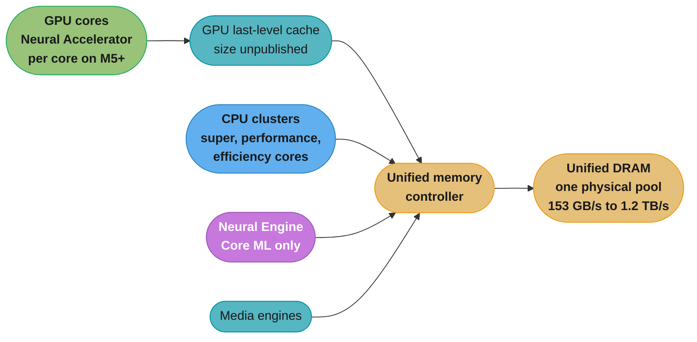
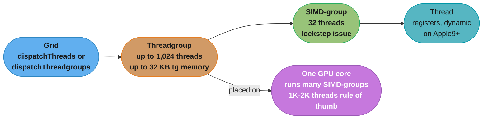
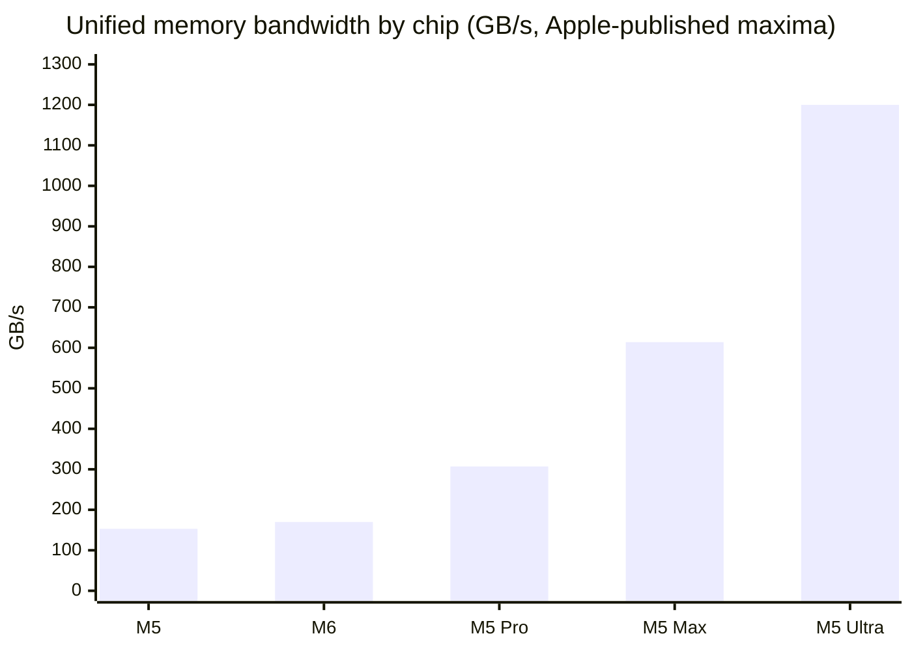
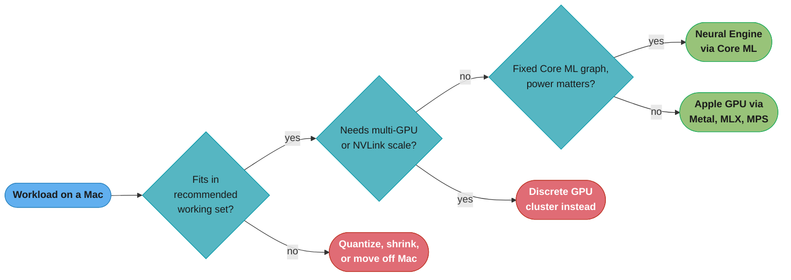

# Apple Silicon GPU Architecture

> **Version anchor (fetched 2026-11-25):** Metal Feature Set Tables (dated 2026-10-23) list GPU
> families Apple7 (A14, M1) through Apple11 (M6); the Metal 4 programming model needs Apple7 or
> later. Metal Shading Language Specification 4.1 (dated 2026-06-04; `-std=metal4.1` targets the
> OS 27 releases). Chip figures from Apple Newsroom: M5 (2025-10-15) 10-core GPU, 153 GB/s;
> M5 Pro up to 20-core GPU, 307 GB/s, 64 GB and M5 Max up to 40-core GPU, 614 GB/s, 128 GB
> (2026-03-03); M6 12-core GPU, 170 GB/s, 32 GB and M5 Ultra up to 80-core GPU, 1.2 TB/s,
> 512 GB (2026-08-25). SIMD width 32 on all Apple GPUs (WWDC22 session 10159). Apple publishes
> no per-core ALU count, FLOPS figure, register-file size, cache size or threadgroup-memory bank
> layout; this page says so wherever a CUDA reader would expect one.

## 1. Concept Overview

An Apple silicon GPU is an **integrated** GPU: it sits on the same system on a chip (SoC) as the
CPU cores, the Neural Engine and the media engines, and it reads and writes the **same physical
DRAM** as the CPU. There is no PCIe link, no separate VRAM and no `cudaMemcpy`-style transfer
step. Apple calls this the unified memory architecture, and it is the single fact that changes
the most when a CUDA engineer sits down at a Mac.

The GPU is built from **GPU cores** (Apple's marketing unit: an M5 has 10, an M5 Max up to 40,
an M5 Ultra up to 80). Each core runs many **SIMD-groups** of 32 threads, which Apple's own
documentation describes as "also known as warps or wavefronts". Threads are grouped into
**threadgroups** of up to 1,024 threads that share up to 32 KB of **threadgroup memory**, which
is Metal's name for what CUDA calls shared memory. The only supported way to program the GPU is
**Metal** (with MSL, the Metal Shading Language), or a framework built on it: Metal Performance
Shaders, MLX, PyTorch's MPS backend, Core ML.

Apple also designs the GPU for graphics first. Its GPUs use **tile-based deferred rendering
(TBDR)** with fast on-chip **tile memory**, and since the M3 generation (Apple family 9) the
shader core uses **Dynamic Caching**: registers, threadgroup memory, tile memory, stack and
buffer data share on-chip caches that the hardware allocates at run time. From the M5 generation
each GPU core also carries a **Neural Accelerator** that Metal 4's tensor APIs can drive.

What Apple does **not** publish matters as much as what it does. There is no Apple equivalent of
NVIDIA's per-SM table: no FP32 lanes per core, no register-file size, no L1 or last-level cache
size, no threadgroup-memory bank count, no TFLOPS number. Apple publishes relative claims
("over 4x the peak GPU compute for AI compared to M4") and feature/limit tables. A kernel author
on Apple silicon therefore works from three sources: the Metal Feature Set Tables, the Metal
Shading Language Specification, and measurement in Xcode's GPU tools.

This module is the hardware half of Phase 8. The programming half is
[Metal Compute Programming](../metal_compute_programming/metal_compute_programming.md);
frameworks are in
[Metal Performance Shaders, MLX and PyTorch MPS](../metal_performance_shaders_mlx_and_pytorch_mps/metal_performance_shaders_mlx_and_pytorch_mps.md);
measurement is in [Metal Profiling and Debugging](../metal_profiling_and_debugging/metal_profiling_and_debugging.md).
The NVIDIA baseline it is compared against lives in
[GPU Hardware Architecture](../gpu_hardware_architecture/gpu_hardware_architecture.md) and
[CUDA Memory Model and Hierarchy](../cuda_memory_model_and_hierarchy/cuda_memory_model_and_hierarchy.md).

---

## 2. Intuition

> **One-line analogy**: A discrete NVIDIA card is a restaurant across town with its own pantry:
> fast cooks, but every ingredient rides a delivery van (PCIe) before cooking starts. An Apple
> GPU is a second chef in your own kitchen: same pantry, no van, but the pantry door is one
> shared door, and two chefs reaching for the same jar still have to take turns.

**Mental model**: Picture one pool of system memory with several engines bolted to it: CPU
clusters, GPU cores, the Neural Engine. Every engine sees the same bytes. The GPU's private world
is only what lives on chip: registers, threadgroup memory, tile memory and caches. So the cost
model has two levels instead of three. On CUDA you think "host DRAM -> PCIe -> HBM -> SM". On
Apple you think "unified DRAM -> GPU core". The bandwidth of that one DRAM pool (153 GB/s on M5,
614 GB/s on M5 Max, 1.2 TB/s on M5 Ultra) is the number that bounds every memory-bound kernel.

**Why it matters**: Two things follow. First, capacity: an M5 Ultra Mac Studio can give the GPU
access to up to 512 GB of memory, far more than any single data-center GPU's HBM, so models
that need multi-GPU sharding on NVIDIA can fit on one Apple GPU. Second, bandwidth per byte of
capacity is lower: 1.2 TB/s feeding 512 GB is a very different ratio from an HBM part. Apple
GPUs win on "can it fit" and lose on "how fast can it stream it", which is exactly the profile
of single-user LLM inference.

**Key insight**: Most CUDA performance lore transfers at the level of *concepts* (coalescing
matters, divergence costs, occupancy hides latency, reductions use SIMD shuffles) but not at the
level of *numbers* (bank counts, registers per thread, occupancy tables), because Apple does not
publish the numbers and Dynamic Caching makes several of them run-time quantities. Port the
algorithm, re-derive the tuning by measurement.

---

## 3. Core Principles

- **One physical memory pool.** CPU and GPU share system DRAM. `MTLStorageMode.shared` is the
  default for buffers and textures on Apple silicon GPUs. "Zero-copy" is the normal case, not a
  special API.
- **No copy does not mean no synchronization.** A shared buffer is visible to both processors,
  but the CPU must not read GPU results until the command buffer completes, and must not
  overwrite inputs the GPU is still reading.
- **SIMD-groups are 32 threads on every Apple GPU.** `threadExecutionWidth` returns 32
  (WWDC22 10159). Ballot masks are still typed 64-bit (`simd_vote` wraps a `uint64_t`).
- **Threadgroup budget: 1,024 threads, 32 KB.** Apple4 through Apple11 all report a theoretical
  1,024 threads per threadgroup and 32 KB total threadgroup memory. The real thread cap is the
  pipeline's `maxTotalThreadsPerThreadgroup`.
- **Occupancy is dynamic on Apple9+.** Dynamic Caching allocates registers and on-chip memory as
  the program runs and throttles occupancy to avoid spilling, so there is no static
  "registers per thread -> SIMD-groups per core" table to tune against.
- **FP16 is first class.** Apple states FP16 arithmetic runs at peak throughput, uses fewer
  registers than FP32 and converts to and from FP32 at no cost.
- **Features are gated by GPU family, not by chip name.** Query `supportsFamily(.apple9)` or
  `.metal4`; read limits from `MTLDevice` and `MTLComputePipelineState` properties.
- **The undocumented stays undocumented.** Bank layout, cache sizes, ALU counts and FLOPS are not
  published. Do not hard-code guesses; measure with Xcode's GPU counters.
- **Three ML engines, three front doors.** GPU: Metal, MPS, MLX. Neural Engine: Core ML only.
  CPU matrix hardware: Apple frameworks such as Accelerate; no public ISA.

---

## 4. Types / Architectures / Strategies

### 4.1 GPU families: the unit Metal actually gates on

Metal exposes hardware generations as `MTLGPUFamily` values. The feature set tables map chips to
families, and every compute feature has a minimum family.

| Family | Chips (from the 2026-10-23 tables) | Compute-relevant features first available |
|--------|------------------------------------|-------------------------------------------|
| Apple7 | A14 Bionic, M1-series | SIMD-scoped reductions, SIMD-scoped matrix multiply (`simdgroup_matrix`), floating-point atomics, quad reductions, generic address space, acquire/release atomics (with MSL 4.1), Metal 4 programming model, tensors |
| Apple8 | A15, A16, M2-series | SIMD shift-and-fill, 64-bit atomic min/max on `ulong` (macOS only), placement sparse resources on all devices |
| Apple9 | A17 Pro, A18-series, M3-series, M4-series | Full 64-bit atomics on all platforms, Dynamic Caching shader core, hardware ray tracing and mesh shading, 256 KB implicit imageblock limit |
| Apple10 | A19-series, M5-series | 32,768 px max 2D texture, 8x MSAA; on M5-series chips Apple adds a Neural Accelerator to every GPU core |
| Apple11 | M6-series | Compute-shader forward-progress guarantees, FP32 denormalized numbers |

The tables also state that "all Metal 3 and Metal 4 devices support at least the limits listed
in the Apple7 column", so Apple7 is the safe floor for a portable Metal compute kernel.

### 4.2 Chip tiers: same architecture, different width

Within a generation, Apple scales by core count and memory-interface width. These are the
Apple-published figures for the current generations.

| Chip | Announced | GPU cores | Unified memory bandwidth | Max unified memory |
|------|-----------|-----------|--------------------------|--------------------|
| M5 | 2025-10-15 | 10 | 153 GB/s | 32 GB |
| M5 Pro | 2026-03-03 | up to 20 | up to 307 GB/s | 64 GB |
| M5 Max | 2026-03-03 | up to 40 | up to 614 GB/s | 128 GB |
| M6 | 2026-08-25 | 12 | up to 170 GB/s | 32 GB |
| M5 Ultra | 2026-08-25 | up to 80 | 1.2 TB/s | 512 GB |

The same releases give the Neural Engine sizes as 16-core (M5), "Dual 16-core" (M6) and 32-core
(M5 Ultra). M5 Pro and M5 Max use Apple's "Fusion Architecture", which joins two dies into one
SoC. M5 Ultra uses UltraFusion to join two dual-die M5 Max chips into a quad-die part, with
inter-die bandwidth Apple quotes at over 4.4 TB/s, and Apple says the four dies "behave as a
single unified processor". From Metal's point of view an M5 Ultra is one `MTLDevice`, not four.

### 4.3 The execution hierarchy

| Level | Apple name | CUDA analogue | Published facts |
|-------|-----------|---------------|-----------------|
| Whole GPU | GPU | GPU | Core count per chip (4.2) |
| Core | GPU core / shader core | SM | Threadgroups are distributed uniformly to cores; each core has its own threadgroup memory |
| Scheduling unit | SIMD-group | warp | 32 threads on all Apple GPUs |
| Cooperating group | threadgroup | thread block | Up to 1,024 threads, up to 32 KB threadgroup memory |
| Sub-SIMD unit | quad-group | (no direct analogue) | A SIMD-group view with execution width 4 |
| Launch | grid | grid | 1D, 2D or 3D; `dispatchThreads` allows non-uniform edge threadgroups (Apple4+) |

The MSL spec adds two guarantees worth memorizing. The mapping of threads to SIMD-groups is
invariant for a kernel's execution and across dispatches with the same launch parameters. And
all SIMD-groups in a threadgroup are the same size except the one with the highest index, which
is smaller when the threadgroup size is not a multiple of 32.

### 4.4 The memory hierarchy

| Level | Scope | What Apple documents |
|-------|-------|----------------------|
| Unified DRAM | Whole SoC | Capacity and bandwidth per chip (4.2) |
| GPU last-level cache | Whole GPU | "services all GPU memory traffic" (M3/A17 Pro tech talk); size not published |
| On-chip core cache | One GPU core | On Apple9+, one set of larger caches services registers, threadgroup, tile, stack and buffer data; sizes not published |
| Threadgroup memory | One threadgroup | 32 KB max per threadgroup; allocation lengths are multiples of 16 bytes |
| Tile memory / imageblocks | One tile (render pass) | 32 KB explicit imageblock, 256 KB implicit imageblock on Apple9+; used by `memoryless` textures |
| Registers | One thread | Dynamically allocated on Apple9+; file size not published |

### 4.5 Dynamic Caching (Apple family 9 and later)

Apple's M3/A17 Pro tech talk describes three shader-core changes, all transparent to the
program:

1. **Dynamic shader core memory.** Before Apple9, a SIMD-group allocated its *maximum* register
   count up front and held it for its whole life, so one register-heavy branch capped occupancy
   for the entire kernel. On Apple9 the register file is a cache, and registers are allocated
   and freed as the program runs.
2. **Flexible on-chip memory.** Threadgroup memory, tile memory, stack and buffer caching share
   "fewer larger caches". A kernel that uses no threadgroup memory gives that capacity to
   registers or buffer caching instead of leaving it idle.
3. **Occupancy throttling.** If the working set would spill, the core lowers occupancy to keep
   data on chip. Occupancy is now a function of how the shader touches threadgroup, tile, stack
   and buffer memory, not only of register count.

M5, M5 Pro, M5 Max and M5 Ultra ship "second-generation dynamic caching" and M6 "updated Dynamic
Caching"; Apple has not published how those versions differ.

### 4.6 TBDR and tile memory

Apple GPUs render with tile-based deferred rendering: the GPU bins all geometry of a render pass
into tiles, then shades each tile in on-chip **tile memory**, which Apple describes as having
bandwidth "many times faster" and latency "many times lower" than device memory. For compute
work this matters in three places:

- A normal compute dispatch does not use tile memory; it uses threadgroup memory and caches.
- **Tile shaders** and **imageblocks** let compute run *inside* a render pass and read the tile
  memory directly, which is how image-processing chains avoid DRAM round trips.
- `MTLStorageMode.memoryless` textures live only in tile memory for the duration of a pass.
  Only textures can be memoryless, never buffers.

### 4.7 GPU vs Neural Engine vs CPU matrix hardware

| Engine | How you program it | Precision / formats | When it wins |
|--------|--------------------|---------------------|--------------|
| GPU cores | Metal compute, MPS, MPSGraph, MLX, PyTorch MPS | FP32, FP16, BF16 (`bfloat`), integer; Metal 4 tensors add FP8 and FP4 formats in MSL 4.1 | Custom kernels, training, large-batch or long-context work, anything you need to write yourself |
| GPU Neural Accelerators (M5 generation and later) | Metal 4 tensor APIs (`MTLTensor`, Metal Performance Primitives `matmul2d`); MPS and Core ML use them automatically | Tensor formats listed in the feature tables | Matrix-heavy layers inside GPU work, such as prompt processing |
| Neural Engine | Core ML only, via `MLComputeUnits` (`.all`, `.cpuAndNeuralEngine`, `.cpuAndGPU`, `.cpuOnly`) | Whatever the Core ML compiler selects; no public ISA | Power-efficient inference of supported model graphs |
| CPU matrix hardware | Apple frameworks such as Accelerate; Apple's M5 release refers to "the Neural Accelerators in the CPU and GPU" | Not documented as an ISA | Small or latency-sensitive matrix work that would not amortize a GPU dispatch |

Apple documents no direct programming interface for the Neural Engine. A Metal 4 app can run a
whole Core ML network on the **GPU timeline** with `MTL4MachineLearningCommandEncoder`
(WWDC25 session 262), which is not the same thing as running it on the Neural Engine.

---

## 5. Architecture Diagrams

### 5.1 The SoC: one memory pool, several engines



Every engine reaches the same DRAM through the same memory controller; nothing is copied to
reach the GPU. The bandwidth range on the DRAM node is the whole M5/M6 family, from M5
(153 GB/s) to M5 Ultra (1.2 TB/s), and it is the ceiling for every memory-bound kernel.

### 5.2 Discrete vs unified data path

```
  DISCRETE (CUDA on a PCIe card)                 UNIFIED (Metal on Apple silicon)

  host DRAM [x: 4 GB]                            unified DRAM [x: 4 GB]  <-- one copy
       |                                               |      ^
       | cudaMemcpy H2D over PCIe                      |      | CPU reads results
       v                                               v      |  after completion
  GPU HBM   [x: 4 GB]  <-- second copy           GPU cores (read and write in place)
       |
       v
  SMs compute, write HBM
       |
       | cudaMemcpy D2H over PCIe
       v
  host DRAM [y]

  copies per round trip:      2                  copies per round trip:      0
  resident bytes for x:       8 GB               resident bytes for x:       4 GB
  sync needed before reading: yes                sync needed before reading: yes
```

The unified path removes both copies and halves the resident footprint, but the bottom line is
identical on both sides: the CPU still waits for GPU completion before it reads results.

### 5.3 Execution hierarchy and its limits



A threadgroup never spans two GPU cores, which is why its threadgroup memory can be local to
one core. Apple's rule of thumb from WWDC22 10159 is that 1K to 2K concurrent threads per core is
"very good occupancy" for relatively complex kernels.

### 5.4 Why Dynamic Caching raises occupancy

```
  ONE KERNEL: register use over time (R = registers in use by one SIMD-group)

  program point:     load   math   shadeGlass()   math   store
  registers used:     20     24        96          24      16

  BEFORE Apple9 (static allocation = peak for whole lifetime)
  each SIMD-group reserves 96 for its whole life
  core register file (illustrative capacity 384):
  [ SG0 96 ][ SG1 96 ][ SG2 96 ][ SG3 96 ]          -> 4 SIMD-groups resident

  Apple9 and later (dynamic allocation = current use)
  most SIMD-groups sit at 16-24, only the ones inside shadeGlass() hold 96
  [ SG0 24 ][ SG1 20 ][ SG2 96 ][ SG3 24 ][ SG4 16 ][ SG5 24 ][ SG6 24 ] ...
                                                  -> more SIMD-groups resident

  if the sum would spill off chip, the core lowers occupancy instead of spilling
```

The register counts and the capacity of 384 are illustrative, because Apple does not publish
register-file sizes; the shape is the one Apple's M3 tech talk walks through with its
`shadeGlass` ray-tracing example. The lesson for kernel authors: a rarely taken heavy branch no
longer caps occupancy for the whole kernel on Apple9+.

### 5.5 Bandwidth across the current lineup



Each step from M5 to Pro to Max to Ultra roughly doubles the bandwidth, tracking the doubling of
GPU cores (10, 20, 40, 80). A memory-bound kernel's best case scales with this bar, not with any
FLOPS figure, which Apple does not publish anyway.

---

## 6. How It Works — Detailed Mechanics

### 6.1 Ask the device, do not guess

Everything a kernel needs to size itself is a property on `MTLDevice` or on a compiled
`MTLComputePipelineState`. This Swift snippet prints the numbers a CUDA author would look up in a
spec sheet.

```swift
import Metal

let device = MTLCreateSystemDefaultDevice()!
print("name:", device.name)
print("unified memory:", device.hasUnifiedMemory)
print("Metal 4 model:", device.supportsFamily(.metal4))
print("Apple9+ (Dynamic Caching):", device.supportsFamily(.apple9))
print("max buffer bytes:", device.maxBufferLength)          // at least 256 MB by contract
print("recommended working set:", device.recommendedMaxWorkingSetSize)
print("max threadgroup memory:", device.maxThreadgroupMemoryLength)
print("max threads/threadgroup (trivial shader):", device.maxThreadsPerThreadgroup)

// Per-pipeline numbers: these depend on the compiled kernel.
let lib = device.makeDefaultLibrary()!
let pso = try device.makeComputePipelineState(function: lib.makeFunction(name: "vadd")!)
print("SIMD width:", pso.threadExecutionWidth)                // 32 on Apple GPUs
print("max threads for THIS kernel:", pso.maxTotalThreadsPerThreadgroup)
print("static threadgroup bytes:", pso.staticThreadgroupMemoryLength)
```

`maxThreadsPerThreadgroup` on the device is the limit "for a trivial shader"; the pipeline's
`maxTotalThreadsPerThreadgroup` is the real cap for your kernel and can differ between two
pipelines on the same device.

### 6.2 SIMD-groups, divergence and ballots

A SIMD-group of 32 threads issues one instruction for all active lanes. Apple's own guidance is
the CUDA guidance: if one thread in a SIMD-group takes the other side of an `if`, the group runs
both sides, and the time is the sum of both branches. Per-lane data exchange uses SIMD-group
functions (`simd_shuffle`, `simd_shuffle_xor`, `simd_sum`, `simd_prefix_exclusive_sum`,
`simd_ballot`) that move data between registers with no threadgroup memory and no barrier.

The ballot type is the trap. `simd_ballot(expr)` returns `simd_vote`, a wrapper around a
`uint64_t`. The spec says that on hardware with fewer than 64 threads in a SIMD-group, the top
bits are undefined and may be non-zero. Apple GPUs have 32, so bits 32 to 63 are garbage until
you mask them.

```metal
#include <metal_stdlib>
using namespace metal;

kernel void count_positive(device const float* x [[buffer(0)]],
                           device atomic_uint* count [[buffer(1)]],
                           uint gid [[thread_position_in_grid]],
                           uint lane [[thread_index_in_simdgroup]],
                           uint width [[threads_per_simdgroup]]) {
    simd_vote vote = simd_ballot(x[gid] > 0.0f);
    // Mask to the real SIMD width before counting: bits >= width are undefined.
    ulong mask = (width == 64) ? ~0ul : ((1ul << width) - 1ul);
    uint votes = popcount(static_cast<ulong>(vote) & mask);
    if (lane == 0) {
        atomic_fetch_add_explicit(count, votes, memory_order_relaxed);
    }
}
```

### 6.3 How many threads fill the GPU

Apple's occupancy rule of thumb is 1K to 2K concurrent threads per GPU core. That turns into a
minimum grid size per chip:

| Chip | GPU cores | Threads in flight at 1K/core | at 2K/core |
|------|-----------|------------------------------|------------|
| M5 | 10 | 10,240 | 20,480 |
| M6 | 12 | 12,288 | 24,576 |
| M5 Pro | 20 | 20,480 | 40,960 |
| M5 Max | 40 | 40,960 | 81,920 |
| M5 Ultra | 80 | 81,920 | 163,840 |

A 1D dispatch of 16,384 threads (for example, one thread per hidden unit of a 16K-wide layer) is
enough work for an M5 but fills less than half of an M5 Max even at the 1K rule. The fix is the
same as on CUDA: give each kernel more parallel work (batch, split K, launch more rows), or
fuse small dispatches.

### 6.4 Threadgroup memory budgeting

32 KB is 8,192 FP32 values or 16,384 FP16 values. A classic tiled GEMM that stages one tile of A
and one of B per step needs:

| Tile shape | FP32 bytes for A + B | FP16 bytes for A + B | Fits 32 KB? |
|------------|----------------------|----------------------|-------------|
| 32 x 32 | 2 x 4 KB = 8 KB | 2 x 2 KB = 4 KB | yes, room for double buffering |
| 64 x 64 | 2 x 16 KB = 32 KB | 2 x 8 KB = 16 KB | FP32 uses 100%, no double buffer; FP16 fits double-buffered |
| 128 x 64 | 2 x 32 KB = 64 KB | 2 x 16 KB = 32 KB | FP32 no; FP16 exactly 100% |

On Apple9+ a large threadgroup allocation also competes with registers and buffer caching for
the same on-chip caches, so the right size is found by measurement, not by maximizing the tile.

### 6.5 Unified memory budget and the decode ceiling

`recommendedMaxWorkingSetSize` is Apple's "approximation of how much memory, in bytes, this GPU
device can allocate without affecting its runtime performance". Apple does not publish a formula
for it (it is not a fixed fraction you should hard-code); read it at run time and keep the sum
of buffers, heaps and textures below it.

For LLM decode, each new token reads every weight once, so the bandwidth bound is
`tokens/s <= bandwidth / weight_bytes`. Roofline arithmetic, not a benchmark:

| Model (weights only) | Bytes | M5 (153 GB/s) | M5 Max (614 GB/s) | M5 Ultra (1.2 TB/s) |
|----------------------|-------|---------------|-------------------|---------------------|
| 8B params at 4 bits | 4 GB | 38 tok/s | 153 tok/s | 300 tok/s |
| 70B params at 4 bits | 35 GB | does not fit 32 GB | 17.5 tok/s | 34 tok/s |
| 70B params at 8 bits | 70 GB | does not fit | tight in 128 GB once caches are added | 17 tok/s |

Real throughput is lower (KV-cache reads, dequantization, kernel efficiency), but the table
shows the shape: capacity decides *whether*, bandwidth decides *how fast*. The full design is in
[Run LLM Inference on Apple Silicon](../case_studies/run_llm_inference_on_apple_silicon.md).

### 6.6 Zero-copy wrapping of existing memory

`makeBuffer(length:options:)` allocates (and zero-fills) a new buffer. To make the GPU read an
allocation the CPU already owns, wrap it with `makeBuffer(bytesNoCopy:length:options:deallocator:)`.
Its contract: the pointer is page-aligned, the length is a page-aligned region, and the
allocation lies inside a single virtual-memory region. Apple's porting guide warns that page
sizes differ between Apple silicon and Intel Macs and tells you to read `vm_page_size`.

```swift
import Metal
import Darwin

let device = MTLCreateSystemDefaultDevice()!
let page = Int(vm_page_size)                       // do not hard-code 4096
let wanted = 10_000_000
let length = (wanted + page - 1) / page * page     // round up to whole pages

var raw: UnsafeMutableRawPointer? = nil
precondition(posix_memalign(&raw, page, length) == 0)

let buf = device.makeBuffer(bytesNoCopy: raw!, length: length,
                            options: .storageModeShared,
                            deallocator: { ptr, _ in free(ptr) })!
// CPU writes through raw, GPU reads buf: same bytes, no copy.
```

### 6.7 Precision: lean on FP16 and BF16

Apple's M3 tech talk is direct: FP16 math executes at peak throughput, uses fewer registers than
FP32, halves bandwidth when buffers store FP16, and converts to and from FP32 at no cost. On
Apple9+ the core can also execute FP32, FP16 and integer instructions in parallel to a greater
degree, which Apple quotes as up to 2x ALU performance over prior Apple GPUs when instructions
come from multiple SIMD-groups. `bfloat` scalars and vectors exist from Apple6, and
`simdgroup_bfloat8x8` from MSL 3.1. The practical recipe: store activations and weights in
FP16 or BF16, accumulate reductions in FP32.

### 6.8 Mapping the CUDA vocabulary

| CUDA | Apple / Metal | Notes |
|------|---------------|-------|
| SM | GPU core | No published lane count |
| warp (32) | SIMD-group (32) | Ballot type is 64-bit wide |
| thread block | threadgroup | Max 1,024 threads |
| shared memory (up to 228 KB per SM on H100) | threadgroup memory (32 KB per threadgroup) | See [Shared Memory and Bank Conflicts](../shared_memory_and_bank_conflicts/shared_memory_and_bank_conflicts.md) |
| HBM + host DRAM | one unified DRAM | No transfer API needed |
| Tensor Cores | `simdgroup_matrix` (8x8), Metal 4 tensor ops on Neural Accelerators | See [Tensor Cores and Mixed Precision](../tensor_cores_and_mixed_precision/tensor_cores_and_mixed_precision.md) |
| occupancy calculator | Xcode compiler statistics ("max theoretical occupancy", Xcode 14+) and GPU counters | Dynamic on Apple9+ |
| `cudaDeviceProp` | `MTLDevice` properties and the Metal Feature Set Tables | |

The full four-vendor table is in
[Cross-Vendor GPU Concept Map](../cross_vendor_gpu_concept_map/cross_vendor_gpu_concept_map.md).

---

## 7. Real-World Examples

- **Apple's own launch material** names the workloads it optimizes the GPU for. The M5 release
  cites diffusion models in Draw Things and local LLMs in LM Studio and webAI as beneficiaries of
  the per-core Neural Accelerators; the M6/M5 Ultra release says the 512 GB, 1.2 TB/s Mac Studio
  lets users "run huge LLMs with hundreds of billions of parameters entirely on device".
- **llama.cpp** ships a dedicated Metal backend (`ggml/src/ggml-metal`, with its own `kernels`
  directory) so GGUF models run on the Apple GPU through hand-written MSL kernels rather than a
  portability layer.
- **PyTorch's MPS backend and MLX** are the two framework paths most ML engineers use; both sit
  on Metal. Apple also publishes a sample, "Customizing a PyTorch operation", that plugs a custom
  Metal kernel into PyTorch. Details are in
  [Metal Performance Shaders, MLX and PyTorch MPS](../metal_performance_shaders_mlx_and_pytorch_mps/metal_performance_shaders_mlx_and_pytorch_mps.md).
- **Games and renderers** are the original TBDR customers; the M3 tech talk shows Blender Cycles
  with Metal ray tracing and Pixar's Hydra Storm with Metal mesh shading. The same shader core
  runs compute kernels, which is why Dynamic Caching benefits both.

---

## 8. Tradeoffs

### 8.1 Apple GPU vs a discrete data-center GPU

| Dimension | Apple silicon GPU | Discrete NVIDIA / AMD GPU |
|-----------|-------------------|---------------------------|
| Memory capacity visible to one GPU | Up to 512 GB (M5 Ultra) | HBM on the card (see [GPU Hardware Architecture](../gpu_hardware_architecture/gpu_hardware_architecture.md)) |
| Memory bandwidth | 153 GB/s (M5) to 1.2 TB/s (M5 Ultra) | Multiple TB/s of HBM on current data-center parts |
| Host-device transfer | None (shared DRAM) | PCIe or chip-to-chip link copies |
| Published microarchitecture | Feature/limit tables only | Detailed per-SM or per-CU tables, FLOPS, cache sizes |
| Multi-GPU scale-out | One GPU per SoC; no NVLink-class fabric for Metal | NVLink / xGMI with NCCL / RCCL |
| Tooling | Xcode GPU tools, Metal debugger | Nsight, rocprof |
| Best fit | Single-user inference, prototyping, apps that ship on Apple devices | Training, multi-tenant serving |

### 8.2 Which engine for an ML op on one Mac

| Choice | Strength | Weakness |
|--------|----------|----------|
| GPU via Metal / MLX / MPS | Full control, custom kernels, large memory | Highest power of the three for small ops |
| GPU Neural Accelerators via Metal 4 tensors | Matrix throughput inside GPU work (M5+) | Needs Metal 4 and M5-generation hardware to pay off |
| Neural Engine via Core ML | Power efficiency for supported graphs | Core ML decides placement; no direct kernel control |
| CPU via Accelerate | No dispatch latency, good for tiny matrices | Lowest throughput for large ones |

### 8.3 Storage mode on Apple silicon

| Mode | CPU access | GPU access | Lives in | Use for |
|------|-----------|-----------|----------|---------|
| `shared` (default) | Yes | Yes | System DRAM | Almost every compute buffer |
| `private` | No | Yes | System DRAM | GPU-only intermediates where Metal may optimize layout |
| `memoryless` | No | Yes, within one pass | Tile memory | Transient render-pass textures only |
| `managed` | Yes, with explicit sync | Yes | Separate copies | Discrete-GPU Macs; not iOS or tvOS |

---

## 9. When to Use / When NOT to Use



**Use the Apple GPU when:**
- The model or dataset fits in unified memory but would need sharding across discrete GPUs.
- The product ships on Macs, iPads or iPhones and must run on device.
- You are prototyping kernels on a laptop and want no host-device copy code at all.

**Do not use it when:**
- You need multi-GPU training at scale: Metal has no NCCL-class collective fabric.
- The workload is compute-bound at data-center FLOPS levels and you need published peak numbers
  to plan capacity.
- You must hit a numeric contract that depends on undocumented behavior (bank layout, cache
  sizes); write against what the feature tables guarantee instead.

---

## 10. Common Pitfalls

### 10.1 Copying into a private buffer "because that is what CUDA does"

A CUDA port allocates a CPU staging buffer, a GPU buffer, and blits between them. On Apple
silicon both live in the same DRAM, so the copy doubles footprint and spends bandwidth for
nothing.

```swift
// BROKEN: discrete-GPU habit on a unified-memory Mac.
// 2 x 4 GB resident, plus a 4 GB blit that reads and writes DRAM before the kernel runs.
let staging = device.makeBuffer(length: bytes, options: .storageModeShared)!
let gpuOnly = device.makeBuffer(length: bytes, options: .storageModePrivate)!
fillOnCPU(staging)
let cb = queue.makeCommandBuffer()!
let blit = cb.makeBlitCommandEncoder()!
blit.copy(from: staging, sourceOffset: 0, to: gpuOnly, destinationOffset: 0, size: bytes)
blit.endEncoding()
encodeKernel(cb, input: gpuOnly)
cb.commit()
```

```swift
// FIX: one shared buffer. CPU writes it, GPU reads it in place.
// 4 GB resident, zero copies; sync is still required before the CPU reads results.
let input = device.makeBuffer(length: bytes, options: .storageModeShared)!
fillOnCPU(input)
let cb = queue.makeCommandBuffer()!
encodeKernel(cb, input: input)
cb.commit()
cb.waitUntilCompleted()   // only before the CPU touches GPU outputs
```

Use `private` only for GPU-to-GPU intermediates that the CPU never reads, where Metal "may
apply additional optimizations" it cannot apply to shared resources.

### 10.2 Counting garbage bits in a ballot

```metal
// BROKEN: simd_vote holds a uint64_t; bits 32-63 are undefined on 32-wide hardware.
uint votes = popcount(static_cast<ulong>(simd_ballot(pred)));   // can exceed 32
```

```metal
// FIX: mask to the real SIMD width (or use simd_sum on a 0/1 value).
uint votes = popcount(static_cast<ulong>(simd_ballot(pred)) & 0xFFFFFFFFul);
uint votes2 = simd_sum(pred ? 1u : 0u);                         // same answer, no mask
```

A histogram or compaction kernel that uses the unmasked form can report counts above the SIMD
width on some dispatches and not others, because the undefined bits depend on whatever the
hardware leaves there, which is the worst kind of bug: correct in the unit test, wrong in
production.

### 10.3 Treating recommendedMaxWorkingSetSize as a hard error

Allocation past `recommendedMaxWorkingSetSize` usually succeeds on a unified-memory Mac; what
degrades is performance, because the GPU working set competes with the OS and other apps for the
same DRAM. Teams see a model "load fine" and then run far slower than the bandwidth math in 6.5
predicts. Budget weights plus KV cache plus activations below the recommended value and check it
at startup.

### 10.4 Hard-coding 4 KB pages for zero-copy buffers

`makeBuffer(bytesNoCopy:)` with an allocation aligned to 4,096 bytes violates the page-alignment
contract on a system whose page size is larger, and buffer creation fails. Read `vm_page_size`
and round both pointer and length (6.6).

### 10.5 Porting CUDA bank-conflict padding by reflex

Adding `+1` padding to every threadgroup array assumes CUDA's 32 banks of 4 bytes. Apple does
not publish its threadgroup-memory bank layout, so the padding may help, do nothing, or waste
the 32 KB budget. Profile the kernel in Xcode with and without the padding and keep the faster
one; see [Metal Profiling and Debugging](../metal_profiling_and_debugging/metal_profiling_and_debugging.md).

### 10.6 Inferring features from the marketing name

"M4" does not tell a program whether `simdgroup_matrix` or 64-bit atomics exist; the GPU family
does. Code that checks `device.name.contains("M3")` to enable 64-bit atomics silently disables
them on an M4, which is also Apple9. Use `supportsFamily`.

---

## 11. Technologies & Tools

| Tool | Purpose | Notes |
|------|---------|-------|
| Metal | The GPU API for compute and graphics | Metal 3 and Metal 4 programming models |
| Metal Shading Language | Kernel language | C++17-based from Metal 4; spec 4.1 dated 2026-06-04 |
| Metal Feature Set Tables | Per-family features and limits | Dated 2026-10-23; the source for every limit on this page |
| Xcode GPU tools | Frame capture, Metal debugger, shader profiler, compiler statistics | Theoretical occupancy shown since Xcode 14 |
| Instruments (Metal System Trace) | GPU timeline, limiters, bandwidth counters | See the profiling module |
| Metal Performance Shaders / MPSGraph | Tuned kernels and graph runtime | Uses Neural Accelerators automatically on M5+ |
| MLX | Apple's array framework for Apple silicon | Unified-memory-native |
| Core ML | Model runtime with CPU, GPU and Neural Engine placement | `MLComputeUnits` controls placement |
| Accelerate | CPU math libraries | Front door to CPU matrix hardware |

---

## 12. Interview Questions with Answers

**Q: Does Apple's unified memory mean CPU and GPU can touch a shared buffer at the same time without synchronization?**
**Short:** No. Unified memory removes the copy, not the race; the CPU must wait for the command buffer to complete before reading GPU results from a shared buffer.

Unified memory removes the transfer, not the data race. A `shared` buffer is one set of bytes
that both processors address, so if the CPU reads it while a command buffer is still running,
it sees partially written results, and if it overwrites inputs the GPU has not consumed yet, the
kernel reads new data. Apple's documentation for `MTLStorageMode.shared` makes the caller
responsible for ensuring that changes scheduled on one processor complete before the other
accesses the resource. Wait on `waitUntilCompleted()`, a completion handler, or an
`MTLSharedEvent` before reading, and double-buffer inputs if the CPU produces the next batch
while the GPU consumes the current one.

**Q: Is an Apple GPU core equivalent to an NVIDIA SM?**
**Short:** Only loosely: both host threadgroups and SIMD-groups, but Apple publishes no ALU count, register file or FLOPS per core, so per-core equivalence math is guesswork.

Conceptually yes: a GPU core receives whole threadgroups, owns their threadgroup memory, and
interleaves many SIMD-groups to hide latency, exactly like an SM. Quantitatively you cannot
compare them, because Apple does not publish FP32 lanes per core, register-file size, cache
sizes or peak TFLOPS. Comparing "40 GPU cores" with "132 SMs" says nothing about throughput. Use
measured kernel throughput, and use bandwidth (which Apple does publish) for memory-bound work.

**Q: What is the SIMD-group width on Apple GPUs, and why should code still query it?**
**Short:** Apple says threadExecutionWidth is 32 on all Apple GPUs; reading it from the pipeline state keeps code correct if a future family differs and documents the assumption.

WWDC22 session 10159 states that `threadExecutionWidth` returns the SIMD width and "on all Apple
GPUs, it is equal to 32", the same width as a CUDA warp. Kernels can still read it through the
`[[threads_per_simdgroup]]` attribute (an alias of `[[thread_execution_width]]`) and host code
from the pipeline state. Doing so costs nothing and keeps reduction loops such as
`for (offset = width / 2; offset > 0; offset /= 2)` correct on any width, which matters for code
that is shared with other vendors' backends.

**Q: Why can't you port CUDA's 32-bank shared-memory padding rule directly to Apple threadgroup memory?**
**Short:** Apple does not publish the bank count or width of threadgroup memory, so padding by one word is an untested guess; measure with Xcode's GPU counters instead.

The CUDA rule (32 banks, 4 bytes each, pad a 32-column tile to 33) comes from published NVIDIA
hardware details. Apple publishes only the threadgroup-memory size (32 KB) and allocation
alignment (16 bytes). The padding might remove a conflict, might do nothing, or might push a
tile over the budget and lower occupancy. Keep the transpose-through-threadgroup-memory pattern,
then A/B the padding in Xcode's shader profiler.

**Q: Why is copying data into a private-storage buffer often a mistake on Apple silicon?**
**Short:** Private and shared buffers both live in the same system DRAM, so a blit copy doubles the footprint and burns bandwidth; private only lets Metal apply GPU-only optimizations.

On a discrete GPU, `private` means VRAM and the copy is the price of fast access. On Apple
silicon, Apple's storage-mode guide says both `shared` and `private` are system memory; the
difference is CPU visibility. A staging-buffer-plus-blit port therefore holds two copies of the
data in one memory pool and spends a full read and write of it before the first kernel runs.
Keep CPU-produced inputs `shared`; reserve `private` for GPU-only intermediates.

**Q: What does recommendedMaxWorkingSetSize tell you, and what goes wrong when you exceed it?**
**Short:** It approximates how much memory the GPU can use without hurting performance; exceeding it on a unified-memory Mac rarely fails allocation but risks a slowdown, so budget below it.

`MTLDevice.recommendedMaxWorkingSetSize` is documented as "an approximation of how much memory,
in bytes, this GPU device can allocate without affecting its runtime performance". It is not a
hard limit, which is the danger: the allocation succeeds, and the slowdown appears later as the
GPU's resources compete with everything else in the same DRAM. Read it at startup, compare it
with weights plus caches plus activations, and degrade (smaller batch, lower precision) before
crossing it.

**Q: What is Dynamic Caching?**
**Short:** Apple family 9's shader-core memory scheme: registers, threadgroup, tile, stack and buffer data share on-chip caches allocated at run time, so peak register use no longer fixes occupancy.

Introduced with M3 and A17 Pro, it has three parts in Apple's tech talk: registers are
allocated and freed dynamically over a SIMD-group's life (the register file is now a cache);
threadgroup, tile, stack and buffer storage are served by fewer, larger shared caches; and the
core lowers occupancy when the working set would spill off chip. Apple calls it "transparent to
developers". M5-generation chips ship a "second-generation" version whose differences Apple has
not detailed.

**Q: How does Dynamic Caching change occupancy tuning compared with CUDA?**
**Short:** Occupancy is set at run time by actual register and memory use, and the core throttles it to avoid spills, so there is no static registers-per-thread table to tune against.

On CUDA, `ptxas` reports registers per thread and the occupancy calculator turns that into
resident warps; you tune with `__launch_bounds__` and `maxrregcount`. On Apple9+ the peak
register count of a cold branch no longer reserves registers for the whole kernel, and
threadgroup or buffer access patterns also affect how many SIMD-groups stay resident. Tune by
measuring occupancy and limiter counters in Xcode, use Xcode's compiler statistics for the
theoretical ceiling, and treat "reduce peak registers" as less important than it is on NVIDIA.

**Q: What is TBDR, and does it matter for compute kernels?**
**Short:** Tile-based deferred rendering shades each screen tile in on-chip tile memory; plain compute dispatches do not use it, but tile shaders and imageblocks let compute share tile memory in a render pass.

Apple GPUs bin a render pass's geometry into tiles and shade each tile in tile memory before
writing results to DRAM. A standalone compute kernel uses threadgroup memory and caches
instead. TBDR matters for compute when image processing runs as a tile shader inside a render
pass, reading imageblocks in tile memory and avoiding a DRAM round trip, and for `memoryless`
textures that exist only in tile memory for one pass.

**Q: What are the hard per-threadgroup limits on Apple7 and later GPUs?**
**Short:** 1,024 threads per threadgroup in theory, 32 KB of threadgroup memory, allocations in 16-byte multiples, 31 buffer slots and 4 KB of setBytes data; the pipeline sets the real thread cap.

The feature set tables list, for Apple4 through Apple11, a theoretical maximum of 1,024 threads
per threadgroup and 32 KB total threadgroup memory, with threadgroup-memory lengths aligned to
16 bytes. Per kernel there are 31 buffer argument slots and 31 threadgroup-memory slots, and
`setBytes` can inline at most 4 KB. The tables tell you to check
`maxTotalThreadsPerThreadgroup` on the compiled pipeline, because a register-heavy kernel can
report less than 1,024.

**Q: How do you estimate how many threads you need in flight to fill an M5 Max GPU?**
**Short:** Apple's rule of thumb is 1K-2K concurrent threads per GPU core, so a 40-core M5 Max wants roughly 41K-82K threads resident; smaller grids leave cores idle.

Threadgroups are distributed uniformly across cores, and each core needs many SIMD-groups to
hide memory latency. WWDC22 10159 calls 1K-2K concurrent threads per core very good occupancy
for relatively complex kernels. Multiply by core count: 40 x 1,024 = 40,960 and 40 x 2,048 =
81,920 for an M5 Max; an M5 Ultra needs twice that. A grid of 16K threads that saturates an M5
leaves most of an M5 Max idle, so batch or split work to scale with the chip.

**Q: Where does the Neural Engine fit relative to the GPU for ML inference?**
**Short:** The Neural Engine is reachable only through Core ML's MLComputeUnits; the GPU is programmable through Metal, MPS and MLX, and Core ML chooses the Neural Engine when allowed and supported.

Apple documents no direct API or instruction set for the Neural Engine. You set
`MLComputeUnits` (`.all`, `.cpuAndNeuralEngine`, `.cpuAndGPU`, `.cpuOnly`) on a Core ML model
and the runtime places layers. The GPU, by contrast, runs any kernel you write. So: custom ops,
training and dynamic shapes go to the GPU; a fixed, supported Core ML graph where power matters
can target the Neural Engine. Running a Core ML network through Metal 4's machine-learning
encoder places it on the GPU timeline, not on the Neural Engine.

**Q: What are the GPU Neural Accelerators in M5 and later, and how are they programmed?**
**Short:** M5-generation GPUs add a Neural Accelerator to each GPU core; Apple's documented direct route is the Metal 4 tensor APIs, while MPS, Metal 4 and Core ML use them automatically.

Apple's M5 announcement says the 10-core GPU has "a dedicated Neural Accelerator in each core"
and that developers can program them "directly ... using Tensor APIs in Metal 4"; the same design
scales to 40 cores on M5 Max and 80 on M5 Ultra, and M6 keeps one per core. In MSL that means
`tensor<...>` types and Metal Performance Primitives operations such as `matmul2d`. Apple
publishes relative gains ("over 4x the peak GPU compute for AI compared to M4") but no absolute
throughput.

**Q: Why is FP16 preferred on Apple GPUs?**
**Short:** Apple says FP16 math runs at peak throughput, uses fewer registers than FP32, halves buffer bandwidth and converts to and from FP32 at no cost.

The M3 tech talk recommends FP16 "wherever possible" for those four reasons. Fewer registers
also helps Dynamic Caching keep more SIMD-groups resident, and half the bytes per element
doubles the effective bandwidth of memory-bound kernels. Keep accumulators and reductions in
FP32 where error growth matters; convert at the boundary, since conversion is free.

**Q: How does memory bandwidth set the ceiling for LLM decode on M-series chips?**
**Short:** Each decoded token streams all weights once, so tokens/s is bounded by bandwidth over weight bytes: 614 GB/s over 35 GB of 4-bit 70B weights caps an M5 Max near 17.5 tokens/s.

Batch-1 decode is a sequence of matrix-vector products, so arithmetic intensity is about one
multiply-add per weight and the kernel is memory-bound. The roofline ceiling is
`bandwidth / weight_bytes`: 70B parameters at 4 bits is 35 GB, and 614 / 35 = 17.5 tokens per
second on M5 Max or 1,200 / 35 = 34 on M5 Ultra. Real numbers are lower because of KV-cache
traffic and dequantization; capacity, not bandwidth, is what decides whether the model loads.

**Q: Why is simd_ballot's result 64 bits wide on 32-wide hardware, and what bug does that cause?**
**Short:** simd_vote wraps a uint64_t; on 32-wide SIMD-groups the top 32 bits are undefined, so a popcount on the raw value can count garbage unless you mask it.

The MSL spec defines `simd_vote` around a `uint64_t` so the same code compiles for any SIMD width
up to 64, and it says that on hardware with fewer than 64 threads the top bits are undefined
and must not be assumed zero. Casting the vote to `ulong` and calling `popcount` can therefore
return values above 32. Mask with `0xFFFFFFFF` (or `(1ul << width) - 1`), or count with
`simd_sum` on a 0/1 value. It is the mirror image of the AMD wave64 porting trap.

**Q: What constraints apply when wrapping existing CPU memory with makeBuffer(bytesNoCopy:)?**
**Short:** The pointer and length must be page-aligned and the allocation must lie in a single VM region; read the page size from vm_page_size instead of assuming 4 KB.

The API documentation requires "a page-aligned pointer", a length that "results in a
page-aligned region of memory", and an allocation "within a single virtual memory (VM) region".
Allocate with `posix_memalign` or `mmap` using `vm_page_size`, round the length up, and pass a
deallocator so Metal frees it when the buffer dies. Memory from `malloc` or a Swift array
usually violates the alignment rule.

**Q: How do you check at run time which Apple GPU family and Metal features a device supports?**
**Short:** Call MTLDevice.supportsFamily with .apple7 through .apple11 or .metal4, and read limits from device and pipeline properties; never infer features from chip marketing names.

`MTLGPUFamily` has cases `apple1` through `apple11`, `mac1` and `mac2`, `common1` to `common3`
and `metal3` / `metal4`. Each feature in the Metal Feature Set Tables lists its minimum family,
for example SIMD-scoped matrix multiply at Apple7 and full 64-bit atomics at Apple9. Branch on
`supportsFamily`, then read `maxThreadgroupMemoryLength`, `maxBufferLength` and the pipeline's
`maxTotalThreadsPerThreadgroup` for limits. Several chip names share a family (M3 and M4 are both
Apple9), so name checks break with every new chip.

**Q: Can one Metal kernel use the whole M5 Ultra, given that it is four dies?**
**Short:** Yes: Apple says UltraFusion makes the four dies behave as a single unified processor, so Metal sees one device and a single dispatch spreads threadgroups over all 80 GPU cores.

M5 Ultra joins two dual-die M5 Max chips with UltraFusion, which Apple quotes at over 4.4 TB/s
of inter-die bandwidth, and presents them as one SoC. There is no per-die device to select and
no peer-copy API to write. The practical consequence is sizing: the grid needs about twice the
resident threads of an M5 Max (6.3) to keep all 80 cores busy.

---

## 13. Best Practices

1. **Read limits from the device and pipeline**, not from a blog post: `supportsFamily`,
   `maxThreadgroupMemoryLength`, `maxTotalThreadsPerThreadgroup`, `threadExecutionWidth`.
2. **Default to `shared` buffers** for anything the CPU writes or reads; use `private` for
   GPU-only intermediates; never stage-and-blit CPU data on Apple silicon.
3. **Synchronize before reading**: completion handler, `waitUntilCompleted()` or a shared event.
4. **Budget against `recommendedMaxWorkingSetSize`** at startup and leave headroom for the OS.
5. **Size grids to the chip**: 1K-2K resident threads per GPU core, times core count.
6. **Store in FP16 or BF16, accumulate in FP32.**
7. **Mask ballots** to 32 bits or count with `simd_sum`.
8. **Treat CUDA numbers as hypotheses**: bank padding, tile sizes and launch bounds get re-measured
   in Xcode, because Apple does not publish the hardware details behind them.
9. **Gate optional paths by family**: `simdgroup_matrix` needs Apple7, 64-bit atomics Apple9,
   Metal 4 tensors need the Metal 4 model, and Neural Accelerator speedups need M5-generation
   hardware.
10. **Use the bandwidth table for capacity planning**; use measurement, not FLOPS, for compute.

---

## 14. Case Study

**Scenario.** A team ports a CUDA batch-1 decode kernel for an 8B-parameter, 4-bit model
(4 GB of weights) to a 14-inch MacBook Pro with M5 (10-core GPU, 153 GB/s, 32 GB). Their CUDA
build ran at roughly 70% of its bandwidth roofline. The first Metal build delivers 9 tokens per
second against a roofline of 153 / 4 = 38 tokens per second, about 24%.

**Diagnosis.**

1. The port kept the CUDA structure: a CPU staging buffer, a `private` weight buffer, and a blit
   at load time. Resident weight memory was 8 GB instead of 4 GB, and on 16 GB test machines the
   working set crossed `recommendedMaxWorkingSetSize`.
2. Each matrix-vector kernel launched one threadgroup of 256 threads per 256 output rows. For a
   4,096-row projection that is 16 threadgroups, 4,096 threads, well under the 10,240-20,480
   threads an M5 wants resident.
3. A ballot-based early-exit for zero blocks used an unmasked `simd_ballot` popcount and
   sometimes skipped real work, which surfaced as rare wrong tokens.

```swift
// BROKEN: discrete-GPU loading path. 8 GB resident for 4 GB of weights.
let staging = device.makeBuffer(length: weightBytes, options: .storageModeShared)!
readWeights(into: staging.contents(), count: weightBytes)
let weights = device.makeBuffer(length: weightBytes, options: .storageModePrivate)!
let cb = queue.makeCommandBuffer()!
let blit = cb.makeBlitCommandEncoder()!
blit.copy(from: staging, sourceOffset: 0, to: weights, destinationOffset: 0, size: weightBytes)
blit.endEncoding()
cb.commit()
cb.waitUntilCompleted()
// staging is kept alive by a cache elsewhere: both copies stay resident.
```

```swift
// FIX: read the weights once into a page-aligned allocation and wrap it.
// 4 GB resident, no blit, budget checked before loading.
precondition(UInt64(weightBytes) < device.recommendedMaxWorkingSetSize / 2,
             "weights alone exceed half the recommended GPU working set")
let page = Int(vm_page_size)
let length = (weightBytes + page - 1) / page * page
var raw: UnsafeMutableRawPointer? = nil
precondition(posix_memalign(&raw, page, length) == 0)
readWeights(into: raw!, count: weightBytes)
let weights = device.makeBuffer(bytesNoCopy: raw!, length: length,
                                options: .storageModeShared,
                                deallocator: { p, _ in free(p) })!
```

```metal
// BROKEN: unmasked ballot. Undefined high bits make the count non-zero for all-zero blocks
// some of the time, so the zero-skip logic and the work split disagree.
bool any_nonzero = popcount(static_cast<ulong>(simd_ballot(w != 0))) > 0;

// FIX: simd_any reads only active lanes and needs no mask.
bool any_nonzero_fixed = simd_any(w != 0);
```

**Re-launch shape.** The team split each output row across one SIMD-group (32 lanes stride the
row, then `simd_sum`), with 8 SIMD-groups per threadgroup: a 4,096-row projection becomes 512
threadgroups and 16,384 threads, inside the M5's 10K-20K target.

**Result (team-measured; the method, not the exact numbers, is the lesson).**

| Build | Resident weight memory | Threads per 4,096-row GEMV | Tokens/s | Share of 38 tok/s roofline |
|-------|------------------------|-----------------------------|----------|----------------------------|
| Port as-is | 8 GB | 4,096 | 9 | 24% |
| Shared buffer, no blit | 4 GB | 4,096 | 12 | 32% |
| Plus row-per-SIMD-group launch | 4 GB | 16,384 | 24 | 63% |
| Plus FP16 dequant path | 4 GB | 16,384 | 27 | 71% |

**Lessons.** The algorithm transferred from CUDA unchanged; the three regressions all came from
CUDA *assumptions*: that the GPU has its own memory, that a launch sized for a big data-center
GPU fills any GPU, and that ballots are 32 bits wide. Each fix came from a documented Apple
fact (storage modes, the 1K-2K threads-per-core rule, the `simd_vote` definition), not from
undocumented microarchitecture. The production version of this pipeline, including KV-cache
budgeting and MLX integration, is in
[Run LLM Inference on Apple Silicon](../case_studies/run_llm_inference_on_apple_silicon.md).
