# Vendor Terminology and Numbers Reference

> **Version anchor (fetched 2026-11-25):** CUDA Programming Guide v13.5 (compute-capability
> tables); ROCm Core SDK 10.2.0, released 2026-11-18 (GPU specifications table, HIP C++
> language extensions); Metal Shading Language Specification 4.1 (dated 2026-06-04) and Metal
> Feature Set Tables (dated 2026-10-23); Vulkan spec 1.4.369 required-limits table; Vulkan
> Hardware Database distributions read 2026-11-25.

## 1. Concept Overview

This is the quick-lookup card for case studies that run one kernel on more than one GPU
vendor. It holds four things on one page: the term card (what each stack calls the same
concept), the host and device API card (which call does what), the numbers card (the limits a
port must re-derive), and a per-device card for the GPUs the case studies use.

The full explanation, the four-language code samples and the 21 interview questions live in
the module [Cross-Vendor GPU Concept Map](../../cross_vendor_gpu_concept_map/cross_vendor_gpu_concept_map.md).
This file does not repeat the reasoning. It repeats the numbers, so a case study can link one
row instead of re-deriving it.

Read it next to the other cross-cutting files:
[CUDA memory hierarchy reference](cuda_memory_hierarchy_reference.md) for the NVIDIA ladder,
[roofline and arithmetic intensity](roofline_and_arithmetic_intensity.md) for whether a tile
size matters, [CUDA error handling and launch-config patterns](cuda_error_handling_and_launch_config_patterns.md)
for the `CUDA_CHECK` idiom that §6.2 extends to other stacks, and
[numerical precision and determinism](numerical_precision_and_determinism.md) for the FP64 gap
on Metal.

Vendor depth: [HIP Programming and Porting](../../hip_programming_and_porting/hip_programming_and_porting.md),
[Metal Compute Programming](../../metal_compute_programming/metal_compute_programming.md),
[Vulkan Compute Fundamentals](../../vulkan_compute_fundamentals/vulkan_compute_fundamentals.md),
[AMD GPU Architecture: CDNA and RDNA](../../amd_gpu_architecture_cdna_and_rdna/amd_gpu_architecture_cdna_and_rdna.md)
and [Apple Silicon GPU Architecture](../../apple_silicon_gpu_architecture/apple_silicon_gpu_architecture.md).

---

## 2. Intuition

> **One-line analogy**: a currency card in a traveller's wallet. You already know what a
> coffee costs; the card tells you how many of the local units that is.

**Mental model.** You already know the CUDA value of every concept. Each row of this card turns
that value into the HIP, Metal and Vulkan value. When a row says "query", the honest answer is
"it depends on the device", and the case study must read it at runtime.

**Why it matters.** Case studies make capacity and tile-size decisions. A tile that fits in
227 KB on H100 does not fit in 32 KB on Apple silicon. A reduction that assumes 8 partials per
256-thread block gets 4 on MI300X and up to 64 on Vulkan. One wrong unit invalidates every
number that follows it.

**Key insight.** Most rows hold a fixed number for NVIDIA, AMD and Apple, and a floor plus a
spread for Vulkan. Design for the floor, tune for the common value, and log the queried value.

---

## 3. Core Principles

- **One concept, one row.** Every table here is keyed by the concept, not by the vendor, so a
  lookup is a single horizontal read.
- **Numbers carry their source.** Each number in §4.3 names the document it came from in the
  version anchor. If a case study needs a number that is not here, fetch it first.
- **Floors are for correctness, common values are for tuning.** Size buffers and scratch for
  the smallest legal value; pick launch shapes for the most common one.
- **Every stack can report its own numbers.** §6.1 lists the query for each one. Log them at
  startup in every benchmark.
- **Upper bounds are labelled as such.** Where a vendor publishes only a per-unit capacity (AMD
  LDS per CU), the per-group limit is stated as "at most" that capacity.

---

## 4. Types / Architectures / Strategies

### 4.1 Term card

| Concept | CUDA | HIP / AMD | Metal | Vulkan / GLSL |
|---|---|---|---|---|
| launch | grid | grid | grid | dispatch |
| group | block | block (workgroup) | threadgroup | workgroup |
| lockstep bundle | warp | warp / wavefront | SIMD-group | subgroup |
| thread | thread | thread / lane | thread | invocation |
| compute unit | SM | CU | GPU core | implementation-defined |
| group-local memory | shared memory | LDS | threadgroup memory | `shared` (Workgroup storage) |
| device memory | global memory | global memory | `device` buffer | storage buffer |
| matrix unit | Tensor Core | Matrix Core (MFMA) | `simdgroup_matrix`, Metal 4 tensor ops | cooperative matrix |
| work queue | stream | stream | command queue + command buffer + encoder | queue + command buffer |
| cross-queue sync | event | event | `MTLEvent`, `MTLSharedEvent` | timeline semaphore |
| device IR | PTX | none shipped | Metal IR | SPIR-V |
| shipped binary | cubin / fatbin | code object per `gfx` target | `.metallib` | SPIR-V module |

### 4.2 API card

Host side:

| Task | CUDA | HIP | Metal (Swift) | Vulkan |
|---|---|---|---|---|
| allocate device memory | `cudaMalloc` | `hipMalloc` | `device.makeBuffer(length:options:)` | `vkCreateBuffer` + `vkAllocateMemory` + `vkBindBufferMemory` |
| copy | `cudaMemcpyAsync` | `hipMemcpyAsync` | blit encoder `copy(from:sourceOffset:to:destinationOffset:size:)`, or none with shared storage | `vkCmdCopyBuffer` |
| build kernel | `nvcc` / NVRTC | `hipcc` / hipRTC | `makeComputePipelineState(function:)` | `vkCreateComputePipelines` |
| launch | `kernel<<<g, b, smem, s>>>` | same, or `hipLaunchKernelGGL` | `dispatchThreadgroups` / `dispatchThreads` on an encoder | `vkCmdDispatch` |
| submit | implicit | implicit | `commit()` | `vkQueueSubmit` |
| wait | `cudaStreamSynchronize` | `hipStreamSynchronize` | `waitUntilCompleted()` or `addCompletedHandler` | fence or `vkWaitSemaphores` |
| check errors | `cudaGetLastError`, `cudaGetErrorString` | `hipGetLastError`, `hipGetErrorString` | Swift `throws` on pipeline creation; command-buffer `status` and `error` | `VkResult` from every call |

Device side:

| Task | CUDA | HIP | MSL | GLSL |
|---|---|---|---|---|
| group barrier | `__syncthreads()` | `__syncthreads()` | `threadgroup_barrier(mem_flags::mem_threadgroup)` | `barrier()` |
| shuffle down | `__shfl_down_sync(mask, v, d)` | `__shfl_down(v, d)` | `simd_shuffle_down(v, d)` | `subgroupShuffleDown(v, d)` |
| bundle sum | shuffle loop (`__reduce_add_sync` for integers, cc 8.x+) | shuffle loop | `simd_sum(v)` (Apple7+) | `subgroupAdd(v)` |
| ballot | `__ballot_sync` -> 32-bit | `__ballot` -> 64-bit | `simd_ballot` -> `simd_vote` | `subgroupBallot` -> `uvec4` |
| popcount of ballot | `__popc` | `__popcll` | `popcount` on the masked `vote_t` | `subgroupBallotBitCount` |
| device fence | `__threadfence()` | `__threadfence()` | `atomic_thread_fence(mem_flags::mem_device, ...)` (Metal 3.2+) | `memoryBarrierBuffer()` |
| matrix multiply | `wmma::mma_sync` | `__builtin_amdgcn_mfma_*` | `simdgroup_multiply_accumulate` | `coopMatMulAdd` |

### 4.3 Numbers card

| Number | CUDA | HIP / AMD | Metal | Vulkan |
|---|---|---|---|---|
| lockstep width | 32 | 64 on CDNA (`gfx9`); 32 on RDNA in HIP | 32 | power of two; floor 4 (Roadmap 2022), GLSL max 128 |
| ballot bits | 32 | 64 | 64-bit storage, top bits undefined if width < 64 | 128 |
| max threads per group | 1024 | typically 1024 | 1024 (Apple4+), pipeline may be lower | floor 128 (core), 256 (Vulkan 1.4) |
| group-local memory per group | 48 KB default, 227 KB opt-in (cc 9.0, 10.0) | at most the CU's LDS (64 KiB on MI300X) | 32 KB (Apple4+) | floor 16384 B; 32768 B under Roadmap 2026 |
| FP64 in kernels | yes | yes | no `double` | optional (`shaderFloat64`) |
| atomic memory orders | C++ orders via `cuda::atomic` | `atomicAdd` family, `_system` variants | relaxed only before MSL 4.1; acquire/release from 4.1 (Apple7+) | scoped atomics with GLSL memory semantics |
| widest scope | system | system | device | Device |
| cross-group spin wait | only with `cudaLaunchCooperativeKernel` | only with `hipLaunchCooperativeKernel` | forward-progress guarantee listed from Apple11 | split the dispatch |

Vulkan distributions from the Vulkan Hardware Database (read 2026-11-25):

| Value | `subgroupSize` reports | `maxComputeSharedMemorySize` value | reports |
|---|---|---|---|
| most common | 32: 4461 | 32768 | 3994 |
| second | 64: 2395 | 49152 | 3333 |
| third | 8: 542 | 65536 | 1513 |
| others | 16: 483, 128: 152, 4: 146, 1: 35 | 16384: 196, 131072: 21, 28640: 1 | |

### 4.4 Device card

| GPU | Stack | Target id | Width | Group-local memory | Other numbers |
|---|---|---|---|---|---|
| H100 | CUDA | cc 9.0 | 32 | 228 KB per SM; 227 KB per block (opt-in) | 64K 32-bit registers per SM; 32 shared-memory banks |
| B200 | CUDA | cc 10.0 | 32 | 228 KB per SM; 227 KB per block (opt-in) | 64K 32-bit registers per SM |
| MI300X | HIP | `gfx942` (CDNA3) | 64 | 64 KiB LDS per CU | 304 CUs (38 per XCD), 192 GiB, 256 MiB L3, 32 MiB L2 |
| MI325X | HIP | `gfx942` (CDNA3) | 64 | 64 KiB LDS per CU | 304 CUs, 256 GiB |
| MI355X | HIP | `gfx950` (CDNA4) | 64 | 160 KiB LDS per CU | 256 CUs (32 per XCD), 288 GiB, 256 MiB L3, 32 MiB L2 |
| Radeon RX 9070 XT | HIP | `gfx1201` (RDNA4) | 32 in HIP (hardware lists "32 or 64") | 128 KiB LDS listed | 64 CUs, 16 GiB |
| M1-series | Metal | Apple7 | 32 | 32 KB per threadgroup | Metal 3 and Metal 4 |
| M2-series | Metal | Apple8 | 32 | 32 KB per threadgroup | Metal 3 and Metal 4 |
| M3-series, M4-series | Metal | Apple9 | 32 | 32 KB per threadgroup | full 64-bit atomics from Apple9 |
| M5-series | Metal | Apple10 | 32 | 32 KB per threadgroup | Metal 3 and Metal 4 |
| M6-series | Metal | Apple11 | 32 | 32 KB per threadgroup | compute forward-progress guarantees listed |
| any Vulkan 1.4 device | Vulkan | device-reported | query | query (16384 B floor) | invocations per workgroup floor 256 |

The Apple rows come from the Metal Feature Set Tables' GPU-to-family list; the width row comes
from Apple's WWDC22 statement that `threadExecutionWidth` is 32 on all Apple GPUs.

---

## 5. Architecture Diagrams

### Pre-port number check

```mermaid
flowchart LR
    classDef start fill:#61afef,stroke:#2e86c1,color:#1a1a1a,font-weight:bold
    classDef ask   fill:#e5c07b,stroke:#f39c12,color:#1a1a1a
    classDef fix   fill:#e06c75,stroke:#c0392b,color:#fff
    classDef ok    fill:#98c379,stroke:#27ae60,color:#1a1a1a

    k(["CUDA kernel"]) --> w("Any literal 16, 32<br/>or 0xffffffff?")
    w -->|yes| fw("Replace with warpSize,<br/>simd width, gl_SubgroupSize")
    w -->|no| b("Ballot stored in<br/>32-bit type?")
    fw --> b
    b -->|yes| fb("Widen: 64-bit HIP,<br/>vote_t MSL, uvec4 GLSL")
    b -->|no| s("Shared tile over<br/>queried limit?")
    fb --> s
    s -->|yes| fs("Pick tile from<br/>queried limit")
    s -->|no| o("Ordering beyond<br/>relaxed or device scope?")
    fs --> o
    o -->|yes| fo("Fence, MSL 4.1 orders,<br/>or split dispatch")
    o -->|no| done(["Ready to tune"])
    fo --> done

    class k start
    class w,b,s,o ask
    class fw,fb,fs,fo fix
    class done ok
```



Caption: four checks, one per row of §4.3 that causes silent wrong results: lane width, ballot
width, group-local memory and memory-order scope. Run them before the first benchmark, because
a wrong result can still look fast.

### Tile budget grid (fp16 A and B tiles)

```
Group-local bytes for A (BM x BK) + B (BK x BN) in fp16, times pipeline stages

tile BMxBNxBK   stages  bytes     H100     MI300X   Apple    Vulkan     Vulkan
                                  opt-in   (LDS)    (Apple4+) floor     Roadmap 2026
                                  227 KB   64 KiB   32 KB    16 KiB     32 KiB
--------------  ------  --------  -------  -------  -------  ---------  ------------
64x64x64          1      16,384    yes      yes      yes      yes        yes
128x128x32        1      16,384    yes      yes      yes      yes        yes
128x128x64        1      32,768    yes      yes      yes      no         yes
128x128x64        2      65,536    yes      yes      no       no         no
256x128x64        3     147,456    yes      no       no       no         no

bytes = stages x (BM x BK + BK x BN) x 2
```

Caption: the 2-stage 128x128x64 tile that is routine on H100 uses all 64 KiB of an MI300X CU's
LDS, which leaves no room for a second resident workgroup on that CU, and it does not fit Metal
or Vulkan at all. A portable kernel carries at least two tile configurations.

---

## 6. How It Works — Detailed Mechanics

### 6.1 One query per number

```cpp
// CUDA / HIP
cudaDeviceGetAttribute(&v, cudaDevAttrWarpSize, dev);
cudaDeviceGetAttribute(&v, cudaDevAttrMaxSharedMemoryPerBlockOptin, dev);
hipDeviceGetAttribute(&v, hipDeviceAttributeWarpSize, dev);
```

```swift
// Metal
let width  = pso.threadExecutionWidth
let maxTpg = pso.maxTotalThreadsPerThreadgroup
let tgMem  = device.maxThreadgroupMemoryLength
```

```cpp
// Vulkan: subgroupSize from VkPhysicalDeviceSubgroupProperties,
// maxComputeSharedMemorySize and maxComputeWorkGroupInvocations from VkPhysicalDeviceLimits
vkGetPhysicalDeviceProperties2(phys, &props2);
```

### 6.2 One error-check idiom per stack

```cuda
#define CUDA_CHECK(x) do { cudaError_t e_ = (x); if (e_ != cudaSuccess) { \
    fprintf(stderr, "CUDA %s at %s:%d\n", cudaGetErrorString(e_), __FILE__, __LINE__); \
    abort(); } } while (0)
```

```cpp
#define HIP_CHECK(x) do { hipError_t e_ = (x); if (e_ != hipSuccess) { \
    fprintf(stderr, "HIP %s at %s:%d\n", hipGetErrorString(e_), __FILE__, __LINE__); \
    abort(); } } while (0)

#define VK_CHECK(x) do { VkResult r_ = (x); if (r_ != VK_SUCCESS) { \
    fprintf(stderr, "Vulkan error %d at %s:%d\n", (int)r_, __FILE__, __LINE__); \
    abort(); } } while (0)
```

```swift
// Metal: pipeline creation throws; command-buffer errors surface after completion
let pso = try device.makeComputePipelineState(function: fn)
cmdBuf.addCompletedHandler { cb in
    if let err = cb.error { print("Metal command buffer failed: \(err)") }
}
```

### 6.3 Three formulas every port uses

```
partials per group      = group_size / width
                          256 threads: CUDA 8, MI300X 4, Apple 8, Vulkan 2..64

scratch entries needed  = max_group_size / min_width
                          CUDA/HIP/Metal at 1024 threads: 1024 / 32 = 32
                          Vulkan at 256 invocations:       256 / 4  = 64

shuffle steps           = log2(width)
                          32 lanes: 5 steps (16,8,4,2,1)   64 lanes: 6 steps (32,...,1)
```

---

## 7. Real-World Examples

| Case study | Rows it leans on |
|---|---|
| [Port an LLM Kernel to AMD MI300](../port_an_llm_kernel_to_amd_mi300.md) | width 64, 64-bit ballot, 64 KiB LDS per CU, `gfx942` target |
| [Run LLM Inference on Apple Silicon](../run_llm_inference_on_apple_silicon.md) | width 32, 32 KB threadgroup memory, no FP64, shared storage mode |
| [Ship One Kernel Across NVIDIA, AMD and Apple](../ship_one_kernel_across_nvidia_amd_and_apple.md) | every row of §4.3, the tile budget grid, the error-check idioms |
| [Build a FlashAttention Kernel](../build_a_flash_attention_kernel.md) | the CUDA column, as the reference the other columns are measured against |

Outside this repo, PyTorch exposes AMD GPUs through `torch.cuda` on ROCm builds and Apple GPUs
through the `mps` device, and llama.cpp ships separate Metal, CUDA, HIP and Vulkan backends.
Both re-derive the rows of this card per backend.

---

## 8. Tradeoffs

| Choice for a number | Correct on unknown devices | Performance | Use for |
|---|---|---|---|
| hardcode the CUDA value | no | best on NVIDIA only | nothing shared |
| hardcode the vendor value per build | yes, per target list | best per target | HIP builds with fixed `--offload-arch` |
| use the spec floor | yes | may leave memory unused | scratch arrays, correctness paths |
| query at runtime | yes | needs specialization to unroll | launch shapes, tile selection |

---

## 9. When to Use / When NOT to Use

**Use this card** while writing a case study's capacity section, while choosing tile sizes for
more than one vendor, and while reviewing a port for the four silent-failure classes in §5.

**Do not use it** to learn a concept for the first time (read the
[concept map module](../../cross_vendor_gpu_concept_map/cross_vendor_gpu_concept_map.md)), or
to make a performance claim. Equal limits do not mean equal speed; profile with the stack's own
tool (Nsight Compute, ROCm Compute Profiler, the Xcode Metal debugger).

---

## 10. Common Pitfalls

- **Scratch sized from the CUDA warp in a Vulkan shader.** A 256-invocation workgroup on a
  device with 8-wide subgroups produces 32 partials, not 8.

```glsl
// BROKEN: sized for 256 / 32; overflows when gl_SubgroupSize < 32
shared float s[8];
void store_partial(float v) {
    if (subgroupElect()) s[gl_SubgroupID] = v;     // gl_SubgroupID up to 63
}
```

```glsl
// FIX: size for the smallest Roadmap subgroup (4) and the workgroup size (256)
shared float s[64];
void store_partial(float v) {
    if (subgroupElect()) s[gl_SubgroupID] = v;
}
```

- **Reading the MI300X LDS number as a per-block guarantee for every AMD part.** The ROCm table
  publishes LDS per CU; MI355X lists 160 KiB, RDNA parts list 128 KiB, which on RDNA is one pool
  per two-CU WGP with at most 64 KiB per workgroup. Query the per-block
  limit with `hipDeviceGetAttribute` before sizing.
- **Copying `maxTotalThreadsPerThreadgroup` from the device instead of the pipeline.** The Metal
  value is per pipeline and can be below 1024 for a register-heavy kernel.
- **Treating "Metal 3 and Metal 4" as one feature set.** Tensors, command allocators and
  decoupled command queues are listed for the Metal 4 programming model only, from Apple7.

---

## 11. Technologies & Tools

| Tool | Use with this card |
|---|---|
| Vulkan Hardware Database | real-device distributions for every Vulkan limit and property |
| `rocminfo` | lists each AMD agent's `gfx` target and properties |
| ROCm GPU specifications table | CU count, LDS, cache sizes and wavefront size per AMD GPU |
| Metal Feature Set Tables | feature availability and limits per Apple GPU family |
| CUDA Programming Guide compute-capability tables | per-cc limits for NVIDIA GPUs |
| `vulkaninfo` | prints a local device's limits and subgroup properties |

---

## 12. Interview Questions with Answers

**Q: Which three numbers should a cross-vendor kernel log at startup?**
**Short:** The lockstep width, the group-local memory limit and the maximum group size, because those three decide reductions, tile sizes and launch shapes.
Width decides shuffle steps and partial counts, the group-local limit decides tile sizes, and
the maximum group size bounds launch shapes. They are `warpSize` (CUDA, HIP),
`threadExecutionWidth` and `maxThreadgroupMemoryLength` (Metal), and `subgroupSize` and
`maxComputeSharedMemorySize` (Vulkan). A bug report with these three numbers already rules out
most port bugs.

**Q: How many partials does a 256-thread group produce on each stack?**
**Short:** 8 on NVIDIA and Apple (width 32), 4 on AMD CDNA (width 64), and anywhere from 2 to 64 on Vulkan, depending on the reported subgroup size.
Partials equal the group size divided by the lockstep width. Vulkan's Roadmap floor for subgroup
size is 4, which gives 64; a 128-wide subgroup gives 2. Size scratch for the largest count and
let the last stage loop over the actual count.

**Q: Why is the MI300X per-workgroup LDS stated as "at most 64 KiB"?**
**Short:** AMD's specifications table publishes 64 KiB of LDS per CU, and a workgroup runs on one CU, so the CU's total is the upper bound for one workgroup.
The ROCm GPU specifications table lists LDS per CU: 64 KiB for MI300X and MI325X, 160 KiB for
MI350X and MI355X. Using all of it in one workgroup leaves no LDS for a second workgroup on the
same CU, which caps occupancy. Query the per-block limit and size tiles to leave room for at
least two resident workgroups when latency hiding matters.

**Q: Does a 2-stage 128x128x64 fp16 GEMM tile fit on every target?**
**Short:** No: it needs 65,536 bytes, which fits H100 opt-in and exactly fills an MI300X CU's LDS but exceeds Metal's 32 KB and Vulkan's floor.
Each stage holds a 128x64 A tile and a 64x128 B tile, 16,384 fp16 values or 32,768 bytes, and
two stages double it. H100 allows 227 KB per block with opt-in. MI300X has exactly 64 KiB of LDS
per CU. Metal allows 32 KB per threadgroup, Vulkan guarantees 16 KiB. Carry a 1-stage or smaller
tile for Metal and Vulkan.

**Q: Which ballot type should a portable helper return?**
**Short:** The widest native type per stack: 64-bit in HIP, simd_vote masked to the real width in MSL, and a uvec4 consumed through subgroupBallot helpers in GLSL.
CUDA's `__ballot_sync` returns 32 bits, HIP's `__ballot` 64 bits, MSL's `simd_ballot` a
`simd_vote` with 64-bit storage and undefined top bits on 32-wide GPUs, and GLSL's
`subgroupBallot` a 128-bit `uvec4`. Return a count or a lane test from the helper, not the raw
mask, so callers never see the width difference.

**Q: When can Metal code use acquire and release atomics?**
**Short:** From MSL 4.1 on Apple7-family GPUs or later; earlier language versions allow only memory_order_relaxed on atomic operations.
The MSL 4.1 specification marks `memory_order_acquire`, `memory_order_release` and
`memory_order_acq_rel` as "Metal 4.1 and later", and the Feature Set Tables list the feature
from Apple7. On older targets use `atomic_thread_fence` with `memory_order_seq_cst` (Metal 3.2+)
or split the work into two dispatches.

**Q: Which Apple GPU family does each M-series chip belong to?**
**Short:** The Metal Feature Set Tables map M1 to Apple7, M2 to Apple8, M3 and M4 to Apple9, M5 to Apple10, and M6 to Apple11.
Feature gates in MSL and Metal are written per family, so a case study needs the family, not
the chip name. Apple7 is the floor for Metal 4, SIMD-group matrix multiply, SIMD-scoped
reductions, floating-point atomics and acquire/release atomics. Full 64-bit atomics start at
Apple9, and compute forward-progress guarantees at Apple11.

**Q: What does Vulkan guarantee for shared memory, and what do devices usually report?**
**Short:** The spec guarantees 16384 bytes (32768 under Roadmap 2026), while the most common reported value is 32768 and many devices report 49152 or 65536.
The required-limits table sets the floor; the Vulkan Hardware Database shows the spread: 32768
in 3994 reports, 49152 in 3333, 65536 in 1513 and 16384 in 196. A kernel that needs more than the
floor must check the limit and fall back to a smaller tile through a specialization constant.

**Q: Why does an AMD build need a target list when a CUDA build often does not?**
**Short:** AMD code objects are compiled per gfx target with no shipped virtual ISA, while a CUDA fatbin can carry PTX that the driver compiles for newer GPUs.
MI300X and MI325X are `gfx942`, MI355X is `gfx950`, and RDNA4 consumer parts are `gfx1200` or
`gfx1201`. Each needs its own `--offload-arch` entry, or an LLVM generic target with code object
V6. Keep the target list in one build variable and test that every deployed `gfx` id is in it.

**Q: Which profiler should a case study cite for each stack?**
**Short:** Nsight Compute for NVIDIA, ROCm Compute Profiler and rocprofv3 for AMD, the Xcode Metal debugger for Apple, and the GPU vendor's own tool for Vulkan.
The timeline tools are Nsight Systems, ROCm Systems Profiler (the `rocsys` command since ROCm
10.2) and Instruments' Metal System Trace. For Vulkan, RenderDoc captures the work, and Nsight
Graphics or Radeon GPU Profiler reads the hardware. Cite the tool and its version in the case
study's measurement notes, as [the Nsight workflow note](nsight_profiling_workflow.md) does for
CUDA.

---

## 13. Best Practices

- Link a row of this card instead of restating a number in a case study.
- Size scratch from the floor (Vulkan subgroup 4, smallest width per stack) and launch shapes
  from the common value.
- Keep two tile configurations in every portable GEMM-like kernel: one for at least 64 KiB of
  group-local memory, one for at most 32 KB.
- Log the queried width, group-local memory and maximum group size with every benchmark result.
- Re-fetch the version anchor sources before an audit pass; the Vulkan distributions and the
  ROCm device table change with every release.

---

## 14. Case Study

### Choosing one GEMM tile configuration set for four targets

**Context.** The [cross-vendor shipping case study](../ship_one_kernel_across_nvidia_amd_and_apple.md)
needs one tile table that works on H100, MI300X, an M4 Mac and a Vulkan fallback. The first
draft copied the H100 configuration everywhere.

```cpp
// BROKEN: one tile for all targets, sized from the H100 opt-in limit
struct TileCfg { int bm, bn, bk, stages; };
constexpr TileCfg kTile = {256, 128, 64, 3};          // 147,456 bytes of fp16 staging

size_t smem_bytes(const TileCfg& t) {
    return size_t(t.stages) * (t.bm * t.bk + t.bk * t.bn) * 2;
}
// MI300X: 147,456 > 65,536 LDS per CU   -> launch fails
// Metal:  147,456 > 32,768              -> pipeline creation fails
// Vulkan: 147,456 > reported limit      -> invalid pipeline
```

```cpp
// FIX: pick the largest configuration that fits the queried limit
struct TileCfg { int bm, bn, bk, stages; };
constexpr TileCfg kTiles[] = {
    {256, 128, 64, 3},   // 147,456 B: NVIDIA opt-in
    {128, 128, 64, 2},   //  65,536 B: MI300X (whole CU LDS)
    {128, 128, 64, 1},   //  32,768 B: Metal, Vulkan Roadmap 2026
    { 64,  64, 64, 1},   //  16,384 B: Vulkan floor
};

size_t smem_bytes(const TileCfg& t) {
    return size_t(t.stages) * (t.bm * t.bk + t.bk * t.bn) * 2;
}

TileCfg pick_tile(size_t queried_limit) {
    for (const TileCfg& t : kTiles)
        if (smem_bytes(t) <= queried_limit) return t;
    return kTiles[3];
}
```

**Outcome.** Every target now launches. The selection is logged with the queried limit, so a
performance difference between targets is traceable to the tile actually used. MI300X uses the
2-stage tile, which fills the CU's LDS and allows one resident workgroup per CU; the case study
then measures whether the 1-stage tile with two resident workgroups is faster, using ROCm
Compute Profiler. That is a tuning question, which this card deliberately does not answer.

**Lessons.**

1. The tile table is a function of one queried number, not of the vendor name.
2. The smallest configuration exists for correctness on the Vulkan floor, not for speed.
3. Every byte count in the table comes from one formula in §6.3, so a reviewer can check it by
   hand.
