# Case Study: Optimize MoE Expert-Parallel Dispatch and Combine

## Intuition

> **Design intuition**: Every other case study in this section optimizes a kernel that owns its
> data. An MoE dispatch kernel does not. The router decides, at runtime, that token 4,001 belongs
> to experts 17, 88, 103, 140, 166, 199, 221 and 244 — and seven of those live on other GPUs. So
> the kernel's job is not "compute faster", it is "get 234 MB of activations to seven different
> destinations, in a pattern nobody knew a microsecond ago, without the SMs sitting idle while it
> happens." The arithmetic is trivial. The data movement is the algorithm.
>
> This is also the only case study here that is not single-GPU, and that is the point. A
> dense-GEMM intuition transfers almost nothing: the bottleneck is not FLOP/byte, it is *when* a
> byte is allowed to start moving.

**Key insight**: The dispatch pattern is **data-dependent and only known after the router kernel
runs**. That single fact rules out every static communication plan. A host-launched all-to-all
cannot begin until the permutation kernel has fully retired, the host has been notified, and the
collective has been scheduled — three serialization points stacked on top of a transfer that
could have started the instant the first token's destination was computed. Fusing the routing,
the permutation and the send into one kernel removes all three, and it is why device-initiated
communication exists.

The second insight is quieter and costs more people more time: **a communication kernel occupies
SMs that your GEMM wanted.** DeepEP's own measurements show its internode kernels running on 6 or
12 SMs by design. Getting a dispatch kernel from 32 SMs down to 12 is worth more, on a real MoE
layer, than any amount of tuning inside it.

Boundary, from the section's non-overlap rules:
[`llm/mixture_of_experts`](../../llm/mixture_of_experts/mixture_of_experts.md) owns routing
algorithms, capacity factors, load-balancing losses and expert placement.
[`ml/distributed_training`](../../ml/distributed_training/distributed_training.md) owns the
parallelism strategy that puts EP next to TP/PP/DP. **This file owns the kernels and the wire.**

---

## 1. Requirements Clarification

### Functional Requirements

- Given a router's output — for each token, `top_k` expert ids and their gating weights — deliver
  each token's hidden vector to every GPU hosting one of its selected experts (**dispatch**),
  run the expert FFNs, and return each token's `top_k` partial outputs to its origin GPU where
  they are weighted-summed into one vector (**combine**).
- Support **expert parallelism (EP)** across ranks, with experts sharded so each rank hosts
  `E / EP` experts. Intranode ranks communicate over NVLink, internode over RDMA.
- **Ragged, not padded.** Token counts per expert are unequal and unknown until the router runs;
  the design must not require a fixed capacity factor that either drops tokens or pads to a
  worst case.
- Dispatch payload in **FP8** with per-token scales; combine payload in **BF16**, because combine
  is a summation and low-precision accumulation of `top_k` partials loses more than the wire
  saving is worth.
- Overlap: the communication for micro-batch `n` must overlap the expert compute for micro-batch
  `n-1`, with an explicit event handle so the caller controls where the wait lands.

### Non-Functional Requirements

- **Dispatch and combine together must consume at most 12 SMs** on a B200 (148 SMs — query it, see §2), leaving the
  rest for the expert GEMMs. This is a *budget*, treated as a hard requirement, not a
  nice-to-have — see §2.
- Intranode dispatch bandwidth **at or above 700 GB/s** against NVLink 5's ~900 GB/s
  per-direction ceiling (78% of wire). DeepEP measures 726 GB/s dispatch and 740 GB/s combine on
  SM100 at EP 8 intranode, which is the bar.
- Correctness gate: bitwise-identical expert assignment against a CPU reference, and combined
  output within BF16 tolerance of a single-GPU reference that runs every expert locally.
- No token dropped, ever. A dropped token is a silent accuracy regression that no unit test
  written against shapes will catch.

### Out of Scope

- The router itself — top-k selection, auxiliary load-balance loss, expert-choice vs
  token-choice. See [`llm/mixture_of_experts`](../../llm/mixture_of_experts/mixture_of_experts.md).
- Which parallelism to combine EP with, and the memory arithmetic of doing so
  ([`ml/distributed_training`](../../ml/distributed_training/distributed_training.md)).
- The NCCL device API's own mechanics — modes, symmetric memory windows, `ncclDevCommCreate`.
  That is a full deep dive at
  [`device_initiated_communication.md`](../multi_gpu_programming_and_nccl/device_initiated_communication.md);
  this file *uses* that vocabulary.
- Serving-level concerns — batching policy, KV cache, admission control. See
  [`llm/case_studies/design_gpu_inference_platform.md`](../../llm/case_studies/design_gpu_inference_platform.md).

---

## 2. Scale Estimation

### The reference configuration

A frontier-scale MoE layer of the shape these kernels are built for. DeepSeek-V3 is the public
reference point for the class — "671B total parameters with 37B activated for each token" — and
the per-layer numbers below are the working configuration this case study sizes against:

| Symbol | Value | Meaning |
|---|---|---|
| `H` | 7,168 | Hidden size (model dimension) |
| `I` | 2,048 | Expert FFN intermediate size |
| `E` | 256 | Routed experts per MoE layer |
| `k` | 8 | Experts activated per token (top-k) |
| `EP` | 64 | Expert-parallel ranks (8 nodes x 8 GPUs), so 4 experts per rank |
| `T_train` | 4,096 | Tokens per rank per micro-batch (training / prefill) |
| `T_decode` | 128 | Tokens per rank per step (decode) |
| `L_moe` | 61 | MoE layers in the model — the multiplier on every per-layer number below |
| dtype | FP8 dispatch, BF16 combine | 1 byte and 2 bytes per element |

### Dispatch bytes on the wire

Each token is replicated to `k` destinations. With `EP = 64` and `k = 8`, the chance that a given
selection stays on the local rank is `1/64`, so essentially all `k` copies leave:

```
  dispatch bytes per rank (training):
      T_train * k * H * 1 byte  = 4096 * 8 * 7168 * 1
                                = 234,881,024 B
                                = 234.9 MB   (FP8)

  combine bytes per rank (training):
      T_train * k * H * 2 bytes = 469.8 MB   (BF16, k partials returning)

  same in decode:
      dispatch  128 * 8 * 7168 * 1 =  7.34 MB
      combine   128 * 8 * 7168 * 2 = 14.68 MB
```

| Term | Why it is there |
|---|---|
| `k` | The replication factor. This is the single biggest lever on wire bytes and it is set by the model, not by you |
| `H` | Each copy is a full hidden vector, not a token id |
| `1 byte` vs `2 bytes` | FP8 dispatch halves the outbound wire. Combine stays BF16 because it is a sum |

### Time on the wire, both regimes

Using DeepEP's measured figures — 726 GB/s dispatch intranode over NVLink on SM100, 61 GB/s
internode RDMA at EP 8x4 with ConnectX-7:

```
  TRAINING (bandwidth-bound):
    intranode  234.9 MB / 726 GB/s =  324 us
    internode  234.9 MB /  61 GB/s = 3,850 us   <-- 12x worse, and this is the real path

  DECODE (latency-bound):
    intranode    7.34 MB / 726 GB/s =  10.1 us
    internode    7.34 MB /  61 GB/s =  120 us
```

Note the shape change. In training the transfer is large enough that raw bandwidth decides
everything, and the fix is more wire and better overlap. In decode the transfer is 7 MB — small
enough that *fixed overheads* dominate: kernel launch, the count-exchange round trip, the host
round trip if there is one. That is why DeepEP historically shipped two kernel families and why
its v2 unifies them behind one `ElasticBuffer` interface rather than pretending one code path
serves both.

### Expert compute, for comparison

```
  FLOPs per token per expert (SwiGLU FFN: gate, up, down):
      3 * 2 * H * I = 3 * 2 * 7168 * 2048 = 88,080,384 FLOP = 88.1 MFLOP

  token-expert pairs arriving at one rank (uniform routing, steady state):
      global tokens = T_train * EP = 4096 * 64 = 262,144
      pairs         = 262,144 * k  = 2,097,152
      per rank      = 2,097,152 / 64 = 32,768

  FLOPs per rank = 32,768 * 88.1e6 = 2.887e12 = 2.89 TFLOP

  B200 dense FP8 peak = 4.5 PFLOP/s; a ragged grouped GEMM realistically reaches ~60%
      t_compute = 2.89e12 / (0.60 * 4.5e15) = 1,070 us
```

So on the internode path: **3,850 us of communication against 1,070 us of compute.** Communication
is 3.6x the compute and cannot be hidden behind it — no amount of overlap saves you when the thing
you are overlapping with is a quarter as long. That is the number that justifies FP8 dispatch,
device-initiated sends, and topology-aware routing all at once. Intranode the ratio inverts
(324 us comm against 1,070 us compute), which is why an EP group that fits inside one NVLink
domain is a fundamentally different engineering problem from one that does not.

### The SM budget

```
  B200: 148 SMs. NVIDIA does not publish this figure in the Blackwell Tuning Guide
  (what it publishes is per-SM: 228 KB shared memory, 64K registers, 32 resident
  blocks), so read cudaDeviceProp::multiProcessorCount rather than hard-coding it.
  148 is the commonly reported B200 count and every ratio below survives a different one.

  Dispatch+combine at 12 SMs  ->  8.1% of the device, 136 SMs left for GEMM
  Dispatch+combine at 32 SMs  -> 21.6% of the device, 116 SMs left for GEMM

  Expert GEMM time scales roughly with SM count at this size:
      1,070 us * (136/116) = 1,254 us   <- the 20-SM difference costs 184 us per layer

  61 MoE layers, forward only: 184 us * 61 = 11.2 ms per forward pass
```

Eleven milliseconds per forward pass, bought back by making a communication kernel use twenty
fewer SMs. This is the concrete form of the "communication kernels compete with compute kernels"
claim, and it is why the SM count in DeepEP's benchmark table is published alongside the
bandwidth — a dispatch kernel that hits 800 GB/s on 64 SMs may be a worse kernel than one that
hits 726 GB/s on up to 64.

Bandwidth ceilings and their conventions (NVLink 5 at 1.8 TB/s *bidirectional aggregate*,
~900 GB/s *per direction*) come from
[`multi_gpu_programming_and_nccl`](../multi_gpu_programming_and_nccl/multi_gpu_programming_and_nccl.md);
the roofline framing is in
[`cross_cutting/roofline_and_arithmetic_intensity.md`](cross_cutting/roofline_and_arithmetic_intensity.md).

---

## 3. High-Level Architecture

Six stages, of which two are the case study and four are context.

```mermaid
flowchart LR
    ROUTER(["Router<br/>top-k + weights"]) --> COUNT(["Count kernel<br/>histogram per expert"])
    COUNT --> XCHG(["Count exchange<br/>all-to-all of ints"])
    XCHG --> PERM(["Permute kernel<br/>token to expert order"])
    PERM --> DISP(["Dispatch<br/>ragged all-to-all"])
    DISP --> GEMM(["Grouped GEMM<br/>per-expert FFN"])
    GEMM --> COMB(["Combine<br/>ragged all-to-all back"])
    COMB --> RED(["Weighted reduce<br/>k partials to 1"])

    classDef io fill:#61afef,stroke:#528bff,color:#282c34
    classDef proc fill:#98c379,stroke:#7a9f5f,color:#282c34
    classDef warn fill:#e5c07b,stroke:#d19a66,color:#282c34
    classDef mem fill:#c678dd,stroke:#a758c0,color:#282c34
    class ROUTER,RED io
    class COUNT,PERM,GEMM proc
    class XCHG,DISP,COMB warn
```



The two orange stages are the all-to-alls, and the yellow one before them — the count exchange —
is the stage that makes them possible and also the one that hurts most in decode. You cannot send
a ragged payload until every receiver knows how many bytes to expect, so there is a small,
latency-bound collective sitting in front of a large, bandwidth-bound one. At 7 MB of decode
payload, the round trip to exchange 64 integers can be a meaningful fraction of the whole layer.

### Where the time actually goes

```
Internode training step, one MoE layer, EP=64 across 8 nodes. Times from Section 2.
Naive ordering (each stage waits for the previous one to finish):

  router  count  xchg   permute      dispatch          grouped GEMM        combine
  |--30--|--18--|--45--|----60-----|-----3850--------|------1070--------|---3850----|
                                                                          total 8923 us

Fused + overlapped (dispatch for micro-batch n overlaps GEMM for n-1, combine likewise):

  |--30--|--18--|--45--|--fused into dispatch--|
                       |========= dispatch 3850 ==========|
                                  |===== GEMM 1070 =====|          (hidden)
                                            |======= combine 3850 =======|
                                                                  total ~7800 us

The permutation disappears into the dispatch kernel (nothing to hide it behind otherwise),
and the GEMM hides entirely inside the dispatch of the next micro-batch. What does NOT hide
is the wire time itself -- 7700 us of the 7800 is two transfers that must happen. When
communication is 3.6x compute, overlap buys the compute back and nothing more.
```

That diagram is the honest version of the "just overlap it" advice. Overlap converts the
1,070 us of compute from additive to free. It does not touch the 7,700 us of transfer, and the
only levers that do are: fewer bytes (FP8, and a smaller `k` if the model allows), a better
topology (keep the EP group inside an NVLink domain), or a wire that starts moving earlier
(device-initiated).

---

## 4. Component Deep Dives

### 4.1 Counting tokens per expert

Everything downstream needs the per-expert histogram, and it is the cheapest kernel in the
pipeline — pure atomics over a tiny output.

```cuda
// topk_ids: [num_tokens, k] int32, the router's selections
// counts:   [num_experts] int32, zeroed before launch
__global__ void countTokensPerExpert(const int* __restrict__ topk_ids,
                                     int* __restrict__ counts,
                                     int num_tokens, int k, int num_experts) {
    int idx = blockIdx.x * blockDim.x + threadIdx.x;
    int total = num_tokens * k;
    for (int i = idx; i < total; i += gridDim.x * blockDim.x) {
        int e = topk_ids[i];
        if (e >= 0 && e < num_experts) {
            atomicAdd(&counts[e], 1);
        }
    }
}
```

With 256 experts the contention is real — 32,768 atomics landing on 1 KB of memory — but the
kernel is 32 microseconds and it is not worth a shared-memory privatized histogram until it is.
If it ever is, that optimization is exactly the one taught in
[`parallel_patterns_reduction_scan_histogram`](../parallel_patterns_reduction_scan_histogram/parallel_patterns_reduction_scan_histogram.md).

### 4.2 The permutation kernel, and the race that makes it wrong

Tokens arrive in token order; the grouped GEMM needs them in expert order. The permutation
computes, for each `(token, expert)` pair, its destination slot in the expert-contiguous buffer.

**BROKEN — a per-expert cursor read and written without atomicity:**

```cuda
// BROKEN: two threads whose tokens select the same expert can read the same
// cursor value before either writes back, so both claim slot 17. One token
// silently overwrites the other, and the expert's row count is now one short
// of what the count kernel promised the receiver.
__global__ void buildPermutationBroken(const int* topk_ids, const int* expert_offsets,
                                       int* cursor, int* dst_slot,
                                       int num_tokens, int k) {
    int i = blockIdx.x * blockDim.x + threadIdx.x;
    if (i >= num_tokens * k) return;
    int e = topk_ids[i];
    int slot = cursor[e];          // <-- read
    cursor[e] = slot + 1;          // <-- write. Not atomic. Two threads, one slot.
    dst_slot[i] = expert_offsets[e] + slot;
}
```

The failure mode is what makes this expensive rather than merely wrong. Loss still goes down —
you have lost a fraction of a percent of tokens, not corrupted the math — and the model trains
to a slightly worse number that nothing in the pipeline flags. It surfaces weeks later as "our
MoE underperforms the dense baseline by 0.3%".

**FIX — `atomicAdd` returns the old value, which *is* the slot reservation:**

```cuda
// FIX: atomicAdd returns the pre-increment value, so each thread gets a unique
// slot with no read-modify-write window at all. This is the standard "atomic
// ticket" idiom and it costs one instruction more than the broken version.
__global__ void buildPermutation(const int* __restrict__ topk_ids,
                                 const int* __restrict__ expert_offsets,
                                 int* __restrict__ cursor,
                                 int* __restrict__ dst_slot,
                                 int* __restrict__ src_token,
                                 int num_tokens, int k) {
    int i = blockIdx.x * blockDim.x + threadIdx.x;
    if (i >= num_tokens * k) return;

    int e    = topk_ids[i];
    int slot = atomicAdd(&cursor[e], 1);        // unique per (token, expert) pair
    int dst  = expert_offsets[e] + slot;

    dst_slot[i]  = dst;
    src_token[dst] = i / k;                     // inverse map, needed by combine
}
```

Two details that are easy to drop and expensive to debug. `expert_offsets` must be the exclusive
prefix sum of `counts` — use CUB's `DeviceScan::ExclusiveSum`, not a hand-rolled scan. And
`src_token` is the *inverse* permutation: combine has to route each partial result back to the
token it came from, and reconstructing that map later is both slower and easier to get wrong than
writing it here for free.

### 4.3 The gather: writing tokens into dispatch order

```cuda
// Gather hidden vectors into expert-contiguous order, converting to FP8 with a
// per-token scale. H = 7168, so one block per row and a grid-stride over rows.
template <int H>
__global__ void gatherAndQuantize(const __nv_bfloat16* __restrict__ x,   // [num_tokens, H]
                                  const int* __restrict__ dst_slot,      // [num_tokens*k]
                                  __nv_fp8_e4m3* __restrict__ out,       // [total_rows, H]
                                  float* __restrict__ out_scale,         // [total_rows]
                                  int num_pairs, int k) {
    int pair = blockIdx.x;
    if (pair >= num_pairs) return;

    const int src = pair / k;
    const int dst = dst_slot[pair];
    const __nv_bfloat16* row = x + (size_t)src * H;

    // 1. Per-row amax, block reduction. Warp shuffles then one shared slot --
    //    the ladder from parallel_patterns_reduction_scan_histogram.
    float amax = 0.0f;
    for (int i = threadIdx.x; i < H; i += blockDim.x) {
        amax = fmaxf(amax, fabsf(__bfloat162float(row[i])));
    }
    __shared__ float s_amax;
    if (threadIdx.x == 0) s_amax = 0.0f;
    __syncthreads();
    for (int off = 16; off > 0; off >>= 1) {
        amax = fmaxf(amax, __shfl_down_sync(0xffffffffu, amax, off));
    }
    if ((threadIdx.x & 31) == 0) atomicMax((int*)&s_amax, __float_as_int(amax));
    __syncthreads();

    const float scale = s_amax / 448.0f;          // 448 = max finite e4m3
    const float inv   = scale > 0.0f ? 1.0f / scale : 0.0f;
    if (threadIdx.x == 0) out_scale[dst] = scale;

    // 2. Quantize and store. Coalesced on both sides: consecutive lanes touch
    //    consecutive elements of a 7168-element row.
    __nv_fp8_e4m3* dstRow = out + (size_t)dst * H;
    for (int i = threadIdx.x; i < H; i += blockDim.x) {
        dstRow[i] = __nv_fp8_e4m3(__bfloat162float(row[i]) * inv);
    }
}
```

The `atomicMax` on a bit-cast float works only because the values are non-negative after `fabsf`
— positive IEEE-754 floats compare identically to their integer bit patterns. This is a standard
trick and a genuine trap if anyone later removes the `fabsf`.

This kernel is purely memory-bound: it reads 2 bytes and writes 1 byte per element, 3 bytes per
element over `num_pairs * H` elements. At `T_train`: `32,768 * 7168 * 3 B = 704 MB` at 8 TB/s
= **88 us** (the HBM figure and the rest of the latency/bandwidth ladder are tabulated in
[`cross_cutting/cuda_memory_hierarchy_reference.md`](cross_cutting/cuda_memory_hierarchy_reference.md)). That is real time — a quarter of the intranode dispatch — which is the whole argument
for fusing it into the dispatch kernel rather than running it as a separate pass (§4.6). See
[`memory_coalescing_and_access_patterns`](../memory_coalescing_and_access_patterns/memory_coalescing_and_access_patterns.md)
for why the row-per-block layout is the coalesced one.

### 4.4 The ragged all-to-all

```python
import torch
import torch.distributed as dist

def dispatch_all_to_all(send_buf, send_counts, group):
    """send_buf: [total_send_rows, H] fp8, already in destination-rank order.
       send_counts: [world_size] int64, rows going to each rank."""
    world = dist.get_world_size(group)

    # Stage 1: every rank must learn how many rows it will RECEIVE before it can
    # size its receive buffer. This is a tiny, latency-bound collective in front
    # of a large, bandwidth-bound one -- and in decode it is not negligible.
    recv_counts = torch.empty_like(send_counts)
    dist.all_to_all_single(recv_counts, send_counts, group=group)

    # Stage 2: the payload, with per-rank splits.
    H = send_buf.shape[1]
    recv_buf = torch.empty((int(recv_counts.sum()), H),
                           dtype=send_buf.dtype, device=send_buf.device)
    dist.all_to_all_single(
        recv_buf, send_buf,
        output_split_sizes=recv_counts.tolist(),
        input_split_sizes=send_counts.tolist(),
        group=group,
    )
    return recv_buf, recv_counts
```

`recv_counts.tolist()` is a device-to-host copy, and it is a **synchronization point**: the CPU
cannot build the split list until the count exchange has actually completed on the GPU. That one
line is the reason this formulation cannot overlap with anything — it drags the host into the
middle of the pipeline. Everything in §4.6 exists to delete it.

### 4.5 Grouped GEMM and combine

The expert FFNs are a *grouped* (ragged) GEMM, not a batched one: `m` differs per expert while
`n` and `k` are fixed. A batched GEMM would require padding every expert to the largest token
count, which at realistic routing skew wastes 20-40% of the FLOPs.

```python
# Per-expert row ranges come straight from the exclusive prefix sum of recv_counts.
expert_offsets = torch.zeros(num_local_experts + 1, dtype=torch.int64, device="cuda")
torch.cumsum(recv_counts_per_expert, dim=0, out=expert_offsets[1:])

# CUTLASS/cuBLASLt grouped-GEMM entry points take the offset array directly and
# launch one persistent kernel over all groups -- do not loop in Python issuing
# one GEMM per expert. With 4 local experts that loop is 4 launches and 4 tails;
# with 64 it is a disaster.
y = grouped_gemm(x_recv, w_gate, w_up, w_down, expert_offsets)   # library call
```

Combine is the mirror image, plus the weighted reduction:

```cuda
// Each token receives k partial outputs. Reduce them with the router's gating
// weights, in FP32, into one BF16 vector.
template <int H>
__global__ void combineWeighted(const __nv_bfloat16* __restrict__ partials, // [num_pairs, H]
                                const int*   __restrict__ src_token,        // [num_pairs]
                                const float* __restrict__ gate_w,           // [num_tokens, k]
                                __nv_bfloat16* __restrict__ out,            // [num_tokens, H]
                                int num_tokens, int k) {
    int t = blockIdx.x;
    if (t >= num_tokens) return;

    for (int i = threadIdx.x; i < H; i += blockDim.x) {
        float acc = 0.0f;
        for (int j = 0; j < k; ++j) {
            const int pair = t * k + j;
            acc = fmaf(gate_w[pair],
                       __bfloat162float(partials[(size_t)pair * H + i]), acc);
        }
        out[(size_t)t * H + i] = __float2bfloat16(acc);
    }
}
```

`acc` is FP32 and the multiply-accumulate is `fmaf`, deliberately. Summing eight BF16 partials in
BF16 loses roughly three bits of the result on a typical activation magnitude spread; the FP32
accumulator costs nothing here because the kernel is memory-bound anyway. This is the same
accumulate-wide discipline as
[`cross_cutting/numerical_precision_and_determinism.md`](cross_cutting/numerical_precision_and_determinism.md),
and it is also why the combine payload stays BF16 on the wire while dispatch goes FP8: you can
afford to quantize an operand, not an accumulator.

### 4.6 The device-initiated version — deleting the host from the loop

Everything above has three serialization points: the permutation kernel must retire before the
send starts, the host must learn the counts, and the collective must be scheduled. A
device-initiated dispatch removes all three by putting the send *inside* the permutation kernel.

```cuda
// Fused route-permute-send. Each block owns one (token, expert) pair: it computes
// the destination slot, quantizes the row into the peer's symmetric-memory window,
// and signals. The row leaves the moment it is ready -- not when the kernel ends.
//
// The device-communicator setup (ncclDevCommRequirements, ncclCommWindowRegister,
// ncclDevCommCreate) and the LSA/Multimem/GIN mode choice are covered in
// ../multi_gpu_programming_and_nccl/device_initiated_communication.md -- this is
// the consumer, not the tutorial.
template <int H>
__global__ void fusedDispatch(ncclDevComm devComm,
                              const __nv_bfloat16* __restrict__ x,
                              const int* __restrict__ topk_ids,
                              const int* __restrict__ expert_offsets,
                              int* __restrict__ cursor,
                              ncclWindow_t win,
                              int num_pairs, int k, int experts_per_rank) {
    const int pair = blockIdx.x;
    if (pair >= num_pairs) return;

    const int e         = topk_ids[pair];
    const int dst_rank  = e / experts_per_rank;
    const int slot      = (threadIdx.x == 0) ? atomicAdd(&cursor[e], 1) : 0;
    const int dstSlot   = __shfl_sync(0xffffffffu, slot, 0);

    // Address the PEER's window as if it were local memory (LSA mode).
    __nv_fp8_e4m3* peerRow =
        (__nv_fp8_e4m3*)ncclGetLsaPointer(devComm, win, dst_rank)
        + (size_t)(expert_offsets[e] + dstSlot) * H;

    const __nv_bfloat16* srcRow = x + (size_t)(pair / k) * H;
    for (int i = threadIdx.x; i < H; i += blockDim.x) {
        peerRow[i] = __nv_fp8_e4m3(__bfloat162float(srcRow[i]) * INV_SCALE);
    }
}
```

Three things changed, and only one of them is the obvious one:

1. **The store is the send.** No staging buffer, no separate all-to-all — the write lands in the
   peer's memory. The 88 us of §4.3's gather kernel disappears because the quantization now
   happens on the way out.
2. **No host round trip.** The counts still have to be exchanged so receivers can size buffers,
   but that becomes a device-side barrier rather than a `.tolist()` that stalls the CPU.
3. **The SM cost is now explicit and yours to budget.** This kernel occupies SMs for as long as
   the transfer takes. That is the tradeoff device-initiated communication makes: it buys latency
   by spending occupancy, which is precisely why the alternative — Copy Engine collectives, which
   run at zero SM cost — exists for the cases where bulk bandwidth matters more than start time.

The correctness obligation that comes with it: **a write into a peer's window is not visible to
that peer until you signal.** An `ncclLsaBarrierSession` (or a GIN barrier internode) after the
stores, and the receiver waiting on it, is not optional bookkeeping — without it the receiver's
grouped GEMM reads whatever the window held before. The failure is nondeterministic and looks
like a numerics bug.

### 4.7 Harness and correctness gate

```python
import torch, torch.distributed as dist

def check_moe_layer(rank, world, layer, x, topk_ids, topk_w):
    """Single-GPU reference: run EVERY expert locally and weighted-sum. Slow,
       exact, and the only thing that catches a dropped token."""
    ref = torch.zeros_like(x, dtype=torch.float32)
    for t in range(x.shape[0]):
        for j in range(topk_ids.shape[1]):
            e = int(topk_ids[t, j])
            ref[t] += float(topk_w[t, j]) * layer.expert_fp32(e, x[t].float())

    out = layer.forward_ep(x, topk_ids, topk_w)          # the EP path under test

    # 1. Not one token lost. The count identity is the cheapest strong check
    #    there is, and it fails loudly on the atomicAdd race in 4.2.
    assert int(layer.last_dispatch_rows) == x.shape[0] * topk_ids.shape[1], \
        f"rank {rank}: dispatched {layer.last_dispatch_rows} rows, "         \
        f"expected {x.shape[0] * topk_ids.shape[1]}"

    # 2. Value check against the FP32 reference, BF16 tolerance.
    torch.testing.assert_close(out.float(), ref, atol=2e-2, rtol=2e-2)

    # 3. Every rank agrees it passed, before anyone reports success.
    ok = torch.tensor([1], device="cuda")
    dist.all_reduce(ok, op=dist.ReduceOp.MIN)
    assert int(ok) == 1
```

Check 1 is the one people skip and the one that matters. A value comparison on a few tokens will
pass while 0.2% of tokens are being dropped by a permutation race; the row-count identity fails
immediately and points straight at the kernel. Launch-safety wrappers for every kernel here follow
[`cross_cutting/cuda_error_handling_and_launch_config_patterns.md`](cross_cutting/cuda_error_handling_and_launch_config_patterns.md).

---

## 5. Design Decisions & Tradeoffs

| Decision | Chosen | Alternative | Why |
|---|---|---|---|
| Payload precision | FP8 dispatch, BF16 combine | BF16 both ways | Halves the outbound wire on the dominant transfer. Combine is a sum of `k` partials, where low precision costs accuracy for no bandwidth win worth having |
| Capacity | Ragged, exact counts | Fixed capacity factor with drop/pad | A capacity factor either drops tokens (silent accuracy loss) or pads to a worst case (wasted wire and FLOPs). The cost of ragged is a count-exchange round trip |
| Expert GEMM | Grouped/ragged GEMM, one launch | One GEMM per expert in a Python loop | With 4 local experts the loop costs 4 launches and 4 tails; the grouped kernel is one persistent launch over all groups |
| Send issue point | Device-initiated, fused into permute | Host-launched `all_to_all_single` | Removes the kernel-retire, host-notify and schedule serialization points, and folds the 88 us gather into the send |
| Bulk path | Keep CE collectives in reserve | Device-initiated for everything | CE collectives run at **zero SM cost** and reach ~780 GB/s AllGather on 8 Blackwell GPUs versus ~620 GB/s for the SM path. For a large, non-latency-critical transfer that is the better trade |
| SM budget | 12 SMs, hard cap | Whatever the kernel needs | Twenty extra SMs cost 184 us per layer of GEMM time (§2). The budget is a first-class requirement |
| Combine accumulate | FP32 accumulator | BF16 accumulator | Costs nothing in a memory-bound kernel, saves ~3 bits on an 8-term sum |
| Overlap control | Explicit event handle to the caller | Implicit stream ordering | The caller knows what independent work exists; the library does not. DeepEP exposes exactly this via `EventOverlap` |

The row that generalizes beyond MoE is the fourth one, and it has an edge people fall off: device
initiation is a **latency** optimization that costs **occupancy**. On the intranode path, where
communication is a third of compute and easily hidden, spending 12 SMs to start a transfer earlier
can be a net loss. On the internode path, where communication is 3.6x compute, it is obviously
right. Measure which regime you are in before choosing.

---

## 6. Real-World Implementations

- **DeepSeek's DeepEP** is the reference implementation and the reason most of this is public. Its
  measured numbers on SM100 are 726 GB/s dispatch and 740 GB/s combine intranode over NVLink at
  EP 8 (using up to 64 SMs), and 90 GB/s dispatch / 91 GB/s combine internode over ConnectX-7 at
  EP 8x2 using **12 SMs**. The v2 rewrite unified the old high-throughput and low-latency kernel
  families behind one `ElasticBuffer` interface and — this is the fact most people have stale —
  **moved off NVSHMEM onto the NCCL Gin backend**, described as header-only and lightweight. It
  requires Hopper (SM90) or later, CUDA 12.3+, PyTorch 2.10+ and NCCL 2.30.4+.
- **NVIDIA NCCL 2.28** shipped both halves of what this case study uses: the device API (LSA,
  Multimem, GIN) for kernel-initiated transfers, and Copy Engine collectives for the zero-SM bulk
  path. NVIDIA's framing is that kernels "initiate data movement directly, integrating
  communication with compute operations, which yields more throughput and less overhead."
- **NVSHMEM** is the older PGAS route and still the substrate behind a great deal of published MoE
  work. It remains a legitimate choice; it is simply no longer the only one, and DeepEP's move off
  it is the strongest available signal about where the ecosystem is going.
- **vLLM and SGLang** both ship MoE dispatch paths for expert-parallel serving, where the decode
  regime (§2) dominates and the engineering pressure is entirely on fixed overhead rather than
  bandwidth. See [`llm/inference_engines`](../../llm/inference_engines/inference_engines.md).
- **Megatron-LM and DeepSpeed-MoE** are where the host-launched, capacity-factor formulation is
  still most visible in production training code — useful to read precisely because it shows what
  the ragged device-initiated design is replacing.

---

## 7. Technologies & Tools

| Tool | Role here |
|---|---|
| NCCL 2.28+ device API | `ncclCommWindowRegister`, `ncclDevCommCreate`, and the device-side `ncclGetLsaPointer` / `ncclGin::put` used in §4.6 |
| NCCL Copy Engine collectives | The zero-SM AllGather/AlltoAll path for bulk transfers |
| DeepEP | Production dispatch/combine kernels and the benchmark numbers this case study sizes against |
| CUTLASS / cuBLASLt grouped GEMM | The ragged per-expert FFN in one persistent launch |
| CUB `DeviceScan::ExclusiveSum` | Expert offsets from the count histogram |
| `torch.distributed` (`all_to_all_single`) | The host-launched baseline in §4.4, and the thing §4.6 replaces |
| Nsight Systems (`nsys`) | The only tool that shows communication/compute overlap on a timeline. This is a `nsys` problem, not an `ncu` problem |
| Nsight Compute (`ncu`) | Occupancy and SM count of the dispatch kernel itself |
| `nccl-tests` | Establishing the achievable wire bandwidth before blaming your kernel — see the parent module §6.9 |
| `NCCL_DEBUG=INFO` | Confirming the topology and transport NCCL actually chose |

---

## 8. Operational Playbook

This is the general profile-hypothesize-fix-remeasure loop from
[`cross_cutting/nsight_profiling_workflow.md`](cross_cutting/nsight_profiling_workflow.md) with
one substitution that matters: the primary instrument is `nsys`, not `ncu`. Overlap is a timeline
property and no per-kernel counter can see it.

### The measure-first loop

```bash
# 1. What is the wire actually capable of, on THIS cluster? Establish the
#    ceiling before optimizing anything. busbw is the number to compare.
mpirun -np 64 ./build/all_to_all_perf -b 8M -e 512M -f 2 -g 1

# 2. Is anything overlapping? A timeline, not a counter.
nsys profile -t cuda,nvtx,nccl -o moe_layer \
    python train_moe.py --layers 2 --steps 20

# 3. What does the dispatch kernel cost in occupancy?
ncu --set full --kernel-name regex:".*[Dd]ispatch.*" \
    python train_moe.py --steps 2

# 4. Did NCCL pick the transport you expect (NVLink intranode, IB internode)?
NCCL_DEBUG=INFO python train_moe.py --steps 1 2>&1 | grep -E "via|NET/"
```

### Reading the result

| Symptom | Likely cause | Where to look |
|---|---|---|
| Dispatch bandwidth far below `nccl-tests` `busbw` | Too few SMs, or a payload too small to amortize | Kernel SM count; message size per peer |
| No overlap on the `nsys` timeline | A host synchronization inside the loop | The `.tolist()` in §4.4, or an implicit sync from a `.item()` / `.cpu()` |
| Wildly uneven per-rank time | Routing skew — some experts got far more tokens | Per-expert histogram; this is a *model* problem, see `llm/mixture_of_experts` |
| Correct loss, slightly worse than dense | Dropped tokens | The row-count identity in §4.7 |
| Intermittent garbage in expert inputs | Missing barrier after device-initiated writes | `ncclLsaBarrierSession` placement |
| Internode much worse than the DeepEP table | Transport fell back off IB, or wrong NIC affinity | `NCCL_DEBUG=INFO` transport lines |

### Rollout checklist

1. Run `nccl-tests` on the exact allocation. Record `busbw`. Every later number is a fraction of it.
2. Run the correctness gate (§4.7) — **row-count identity first**, values second.
3. Profile with `nsys` at 2 layers, not 61. Overlap bugs are visible in two.
4. Record achieved dispatch/combine GB/s *and* SM count together. Either alone is misleading.
5. Re-run at both regimes: a training-shaped batch and a decode-shaped one. They fail differently.

---

## 9. Common Pitfalls & War Stories

- **The non-atomic permutation cursor (§4.2).** Two threads claim one slot, one token is silently
  overwritten. Quantified: with `T_train * k = 32,768` pairs across 256 experts, the collision
  probability is high enough that a fraction of a percent of tokens is lost every step — enough
  to cost a measurable amount of final model quality, and small enough that loss curves look
  normal. The row-count identity catches it in one line; nothing else does.

- **`recv_counts.tolist()` in the hot loop.** A device-to-host copy that stalls the CPU until the
  count exchange completes, deleting every overlap opportunity downstream. On the internode
  training shape this turns a 7,800 us layer into an 8,900 us one — **14% of the whole layer**,
  bought back by removing one line of Python. It is invisible in `ncu` (the kernels are all fine)
  and glaring in `nsys` (a gap where the GPU does nothing).

- **A capacity factor tuned on one dataset.** Fixed-capacity dispatch drops any token past the
  cap. Set the cap by measuring routing skew on data that turns out to be less skewed than
  production, and you ship a model that quietly drops tokens on the hard examples — exactly the
  ones you needed. The ragged design has no such knob, which is its main argument.

- **Combining in FP8 to "match" dispatch.** Symmetric-looking and wrong: dispatch quantizes an
  operand that a GEMM will immediately re-scale, while combine accumulates `k` partials that are
  the layer's output. Accumulating eight FP8 values loses several bits with nothing downstream to
  recover them.

- **Optimizing bandwidth while ignoring SMs.** A dispatch kernel at 800 GB/s on 64 SMs against one
  at 726 GB/s on up to 64: the second is better on any real layer, because the 52 SMs it gives back are
  worth 184 us of GEMM time per layer (§2) against a 74 GB/s wire difference worth ~30 us. Publish
  both numbers or the comparison is meaningless.

- **Forgetting the barrier after device-initiated writes.** The receiver's GEMM reads its window
  before the sender's stores have been made visible. Nondeterministic, load-dependent, and it
  presents as a numerics problem. The rule is simple and absolute: a write into a peer's window is
  not visible until you signal, and the receiver must wait on that signal.

- **Benchmarking intranode and shipping internode.** The two regimes differ by 12x in wire time
  (§2) and invert the comm-versus-compute ratio. An EP group that fits in one NVLink domain is a
  different engineering problem, and a kernel tuned in that regime can be badly misconfigured for
  the other. Always measure at the topology you will run.

- **Looping GEMMs in Python, one per expert.** Four local experts is four launches, four
  tails, and four chances for the tail of one to stall the head of the next. It reads as harmless
  and it is the difference between a grouped GEMM at 60% of peak and a loop at 35%.

---

## 10. Capacity Planning

Sizing an MoE training run on Blackwell, from the §2 configuration:

| Quantity | Value | Derivation |
|---|---|---|
| Wire bytes per layer per rank | 234.9 MB dispatch + 469.8 MB combine | `T * k * H * bytes` |
| Layer time, internode, overlapped | ~7,800 us | §3 timeline |
| Layer time, intranode, overlapped | ~1,400 us | Communication hides inside compute |
| MoE layers | 61 | Configuration |
| Forward pass, internode | ~476 ms | `7,800 us * 61` |
| Forward pass, intranode | ~85 ms | `1,400 us * 61` |
| SM tax of communication | 12 of 148 SMs = 8.1% | The budget from §1 |
| Cost of a 32-SM dispatch instead | +11.2 ms per forward pass | §2 |

Three planning conclusions, in order of how much money they are worth:

1. **Topology dominates everything else.** A 5.6x difference between the intranode and internode
   forward pass swamps every kernel-level optimization in this file combined. If the EP group can
   be made to fit inside one NVLink domain — fewer experts per layer, a different EP/TP split,
   a larger NVLink domain — do that before tuning a kernel.
2. **`k` is the second lever, and it is not yours.** Wire bytes are linear in `k`. Going from
   top-8 to top-6 is a 25% wire reduction for free, but it is a model-architecture decision owned
   by [`llm/mixture_of_experts`](../../llm/mixture_of_experts/mixture_of_experts.md). Bring it the
   bandwidth arithmetic; do not decide it in a kernel review.
3. **FP8 dispatch is worth 324 us per layer internode** on this shape and costs a per-token scale
   plus a quantization pass you were doing anyway. Take it.

What does *not* show up on this table, and should be checked before trusting it: routing skew.
Every number above assumes uniform expert load. Real routing is not uniform, the slowest rank sets
the step time, and a 2x-loaded expert makes the grouped GEMM on its rank take twice as long while
63 other ranks wait. Auxiliary load-balance losses exist for this reason and they are a model-side
fix for a systems-side symptom.

---

## 11. Interview Discussion Points

**Q: Why can't an MoE all-to-all be planned ahead of time like a data-parallel all-reduce?**

Because the communication pattern is data-dependent. An all-reduce moves a fixed buffer between a
fixed set of peers every step, so NCCL can build a ring once and reuse it forever. MoE dispatch
depends on the router's top-k output, which is computed at runtime from the current activations —
until that kernel runs, nobody knows how many bytes go where. That forces two things: a count
exchange before the payload (so receivers can size buffers), and an inability to overlap the
transfer with anything that came before the router. It is also why a fixed capacity factor is so
tempting and so harmful: it makes the pattern static again by throwing away the tokens that do
not fit.

**Q: Walk me through where the time goes in one MoE layer, and what you would fix first.**

Router and counting are noise, tens of microseconds. The count exchange is small but latency-bound
and matters in decode. Then dispatch and combine, which on an internode EP group are the entire
budget — on a reference shape, roughly 3,850 microseconds each against 1,070 microseconds of
expert GEMM. That ratio is the whole diagnosis: communication is 3.6x compute, so overlapping
perfectly buys back the compute and leaves you with 7,700 microseconds of unavoidable transfer.
What I would fix first is not a kernel at all — it is the topology. Getting the EP group inside
one NVLink domain changes 61 GB/s into 726 GB/s, a 12x improvement that no kernel optimization
approaches. After that: FP8 dispatch, then removing host synchronization from the loop, then SM
budget.

**Q: What is the single most dangerous bug in a dispatch pipeline?**

A dropped or overwritten token, usually from a non-atomic slot reservation in the permutation
kernel. It is dangerous specifically because it does not look like a bug: the model still trains,
loss still descends, and the only symptom is that the final number is slightly worse than it
should be. A fixed capacity factor produces the same class of failure by design rather than by
accident. The defense is a row-count identity check — dispatched rows must equal
`num_tokens * top_k`, exactly — run in the correctness gate rather than a value comparison on a
handful of tokens, which will pass while 0.2% of tokens are being lost.

**Q: Why send activations in FP8 but return results in BF16?**

Because dispatch sends an operand and combine returns an accumulator. The dispatched hidden vector
goes straight into a GEMM that will rescale it anyway, so an FP8 representation with a per-token
scale costs very little accuracy and halves the largest transfer in the layer. Combine carries
`top_k` partial outputs that get weighted-summed into the layer's actual output — summing eight
FP8 values throws away several bits with nothing downstream to recover them. The general rule is
quantize operands, not accumulators, and the same rule is why the combine kernel accumulates in
FP32 even though it stores BF16.

**Q: What does device-initiated communication actually buy here, and what does it cost?**

It buys the removal of three serialization points: the permutation kernel no longer has to fully
retire before bytes move, the host no longer has to learn the counts and schedule a collective,
and the quantization pass folds into the send instead of being a separate 88-microsecond kernel.
A row leaves the moment its destination slot is computed. What it costs is SMs — the kernel
occupies the device for as long as the transfer takes, and those SMs are not running your GEMM.
That is exactly why NCCL 2.28 shipped Copy Engine collectives alongside the device API: for a
large bulk transfer where start latency does not matter, the zero-SM path at around 780 GB/s
AllGather is the better trade. Device initiation is a latency optimization paid for in occupancy,
so which one is right depends on whether you are in the latency-bound decode regime or the
bandwidth-bound training one.

**Q: Why does a communication kernel's SM count matter so much?**

Because it is subtracted directly from the GEMM. On a 148-SM B200, a dispatch kernel using 32 SMs
instead of 12 leaves 116 instead of 136 for the expert FFNs, which stretches a 1,070-microsecond
grouped GEMM to about 1,254 — 184 microseconds per layer, or 11.2 milliseconds per forward pass
across 61 layers. That is a much larger effect than the bandwidth difference between a 12-SM and a
64-SM kernel usually is. It is why DeepEP publishes SM count in the same table as bandwidth, and
why a kernel that hits 726 GB/s on up to 64 SMs beats one that hits 800 GB/s on 64.

**Q: What is a grouped GEMM and why not just use a batched GEMM?**

A grouped (ragged) GEMM computes many independent GEMMs whose `m` dimensions differ, driven by an
offset array, in one persistent kernel launch. A batched GEMM requires every problem to have
identical shape. Expert token counts are unequal by construction — that is what routing does — so
a batched formulation forces padding every expert to the largest count, wasting FLOPs in
proportion to the routing skew, typically 20-40%. The alternative failure is looping in Python
issuing one GEMM per expert, which pays a launch and a tail per expert and leaves the device idle
between them.

**Q: Where does the count exchange hurt, and can you avoid it?**

It hurts in decode. With 128 tokens per rank the payload is about 7 MB and the transfer is 10
microseconds intranode — at that size a small latency-bound collective in front of it is a real
fraction of the layer. You cannot avoid it outright while staying ragged, because receivers must
size their buffers, but you can make it cheap: keep it on the device rather than round-tripping
counts to the host, overlap it with the tail of the router kernel, or in a serving setting reuse
a bounded receive buffer sized for the worst case so only the counts, not the allocation, are on
the critical path. What you should not do is make the pattern static by adopting a capacity
factor — that trades a microsecond-scale overhead for a correctness risk.

**Q: How do you tell whether your overlap is actually working?**

With Nsight Systems, not Nsight Compute. Overlap is a timeline property: you are asking whether
the dispatch for micro-batch `n` is in flight while the GEMM for `n-1` is running, and no
per-kernel counter can tell you that. `ncu` will happily report that every kernel is efficient
while the timeline shows them running strictly one after another with gaps between. The most
common cause of a gap is a host synchronization hidden inside an innocuous line — a `.tolist()`,
`.item()`, or `.cpu()` on a tensor whose value depends on a collective. Profile two layers, not
sixty; the pattern is visible immediately.

**Q: What breaks if you forget the barrier after a device-initiated write?**

The receiver reads its window before the sender's stores are visible, so the expert GEMM consumes
whatever the buffer held previously — usually the last micro-batch's activations. The result is
nondeterministic, load-dependent, and presents as a numerics problem rather than a
synchronization one, which is what makes it expensive. The rule is that a write into a peer's
symmetric-memory window is not visible to that peer until an explicit signal, and the receiver
must wait on it. The mechanics are in
[`device_initiated_communication.md`](../multi_gpu_programming_and_nccl/device_initiated_communication.md);
the discipline is the same one behind every producer/consumer barrier in this section.

**Q: Routing is skewed — one expert gets 3x the tokens. What is the systems-side impact?**

The rank hosting that expert takes proportionally longer in its grouped GEMM, and because the
layer ends with a collective, every other rank waits for it. The step time is set by the slowest
rank, so a 3x-loaded expert on one rank can cost far more than 3x its own share. There are
systems-side mitigations — replicating hot experts across ranks, or a smarter expert-to-rank
placement — but the honest answer is that this is a model-side symptom: auxiliary load-balancing
losses exist precisely to keep routing near-uniform, and they belong to
[`llm/mixture_of_experts`](../../llm/mixture_of_experts/mixture_of_experts.md). What the systems
side owes is the measurement: publish the per-expert histogram so the imbalance is visible rather
than showing up as unexplained step-time variance.

**Q: You have 12 SMs for dispatch. How do you spend them?**

One block per `(token, expert)` pair, each block moving one 7,168-element row, with enough blocks
in flight to keep the wire busy rather than enough to saturate the SMs. The kernel is entirely
memory- and network-bound, so occupancy per SM matters far less than having enough concurrent
outstanding transfers to cover the link's latency-bandwidth product. Keep the per-thread register
footprint small so many blocks are resident, do the FP8 conversion inline on the way out (it is
free against the transfer), and avoid any per-block synchronization that would serialize
independent rows. The one thing worth spending registers on is wide vectorized loads of the
source row — the read side is ordinary coalesced global memory and should be treated as such.

**Q: How would this design change for inference decode rather than training?**

Almost entirely. The payload drops from 235 MB to about 7 MB per rank, so bandwidth stops being
the constraint and fixed overheads become everything: kernel launch, the count exchange, any host
round trip, and the tail of each collective. You want the lowest-latency path even at a poor
fraction of peak bandwidth, which inverts the Copy-Engine-versus-device-API choice — CE
collectives' zero-SM bulk efficiency is worth little when the transfer is 10 microseconds, while
the device API's early start is worth a lot. You also care about jitter rather than mean, because
a serving SLA is a tail-latency promise. This is why DeepEP historically shipped separate
low-latency kernels, and why the unification behind one interface still routes to different
strategies underneath.
