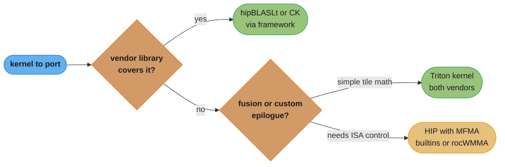

# Case Study: Port an LLM Kernel to AMD MI300X

> **Version anchor (fetched 2026-11-25):** ROCm Core SDK 10.2.0 (release notes dated 2026-11-18) with HIP 7.17.0, Composable Kernel 1.3.0, hipBLASLt 1.5.0, rocWMMA 2.2.2, ROCm Compute Profiler 3.10.0 and RCCL 2.32.3. MI300X is `gfx942` (CDNA 3): 304 CUs, 192 GB HBM3 at 5.3 TB/s, 1,307.4 dense FP16 TFLOPS, 64 KB LDS per CU, 512 VGPRs per SIMD, wavefront size 64. MI355X is `gfx950` (CDNA 4) with 160 KB LDS per CU. HIP does not support warp matrix (WMMA) types or functions.

## Intuition

> **Design intuition**: Porting a CUDA kernel to an MI300X is two jobs that look like one. The first is translation: `hipify-clang` renames `cudaMalloc` to `hipMalloc` and `<<<...>>>` stays, and in an afternoon the code compiles for `gfx942`. The second is re-tuning: the kernel was shaped around a 32-lane warp, 227 KB of shared memory per block and Tensor Core fragments, and the MI300X has a 64-lane wavefront, 64 KB of LDS per CU and MFMA instructions with different operand layouts. The translation is mechanical and quick. The re-tuning is where the correctness bugs and the 2x performance gaps live.

**Key insight**: The three numbers that break a straight port are **64** (wavefront width, so lane masks need 64 bits), **64 KB** (LDS per CU, against 227 KB of shared memory per block on H100), and **16x16x16** (the MFMA shape a CDNA 3 matrix core computes, with its own per-lane data layout). A kernel that respects all three compiles, gives correct answers, and then needs the normal profile-driven loop. A kernel that ignores any one of them either fails to launch, gives wrong answers, or runs at half speed with no error.

**The payoff that justifies the work**: one MI300X holds 192 GB of HBM at 5.3 TB/s. A 70B-parameter FP16 model (140 GB of weights) fits on one GPU with 52 GB to spare, where an 80 GB H100 needs two GPUs and a tensor-parallel all-reduce in every layer. For a memory-bound decode step that is a 1.58x higher bandwidth ceiling per GPU and no inter-GPU traffic.

**Non-overlap note**: The CUDA versions of these kernels are built in [`optimize_llm_inference_kernels.md`](./optimize_llm_inference_kernels.md) (GEMV, fused decode attention, quantized matmul) and [`build_a_flash_attention_kernel.md`](./build_a_flash_attention_kernel.md) (the tiling and online-softmax algorithm). This file does not re-derive either algorithm; it takes them as given and covers only what changes on AMD. Shipping one kernel source to NVIDIA, AMD and Apple at the same time is [`ship_one_kernel_across_nvidia_amd_and_apple.md`](./ship_one_kernel_across_nvidia_amd_and_apple.md). Multi-GPU layout on AMD nodes is [`multi_gpu_on_amd_rccl_and_xgmi`](../multi_gpu_on_amd_rccl_and_xgmi/multi_gpu_on_amd_rccl_and_xgmi.md).

---

## 1. Requirements Clarification

### Functional Requirements

- Port three CUDA kernels from an H100 serving stack for a Llama-3-70B-class decoder (80 layers, hidden size 8192, 64 query heads, 8 KV heads, head dimension 128, FP16 weights) to MI300X:
  1. **Fused paged decode attention** with grouped-query attention (8 query heads per KV head), written in CUDA C++ with warp shuffles, a `__ballot_sync`-based mask of valid KV slots, and double-buffered shared-memory K/V tiles.
  2. **Fused RMSNorm plus FP16 GEMM** for the QKV and MLP projections, written with `nvcuda::wmma` 16x16x16 fragments.
  3. **Warp-level softmax and top-k helpers** used by the sampler.
- Keep numerical results within the existing tolerance against an FP32 reference: max absolute error at or below 2e-2 and mean absolute error at or below 1e-3 for FP16 outputs (the existing H100 acceptance bar).
- Keep one kernel source tree that still builds for the H100 (`sm_90`) target. HIP can target NVIDIA, and Triton targets both vendors.
- Support MI300X (`gfx942`) first; MI355X (`gfx950`) as a follow-on target in the same build.

### Non-Functional Requirements

- **Decode throughput**: reach at least the per-GPU decode tokens per second of the H100 deployment. This is an assumption for this case study, set by the team's capacity plan in §10.
- **Memory-bound kernels near the bandwidth roof**: decode attention and the batch-1 projections must be judged against 5.3 TB/s, not against FLOPs (§2).
- **No silent wrong answers**: every kernel ships with a wave64-specific test that exercises lanes 32 to 63, because those are the lanes a 32-lane assumption corrupts.
- **Profiling-driven**: every tuning change is justified by a ROCm Compute Profiler (`rocprof-compute`) measurement, the AMD counterpart of the Nsight loop in [`./cross_cutting/nsight_profiling_workflow.md`](./cross_cutting/nsight_profiling_workflow.md).

### Out of Scope

- Serving-platform design, request scheduling and KV-cache paging policy ([`../../llm/case_studies/design_gpu_inference_platform.md`](../../llm/case_studies/design_gpu_inference_platform.md)).
- Multi-node training and RCCL tuning ([`../multi_gpu_on_amd_rccl_and_xgmi/multi_gpu_on_amd_rccl_and_xgmi.md`](../multi_gpu_on_amd_rccl_and_xgmi/multi_gpu_on_amd_rccl_and_xgmi.md)).
- The HIP language itself, `hipcc` flags and the CUDA-to-HIP API map ([`../hip_programming_and_porting/hip_programming_and_porting.md`](../hip_programming_and_porting/hip_programming_and_porting.md)).

---

## 2. Scale Estimation

### The two GPUs side by side

| Quantity | H100 SXM5 | MI300X | Ratio | Why it matters for the port |
|----------|-----------|--------|-------|-----------------------------|
| HBM capacity | 80 GB | 192 GB | 2.4x | 70B FP16 fits on one MI300X |
| HBM bandwidth | 3.35 TB/s | 5.3 TB/s | 1.58x | Ceiling for every decode kernel |
| Dense FP16 matrix | 989 TFLOP/s | 1,307.4 TFLOP/s | 1.32x | Ceiling for prefill GEMMs |
| Ridge point (FP16) | 295.2 FLOP/B | 246.7 FLOP/B | 0.84x | Decode GEMMs turn compute-bound at a smaller batch |
| SMs / CUs | 132 SMs | 304 CUs | 2.3x | More, smaller units: grids must be larger |
| On-chip scratchpad | 228 KB per SM, 227 KB per block | 64 KB LDS per CU | 0.28x | Tile sizes must shrink |
| SIMT width | 32-lane warp | 64-lane wavefront | 2x | Masks, shuffles, reductions |
| L2 | 50 MB, one pool | 4 MB per XCD, 8 XCDs | n/a | Locality per XCD, plus 256 MB Infinity Cache |

The MI300X figures come from AMD's MI300X product page and the ROCm MI300 microarchitecture page; the H100 figures are the ones used across this section (see [`./cross_cutting/roofline_and_arithmetic_intensity.md`](./cross_cutting/roofline_and_arithmetic_intensity.md)). The vocabulary mapping (warp vs wavefront, shared memory vs LDS, SM vs CU) is collected in [`./cross_cutting/vendor_terminology_and_numbers_reference.md`](./cross_cutting/vendor_terminology_and_numbers_reference.md).

### Ridge points: where decode stops being memory-bound

```
  ridge = peak FLOP/s / peak bytes/s

  H100   : 989e12    / 3.35e12  = 295.2 FLOP/byte
  MI300X : 1307.4e12 / 5.3e12   = 246.7 FLOP/byte

  A decode projection at batch B reads each FP16 weight (2 bytes) once and does
  2 x B FLOPs with it:  arithmetic intensity = 2B / 2 = B FLOP/byte

  compute-bound only when B > ridge:
    H100   : B > 295
    MI300X : B > 247
```

*The MI300X roof is higher on both axes, but its ridge is lower because bandwidth grew more than FLOPs. Every decode batch below about 247 is a bandwidth problem on MI300X, so most decode kernels in this port are judged in GB/s.*

### Model memory and the single-GPU fit

```
  weights          : 70e9 params x 2 bytes                    = 140 GB
  KV per token     : 2 (K,V) x 80 layers x 8 heads x 128 x 2 B  = 327,680 B = 320 KiB

  MI300X, TP1      : 192 - 140 = 52 GB left for KV cache and workspace
                     52e9 / 327,680                           = ~158,700 cached tokens (upper bound)
  H100,  TP2       : 2 x 80 - 140 = 20 GB left across the pair
                     20e9 / 327,680                           = ~61,000 cached tokens (upper bound)

  batch-1 decode, weights only, at nameplate bandwidth:
    MI300X TP1     : 140 GB / 5.3 TB/s                        = 26.4 ms per token
    H100   TP2     : 70 GB per GPU / 3.35 TB/s                = 20.9 ms per token,
                     plus 2 all-reduces per layer x 80 layers over NVLink
```

### Decode attention bytes per step

```
  per token, per layer, K and V : 8 KV heads x 128 dims x 2 B x 2   = 4,096 B
  per sequence, 8K context      : 8,192 x 4,096 B                   = 33.5 MB per layer
  all 80 layers                 : 80 x 33.5 MB                      = 2.68 GB per sequence per step
  at B = 16                     : 42.9 GB per decode step
  time at 5.3 TB/s              : 42.9 / 5,300                      = 8.1 ms
  same bytes at 3.35 TB/s       : 42.9 / 3,350                      = 12.8 ms
```

*Attention alone reads 42.9 GB per decode step at this batch and context, about 30% of the weight bytes. The decode attention kernel is therefore graded the same way as the projections: achieved GB/s against 5.3 TB/s.*

The H100 pair is faster per token at batch 1 because two GPUs read the weights in parallel; the MI300X is cheaper per token because one GPU does the work of two and holds 2.6x more KV cache. §10 turns this into a throughput plan.

### LDS budget: the H100 tiles do not fit

The CUDA decode-attention kernel stages K and V tiles for `BLOCK_N = 128` cached tokens, double-buffered with `cp.async`:

```
  K tile  : 128 tokens x 128 dims x 2 B   = 32 KB
  V tile  : 128 tokens x 128 dims x 2 B   = 32 KB
  per stage                               = 64 KB
  2 stages                                = 128 KB
  Q for one GQA group: 8 heads x 128 x 2  =   2 KB
  total                                   = 130 KB

  H100 per-block limit  : 227 KB   -> fits, 1 block/SM by shared memory
  MI300X LDS per CU     :  64 KB   -> does not fit at all
```

The projection GEMM used a CUTLASS-style 128x256 tile with `BLOCK_K = 64` and 3 stages: `(128x64 + 64x256) x 2 B = 48 KB` per stage, 144 KB in total. It does not fit either. Both kernels need new tile shapes (§4.3), and the shapes come from AMD's occupancy formula, not from the H100 configs.

### MFMA arithmetic, checked against the data sheet

```
  v_mfma_f32_16x16x16_f16 : 2 x 16 x 16 x 16 = 8,192 FLOP in 16 cycles
                          = 512 FLOP per cycle per SIMD
  4 SIMDs per CU          = 2,048 FLOP per cycle per CU   (AMD: "Matrix FP16 2048")
  x 304 CUs x 2.1 GHz     = 1,307.4 TFLOP/s               (AMD: 1307.4)

  v_mfma_f32_32x32x8_f16  : 2 x 32 x 32 x 8  = 16,384 FLOP in 32 cycles
                          = the same 512 FLOP per cycle per SIMD
```

Both FP16 MFMA shapes reach the same peak. They differ in register footprint and operand layout. AMD's tuning guide reports that on MI300X `mfma_16x16` usually beats `mfma_32x32` for GEMM, even at large tile sizes.

---

## 3. High-Level Architecture

```mermaid
flowchart LR
    classDef io      fill:#61afef,stroke:#2e86c1,color:#1a1a1a,font-weight:bold
    classDef frozen  fill:#c678dd,stroke:#9b59b6,color:#fff
    classDef train   fill:#98c379,stroke:#27ae60,color:#1a1a1a
    classDef mathOp  fill:#d19a66,stroke:#e67e22,color:#1a1a1a,font-weight:bold
    classDef lossN   fill:#e06c75,stroke:#c0392b,color:#fff,font-weight:bold
    classDef req     fill:#56b6c2,stroke:#0097a7,color:#1a1a1a
    classDef base    fill:#e5c07b,stroke:#f39c12,color:#1a1a1a

    src(["CUDA kernels<br/>sm_90 tuned"]) --> hip(["hipify-clang<br/>--print-stats"])
    hip --> build(["hipcc<br/>--offload-arch=gfx942"])
    build --> wave(["wave64 audit<br/>masks, shuffles"])
    wave --> lds(["LDS budget<br/>64 KB per CU"])
    lds --> mm(["matrix path:<br/>MFMA, CK, Triton"])
    mm --> test(["parity tests<br/>vs FP32 reference"])
    test --> prof(["rocprof-compute<br/>profile and analyze"])
    prof -->|"retune"| lds
    prof --> ship(["rollout<br/>gfx942 then gfx950"])

    class src io
    class hip,build frozen
    class wave,lds lossN
    class mm mathOp
    class test req
    class prof base
    class ship train
```



*Translation is two boxes on the left. The red boxes are where straight ports break: the wave64 audit catches wrong answers, the LDS budget catches launch failures. The loop from the profiler back to the LDS budget is where performance is won.*

### Which path each kernel takes

| CUDA kernel | AMD path chosen | Why |
|-------------|-----------------|-----|
| Fused paged decode attention | AITER/CK attention through vLLM's `ROCM_AITER_FA` backend in production; a hand-ported HIP kernel kept for the custom GQA masking | vLLM and AMD report 1.2-4.4x higher throughput for the AITER attention backends; the HIP port is the fallback and the test oracle |
| RMSNorm + FP16 GEMM | Triton kernel with AMD tuning knobs (`waves_per_eu`, `matrix_instr_nonkdim`) | One source for H100 and MI300X; autotuning picks tile shapes per architecture |
| Plain projections (no fusion) | hipBLASLt through PyTorch, tuned with TunableOp | A vendor GEMM beats a hand kernel for unfused shapes |
| Warp softmax / top-k helpers | Hand-ported HIP with `warpSize`-generic code | Small kernels; the porting risk is correctness, not speed |



*Hand-written MFMA code is the last resort, not the first. It is shown in §4.4 because it is the clearest way to understand what CK, hipBLASLt and Triton generate.*

---

## 4. Component Deep Dives

### 4.1 The translation pass and what it reports

```bash
# Same headers as an nvcc build; Clang arguments follow the "--" separator.
hipify-clang decode_attn.cu --cuda-path=/usr/local/cuda-13.2 \
    -o decode_attn.hip.cpp --print-stats -- -std=c++17 -I include/

hipcc -O3 -std=c++17 --offload-arch=gfx942 --offload-arch=gfx950 \
    decode_attn.hip.cpp -o decode_attn
```

`--print-stats` reports converted and unconverted references per file. The runtime API, kernel qualifiers and the launch syntax convert completely. Three groups of code survive translation untouched or translate into something that is wrong for CDNA:

| CUDA construct | What `hipify-clang` does | What the port must do |
|----------------|--------------------------|-----------------------|
| `nvcuda::wmma` fragments | Nothing usable: HIP does not support warp matrix types or functions | Rewrite with rocWMMA, MFMA builtins, CK, hipBLASLt or Triton (§4.4) |
| Inline PTX (`asm("ldmatrix...")`, `cp.async`) | Left as is; it does not compile for `gfx942` | Replace with plain loads into LDS or a library path |
| `__shfl_xor_sync(0xffffffff, ...)`, `__ballot_sync` stored in `uint32_t`, `lane = tid & 31` | Translates the names; keeps the 32-lane assumptions | Rewrite with `warpSize`, 64-bit masks and `__popcll` (§4.2) |
| `__launch_bounds__(256, 2)` | Kept, but the second argument means something else in HIP | Convert to `MIN_WARPS_PER_EXECUTION_UNIT` with HIP's formula |

The `__launch_bounds__` conversion comes straight from HIP's porting guide. In CU mode, typical of CDNA:

```
  MIN_WARPS_PER_EXECUTION_UNIT = (MIN_BLOCKS_PER_MULTIPROCESSOR x MAX_THREADS_PER_BLOCK)
                                 / (warpSize x 2)
  CUDA __launch_bounds__(256, 2) on gfx942:
                               = (2 x 256) / (64 x 2) = 4
  HIP: __launch_bounds__(256, 4)
```

### 4.2 Wave64 traps: correct on H100, wrong on MI300X

The decode kernel builds a bitmask of valid KV slots in each tile (slots past the sequence length or in freed pages are invalid), counts them, and compacts the valid slot indices.

```cpp
// BROKEN on gfx942: 32-lane assumptions survive hipify.
__device__ int compact_valid_slots(const int* slot_ids, int n_valid_upto,
                                   int* out_idx) {
    int lane = threadIdx.x & 31;                        // wrong lane id for lanes 32..63
    bool valid = (threadIdx.x < n_valid_upto) && (slot_ids[threadIdx.x] >= 0);
    unsigned int mask = __ballot_sync(0xffffffff, valid); // 64-bit result truncated
    int total = __popc(mask);                             // counts lanes 0..31 only
    int before = __popc(mask & ((1u << lane) - 1));       // 32-bit shift
    if (valid) out_idx[before] = slot_ids[threadIdx.x];   // lanes 32..63 overwrite 0..31
    return total;
}
```

On H100 the warp has 32 lanes and every line is right. On MI300X the wavefront has 64 lanes and three things break at once. HIP's `__ballot_sync` returns `unsigned long long`, and storing it in `unsigned int` drops lanes 32 to 63. `threadIdx.x & 31` maps lanes 32 to 63 onto 0 to 31, so their prefix counts collide with the first half's. The result is a count that is too small and an output array where the second half of the wavefront overwrites the first. Nothing faults. HIP's porting guide names exactly this pattern: GCN and CDNA have a warp size of 64, and 32-bit lane masks "would clear the 32-bit register".

```cpp
// FIX: wavefront-width-generic, 64-bit masks.
#if defined(__GFX8__) || defined(__GFX9__)
typedef uint64_t lane_mask_t;                     // gfx942, gfx950: wave64
#else
typedef uint32_t lane_mask_t;                     // RDNA (gfx10+): wave32 in HIP
#endif

__device__ int compact_valid_slots(const int* slot_ids, int n_valid_upto,
                                   int* out_idx) {
    int lane = threadIdx.x % warpSize;            // folded early by the compiler since ROCm 7.0
    bool valid = (threadIdx.x < n_valid_upto) && (slot_ids[threadIdx.x] >= 0);
    lane_mask_t mask = __ballot(valid);           // full 64-bit ballot on CDNA
    int total  = __popcll(mask);
    int before = __popcll(mask & ((lane_mask_t{1} << lane) - 1));
    if (valid) out_idx[before] = slot_ids[threadIdx.x];
    return total;
}
```

```
  one CDNA wavefront, valid slots only in lanes 40..63

  lane          0 ........... 31 | 32 ...... 39 | 40 ........... 63
  valid         0 0 0 ...... 0 0 | 0 0 ..... 0 0 | 1 1 1 ...... 1 1
  64-bit ballot 0x FFFFFF00 00000000              -> __popcll = 24   (correct)
  32-bit copy   0x 00000000                        -> __popc   =  0   (BROKEN: all 24 lost)
  tid & 31      0 ........... 31 | 0 ........ 7 | 8 ............ 31
                                     ^ lanes 32..63 reuse ids 0..31: prefix sums collide
```

*The truncated mask is not a little wrong; for this input it is completely wrong. The 24 valid slots sit entirely in the half that the 32-bit copy throws away.*

This fix handles one wavefront. The test that proves it launches 64 threads with valid slots only in lanes 40 to 63, the case the broken version gets wrong. The same audit covers three more patterns:

- **Shuffle loops that start at offset 16.** A tree reduction written `for (int o = 16; o > 0; o >>= 1)` reduces 32 lanes. In a 64-lane wavefront it produces two partial sums, one in lane 0 and one in lane 32. Write `for (int o = warpSize / 2; o > 0; o >>= 1)`. HIP documents that since ROCm 7.0 `warpSize` is folded early, so the loop still unrolls.
- **Blocks of 32 threads.** The CUDA decode kernel launched one 32-thread block per KV head. On CDNA a 32-thread block occupies a 64-lane wavefront with half of its lanes idle. HIP's documentation says such code runs but "only utilizes half of the compute resources". The port launches 64 threads per KV head, so each lane handles 2 of the 128 head dimensions instead of 4.
- **Host code that hard-codes 32.** `warpSize` is not a compile-time constant on the host. Query `hipDeviceAttributeWarpSize` with `hipDeviceGetAttribute` and size shared-memory arrays from it.

### 4.3 Fitting the tiles into 64 KB of LDS

AMD's tuning guide gives the occupancy calculation. Each SIMD (execution unit) has 512 VGPRs, allocated in blocks of 16. A kernel's occupancy is the smaller of its VGPR limit and its LDS limit:

```
  occ_vgpr = floor(512 / round_up(vgprs_per_lane, 16))        waves per SIMD
  occ_lds  = floor(65536 / lds_bytes_per_workgroup)           workgroups per CU (MI300X)
  occ      = min(floor(occ_vgpr x 4 / nW), occ_lds) x nW / 4   waves per SIMD
             where nW = waves per workgroup, and 4 = SIMDs per CU
```

```cpp
// BROKEN on gfx942: the H100 tile shape, 130 KB of LDS per workgroup.
constexpr int BLOCK_N = 128, HEAD_DIM = 128, GQA = 8, STAGES = 2;
__global__ void decode_attn(/* ... */) {
    __shared__ __half k_tile[STAGES][BLOCK_N][HEAD_DIM];   // 64 KB
    __shared__ __half v_tile[STAGES][BLOCK_N][HEAD_DIM];   // 64 KB
    __shared__ __half q_tile[GQA][HEAD_DIM];               //  2 KB
    // ... 130 KB in total: rejected for gfx942, whose LDS is 64 KB per CU
}
```

```cpp
// FIX: size the tile from the device, and choose the shape with the occupancy formula.
constexpr int HEAD_DIM = 128, GQA = 8;

template <int BLOCK_N, int STAGES>
constexpr size_t lds_bytes() {
    return size_t(2) * STAGES * BLOCK_N * HEAD_DIM * sizeof(__half)   // K and V
         + size_t(GQA) * HEAD_DIM * sizeof(__half);                  // Q
}

template <int BLOCK_N, int STAGES>
__global__ __launch_bounds__(256) void decode_attn(/* ... */) {
    extern __shared__ __half smem[];             // dynamic LDS, size checked on the host
    // ... same algorithm; BLOCK_N and STAGES are template parameters
}

bool launch_decode_attn(hipStream_t s /* , args */) {
    int dev = 0, max_lds = 0;
    HIP_CHECK(hipGetDevice(&dev));
    HIP_CHECK(hipDeviceGetAttribute(&max_lds, hipDeviceAttributeMaxSharedMemoryPerBlock, dev));
    constexpr size_t need = lds_bytes<32, 1>();  // 18 KB, see the table below
    if (need > size_t(max_lds)) return false;    // fall back instead of failing to launch
    hipLaunchKernelGGL((decode_attn<32, 1>), dim3(/* grid */ 1), dim3(256), need, s /* , args */);
    HIP_CHECK(hipGetLastError());
    return true;
}
```

`HIP_CHECK` and the launch-error idiom follow [`./cross_cutting/cuda_error_handling_and_launch_config_patterns.md`](./cross_cutting/cuda_error_handling_and_launch_config_patterns.md) with `hip` substituted for `cuda`. The candidate shapes, with 4 waves per workgroup and 128 VGPRs per lane (so `occ_vgpr = 4`):

| BLOCK_N | Stages | LDS per workgroup | occ_lds | Waves per SIMD | Note |
|---------|--------|-------------------|---------|----------------|------|
| 128 | 2 | 130 KB | 0 | none | The H100 shape: cannot launch |
| 64 | 1 | 34 KB | 1 | 1 | Fits, but one workgroup per CU hides little latency |
| 32 | 2 | 34 KB | 1 | 1 | Same LDS as above, with prefetch |
| 32 | 1 | 18 KB | 3 | 3 | Chosen: 3 workgroups per CU |
| 16 | 1 | 10 KB | 6 | 4 | VGPR-limited at 4; more loop iterations per token |

```
  waves per SIMD for BLOCK_N=32, STAGES=1:
    occ_lds = floor(65536 / 18432)            = 3
    occ     = min(floor(4 x 4 / 4), 3) x 4/4  = min(4, 3) x 1 = 3
```

The GEMM gets the same treatment. The 144 KB H100 configuration is replaced by Triton autotuning over shapes that fit (§4.5), starting from `BLOCK_M = BLOCK_N = 128, BLOCK_K = 32` with two stages, which uses `2 x (128x32 + 32x128) x 2 B = 32 KB`. On `gfx950` the 160 KB LDS lets the autotuner try larger tiles and a deeper pipeline; AMD's guide notes MI350X may allow 3 or 4 stages for single-GEMM kernels.

AMD also warns about the layout inside LDS: unpadded, unswizzled shared layouts cause 2-way to 4-way bank conflicts and cut the effective LDS service rate from 256 B per cycle to 64 to 128 B per cycle on CDNA 4. The decode kernel pads each K row by 8 halves (16 bytes), the same padding trick taught for NVIDIA in [`../shared_memory_and_bank_conflicts/shared_memory_and_bank_conflicts.md`](../shared_memory_and_bank_conflicts/shared_memory_and_bank_conflicts.md), and the "Percent Bank Conflict Rate" metric in `rocprof-compute` confirms it.

### 4.4 From Tensor Cores to MFMA

The CUDA GEMM used `nvcuda::wmma::mma_sync` on 16x16x16 FP16 fragments. HIP has no equivalent of that API. There are four replacements, from highest to lowest level: a library (hipBLASLt, CK), Triton (`tl.dot` lowers to MFMA), rocWMMA (a WMMA-like C++ API), and the compiler builtins. The builtin is the clearest way to see what all of them generate:

```cpp
#include <hip/hip_runtime.h>

typedef _Float16 half4  __attribute__((ext_vector_type(4)));
typedef float    floatx4 __attribute__((ext_vector_type(4)));

// One 64-lane wavefront computes a 16x16 FP32 tile D = A (16xK) * B (Kx16), K % 16 == 0.
// Launch with dim3 block(16, 4): x = 0..15 (row of A / column of B), y = 0..3 (k group).
__global__ void mfma_16x16_tile(const _Float16* A, const _Float16* B, float* D, int K) {
    const int x = threadIdx.x;          // 0..15
    const int y = threadIdx.y;          // 0..3
    floatx4 acc = {0.f, 0.f, 0.f, 0.f};
    for (int k0 = 0; k0 < K; k0 += 16) {
        half4 a, b;
        for (int i = 0; i < 4; ++i) {
            a[i] = A[x * K + (k0 + 4 * y + i)];       // A[m = x][k = k0 + 4y + i]
            b[i] = B[(k0 + 4 * y + i) * 16 + x];      // B[k = k0 + 4y + i][n = x]
        }
        // v_mfma_f32_16x16x16_f16: 16 cycles, 8,192 FLOP for the whole wavefront
        acc = __builtin_amdgcn_mfma_f32_16x16x16f16(a, b, acc, 0, 0, 0);
    }
    for (int i = 0; i < 4; ++i)
        D[(4 * y + i) * 16 + x] = acc[i];             // D[row = 4y + i][col = x]
}
```

The builtin's signature, from Clang's `BuiltinsAMDGPU.td`, takes two 4-element `_Float16` vectors and a 4-element `float` accumulator, plus three constant modifiers (`cbsz`, `abid`, `blgp`) that this kernel leaves at 0. The lane-to-element mapping extends AMD's published `V_MFMA_F32_16x16x4F32` example along K, and `python3 matrix_calculator.py -a cdna3 --instruction v_mfma_f32_16x16x16_f16 -M --D-matrix` from the AMD Matrix Instruction Calculator prints the D layout for checking. Three differences from WMMA matter for the port:

- **The wavefront owns the tile.** All 64 lanes hold pieces of A, B and D. A WMMA fragment belonged to a 32-lane warp.
- **The layout is explicit.** With WMMA the layout was opaque and `load_matrix_sync` hid it. With the builtin, the load code above is the layout. A wrong index is a wrong answer, not a compile error, which is why the parity tests in §8 run on every shape.
- **Shapes differ by generation.** `__builtin_amdgcn_mfma_f32_16x16x32_f16` exists only for `gfx950`. A kernel that uses it needs an architecture guard or a separate build target.

The production GEMM does not use this kernel. It is the test oracle for the Triton kernel and a teaching reference, and it explains the knob in §4.5: `matrix_instr_nonkdim = 16` selects this instruction family.

When the CUDA code is built around `wmma` fragments and a rewrite into Triton is not wanted, rocWMMA keeps the shape of the code. The calls below are the ones the rocWMMA `simple_hgemm` sample uses:

```cpp
// CUDA (before)                                   // HIP + rocWMMA 2.2.2 (after)
// #include <mma.h>                                #include <rocwmma/rocwmma.hpp>
// using namespace nvcuda;
// wmma::fragment<wmma::matrix_a,16,16,16,         rocwmma::fragment<rocwmma::matrix_a, 16, 16, 16,
//                half, wmma::row_major> a;            rocwmma::float16_t, rocwmma::row_major> a;
// wmma::fragment<wmma::matrix_b,16,16,16,         rocwmma::fragment<rocwmma::matrix_b, 16, 16, 16,
//                half, wmma::col_major> b;            rocwmma::float16_t, rocwmma::col_major> b;
// wmma::fragment<wmma::accumulator,16,16,16,      rocwmma::fragment<rocwmma::accumulator, 16, 16, 16,
//                float> acc;                          rocwmma::float32_t> acc;
// wmma::fill_fragment(acc, 0.0f);                 rocwmma::fill_fragment(acc, 0.0f);
// wmma::load_matrix_sync(a, A + off_a, lda);      rocwmma::load_matrix_sync(a, A + off_a, lda);
// wmma::load_matrix_sync(b, B + off_b, ldb);      rocwmma::load_matrix_sync(b, B + off_b, ldb);
// wmma::mma_sync(acc, a, b, acc);                 rocwmma::mma_sync(acc, a, b, acc);
// wmma::store_matrix_sync(D + off_d, acc, ldd,    rocwmma::store_matrix_sync(D + off_d, acc, ldd,
//                         wmma::mem_row_major);       rocwmma::mem_row_major);
```

The calls map one to one, but the unit that owns a fragment changes from a 32-lane warp to a 64-lane wavefront. The sample computes its wave index with `rocwmma::Constants::AMDGCN_WAVE_SIZE`, not 32. Any CUDA code that derives a warp index as `threadIdx.x / 32` to pick which tile a warp computes assigns two "warps" to one wavefront and must be changed the same way as the masks in §4.2.

### 4.5 The fused RMSNorm + GEMM in Triton, tuned for CDNA

```python
import torch
import triton
import triton.language as tl

def _configs() -> list[triton.Config]:
    cfgs = []
    for bm, bn, bk in [(128, 128, 32), (128, 128, 64), (256, 128, 32), (64, 128, 64)]:
        for wpe in (0, 2, 3):
            cfgs.append(triton.Config(
                {"BLOCK_M": bm, "BLOCK_N": bn, "BLOCK_K": bk, "GROUP_M": 8,
                 "waves_per_eu": wpe, "matrix_instr_nonkdim": 16},
                num_warps=4, num_stages=2))       # num_warps counts 64-lane wavefronts on AMD
    return cfgs

@triton.autotune(configs=_configs(), key=["M", "N", "K"])
@triton.jit
def rmsnorm_matmul(x_ptr, g_ptr, w_ptr, y_ptr, M, N, K, eps,
                   BLOCK_M: tl.constexpr, BLOCK_N: tl.constexpr, BLOCK_K: tl.constexpr,
                   GROUP_M: tl.constexpr, NUM_XCDS: tl.constexpr = 8):
    pid = tl.program_id(0)
    n_m = tl.cdiv(M, BLOCK_M)
    n_n = tl.cdiv(N, BLOCK_N)
    n_pids = n_m * n_n
    # XCD-aware remap: in SPX mode workgroups go round-robin to the 8 XCDs, so
    # consecutive pids land on different XCDs and different 4 MB L2s.
    # Remap so a run of consecutive tiles stays on one XCD (needs n_pids % 8 == 0).
    if n_pids % NUM_XCDS == 0:
        pid = (pid % NUM_XCDS) * (n_pids // NUM_XCDS) + (pid // NUM_XCDS)
    # GROUP_M swizzle for operand reuse in L2.
    group = pid // (GROUP_M * n_n)
    first_m = group * GROUP_M
    size_m = min(n_m - first_m, GROUP_M)
    pid_m = first_m + (pid % size_m)
    pid_n = (pid % (GROUP_M * n_n)) // size_m

    rm = pid_m * BLOCK_M + tl.arange(0, BLOCK_M)
    rn = pid_n * BLOCK_N + tl.arange(0, BLOCK_N)
    rk = tl.arange(0, BLOCK_K)

    # Pass 1: RMS over the full row of x, in FP32.
    sq = tl.zeros([BLOCK_M], dtype=tl.float32)
    for k0 in range(0, K, BLOCK_K):
        xk = tl.load(x_ptr + rm[:, None] * K + (k0 + rk)[None, :],
                     mask=(rm[:, None] < M) & ((k0 + rk)[None, :] < K), other=0.0)
        sq += tl.sum(xk.to(tl.float32) * xk.to(tl.float32), axis=1)
    inv_rms = 1.0 / tl.sqrt(sq / K + eps)

    # Pass 2: normalized x times W, FP32 accumulation on the matrix cores.
    acc = tl.zeros([BLOCK_M, BLOCK_N], dtype=tl.float32)
    for k0 in range(0, K, BLOCK_K):
        kk = k0 + rk
        xk = tl.load(x_ptr + rm[:, None] * K + kk[None, :],
                     mask=(rm[:, None] < M) & (kk[None, :] < K), other=0.0)
        gk = tl.load(g_ptr + kk, mask=kk < K, other=0.0)
        xn = (xk.to(tl.float32) * inv_rms[:, None] * gk[None, :].to(tl.float32)).to(tl.float16)
        wk = tl.load(w_ptr + kk[:, None] * N + rn[None, :],
                     mask=(kk[:, None] < K) & (rn[None, :] < N), other=0.0)
        acc += tl.dot(xn, wk)
    tl.store(y_ptr + rm[:, None] * N + rn[None, :], acc.to(tl.float16),
             mask=(rm[:, None] < M) & (rn[None, :] < N))

def fused_rmsnorm_matmul(x: torch.Tensor, g: torch.Tensor, w: torch.Tensor,
                         eps: float = 1e-5) -> torch.Tensor:
    M, K = x.shape
    _, N = w.shape
    y = torch.empty((M, N), device=x.device, dtype=torch.float16)
    grid = lambda meta: (triton.cdiv(M, meta["BLOCK_M"]) * triton.cdiv(N, meta["BLOCK_N"]),)
    rmsnorm_matmul[grid](x, g, w, y, M, N, K, eps)
    return y
```

The same source runs on H100, where the AMD-only keys are ignored. The AMD-specific choices, each from AMD's MI300 and MI350 workload-optimization guide:

| Knob | Value range | What it does |
|------|-------------|--------------|
| `matrix_instr_nonkdim` | 16 | Selects `mfma_16x16`; the guide reports it usually beats `mfma_32x32` for GEMM on MI300X |
| `waves_per_eu` | 0, 2, 3 | Asks the compiler to cut VGPRs so that many waves fit per SIMD; at 176 VGPRs only 2 fit because `176 x 3 > 512` |
| `num_stages` | 2 | The guide's setting for kernels with a single GEMM (1 for kernels that fuse two GEMMs, such as attention) |
| XCD remap + `GROUP_M` | 8 XCDs, group 4 to 8 | In AMD's tutorial kernel, L2 misses fell from about 5M to about 3.1M and throughput rose by about 67 TFLOPS |
| Grid size | at least 1,024 workgroups | The guide's minimum for MI300X; small-M decode shapes need split-K or a GEMV kernel instead |

For the plain projections outside the fusion, PyTorch's hipBLASLt path is tuned with TunableOp: one run with `PYTORCH_TUNABLEOP_ENABLED=1` writes `tunableop_results.csv` with the fastest kernel per GEMM shape, and production runs with `PYTORCH_TUNABLEOP_TUNING=0` to reuse it.

### 4.6 Attention: use the library path, keep the port as the oracle

The hand-ported decode kernel from §4.2 and §4.3 is correct and reasonably fast, but it is not where production attention runs. The serving stack uses vLLM on ROCm with AITER kernels, with the environment settings from the recipe Character.ai published for its MI325X deployment:

```bash
VLLM_ROCM_USE_AITER=1 VLLM_ROCM_USE_AITER_MOE=1 VLLM_USE_TRITON_FLASH_ATTN=0 \
vllm serve <model> --tensor-parallel-size 1 --kv-cache-dtype fp8 --max-model-len 32768
```

Two published results drove that choice. The vLLM MI300X guide from Embedded LLM and Hot Aisle (October 2024) says the CK flash-attention implementation "is a lot faster than triton implementation". The vLLM and AMD write-up of February 2026 describes seven attention backends on ROCm and reports that `ROCM_AITER_FA` and the AITER MLA backends deliver 1.2-4.4x higher throughput. The same write-up warns that the legacy `ROCM_ATTN` backend's HIP paged-attention kernel supports only certain KV head sizes and falls back to slower Triton decode kernels for the rest. The team's custom GQA masking is the reason the hand-ported kernel survives: it is the reference against which every library upgrade is checked.

### 4.7 FP8 on MI300X is not the FP8 on H100

```python
# BROKEN: reuse the H100 FP8 checkpoint bytes directly on gfx942.
w_fp8 = torch.load("proj_fp8_e4m3fn.pt")                # OCP E4M3 bytes from H100
w = w_fp8.view(torch.float8_e4m3fnuz)                   # reinterpret: same bits, other format
```

ROCm's precision-support table lists `__hip_fp8_e4m3_fnuz` and `__hip_fp8_e5m2_fnuz` as the CDNA 3 types and the OCP types `__hip_fp8_e4m3` and `__hip_fp8_e5m2` as CDNA 4 (and RDNA 4) types. The documentation states that CDNA 3 natively supports FP8 FNUZ, which differs from the FP8 format used with H100, and that the FNUZ variant has no infinity or signed zero and represents NaN as negative zero. A `view` keeps the bits and changes their meaning, so every weight decodes to a different value. Nothing raises an error; perplexity simply climbs.

```python
# FIX: convert through a wider type, and pick the FP8 flavour per architecture.
def fp8_dtype_for(device: int = 0) -> torch.dtype:
    arch = torch.cuda.get_device_properties(device).gcnArchName   # e.g. "gfx942:sramecc+:xnack-"
    return torch.float8_e4m3fnuz if arch.startswith("gfx942") else torch.float8_e4m3fn

w_fp8 = torch.load("proj_fp8_e4m3fn.pt")
w = (w_fp8.to(torch.float32) * scale).to(fp8_dtype_for())   # value-preserving conversion
# Recompute the per-tensor scale for the target format before quantizing in production.
```

AMD's guide makes the same point for MI350: MI300X uses FNUZ, MI350X uses OCP FP8, and quantized models and inference engines must target the right format per GPU. [`./cross_cutting/numerical_precision_and_determinism.md`](./cross_cutting/numerical_precision_and_determinism.md) covers how to set tolerances for the FP8 paths.

### 4.8 The profile, fix, re-measure loop

```bash
# 1. Whole-application profile, kernels filtered by name.
rocprof-compute profile -n decode_v1 -k decode_attn -- python bench_decode.py

# 2. Roofline only: empirical HBM, cache and MFMA ceilings for this GPU.
rocprof-compute profile -n decode_v1_roof --roof-only -- python bench_decode.py

# 3. Read the results: speed-of-light, LDS, wavefront occupancy.
rocprof-compute analyze -p workloads/decode_v1/MI300X

# 4. ISA for the Triton kernel: confirm MFMA, dwordx4 loads, _b128 LDS ops.
AMDGCN_ENABLE_DUMP=1 python bench_gemm.py > gemm.isa
grep -E "v_mfma_f32_16x16x16|global_load_dwordx4|ds_read_b128|vgpr_count" gemm.isa
```

The loop mirrors the Nsight workflow in [`./cross_cutting/nsight_profiling_workflow.md`](./cross_cutting/nsight_profiling_workflow.md) and the tooling detail lives in [`../rocm_profiling_and_debugging/rocm_profiling_and_debugging.md`](../rocm_profiling_and_debugging/rocm_profiling_and_debugging.md). `rocprof-compute` may replay a kernel several times to collect every counter, so profile a benchmark harness, not a live server. What each iteration of the port looked at:

| Iteration | Symptom in the profile | Change | Check |
|-----------|------------------------|--------|-------|
| 1 | Decode kernel far below the HBM roof, low wave occupancy | `BLOCK_N` 64 to 32, one stage, 18 KB LDS | occ from 1 to 3 waves per SIMD (§4.3) |
| 2 | High LDS bank-conflict rate on K reads | Pad K rows by 16 bytes | Bank-conflict percentage drops |
| 3 | GEMM at 2 waves per SIMD, 176 VGPRs in the ISA | Autotuner picks `waves_per_eu=3` for the hot shape | `.vgpr_count` at or below 168 |
| 4 | GEMM L2 hit rate low | XCD remap plus `GROUP_M = 8` | L2 misses fall, as in AMD's tutorial |
| 5 | Half-empty wavefronts in the sampler helpers | 64-thread blocks instead of 32 | Lane utilization in the timeline |

### 4.9 Measuring achieved bandwidth without a profiler

`rocprof-compute` replays kernels and is too heavy for a CI gate. The gate uses events and a byte count, the same harness that runs on H100:

```python
import torch

def achieved_gbps(fn, bytes_moved: int, iters: int = 50, warmup: int = 10) -> float:
    for _ in range(warmup):
        fn()
    start = torch.cuda.Event(enable_timing=True)   # HIP events on a ROCm build
    stop = torch.cuda.Event(enable_timing=True)
    start.record()
    for _ in range(iters):
        fn()
    stop.record()
    torch.cuda.synchronize()
    seconds = start.elapsed_time(stop) / 1e3 / iters
    return bytes_moved / seconds / 1e9

# Decode attention for one layer: B sequences x L cached tokens x 8 KV heads x 128 dims
# x 2 (K and V) x 2 bytes, plus a negligible Q and output.
B, L = 16, 8192
kv_bytes = B * L * 8 * 128 * 2 * 2                 # 268,435,456 B = 268 MB
peak = 5300.0 if torch.version.hip else 3350.0      # GB/s, nameplate
# gbps = achieved_gbps(lambda: decode_attn_layer(...), kv_bytes)
# assert gbps / peak >= baseline_fraction - 0.05     # regression gate vs the stored baseline
```

The gate compares against a stored per-architecture baseline fraction, never against nameplate peak directly, because the achievable fraction differs by GPU and by ROCm release. One layer at `B = 16` and 8K context moves 268 MB, about 51 us at 5.3 TB/s, which is long enough to time reliably with events.

---

## 5. Design Decisions & Tradeoffs

| Decision | Chosen | Alternative | Why |
|----------|--------|-------------|-----|
| Translation tool | `hipify-clang` with `--print-stats` | `hipify-perl` | The Clang-based tool parses the code and reports what it could not convert; `hipify-perl` is text substitution with less error detection |
| Attention in production | AITER/CK through vLLM `ROCM_AITER_FA` | Port the CUDA kernel and tune it | Published 1.2-4.4x gains from the AITER path; the hand port stays as the correctness oracle |
| Fused RMSNorm + GEMM | Triton with AMD knobs | rocWMMA or MFMA builtins in HIP | One source for both vendors; autotuning absorbs the LDS and VGPR differences |
| Unfused GEMMs | hipBLASLt + TunableOp | Triton | A tuned vendor GEMM is the baseline a custom kernel must beat |
| MFMA shape | 16x16x16 (`matrix_instr_nonkdim = 16`) | 32x32x8 | AMD reports 16x16 usually faster for GEMM on MI300X; both reach the same peak |
| Tensor parallelism | TP1 per MI300X | TP2 as on H100 | 140 GB fits in 192 GB; TP2 on an xGMI mesh uses one 64 GB/s-per-direction link per pair |
| Lane masks | `lane_mask_t` chosen by architecture | Always `uint64_t` | RDNA runs HIP in wave32; one typedef serves both families |
| FP8 format | FNUZ on gfx942, OCP on gfx950 | One FP8 checkpoint for all | The bit formats differ; one checkpoint means silent errors on one of the two |
| Build targets | `--offload-arch=gfx942 --offload-arch=gfx950` in one binary | Separate builds | One artifact; each kernel guarded where an instruction exists on one arch only |
| WMMA-heavy legacy code | rocWMMA where a rewrite is not funded | Rewrite everything in Triton | rocWMMA keeps the call structure; only warp-index math changes |
| Decode GEMV grid | Split-K to reach 1,024 workgroups | One workgroup per output tile | 64 workgroups use about 21% of 304 CUs on a bandwidth-bound kernel |
| KV-cache precision | FP8 KV with format chosen per architecture | FP16 KV | Doubles the batch at the same bytes per step (§10) |

---

## 6. Real-World Implementations

**Character.ai, DigitalOcean and AMD (January 2026).** Character.ai, a platform with about 20 million users, moved a Qwen3-235B FP8 workload to MI325X GPUs on DigitalOcean. The published vLLM recipe sets `VLLM_ROCM_USE_AITER=1`, `VLLM_ROCM_USE_AITER_MOE=1` and `VLLM_USE_TRITON_FLASH_ATTN=0`, with `--kv-cache-dtype fp8`; the write-up notes the FP8 KV cache reduces its VRAM use by about 50%. The team saw crashes with full CUDA-graph capture on ROCm vLLM and used piecewise capture instead. With the final DP2/TP4/EP4 layout they report about 2x QPS per 8-GPU server compared with a generic setup elsewhere, under p90 latency targets for a 5,600-token input and 140-token output workload.

**vLLM with Embedded LLM and Hot Aisle (October 2024).** The guest post "Serving LLMs on AMD MI300X: Best Practices" measured vLLM against TGI on 8x MI300X: 1.5x higher throughput and 1.7x faster time to first token for Llama 3.1 405B, and 1.8x throughput and 5.1x faster time to first token for Llama 3.1 70B. Its list of MI300X settings includes "Use CK Flash Attention: the CK Flash Attention implementation is a lot faster than triton implementation", disabling NUMA balancing, and tuning `NCCL_MIN_NCHANNELS`.

**vLLM and AMD on ROCm attention backends (February 2026).** "Beyond Porting" documents seven attention backends on ROCm and the three-path routing in `ROCM_AITER_FA` (prefill, extend and decode each to its own kernel, after a `[decode:extend:prefill]` batch reorder). It reports 1.2-4.4x higher throughput for the AITER MHA and MLA backends, and records that the legacy HIP paged-attention kernel only supports certain KV head sizes, falling back to Triton decode for configurations such as Qwen3-235B.

**Databricks / MosaicML (October 2023).** On MI250 GPUs, moving from ROCm 5.4 with FlashAttention to ROCm 5.7 with FlashAttention-2 raised LLM training performance 1.13x. The team ran unchanged PyTorch code on both vendors and named the next step this case study takes: the same FlashAttention-2 Triton kernel on NVIDIA and AMD, "eliminating the need for a ROCm-specific kernel".

**AMD's own tuning guidance.** AMD's MI300 and MI350 workload guide is a primary source for most knobs in §4: `waves_per_eu`, `matrix_instr_nonkdim`, `num_stages`, the 1,024-workgroup minimum, and the XCD-aware remap that cut L2 misses from about 5M to about 3.1M and added about 67 TFLOPS in its tutorial kernel. In its Gluon tutorial for `gfx950`, replacing register staging with `buffer_load_to_lds` direct L1-to-LDS copies took a reference GEMM from 697 to 1,113 TFLOPS.

**Microsoft Azure ND MI300X v5.** Microsoft offers 8x MI300X VMs (`Standard_ND96isr_MI300X_v5`), each GPU with 192 GB, connected by Infinity Fabric and by one 400 Gb/s InfiniBand link per GPU. A single-GPU TP1 deployment like the one in this case study uses one of the eight GPUs per model replica.

---

## 7. Technologies & Tools

| Tool | Role in this port | Notes |
|------|-------------------|-------|
| `hipify-clang` | CUDA-to-HIP translation with conversion statistics | Needs the CUDA headers; `--print-stats` and `--print-stats-csv` |
| `hipcc` / `amdclang++` | Compile for `gfx942` and `gfx950` | `--offload-arch` once per target |
| HIP 7.17.0 | Runtime and kernel language | `warpSize` folded early since ROCm 7.0; 64-bit `__ballot` |
| rocWMMA 2.2.2 | WMMA-like C++ API over MFMA | The shortest path for code built around `wmma` fragments |
| Composable Kernel 1.3.0 | Templated tile kernels, flash attention | Backs AITER and vLLM's CK attention |
| AITER | AMD operator library: Triton, CK and assembly kernels | Integrated in vLLM and SGLang |
| hipBLASLt 1.5.0 | Vendor GEMM | Tuned through PyTorch TunableOp |
| Triton (AMD backend) | Single-source kernels for both vendors | AMD knobs: `waves_per_eu`, `matrix_instr_nonkdim` |
| AMD Matrix Instruction Calculator | Prints MFMA register layouts and cycle counts | `-a cdna3 --instruction v_mfma_f32_16x16x16_f16` |
| ROCm Compute Profiler 3.10.0 | Counters, roofline, LDS and occupancy analysis | `rocprof-compute profile` / `analyze` |
| `rocprofv3` | Timelines and kernel traces | Counterpart of Nsight Systems |
| PyTorch on ROCm | Framework; `torch.cuda` reused | `torch.version.hip`, `gcnArchName` |
| vLLM on ROCm | Serving engine with seven attention backends | `ROCM_AITER_FA` in this deployment |

---

## 8. Operational Playbook

### Correctness gates before any performance work

1. **Shape sweep against an FP32 reference.** Sequence lengths just below, at, and above every tile boundary (`BLOCK_N - 1`, `BLOCK_N`, `BLOCK_N + 1`), batch sizes 1, 7, 64, all head counts of the target models, both FP16 and the FP8 paths.
2. **Wave64 lanes test.** For every kernel with a ballot, shuffle or lane mask: inputs where only lanes 32 to 63 are active, only lanes 0 to 31 are active, and a single active lane at 63.
3. **Cross-vendor parity.** The same test binary runs on `sm_90` and `gfx942` in CI, and the outputs are compared with each other as well as with the reference. Bitwise equality is not expected; accumulation order differs.
4. **Library-upgrade oracle.** Every AITER, CK or vLLM upgrade re-runs the hand-ported decode kernel and the library kernel on the same inputs.

```python
import torch

def check(out: torch.Tensor, ref: torch.Tensor, max_abs: float = 2e-2, mean_abs: float = 1e-3) -> None:
    d = (out.float() - ref.float()).abs()
    assert d.max().item() <= max_abs, f"max abs err {d.max().item():.3e}"
    assert d.mean().item() <= mean_abs, f"mean abs err {d.mean().item():.3e}"

def lanes_32_to_63_only(n: int = 64) -> torch.Tensor:
    valid = torch.zeros(n, dtype=torch.bool)
    valid[32:] = True                    # the half a 32-lane assumption drops
    return valid
```

### Port checklist, per kernel

| Check | How | Fails when |
|-------|-----|------------|
| Translation complete | `hipify-clang --print-stats` shows 0 unconverted references, or each one is listed in the port ticket | WMMA, inline PTX or `cp.async` remain |
| No 32-lane constants | `grep -nE "0xffffffff\|& 31\|>> 5\|/ 32\|unsigned int .*ballot"` over the HIP sources | Any hit outside a commented, deliberate wave32 path |
| Wavefront-sized blocks | Block sizes are multiples of 64 | A block of 32 threads leaves half a wavefront idle |
| LDS fits | Host asserts LDS per workgroup is at most `hipDeviceAttributeMaxSharedMemoryPerBlock` | The H100 tile shape is still in use |
| Launch bounds converted | Second argument recomputed with `(blocks x threads) / (warpSize x 2)` | The CUDA value was copied |
| Grid large enough | At least 1,024 workgroups on MI300X for the hot shapes | Batch-1 shapes with one workgroup per output tile |
| FP8 flavour | `gfx942` uses FNUZ, `gfx950` OCP | A checkpoint is reinterpreted instead of converted |
| Parity and lane tests | §8 gates pass on `sm_90`, `gfx942`, `gfx950` | Any tolerance or lane test fails |

### CI matrix

| Target | Runner | Gate |
|--------|--------|------|
| `sm_90` (H100) | CUDA build of the same sources | Parity and performance regression versus the last release |
| `gfx942` (MI300X) | `hipcc --offload-arch=gfx942` | Parity, wave64 lanes test, LDS budget assertion at launch |
| `gfx950` (MI355X) | `hipcc --offload-arch=gfx950` | Parity; FP8 tests run the OCP path |
| Triton on both | Same Python sources | Autotune cache stored per architecture |

### Performance gates

- Decode kernels are reported as achieved GB/s against 5.3 TB/s, from `rocprof-compute` or from bytes divided by measured time.
- GEMMs are reported against the empirical MFMA roof from `rocprof-compute profile --roof-only`, not against the 1,307.4 TFLOP/s nameplate.
- A tile-shape change ships only with the before and after occupancy numbers from §4.3.

### Rollout

1. Shadow traffic on one MI300X replica, comparing logits with the H100 deployment for a fixed prompt set.
2. Canary at 5% of traffic, watching time to first token, time per output token and output-quality metrics.
3. Full rollout per region; the H100 pool stays available for rollback until the MI300X pool has run through one weekly traffic peak.

### Rollback criteria, decided before the canary starts

| Signal | Threshold (assumption, set by the team's SLOs) | Action |
|--------|-----------------------------------------------|--------|
| Logit parity on the fixed prompt set | Max absolute difference above the §1 tolerance on any prompt | Stop the canary; diff the kernel outputs layer by layer |
| p90 time to first token | More than 10% above the H100 pool at equal load | Hold at the current traffic share and profile prefill |
| p90 time per output token | More than 10% above the H100 pool at equal load | Hold; compare decode-kernel GB/s with the CI baseline |
| Output-quality metric | Any statistically significant drop | Roll back; check the FP8 format and the attention backend first |
| Memory-access faults or GPU resets | Any | Roll back the node pool; reproduce with the allocator settings below |

The thresholds are this team's assumptions, not published figures. The order of checks in the last two rows comes from the two silent-failure classes in §4.7 and §4.6.

### On-call signals specific to the AMD fleet

- A drop in decode tokens per second after a ROCm upgrade: check whether the vLLM attention backend changed, and diff `rocprof-compute` reports for the decode kernel.
- Perplexity drift with no kernel change: check the FP8 format of any newly published checkpoint.
- Memory-access faults during model load, which Character.ai reported during its migration: reproduce with `PYTORCH_NO_HIP_MEMORY_CACHING=1 HSA_DISABLE_FRAGMENT_ALLOCATOR=1`, the settings AMD's guide recommends for exposing out-of-bounds writes that the caching allocator would otherwise mask.

---

## 9. Common Pitfalls & War Stories

**The ballot that lost half its lanes.** The `__ballot_sync` result stored in a 32-bit integer (§4.2) produced a valid-slot count that was too small whenever a tile had valid slots in lanes 32 to 63. Attention then skipped those KV entries. With `BLOCK_N = 64` and the slot layout used here, up to half of the cached tokens in a tile could be dropped, and model outputs drifted only for long contexts. The fix is three lines; the lesson is the lanes-32-to-63 test.

**The tile that never launched.** The 130 KB H100 decode tile is rejected outright on a 64 KB LDS. The team's first reaction, halving `BLOCK_N` to 64 with two stages (66 KB), still did not fit. Sizing the tile from `hipDeviceAttributeMaxSharedMemoryPerBlock` and the occupancy formula, not by trial, gave the 18 KB shape with 3 workgroups per CU.

**Half-empty wavefronts.** The sampler helpers launched 32-thread blocks. On CDNA each block filled half of a 64-lane wavefront, so the kernels used half of the available lanes, exactly as HIP's documentation describes. Moving to 64-thread blocks fixed it with no algorithm change.

**FNUZ versus OCP.** Reinterpreting OCP E4M3 bytes as FNUZ (§4.7) changes every decoded value without an error. AMD's MI350 notes list this as a porting concern in both directions: MI300X needs FNUZ, MI350X needs OCP.

**Raw LDS layouts.** AMD's Gluon guidance quantifies the cost of unpadded, unswizzled layouts on CDNA 4: 2-way to 4-way bank conflicts that cut the LDS service rate from 256 B per cycle to 64 to 128 B per cycle, a 2x to 4x loss on LDS-bound loops.

**Full graph capture on ROCm vLLM.** Character.ai saw crashes with full CUDA-graph compilation on ROCm vLLM and moved to piecewise capture (`"full_cuda_graph": false`), which captures graphs for the linear layers and runs attention eagerly.

**The legacy HIP paged-attention kernel.** vLLM's `ROCM_ATTN` backend uses a HIP paged-attention kernel only for certain KV head sizes; other configurations, Qwen3-235B among them, fall back to Triton decode kernels with "significantly slower performance". A port that benchmarks one model and deploys another can land on the slow path.

**ROCm upgrades that move defaults.** RCCL 2.30.4 (ROCm 7.14) cut the default multi-node channel count on MI350X from 64 to 48. On MI200, ROCm 7.13 and later add a per-launch scratch-reclaim cost that makes collectives under 16 MB roughly 5-10x slower until `HSA_NO_SCRATCH_RECLAIM=1` is set. Neither affects a single-GPU decode kernel, but both show up in end-to-end numbers taken right after an upgrade.

**Grids sized for 132 SMs.** The batch-1 projection kernels were launched with one workgroup per 128 output columns, which gave 64 workgroups for an 8,192-wide output. That kept 64 of 132 SMs busy on H100 and only 64 of 304 CUs on MI300X, about 21% of the chip, on a kernel that should be reading weights at full bandwidth. AMD's guide asks for at least 1,024 workgroups on MI300X. Splitting K into 16 chunks with a second reduction pass gave 1,024 workgroups.

**`mfma_32x32` by habit.** Larger instruction shapes look better on paper. Both FP16 shapes reach 512 FLOP per cycle per SIMD (§2), and AMD's guide reports `mfma_16x16` usually faster for GEMM on MI300X. Let the autotuner decide.

---

## 10. Capacity Planning

### Per-GPU decode ceiling

```
  step_time(B, L) = (weight_bytes + B x L x kv_bytes_per_token) / HBM_bandwidth
  tokens_per_s    = B / step_time

  constants:
    weight_bytes       = 140 GB (70B, FP16)
    kv_bytes_per_token = 327,680 B (FP16 KV) or 163,840 B (FP8 KV)
    L                  = 8,192 tokens of context per sequence (assumption)
```

These are ceilings at nameplate bandwidth. Measure the achieved fraction for your kernels with `rocprof-compute` and scale the results by it.

### Worked comparison at 8K context, FP16 KV

```
  KV per sequence at 8K = 8,192 x 327,680 B = 2.68 GB

  MI300X, TP1 (52 GB free):
    max batch by KV      = floor(52 / 2.68)                 = 19
    at B = 16            : KV read = 16 x 2.68 = 42.9 GB
    step_time            = (140 + 42.9) GB / 5.3 TB/s       = 34.5 ms
    tokens/s per GPU     = 16 / 0.0345                      = ~464

  H100, TP2 pair (20 GB free across the pair):
    max batch by KV      = floor(20 / 2.68)                 = 7
    at B = 7             : per GPU, weights 70 GB + KV 7 x 2.68 / 2 = 79.4 GB read
    step_time            = 79.4 GB / 3.35 TB/s              = 23.7 ms (+ all-reduce time)
    tokens/s per pair    = 7 / 0.0237                       = ~295
    tokens/s per GPU     = ~148
```

| Configuration | Max batch at 8K (FP16 KV) | Ceiling tokens/s | Per GPU |
|---------------|---------------------------|------------------|---------|
| MI300X, TP1, B = 16 | 19 | ~464 | ~464 |
| H100, TP2, B = 7 | 7 | ~295 | ~148 |
| MI300X, TP1, FP8 KV, B = 32 | 38 | ~32 / ((140 + 42.9) / 5300) = ~928 | ~928 |

The FP8 KV row uses 163,840 B per token: 32 sequences x 1.34 GB = 42.9 GB, the same bytes as 16 FP16 sequences, so the step time is unchanged at 34.5 ms and the batch doubles. That is the arithmetic behind Character.ai's choice of `--kv-cache-dtype fp8`.

### Fleet sizing

```
  target           : 50,000 output tokens/s for this model (assumption)
  MI300X TP1 FP16  : 50,000 / 464   = 108 GPUs (ceiling; divide by achieved fraction)
  MI300X TP1 FP8KV : 50,000 / 928   =  54 GPUs
  H100 TP2         : 50,000 / 148   = 338 GPUs
```

### The same plan at short context

```
  L = 1,024 tokens, FP16 KV: KV per sequence = 1,024 x 327,680 B = 0.336 GB

  MI300X TP1, B = 64      : KV read = 64 x 0.336 = 21.5 GB
                            step = (140 + 21.5) / 5,300 = 30.5 ms -> 64 / 0.0305 = ~2,100 tokens/s
  H100 TP2,   B = 59      : KV per GPU = 59 x 0.336 / 2 = 9.9 GB  (pair holds 20 / 0.336 = 59 seqs)
                            step = (70 + 9.9) / 3,350 = 23.9 ms
                            59 / 0.0239                            = ~2,470 tokens/s per pair
                            per GPU                                = ~1,235
```

At 1K context the H100 pair's ceiling per pair is higher than one MI300X, because both GPUs read weights in parallel and the KV cache no longer limits its batch much. Per GPU the MI300X still leads, about 1.7x instead of 3.1x. The general rule: the longer the context, the more the 192 GB capacity is worth.

The ratio, not the absolute count, is the planning result: at this context length the per-GPU ceiling favours MI300X by about 3.1x with FP16 KV, because the model fits on one GPU and leaves room for a larger batch. Re-run the numbers for short contexts, where weights dominate and the H100 pair's parallel weight read narrows the gap. For multi-GPU layouts on AMD nodes, the bandwidth per tensor-parallel group comes from [`../multi_gpu_on_amd_rccl_and_xgmi/multi_gpu_on_amd_rccl_and_xgmi.md`](../multi_gpu_on_amd_rccl_and_xgmi/multi_gpu_on_amd_rccl_and_xgmi.md), and the memory hierarchy terms used here are in [`./cross_cutting/cuda_memory_hierarchy_reference.md`](./cross_cutting/cuda_memory_hierarchy_reference.md).

### LDS-driven occupancy across targets

| Target | LDS per CU | Decode tile (BLOCK_N, stages) | LDS per workgroup | Workgroups per CU by LDS |
|--------|------------|-------------------------------|-------------------|--------------------------|
| MI300X / MI325X (`gfx942`) | 64 KB | 32, 1 | 18 KB | 3 |
| MI355X (`gfx950`) | 160 KB | 32, 2 | 34 KB | 4 |
| MI355X (`gfx950`) | 160 KB | 64, 2 | 66 KB | 2 |

On `gfx950` the extra LDS buys a prefetch stage at the same occupancy, which is why the autotune cache is stored per architecture rather than shared.

---

## 11. Interview Discussion Points

**Q: A kernel passes every test after `hipify-clang` on a 32-thread test case, then gives wrong answers in production on MI300X. What is the first thing you check?**
**Short:** 32-lane assumptions: lane masks stored in 32 bits, lane ids from tid & 31 and shuffle loops starting at 16, because CDNA wavefronts have 64 lanes and the test never activated lanes 32 to 63.
HIP's `__ballot` and `__ballot_sync` return 64-bit masks on CDNA, and storing them in `unsigned int` drops the upper half. Shifts like `1u << lane` are wrong for lanes 32 to 63, and a reduction loop that starts at offset 16 leaves two partial sums. A 32-thread test case never touches the broken lanes, so the bug survives CI. Fix the code with `warpSize`, `uint64_t` (or a per-architecture `lane_mask_t`) and `__popcll`, and add a test where only lanes 32 to 63 are active.

**Q: Your CUDA GEMM uses `nvcuda::wmma`. What are your options on AMD?**
**Short:** HIP has no WMMA API, so use hipBLASLt or CK for standard shapes, Triton for fused kernels, rocWMMA for a close C++ port, or the MFMA builtins when you need direct control.
The HIP documentation states it does not support warp matrix types or functions. A library is the default for plain GEMMs. Triton's `tl.dot` lowers to MFMA and keeps one source for both vendors. rocWMMA offers a fragment API close to WMMA. The builtins such as `__builtin_amdgcn_mfma_f32_16x16x16f16` expose the instruction directly; there the per-lane data layout is your code, so a wrong index is a wrong answer, not a compile error.

**Q: A tile configuration that runs well on H100 does not launch on MI300X. Why, and how do you pick a new one?**
**Short:** H100 allows 227 KB of shared memory per block while MI300X has 64 KB of LDS per CU; size tiles from the device attribute and AMD's occupancy formula, not from the H100 config.
The H100 decode tile used 130 KB of shared memory, which exceeds the MI300X's 64 KB LDS outright. Query `hipDeviceAttributeMaxSharedMemoryPerBlock`, compute LDS per workgroup, and apply AMD's formula: `occ = min(floor(occ_vgpr x 4 / nW), occ_lds) x nW / 4` with `occ_lds = floor(65536 / LDS)` on MI300X. In this port a 32-token, single-stage tile at 18 KB gave 3 workgroups per CU. On MI355X the 160 KB LDS allows a second stage at higher occupancy.

**Q: How do you check that MI300X's 1,307.4 TFLOP/s FP16 figure is consistent with the MFMA instruction you are using?**
**Short:** v_mfma_f32_16x16x16_f16 does 8,192 FLOP in 16 cycles, 512 per cycle per SIMD; times 4 SIMDs is 2,048 per CU, times 304 CUs at 2.1 GHz is 1,307.4 TFLOP/s.
The AMD Matrix Instruction Calculator lists the 16x16x16 FP16 instruction at 16 cycles and the 32x32x8 variant at 32 cycles. Both deliver 512 FLOP per cycle per SIMD, which matches AMD's "Matrix FP16 2048 FLOPS/clock/CU". Multiplying by 304 CUs and the 2.1 GHz peak engine clock reproduces the data-sheet number. The exercise proves the two shapes have the same ceiling, so the choice between them is about registers and layout, and AMD reports 16x16 is usually faster for GEMM on MI300X.

**Q: Why can a 70B FP16 model run TP1 on MI300X when it needs TP2 on H100, and what does that change for decode?**
**Short:** 140 GB of weights fit in the MI300X's 192 GB but not in 80 GB, so one MI300X serves the model with no per-layer all-reduce and with 52 GB left for KV cache.
At batch 1 the H100 pair still finishes a token sooner, because two GPUs read 70 GB each in parallel (about 20.9 ms against about 26.4 ms). At realistic batch sizes the extra KV capacity dominates: at 8K context the MI300X fits about 19 sequences against 7 on the H100 pair, and its per-GPU decode ceiling is roughly 3x higher. TP1 also avoids the xGMI mesh issue that a 2-GPU group on MI300X uses only one 64 GB/s-per-direction link.

**Q: Below what batch size is a decode projection memory-bound on MI300X, and why is it lower than on H100?**
**Short:** About 247: arithmetic intensity at batch B is B FLOP per byte for FP16 weights, and the MI300X ridge is 1,307.4 / 5.3 = 246.7, below H100's 295 because bandwidth grew more than FLOPs.
Each FP16 weight is 2 bytes and contributes 2 FLOPs per sequence in the batch, so intensity equals the batch size in FLOP per byte. On MI300X the bandwidth advantage over H100 (1.58x) is larger than the FP16 compute advantage (1.32x), so the ridge moves left. In practice almost every decode step is bandwidth-bound on both GPUs, and decode kernels should be judged in GB/s against 5.3 TB/s. [`./cross_cutting/roofline_and_arithmetic_intensity.md`](./cross_cutting/roofline_and_arithmetic_intensity.md) has the general method.

**Q: Why did the team use AITER/CK attention in production instead of the attention kernel it ported by hand?**
**Short:** Published vLLM results show the CK and AITER paths much faster than Triton or legacy HIP attention on MI300X, so the hand port became the correctness oracle rather than the production kernel.
The vLLM MI300X guide of October 2024 said CK flash attention is "a lot faster" than the Triton implementation, and the February 2026 vLLM and AMD write-up reports 1.2-4.4x higher throughput for the AITER backends. The custom GQA masking still needed a reference, and the hand-ported kernel is exactly that: every library upgrade is checked against it on the same inputs. Owning a kernel and shipping it are separate decisions.

**Q: An FP8 checkpoint that works on H100 produces garbage on MI300X with no error. What happened?**
**Short:** MI300X natively uses FP8 FNUZ while H100 checkpoints use OCP FP8; reinterpreting the bytes changes every value, so convert through a wider type and choose the FP8 flavour per architecture.
ROCm's precision tables list `__hip_fp8_e4m3_fnuz` for CDNA 3 and the OCP `__hip_fp8_e4m3` for CDNA 4. FNUZ has no infinity or signed zero and encodes NaN as negative zero, so the same bit pattern means a different number. A `view` or `reinterpret_cast` keeps the bits. Convert values through FP32 with the scale, re-derive scales for the target format, and select `torch.float8_e4m3fnuz` on `gfx942` and `torch.float8_e4m3fn` on `gfx950`.

**Q: What do `waves_per_eu` and `matrix_instr_nonkdim` do in an AMD Triton config?**
**Short:** waves_per_eu asks the compiler to reduce VGPR use so that many wavefronts fit per SIMD, and matrix_instr_nonkdim selects the MFMA shape, 16 for mfma_16x16 or 32 for mfma_32x32.
Each SIMD has 512 VGPRs allocated in blocks of 16, so a kernel at 176 VGPRs fits only 2 waves per SIMD because 176 x 3 exceeds 512. Setting `waves_per_eu=3` makes the backend try to fit under 170. `matrix_instr_nonkdim=16` picks the 16x16 MFMA family, which AMD reports usually outperforms 32x32 for GEMM on MI300X. Both are autotuning dimensions, not fixed settings, and NVIDIA builds ignore them.

**Q: What is XCD-aware remapping and why does it help a GEMM on MI300X?**
**Short:** In SPX mode workgroups are dealt round-robin to the 8 XCDs, each with its own 4 MB L2; remapping program ids keeps neighbouring tiles on one XCD so they share operands in the same L2.
Consecutive program ids normally land on different XCDs, so tiles that read the same A rows or B columns do so through different L2 caches. Remapping `pid` so that runs of consecutive tiles stay on one XCD, combined with a `GROUP_M` swizzle, restores L2 reuse. In AMD's tutorial kernel this cut L2 misses from about 5M to about 3.1M and added about 67 TFLOPS. It does not apply in CPX mode, where each XCD is already its own device.

**Q: How do you keep one kernel source building for H100 and both AMD generations without diverging?**
**Short:** Use Triton or warpSize-generic HIP, build every AMD target with --offload-arch in one binary, guard generation-only instructions, and keep per-architecture autotune caches and parity tests in CI.
HIP can target NVIDIA, and Triton targets both vendors, so the source stays single. `hipcc --offload-arch=gfx942 --offload-arch=gfx950` produces one artifact with both code objects. Instructions that exist on one generation, such as `mfma_f32_16x16x32_f16` on `gfx950`, need an architecture guard. Tile shapes come from autotuning per architecture because LDS differs from 64 KB to 160 KB. CI runs the same parity and wave64 tests on `sm_90`, `gfx942` and `gfx950`.

**Q: How does the profiling loop on MI300X map onto the Nsight loop you would run on H100?**
**Short:** rocprof-compute profile and analyze play the role of Nsight Compute, with --roof-only for the empirical roofline, rocprofv3 for timelines, and an ISA dump to confirm MFMA and wide loads.
Filter kernels by name with `-k` because the tool may replay each kernel several times. Read speed-of-light, LDS bank-conflict rate and occupancy, change one thing, and re-measure. For Triton kernels, `AMDGCN_ENABLE_DUMP=1` prints the ISA, where `v_mfma_*`, `global_load_dwordx4`, `ds_read_b128` and `.vgpr_count` confirm the compiler did what the config asked. The method is the one in [`./cross_cutting/nsight_profiling_workflow.md`](./cross_cutting/nsight_profiling_workflow.md); only the counter names change.

**Q: Would you run this model TP2 on two MI300X GPUs to cut per-token latency?**
**Short:** Only after measuring it: a 2-GPU group on an xGMI mesh uses a single 64 GB/s-per-direction link, so per-layer all-reduces cost far more than on an NVSwitch pair.
Two GPUs would halve the weight read per token, but each layer adds two all-reduces over one link instead of a 450 GB/s-per-direction NVSwitch path. AMD's MI300X guide advises 1 GPU or all 8 for collectives. If latency targets require splitting the model, TP8 uses all seven links. The arithmetic and the published production comparison are in [`../multi_gpu_on_amd_rccl_and_xgmi/multi_gpu_on_amd_rccl_and_xgmi.md`](../multi_gpu_on_amd_rccl_and_xgmi/multi_gpu_on_amd_rccl_and_xgmi.md).

---

*Production lesson*: porting to MI300X is cheap to start and easy to get subtly wrong. The translation takes an afternoon. The three numbers in the Intuition, 64 lanes, 64 KB of LDS and the 16x16x16 MFMA layout, decide whether the result is correct and whether it fits on the chip. Libraries (AITER, CK, hipBLASLt) and Triton decide whether it is fast. Keep the hand port as an oracle, test the lanes a 32-wide assumption drops, and judge every decode kernel against 5.3 TB/s.
