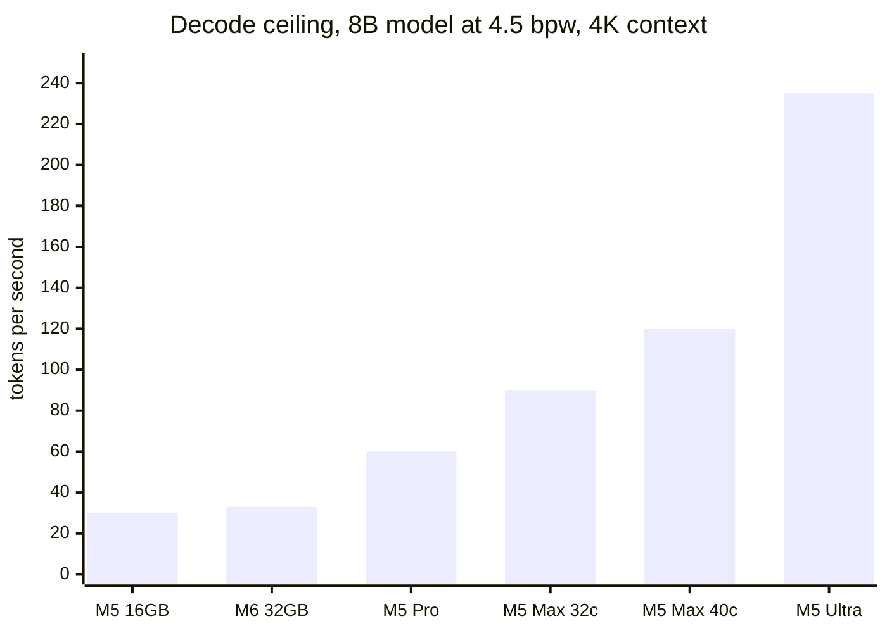
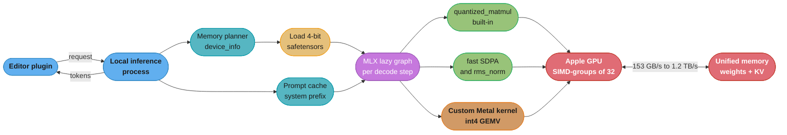
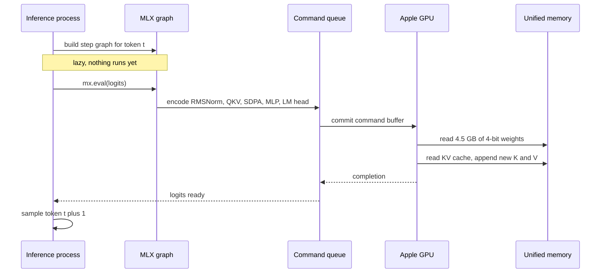

# Case Study: Run LLM Inference on Apple Silicon (MLX, Quantized Matmul, Custom Metal Kernels)

> **Version anchor (fetched 2026-11-25):** MLX v0.32.5 (released 2026-11-25), mlx-lm v0.32.2 (2026-10-16), llama.cpp v1.0.0 (2026-11-13, rolling build b12722 on 2026-11-25), Metal Shading Language Specification 4.1 (dated 2026-06-04), Metal Feature Set Tables (dated 2026-10-23). Memory bandwidth figures come from the apple.com spec pages for MacBook Air, MacBook Pro, Mac mini and Mac Studio, read on 2026-11-25. M-series measurements come from Apple Machine Learning Research posts of 2025-11-19 and 2026-10-15.

## Intuition

> **Design intuition**: On an NVIDIA or AMD server, the model lives in HBM and the host lives somewhere else, across a PCIe bus. On a Mac, there is one pool of LPDDR memory, and the CPU, the GPU and the Neural Engine all read the same physical pages. That removes the copy, but it also removes the comfortable boundary: the model, the KV cache, the browser the user has open, and the window server all compete for the same bytes. The kernel author's job on Apple silicon is the same as on any GPU during decode — stream the weights as close to the memory-bandwidth limit as possible — with one extra constraint that a datacenter engineer never meets: the budget is shared with a human who is still using the machine.

**Key insight**: **Decode on Apple silicon is a bandwidth problem with a memory-capacity ceiling on top.** A 4-bit 8B model on an M5 (153 GB/s) can never exceed about 30 tokens/s at a 4K context, however good the kernel is, because every token reads about 5.1 GB. The same model on an M5 Max with the 40-core GPU (614 GB/s) has a ceiling near 120 tokens/s. Prefill is the opposite regime — compute-bound — and that is where the M5 generation's GPU Neural Accelerators change the numbers (Apple measured up to 4x faster time to first token against an M4). Every component in §4 either shrinks the bytes read per token (quantization, KV policy), keeps those bytes resident (the wired-memory budget), or raises the fraction of bandwidth a kernel actually uses (a fused dequantize-GEMV Metal kernel).

**Non-overlap note**: [`optimize_llm_inference_kernels.md`](./optimize_llm_inference_kernels.md) builds the decode kernels (GEMV, paged attention, weight-only INT8/FP8) for an NVIDIA H100. This file does not repeat that roofline argument. It answers the Apple-specific questions: how unified memory changes the capacity plan, how MLX packs 4-bit weights, how to write and verify a custom Metal kernel through `mx.fast.metal_kernel`, and where the SIMD-group matrix path fits. The choice of an edge runtime as a product decision (MLX vs Core ML vs ONNX) belongs to [`../../llm/small_language_models_and_edge_ai/small_language_models_and_edge_ai.md`](../../llm/small_language_models_and_edge_ai/small_language_models_and_edge_ai.md), and shipping models to devices at fleet scale belongs to [`../../mlops/edge_and_on_device_deployment/edge_and_on_device_deployment.md`](../../mlops/edge_and_on_device_deployment/edge_and_on_device_deployment.md).

---

## 1. Requirements Clarification

### Scenario

A developer-tools company ships a private coding assistant that runs entirely on the user's Mac: no prompt or source file leaves the machine. The assistant must run an 8B dense model on every supported Mac, offer a 30B-class mixture-of-experts (MoE) model on machines that can hold it, and offer a 32B dense model on Mac Studio. The engineering team owns the inference layer and has budget for one custom Metal kernel where the built-in MLX kernels fall short.

### Functional Requirements

- Load Hugging Face checkpoints, quantize them to 4-bit (MLX `affine` mode, group size 64) once on the build server, and ship the quantized safetensors to clients.
- Run decode with a 4-bit weight path end to end. The weights must never be expanded to FP16 in memory.
- Support prompts up to 32K tokens (repository-sized context) with a bounded KV cache.
- Reuse a cached system-prompt prefix across requests (prompt caching), because every request starts with the same 3K-token tool and style instructions.
- Provide one custom fused kernel: a 4-bit dequantize-and-GEMV for decode (`M = 1`), used for a projection whose shape the team wants to own, and keep the built-in `mx.quantized_matmul` as the reference implementation.
- Expose the model to the editor plugin through a local process boundary, so a crash in inference does not take down the editor.

### Non-Functional Requirements

- **Decode**: at least 20 tokens/s on the slowest supported machine (M5 or M6, 16 GB, 153 GB/s) and at least 25 tokens/s on machines with 32 GB or more, both at a 4K context.
- **Time to first token (TTFT)**: under 3 s for a 3K-token cached system prompt plus a 1K-token user turn, on an M5 Pro or newer.
- **Memory**: the inference process must stay under the GPU's recommended working set (`max_recommended_working_set_size` from `mx.device_info()`), with at least 2 GB headroom for the rest of the system. No swap during decode.
- **Correctness**: the custom kernel must match `mx.quantized_matmul` within `atol = rtol = 1e-2` on FP16 outputs for every production shape, and the quantized model must stay within an agreed eval delta of the BF16 model (the eval itself is owned by the ML team; this file owns the kernel-level check).
- **Determinism boundary**: the same build on the same chip generation reproduces outputs for greedy decoding. Bit-identical output across M-series generations is not required. See [`./cross_cutting/numerical_precision_and_determinism.md`](./cross_cutting/numerical_precision_and_determinism.md).

### Out of Scope

- Training and fine-tuning on the Mac (MLX LM supports LoRA, but this product only serves).
- Multi-Mac distributed inference over Thunderbolt (covered in §6 as a real-world reference, not built here).
- The Apple Neural Engine path through Core ML, and Apple's own Foundation Models framework. Both are discussed in §5 and §6 as alternatives.
- Server-side serving on NVIDIA or AMD. For the same kernel family on those vendors, see [`./ship_one_kernel_across_nvidia_amd_and_apple.md`](./ship_one_kernel_across_nvidia_amd_and_apple.md) and [`./port_an_llm_kernel_to_amd_mi300.md`](./port_an_llm_kernel_to_amd_mi300.md).

---

## 2. Scale Estimation

All model shapes below are **design assumptions** chosen to look like common open-weight models. They are not the published configuration of any specific model. Bandwidth and capacity numbers are Apple's published specs.

### The hardware envelope (apple.com spec pages, read 2026-11-25)

| Chip (as shipped in) | GPU cores | Unified memory options | Memory bandwidth |
|---|---|---|---|
| M5 (MacBook Air) | 8 or 10 | 16, 24, 32 GB | 153 GB/s |
| M6 (14-inch MacBook Pro, Mac mini) | 12 | 16 GB | 153 GB/s |
| M6 (14-inch MacBook Pro, Mac mini) | 12 | 24 or 32 GB | 170 GB/s |
| M5 Pro | 16 or 20 | 24, 48, 64 GB | 307 GB/s |
| M5 Max, 32-core GPU | 32 | 36 GB | 460 GB/s |
| M5 Max, 40-core GPU | 40 | 48, 64, 128 GB | 614 GB/s |
| M5 Ultra (Mac Studio) | 64 or 80 | 96 GB; 256 or 512 GB with the 80-core GPU | 1.2 TB/s |

For comparison, Apple's own posts give the previous generations: M4 at 120 GB/s and M3 Ultra at 819 GB/s. An H100 SXM is 3.35 TB/s and an MI300X is 5.3 TB/s, but those numbers sit next to 80 GB and 192 GB of HBM, while the M5 Ultra sits next to up to 512 GB. Apple silicon trades bandwidth for capacity.

### Bytes per weight for MLX quantization modes

MLX `mx.quantize` supports four modes. For `affine`, each group of `group_size` consecutive elements in a row shares one scale and one bias, both stored in the input dtype (16-bit for an FP16 or BF16 model):

```
bits per weight (affine) = bits + (16 + 16) / group_size

  affine 4-bit, group 32   : 4 + 32/32  = 5.00 bpw
  affine 4-bit, group 64   : 4 + 32/64  = 4.50 bpw   <- the MLX default (group 64, 4 bits)
  affine 4-bit, group 128  : 4 + 32/128 = 4.25 bpw
  affine 8-bit, group 64   : 8 + 32/64  = 8.50 bpw
  mxfp4  (group 32, E8M0 scale, no bias) : 4 + 8/32 = 4.25 bpw
  nvfp4  (group 16, E4M3 scale, no bias) : 4 + 8/16 = 4.50 bpw
  bf16 reference                          : 16.00 bpw
```

### Weight bytes for the three product models (assumption shapes)

```
weights_bytes = params x bpw / 8

  8B dense,  4-bit g64 : 8.0e9  x 4.5 / 8 = 4.50 GB
  8B dense,  bf16      : 8.0e9  x 16  / 8 = 16.0 GB
  32B dense, 4-bit g64 : 32.0e9 x 4.5 / 8 = 18.0 GB
  30B MoE (3B active), 4-bit g64:
      resident  : 30.0e9 x 4.5 / 8 = 16.9 GB   (every expert must be in memory)
      read/token:  3.0e9 x 4.5 / 8 = 1.69 GB   (only routed experts are read)
```

Apple's M5 post is a useful cross-check: it reports 5.61 GB of memory in use for `Qwen3-8B-MLX-4bit` and 17.46 GB for `Qwen3-8B-MLX-bf16` with a 4,096-token prompt and 128 generated tokens. Weights plus KV cache plus activations land close to the arithmetic above.

### KV cache per token

```
kv_bytes_per_token = 2 (K and V) x layers x kv_heads x head_dim x bytes_per_element

  8B shape  (36 layers, 8 KV heads, head_dim 128, FP16):
      2 x 36 x 8 x 128 x 2 = 147,456 B = 144 KiB / token
      at  4,096 tokens:  576 MiB  (0.60 GB)
      at 32,768 tokens:  4.5 GiB  (4.83 GB)

  32B shape (64 layers, 8 KV heads, head_dim 128, FP16):
      2 x 64 x 8 x 128 x 2 = 262,144 B = 256 KiB / token
      at  8,192 tokens:  2.0 GiB  (2.15 GB)
      at 32,768 tokens:  8.0 GiB  (8.59 GB)

  30B MoE shape (48 layers, 4 KV heads, head_dim 128, FP16):
      2 x 48 x 4 x 128 x 2 = 98,304 B = 96 KiB / token
      at  4,096 tokens:  384 MiB  (0.40 GB)
```

### The decode ceiling: bandwidth divided by bytes read per token

During decode with batch size 1, each token reads every active weight once and the whole KV cache once. Arithmetic intensity is about 1 FLOP per byte at FP16 weights and about 3.5 FLOP per byte at 4.5 bpw, far below any GPU's ridge point (see [`./cross_cutting/roofline_and_arithmetic_intensity.md`](./cross_cutting/roofline_and_arithmetic_intensity.md)). So:

```
tokens/s ceiling = memory_bandwidth / (weight_bytes_read + kv_bytes_read)

8B dense, 4-bit g64, 4K context: 4.50 + 0.60 = 5.10 GB per token
  M5 or M6 16 GB   153 GB/s  ->  30.0 tok/s
  M6 24/32 GB      170 GB/s  ->  33.3 tok/s
  M5 Pro           307 GB/s  ->  60.2 tok/s
  M5 Max (32c)     460 GB/s  ->  90.2 tok/s
  M5 Max (40c)     614 GB/s  -> 120.4 tok/s
  M5 Ultra        1200 GB/s  -> 235.3 tok/s

8B dense, 4-bit g64, 32K context: 4.50 + 4.83 = 9.33 GB per token
  M5 Max (40c)     614 GB/s  ->  65.8 tok/s   <- the KV cache now costs more than the weights

32B dense, 4-bit g64, 4K context: 18.0 + 1.07 = 19.07 GB per token
  M5 Pro           307 GB/s  ->  16.1 tok/s
  M5 Max (40c)     614 GB/s  ->  32.2 tok/s
  M5 Ultra        1200 GB/s  ->  62.9 tok/s

30B MoE (3B active), 4-bit g64, 4K context: 1.69 + 0.40 = 2.09 GB per token
  M5 or M6 16 GB   153 GB/s  ->  73.2 tok/s ceiling, but 16.9 GB resident does NOT fit in 16 GB
  M5 Pro 48 GB     307 GB/s  -> 146.9 tok/s ceiling
```

The ceiling is not the achieved number. Kernels never reach 100% of peak bandwidth, and MoE routing adds gather work. This design uses **70% of the ceiling** as its planning number (an assumption to be replaced by `mlx_lm.benchmark` measurements in §8). At 70%, the 8B model on a 153 GB/s machine plans at 21 tok/s: it meets the 20 tok/s floor for 16 GB machines with almost no margin, and it misses the 25 tok/s target — so machines with 32 GB or more ship the MoE (which does not fit in 24 GB with headroom, §10). That is a product decision forced by arithmetic, not by kernel quality.



The bars are a straight line in bandwidth: the GPU core count barely matters for decode. Apple's own M5 post shows the same thing from the measurement side — generation speed improved 19-27% from M4 to M5, tracking the 28% bandwidth increase (120 to 153 GB/s), not the GPU's new matrix hardware.

### Prefill is compute-bound

Prefill processes the whole prompt in one pass, so each weight is reused across thousands of tokens:

```
prefill FLOPs ~= 2 x params x prompt_tokens

  8B,  4,096-token prompt: 2 x 8.0e9  x 4096 = 6.55e13 FLOP
  14B, 4,096-token prompt: 2 x 14.0e9 x 4096 = 1.15e14 FLOP

Apple reports TTFT under 10 s for a dense 14B 4-bit model with a 4,096-token prompt
on the base M5. That implies at least 1.15e14 / 10 s = 11.5 TFLOP/s sustained.
```

This is the regime where the M5 GPU Neural Accelerators matter: Apple measured TTFT speedups of 3.33x to 4.06x over an M4 across six models, against generation speedups of only 1.19x to 1.27x. Prompt caching (§4.5) removes most of the 3K-token system prompt from every request, which is the cheapest TTFT win on every chip.

### Memory budget on a 24 GB machine

```
24 GB M5 MacBook Pro, 8B 4-bit model, 32K context (bars to scale, 1 char = 0.5 GB)

  total unified memory  |################################################| 24.0 GB
  GPU working set (*)   |  smaller than total; query it, never assume    | runtime value
  model weights         |#########|                                        4.5 GB
  KV cache @ 32K        |##########|                                       4.8 GB
  prefill activations   |##|                                               ~1 GB (assumption)
  required headroom     |####|                                             2.0 GB
  -----------------------------------------------------------------------------------
  inference need        |#########################|                       12.3 GB

(*) max_recommended_working_set_size from mx.device_info(); never hard-code it.
```

Caption: on a 24 GB machine the 8B model at 32K context needs about 12.3 GB, which leaves room for the editor and the browser. The same budget with the 32B model (18 GB weights plus 8.6 GB KV) needs about 29.6 GB and does not fit, which is why §10 gates the 32B model to Mac Studio and to 48 GB or larger laptops.

---

## 3. High-Level Architecture



The editor talks to a separate inference process, so an out-of-memory kill or a Metal validation abort costs one request, not the user's unsaved files. The memory planner runs before the model loads and picks the model, the context limit and the wired-memory limit from `mx.device_info()`. Inside the process, MLX builds a lazy graph for each decode step and dispatches mostly built-in kernels; only the projection the team chose to own goes through the custom kernel (orange). Everything reads the same unified memory pool (red), which is the one shared resource every decision in this file is about.

### One decode step



Two details are Apple-specific. MLX evaluates lazily, so nothing reaches the GPU until `mx.eval` (or a conversion such as `.item()`) forces it — a benchmark that forgets this measures graph construction (§9). And there is no host-to-device copy anywhere in the step: the "upload" arrow from every CUDA diagram in this section does not exist here.

### Failure domains

| Failure | Blast radius | Detection | Containment |
|---|---|---|---|
| Process exceeds the GPU working set | That machine's assistant slows to swap speed | Peak memory above plan, tokens/s below 50% of the recorded ratio | Planner picks a shorter context or smaller model at next start |
| Metal kernel compile error after an MLX upgrade | Every request that touches the custom projection | Exception at the first `metal_kernel` call, caught at startup | Feature flag falls back to `mx.quantized_matmul` |
| Silent wrong output from a kernel change | Every user on the new build | Acceptance gate (§8) and greedy-decode golden prompts in CI | Release blocked; no runtime detection is reliable |
| Corrupt or partial model download | One machine | Checksum of every safetensors shard before load | Re-download; never load a shard with a bad checksum |
| Thermal or power limits on a laptop | Long sessions on one machine | Sustained tokens/s lower than the first-minute rate | Product shows the measured rate; no kernel fix exists |

The third row is the reason the custom kernel has its own test harness: a GPU kernel that returns wrong numbers does not crash, and a language model that receives wrong numbers still produces fluent text.

---

## 4. Component Deep Dives

### 4.1 Memory planner: size against the GPU working set, not total RAM

MLX exposes the two numbers that matter. `mx.device_info()` returns `memory_size` (total unified memory) and `max_recommended_working_set_size` (the system wired limit for GPU memory). MLX's `mx.set_memory_limit` defaults to 1.5 times the recommended working set, and `mx.set_wired_limit` (useful on macOS 15 and later) keeps up to the given number of bytes resident; it must stay below the system wired limit, and setting it higher is an error. The system limit itself can be raised with `sudo sysctl iogpu.wired_limit_mb=N`, which mlx-lm's README recommends when it prints its "[WARNING] Generating with a model that requires ..." message.

```python
# BROKEN: plans against total RAM, so a model that "fits" pages during decode
import mlx.core as mx

def fits_broken(weights_gb: float, kv_gb: float) -> bool:
    info = mx.device_info()
    total_gb = info["memory_size"] / 1e9
    return weights_gb + kv_gb < total_gb   # 18.0 + 8.6 < 32.0 -> True on a 32 GB Mac

# The 32B model at 32K context passes this check on a 32 GB machine. The GPU's
# recommended working set is smaller than total RAM, the OS and the editor need
# memory too, and decode then pages weights. mlx-lm warns about exactly this case.
```

```python
# FIX: plan against the working set, keep headroom, and choose the context to fit
from dataclasses import dataclass
import mlx.core as mx

GB = 1e9

@dataclass(frozen=True)
class ModelShape:
    params: float          # total parameters
    layers: int
    kv_heads: int
    head_dim: int
    bits: int = 4
    group_size: int = 64

    def weight_bytes(self) -> float:
        bpw = self.bits + 32 / self.group_size      # 16-bit scale + 16-bit bias per group
        return self.params * bpw / 8

    def kv_bytes_per_token(self, elem_bytes: int = 2) -> int:
        return 2 * self.layers * self.kv_heads * self.head_dim * elem_bytes

def plan(shape: ModelShape, want_ctx: int, headroom_gb: float = 2.0,
         activations_gb: float = 1.0) -> dict:
    info = mx.device_info()
    budget = float(info["max_recommended_working_set_size"])
    fixed = shape.weight_bytes() + (headroom_gb + activations_gb) * GB
    if fixed >= budget:
        return {"ok": False, "reason": "weights alone exceed the GPU working set"}
    max_ctx = int((budget - fixed) // shape.kv_bytes_per_token())
    ctx = min(want_ctx, max_ctx)
    need = fixed + ctx * shape.kv_bytes_per_token()
    mx.set_wired_limit(int(min(need, budget * 0.98)))   # must stay below the system limit
    return {"ok": True, "ctx": ctx, "need_gb": need / GB, "budget_gb": budget / GB}

eight_b = ModelShape(params=8.0e9, layers=36, kv_heads=8, head_dim=128)
print(plan(eight_b, want_ctx=32_768))
```

The planner returns a context length, not just yes or no. When the budget is tight, a shorter rotating KV cache (`--max-kv-size` in mlx-lm, §4.5) is a better product than a model that pages. The wired limit is set to what the plan needs, not to the maximum, so the editor and browser keep their memory.

### 4.2 Quantized weights: keep the 4-bit path all the way into the kernel

MLX's `affine` mode quantizes each group of `group_size` consecutive elements in a row with `s = (max - min) / (2^bits - 1)` and a bias equal to the group minimum, so `w = s * q + b`. For 4 bits, eight values pack into one `uint32`, **the first element in the 4 least significant bits**. `mx.quantize` returns `(w_q, scales, biases)`; `mx.quantized_matmul(x, w_q, scales, biases, transpose=True, group_size=64, bits=4)` computes `x @ w.T` without ever materializing `w` in FP16. At the model level, `mlx.nn.quantize(model, group_size, bits)` swaps every `Linear` and `Embedding` that defines `to_quantized()` for its quantized version, in place.

```python
# BROKEN: "4-bit model", FP16 compute -- dequantizes once at load and keeps the result
import mlx.core as mx

w = (mx.random.normal((14336, 4096)) * 0.02).astype(mx.float16)
w_q, scales, biases = mx.quantize(w, group_size=64, bits=4)

w16 = mx.dequantize(w_q, scales, biases, group_size=64, bits=4)   # 4.5 bpw -> 16 bpw
def mlp_up(x: mx.array) -> mx.array:
    return x @ w16.T                                               # reads 16-bit weights

# Resident size and bytes read per token both grow by 16 / 4.5 = 3.56x. For the 8B
# model that is 16 GB instead of 4.5 GB, and the 153 GB/s decode ceiling drops from
# 30 tok/s to about 9 tok/s. Nothing errors -- the model is just 3.5x slower and
# no longer fits on a 16 GB machine.
```

```python
# FIX: multiply directly against the packed weights
def mlp_up_fixed(x: mx.array) -> mx.array:
    return mx.quantized_matmul(x, w_q, scales, biases,
                               transpose=True, group_size=64, bits=4)

x = mx.random.normal((1, 4096)).astype(mx.float16)
ref = x @ mx.dequantize(w_q, scales, biases, group_size=64, bits=4).T   # test only
out = mlp_up_fixed(x)
mx.eval(ref, out)
assert mx.allclose(out, ref, atol=1e-2, rtol=1e-2)
```

The `dequantize` call in the fixed version is there only to build a test reference; it never runs in the serving path. The quantization choice itself (bits, group size, mode) is a model-quality decision covered in [`../../llm/optimization_and_quantization/optimization_and_quantization.md`](../../llm/optimization_and_quantization/optimization_and_quantization.md); this file owns the fact that the kernel must consume the packed form.

### 4.3 Custom Metal kernel: fused int4 dequantize-GEMV with `mx.fast.metal_kernel`

The team owns one projection whose decode GEMV (`M = 1`) they want to control, for example to fuse an activation later. `mx.fast.metal_kernel` takes only the **body** of a Metal kernel. MLX generates the signature from the input and output names, adds any Metal attribute the body uses (such as `thread_position_in_grid` or `thread_index_in_simdgroup`), and instantiates `template` parameters, which can be dtypes, `int` or `bool`. `grid` and `threadgroup` are passed to `dispatchThreads`, so `grid` is the **total number of threads**, not the number of threadgroups. Each `metal_kernel(...)` call creates a new Metal library that may be JIT-compiled, so the kernel is built once at import time and reused.

Work split: one SIMD-group (32 threads on every Apple GPU) owns one output row. Each lane walks the packed `uint32` words of the row with a stride of 32, so adjacent lanes read adjacent words (coalesced), dequantizes eight 4-bit values per word in registers, accumulates in FP32, and `simd_sum` reduces the 32 partial sums without touching threadgroup memory.

```
One output row r, K = 4096, group_size = 64, 4-bit: 512 uint32 words per row

  word index j:    0    1    2   ...  31 |  32   33  ...  63 |  ...  | 480 ... 511
  SIMD lane:       0    1    2   ...  31 |   0    1  ...  31 |  ...  |   0 ...  31
  pass:            ---- pass 0 -------- | ---- pass 1 ------ |  ...  | -- pass 15 --
  group (j*8/64):  0    0    0   ...   3 |   4    4  ...   7 |  ...  |  60 ...  63

  lane l handles words l, l+32, ... l+480  -> 16 words = 128 weights per lane
  then: acc = simd_sum(acc) across the 32 lanes, lane 0 writes y[r]
```

Caption: in every pass the 32 lanes read 32 consecutive 4-byte words (128 contiguous bytes), and each group of 64 weights spans exactly 8 words, so one group's scale and bias are read by 8 neighbouring lanes. The 16 passes per row cover all 512 words.

```python
# BROKEN: nibbles unpacked most-significant first; MLX packs least-significant first
import mlx.core as mx

QMV_BODY_BROKEN = """
    uint row  = thread_position_in_grid.x / 32;
    uint lane = thread_index_in_simdgroup;
    if (row >= N) { return; }                    // uniform per SIMD-group
    const uint words = K / 8;
    const uint groups = K / GS;
    float acc = 0.0f;
    for (uint j = lane; j < words; j += 32) {
        uint word = w[row * words + j];
        uint g = (j * 8) / GS;
        float s = float(scales[row * groups + g]);
        float b = float(biases[row * groups + g]);
        for (uint i = 0; i < 8; ++i) {
            float q = float((word >> (28 - 4 * i)) & 0xFu);   // wrong end of the word
            acc += float(x[j * 8 + i]) * (s * q + b);
        }
    }
    acc = metal::simd_sum(acc);
    if (lane == 0) { y[row] = static_cast<T>(acc); }
"""
# Every weight inside a word is paired with the wrong activation. The kernel runs at
# full speed, returns finite numbers of the right magnitude, and the model produces
# fluent nonsense. Only a comparison against mx.quantized_matmul catches it.
```

```python
# FIX: least-significant nibble first, plus a test against the built-in kernel
import mlx.core as mx

QMV_BODY = """
    uint row  = thread_position_in_grid.x / 32;
    uint lane = thread_index_in_simdgroup;
    if (row >= N) { return; }                    // uniform per SIMD-group: simd_sum stays safe
    const uint words = K / 8;                    // 8 x 4-bit values per uint32
    const uint groups = K / GS;
    float acc = 0.0f;                            // FP32 accumulator, never half
    for (uint j = lane; j < words; j += 32) {
        uint word = w[row * words + j];
        uint g = (j * 8) / GS;
        float s = float(scales[row * groups + g]);
        float b = float(biases[row * groups + g]);
        for (uint i = 0; i < 8; ++i) {
            float q = float((word >> (4 * i)) & 0xFu);        // element 8j+i
            acc += float(x[j * 8 + i]) * (s * q + b);
        }
    }
    acc = metal::simd_sum(acc);
    if (lane == 0) { y[row] = static_cast<T>(acc); }
"""

_qmv = mx.fast.metal_kernel(                     # built once, reused for every token
    name="qmv_int4_affine",
    input_names=["x", "w", "scales", "biases"],
    output_names=["y"],
    source=QMV_BODY,
)

def qmv_int4(x: mx.array, w_q: mx.array, scales: mx.array, biases: mx.array,
             group_size: int = 64) -> mx.array:
    n_rows, k = w_q.shape[0], x.shape[-1]
    if k % group_size or w_q.shape[1] * 8 != k:
        raise ValueError(f"K={k} does not match the packed weight or group size {group_size}")
    outputs = _qmv(
        inputs=[x, w_q, scales, biases],
        template=[("T", x.dtype), ("N", n_rows), ("K", k), ("GS", group_size)],
        grid=(32 * n_rows, 1, 1),                # total threads: one SIMD-group per row
        threadgroup=(256, 1, 1),                 # 8 SIMD-groups = 8 rows per threadgroup
        output_shapes=[(n_rows,)],
        output_dtypes=[x.dtype],
    )
    return outputs[0]

def test_qmv() -> None:
    mx.random.seed(0)
    for n_rows, k in [(4096, 4096), (14336, 4096), (4096, 14336), (8, 64)]:
        w = (mx.random.normal((n_rows, k)) * 0.02).astype(mx.float16)
        w_q, s, b = mx.quantize(w, group_size=64, bits=4)
        x = mx.random.normal((k,)).astype(mx.float16)
        ref = mx.quantized_matmul(x[None, :], w_q, s, b, transpose=True,
                                  group_size=64, bits=4)[0]
        out = qmv_int4(x, w_q, s, b)
        mx.eval(ref, out)
        assert mx.allclose(out, ref, atol=1e-2, rtol=1e-2), (n_rows, k)

test_qmv()
```

Three properties make this kernel correct on Apple hardware specifically. The early `return` is safe only because `row` is identical for all 32 lanes of a SIMD-group — `simd_sum` must see every lane that is expected to participate. The accumulator is FP32: a half accumulator over 4,096 products overflows or loses most of its precision long before the end of the row. And the test shapes include `K = 64`, the smallest legal row, where a bug in the group index is most visible. Passing `verbose=True` to the kernel call prints the generated Metal source, which is the first thing to read when a template parameter is wrong.

Is it faster than `mx.quantized_matmul`? Not necessarily — MLX ships tuned quantized GEMV kernels (its v0.32.5 release notes alone list new `qmv` variants). The value of owning the kernel is fusion headroom and a known memory-access pattern, and the acceptance test in §8 is "no slower than the built-in on every production shape", measured, not assumed.

### 4.4 The SIMD-group matrix path for prefill

Decode is a GEMV and gains nothing from matrix hardware. Prefill is a GEMM, and Apple GPUs expose matrix multiply at SIMD-group scope through `simdgroup_matrix` (available from the Apple7 family, which is M1). The Metal Shading Language defines 8x8 types — `simdgroup_half8x8`, `simdgroup_bfloat8x8` (Metal 3.1 and later) and `simdgroup_float8x8` — loaded from device or threadgroup memory with `simdgroup_load`, combined with `simdgroup_multiply_accumulate(d, a, b, c)` (`d = a * b + c`, all four of the same element type), and written with `simdgroup_store`.

```metal
#include <metal_stdlib>
using namespace metal;

// C[M,N] = A[M,K] * B[K,N], row-major FP32, M, N and K multiples of 8.
// Teaching sketch: one SIMD-group (one 32-thread threadgroup) computes one 8x8 tile of C.
// A production kernel stages tiles in threadgroup memory and gives each SIMD-group
// several 8x8 accumulators to reuse every loaded tile.
kernel void sg_matmul_8x8(device const float* A   [[buffer(0)]],
                          device const float* B   [[buffer(1)]],
                          device float*       C   [[buffer(2)]],
                          constant uint3&     MNK [[buffer(3)]],
                          uint2 tile [[threadgroup_position_in_grid]])
{
    const uint M = MNK.x, N = MNK.y, K = MNK.z;
    const uint row0 = tile.y * 8;
    const uint col0 = tile.x * 8;
    if (row0 >= M || col0 >= N) { return; }

    simdgroup_float8x8 acc = make_filled_simdgroup_matrix<float, 8, 8>(0.0f);
    simdgroup_float8x8 a;
    simdgroup_float8x8 b;
    for (uint k = 0; k < K; k += 8) {
        simdgroup_load(a, A + row0 * K + k, K);      // 8x8 block of A, row stride K
        simdgroup_load(b, B + k * N + col0, N);      // 8x8 block of B, row stride N
        simdgroup_multiply_accumulate(acc, a, b, acc);
    }
    simdgroup_store(acc, C + row0 * N + col0, N);
}
```

```swift
// Host dispatch: one 32-thread threadgroup per 8x8 output tile.
var mnk = SIMD3<UInt32>(UInt32(M), UInt32(N), UInt32(K))
let enc = commandBuffer.makeComputeCommandEncoder()!
enc.setComputePipelineState(matmulPipeline)
enc.setBuffer(aBuf, offset: 0, index: 0)
enc.setBuffer(bBuf, offset: 0, index: 1)
enc.setBuffer(cBuf, offset: 0, index: 2)
enc.setBytes(&mnk, length: MemoryLayout<SIMD3<UInt32>>.stride, index: 3)
enc.dispatchThreadgroups(MTLSize(width: N / 8, height: M / 8, depth: 1),
                         threadsPerThreadgroup: MTLSize(width: 32, height: 1, depth: 1))
enc.endEncoding()
```

`aBuf` and friends are ordinary `MTLBuffer`s in shared storage — the CPU wrote them and the GPU reads the same pages, with no blit. On the M5 generation (Apple10 family in the feature tables) there is a second, faster path: MLX uses Metal 4 TensorOps and the Metal Performance Primitives framework to drive the GPU Neural Accelerators, and `mx.metal.is_nax_available()` reports whether MLX kernels can use them. That is why §5 keeps prefill on MLX's built-in GEMM and spends the team's one custom kernel on decode. The full SIMD-group and Metal 4 tensor programming model is in [`../metal_compute_programming/metal_compute_programming.md`](../metal_compute_programming/metal_compute_programming.md); how the M-series GPU executes SIMD-groups is in [`../apple_silicon_gpu_architecture/apple_silicon_gpu_architecture.md`](../apple_silicon_gpu_architecture/apple_silicon_gpu_architecture.md).

### 4.5 KV cache and prompt cache policy

mlx-lm gives three knobs, all from its README:

| Knob | What it does | How this product uses it |
|---|---|---|
| `--max-kv-size n` | Rotating, fixed-size KV cache. 512 uses very little RAM at a quality cost; 4,096 or more keeps quality | Set from the planner's `ctx` on tight machines instead of refusing the model |
| `--prefill-step-size n` | Processes long prompts `n` tokens at a time; default 2,048. Smaller steps lower peak memory and slow prompt reading | 2,048 on 32 GB and up; 1,024 on 16 GB machines to cut activation peaks |
| `mlx_lm.cache_prompt` | Saves the KV state of a prefix to a `.safetensors` file; `mlx_lm.generate --prompt-cache-file` reuses it, and the cached prompt is treated as a prefix of the new prompt | The 3K-token system prompt is cached at install time per model |

```bash
# Build the cached prefix once per model version (run by the installer)
cat system_prompt.txt | mlx_lm.cache_prompt \
  --model ./models/coder-8b-4bit \
  --prompt - \
  --prompt-cache-file ./cache/coder-8b-system.safetensors

# Every request reuses it; only the user's turn is prefilled
mlx_lm.generate \
  --prompt-cache-file ./cache/coder-8b-system.safetensors \
  --prompt "Explain the failing test in parser.rs" \
  --max-kv-size 16384
```

With the 8B shape, the cached 3K-token prefix holds 3,072 x 144 KiB = 432 MiB of KV state. Reusing it removes 3,072 of the 4,096 prefill tokens, about 75% of the prefill FLOPs, from every request — the single biggest TTFT lever and the reason the TTFT requirement is reachable on an M5 Pro.

### 4.6 The serving loop

```python
# Inference process core loop (the IPC layer to the editor is omitted)
import logging
import time
import mlx.core as mx
from mlx_lm import load, stream_generate

log = logging.getLogger("inference")
PEAK_BUDGET_GB = 12.3        # need_gb from the planner in 4.1 for this machine and model
model, tokenizer = load("./models/coder-8b-4bit")

def serve(user_turn: str, max_tokens: int = 512) -> tuple[str, float]:
    messages = [{"role": "user", "content": user_turn}]
    prompt = tokenizer.apply_chat_template(messages, add_generation_prompt=True)
    mx.reset_peak_memory()
    t0 = time.perf_counter()
    chunks = [r.text for r in stream_generate(model, tokenizer, prompt, max_tokens=max_tokens)]
    elapsed = time.perf_counter() - t0
    peak_gb = mx.get_peak_memory() / 1e9
    if peak_gb > PEAK_BUDGET_GB:
        log.warning("peak memory %.2f GB over plan %.2f GB", peak_gb, PEAK_BUDGET_GB)
    return "".join(chunks), elapsed
```

`mx.get_peak_memory()` and `mx.reset_peak_memory()` give the per-request peak that the planner promised; a peak above plan is logged before it becomes swap. `mx.get_active_memory()` excludes MLX's buffer cache, so it reads lower than what Activity Monitor shows; `mx.clear_cache()` returns cached buffers when the app goes to the background.

### 4.7 Carrying a CUDA decode-kernel mental model over to Metal

The team's kernel engineers came from CUDA. Most of their instincts transfer; five of them break. The full vocabulary lives in [`./cross_cutting/vendor_terminology_and_numbers_reference.md`](./cross_cutting/vendor_terminology_and_numbers_reference.md) and [`../cross_vendor_gpu_concept_map/cross_vendor_gpu_concept_map.md`](../cross_vendor_gpu_concept_map/cross_vendor_gpu_concept_map.md); this table holds only what the GEMV in §4.3 depends on.

| CUDA habit | Metal and MLX reality | What changed in this kernel |
|---|---|---|
| Warp of 32 lanes, `__shfl_xor_sync` reduction | SIMD-group of 32 on every Apple GPU (Apple, WWDC22 "Scale compute workloads across Apple GPUs"); `simd_sum` does the whole reduction in one call | The reduction is one line; no shuffle loop to get wrong |
| `<<<blocks, threads>>>` counts blocks | MLX `grid` counts **threads** (`dispatchThreads`) | `grid=(32 * rows, 1, 1)` |
| Up to 227 KB of shared memory per block on H100 (opt-in) | 32 KB maximum threadgroup memory on every current Apple family | Tiling plans that stage large tiles in shared memory do not port; the GEMV uses none |
| `cudaMemcpy` host to device before the launch | Shared storage: CPU and GPU read the same pages | No upload; the cost moved into the capacity plan (§4.1) |
| 32-bit `__ballot_sync` mask | `simd_vote` is a 64-bit type; bits above the SIMD width are undefined | Never pack a vote result into 32 bits by habit |
| `cudaGetLastError` after each launch | Command-buffer status and Metal API validation; MLX raises on kernel compile errors | Run the acceptance test with validation on (see [`../metal_profiling_and_debugging/metal_profiling_and_debugging.md`](../metal_profiling_and_debugging/metal_profiling_and_debugging.md)) |

The 32 KB limit is the one that hurts a GEMM author most. An H100 FlashAttention tile set of about 161 KiB (see [`./build_a_flash_attention_kernel.md`](./build_a_flash_attention_kernel.md)) is five times larger than an Apple threadgroup can hold, so Apple attention kernels keep more state in registers and SIMD-group matrices and use smaller tiles. The per-level latency and capacity comparison for NVIDIA is in [`./cross_cutting/cuda_memory_hierarchy_reference.md`](./cross_cutting/cuda_memory_hierarchy_reference.md); use it as the baseline the Apple numbers are measured against, not as Apple's numbers.

---

## 5. Design Decisions & Tradeoffs

| Decision | Chosen | Alternative | Why |
|---|---|---|---|
| Runtime | MLX + mlx-lm | llama.cpp (Metal backend, on by default on macOS) | Both read 4-bit weights and run on the GPU. MLX gives a Python kernel hook (`mx.fast.metal_kernel`) and Apple maintains its Neural Accelerator path; llama.cpp gives a single C++ binary and GGUF. The team needs the kernel hook |
| Neural Engine via Core ML | Not used | Core ML conversion to run on the ANE | The ANE path needs a conversion pipeline per model and gives the team no kernel-level control; GPU decode is bandwidth-bound either way |
| Apple Foundation Models framework | Offered as a separate low-tier feature | Use only the system model | The system model is about 3B parameters and Apple says it is not designed as a general world-knowledge chatbot; the coding assistant needs a larger code model |
| Quantization | affine 4-bit, group 64 (4.5 bpw) | group 32 (5.0 bpw), group 128 (4.25 bpw), mxfp4 (4.25 bpw) | g64 is the MLX default and the most-used format on mlx-community; g32 costs 11% more bandwidth for quality the eval did not need |
| Decode kernel | Built-in `quantized_matmul` everywhere, custom kernel on one projection | Custom kernels for all layers | One owned kernel is enough to keep the team's Metal skills and fusion option alive without owning MLX's whole kernel library |
| Prefill kernel | Built-in MLX GEMM | Hand-written `simdgroup_matrix` GEMM | On M5 MLX reaches the Neural Accelerators through Metal 4 TensorOps; a hand-written SIMD-group GEMM would leave them idle |
| Memory policy | Planner sets context and wired limit per machine | One fixed context for every Mac | A fixed 32K context pages on 16 GB machines; a fixed 4K context wastes 64 GB machines |
| KV cache | FP16, rotating when the planner says so | Quantized KV cache | The product keeps FP16 KV for quality; the planner trades context length instead |
| Process model | Separate inference process | In-process library in the editor | Memory pressure and GPU errors are isolated from user data |
| Host language | Python process running mlx-lm | MLX Swift embedded in a native helper | Python gives mlx-lm's loader, prompt cache and server today; MLX Swift shares the same core library and is the planned path once the helper needs no Python runtime |
| Benchmark of record | `mlx_lm.benchmark` with fixed `-p` and `-g` | Ad hoc timing in the app | The same tool Apple used for its published M5 and M5 Ultra results, so numbers are comparable |
| Model tiers | 8B everywhere, 30B MoE on 32 GB and up, 32B on 48 GB and up | One model for all | §2 and §10 arithmetic: the 8B ceiling on 153 GB/s is 30 tok/s, the MoE reads only 1.69 GB per token but needs 16.9 GB resident |

---

## 6. Real-World Implementations

**Apple Machine Learning Research, "Exploring LLMs with MLX and the Neural Accelerators in the M5 GPU" (2025-11-19).** Apple benchmarked six models with `mlx_lm.generate` on a 24 GB M5 MacBook Pro against an M4 MacBook Pro, with a 4,096-token prompt and 128 generated tokens. TTFT speedups ranged from 3.33x (gpt-oss-20b in MXFP4) to 4.06x (Qwen3-14B 4-bit); generation speedups ranged from 1.19x to 1.27x. Apple's own explanation matches §2: TTFT is compute-bound and uses the Neural Accelerators, while generation is bandwidth-bound and follows the 120 GB/s to 153 GB/s increase. The same post reports 5.61 GB of memory for Qwen3-8B 4-bit and 17.31 GB for Qwen3-30B-A3B 4-bit, and states that the Neural Accelerator path needs macOS 26.2 or later.

**Apple Machine Learning Research, "Local and Distributed Large LLM Inference with MLX and RDMA on Mac Studio" (2026-10-15).** On a single 512 GB Mac Studio, Apple reports TTFT up to 4.6x faster on M5 Ultra than on M3 Ultra and decode 1.6x faster, attributing decode to 1.2 TB/s versus 819 GB/s. Peak power was about 200 W on M3 Ultra and 300 W on M5 Ultra. For an 816B-parameter MoE that needs about 493 GB in NVFP4 — more than one machine — MLX splits the model across Mac Studios over the RDMA-over-Thunderbolt-5 driver introduced in macOS 26.2, using the `jaccl` collectives available from MLX v0.30.1, and reports over 36 tokens/s on four Mac Studios with tensor parallelism. All benchmarks used `mlx_lm.benchmark`.

**Apple Intelligence on-device foundation model (2025).** Apple's update post describes an on-device model of about 3 billion parameters compressed to 2 bits per weight with quantization-aware training, a 4-bit embedding table, an 8-bit KV cache, and low-rank adapters trained to recover the lost quality. The model is split into two blocks with a 5:3 depth ratio, and the second block reuses the KV caches of the first block's final layer, cutting KV cache memory by 37.5%. The same post says the server model's weights use ASTC texture compression at 3.56 bpw, decoded by dedicated GPU hardware. The lesson for this file: Apple's own team attacks exactly the two terms of the §2 decode equation, weight bytes and KV bytes.

**LM Studio.** LM Studio's `mlx-engine` repository describes itself as the Apple MLX LLM engine for LM Studio, built on mlx-lm, Outlines (structured output) and mlx-vlm; LM Studio 0.3.4 and newer for Mac ship with it bundled. It is the closest public analogue of this case study's architecture: a desktop app with a separate MLX-based inference engine.

**Ollama.** Ollama's release notes describe an "MLX runner on Apple silicon" alongside its llama.cpp-based runner; v0.40.4 (2026-10-12), for example, lists speculative-decoding reliability fixes in the MLX runner. A widely used local runtime keeping both engines is evidence that neither MLX nor llama.cpp covers every model and machine.

**Hugging Face `mlx-community`.** The mlx-lm README names `mlx-community/Llama-3.2-3B-Instruct-4bit` as the default model for `mlx_lm.generate` and `mlx_lm.chat`, and points to thousands of pre-quantized models in the `mlx-community` organization. This is why §5 picks the default 4-bit group-64 format: a model that already exists in that format needs no in-house conversion step.

**llama.cpp.** Its build documentation states that Metal is enabled by default on macOS, can be disabled at build time with `-DGGML_METAL=OFF`, and that `--n-gpu-layers 0` disables GPU inference at run time. The project reached v1.0.0 on 2026-11-13. It is the alternative runtime in §5 and the fallback the product keeps for machines where MLX is not supported.

See also: the hardware, runtime and model landscape around this design is in [Local AI](../../llm/local_ai/local_ai.md).

---

## 7. Technologies & Tools

| Tool | Role | Notes |
|---|---|---|
| MLX (`ml-explore/mlx`) | Array framework with lazy evaluation and unified-memory arrays | Requires Apple silicon, macOS 14 or later, native Python 3.10 or later; also has a CUDA backend (`mlx[cuda12]`, `mlx[cuda13]`) |
| mlx-lm | Load, quantize, generate, serve, benchmark | `mlx_lm.convert -q`, `mlx_lm.generate`, `mlx_lm.chat`, `mlx_lm.server`, `mlx_lm.benchmark`, `mlx_lm.cache_prompt` |
| `mx.fast.metal_kernel` | JIT custom Metal kernels from Python | Body-only source; `template`, `grid` (total threads), `threadgroup`, `header`, `atomic_outputs`, `compile_options={"math_mode": ...}` |
| `mx.fast.rms_norm`, `mx.fast.scaled_dot_product_attention` | Built-in fused kernels | SDPA computes softmax in FP32 and supports MHA, GQA and MQA |
| MLX Swift | Same core library from Swift | For embedding MLX directly in a native app instead of a Python process |
| Xcode GPU tools | Frame capture, dependency view | `mx.metal.start_capture("x.gputrace")` with `MTL_CAPTURE_ENABLED=1`; see [`../metal_profiling_and_debugging/metal_profiling_and_debugging.md`](../metal_profiling_and_debugging/metal_profiling_and_debugging.md) |
| llama.cpp | C++ runtime with a Metal backend | Alternative runtime; GGUF models |
| Hugging Face Hub (`mlx-community`) | Pre-quantized MLX models | Default 4-bit models for most open-weight families |
| PyTorch MPS backend | Prototyping and reference outputs | `torch.mps.compile_shader` runs a Metal shader from Python; see [`../metal_performance_shaders_mlx_and_pytorch_mps/metal_performance_shaders_mlx_and_pytorch_mps.md`](../metal_performance_shaders_mlx_and_pytorch_mps/metal_performance_shaders_mlx_and_pytorch_mps.md) |
| Metal Feature Set Tables | Per-family limits | 32 KB maximum threadgroup memory and 1,024 maximum threads per threadgroup on current Apple families |

---

## 8. Operational Playbook

### Bring-up on a new machine class

```bash
pip install mlx-lm
python -c "import mlx.core as mx; print(mx.device_info()); print(mx.metal.is_nax_available())"

# Quantize once on the build server (4-bit is the -q default per the mlx-lm README)
mlx_lm.convert --model <org>/<model> -q

# Measure, never assume: prompt 4,096, generate 128, batch 1
mlx_lm.benchmark --model ./models/coder-8b-4bit -p 4096 -g 128 -b 1
mlx_lm.benchmark --model ./models/coder-8b-4bit -p 32768 -g 128 -b 1
```

Record the measured tokens/s next to the §2 ceiling for that chip. The ratio (achieved over ceiling) is the number that transfers between machines; a ratio that drops on a new chip is a kernel or memory problem, not a hardware one.

### The kernel acceptance gate

| Check | Pass condition |
|---|---|
| Correctness | `test_qmv()` passes for every production `(N, K)` shape and for `K = 64` |
| Group size | Kernel `GS` equals the checkpoint's quantization group size (read from the model config, never hard-coded) |
| Speed | Custom kernel time is no worse than `mx.quantized_matmul` on every shape, median of 50 runs after 10 warm-up runs |
| Memory | `mx.get_peak_memory()` during a 32K-context request is within 5% of the planner's `need_gb` |
| Determinism | Greedy decoding of 20 fixed prompts is identical across two runs on the same machine |

### Timing a kernel correctly

```python
import time
import mlx.core as mx

def time_kernel(fn, *args, warmup: int = 10, iters: int = 50) -> float:
    for _ in range(warmup):
        mx.eval(fn(*args))                 # MLX is lazy: eval forces the GPU work
    samples = []
    for _ in range(iters):
        t0 = time.perf_counter()
        mx.eval(fn(*args))
        samples.append(time.perf_counter() - t0)
    samples.sort()
    return samples[len(samples) // 2]

def achieved_gbps(seconds: float, n_rows: int, k: int, group_size: int = 64) -> float:
    weight_bytes = n_rows * k / 2                          # 4 bits per weight
    scale_bias_bytes = n_rows * (k // group_size) * 2 * 2  # FP16 scale and bias
    act_bytes = k * 2
    return (weight_bytes + scale_bias_bytes + act_bytes) / seconds / 1e9
```

Compare `achieved_gbps` with the chip's published bandwidth. This is the Apple equivalent of the DRAM-throughput check in [`./cross_cutting/nsight_profiling_workflow.md`](./cross_cutting/nsight_profiling_workflow.md): one number that says how close the kernel is to the only roof that matters for decode.

### Capturing a GPU trace

```bash
MTL_CAPTURE_ENABLED=1 python capture_decode.py   # calls mx.metal.start_capture / stop_capture
open decode_step.gputrace                         # opens in Xcode; check the Dependencies view
```

`mx.metal.start_capture` needs a path ending in `.gputrace` that does not already exist. Capture two decode steps, not a whole generation: a capture of thousands of command buffers is too large to read.

### Runbook: "the assistant got slow after an update"

1. Run `mlx_lm.benchmark` with the pinned prompt and generation lengths; compare with the recorded ratio for this chip.
2. If decode is slow and prefill is normal, check `mx.get_peak_memory()` against the plan — a new model revision with a larger vocabulary or more layers can push the process past the working set.
3. If the user raised the context limit, recompute the KV term: on the 8B shape every extra 8K tokens adds 1.2 GB.
4. If only the custom-kernel projection regressed, run the acceptance gate; an MLX upgrade may have made the built-in faster than the custom kernel, and the gate then switches back to the built-in.
5. If both prefill and decode are slow, capture a trace and check for a CPU-side gap between command buffers (Python overhead), which looks like idle GPU time in the capture.

### CI machine matrix

| Runner | Why it is in the matrix | Jobs |
|---|---|---|
| 16 GB M5 MacBook Air (153 GB/s) | Smallest supported memory and bandwidth; catches capacity regressions first | Planner tests, 8B benchmark, peak-memory gate |
| 32 GB M6 Mac mini (170 GB/s) | First tier that ships the MoE | MoE benchmark, KV-limit tests at 32K |
| 48 GB M5 Pro Mac mini (307 GB/s) | First tier for the 32B dense model | 32B benchmark, prompt-cache TTFT test |
| 128 GB M5 Max (614 GB/s) | Fastest laptop tier; Neural Accelerator path | Custom kernel speed gate against the built-in, `is_nax_available()` check |
| M5 Ultra Mac Studio | Shared-server configuration | Batched `mlx_lm.server` load test with 8 concurrent sequences |

A CI machine with 64 GB or more hides every capacity bug in §9, which is why the smallest machine runs first and blocks the merge.

### Release checklist per model version

1. Convert and quantize on the build server; record bits, group size and mode in the release manifest.
2. Run the ML team's eval against the BF16 model and record the delta.
3. Run `test_qmv()` with `GS` read from the new checkpoint's config.
4. Rebuild every cached system-prompt file; a prompt cache from the previous model version is invalid.
5. Run `mlx_lm.benchmark` on every CI tier and update the recorded ratio per chip.
6. Ship the planner's new `weight_bytes` and KV parameters with the model, never a hard-coded table.

---

## 9. Common Pitfalls & War Stories

**The model that fit on paper (illustrative incident).** A beta build sized models against `memory_size`, as in the §4.1 BROKEN code. On 32 GB M6 machines the 32B model at 32K context (26.6 GB of weights and KV) passed the check. Decode, whose ceiling at that context is 170 / 26.6 = 6.4 tok/s, fell below 1 tok/s once the editor and a browser were open, because pages were evicted and re-read every token. About 30% of beta testers on 32 GB machines filed "assistant is frozen" reports in the first week. The fix was the working-set planner plus a hard gate of 48 GB for the 32B model.

**Dequantize-at-load (illustrative incident).** A refactor replaced `nn.QuantizedLinear` with a plain `Linear` initialised from `mx.dequantize(...)`, to make a debugging hook easier. Resident memory for the 8B model went from 4.5 GB to 16 GB (3.56x), the 16 GB tier began to swap, and decode on 24 GB machines dropped by the same 3.56x. Nothing failed in CI because the CI machine had 64 GB. The fix added a test that asserts every `Linear` in the served model is quantized, and a CI job on a 16 GB machine.

**Reversed nibble order.** The §4.3 BROKEN kernel is a real bug class for anyone porting a 4-bit kernel from another library: GPTQ-style and GGUF-style packings do not use the same nibble order or group layout as MLX. Output magnitude is right, so smoke tests that check "no NaN, sensible range" pass. Only the comparison against `mx.quantized_matmul` fails, with errors as large as the outputs themselves.

**Group size baked into the kernel.** A kernel compiled with `GS = 64` was served a checkpoint quantized with group size 32. Every scale and bias index pointed at the wrong group for half the row. The fix is the acceptance-gate row above: read `GS` from the checkpoint config and pass it as a template parameter, so a mismatch builds a different, correct kernel instead of a wrong answer.

**Kernel rebuilt per token.** A wrapper constructed `mx.fast.metal_kernel(...)` inside the function that ran every decode step. MLX documents that each construction creates a new Metal library that may be JIT-compiled. Per-token time rose by the compile cost on every call (illustrative: tens of milliseconds, more than the 33 ms per token budget of a 30 tok/s target). Moving construction to module scope fixed it.

**Benchmarks that never ran the GPU.** A timing loop measured `qmv_int4(x, ...)` without `mx.eval`. MLX is lazy, so the loop measured graph construction and reported a kernel "faster than the memory bandwidth allows" — an achieved bandwidth above the chip's published figure is the tell. The `time_kernel` helper in §8 forces evaluation in every iteration.

**Half-precision accumulator.** An early version of the kernel accumulated in `half`. With 4,096 products per row and activations of magnitude around 3, partial sums exceeded half's 65,504 maximum on some rows and became `inf`. The fix is the FP32 accumulator in §4.3; the general rule is in [`./cross_cutting/numerical_precision_and_determinism.md`](./cross_cutting/numerical_precision_and_determinism.md).

**Unbounded context on small machines.** With no `--max-kv-size`, a user pasted a 60K-token log file. On the 8B shape that is 8.6 GB of KV cache on a 16 GB machine that already held 4.5 GB of weights. The planner-selected rotating cache keeps the process inside its budget at the cost of forgetting the oldest tokens, which the UI now states explicitly.

---

## 10. Capacity Planning

### Which model runs where

```
need_gb = weights + KV(ctx) + activations (1 GB, assumption) + headroom (2 GB)
compare against max_recommended_working_set_size at runtime (unknown until queried),
so this table uses 75% of total memory as a conservative planning stand-in (assumption)

memory   planning   8B 4-bit @32K   30B MoE 4-bit @8K   32B 4-bit @8K    32B 4-bit @32K
tier     budget     (12.3 GB)       (20.7 GB)           (23.2 GB)        (29.6 GB)
------   --------   -------------   -----------------   --------------   --------------
16 GB    12.0 GB    tight: 30K ctx  no                  no               no
24 GB    18.0 GB    yes             no                  no               no
32 GB    24.0 GB    yes             yes                 yes (tight)      no
36 GB    27.0 GB    yes             yes                 yes              no
48 GB    36.0 GB    yes             yes                 yes              yes
64 GB+   48.0 GB+   yes             yes                 yes              yes
```

Caption: the 30B MoE needs 16.9 GB resident plus 0.8 GB of KV at 8K, which rules out 24 GB machines under a 75% budget even though its decode reads only 2.1 GB per token; the 32B dense model at full 32K context needs a 48 GB machine. The real budget comes from `mx.device_info()` on each machine, and the planner in §4.1 replaces this table at run time.

### Throughput at the planning ratio (70% of ceiling)

| Chip | 8B @4K | 8B @32K | 30B MoE @4K | 32B @4K |
|---|---|---|---|---|
| M5 / M6 16 GB (153 GB/s) | 21 tok/s | 11 tok/s | does not fit | does not fit |
| M6 32 GB (170 GB/s) | 23 tok/s | 13 tok/s | 57 tok/s | 6 tok/s |
| M5 Pro (307 GB/s) | 42 tok/s | 23 tok/s | 103 tok/s (48 GB and up) | 11 tok/s |
| M5 Max 40c (614 GB/s) | 84 tok/s | 46 tok/s | 206 tok/s | 23 tok/s |
| M5 Ultra (1.2 TB/s) | 165 tok/s | 90 tok/s | 402 tok/s | 44 tok/s |

The table makes the product rule obvious: on 153-170 GB/s machines, the MoE (where it fits) beats the 8B dense model on speed by about 2.5x, and the 32B dense model is only reasonable from M5 Max upward.

### A shared Mac Studio for a small team

A team of 8 engineers shares one M5 Ultra Mac Studio running the 32B model through `mlx_lm.server`. Batched decode reads the weights once per step for all sequences, but each sequence reads its own KV cache:

```
bytes per decode step = weights + B x KV(ctx)
32B 4-bit, 8K context per sequence: 18.0 GB + B x 2.15 GB

  B = 1 : 20.15 GB/step -> 1200 / 20.15 = 59.6 steps/s ->  59.6 tok/s total
  B = 4 : 26.60 GB/step -> 1200 / 26.60 = 45.1 steps/s -> 180.5 tok/s total
  B = 8 : 35.20 GB/step -> 1200 / 35.20 = 34.1 steps/s -> 272.7 tok/s total

Memory at B = 8: 18.0 + 8 x 2.15 = 35.2 GB, inside a 96 GB Mac Studio.
At 70% of ceiling: 8 users x ~24 tok/s each.
```

Batching raises total throughput 4.6x from B = 1 to B = 8 while each user's speed falls from about 42 to about 24 tok/s at the planning ratio. That is the same amortization argument as in [`./optimize_llm_inference_kernels.md`](./optimize_llm_inference_kernels.md), with one difference: on a 96 GB to 512 GB Mac Studio, the KV cache runs out of bandwidth long before it runs out of capacity.

---

## 11. Interview Discussion Points

**Q: Why does an M5 Max with the 40-core GPU decode about 4x faster than a base M5 when the GPU core count is also about 4x?**
**Short:** Because decode is bandwidth-bound: 614 GB/s versus 153 GB/s is 4.0x, and the core count only looks like the cause.

Every decode token reads all active weights and the KV cache once, so tokens/s is about bandwidth divided by bytes per token. The 8B 4-bit model reads 5.1 GB per token at 4K context, giving ceilings of 30 and 120 tok/s. Apple's M4-to-M5 measurements show the same effect in isolation: generation improved 19-27%, tracking the 28% bandwidth increase, while the GPU gained new matrix hardware. Core count matters for prefill, not decode.

**Q: How do you decide whether a model fits on a given Mac?**
**Short:** Compare weights plus KV cache plus headroom against the GPU's recommended working set from mx.device_info(), not against total RAM.

`mx.device_info()` reports `max_recommended_working_set_size` (the system wired limit) and `memory_size`. Weights are params times bpw over 8 (4.5 bpw for 4-bit group 64), and the KV cache is 2 x layers x KV heads x head_dim x 2 bytes per token. If the sum plus about 2 GB of headroom exceeds the working set, shorten the context with a rotating KV cache or pick a smaller model. Raising `iogpu.wired_limit_mb` with `sysctl` is a user-machine change, not a default to rely on.

**Q: Why is 4-bit group-64 quantization 4.5 bits per weight and not 4?**
**Short:** Each group of 64 weights also stores a 16-bit scale and a 16-bit bias, adding 32 bits per 64 weights, which is 0.5 bit per weight.

MLX's `affine` mode stores scales and biases in the input dtype. Group 32 costs 5.0 bpw and group 128 costs 4.25 bpw; `mxfp4` uses an 8-bit E8M0 scale per 32 elements and no bias, so 4.25 bpw. The 0.5 bpw matters: on the 8B model it is 0.5 GB per token, about 10% of the 5.1 GB read per decode step at 4K context.

**Q: What is wrong with dequantizing a 4-bit model to FP16 at load time?**
**Short:** It throws away the bandwidth win: memory and bytes read per token grow 3.56x, so decode slows by the same factor.

Quantization helps decode only if the kernel reads the packed weights. `mx.quantized_matmul` and `nn.QuantizedLinear` dequantize in registers inside the kernel. An FP16 copy made at load turns 4.5 GB into 16 GB for an 8B model and turns a 30 tok/s ceiling into about 9 tok/s on a 153 GB/s machine. It also makes the model stop fitting on 16 GB machines, and it fails silently.

**Q: In `mx.fast.metal_kernel`, what does the `grid` argument mean?**
**Short:** It is the total number of threads passed to dispatchThreads, not the number of threadgroups as in a CUDA launch.

MLX launches `prod(grid)` threads split into `threadgroup`-sized groups. A kernel that assigns one SIMD-group per row therefore passes `grid=(32 * rows, 1, 1)` and `threadgroup=(256, 1, 1)`. Passing `grid=(rows, 1, 1)` launches 32x too few threads and computes only the first rows. MLX also generates the function signature from the input names and any attributes the body uses, so only the body goes in `source`.

**Q: Why is an early `return` before `simd_sum` safe in the GEMV kernel but dangerous in general?**
**Short:** It is safe only because the row index is identical for all 32 lanes, so the whole SIMD-group returns or none of it does.

SIMD-group reductions combine values from the lanes that participate. If some lanes of a SIMD-group return and others reach `simd_sum`, the result no longer covers the lanes the code expects. The general rule is the same as for CUDA warp shuffles: make the exit condition uniform per SIMD-group, or keep all lanes alive and contribute zero. The Metal Shading Language also warns that `simd_vote` is a 64-bit type whose top bits are undefined on hardware with fewer than 64 threads per SIMD-group.

**Q: How do you test a custom quantized kernel?**
**Short:** Compare it with mx.quantized_matmul on the same packed weights for every production shape, including the smallest legal row, with FP16 tolerances.

The reference must use the same `w_q`, scales and biases, so the test isolates the kernel from quantization error. Include `K = 64` (one group), shapes where `N` is not a multiple of the rows per threadgroup, and the real production shapes. Then gate speed against the built-in kernel. Nibble order, group size and accumulator precision bugs all produce plausible-looking numbers, so a plausibility check is never enough.

**Q: Where do the M5 Neural Accelerators help, and where do they not?**
**Short:** They speed up compute-bound matrix work such as prefill, up to about 4x TTFT in Apple's tests, but barely change bandwidth-bound decode.

Apple's MLX benchmarks show TTFT speedups of 3.33x to 4.06x over an M4 and generation speedups of 1.19x to 1.27x. MLX reaches the accelerators through Metal 4 TensorOps and Metal Performance Primitives, and `mx.metal.is_nax_available()` reports whether they can be used. That is why a hand-written `simdgroup_matrix` prefill GEMM is a poor use of effort on M5: it would bypass the faster path.

**Q: Why does a 30B MoE decode faster than an 8B dense model on the same Mac?**
**Short:** Decode reads only the active experts, about 3B parameters or 1.69 GB per token, while the 8B dense model reads 4.5 GB per token.

The cost moves from bandwidth to capacity: every expert must be resident, so the MoE needs about 16.9 GB of memory against 4.5 GB for the 8B model. On a 24 GB machine it does not fit with headroom; on 32 GB it does, and its decode ceiling is about 2.5x the 8B model's. Apple measured 17.31 GB in use for Qwen3-30B-A3B 4-bit, which matches the arithmetic.

**Q: What is the cheapest way to cut time to first token for an assistant with a long fixed system prompt?**
**Short:** Cache the KV state of the fixed prefix once and reuse it, so each request prefills only the new user turn.

mlx-lm's `cache_prompt` saves the prefix KV state to a file and `--prompt-cache-file` reuses it as a prefix. For a 3K-token system prompt and a 1K-token user turn, this removes about 75% of prefill FLOPs per request. It costs memory equal to the prefix's KV size (432 MiB on the 8B shape) and must be rebuilt whenever the model or the system prompt changes.

**Q: How does Apple fit a 3B model with good quality on an iPhone-class memory budget?**
**Short:** Apple compresses weights to 2 bits per weight with quantization-aware training, uses 8-bit KV cache and 4-bit embeddings, and recovers quality with adapters.

Apple's 2025 foundation model post also describes sharing the KV caches of the second block with the final layer of the first block, which cuts KV memory by 37.5%. Each technique attacks one term of the decode bandwidth and capacity equation. Quantization-aware training is what makes 2 bpw viable; post-training 2-bit quantization of an arbitrary open model usually loses far more quality.

**Q: What breaks when you port a large-tile CUDA GEMM or attention kernel to Metal without redesigning it?**
**Short:** The tile plan: Apple GPUs allow at most 32 KB of threadgroup memory, while an H100 block can opt into 227 KB of shared memory.

A FlashAttention-style tile set of about 161 KiB is five times what an Apple threadgroup can hold, so the kernel either fails to build a pipeline or must be re-tiled. Apple kernels keep more state in registers and `simdgroup_matrix` fragments, use smaller tiles, and rely on the GPU's caches more. The grid convention also changes: MLX's `grid` counts threads, not threadgroups. Re-derive the tiling from the Metal feature tables, then benchmark; do not translate constants.

**Q: When would you choose llama.cpp over MLX on a Mac?**
**Short:** When you need one C++ binary, GGUF models, or a backend that also builds for CUDA, HIP and Vulkan from the same tree.

llama.cpp enables Metal by default on macOS and can build several backends at once. MLX gives a Python kernel hook, Apple-maintained Neural Accelerator support and the `mlx-community` model library. Products such as Ollama ship both runners, which says the choice is per model and per machine, not permanent. The deciding test is measured tokens/s and peak memory on your target machines, not a framework preference.

---

*Production lesson*: on Apple silicon the decode roofline has two walls instead of one. The bandwidth wall sets tokens/s, exactly as on an H100. The capacity wall is shared with the user, so it moves every time they open another app. A kernel team that only optimizes the first wall ships a fast assistant that freezes the machine. The planner in §4.1, the packed-weight rule in §4.2 and the tested custom kernel in §4.3 are the three pieces that respect both walls, and every other decision in this file is arithmetic on top of them.
