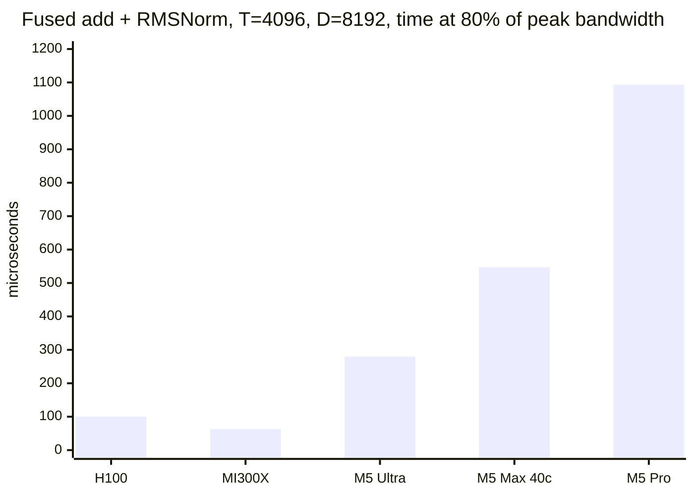
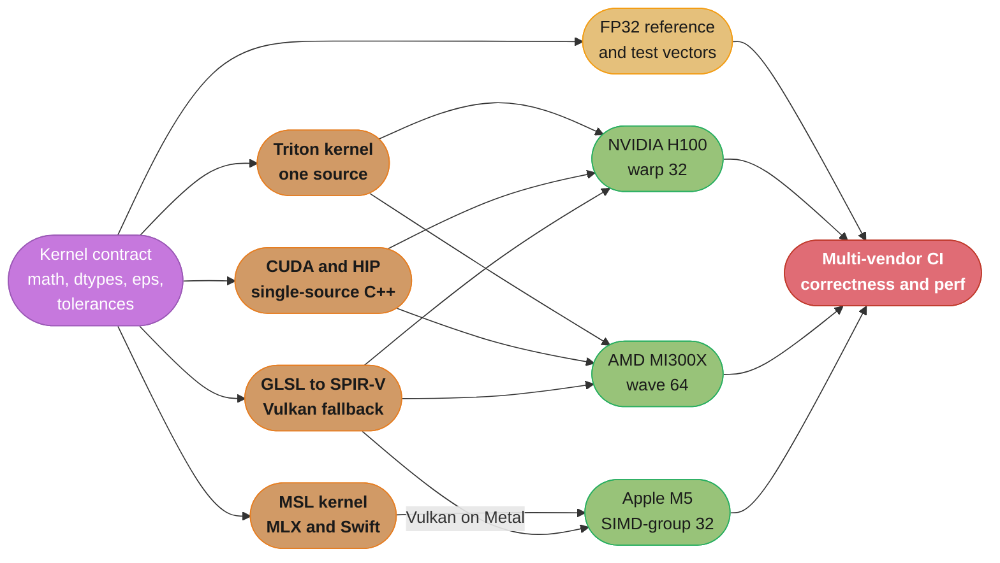
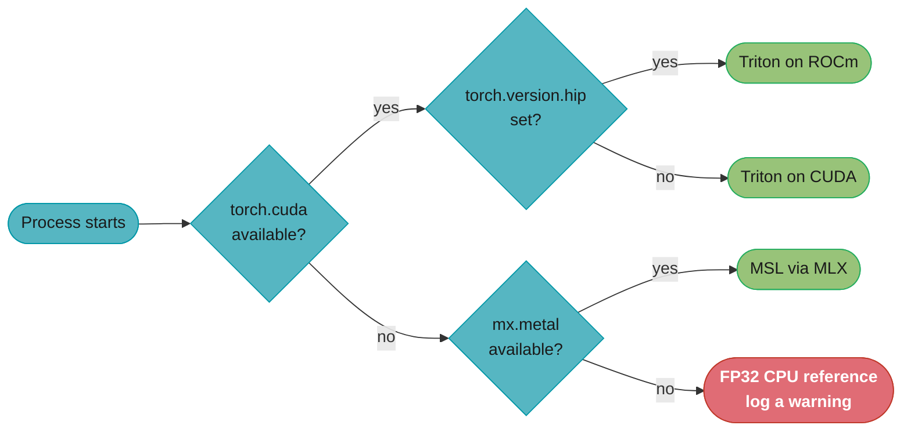

# Case Study: Ship One Kernel Across NVIDIA, AMD and Apple (Triton, HIP and MSL, One Test Matrix)

> **Version anchor (fetched 2026-11-25):** Triton v3.9.0 (released 2026-10-27; README lists Linux, NVIDIA compute capability 8.0+, AMD with ROCm 6.2+, CPUs under development), ROCm Core SDK 10.2.0 (release notes dated 2026-11-18) with HIP documentation 7.17.0, MLX v0.32.5 (2026-11-25), PyTorch 2.15 documentation, Metal Shading Language Specification 4.1 (dated 2026-06-04), Metal Feature Set Tables (dated 2026-10-23), Vulkan SDK headers tag `vulkan-sdk-1.4.363.0`, MoltenVK v1.4.2 (2026-07-24, deprecated by Khronos), llama.cpp v1.0.0 (2026-11-13), `actions/checkout` v7.0.1. Hardware figures come from the AMD Instinct specification table in the ROCm docs, the AMD MI300X and NVIDIA H100 product pages, and the apple.com spec pages, all read on 2026-11-25.

## Intuition

> **Design intuition**: Shipping one kernel on three vendors is not writing one kernel three times. It is writing one **contract** — the math, the dtypes, the rounding rules, the test vectors and the performance target — and then three implementations that are each allowed to be idiomatic for their hardware. The failure mode teams fall into is the opposite: they port the *code* line by line and the *assumptions* come along silently. A literal `32` that was a warp width on NVIDIA becomes half a wavefront on an AMD Instinct GPU. A 227 KB shared-memory tile becomes seven times the 32 KB an Apple threadgroup can hold. A Triton kernel that "runs everywhere" does not run on a Mac at all.

**Key insight**: **Portability is a property of the test matrix, not of the source language.** Triton gives one source for NVIDIA and AMD, but its README lists only Linux with NVIDIA (compute capability 8.0+) and AMD (ROCm 6.2+) GPUs — Apple needs a separate Metal path. HIP gives one C++ source for NVIDIA and AMD, but only if the wavefront width is a template parameter and never a literal. MSL is Apple-only. The only thing that is truly shared across all three is the contract and the harness that checks every implementation against it, on real hardware from every vendor, on every pull request. This case study builds that contract around one small, memory-bound kernel that every transformer runs twice per layer: fused residual-add plus RMSNorm.

**Non-overlap note**: porting a large kernel from CUDA to one AMD target (hipify, wave64 retuning, LDS budget, MFMA) is [`./port_an_llm_kernel_to_amd_mi300.md`](./port_an_llm_kernel_to_amd_mi300.md). Running a whole model on Apple silicon (unified-memory budget, quantized matmul) is [`./run_llm_inference_on_apple_silicon.md`](./run_llm_inference_on_apple_silicon.md). The survey of portability layers (HIP, SYCL, Metal, WebGPU, OpenCL) is [`../gpu_portability_hip_sycl_and_beyond/gpu_portability_hip_sycl_and_beyond.md`](../gpu_portability_hip_sycl_and_beyond/gpu_portability_hip_sycl_and_beyond.md). This file owns the multi-vendor **engineering system**: one contract, several implementations, one correctness and performance matrix, and the CI that keeps them honest.

---

## 1. Requirements Clarification

### The kernel

For each row of a `[T, D]` activation tensor (T tokens, D hidden size):

```
h = x + residual                                  (new residual stream, stored)
y = h * rsqrt(mean(h^2) + eps) * weight           (normalized output, stored)
```

Two inputs (`x`, `residual`) and one parameter vector (`weight`, length D) in, two tensors (`y`, `h`) out. Fusing the add into the norm saves writing `h` and reading it back in a second kernel.

### Functional Requirements

- One numerical contract for all backends: inputs and outputs in FP16 or BF16, all arithmetic after the load in FP32, `eps = 1e-6` by default, and `y` computed from the **FP32** `h`, not from `h` rounded to the storage dtype.
- Implementations:
  - **Triton** for NVIDIA and AMD in the Python serving stack.
  - **Single-source CUDA/HIP C++** for the C++ engine, built with `nvcc` for NVIDIA and through CMake's HIP language support for AMD.
  - **Metal Shading Language** for Apple silicon, called through `mx.fast.metal_kernel` from the MLX stack and as a `.metal` file from the Swift app.
  - **GLSL compiled to SPIR-V for Vulkan** as a fallback for any GPU with a conformant Vulkan driver, including Apple Silicon through a Vulkan-on-Metal layer.
- A runtime dispatcher that picks the backend from what the process can see (`torch.version.hip`, `torch.version.cuda`, `mx.metal.is_available()`), with an FP32 CPU reference as the last resort.
- Hidden sizes D in {2048, 4096, 5120, 8192} (the product's models) plus one non-power-of-two D (1000) as a masking test.

### Non-Functional Requirements

- **Correctness**: every backend matches the FP32 reference within the dtype tolerance (§4.1) on every test vector, on every vendor, on every pull request.
- **Performance**: on prefill-sized inputs (T = 4096) each backend reaches at least 80% of the **measured** copy bandwidth of the same device (an assumption chosen by the team; §8 explains why the gate is a ratio and not an absolute number).
- **No regressions**: kernel time on any device must not regress more than 5% against the last green run of the main branch.
- **Engineering cost**: one engineer must be able to change the contract (for example, add a bias term) and land it on all backends in one pull request.

### Out of Scope

- Matrix-multiply kernels and their per-vendor matrix units (Tensor Cores, MFMA, `simdgroup_matrix`, Vulkan cooperative matrix): see [`../tensor_cores_and_mixed_precision/tensor_cores_and_mixed_precision.md`](../tensor_cores_and_mixed_precision/tensor_cores_and_mixed_precision.md) and [`../cross_vendor_gpu_concept_map/cross_vendor_gpu_concept_map.md`](../cross_vendor_gpu_concept_map/cross_vendor_gpu_concept_map.md).
- Intel GPUs and SYCL (covered in the portability module), and WebGPU.
- Multi-GPU collectives (NCCL, RCCL).

---

## 2. Scale Estimation

Hidden size D = 8192 and the batch sizes below are **design assumptions**. Device bandwidths are vendor-published peaks.

### Bytes and FLOPs per row

```
Per row of D = 8192, FP16 storage:
  read  x          : 8192 x 2 B = 16 KiB
  read  residual   : 8192 x 2 B = 16 KiB
  write h          : 8192 x 2 B = 16 KiB
  write y          : 8192 x 2 B = 16 KiB
  read  weight     : 16 KiB, but shared by every row and served from cache after the first rows
  ---------------------------------------------------------------
  DRAM traffic per row       ~= 64 KiB = 65,536 B
  FLOPs per element          ~= 5 (add, square, accumulate, two multiplies)
  arithmetic intensity       ~= 5 / 8 = 0.625 FLOP/byte
```

0.625 FLOP/byte is two to three orders of magnitude below the ridge point of every GPU in this file. The kernel is memory-bound on all of them, which is what makes it a good portability case: **the target metric — fraction of achievable memory bandwidth — means the same thing on every vendor**, even though peak FLOP/s, warp width and on-chip memory all differ. See [`./cross_cutting/roofline_and_arithmetic_intensity.md`](./cross_cutting/roofline_and_arithmetic_intensity.md).

### Time per call at 80% of peak bandwidth

```
Prefill chunk T = 4096 rows: 4096 x 65,536 B = 268,435,456 B (268 MB)

device                peak BW      80% of peak    time per call
--------------------  -----------  -------------  -------------
NVIDIA H100 SXM       3.35 TB/s    2.68 TB/s       100 us
AMD MI300X            5.3  TB/s    4.24 TB/s        63 us
Apple M5 Pro          307  GB/s    246  GB/s     1,093 us
Apple M5 Max (40c)    614  GB/s    491  GB/s       547 us
Apple M5 Ultra        1.2  TB/s    960  GB/s       280 us

Decode step T = 32 rows: 32 x 65,536 B = 2.1 MB
  H100 at 2.68 TB/s: 0.78 us of traffic -- smaller than a kernel launch, so decode
  performance is decided by launch batching (CUDA Graphs, HIP graphs, Metal command
  buffers), not by this kernel's inner loop.
```



The chart is the performance contract in one picture: a backend is "done" when its measured time is close to its own bar, not when it matches another vendor's bar. An Apple backend at 547 us is a success; an MI300X backend at 200 us is a failure.

### Parallelism per device

| Device | Execution unit | Lanes per scheduling unit | Units | Max on-chip scratch per group |
|---|---|---|---|---|
| NVIDIA H100 | SM | warp of 32 | 132 SMs | up to 227 KB shared memory per block (opt-in) |
| AMD MI300X (CDNA3, gfx942) | CU | wavefront of 64 | 304 CUs (38 per XCD) | 64 KiB LDS per CU |
| AMD MI355X (CDNA4, gfx950) | CU | wavefront of 64 | 256 CUs (32 per XCD) | 160 KiB LDS per CU |
| AMD RDNA (gfx10 and later) | CU | 32 (HIP does not support 64 on gfx10+) | per SKU | per SKU |
| Apple M5 Max | GPU core | SIMD-group of 32 | 32 or 40 cores | 32 KB threadgroup memory |

With T = 4096 rows and one workgroup per row, every device has far more work groups than execution units. With T = 32 (decode), an MI300X runs 32 workgroups on 304 CUs — 90% of the chip is idle. That is acceptable here because the whole call is under a microsecond of traffic; for a larger per-row workload it would call for splitting rows across workgroups. The full vendor vocabulary is in [`./cross_cutting/vendor_terminology_and_numbers_reference.md`](./cross_cutting/vendor_terminology_and_numbers_reference.md).

### The test matrix size

```
vendor classes in CI (4: NVIDIA H100, AMD CDNA MI300X, AMD RDNA, Apple M5 Max)
  x dtypes (2) x hidden sizes (5) x T values (3: 1, 32, 4096) x test vectors (4)
  correctness cases per backend-device pair = 2 x 5 x 3 x 4 = 120 kernel runs
backend-device pairs gated on every PR: 7 (Triton x 2, C++ x 3, MSL x 1, reference x 1)
  ~= 840 correctness runs per PR, each well under 1 s of GPU time
performance cases: T = 4096 only, 2 dtypes x 5 sizes x (10 warm-up + 50 timed) per pair
```

The GPU time of the whole matrix is a few minutes. The cost of the matrix is runner availability on four machine classes, which is what §10 plans.

---

## 3. High-Level Architecture



The contract (purple) is the only artifact every backend depends on. Four implementations (orange) cover three vendors with overlap on purpose: Triton and the C++ kernel both run on NVIDIA and AMD, because the Python stack and the C++ engine are separate products. The CI (red) compares every implementation on every device it targets against the same FP32 reference. No implementation is ever checked against another implementation — only against the reference — so a bug shared by two backends cannot hide behind their agreement.

### The runtime dispatcher



PyTorch for HIP intentionally reuses the `torch.cuda` interfaces, so `torch.cuda.is_available()` is true on both NVIDIA and AMD builds. The PyTorch documentation's own idiom tells them apart: `torch.version.hip` is set on a ROCm build and `torch.version.cuda` on a CUDA build. Any code that treats `torch.cuda.is_available()` as "this is an NVIDIA GPU" will pick NVIDIA-tuned settings on an MI300X.

---

## 4. Component Deep Dives

### 4.1 The contract: reference, test vectors and tolerances

```python
# contract.py -- the only file every backend's tests import
from dataclasses import dataclass
import numpy as np

EPS = 1e-6
HIDDEN_SIZES = (2048, 4096, 5120, 8192, 1000)   # 1000 exercises masking and partial loops
ROW_COUNTS = (1, 32, 4096)

@dataclass(frozen=True)
class Tolerance:
    atol: float
    rtol: float

# FP16 has a 10-bit mantissa (unit roundoff about 4.9e-4); BF16 has 7 bits (about 3.9e-3).
# The bounds below leave room for a different FP32 summation order, not for bugs.
TOL = {"float16": Tolerance(atol=1e-2, rtol=1e-2),
       "bfloat16": Tolerance(atol=3e-2, rtol=3e-2)}

def reference(x: np.ndarray, residual: np.ndarray, weight: np.ndarray,
              eps: float = EPS) -> tuple[np.ndarray, np.ndarray]:
    """FP32 math, FP32 h used for the norm (the contract), results returned in FP32."""
    h = x.astype(np.float32) + residual.astype(np.float32)
    ms = np.mean(h * h, axis=-1, keepdims=True)
    y = h / np.sqrt(ms + eps) * weight.astype(np.float32)
    return y, h

def test_vectors(rows: int, d: int, seed: int = 0) -> list[dict]:
    rng = np.random.default_rng(seed)
    cases = [{"name": "normal",
              "x": rng.standard_normal((rows, d)),
              "res": rng.standard_normal((rows, d)),
              "w": 1.0 + 0.1 * rng.standard_normal(d)}]
    big = rng.standard_normal((rows, d))
    big[:, :: max(1, d // 8)] = 300.0           # 8 outlier channels: 300^2 = 90,000 > FP16 max
    cases.append({"name": "outliers", "x": big, "res": np.zeros((rows, d)),
                  "w": np.ones(d)})
    cases.append({"name": "zeros", "x": np.zeros((rows, d)), "res": np.zeros((rows, d)),
                  "w": np.ones(d)})              # eps must keep this finite: y = 0, not NaN
    sum_overflow = np.full((rows, d), 3.0)       # sum of squares 9 x 8192 = 73,728 > 65,504
    cases.append({"name": "sum_overflow", "x": sum_overflow, "res": np.zeros((rows, d)),
                  "w": np.ones(d)})
    return cases

def check(name: str, got_y: np.ndarray, got_h: np.ndarray, x_in: np.ndarray,
          res_in: np.ndarray, w_in: np.ndarray, dtype: str) -> None:
    """x_in, res_in, w_in: the exact inputs the backend saw (after rounding to `dtype`),
    copied back to the host as FP32. The reference must start from the same rounded inputs."""
    ref_y, ref_h = reference(x_in, res_in, w_in)
    tol = TOL[dtype]
    np.testing.assert_allclose(got_h.astype(np.float32), ref_h, atol=tol.atol, rtol=tol.rtol,
                               err_msg=f"{name}: h")
    np.testing.assert_allclose(got_y.astype(np.float32), ref_y, atol=tol.atol, rtol=tol.rtol,
                               err_msg=f"{name}: y")
```

Three test vectors exist only to break specific implementations. `outliers` sets eight channels of every row to 300: 300 squared is 90,000, which overflows FP16 (maximum 65,504) if the square is computed before the upcast. `sum_overflow` has no large element at all, but 8,192 squares of 3.0 add up to 73,728, which overflows an FP16 accumulator. `zeros` checks that `eps` is applied, so the output is 0 and not `0 / 0`. Numerical background: [`./cross_cutting/numerical_precision_and_determinism.md`](./cross_cutting/numerical_precision_and_determinism.md).

### 4.2 Triton: one source for NVIDIA and AMD

```python
# BROKEN: squares and sums in the storage dtype
import triton
import triton.language as tl

@triton.jit
def add_rmsnorm_broken(x_ptr, res_ptr, w_ptr, y_ptr, h_ptr, stride, n, eps,
                       BLOCK: tl.constexpr):
    row = tl.program_id(0)
    cols = tl.arange(0, BLOCK)
    mask = cols < n
    off = row * stride + cols
    h = tl.load(x_ptr + off, mask=mask, other=0.0) + tl.load(res_ptr + off, mask=mask, other=0.0)
    tl.store(h_ptr + off, h, mask=mask)
    var = tl.sum(h * h, axis=0) / n          # h * h is FP16: 300 * 300 -> inf
    inv = tl.rsqrt(var + eps)                 # rsqrt(inf) = 0
    w = tl.load(w_ptr + cols, mask=mask, other=0.0)
    tl.store(y_ptr + off, h * inv * w, mask=mask)
# On the "outliers" vector every row becomes all zeros. It fails identically on NVIDIA
# and AMD, so it is not a portability bug -- but it passes every test built from
# torch.randn inputs, which is why the contract carries the outlier vector.
```

```python
# FIX: upcast at the load; FP32 for every intermediate; one program per row
import torch
import triton
import triton.language as tl

@triton.jit
def add_rmsnorm_kernel(x_ptr, res_ptr, w_ptr, y_ptr, h_ptr, stride, n, eps,
                       BLOCK: tl.constexpr):
    row = tl.program_id(0)
    cols = tl.arange(0, BLOCK)
    mask = cols < n
    off = row * stride + cols
    x = tl.load(x_ptr + off, mask=mask, other=0.0).to(tl.float32)
    r = tl.load(res_ptr + off, mask=mask, other=0.0).to(tl.float32)
    h = x + r
    tl.store(h_ptr + off, h.to(h_ptr.dtype.element_ty), mask=mask)
    var = tl.sum(h * h, axis=0) / n
    inv = tl.rsqrt(var + eps)
    w = tl.load(w_ptr + cols, mask=mask, other=0.0).to(tl.float32)
    tl.store(y_ptr + off, (h * inv * w).to(y_ptr.dtype.element_ty), mask=mask)

def add_rmsnorm(x: torch.Tensor, residual: torch.Tensor, weight: torch.Tensor,
                eps: float = 1e-6) -> tuple[torch.Tensor, torch.Tensor]:
    if not (x.is_contiguous() and residual.is_contiguous()):
        raise ValueError("x and residual must be contiguous")
    rows, n = x.shape
    y = torch.empty_like(x)
    h = torch.empty_like(x)
    block = triton.next_power_of_2(n)
    num_warps = 8 if block >= 4096 else 4
    add_rmsnorm_kernel[(rows,)](x, residual, weight, y, h, x.stride(0), n, eps,
                                BLOCK=block, num_warps=num_warps)
    return y, h
```

The same source compiles for both vendors, but **`num_warps` does not mean the same number of threads**. Triton's AMD backend sets its warp size to 64 for targets before gfx10 (CDNA, including gfx942 and gfx950) and 32 for gfx10 and later (RDNA), and its default `num_warps` is 4. So `num_warps=8` is 256 threads on an H100 and 512 threads on an MI300X. For D = 8192 that is 32 FP32 values per thread on NVIDIA and 16 on CDNA: different register pressure, different occupancy, and a different best configuration. Tune per vendor (§4.6); never copy an H100 config to MI300X and call it tuned.

Two Triton 3.9 changes matter for anyone maintaining kernels like this. Block pointers were removed — `tl.make_block_ptr` raises `NotImplementedError` and `tl.load` no longer accepts `boundary_check` — so masked loads or tensor descriptors are the portable form. And the AMD backend dropped gfx10 targets (RDNA1 and RDNA2) and Python 3.10. A multi-vendor project pins its Triton version per release and upgrades it deliberately, with the whole matrix green. Triton details: [`../triton_and_kernel_dsls/triton_and_kernel_dsls.md`](../triton_and_kernel_dsls/triton_and_kernel_dsls.md); the AMD library and DSL landscape: [`../rocm_libraries_and_kernel_dsls/rocm_libraries_and_kernel_dsls.md`](../rocm_libraries_and_kernel_dsls/rocm_libraries_and_kernel_dsls.md).

### 4.3 Single-source CUDA and HIP C++: the wavefront width is a template parameter

The HIP documentation is explicit: `warpSize` is 32 on NVIDIA, 64 on AMD gfx9 (CDNA) and 32 on gfx10 and later; HIP does not support 64 on gfx10+; and code that needs the warp size at compile time should query it on the host (`hipDeviceGetAttribute(..., hipDeviceAttributeWarpSize, ...)`) and pass it in as a template parameter. HIP's `__ballot` and `__activemask` return 64-bit masks, and the `_sync` shuffle variants take an `unsigned long long` mask.

```
256-thread block, the cross-warp reduction step

NVIDIA, warp = 32          lanes 0-31 | 32-63 | 64-95 | ... | 224-255
                           warp 0     | warp 1| warp 2| ... | warp 7      -> 8 partial sums

AMD CDNA, wavefront = 64   lanes 0-63          | 64-127        | ... | 192-255
                           wave 0              | wave 1        | ... | wave 3   -> 4 partial sums

BROKEN code: NWARPS = 256 / 32 = 8 (literal), but wid = tid / warpSize
  NVIDIA:  writes partial[0..7], reads partial[0..7]                 -> correct
  CDNA:    writes partial[0..3], reads partial[0..7]                 -> 4 stale LDS values
```

Caption: the bug needs two sources of truth for the warp width — a literal 32 in one line and `warpSize` in another. On NVIDIA they agree, so every NVIDIA test passes. On CDNA the final reduction reads four shared-memory slots that nobody wrote in this launch, so the result depends on what the previous kernel left in LDS: sometimes right, usually wrong, and different between runs.

```cpp
// BROKEN: hipify-style port that mixes a literal 32 with warpSize
#include <hip/hip_runtime.h>
#include <hip/hip_fp16.h>

__device__ float wave_sum(float v) {
    for (int m = warpSize / 2; m > 0; m >>= 1) v += __shfl_xor(v, m);
    return v;
}

__global__ void add_rmsnorm_broken(const __half* x, const __half* res, const __half* w,
                                   __half* y, __half* h_out, int n, float eps) {
    constexpr int NWARPS = 256 / 32;                 // assumes 32-lane warps
    __shared__ float partial[NWARPS];
    const size_t base = (size_t)blockIdx.x * n;
    float ss = 0.f;
    for (int c = threadIdx.x; c < n; c += blockDim.x) {
        float h = __half2float(x[base + c]) + __half2float(res[base + c]);
        h_out[base + c] = __float2half(h);
        ss += h * h;
    }
    ss = wave_sum(ss);
    const int lane = threadIdx.x % warpSize, wid = threadIdx.x / warpSize;
    if (lane == 0) partial[wid] = ss;                // CDNA: only partial[0..3]
    __syncthreads();
    if (wid == 0) {
        ss = lane < NWARPS ? partial[lane] : 0.f;    // CDNA: reads partial[4..7] too
        ss = wave_sum(ss);
        if (lane == 0) partial[0] = ss;
    }
    __syncthreads();
    const float inv = rsqrtf(partial[0] / n + eps);
    for (int c = threadIdx.x; c < n; c += blockDim.x) {
        float h = __half2float(h_out[base + c]);     // also wrong: uses the rounded h
        y[base + c] = __float2half(h * inv * __half2float(w[c]));
    }
}
```

The BROKEN kernel has a second, quieter defect: its second loop re-reads `h_out`, so it normalizes the FP16-rounded `h` instead of the FP32 `h` the contract specifies. The difference is within tolerance — which is exactly why the contract has to say which one is right, or two correct-looking backends will disagree in golden-output tests.

```cpp
// FIX: add_rmsnorm.cu -- one source; nvcc builds it for NVIDIA, CMake's HIP language for AMD
#include <cstdio>
#include <cstdlib>

#if defined(__HIP_PLATFORM_AMD__)
  #include <hip/hip_runtime.h>
  #include <hip/hip_fp16.h>
  #define GPU_CHECK(call) do { hipError_t e_ = (call); if (e_ != hipSuccess) {              \
      std::fprintf(stderr, "%s:%d %s\n", __FILE__, __LINE__, hipGetErrorString(e_));         \
      std::abort(); } } while (0)
  #define SHFL_XOR(v, m, w) __shfl_xor((v), (m), (w))
  using gpu_stream_t = hipStream_t;
  inline int device_warp_size(int dev) {
      int ws = 0;
      GPU_CHECK(hipDeviceGetAttribute(&ws, hipDeviceAttributeWarpSize, dev));
      return ws;
  }
  #define GPU_GET_LAST_ERROR() hipGetLastError()
#else
  #include <cuda_runtime.h>
  #include <cuda_fp16.h>
  #define GPU_CHECK(call) do { cudaError_t e_ = (call); if (e_ != cudaSuccess) {            \
      std::fprintf(stderr, "%s:%d %s\n", __FILE__, __LINE__, cudaGetErrorString(e_));        \
      std::abort(); } } while (0)
  #define SHFL_XOR(v, m, w) __shfl_xor_sync(0xffffffffu, (v), (m), (w))
  using gpu_stream_t = cudaStream_t;
  inline int device_warp_size(int) { return 32; }
  #define GPU_GET_LAST_ERROR() cudaGetLastError()
#endif

template <int WARP>
__device__ __forceinline__ float group_sum(float v) {
    #pragma unroll
    for (int m = WARP / 2; m > 0; m >>= 1) v += SHFL_XOR(v, m, WARP);
    return v;
}

// One block per row. THREADS * ELEMS >= n. h stays in registers between the two passes.
template <int WARP, int THREADS, int ELEMS>
__global__ void __launch_bounds__(THREADS)
add_rmsnorm(const __half* __restrict__ x, const __half* __restrict__ res,
            const __half* __restrict__ w, __half* __restrict__ y,
            __half* __restrict__ h_out, int n, float eps) {
    static_assert(THREADS % WARP == 0, "block must be whole warps");
    constexpr int NWARPS = THREADS / WARP;           // one source of truth for the width
    __shared__ float partial[NWARPS];
    const size_t base = (size_t)blockIdx.x * n;
    float hv[ELEMS];
    float ss = 0.f;
    #pragma unroll
    for (int i = 0; i < ELEMS; ++i) {
        const int c = threadIdx.x + i * THREADS;
        float h = 0.f;
        if (c < n) {
            h = __half2float(x[base + c]) + __half2float(res[base + c]);
            h_out[base + c] = __float2half(h);
        }
        hv[i] = h;                                   // FP32 h, per the contract
        ss += h * h;
    }
    ss = group_sum<WARP>(ss);
    const int lane = threadIdx.x % WARP, wid = threadIdx.x / WARP;
    if (lane == 0) partial[wid] = ss;
    __syncthreads();
    if (wid == 0) {
        ss = lane < NWARPS ? partial[lane] : 0.f;
        ss = group_sum<WARP>(ss);
        if (lane == 0) partial[0] = ss;
    }
    __syncthreads();
    const float inv = rsqrtf(partial[0] / n + eps);
    #pragma unroll
    for (int i = 0; i < ELEMS; ++i) {
        const int c = threadIdx.x + i * THREADS;
        if (c < n) y[base + c] = __float2half(hv[i] * inv * __half2float(w[c]));
    }
}

template <int WARP>
void launch_for_width(const __half* x, const __half* res, const __half* w, __half* y,
                      __half* h, int rows, int n, float eps, gpu_stream_t s) {
    constexpr int THREADS = 256;
    if (n <= THREADS * 8)        add_rmsnorm<WARP, THREADS, 8><<<rows, THREADS, 0, s>>>(x, res, w, y, h, n, eps);
    else if (n <= THREADS * 16)  add_rmsnorm<WARP, THREADS, 16><<<rows, THREADS, 0, s>>>(x, res, w, y, h, n, eps);
    else if (n <= THREADS * 32)  add_rmsnorm<WARP, THREADS, 32><<<rows, THREADS, 0, s>>>(x, res, w, y, h, n, eps);
    else { std::fprintf(stderr, "hidden size %d above 8192 not compiled\n", n); std::abort(); }
    GPU_CHECK(GPU_GET_LAST_ERROR());
}

void add_rmsnorm_launch(const __half* x, const __half* res, const __half* w, __half* y,
                        __half* h, int rows, int n, float eps, int dev, gpu_stream_t s) {
    switch (device_warp_size(dev)) {                 // query once per device in production
        case 32: launch_for_width<32>(x, res, w, y, h, rows, n, eps, s); break;
        case 64: launch_for_width<64>(x, res, w, y, h, rows, n, eps, s); break;
        default: std::fprintf(stderr, "unsupported warp size\n"); std::abort();
    }
}
```

```cmake
# CMakeLists.txt -- the same .cu file, two vendors (the pattern llama.cpp's ggml-hip uses)
cmake_minimum_required(VERSION 3.21)
project(fused_kernels LANGUAGES CXX)
option(USE_HIP "Build for AMD GPUs" OFF)

if(USE_HIP)
  enable_language(HIP)
  set(CMAKE_HIP_ARCHITECTURES gfx942 gfx950)          # MI300 series and MI350 series
  set_source_files_properties(add_rmsnorm.cu PROPERTIES LANGUAGE HIP)
else()
  enable_language(CUDA)
  set(CMAKE_CUDA_ARCHITECTURES 90)                    # H100
endif()

add_library(fused_kernels STATIC add_rmsnorm.cu)
```

The launcher handles both AMD families with one build: a gfx942 binary queries 64 and runs the `WARP = 64` instantiation; an RDNA card queries 32 and runs the other one. Clang's `--offload-arch` (which CMake's `CMAKE_HIP_ARCHITECTURES` drives) may be given more than once, so one fat binary carries code objects for every listed target. The error-check macro is the same idiom as [`./cross_cutting/cuda_error_handling_and_launch_config_patterns.md`](./cross_cutting/cuda_error_handling_and_launch_config_patterns.md), with the vendor prefix hidden behind `GPU_CHECK`. HIP porting in depth: [`../hip_programming_and_porting/hip_programming_and_porting.md`](../hip_programming_and_porting/hip_programming_and_porting.md); why CDNA schedules 64-wide: [`../amd_gpu_architecture_cdna_and_rdna/amd_gpu_architecture_cdna_and_rdna.md`](../amd_gpu_architecture_cdna_and_rdna/amd_gpu_architecture_cdna_and_rdna.md).

### 4.4 Metal Shading Language through MLX: the Apple path

Triton has no Apple backend, so the Apple implementation is written in MSL. The MLX path uses `mx.fast.metal_kernel`: MLX generates the signature from the input and output names, adds the Metal attributes the body uses, and instantiates `template` parameters (dtypes, `int` or `bool` — not `float`, so `eps` travels as a one-element input). `grid` counts threads, not threadgroups.

```python
# BROKEN: SIMD-group 0 reads the partial sums before the other SIMD-groups wrote them
ADD_RMSNORM_BODY_BROKEN = """
    uint row  = threadgroup_position_in_grid.x;
    uint tid  = thread_position_in_threadgroup.x;
    uint lane = thread_index_in_simdgroup;
    uint sg   = simdgroup_index_in_threadgroup;
    threadgroup float partial[TG / 32];
    const uint base = row * N;
    float ss = 0.0f;
    for (uint c = tid; c < N; c += TG) {
        float h = float(x[base + c]) + float(res[base + c]);
        ss += h * h;
    }
    ss = metal::simd_sum(ss);
    if (lane == 0) { partial[sg] = ss; }
    if (sg == 0) {                                   // no threadgroup_barrier before this
        ss = (lane < TG / 32) ? partial[lane] : 0.0f;
        partial[0] = metal::simd_sum(ss);
    }
"""
# SIMD-groups in a threadgroup are not in lockstep with each other. SIMD-group 0 can
# reach the read while SIMD-groups 1-7 are still summing, so the norm uses stale
# threadgroup memory. It passes on a lightly loaded GPU and fails under load.
```

```python
# FIX: barriers around the shared partial sums; FP32 h kept in registers
import mlx.core as mx

ADD_RMSNORM_BODY = """
    uint row  = threadgroup_position_in_grid.x;
    uint tid  = thread_position_in_threadgroup.x;
    uint lane = thread_index_in_simdgroup;
    uint sg   = simdgroup_index_in_threadgroup;
    threadgroup float partial[TG / 32];              // 8 floats for TG = 256: 32 bytes of 32 KB
    const uint base = row * N;
    float hv[ELEMS];
    float ss = 0.0f;
    for (uint i = 0; i < ELEMS; ++i) {
        uint c = tid + i * TG;
        float h = 0.0f;
        if (c < N) {
            h = float(x[base + c]) + float(res[base + c]);
            h_out[base + c] = static_cast<T>(h);
        }
        hv[i] = h;
        ss += h * h;
    }
    ss = metal::simd_sum(ss);
    if (lane == 0) { partial[sg] = ss; }
    threadgroup_barrier(metal::mem_flags::mem_threadgroup);
    if (sg == 0) {
        float t = (lane < TG / 32) ? partial[lane] : 0.0f;
        t = metal::simd_sum(t);
        if (lane == 0) { partial[0] = t; }
    }
    threadgroup_barrier(metal::mem_flags::mem_threadgroup);
    float inv = metal::rsqrt(partial[0] / float(N) + eps[0]);
    for (uint i = 0; i < ELEMS; ++i) {
        uint c = tid + i * TG;
        if (c < N) { y[base + c] = static_cast<T>(hv[i] * inv * float(w[c])); }
    }
"""

_add_rmsnorm = mx.fast.metal_kernel(
    name="add_rmsnorm",
    input_names=["x", "res", "w", "eps"],
    output_names=["y", "h_out"],
    source=ADD_RMSNORM_BODY,
)

def add_rmsnorm_mlx(x: mx.array, res: mx.array, w: mx.array,
                    eps: float = 1e-6) -> tuple[mx.array, mx.array]:
    rows, n = x.shape
    tg = 256                                         # 8 SIMD-groups of 32
    elems = -(-n // tg)
    y, h = _add_rmsnorm(
        inputs=[x, res, w, mx.array([eps], dtype=mx.float32)],
        template=[("T", x.dtype), ("N", n), ("TG", tg), ("ELEMS", elems)],
        grid=(rows * tg, 1, 1),                      # total threads: one threadgroup per row
        threadgroup=(tg, 1, 1),
        output_shapes=[x.shape, x.shape],
        output_dtypes=[x.dtype, x.dtype],
    )
    return y, h

def test_against_mlx_builtin() -> None:
    x = mx.random.normal((64, 8192)).astype(mx.float16)
    r = mx.random.normal((64, 8192)).astype(mx.float16)
    w = (1.0 + 0.1 * mx.random.normal((8192,))).astype(mx.float16)
    y, h = add_rmsnorm_mlx(x, r, w)
    h32 = x.astype(mx.float32) + r.astype(mx.float32)
    ref = mx.fast.rms_norm(h32, w.astype(mx.float32), 1e-6)
    mx.eval(y, h, ref)
    assert mx.allclose(y.astype(mx.float32), ref, atol=1e-2, rtol=1e-2)
```

`threadgroup_barrier(mem_flags::mem_threadgroup)` is Metal's `__syncthreads()`, and the second barrier is as necessary as the first: without it, a SIMD-group that finishes early could read `partial[0]` before SIMD-group 0 wrote the total. The Apple path has its own built-in reference, `mx.fast.rms_norm`, which the test uses in addition to the contract's NumPy reference. On Apple silicon the inputs never cross a bus: MLX arrays live in unified memory and the kernel reads them in place. Metal programming model: [`../metal_compute_programming/metal_compute_programming.md`](../metal_compute_programming/metal_compute_programming.md); MLX's kernel hooks and PyTorch's `torch.mps.compile_shader`: [`../metal_performance_shaders_mlx_and_pytorch_mps/metal_performance_shaders_mlx_and_pytorch_mps.md`](../metal_performance_shaders_mlx_and_pytorch_mps/metal_performance_shaders_mlx_and_pytorch_mps.md).

### 4.5 GLSL for Vulkan: the any-GPU fallback

Vulkan subgroups have a device-reported size: `VkPhysicalDeviceSubgroupSizeControlProperties` reports `minSubgroupSize` and `maxSubgroupSize` (both powers of two) and `requiredSubgroupSizeStages` for pipelines that must pin one size. A Vulkan kernel therefore reads `gl_SubgroupSize` and `gl_NumSubgroups` instead of assuming 32 or 64.

```glsl
#version 450
#extension GL_KHR_shader_subgroup_basic : require
#extension GL_KHR_shader_subgroup_arithmetic : require

layout(local_size_x = 256) in;
layout(std430, set = 0, binding = 0) readonly  buffer X   { float x[];   };
layout(std430, set = 0, binding = 1) readonly  buffer R   { float res[]; };
layout(std430, set = 0, binding = 2) readonly  buffer W   { float w[];   };
layout(std430, set = 0, binding = 3) writeonly buffer Y   { float y[];   };
layout(std430, set = 0, binding = 4) writeonly buffer H   { float h_out[]; };
layout(push_constant) uniform Params { uint n; float eps; } pc;

shared float partial[256];                     // enough for any subgroup size >= 1

void main() {
    const uint row = gl_WorkGroupID.x;
    const uint tid = gl_LocalInvocationID.x;
    const uint base = row * pc.n;
    float ss = 0.0;
    for (uint c = tid; c < pc.n; c += 256u) {
        float h = x[base + c] + res[base + c];
        h_out[base + c] = h;
        ss += h * h;
    }
    ss = subgroupAdd(ss);                      // width comes from the device, not the source
    if (subgroupElect()) { partial[gl_SubgroupID] = ss; }
    memoryBarrierShared();
    barrier();
    if (tid == 0) {
        float t = 0.0;
        for (uint i = 0; i < gl_NumSubgroups; ++i) { t += partial[i]; }
        partial[0] = t;
    }
    memoryBarrierShared();
    barrier();
    const float inv = inversesqrt(partial[0] / float(pc.n) + pc.eps);
    for (uint c = tid; c < pc.n; c += 256u) {
        y[base + c] = (x[base + c] + res[base + c]) * inv * w[c];
    }
}
```

This fallback uses FP32 buffers to avoid depending on the 16-bit storage feature, and it re-reads `x` and `res` in the second loop instead of holding `h` in registers, so it moves about 1.5x the bytes of the tuned backends. It exists for coverage, not speed: any conformant driver can run it. On Apple Silicon Macs, Khronos now recommends KosmicKrisp, a conformant Vulkan driver in Mesa built on Metal 4 that requires macOS 26 or later; MoltenVK, the older layered implementation that converts SPIR-V to MSL at run time, is deprecated by Khronos and maintained by the community on a best-effort basis, and remains the recommended option for Intel-based Macs and iOS. Vulkan compute in depth: [`../vulkan_compute_fundamentals/vulkan_compute_fundamentals.md`](../vulkan_compute_fundamentals/vulkan_compute_fundamentals.md) and [`../vulkan_compute_advanced_and_ecosystem/vulkan_compute_advanced_and_ecosystem.md`](../vulkan_compute_advanced_and_ecosystem/vulkan_compute_advanced_and_ecosystem.md).

### 4.6 Dispatcher, per-vendor tuning table and the CI matrix

```python
# backends.py
import logging

log = logging.getLogger("kernels")

def select_backend() -> str:
    try:
        import torch
        if torch.cuda.is_available():
            return "triton-rocm" if torch.version.hip else "triton-cuda"
    except ImportError:
        pass
    try:
        import mlx.core as mx
        if mx.metal.is_available():
            return "mlx-metal"
    except ImportError:
        pass
    log.warning("no GPU backend found; using the FP32 CPU reference")
    return "reference-cpu"

# Tuned launch settings live in data, keyed by backend and device, never in kernel code.
TUNING = {
    ("triton-cuda", "H100"):   {"num_warps": 8},     # 256 threads
    ("triton-rocm", "MI300X"): {"num_warps": 4},     # 256 threads: 4 wavefronts of 64
    ("mlx-metal",   "M5"):     {"threadgroup": 256}, # 8 SIMD-groups of 32
}
```

The tuning table makes the `num_warps` trap from §4.2 visible: the H100 entry and the MI300X entry launch the same 256 threads with different `num_warps` values. The values themselves come from the autotuning job in CI, not from intuition.

```yaml
# .github/workflows/kernels.yml
name: kernels
on: [pull_request]

jobs:
  correctness-and-perf:
    strategy:
      fail-fast: false                 # one vendor failing must not hide another
      matrix:
        include:
          - vendor: nvidia
            labels: [self-hosted, linux, x64, h100]
            backends: "triton-cuda cpp-cuda vulkan"
          - vendor: amd-cdna
            labels: [self-hosted, linux, x64, mi300x]
            backends: "triton-rocm cpp-hip vulkan"
          - vendor: amd-rdna
            labels: [self-hosted, linux, x64, rdna]
            backends: "cpp-hip vulkan"
          - vendor: apple
            labels: [self-hosted, macOS, ARM64, m5-max]
            backends: "mlx-metal vulkan"
    runs-on: ${{ matrix.labels }}
    timeout-minutes: 30
    steps:
      - uses: actions/checkout@v7
      - name: Correctness against the FP32 contract
        run: python -m pytest tests/correctness --backends "${{ matrix.backends }}"
      - name: Copy-bandwidth baseline on this machine
        run: python tools/copy_bandwidth.py --out baseline.json
      - name: Performance gate (ratio to baseline and to main)
        run: python tools/perf_gate.py --baseline baseline.json --min-ratio 0.80 --max-regression 0.05
```

Runners are registered with custom labels at configuration time (`./config.sh ... --labels gpu,x64,linux` in GitHub's documentation), and GitHub does not validate that a label such as `linux` matches the machine — the label set is the team's contract with its own hardware pool. The perf gate measures a plain copy kernel on the same runner in the same job and compares the fused kernel's achieved bandwidth against it. That makes the gate immune to the fact that an M5 Max and an MI300X differ by almost 9x in peak bandwidth.

```python
# tools/perf_gate.py (core logic)
def achieved_gbps(rows: int, d: int, seconds: float, elem_bytes: int = 2) -> float:
    return 4 * rows * d * elem_bytes / seconds / 1e9   # read x, res; write h, y

def gate(kernel_gbps: float, copy_gbps: float, main_gbps: float,
         min_ratio: float = 0.80, max_regression: float = 0.05) -> list[str]:
    failures = []
    if kernel_gbps < min_ratio * copy_gbps:
        failures.append(f"{kernel_gbps:.0f} GB/s is below {min_ratio:.0%} of copy {copy_gbps:.0f} GB/s")
    if kernel_gbps < (1 - max_regression) * main_gbps:
        failures.append(f"regressed more than {max_regression:.0%} against main ({main_gbps:.0f} GB/s)")
    return failures
```

---

## 5. Design Decisions & Tradeoffs

| Decision | Chosen | Alternative | Why |
|---|---|---|---|
| Python-stack implementation for NVIDIA and AMD | Triton, one source | CUDA C++ and HIP extensions | One source covers both vendors; the kernel is memory-bound, so the last few percent a hand-tuned kernel might find are small |
| C++ engine implementation | Single-source `.cu` with a vendor header and a warp-width template | Two separate files, CUDA and HIP | One file keeps the math in one place; the vendor differences fit in about 20 lines of macros, the same split llama.cpp's ggml uses |
| Apple implementation | MSL through `mx.fast.metal_kernel`, plus the same body in a `.metal` file for Swift | Vulkan via KosmicKrisp only | MSL reaches SIMD-group functions directly and has no translation layer to debug; Vulkan stays as a fallback |
| Vulkan backend | Kept, FP32, not performance-gated | Dropped | It is the only path that runs on any conformant GPU and catches assumptions none of the native backends exercise (variable subgroup size) |
| Source of truth for the warp width | Queried at run time, passed as a template parameter | `warpSize` inside the kernel, or a literal | HIP docs recommend host-side query plus template for compile-time needs; a literal is the root of the §4.3 bug |
| What `y` is computed from | FP32 `h` | `h` rounded to FP16 or BF16 | Avoids one extra rounding; the contract had to pick one so that backends agree |
| Reference | FP32 NumPy, per contract | "Golden" outputs from the NVIDIA backend | A golden output from one vendor would make that vendor's bugs the specification |
| Perf gate | Ratio to a same-machine copy baseline | Absolute GB/s targets per device | Absolute targets need re-deriving per SKU and drift with drivers; the ratio transfers |
| Tolerance | atol = rtol = 1e-2 (FP16), 3e-2 (BF16) | Bit-exact across vendors | Different reduction trees and FMA contraction produce different last bits; bit-exactness across vendors is not achievable without giving up performance |
| Triton version | Pinned per release, upgraded with the whole matrix green | Track latest | 3.9 removed block pointers and gfx10 targets in a minor release |

---

## 6. Real-World Implementations

**llama.cpp / ggml: one CUDA source tree, compiled for AMD.** The `ggml-hip` CMake file globs `../ggml-cuda/*.cu` and the CUDA template instances, and marks them with CMake's HIP language, so AMD builds compile the same kernel sources NVIDIA builds use. A vendor header (`ggml-cuda/vendors/hip.h`) maps cuBLAS names to hipBLAS, defines `HIP_ENABLE_WARP_SYNC_BUILTINS`, and makes the thread-mask type `uint64_t` on HIP; `ggml_cuda_get_physical_warp_size()` returns 64 for GFX9 and GFX8 targets and 32 otherwise. The same repository keeps a separate Metal kernel directory and a Vulkan shader directory with about 196 entries, and its build documentation shows building several backends at once (for example `-DGGML_CUDA=ON -DGGML_VULKAN=ON`) and building the Vulkan backend on a Mac with Metal turned off (`-DGGML_VULKAN=1 -DGGML_METAL=OFF`) through MoltenVK or KosmicKrisp. It is the clearest public example of the §5 split: single source where vendors share a language, separate sources where they do not.

**Liger Kernel (LinkedIn): Triton kernels with AMD in CI.** Liger Kernel is a collection of Triton kernels for LLM training (RMSNorm, RoPE, SwiGLU, cross-entropy and fused linear losses). Its README reports up to 20% higher multi-GPU training throughput and 60% lower memory use, announces "Full AMD support" in v0.4.0 (2024-11-06), documents a ROCm install from the PyTorch ROCm wheel index, and thanks AMD for providing GPUs for its AMD CI. One Triton source, two vendors, and real AMD hardware in CI is this case study's architecture minus the Apple column.

**MLX: one framework, two GPU backends, two kernel hooks.** MLX installs with a CUDA backend on Linux (`pip install mlx[cuda12]` or `mlx[cuda13]`, NVIDIA SM 7.5 or newer) in addition to Metal on Apple silicon. Its custom-kernel APIs mirror each other: `mx.fast.metal_kernel` and `mx.fast.cuda_kernel` take the same name, input names, output names, body source and header arguments, and the CUDA version adds a `shared_memory` size. The host code can be shared; the kernel body cannot, because one is MSL and the other is CUDA C++.

**Triton itself.** The README lists supported platforms as Linux and supported hardware as NVIDIA GPUs with compute capability 8.0+ and AMD GPUs with ROCm 6.2+, with CPUs under development. The 3.9.0 release notes give AMD code generation its own LLVM pin, make Triton prefer ROCm from TheRock Python wheels, remove gfx10 (RDNA1 and RDNA2) targets, remove block pointers and drop Python 3.10. In the AMD backend source, the warp size is 32 for gfx10 and later and 64 otherwise. Each of these facts changes a multi-vendor project's CI or code.

**PyTorch.** The HIP semantics page states that PyTorch for HIP intentionally reuses the `torch.cuda` interfaces and gives the `torch.version.hip` / `torch.version.cuda` idiom used in §3. On Apple silicon, `torch.mps.compile_shader` compiles Metal source at run time and exposes its kernels as Python callables — a second route to the same MSL body for teams whose Apple stack is PyTorch rather than MLX.

**Khronos and the Vulkan-on-Metal layer.** The MoltenVK README now opens with a deprecation notice: Khronos has deprecated MoltenVK, the repository is community-maintained on a best-effort basis, and Khronos recommends KosmicKrisp on Apple Silicon Macs. Mesa's documentation describes KosmicKrisp as a Vulkan-conformant implementation on top of Metal 4, requiring macOS 26 and later. A project whose Apple path was "Vulkan through MoltenVK" now carries a migration item; one whose Apple path is native MSL does not.

---

## 7. Technologies & Tools

| Tool | Role | Notes |
|---|---|---|
| Triton | One Python kernel source for NVIDIA and AMD | v3.9.0; Linux; NVIDIA CC 8.0+, AMD ROCm 6.2+; `num_warps` counts 64-lane wavefronts on CDNA |
| HIP and ROCm | AMD runtime and compilers | `amdclang++ --offload-arch=gfx942`; `hipDeviceGetAttribute(..., hipDeviceAttributeWarpSize, ...)`; 64-bit `__ballot` |
| CUDA toolkit | NVIDIA compiler and runtime | Same `.cu` source as HIP; `__shfl_xor_sync` with a 32-bit mask |
| CMake HIP language | Compiles `.cu` files as HIP | `enable_language(HIP)`, `CMAKE_HIP_ARCHITECTURES`, `LANGUAGE HIP` source property |
| MLX | Apple GPU arrays and `mx.fast.metal_kernel` | Also `mx.fast.rms_norm` as a built-in reference on Apple |
| PyTorch MPS | `torch.mps.compile_shader` | Alternate Apple route for PyTorch-based stacks |
| Vulkan SDK, glslang | GLSL to SPIR-V | `GL_KHR_shader_subgroup_arithmetic` for `subgroupAdd` |
| KosmicKrisp | Vulkan on Metal 4 for Apple Silicon Macs | Khronos's recommendation; macOS 26 and later |
| MoltenVK | Vulkan 1.4 layered on Metal, SPIR-V to MSL | Deprecated by Khronos; still recommended for Intel Macs and iOS |
| Nsight Compute | NVIDIA per-kernel bandwidth and occupancy | DRAM throughput metric as in [`./cross_cutting/nsight_profiling_workflow.md`](./cross_cutting/nsight_profiling_workflow.md) |
| rocprofv3 and rocprof-compute | AMD per-kernel counters and roofline | See [`../rocm_profiling_and_debugging/rocm_profiling_and_debugging.md`](../rocm_profiling_and_debugging/rocm_profiling_and_debugging.md) |
| Xcode GPU tools | Apple capture and shader profiling | MLX: `mx.metal.start_capture` with `MTL_CAPTURE_ENABLED=1`; see [`../metal_profiling_and_debugging/metal_profiling_and_debugging.md`](../metal_profiling_and_debugging/metal_profiling_and_debugging.md) |
| GitHub Actions self-hosted runners | Per-vendor CI machines | Custom labels per machine class; `fail-fast: false` |

---

## 8. Operational Playbook

### The correctness and performance matrix

| Backend | H100 | MI300X | RDNA box | M5 Max | Gate |
|---|---|---|---|---|---|
| Triton | correctness + perf | correctness + perf | not gated (CDNA is the AMD production target; Triton 3.9 dropped gfx10) | not available | every PR |
| CUDA/HIP C++ | correctness + perf | correctness + perf | correctness | not available | every PR |
| MSL (MLX) | not available | not available | not available | correctness + perf | every PR |
| Vulkan GLSL | correctness | correctness | correctness | correctness (KosmicKrisp) | nightly |
| FP32 reference | everywhere | everywhere | everywhere | everywhere | every PR (self-test) |

"Not available" cells are not gaps to fill: they record which implementation is the intended one for each vendor. A reviewer reading this table knows that an Apple-only bug can only live in the MSL or Vulkan rows.

### Measuring the copy baseline

```python
# tools/copy_bandwidth.py (torch devices; the MLX variant times mx.array copies with mx.eval)
import json
import time
import torch

def copy_gbps(device: str, n_bytes: int = 1 << 30, iters: int = 20) -> float:
    a = torch.empty(n_bytes // 2, dtype=torch.float16, device=device)
    b = torch.empty_like(a)
    for _ in range(3):
        b.copy_(a)
    torch.cuda.synchronize()
    t0 = time.perf_counter()
    for _ in range(iters):
        b.copy_(a)
    torch.cuda.synchronize()
    seconds = (time.perf_counter() - t0) / iters
    return 2 * n_bytes / seconds / 1e9            # read a + write b

if __name__ == "__main__":
    print(json.dumps({"copy_gbps": copy_gbps("cuda")}))
```

On a ROCm build, `torch.cuda.synchronize()` and the `"cuda"` device string work unchanged — the same `torch.cuda` reuse that §3's dispatcher depends on.

### Profiling loop per vendor

1. Run the perf gate; if the ratio to the copy baseline is under 0.80, profile on that vendor only.
2. NVIDIA: Nsight Compute DRAM throughput and achieved occupancy for one launch at T = 4096.
3. AMD: rocprof-compute's memory chart and roofline for the same launch; compare VGPR usage between `num_warps` settings.
4. Apple: an Xcode capture of one launch; read the shader's memory bandwidth and occupancy in the GPU tools.
5. Fix in the backend that is slow. Never change the contract to make one backend's numbers look better.
6. Re-run the whole matrix, including the vendors you did not touch.

### Runbook: "the MI300X job fails, everything else passes"

1. Check whether the failure is flaky across reruns. Flaky wrong answers on CDNA and stable correct answers on NVIDIA point at a warp-width assumption reading uninitialized LDS (§4.3).
2. Grep the backend for literal `32`, `0xffffffff`, `>> 5` and `& 31`; each is a candidate warp-width assumption.
3. Check Triton's `num_warps` and the tuning table for the MI300X key; a missing key falls back to the default of 4 wavefronts.
4. Run the same test on the RDNA box. If RDNA passes and CDNA fails, the bug is wave64-specific.
5. If the failure appeared after a toolchain change (Triton, ROCm, driver), bisect the toolchain before the kernel.

### Runbook: "the Apple job fails under load only"

1. Suspect a missing `threadgroup_barrier`: SIMD-groups in a threadgroup are not in lockstep with each other.
2. Re-run with Metal API validation and shader validation enabled.
3. Check that `TG / 32` matches the threadgroup size actually passed to the dispatch.
4. Compare with `mx.fast.rms_norm` on the same inputs to separate kernel bugs from contract bugs.

---

## 9. Common Pitfalls & War Stories

**The flaky norm on MI300X (illustrative incident).** A hipify-assisted port shipped the §4.3 BROKEN kernel. NVIDIA CI was green for three weeks because AMD hardware was not yet in CI. When the first MI300X runner arrived, about 40% of test runs failed with outputs off by 10-60%, and reruns sometimes passed. The root cause was a literal `NWARPS = 256 / 32` next to `wid = threadIdx.x / warpSize`. Impact before the fix: two days of an inference canary on MI300X served outputs from a model whose every layer norm was wrong, which the canary's quality monitor caught as a 9-point drop on its eval (illustrative figures). The fix was the warp-width template and a rule that no kernel source contains the literal 32.

**FP16 squares on outlier activations.** The §4.2 BROKEN Triton kernel passed every test built from `torch.randn`. The first real checkpoint had residual-stream channels above 300 in a few layers; 300 squared overflows FP16, the row's mean square became infinite, and the row output became zero. Impact: the affected layers zeroed one token's hidden state per occurrence and generation degraded on long prompts (illustrative). The contract's `outliers` and `sum_overflow` vectors now exist so that no backend can pass without upcasting.

**Golden outputs that disagreed by one ulp.** The Apple backend normalized FP32 `h`; the first C++ backend normalized the FP16-rounded `h`. Both were within tolerance of the reference, but a downstream team had built bit-exact golden-output tests on the NVIDIA backend, and the Apple backend failed 100% of them. Impact: a week of investigation into a "Metal precision bug" that did not exist. The fix was a contract clause (FP32 `h`) and a rule that cross-vendor tests use tolerances, never golden bits.

**`num_warps` copied from H100 to MI300X.** An autotuned `num_warps=16` from the H100 was reused on the MI300X: 512 threads on NVIDIA, 1,024 on CDNA. At D = 4096 each thread on CDNA held only 4 values, the reduction tree got deeper, and the kernel reached 61% of the copy baseline instead of 85% (illustrative). The tuning table keyed by backend and device fixed it.

**The Triton upgrade that removed an API.** A routine upgrade to Triton 3.9 broke every kernel in the repository that used `tl.make_block_ptr`, which now raises `NotImplementedError`, and dropped the team's RDNA2 developer workstations (gfx103x) from Triton entirely. Impact: CI red on both vendors for the day it took to port to masked loads, and two developers moved to the C++ backend for local work. Since then, toolchain upgrades are their own pull requests with the full matrix.

**Missing barrier on Apple.** The §4.4 BROKEN kernel passed when tests ran alone and failed when the CI job ran four test processes in parallel on the M5 Max. Impact: three days of "flaky Mac runner" tickets before anyone read the kernel. A missing barrier is a race, and races hide on idle hardware.

**Assuming Triton covers Apple.** An early plan budgeted zero engineering time for Apple because "Triton is portable". Triton's own README lists Linux with NVIDIA and AMD GPUs only. Impact: the Apple backend slipped one release. The planning rule since then: a portability layer's supported-hardware list is read from its README on the day of planning, not from memory.

**Absolute perf targets across vendors.** The first perf gate demanded 2.5 TB/s on every machine. It failed every Apple run (an M5 Max peaks at 614 GB/s) and passed an MI300X run that was using under half of its 5.3 TB/s. The ratio-to-copy gate in §4.6 replaced it.

---

## 10. Capacity Planning

### Engineering cost of the backends

| Artifact | Lines (approx.) | Vendors covered | Change cost when the contract changes |
|---|---|---|---|
| Contract (reference, vectors, tolerances) | 80 | all | Always changed first |
| Triton kernel and launcher | 45 | NVIDIA, AMD | One file |
| CUDA/HIP single source and CMake | 150 | NVIDIA, AMD (CDNA and RDNA) | One file plus template instantiations |
| MSL body and MLX wrapper | 60 | Apple | One file, plus the `.metal` copy for Swift |
| GLSL fallback | 50 | any Vulkan GPU | One file |
| Tests, perf gate, CI workflow | 300 | all | Rarely |

About 300 lines of kernel code across four implementations and about 380 lines of contract and harness. The harness is larger than any single implementation, which is the point: it is the part that makes the implementations trustworthy.

### CI runner capacity

```
Per pull request:
  correctness: ~840 kernel runs, each < 1 s GPU time, spread over 4 vendor jobs
                                                              -> a few GPU-minutes per job
  perf:        5 sizes x 2 dtypes x (10 warm-up + 50 timed) per backend-device pair
               at most 1.1 ms per run on the slowest device (M5 Pro size class)  -> < 1 s per pair
  fixed cost per job (checkout, environment, imports): assume 3 minutes (assumption)

Wall-clock per PR ~= max over vendor jobs ~= 8-10 minutes when every runner is free

Team of 12 engineers, ~25 kernel PRs per working day, plus 2 re-runs each (assumption):
  75 jobs per vendor per day x ~10 minutes = 750 runner-minutes per vendor per day
  one runner gives 8 working hours x 60 = 480 minutes -> 2 runners per vendor to avoid queues
```

| Vendor class | Runners | Why |
|---|---|---|
| NVIDIA (H100) | 2 | 750 minutes of demand per day against 480 per runner |
| AMD CDNA (MI300X) | 2 | Same demand; also the only place wave64 bugs show |
| AMD RDNA | 1 | Correctness only; low demand |
| Apple (M5 Max) | 2 | Correctness and perf; macOS runners also serve the Swift app's tests |
| Nightly Vulkan | shares the above | Runs outside working hours |

### Per-call budget in the serving path

From §2: at T = 4096 the fused kernel costs about 100 us on H100, 63 us on MI300X and 547 us on an M5 Max at 80% of peak. A transformer layer calls it twice, so a 64-layer model spends 128 calls per prefill chunk: about 12.8 ms on H100, 8.1 ms on MI300X and 70 ms on an M5 Max. Those numbers are the input to each platform's TTFT budget, and they show why a bandwidth-bound kernel that is "fast enough" on a datacenter GPU is a visible share of time on a laptop GPU — and why the ratio gate, not the absolute time, is the right definition of done for each.

---

## 11. Interview Discussion Points

**Q: Triton is portable, so why does a multi-vendor product still need an Apple-specific kernel?**
**Short:** Triton's README lists only Linux with NVIDIA (CC 8.0+) and AMD (ROCm 6.2+) GPUs, so Apple GPUs need an MSL or Vulkan path.

Portability in Triton means one source for the GPUs it has backends for. Apple silicon is not one of them, and neither is macOS. The Apple path is MSL through `mx.fast.metal_kernel` or `torch.mps.compile_shader`, or GLSL through a Vulkan-on-Metal driver. Always read a portability layer's supported-hardware list on the day you plan.

**Q: Why is fused add plus RMSNorm a good first kernel to make multi-vendor?**
**Short:** It is memory-bound everywhere, so "fraction of achievable bandwidth" is one target that means the same thing on every vendor.

At about 0.6 FLOP per byte, no GPU in the matrix is compute-limited on it. That removes matrix units, peak FLOP/s and tiling from the comparison and leaves the parts that really differ — reduction width, barriers and launch shapes. It also runs twice per transformer layer, so it matters.

**Q: What breaks when CUDA reduction code runs on an AMD Instinct GPU?**
**Short:** Anything that assumes 32 lanes: CDNA wavefronts are 64 wide, ballot masks are 64-bit, and a literal 32 mixed with warpSize miscounts warps.

HIP documents `warpSize` as 32 on NVIDIA, 64 on gfx9 (CDNA) and 32 on gfx10 and later. Code that is consistent about the width — always a template parameter, or always `warpSize` — keeps working. Code that mixes a literal with the queried value computes the wrong number of partial sums and can read stale LDS, which shows up as flaky wrong answers only on AMD.

**Q: How do you write one CUDA/HIP source that handles both 32- and 64-wide hardware?**
**Short:** Make the width a template parameter, query it on the host with hipDeviceGetAttribute, and dispatch to the matching instantiation.

That is the approach HIP's documentation recommends when the warp size is needed at compile time. Every derived constant (number of warps per block, shuffle loop start, mask type) comes from that one parameter. A vendor header hides the API prefix and the shuffle intrinsic, so the kernel body stays shared.

**Q: Does `num_warps=8` in Triton mean the same thing on NVIDIA and AMD?**
**Short:** No: Triton's AMD backend uses 64-lane warps on CDNA, so num_warps=8 is 512 threads there and 256 threads on NVIDIA.

The AMD backend sets its warp size to 64 for targets before gfx10 and 32 for gfx10 and later. Register pressure, values per thread and the best configuration all change with it. Keep tuning values in a table keyed by backend and device, filled by autotuning on each vendor.

**Q: Why compare every backend with an FP32 reference instead of with the NVIDIA backend?**
**Short:** A golden output from one backend turns that backend's bugs into the specification and hides bugs shared by two backends.

An independent FP32 reference plus tolerances catches a bug in any backend, including the first one. Comparing backends with each other also invites bit-exact tests, which fail across vendors for legitimate reasons: different reduction trees and FMA contraction change the last bits.

**Q: What tolerance should a cross-vendor test use?**
**Short:** One derived from the storage dtype's precision and the reduction length, for example 1e-2 for FP16 outputs, and never bit-exactness.

FP16 has a unit roundoff of about 4.9e-4 and BF16 about 3.9e-3, and each backend sums the row in a different order. The tolerance must absorb that, while adversarial vectors (outliers, overflowing sums, all zeros) catch real bugs that ordinary random inputs never trigger.

**Q: How do you gate performance across devices whose bandwidth differs by almost 10x?**
**Short:** Gate each kernel against a copy-bandwidth baseline measured on the same machine in the same job, plus a regression bound against main.

An M5 Max peaks at 614 GB/s and an MI300X at 5.3 TB/s, so an absolute target is wrong for at least one of them. A ratio such as 80% of copy bandwidth means the same on both and survives driver and SKU changes. The regression bound catches slow drift that stays above the ratio.

**Q: What is the Metal equivalent of `__syncthreads()`, and why does the reduction need two of them?**
**Short:** Metal's equivalent is threadgroup_barrier with the mem_threadgroup flag, and the reduction needs one barrier to publish per-SIMD-group sums and a second to publish the total.

SIMD-groups inside a threadgroup are not in lockstep. Without the first barrier, SIMD-group 0 can read partial sums that others have not written; without the second, other SIMD-groups can read the total before SIMD-group 0 wrote it. Missing barriers often pass on an idle GPU and fail under load.

**Q: Why keep a Vulkan backend if every vendor already has a native one?**
**Short:** It runs on any conformant GPU, exercises device-chosen subgroup sizes, and gives a path for hardware the native backends do not cover.

The fallback here is not performance-gated; it is a coverage and assumption check. On Apple Silicon Macs it now runs through KosmicKrisp, which Khronos recommends since deprecating MoltenVK. It also forces the reduction code to read `gl_SubgroupSize` instead of assuming 32 or 64.

**Q: How does llama.cpp share kernel code between NVIDIA and AMD?**
**Short:** Its HIP backend compiles the CUDA backend's .cu files as HIP, with a vendor header that maps APIs and uses 64-bit thread masks.

`ggml-hip`'s CMake globs `ggml-cuda/*.cu` and sets their language to HIP. `vendors/hip.h` maps cuBLAS names to hipBLAS and defines the mask type as `uint64_t`, and a helper returns a physical warp size of 64 on GFX9 and GFX8. Metal and Vulkan have their own kernel sources, because they are different languages.

**Q: What should happen when a toolchain upgrade (Triton, ROCm, Xcode) lands?**
**Short:** It goes in its own pull request, pinned, and merges only with the full multi-vendor matrix green.

Minor releases remove things: Triton 3.9 removed block pointers and gfx10 targets and dropped Python 3.10. Mixing an upgrade with kernel changes makes every failure ambiguous. A pinned toolchain per release, upgraded deliberately, keeps each red CI run attributable to one change.

---

*Production lesson*: the kernel in this file is about 50 lines per backend. The system around it — a written contract, adversarial test vectors, a dispatcher that knows a ROCm build answers to `torch.cuda`, a tuning table keyed by vendor, a ratio-based perf gate and real hardware from every vendor in CI — is several times larger, and it is the part that makes "runs on NVIDIA, AMD and Apple" a fact instead of a claim. Port the contract, not the code.
