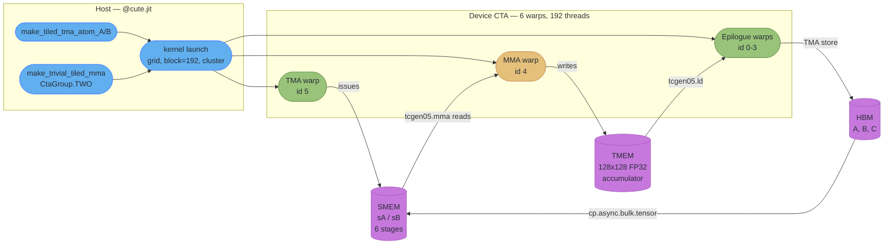

# Case Study: Write a Blackwell GEMM with CuTe DSL

## Intuition

> **Design intuition**: The GEMM optimization ladder in
> [`optimize_matrix_multiplication_kernel.md`](optimize_matrix_multiplication_kernel.md) ends at
> a rung it cannot climb past. Every rung there — coalescing, shared-memory tiling, register
> blocking, WMMA — is a thing *one thread* does with data *it* holds. On Blackwell the fast path
> is none of those: a single elected thread issues a `tcgen05.mma` for the whole CTA, the
> operands arrive by hardware TMA copies that no thread issued a load for, the accumulator lives
> in Tensor Memory that no thread can read without an explicit `tcgen05.ld`, and three different
> warps in the same block are running three different programs. The kernel is not "the same
> matmul, tuned harder." It is a different shape.
>
> CuTe DSL is how you write that shape without hand-writing PTX or waiting on C++ template
> instantiation. It is Python — `@cute.jit` on the host function, `@cute.kernel` on the kernel —
> emitting exactly the CUTLASS kernel a C++ template would have emitted, in seconds instead of
> minutes of compile.

**Key insight**: On a B200 an 8192-cubed FP16 GEMM has an arithmetic intensity of about
**2,731 FLOP/byte** against a ridge point of **281 FLOP/byte** — it is 9.7x past the knee, so
deeply compute-bound that HBM bandwidth is nearly irrelevant. Everything that decides whether you
get 40% or 85% of peak happens *on-chip*: whether the MMA unit ever waits for a tile, whether the
epilogue's TMEM-to-register copy overlaps the next tile's math, and whether the tile scheduler
keeps every SM holding a valid tile from launch to drain. That is why the modern kernel is
warp-specialized and persistent — those two structural choices are the whole game, and neither
one is visible anywhere on a roofline chart.

This case study builds a **persistent, warp-specialized, 2-CTA dense GEMM for SM100 in CuTe DSL**,
modelled directly on CUTLASS's shipped
`examples/python/CuTeDSL/cute/blackwell/kernel/dense_gemm/dense_gemm_persistent.py`. Read
[`tensor_cores_and_mixed_precision`](../tensor_cores_and_mixed_precision/tensor_cores_and_mixed_precision.md)
§4.1b first for the `wmma` → `wgmma` → `tcgen05` lineage and what Tensor Memory is; this file
assumes it.

---

## 1. Requirements Clarification

### Functional Requirements

- Compute `C = A @ B` for `A` (M x K), `B` (N x K), `C` (M x N), FP16 inputs with FP32
  accumulation and FP16 output, batched over an `L` dimension.
- Target **SM100** (B200, compute capability 10.0) specifically, using `tcgen05.mma` with
  `cta_group=2` — the two-SM MMA mode in which a pair of CTAs in a thread-block cluster
  cooperate on one instruction.
- Stage A and B tiles from global to shared memory with **TMA** (`cp.async.bulk.tensor`), with
  cluster multicast so a tile fetched once from HBM lands in both CTAs of the cluster.
- Keep the accumulator in **Tensor Memory** and move it to registers with `tcgen05.ld` only in
  the epilogue.
- Optionally store `C` back through TMA (`--use_tma_store`) rather than a plain global store.
- Accept an elementwise epilogue lambda so the same kernel serves `C = A@B` and
  `C = relu(A@B)`.
- Verify against `torch.matmul` in FP32 reference, with an FP16-accumulation tolerance derived
  in [`cross_cutting/numerical_precision_and_determinism.md`](cross_cutting/numerical_precision_and_determinism.md).

### Non-Functional Requirements

- **Throughput target: at least 80% of the B200's dense FP16 Tensor-Core peak** on the reference
  shape. Peak is ~2.25 PFLOP/s dense per GPU (NVIDIA quotes HGX B200 at 36 PFLOPS FP16/BF16
  *with sparsity* across 8 GPUs — halve for dense, divide by 8 for per-GPU), so the target is
  ~1.8 PFLOP/s.
- **Compile time under 10 seconds** for a fresh kernel variant, and effectively zero on a repeat
  launch of the same variant — `@cute.jit` caches by default (`no_cache=False`).
- No `nvcc` in the loop: the whole build is `pip install nvidia-cutlass-dsl` and Python.
- Every launch parameter that the hardware constrains must be *checked*, not assumed — see the
  constraint list in §4.2, which is the single largest source of silent misconfiguration here.

### Out of Scope

- Block-scaled NVFP4/MXFP8 GEMM. Same kernel skeleton, different MMA atom and an extra scale-factor
  tensor; the instruction-and-layout side is owned by
  [`tensor_cores_and_mixed_precision`](../tensor_cores_and_mixed_precision/tensor_cores_and_mixed_precision.md)
  §4.1b and the accuracy side by
  [`llm/optimization_and_quantization`](../../llm/optimization_and_quantization/optimization_and_quantization.md).
- Fused attention. FlashAttention-4 is also written in CuTe DSL and is covered in
  [`build_a_flash_attention_kernel.md`](build_a_flash_attention_kernel.md) — including its
  softmax/MMA warpgroup ping-pong, which exists because of the TMEM constraint this file
  explains. Do not re-derive it here.
- Multi-GPU tensor-parallel GEMM — see
  [`multi_gpu_programming_and_nccl`](../multi_gpu_programming_and_nccl/multi_gpu_programming_and_nccl.md).
- Autotuning the tile shape. The DSL supports it; this case study fixes one configuration and
  reasons about it.

---

## 2. Scale Estimation

### The reference problem and its FLOP count

Reference shape: `M = N = K = 8192`, `L = 1`, FP16 in, FP32 accumulate — the same shape CUTLASS's
own example benchmarks with (`--mnkl 8192,8192,8192,1 --mma_tiler_mn 256,128
--cluster_shape_mn 2,1 --use_tma_store --use_2cta_instrs`).

```
FLOPs = 2 * M * N * K                       (one multiply + one add per inner-product term)
      = 2 * 8192 * 8192 * 8192
      = 1,099,511,627,776
      = 1.0995 TFLOP per GEMM
```

| Symbol | Meaning |
|---|---|
| `2` | Each K-step is one FMA, counted as two FLOPs — the universal GEMM convention |
| `M * N` | Output elements, each an independent inner product |
| `K` | Length of each inner product |

### The compute floor

```
  B200 dense FP16 Tensor-Core peak  = 2.25 PFLOP/s  (2.25e15 FLOP/s)

  t_min = 1.0995e12 FLOP / 2.25e15 FLOP/s = 4.887e-4 s = 0.489 ms   at 100% of peak
  t_80  = 0.489 ms / 0.80                              = 0.611 ms   at the 80% target
  t_50  = 0.489 ms / 0.50                              = 0.978 ms   at a mediocre 50%
```

The gap between `t_80` and `t_50` is **367 microseconds on one GEMM**. In a 96-layer transformer
doing four large GEMMs per layer, that is 141 ms per forward pass thrown away by structural
inefficiency — which is the entire commercial argument for warp specialization.

### Bytes moved, and why they barely matter

```
  A: 8192 * 8192 * 2 B = 134,217,728 B
  B: 8192 * 8192 * 2 B = 134,217,728 B
  C: 8192 * 8192 * 2 B = 134,217,728 B
  ------------------------------------
  total (compulsory)   = 402,653,184 B = 402.7 MB

  at B200's 8 TB/s HBM3e:  402.7 MB / 8e12 B/s = 50.3 us
```

50.3 us of unavoidable memory traffic against a 489 us compute floor: HBM is busy **10.3% of the
time**. Compare the ratio directly:

```
  Arithmetic intensity = 1.0995e12 FLOP / 4.0265e8 B  = 2,731 FLOP/byte
  B200 ridge point     = 2.25e15 FLOP/s / 8e12 B/s    =   281 FLOP/byte

  2731 / 281 = 9.7x past the ridge  -->  compute-bound with enormous margin
```

The lesson this shape teaches, and the reason it is the right reference for a Blackwell kernel:
**you cannot fix this kernel by moving fewer bytes.** Every optimization that matters is about
keeping the MMA pipe fed, not about the memory system. See
[`cross_cutting/roofline_and_arithmetic_intensity.md`](cross_cutting/roofline_and_arithmetic_intensity.md)
for the model itself.

### On-chip budget

With `mma_tiler_mn = (256, 128)` and `cta_group=2`, the 256-row MMA tile is split across the two
CTAs of the cluster, so each CTA stages 128 rows of A. Taking a 64-element K-step (128 bytes of
FP16, which is the natural TMA box inner extent):

```
  per stage, per CTA:
    sA : 128 rows x 64 K x 2 B = 16,384 B
    sB : 128 cols x 64 K x 2 B = 16,384 B
                                 -------
                                 32,768 B = 32 KB per pipeline stage

  SMEM available per SM on CC 10.0: 228 KB (opt-in carveout)
  reserve ~8 KB for mbarriers, the tmem holding buffer and epilogue metadata

  usable / per-stage = 220 KB / 32 KB = 6 stages    (192 KB), 36 KB left over
```

(The latency and bandwidth figures each level of that budget is judged against — registers,
SMEM, L2, HBM — are tabulated in
[`cross_cutting/cuda_memory_hierarchy_reference.md`](cross_cutting/cuda_memory_hierarchy_reference.md).)

Six stages is deep enough that a TMA copy issued now is not consumed for six K-iterations —
several microseconds of slack against a sub-microsecond HBM round trip. Do not hand-compute this
in production: the shipped example has a `_compute_stages()` helper that derives the stage count
from the real SMEM budget, the dtypes, and whether the TMA-store path also needs C stages
(`num_c_stage = 2 if use_tma_store else 0`). The arithmetic above is here so you can sanity-check
what it returns.

The FP32 accumulator — 128x128 per CTA under 2-CTA mode — never touches shared memory or the
register file during the mainloop. It lives in Tensor Memory, allocated through
`utils.TmemAllocator`, and is read out exactly once per output tile.

### Tile count and the persistent-kernel argument

```
  output tiles = (M / 256) * (N / 128) = 32 * 64 = 2,048 MMA tiles
  clusters     = 2,048   (one 2-CTA cluster per MMA tile)
  CTAs         = 4,096

  B200 SM count = 148 (see the note below); at 1 CTA/SM occupancy a
  non-persistent launch is 4,096 / 148 = 27.7 "waves" of CTAs
```

**On that 148.** NVIDIA does not publish a per-GPU SM count for compute capability 10.0 in the
Blackwell Tuning Guide — what it publishes per-SM is 228 KB of shared memory, 64K 32-bit
registers, and a maximum of 32 resident blocks. So do not hard-code an SM count: read
`cudaDeviceProp::multiProcessorCount` and derive the persistent grid from it. The 148 used here
is the commonly reported B200 figure and every conclusion below is a ratio that survives a
different one.

Twenty-eight waves means twenty-eight cold starts: every wave, a fresh CTA launches with empty
shared memory, issues its first TMA, and stalls for the full HBM latency before its MMA warp has
anything to do. A **persistent** kernel launches exactly as many CTAs as fit, then walks a tile
scheduler — so the first tile is the only cold one and the prologue for tile `n+1` overlaps the
epilogue of tile `n`. That is the second structural choice, and on a 2,048-tile problem it is
worth more than any tile-shape tuning.

---

## 3. High-Level Architecture

The kernel is three programs sharing one CTA, connected by two asynchronous pipelines.



Two things in that picture are worth naming explicitly, because they are what a Volta-era mental
model gets wrong:

1. **No warp ever loads A or B.** The TMA warp issues a descriptor-driven copy and the copy
   hardware writes SMEM and signals an mbarrier. There is no `ld.global` in the mainloop.
2. **No warp ever holds the accumulator.** `tcgen05.mma` reads A and B from SMEM and writes the
   accumulator to TMEM. The only path from TMEM to a register is an explicit `tcgen05.ld`, and it
   happens once, in the epilogue.

### Steady-state pipeline

```
Persistent CTA, 6-stage A/B pipeline, 2 accumulator stages. Time runs left to right,
one column per K-tile of work.

  stage slot   s0    s1    s2    s3    s4    s5    s0    s1    s2 ...
               |     |     |     |     |     |     |     |     |
  TMA warp    [T0]  [T1]  [T2]  [T3]  [T4]  [T5]  [T6]  [T7]  [T8]     <- issues, never waits
                     |                                   ^
                     |  ab_full mbarrier                 |  ab_empty mbarrier
                     v                                   |  (MMA released s0)
  MMA warp           .    [M0]  [M1]  [M2]  [M3]  [M4]  [M5]  [M6]     <- never stalls once primed
                                                   |
                                                   |  acc_full mbarrier (last K-tile of a tile)
                                                   v
  Epi warps          .     .     .     .     .    [E_n-1] [E_n]     <- tcgen05.ld + convert + store

  T_i = TMA warp issues cp.async.bulk.tensor for K-tile i into stage slot i mod 6
  M_i = MMA warp issues tcgen05.mma consuming stage slot i mod 6, accumulating in TMEM
  E_j = epilogue warps drain output tile j from TMEM while the mainloop already runs tile j+1

At steady state the TMA warp runs up to 6 K-tiles ahead of the MMA warp, and the epilogue for
output tile j overlaps the mainloop for tile j+1. The MMA pipe -- the only unit that produces
FLOPs -- is the one thing never idle. Everything else exists to keep that row solid.
```

The generic form of this structure — producer/consumer warp roles, the mbarrier ring, `setmaxnreg`
register rebalancing — is taught in
[`warp_level_primitives_and_cooperative_groups`](../warp_level_primitives_and_cooperative_groups/warp_level_primitives_and_cooperative_groups.md)
§6.9, and the barrier semantics underneath it (arrive/wait, phase parity) in
[`synchronization_and_atomics`](../synchronization_and_atomics/synchronization_and_atomics.md)
§6.6. This case study uses that vocabulary rather than re-teaching it.

---

## 4. Component Deep Dives

### 4.1 The DSL in five minutes

CuTe DSL is Python that compiles to the same CUTLASS kernel a C++ template would produce. Two
decorators carry the whole model:

```python
import cutlass
import cutlass.cute as cute
import cutlass.utils as utils
import cutlass.pipeline as pipeline
from cutlass.cute.nvgpu import cpasync, tcgen05

@cute.jit                     # host-side, JIT-compiled, runs on the CPU
def launch(a, b, c, stream):
    # ... build TMA atoms, compute the grid, then launch a @cute.kernel ...
    my_kernel(a, b, c).launch(
        grid=[num_ctas, 1, 1],
        block=[192, 1, 1],          # 6 warps: see 4.3
        cluster=[2, 1, 1],          # 2-CTA cluster for cta_group=2
        stream=stream,
    )

@cute.kernel                  # device-side, one GPU symbol
def my_kernel(...):
    ...
```

Four rules decide most of what you write:

| Rule | Consequence |
|---|---|
| A `@cute.kernel` may call a `@cute.jit`, inlined at compile time | Helpers are free; there is no device-function call overhead to reason about |
| A `@cute.kernel` may **not** call another `@cute.kernel` | No device-side kernel composition. One kernel, one symbol |
| `cutlass.const_expr(x)` asserts `x` folds at compile time | Every `if` on a configuration flag must be wrapped, or you get a runtime branch in the mainloop |
| `no_cache=False` by default | Second launch of the same variant skips compilation entirely |

The compile-time/runtime split is the thing to internalise. `use_2cta_instrs` is a Python bool
that becomes a *compile-time* fact; `k_tile_cnt` is a runtime value the kernel loops over. Getting
that backwards is how you end up with a mainloop that branches per iteration.

### 4.2 Host side — TMA atoms, the MMA atom, and the constraints that bite

```python
@cute.jit
def __call__(self, a, b, c, stream):
    # 1. The MMA atom. CtaGroup.TWO selects the 2-SM tcgen05 variant, in which
    #    a pair of CTAs in one cluster cooperate on a single MMA instruction.
    self.cta_group = (
        tcgen05.CtaGroup.TWO if self.use_2cta_instrs else tcgen05.CtaGroup.ONE
    )
    tiled_mma = utils.sm100.make_trivial_tiled_mma(
        self.a_dtype, self.a_major_mode, self.b_major_mode,
        self.acc_dtype, self.cta_group, self.mma_tiler[:2],
    )

    # 2. TMA atoms. The atom bakes the CUtensorMap: dtype, global shape and
    #    strides, box (tile) extents, swizzle. Building it host-side is not a
    #    convenience -- the descriptor must reach the kernel through the
    #    constant/parameter path (see cuda_memory_model_and_hierarchy 6.7).
    a_op = utils.sm100.cluster_shape_to_tma_atom_A(self.cluster_shape_mn, tiled_mma.thr_id)
    tma_atom_a, tma_tensor_a = cute.nvgpu.make_tiled_tma_atom_A(
        a_op, a, a_smem_layout, self.mma_tiler, tiled_mma, self.cluster_layout_vmnk.shape,
    )
    b_op = utils.sm100.cluster_shape_to_tma_atom_B(self.cluster_shape_mn, tiled_mma.thr_id)
    tma_atom_b, tma_tensor_b = cute.nvgpu.make_tiled_tma_atom_B(
        b_op, b, b_smem_layout, self.mma_tiler, tiled_mma, self.cluster_layout_vmnk.shape,
    )

    # 3. How many bytes one stage's arrival is worth. The mbarrier the TMA
    #    signals is a *transaction* barrier: it completes on a byte count, not
    #    an arrival count, so this number must be exact.
    self.num_tma_load_bytes = (a_copy_size + b_copy_size) * atom_thr_size
```

The hardware constraints on those parameters are not advisory. From CUTLASS's own documentation
of this kernel:

| Parameter | Legal values | What a violation costs |
|---|---|---|
| `mma_tiler` M | 64 or 128 with `use_2cta_instrs=False`; **128 or 256** with it True | No other value has a `tcgen05` atom. Build error at atom construction, not at launch |
| `mma_tiler` N | 32 to 256, **step 32** | Same |
| Cluster shape M, N | positive powers of 2, total cluster size <= 16 | Launch failure or a cluster the hardware silently cannot form |
| Cluster shape M with 2-CTA MMA | must be a **multiple of 2** | The MMA needs a partner CTA. A cluster of M=1 has none |
| Contiguous dim of A/B/C | >= 16-byte aligned: element count a multiple of 4 (TF32), **8 (FP16/BF16)**, 16 (INT8/FP8) | TMA cannot form the box. This is the alignment cliff, not the mythical "Tensor Cores need multiples of 8 or they fall back to CUDA cores" — see `tensor_cores_and_mixed_precision` §11 |
| OOB tiles with TMA store disabled | not allowed | Out-of-bounds writes |

Two of these deserve a second look. `mma_tiler_mn = (192, 128)` is a perfectly reasonable-sounding
tile that does not exist. And `cluster_shape_mn = (1, 2)` with `use_2cta_instrs=True` is the
misconfiguration that reads as correct — the cluster has two CTAs, just not along the axis the
2-CTA MMA pairs on.

### 4.3 The warp-role split

The whole heterogeneity of the kernel is six lines of configuration:

```python
# Specialized warp ids -- 6 warps, 192 threads per CTA
self.epilogue_warp_id = (0, 1, 2, 3)
self.mma_warp_id      = 4
self.tma_warp_id      = 5
self.threads_per_cta  = 32 * len(
    (self.mma_warp_id, self.tma_warp_id, *self.epilogue_warp_id)
)                                                    # = 192

# Named-barrier ids for the syncs that are NOT pipeline stages
self.epilog_sync_bar_id       = 1
self.tmem_alloc_sync_bar_id   = 2
self.tmem_dealloc_sync_bar_id = 3
```

and, in the kernel, one uniform branch:

```python
@cute.kernel
def kernel(self, tiled_mma, tma_atom_a, mA_mkl, tma_atom_b, mB_nkl, ...):
    warp_idx = cute.arch.warp_idx()
    warp_idx = cute.arch.make_warp_uniform(warp_idx)   # tell the compiler it is warp-uniform

    if warp_idx == self.tma_warp_id:
        cpasync.prefetch_descriptor(tma_atom_a)
        cpasync.prefetch_descriptor(tma_atom_b)
```

`make_warp_uniform` is not decoration. It is the assertion that lets the compiler treat the branch
as a partition rather than divergence — every lane in warp 5 takes the same side, so the split
costs nothing. Note the ratio: **four of six warps are epilogue**, one is MMA, one is TMA. A
producer warp that only issues descriptor-driven copies needs almost no registers, and the MMA
warp needs almost none either because its accumulator is in TMEM. The register budget goes to the
warps that actually hold data: the epilogue.

### 4.4 The two pipelines

```python
# Mainloop A/B pipeline: TMA produces, the UMMA (tcgen05) consumes.
ab_pipeline_producer_group = pipeline.CooperativeGroup(pipeline.Agent.Thread)
num_tma_producer = self.num_mcast_ctas_a + self.num_mcast_ctas_b - 1
ab_pipeline_consumer_group = pipeline.CooperativeGroup(
    pipeline.Agent.Thread, num_tma_producer
)
ab_producer, ab_consumer = pipeline.PipelineTmaUmma.create(
    barrier_storage=storage.ab_full_mbar_ptr.data_ptr(),
    num_stages=self.num_ab_stage,
    producer_group=ab_pipeline_producer_group,
    consumer_group=ab_pipeline_consumer_group,
    tx_count=self.num_tma_load_bytes,     # transaction bytes, not arrival count
    cta_layout_vmnk=cluster_layout_vmnk,
    defer_sync=True,
).make_participants()

# Accumulator pipeline: the UMMA produces a finished tile, the epilogue consumes it.
acc_pipeline = pipeline.PipelineUmmaAsync.create(
    barrier_storage=storage.acc_full_mbar_ptr.data_ptr(),
    num_stages=self.num_acc_stage,
    producer_group=pipeline.CooperativeGroup(pipeline.Agent.Thread),
    consumer_group=pipeline.CooperativeGroup(
        pipeline.Agent.Thread,
        len(self.epilogue_warp_id) * (2 if use_2cta_instrs else 1),
    ),
    cta_layout_vmnk=cluster_layout_vmnk,
    defer_sync=True,
)
```

The two pipeline classes encode who signals what. `PipelineTmaUmma` knows the producer is the TMA
unit — so the "full" barrier is a transaction barrier completed by the copy hardware writing
`tx_count` bytes, and no thread ever reports "done". `PipelineUmmaAsync` knows the producer is the
asynchronous MMA — so the "full" barrier is completed by the MMA's own completion signal.

The consumer group's thread count under 2-CTA mode is worth reading twice:
`len(epilogue_warp_id) * 2` = 8 warps, because both CTAs of the cluster drain the same logical
accumulator. Get that count wrong and the barrier waits for arrivals that never come, or releases
a stage while a peer CTA is still reading it.

Notice what is *not* here: any hand-written `mbarrier` arrive/wait, any phase-parity bit. The
pipeline object owns it. The mechanics underneath are in
[`synchronization_and_atomics`](../synchronization_and_atomics/synchronization_and_atomics.md)
§6.6 — worth knowing precisely because it is what you are debugging when a pipeline hangs.

### 4.5 The TMA warp

```python
if warp_idx == self.tma_warp_id:
    # Peek before committing: try_acquire returns a status the acquire can
    # consume, so the common case costs no barrier wait at all.
    ab_producer.reset()
    peek_ab_empty_status = ab_producer.try_acquire()

    for k_tile in cutlass.range(0, k_tile_cnt, 1, unroll=1):
        handle = ab_producer.acquire_and_advance(peek_ab_empty_status)
        cute.copy(tma_atom_a, tAgA[..., k_tile], tAsA[..., handle.index],
                  tma_bar_ptr=handle.barrier, mcast_mask=a_full_mcast_mask)
        cute.copy(tma_atom_b, tBgB[..., k_tile], tBsB[..., handle.index],
                  tma_bar_ptr=handle.barrier, mcast_mask=b_full_mcast_mask)
        peek_ab_empty_status = ab_producer.try_acquire()

    ab_producer.tail()        # drain: let consumers finish the in-flight stages
```

One warp. One `cute.copy` per operand per K-tile. The `mcast_mask` is what makes the cluster pay
off: with `cluster_shape_mn = (2, 1)`, both CTAs need the same B tile, so a single TMA fetch
multicasts it into both CTAs' shared memory and HBM is read once instead of twice. On this shape
that halves B traffic — 134 MB down to 67 MB — which does not matter for time (the kernel is 9.7x
past the ridge) but does matter for L2 pressure when several GEMMs run concurrently.

`ab_producer.tail()` is not optional bookkeeping. A producer that exits the loop and returns while
stages are still in flight leaves consumers waiting on barriers whose producer is gone.

### 4.6 The MMA warp, and the accumulate flag

```python
if warp_idx == self.mma_warp_id:
    ab_consumer.reset()
    peek_ab_full_status = ab_consumer.try_wait()

    acc_pipeline.producer_acquire(acc_producer_state)

    # FIRST K-tile overwrites the accumulator, every later one adds to it.
    tiled_mma.set(tcgen05.Field.ACCUMULATE, False)

    for k_tile in range(k_tile_cnt):
        handle = ab_consumer.wait_and_advance(peek_ab_full_status)
        cute.gemm(tiled_mma, tCtAcc, tCrA[..., handle.index],
                  tCrB[..., handle.index], tCtAcc)
        tiled_mma.set(tcgen05.Field.ACCUMULATE, True)      # from here on, accumulate
        peek_ab_full_status = ab_consumer.try_wait()

    acc_pipeline.producer_commit(acc_producer_state)
    acc_pipeline.producer_tail(acc_producer_state)
```

**BROKEN — the accumulate flag left True on the first K-tile:**

```python
# BROKEN: ACCUMULATE is never cleared, so the first tcgen05.mma of every output
# tile ADDS into whatever the TMEM allocation happened to hold -- which, on a
# persistent kernel, is the finished accumulator of a PREVIOUS output tile.
tiled_mma.set(tcgen05.Field.ACCUMULATE, True)
for k_tile in range(k_tile_cnt):
    handle = ab_consumer.wait_and_advance(peek_ab_full_status)
    cute.gemm(tiled_mma, tCtAcc, tCrA[..., handle.index],
              tCrB[..., handle.index], tCtAcc)
    peek_ab_full_status = ab_consumer.try_wait()
```

What makes this bug expensive is its signature. The very first output tile a CTA computes is
*correct* — TMEM happened to be zero. Every subsequent tile carries the residue of the previous
one. So a one-tile unit test passes, a small `M=N=K=256` smoke test passes, and the full 8192
matrix comes back with the first 256 rows right and everything below wrong by an amount that
looks like a numerics problem. Engineers lose days to this chasing FP16 accumulation error.

**FIX — clear it before the loop, set it inside:**

```python
# FIX: the first MMA of each output tile OVERWRITES TMEM (ACCUMULATE=False);
# every K-tile after it accumulates. Because the flag is set inside the loop,
# the next output tile's first iteration re-clears it via the pre-loop set.
tiled_mma.set(tcgen05.Field.ACCUMULATE, False)
for k_tile in range(k_tile_cnt):
    handle = ab_consumer.wait_and_advance(peek_ab_full_status)
    cute.gemm(tiled_mma, tCtAcc, tCrA[..., handle.index],
              tCrB[..., handle.index], tCtAcc)
    tiled_mma.set(tcgen05.Field.ACCUMULATE, True)
    peek_ab_full_status = ab_consumer.try_wait()
```

The general rule, and the reason this class of bug is new: on Volta through Hopper the accumulator
was a register fragment you zero-initialized in your own code, so "did I clear it" was visible in
the source. On Blackwell it is an opaque TMEM allocation and the clear is a *flag on the
instruction*. The initialization moved from data to control.

### 4.7 The epilogue — the only path out of TMEM

```python
if warp_idx < self.mma_warp_id:                 # warps 0-3
    tmem_ptr = tmem.retrieve()                   # after tmem_alloc_barrier
    acc_pipeline.consumer_wait(acc_consumer_state)

    # tcgen05.ld: the ONLY way to read Tensor Memory. Tensor Cores can operate
    # on TMEM; nothing else can.
    tTR_rAcc = cute.make_fragment(tTR_tAcc.shape, self.acc_dtype)
    cute.copy(tiled_copy_t2r, tTR_tAcc, tTR_rAcc)

    acc_pipeline.consumer_release(acc_consumer_state)   # release EARLY -- see below

    # Now in registers: convert FP32 -> FP16 and apply the elementwise epilogue.
    acc_vec = tTR_rAcc.load()
    acc_vec = epilogue_op(acc_vec.to(self.c_dtype))     # e.g. relu via cute.where
    tRS_rC.store(acc_vec)

    # Register -> SMEM -> global, so the store to HBM is a TMA bulk copy.
    cute.copy(tiled_copy_r2s, tRS_rC, tRS_sC[..., c_stage])
    cute.arch.fence_proxy(cute.arch.ProxyKind.async_shared,
                          space=cute.arch.SharedSpace.shared_cta)
    cute.copy(tma_atom_c, bSG_sC[..., c_stage], bSG_gC[..., tile_coord])
```

`consumer_release` sits **before** the conversion and the store, not after. The moment the
accumulator is in registers, the TMEM stage is free for the MMA warp to start filling with the
next output tile — the epilogue's remaining work (convert, epilogue lambda, SMEM staging, TMA
store) overlaps the next tile's mainloop entirely. Releasing after the store instead would
serialize the epilogue against the MMA pipe and is worth 10-20% on a shape with this many tiles.

`fence_proxy` is the other easy-to-miss line: registers are written through the generic proxy and
TMA reads through the async proxy, so a fence is required between the register-to-shared store and
the TMA store that reads it. Omit it and the TMA store races the SMEM write — intermittently, and
worse under load.

### 4.8 The driver and correctness harness

```python
import torch
import cutlass
import cutlass.cute as cute
from cutlass.cute.runtime import from_dlpack

def run(m=8192, n=8192, k=8192, l=1, mma_tiler_mn=(256, 128), cluster_shape_mn=(2, 1)):
    torch.manual_seed(0)
    a = torch.randn(l, m, k, device="cuda", dtype=torch.float16)
    b = torch.randn(l, n, k, device="cuda", dtype=torch.float16)
    c = torch.zeros(l, m, n, device="cuda", dtype=torch.float16)

    a_ = from_dlpack(a, assumed_align=16)
    b_ = from_dlpack(b, assumed_align=16)
    c_ = from_dlpack(c, assumed_align=16)

    gemm = PersistentDenseGemmKernel(
        acc_dtype=cutlass.Float32,
        use_2cta_instrs=True,
        mma_tiler_mn=mma_tiler_mn,
        cluster_shape_mn=cluster_shape_mn,
        use_tma_store=True,
    )
    stream = cutlass.cuda.default_stream()

    # First call compiles; cute.compile makes that explicit and reusable.
    compiled = cute.compile(gemm, a_, b_, c_, stream)

    # ---- correctness gate: FULL-tensor compare, never a spot check ----
    compiled(a_, b_, c_, stream)
    torch.cuda.synchronize()
    ref = torch.einsum("lmk,lnk->lmn", a.float(), b.float()).half()
    torch.testing.assert_close(c, ref, atol=1e-1, rtol=1e-2)

    # ---- benchmark ----
    for _ in range(5):                       # warmup
        compiled(a_, b_, c_, stream)
    torch.cuda.synchronize()

    start, end = torch.cuda.Event(True), torch.cuda.Event(True)
    start.record()
    iters = 20
    for _ in range(iters):
        compiled(a_, b_, c_, stream)
    end.record()
    torch.cuda.synchronize()

    ms = start.elapsed_time(end) / iters
    tflops = (2.0 * m * n * k * l) / (ms * 1e-3) / 1e12
    peak_dense_fp16 = 2250.0                 # B200, TFLOP/s, dense
    print(f"{ms:.3f} ms  {tflops:8.1f} TFLOP/s  "
          f"{100.0 * tflops / peak_dense_fp16:.1f}% of dense peak")
```

Two harness decisions that are not stylistic. The reference is computed in **FP32 and then cast**,
not in FP16 — comparing against a FP16 `torch.matmul` compares two different roundings and tells
you nothing. And the comparison is full-tensor: a persistent kernel's tile-scheduler bugs and the
accumulate-flag bug in §4.6 both produce output that is correct in the first tiles and wrong
later, which a spot check on `C[0, :4, :4]` will not see.

---

## 5. Design Decisions & Tradeoffs

| Decision | Chosen | Alternative | Why |
|---|---|---|---|
| Language | CuTe DSL (Python) | CUTLASS C++ templates | Same emitted kernel, seconds instead of minutes to compile a variant, and a Python autotuning loop is trivial. Cost: still labeled public beta in CUTLASS 4.8.0, and a smaller body of examples |
| Language | CuTe DSL | Triton | Triton will not express `cta_group=2`, explicit TMEM staging, or a hand-placed warp-role split. When the kernel *is* those things, the tile abstraction is the wrong altitude — see [`triton_and_kernel_dsls`](../triton_and_kernel_dsls/triton_and_kernel_dsls.md) §4 |
| MMA mode | `CtaGroup.TWO` | `CtaGroup.ONE` | Reaches a 256-row MMA tile across an SM pair, halving the number of tiles and the per-tile prologue cost. Costs: cluster M must be even, and a cluster is a scheduling unit that must be co-resident |
| Kernel shape | Persistent + tile scheduler | One CTA per output tile | 2,048 tiles over 148 SMs is ~28 waves of cold starts otherwise. Costs: you own the scheduler, and load imbalance no longer self-corrects |
| Accumulator | TMEM, drained once per tile | Registers (Hopper-style) | Not a choice on SM100 — `tcgen05.mma` writes TMEM. What *is* a choice is releasing the TMEM stage before the epilogue's conversion work |
| Store path | TMA store via SMEM | Direct register-to-global | TMA store handles OOB tiles (the non-TMA path forbids them) and gives a wide, descriptor-driven write. Costs 2 extra SMEM stages |
| Pipeline depth | 6 A/B stages | 3 stages | Deeper hides more latency; each stage costs 32 KB of a 228 KB budget. Past ~6 the marginal stage buys nothing and starts costing occupancy |
| Epilogue warps | 4 of 6 | 2 of 6 | The epilogue is the only role holding real data. Under-staffing it makes the drain the critical path on small-K shapes |

The most consequential row is the first, and the honest version of it is: **you are choosing a
beta.** CuTe DSL is still labeled public beta in CUTLASS 4.8.0
(September 2026). Writing a production kernel against it today is a defensible bet (FlashAttention-4
made it), but it is a bet.

---

## 6. Real-World Implementations

- **NVIDIA CUTLASS 4.8.0** (September 2026) is where this kernel comes from. Its Python DSL examples
  under `examples/python/CuTeDSL/` include the persistent dense GEMM this case study models,
  a blockscaled variant for NVFP4/MXFP8, and Blackwell GeForce (SM120) variants. CUTLASS supports
  B200 (SM100), B300 (SM103) and RTX 50 (SM120), which are three genuinely different targets — a
  kernel tuned for SM100 is not automatically right for SM120. 4.8.0 also adds initial Rubin
  (SM107) support, which runs only on the R615 driver branch released with CUDA 13.4 GA.
- **FlashAttention-4** (Dao et al.) is written entirely in CuTe DSL and is the highest-profile
  production kernel in the language. It uses the same primitives — 2-CTA MMA, TMEM accumulators,
  warp specialization — and adds a softmax warpgroup that ping-pongs with the MMA warpgroup
  specifically because non-matmul work cannot touch TMEM. See
  [`build_a_flash_attention_kernel.md`](build_a_flash_attention_kernel.md) §4e for the full kernel.
- **PyTorch** consumes this layer without exposing it: `torch.matmul` on a Blackwell GPU routes to
  cuBLASLt, which selects a CUTLASS-lineage kernel of exactly this shape. The reason to write your
  own is a fused epilogue or an unusual shape the library heuristic mis-selects for — see
  [`cuda_math_and_dnn_libraries`](../cuda_math_and_dnn_libraries/cuda_math_and_dnn_libraries.md)
  for the library-versus-custom decision, which should be made *before* you open an editor.
- **vLLM and SGLang** ship hand-written fused kernels for quantized matmul and MoE paths where the
  library epilogue does not fit. Those are the shapes that justify this work; a plain dense GEMM
  almost never is.

---

## 7. Technologies & Tools

| Tool | Role here |
|---|---|
| `nvidia-cutlass-dsl` (pip) | The CuTe DSL package: `cutlass.cute`, `cutlass.pipeline`, `cutlass.utils`, `cutlass.cute.nvgpu.tcgen05` / `cpasync` |
| CUTLASS 4.8.0 | The C++ library the DSL is layered on, and the source of the reference example |
| `tcgen05.mma` / `tcgen05.ld` / `tcgen05.alloc` (PTX) | The Blackwell MMA family, the TMEM read, and TMEM allocation. Documented in the PTX ISA under "TensorCore 5th Generation Family Instructions" |
| `cp.async.bulk.tensor` (TMA) | The descriptor-driven bulk copy the TMA warp issues. Mechanics in [`cuda_memory_model_and_hierarchy`](../cuda_memory_model_and_hierarchy/cuda_memory_model_and_hierarchy.md) §4 and §6.7 |
| Nsight Compute (`ncu`) | SOL bars, the hierarchical Tensor-Core roofline section, and the stall histogram. Metric names in [`profiling_and_performance_analysis`](../profiling_and_performance_analysis/profiling_and_performance_analysis.md) |
| `cuobjdump` / `nvdisasm` | Confirming that `tcgen05` instructions are actually in the binary rather than a fallback path |
| PyTorch | The reference implementation and the tensor plumbing (`from_dlpack`) |
| `compute-sanitizer` | Races between the register-to-shared store and the TMA store, and OOB on boundary tiles |

---

## 8. Operational Playbook

The loop below is the GEMM-specific instance of the general profile-hypothesize-fix-remeasure
discipline in
[`cross_cutting/nsight_profiling_workflow.md`](cross_cutting/nsight_profiling_workflow.md); the
`CUDA_CHECK` / launch-configuration idioms every step assumes are in
[`cross_cutting/cuda_error_handling_and_launch_config_patterns.md`](cross_cutting/cuda_error_handling_and_launch_config_patterns.md).

### The measure-first loop

```bash
# 1. Does it run, and at what fraction of peak? (the harness in 4.8 prints this)
python gemm_sm100.py --mnkl 8192,8192,8192,1 --mma_tiler_mn 256,128 \
    --cluster_shape_mn 2,1 --use_tma_store --use_2cta_instrs

# 2. Where is the time going? SOL bars first, always.
ncu --set full --section SpeedOfLight \
    python gemm_sm100.py --mnkl 8192,8192,8192,1 --warmup_iterations 1 \
    --iterations 10 --skip_ref_check

# 3. Tensor-Core specific: is the MMA pipe the bottleneck, or is it idle?
ncu --section SpeedOfLight_HierarchicalTensorRooflineChart \
    python gemm_sm100.py --mnkl 8192,8192,8192,1 --skip_ref_check

# 4. Confirm the instructions you think you emitted are the ones in the binary.
cuobjdump --dump-sass ./kernel.cubin | grep -c UTCHMMA
```

### Reading the result

| Symptom | Likely cause | Where to look |
|---|---|---|
| Compute SOL 40-60%, memory SOL low | MMA pipe starving — pipeline too shallow, or the TMA warp is waiting | Stage count in `_compute_stages`; `ab_producer.try_acquire` hit rate |
| Compute SOL high but throughput below target | Epilogue serialized against the mainloop | Is `consumer_release` before or after the conversion (§4.7)? |
| Throughput collapses on a non-square shape | Tile quantization — `M % 256` or `N % 128` leaves partial tiles | Tile count arithmetic; consider a smaller `mma_tiler` N |
| No `tcgen05` in the SASS | Wrong target, or the atom construction silently chose a fallback | `self.arch`, and the `sm_100a` architecture-accelerated target |
| Hangs, no output | A pipeline participant that never arrives or never released | Consumer group thread counts under 2-CTA mode (§4.4) |

### Rollout checklist for a new shape

1. Check every constraint in §4.2 against the new `mma_tiler` and cluster shape **before** running.
2. Run the full-tensor correctness gate. Never a spot check.
3. Run at three shapes: the target, one with a partial tile in M, one with a partial tile in N.
4. Compare against `torch.matmul` for *throughput*, not just correctness. If cuBLASLt beats you,
   ship cuBLASLt.
5. Record the achieved percent-of-peak alongside the exact CUTLASS and driver versions. This
   number is not portable across either.

---

## 9. Common Pitfalls & War Stories

- **The accumulate flag (§4.6).** Correct on the first output tile of each CTA, wrong on every
  subsequent one. Because a persistent kernel reuses the same TMEM allocation across tiles, the
  error is "previous tile's result added in", which has the statistical signature of a numerics
  bug rather than a control bug. Quantified: on the 8192 reference shape a single CTA processes
  ~14 tiles, so **13 of 14 output tiles are wrong** while a 256-cubed unit test is perfectly
  clean.

- **Releasing the TMEM accumulator stage after the store instead of before it.** Costs 10-20% of
  achieved throughput on a many-tile shape, and shows up in `ncu` as high compute SOL with
  throughput below what that SOL implies — the pipe is busy, but there is dead time between
  tiles. It is invisible in a single-tile microbenchmark, which is the natural thing to write when
  debugging.

- **`cluster_shape_mn = (1, 2)` with `use_2cta_instrs=True`.** The cluster has two CTAs; the 2-CTA
  MMA pairs along M and finds no partner. The kernel either fails to launch or silently degrades.
  The rule is explicit — cluster M must be a multiple of 2 with 2-CTA MMA — and it is exactly the
  kind of constraint that reads as satisfied.

- **A leading dimension that is not 16-byte aligned.** For FP16 the contiguous extent must be a
  multiple of 8 elements. A `K = 4095` matrix cannot form the TMA box. Note carefully what this is
  and is not: it is a **TMA descriptor** requirement, not the long-debunked claim that Tensor Cores
  need M/N/K multiples of 8 or fall back to CUDA cores. No such fallback has existed since
  cuBLAS 11.0 outside FP8 — see
  [`tensor_cores_and_mixed_precision`](../tensor_cores_and_mixed_precision/tensor_cores_and_mixed_precision.md)
  §11. Padding to 4096 is right here for a different reason than the folklore gives.

- **Building for `sm_100` instead of `sm_100a`.** `tcgen05` instructions exist only under the
  architecture-accelerated target. The build usually still succeeds and quietly selects a
  non-`tcgen05` path, so the only symptom is throughput — against a number you may not have
  measured. Confirm with `cuobjdump` rather than trusting the build.

- **Omitting `fence_proxy` between the register-to-SMEM store and the TMA store.** Registers are
  written through the generic proxy and TMA reads through the async proxy. Without the fence the
  TMA store can read SMEM the epilogue has not finished writing. This is a genuine race: it passes
  in isolation, fails at scale, and `compute-sanitizer --tool racecheck` is the only reliable way
  to find it.

- **Trusting a `@cute.jit` cache across a code edit.** The default `no_cache=False` caches by
  variant. If you are editing kernel source and re-running in the same process, you can be
  benchmarking the previous compile. Restart the process, or pass `no_cache=True` while iterating.

- **Assuming the Python is the cost.** Because the DSL is Python, the instinct is to blame launch
  overhead for a disappointing number. It is almost never that on a 489-microsecond kernel — the
  host code is compiled by `@cute.jit` and the launch is a normal CUDA launch. Profile before
  restructuring the host side.

---

## 10. Capacity Planning

Sizing a Blackwell node for GEMM-dominated work, using the reference shape as the unit:

```
  One 8192-cubed FP16 GEMM = 1.0995 TFLOP
  B200 dense FP16 peak     = 2.25 PFLOP/s
  at 80% of peak           = 1.80 PFLOP/s

  GEMMs per second per GPU = 1.80e15 / 1.0995e12 = 1,637 GEMMs/s
  per 8-GPU HGX B200 node  = 13,096 GEMMs/s      (compute only, no communication)
```

What that budget buys, and what it does not:

| Consideration | Number | Note |
|---|---|---|
| HBM capacity per GPU | 180 GB | Three 8192-cubed FP16 matrices are 402.7 MB — capacity is never the constraint on this shape |
| HBM bandwidth utilisation | 10.3% | 50.3 us of traffic inside a 489 us kernel. Several concurrent GEMMs fit before HBM becomes the limit |
| Percent of peak, realistically | 75-85% | Below 70% means a structural problem (§8), not a tuning opportunity |
| Sensitivity to shape | High | `M = 8000` instead of 8192 leaves a partial tile in M. Tile quantization, not arithmetic, decides the loss |
| SM count assumed | 148 (query it, do not hard-code) | Persistent grid size derives from it. A different Blackwell SKU changes the wave arithmetic, not the kernel |
| Cost of getting it wrong | 367 us per GEMM at 50% vs 80% | Multiply by GEMM count per training step for the real figure |

The planning conclusion that matters: **on this shape, adding memory bandwidth buys nothing.** At
2,731 FLOP/byte against a 281 FLOP/byte ridge, you could halve HBM bandwidth and the kernel would
still be compute-bound. Capacity planning for GEMM-heavy training is a FLOP-and-scheduling
exercise, and the moment it stops being one — small batch, skinny matrices, MoE with tiny expert
GEMMs — you are on a different part of the roofline and the whole analysis restarts. See
[`optimize_llm_inference_kernels.md`](optimize_llm_inference_kernels.md) for that regime.

---

## 11. Interview Discussion Points

**Q: Why can't you write a peak Blackwell GEMM the way you'd write a peak Ampere GEMM?**

Because the three things a peak Ampere kernel does — every thread loads its own data, every thread
holds a slice of the accumulator in registers, every warp runs the same code — are all false on
SM100. Operands arrive by hardware TMA copies that no thread issued a load for; the accumulator
lives in Tensor Memory that only the Tensor Cores can operate on directly; and the kernel is
partitioned by warp role, with a TMA warp, an MMA warp and epilogue warps running different
programs. The Ampere kernel is a data-parallel loop. The Blackwell kernel is a small pipelined
system with three agents and two queues. Tuning the first one harder does not produce the second.

**Q: What is Tensor Memory and what constraint does it impose on kernel structure?**

TMEM is an addressable on-chip memory space on Blackwell, distinct from both the register file and
shared memory, where `tcgen05.mma` writes its accumulator. The constraint is that only the Tensor
Cores can operate on it directly, and Tensor Cores only do matrix multiplication — so anything
that is not a matmul (a conversion, a softmax, an activation) must first copy TMEM to registers
with `tcgen05.ld`, do the work there, and copy back if needed. That is a structural cost, not an
instruction-count cost: it is why the epilogue is a separate set of warps, and it is why
FlashAttention-4 gives softmax its own warpgroup that ping-pongs with the MMA warpgroup instead of
interleaving both in one loop.

**Q: What does `cta_group=2` buy, and what does it cost?**

It lets a pair of CTAs in one thread-block cluster cooperate on a single `tcgen05.mma`, which is
how the MMA tile reaches 256 rows. Twice the tile size means half the tiles, which means half the
per-tile prologue and epilogue overhead across the whole problem. The costs are real: the cluster
shape's M extent must be a multiple of 2, both CTAs must be co-resident on paired SMs, the
accumulator is split across the pair so the epilogue consumer group is twice as many warps, and
the whole thing is SM100-specific. If you get the consumer count wrong the kernel hangs rather
than producing wrong numbers, which is at least an honest failure.

**Q: You have a warp-specialized kernel where the MMA pipe is only 55% busy. How do you diagnose it?**

Start from the structure, because the answer is almost always "the MMA warp is waiting on a
barrier". Check the pipeline depth first — if `_compute_stages` returned 3 because shared memory
was tight, the TMA warp cannot run far enough ahead to cover HBM latency, and the fix is a smaller
tile or fewer C stages rather than anything about the MMA. Second, check whether the epilogue is
serialized against the mainloop: releasing the accumulator stage after the store instead of before
the conversion keeps the MMA warp blocked on a TMEM stage that is logically free. Third, look at
tile quantization — if the last wave of a non-persistent kernel is a quarter full, the tail is
dead time no barrier will show you. Nsight Compute's SOL bars tell you compute is the roof and the
stall histogram tells you `barrier` dominates; the structural reasoning above is what turns that
into a fix.

**Q: Why is CuTe DSL a Python DSL when the whole point is peak performance?**

Because the Python is a compiler front end, not a runtime. `@cute.jit` and `@cute.kernel` compile
to the same CUTLASS kernel the C++ templates emit, and then it is a normal CUDA launch — there is
no Python on the device and none in the launch path after the first call. What Python buys is
compile time (seconds instead of minutes of C++ template instantiation), a trivially scriptable
autotuning loop, and direct interop with PyTorch tensors through DLPack. What it costs is that the
DSL is still a public beta as of CUTLASS 4.8.0 and has a much smaller body of examples and
Stack Overflow answers than CUTLASS C++.

**Q: When would you NOT write this kernel?**

Almost always. `torch.matmul` on Blackwell routes to cuBLASLt, which selects a CUTLASS-lineage
kernel of this exact shape, already tuned per architecture by people with hardware you do not have.
Write your own when you need a fused epilogue the library does not offer, when your shape is one
the library heuristic mis-selects for (skinny GEMMs, MoE-sized expert matmuls, unusual strides),
or when you need a numerical behaviour the library will not give you. The decision belongs before
the editor opens — `cuda_math_and_dnn_libraries` has the framing. A hand-written kernel that
reaches 80% of cuBLASLt is a loss you now have to maintain.

**Q: Walk through what happens between the host call and the first FLOP.**

The `@cute.jit` host function builds the MMA atom (`make_trivial_tiled_mma` with `CtaGroup.TWO`)
and the TMA atoms for A and B — each atom bakes a `CUtensorMap` describing dtype, global shape and
strides, the tile box, and the swizzle. It computes the transaction byte count for one stage,
derives the persistent grid size from the SM count, and launches with `block=[192,1,1]` and
`cluster=[2,1,1]`. On the device, warp 5 prefetches the TMA descriptors, all warps initialise the
two pipelines' mbarriers, the epilogue's warp 0 allocates TMEM and publishes the pointer through a
named barrier, the cluster arrives, and then warp 5 issues the first `cp.async.bulk.tensor`. The
first FLOP happens when that copy's transaction barrier completes and warp 4's first
`tcgen05.mma` fires — every earlier instruction was setup.

**Q: What is `tx_count` on the mainloop pipeline and why does it have to be exact?**

It is the number of bytes the TMA copies for one pipeline stage. The mbarrier the TMA signals is a
*transaction* barrier: it does not complete when some number of threads arrive, it completes when
that many bytes have landed. So `tx_count` is not a hint or a hint-sized buffer — if it is too
large the barrier never completes and the kernel hangs; if it is too small the consumer is released
while part of the tile is still in flight and reads stale shared memory, non-deterministically.
This is the same class of trap as mbarrier phase parity, and it is why the pipeline classes exist:
`PipelineTmaUmma` derives the barrier semantics from knowing that the producer is the copy engine.

**Q: How would you extend this to NVFP4?**

The skeleton is unchanged: same warp roles, same pipelines, same persistent scheduler. What changes
is the MMA atom (a block-scaled `tcgen05` variant), the operand dtypes, and a third tensor — the
scale factors, one per 16 or 32 contiguous K-elements, which must be staged into SMEM alongside A
and B and therefore changes the per-stage byte count and the stage arithmetic. The reason block
scaling is mandatory rather than optional at 4 bits is that FP4 has roughly 16 codes and
essentially no dynamic range, so a single per-tensor scale collapses every ordinary value onto one
or two codes. CUTLASS ships a `dense_blockscaled_gemm_persistent` example that is this kernel plus
that plumbing.

**Q: The kernel produces correct output for the first few hundred rows and garbage below. What do you check first?**

The accumulate flag. On a persistent kernel each CTA computes many output tiles reusing one TMEM
allocation, so if `tcgen05.Field.ACCUMULATE` is not cleared before the first K-tile of each output
tile, every tile after the first accumulates the previous tile's finished result. The signature is
exactly "first tile correct, everything after wrong" and it survives any small-shape unit test,
because a small shape has one tile. Second candidate for the same signature is the tile scheduler
computing an overlapping or skipping tile coordinate. Both are found by a full-tensor comparison
against an FP32 reference — which is why the harness never spot-checks.

**Q: How do you decide the pipeline depth?**

By shared memory, then by latency, then by measurement. Each stage costs `(tile_M + tile_N) *
tile_K * sizeof(dtype)` bytes per CTA — 32 KB for the 128x128x64 FP16 configuration here — against
a 228 KB carveout minus the C stages, mbarriers and the TMEM holding buffer. That arithmetic gives
about 6 stages. Then ask whether 6 stages of lead time covers an HBM round trip: at roughly one
K-tile of MMA work per stage, 6 stages is several microseconds of slack against a sub-microsecond
latency, so it does comfortably. Past that point extra depth is pure cost. In practice you let
`_compute_stages()` derive it and use the arithmetic to check that what it returned is sane.

**Q: Why does the TMA multicast mask matter on a 2-CTA cluster?**

Because both CTAs of the cluster need the same B tile (and, depending on the layout, the same A
tile). Without multicast each CTA issues its own TMA and HBM is read twice for identical bytes.
`cpasync.create_tma_multicast_mask` makes one fetch land in both CTAs' shared memory. On this
shape that halves B traffic from 134 MB to 67 MB. It does not change the runtime — the kernel is
9.7x past the roofline ridge, so HBM is idle 90% of the time — but it halves L2 and HBM pressure,
which is what you care about when several kernels are resident at once, and it is free.

**Q: What is the difference between a thread block cluster and a cooperative grid launch?**

A cluster is a hardware-backed group of CTAs guaranteed to be co-resident on SMs within one GPC,
with distributed shared memory between them and a cluster-scoped barrier — it is what makes 2-CTA
MMA and multicast TMA possible. A cooperative launch guarantees that *all* blocks of the grid are
resident so `grid.sync()` is safe, which is a much stronger and much more restrictive promise: it
caps the grid at what fits on the device and is the wrong tool for a GEMM. Clusters are a locality
mechanism; cooperative launch is a global-synchronization mechanism. See
[`warp_level_primitives_and_cooperative_groups`](../warp_level_primitives_and_cooperative_groups/warp_level_primitives_and_cooperative_groups.md).

**Q: You are told to get this kernel to 90% of peak. What do you say?**

That the target needs justification before it needs engineering. 75-85% of dense peak on a
well-structured Blackwell GEMM is already close to what the shipped CUTLASS examples reach, and the
remaining gap is largely tile quantization, the drain at the end of the persistent grid, and the
epilogue's unavoidable TMEM-to-register traffic. Getting from 82% to 90% is architecture-specific
tuning that will not survive the next GPU generation, whereas the same engineering week spent on
the shapes around this GEMM — fusing the epilogue, avoiding a layout conversion, batching small
GEMMs — usually finds more end-to-end time. Say what the number costs, then let the person asking
decide.

**Q: How does this kernel change on B300 (SM103) or RTX 50 (SM120)?**

They are separate targets, not a version bump. CUTLASS lists SM100, SM103 and SM120 as distinct
architectures with different kernel implementations, and the consumer part in particular differs
architecturally from the datacenter parts. Concretely: tile shapes that are legal on one may not
be on another, the shared-memory carveout and SM count differ so the stage and grid arithmetic
change, and a kernel built for `sm_100a` will not run the `tcgen05` path on a different
architecture at all. The portable move is to keep the tile configuration as parameters and
re-derive the stage count and grid from queried device properties, then re-tune per target — which
is exactly what the CUTLASS examples do, and exactly why they ship one example per architecture.
