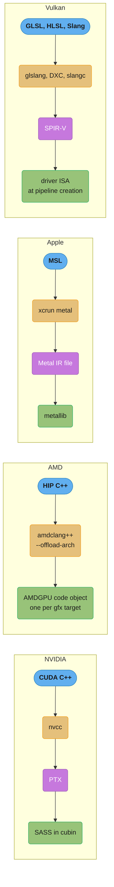
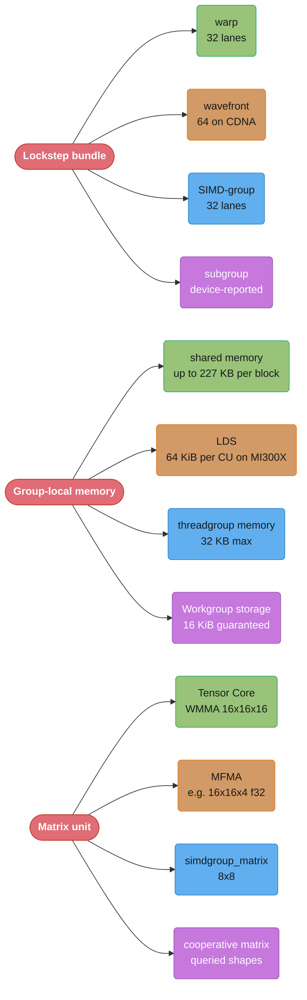
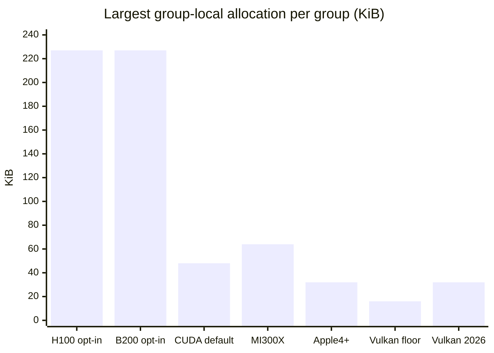
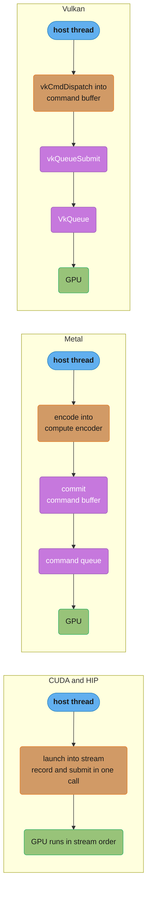

# Cross-Vendor GPU Concept Map: CUDA, HIP, Metal and Vulkan

> **Version anchor (fetched 2026-11-25):** CUDA Programming Guide v13.5 and CUDA Toolkit 13.5
> (compute-capability tables; H100 = cc 9.0, B200 = cc 10.0); ROCm Core SDK 10.2.0, released
> 2026-11-18 (GPU specifications table, HIP C++ language extensions); Metal Shading Language
> Specification 4.1 (dated 2026-06-04) and Metal Feature Set Tables (dated 2026-10-23); Vulkan
> spec and headers 1.4.369 (Vulkan-Headers commit of 2026-11-20); `VK_KHR_cooperative_matrix`
> revision 2; Vulkan Hardware Database value distributions read 2026-11-25.

## 1. Concept Overview

Every GPU programming stack in this section describes the same machine with different words.
A kernel runs as a grid of thread groups. Each group runs on one compute unit and owns a slice
of fast on-chip memory. Inside a group, the hardware issues one instruction for a fixed-width
bundle of threads at a time. The host records work into a queue, and the device runs it in
order unless you say otherwise. CUDA, HIP, Metal and Vulkan compute all expose those facts.
They differ in three places: the **name** of each concept, the **number** behind it (bundle
width, memory size, mask width, group size limit), and the **rules** around it (memory-order
scopes, forward progress, which features exist at all).

This module is the section's single vocabulary and numbers table. It maps:

- the lockstep bundle: CUDA **warp**, AMD **wavefront**, Apple **SIMD-group**, Vulkan **subgroup**;
- group-local memory: CUDA **shared memory**, AMD **LDS**, Metal **threadgroup memory**, Vulkan
  **Workgroup storage** (`shared` in GLSL);
- matrix units: NVIDIA **Tensor Cores**, AMD **MFMA** (Matrix Core) instructions, Metal
  **`simdgroup_matrix`** and Metal 4 tensor operations, Vulkan **cooperative matrix**;
- submission: CUDA and HIP **streams**, Metal **command queues, command buffers and encoders**,
  Vulkan **queues and command buffers**;
- barriers, atomics and memory-model scopes per API;
- profilers, compilers and intermediate representations per stack.

It then shows the same vector add and the same block reduction in CUDA, HIP, MSL and GLSL, and
lists the porting traps that live in the numbers: wave width, ballot mask width, memory-order
scopes and missing features.

**Not here.** Vendor depth lives in the phase modules:
[AMD GPU Architecture: CDNA and RDNA](../amd_gpu_architecture_cdna_and_rdna/amd_gpu_architecture_cdna_and_rdna.md),
[HIP Programming and Porting](../hip_programming_and_porting/hip_programming_and_porting.md),
[Apple Silicon GPU Architecture](../apple_silicon_gpu_architecture/apple_silicon_gpu_architecture.md),
[Metal Compute Programming](../metal_compute_programming/metal_compute_programming.md),
[Vulkan Compute Fundamentals](../vulkan_compute_fundamentals/vulkan_compute_fundamentals.md) and
[Vulkan Compute: Advanced Topics and Ecosystem](../vulkan_compute_advanced_and_ecosystem/vulkan_compute_advanced_and_ecosystem.md).
SYCL, OpenCL, WebGPU and the "how much peak do I trade for reach" decision stay in
[GPU Portability: HIP, SYCL and Beyond](../gpu_portability_hip_sycl_and_beyond/gpu_portability_hip_sycl_and_beyond.md).
The CUDA meaning of each term is taught in
[Warps and SIMT Execution](../warps_and_simt_execution/warps_and_simt_execution.md),
[Shared Memory and Bank Conflicts](../shared_memory_and_bank_conflicts/shared_memory_and_bank_conflicts.md)
and [Synchronization and Atomics](../synchronization_and_atomics/synchronization_and_atomics.md).
A compact lookup version of the tables below, for case studies, is
[the vendor terminology and numbers reference](../case_studies/cross_cutting/vendor_terminology_and_numbers_reference.md).

---

## 2. Intuition

> **One-line analogy**: four road atlases of the same country. The roads are the same, the
> map symbols differ, and one atlas measures in miles while another measures in kilometres.
> You get lost when you read the symbol correctly but the unit wrong.

**Mental model.** Hold three stacked hierarchies in your head and hang every vendor word on one
rung:

1. **Execution**: grid, then group, then lockstep bundle, then thread. CUDA says grid, block,
   warp, thread. HIP uses the same words, and AMD's ISA says wavefront for warp. Metal says grid,
   threadgroup, SIMD-group, thread. Vulkan says dispatch, workgroup, subgroup, invocation.
2. **Memory**: device memory, then group-local memory, then registers. Device memory is
   `global` in CUDA and HIP, the `device` address space in MSL and a storage buffer in Vulkan.
   Group-local memory is `__shared__`, LDS, `threadgroup` and `shared`.
3. **Submission**: host queue, then recorded work, then dispatch. A CUDA stream is both the
   queue and the recording. Metal and Vulkan split them: you encode into a command buffer, then
   commit or submit it to a queue.

**Why it matters.** A port that renames every API call correctly can still be wrong. The
classic example: a shuffle reduction that starts at offset 16 folds exactly 32 lanes. On an
AMD CDNA wavefront of 64 lanes it silently drops half the data. The vocabulary mapped, the
number did not. The same thing happens with a 32-bit ballot mask on a 64-lane wavefront, a
48 KB shared-memory tile on a Vulkan device that reports 32768 bytes, and an acquire/release
flag on a Metal target older than MSL 4.1.

**Key insight.** The *names* map one to one. The *numbers* and the *rules* do not. So a correct
port does two things: it renames, and it **queries** every width and limit at runtime (or pins
it per target at compile time) instead of copying the CUDA constant.

---

## 3. Core Principles

- **Every stack has the same three hierarchies.** Execution (grid, group, bundle, thread),
  memory (device, group-local, private) and submission (queue, recorded work, dispatch). Map a
  new term onto its rung before you learn its API.
- **The lockstep width is a hardware number, not a language constant.** It is 32 on NVIDIA
  (every compute capability in the CUDA Programming Guide), 64 on AMD CDNA and GCN (`gfx9`),
  32 for HIP on RDNA (`gfx10` and later), 32 on all Apple GPUs, and a device-reported power of
  two in Vulkan.
- **Mask width follows lane width, but the C type does not always follow.** CUDA ballots return
  32-bit `unsigned`. HIP ballots return 64-bit `unsigned long long` on every target, even
  32-wide ones. MSL `simd_vote` stores a `uint64_t` whose top bits are undefined on 32-wide
  hardware. GLSL `subgroupBallot` returns a 128-bit `uvec4`.
- **Group-local memory budgets differ by an order of magnitude.** A CUDA block on H100 or B200
  can opt in to 227 KB. An AMD MI300X CU has 64 KiB of LDS. A Metal threadgroup on Apple4 and
  later gets at most 32 KB. Vulkan guarantees only 16384 bytes.
- **Memory-model scopes have different names and different top levels.** CUDA and HIP reach
  system scope (host and peers). MSL's `thread_scope` stops at `thread_scope_device`. Vulkan
  scopes run Invocation, Subgroup, Workgroup, QueueFamily, Device.
- **Matrix units are not portable at the instruction level.** WMMA fragments, MFMA intrinsics,
  `simdgroup_matrix` 8x8 tiles and Vulkan cooperative matrices have different shapes, layouts
  and type lists. Portability lives one level up: in libraries, in Triton, or in a per-backend
  inner tile.
- **The IR boundary decides what ships.** PTX lets one CUDA binary run on future GPUs. An AMD
  code object is compiled per `gfx` target. A Metal library carries Metal IR. Vulkan ships
  SPIR-V, and the driver compiles it when you create the pipeline.
- **Query, do not assume.** Every stack has a runtime query for every number in this module.
  A port that reads `warpSize`, `threadExecutionWidth` or `VkPhysicalDeviceLimits` once at
  startup is correct on hardware that did not exist when you wrote it.

---

## 4. Types / Architectures / Strategies

### 4.1 Master mapping table

| Concept | CUDA (NVIDIA) | HIP (AMD) | Metal (Apple) | Vulkan compute (GLSL / SPIR-V) |
|---|---|---|---|---|
| Whole launch | grid | grid | grid | dispatch (`vkCmdDispatch`) |
| Thread group | thread block (CTA) | block / workgroup | threadgroup | workgroup |
| Lockstep bundle | warp | warp (HIP) / wavefront (ISA) | SIMD-group | subgroup |
| One thread | thread | thread / lane | thread | invocation |
| Compute unit | SM | CU | GPU core | implementation-defined |
| Group-local memory | `__shared__` (shared memory) | `__shared__` (LDS) | `threadgroup` address space | `shared` (SPIR-V Workgroup storage) |
| Device memory | `cudaMalloc` | `hipMalloc` | `device` address space, `MTLBuffer` | storage buffer (`std430`), `VkBuffer` |
| Group barrier | `__syncthreads()` | `__syncthreads()` | `threadgroup_barrier(mem_flags::mem_threadgroup)` | `barrier()` (+ `memoryBarrierShared()`) |
| Bundle barrier | `__syncwarp(mask)` | none needed: HIP docs state AMD runs warp lanes in lockstep | `simdgroup_barrier(...)` | `subgroupBarrier()` |
| Bundle shuffle | `__shfl_down_sync(mask, v, d)` | `__shfl_down(v, d)`; `__shfl_down_sync` takes a 64-bit mask (ROCm 7.0+) | `simd_shuffle_down(v, d)` | `subgroupShuffleDown(v, d)` |
| Bundle reduce | `__reduce_add_sync` (integer, cc 8.x+) | shuffle loop | `simd_sum(v)`, `simd_max(v)` (Apple7+) | `subgroupAdd(v)`, `subgroupMax(v)` |
| Ballot | `__ballot_sync` returns 32-bit `unsigned` | `__ballot` returns 64-bit `unsigned long long` | `simd_ballot` returns `simd_vote` (64-bit storage) | `subgroupBallot` returns `uvec4` (128 bits) |
| Fences | `__threadfence_block()`, `__threadfence()`, `__threadfence_system()` | same three names | `atomic_thread_fence(flags, order, scope)` (Metal 3.2+) | `memoryBarrier*()`, scoped `atomic*` |
| Matrix unit | Tensor Cores (`nvcuda::wmma`, PTX `mma`) | MFMA (`__builtin_amdgcn_mfma_*`), rocWMMA | `simdgroup_matrix`, Metal 4 `tensor_ops::matmul2d` | `coopmat` (`VK_KHR_cooperative_matrix`) |
| Work queue | stream (`cudaStream_t`) | stream (`hipStream_t`) | `MTLCommandQueue` + `MTLCommandBuffer` + `MTLComputeCommandEncoder` (Metal 4: `MTL4CommandQueue`, `MTL4CommandAllocator`) | `VkQueue` + `VkCommandBuffer` |
| Cross-queue sync | `cudaEvent_t` | `hipEvent_t` | `MTLEvent` / `MTLSharedEvent` | timeline `VkSemaphore` (core 1.2) |
| Grid-wide sync | `cudaLaunchCooperativeKernel` + `grid.sync()` | `hipLaunchCooperativeKernel` | no cooperative launch; split into two dispatches | none in core; split into two dispatches |
| Device IR | PTX | none shipped (LLVM IR stays inside the compiler) | Metal IR (`.ir` files) | SPIR-V |
| Shipped binary | cubin / fatbin (SASS + PTX) | AMDGPU code object (ELF, V5 default) per `gfx` target | `.metallib` (+ optional binary archive) | SPIR-V module, compiled by the driver at pipeline creation |
| Compiler | `nvcc` | `hipcc` / `amdclang++` with `--offload-arch=gfx942` | `xcrun metal` | `glslang` (GLSL), DXC (HLSL), `slangc` (Slang) |
| Kernel profiler | Nsight Compute | `rocprofv3`, ROCm Compute Profiler (`rocprof-compute`) | Xcode Metal debugger (GPU trace, counters, per-line shader profiling) | vendor tools: Nsight Graphics, Radeon GPU Profiler |
| Timeline profiler | Nsight Systems | ROCm Systems Profiler (`rocsys` command since 10.2) | Instruments Metal System Trace | RenderDoc (capture), vendor timelines |

Read each row left to right as "same idea, different word". The bold rows of §4.2 are where the
idea is the same and the **number** is not.

### 4.2 Numbers table

| Number | NVIDIA (CUDA 13.5) | AMD (ROCm 10.2.0) | Apple (Metal 4.1) | Vulkan 1.4 |
|---|---|---|---|---|
| **Lockstep width** | 32, every compute capability | 64 on CDNA and GCN (`gfx9`); RDNA parts list "32 or 64", and HIP uses 32 on `gfx10+` | 32 on all Apple GPUs (`threadExecutionWidth`) | `subgroupSize`: power of two, at least 4 under Roadmap 2022; GLSL caps it at 128; devices report 1 to 128 |
| **Max threads per group** | 1024 | typically 1024 (HIP programming model) | 1024 on Apple4 and later (512 on Apple2 and Apple3); the pipeline value may be lower | required minimum 128 (core), 256 (Vulkan 1.4, Roadmap 2022) |
| **Group-local memory, per compute unit** | 228 KB per SM (cc 9.0, 10.0, 10.3); 100 KB (cc 12.x) | 64 KiB LDS per CU (MI300X, MI325X); 160 KiB (MI350X, MI355X); 128 KiB per two-CU WGP for RDNA3 and RDNA4 (64 KiB max per workgroup) | not published per core | not exposed |
| **Group-local memory, per group** | 48 KB without opt-in; 227 KB with opt-in (cc 9.0, 10.0) | at most the CU's LDS: 64 KiB on MI300X (a workgroup runs on one CU) | 32 KB maximum total on Apple4 and later | `maxComputeSharedMemorySize`: required minimum 16384 B; Roadmap 2026 minimum 32768 B |
| **Ballot / mask bits** | 32 | 64 | 64-bit storage; top bits undefined on 32-wide hardware | 128 (`uvec4`) |
| Group-local memory banks | 32 banks | see the AMD architecture module | not documented by Apple | not exposed |
| FP64 in kernels | yes | yes | no: MSL has no `double` | optional feature (`shaderFloat64`) |
| Top memory scope | system (`cuda::thread_scope_system`) | system (`__threadfence_system`, `atomicAdd_system`) | device (`thread_scope_device`) | Device (QueueFamily is narrower) |

Vulkan Hardware Database snapshot (read 2026-11-25) of what real drivers report:

| `subgroupSize` | reports | | `maxComputeSharedMemorySize` | reports |
|---|---|---|---|---|
| 32 | 4461 | | 32768 | 3994 |
| 64 | 2395 | | 49152 | 3333 |
| 8 | 542 | | 65536 | 1513 |
| 16 | 483 | | 16384 | 196 |
| 128 | 152 | | 131072 | 21 |
| 4 | 146 | | 28640 | 1 |
| 1 | 35 | | | |

The spread is the lesson: a Vulkan kernel that hardcodes 32 lanes or 48 KB of shared memory is
wrong on a large fraction of shipped devices.

### 4.3 Built-in index variables

| Meaning | CUDA / HIP | MSL attribute | GLSL built-in |
|---|---|---|---|
| Thread index in group | `threadIdx` | `[[thread_position_in_threadgroup]]` | `gl_LocalInvocationID` |
| Flat thread index in group | computed | `[[thread_index_in_threadgroup]]` | `gl_LocalInvocationIndex` |
| Group index | `blockIdx` | `[[threadgroup_position_in_grid]]` | `gl_WorkGroupID` |
| Group size | `blockDim` | `[[threads_per_threadgroup]]` | `gl_WorkGroupSize` |
| Global thread index | `blockIdx * blockDim + threadIdx` | `[[thread_position_in_grid]]` | `gl_GlobalInvocationID` |
| Bundle width | `warpSize` | `[[threads_per_simdgroup]]` (alias `[[thread_execution_width]]`) | `gl_SubgroupSize` |
| Lane in bundle | `threadIdx.x % warpSize` | `[[thread_index_in_simdgroup]]` | `gl_SubgroupInvocationID` |
| Bundle index in group | `threadIdx.x / warpSize` | `[[simdgroup_index_in_threadgroup]]` | `gl_SubgroupID` |
| Bundles per group | `blockDim.x / warpSize` | `[[simdgroups_per_threadgroup]]` | `gl_NumSubgroups` |

MSL and GLSL hand you the global index directly. CUDA and HIP make you compute it. That is a
common source of off-by-one-block bugs when code moves from Metal or Vulkan to CUDA.

### 4.4 Memory spaces

| CUDA term | HIP term | MSL | Vulkan / GLSL | Notes |
|---|---|---|---|---|
| global | global | `device` | storage buffer (`buffer` block, `std430`) | read-write device memory |
| constant (`__constant__`) | constant | `constant` | uniform buffer (`uniform` block) | small read-only data |
| shared | LDS | `threadgroup` | `shared` | group-local scratchpad |
| local (spilled registers) | scratch | `thread` | `Function` / `Private` storage | per-thread |
| registers | VGPRs and SGPRs | registers | registers | not addressable |
| managed memory (`cudaMallocManaged`) | managed memory | `MTLStorageModeShared` | host-visible, device-local memory type if the device exposes one | one allocation, two views |

On Apple silicon, `MTLStorageModeShared` is the default storage mode for buffers and textures,
and the CPU and GPU share one allocation. Apple's documentation still makes the app
responsible for ordering: work scheduled on one side must complete before the other side reads.

### 4.5 Submission model

| Step | CUDA / HIP | Metal | Vulkan |
|---|---|---|---|
| Choose device | `cudaSetDevice` / `hipSetDevice` | `MTLCreateSystemDefaultDevice()` | `vkEnumeratePhysicalDevices`, `vkCreateDevice` |
| Compile kernel | offline (`nvcc`, `hipcc`) or NVRTC / hipRTC | `makeLibrary`, then `makeComputePipelineState` | `vkCreateShaderModule`, then `vkCreateComputePipelines` |
| Bind arguments | kernel parameters | `setBuffer(_:offset:index:)` on the encoder | descriptor sets, push constants |
| Record | the launch itself is the record | encode into an `MTLComputeCommandEncoder` | `vkCmdBindPipeline`, `vkCmdDispatch` into a `VkCommandBuffer` |
| Submit | implicit at launch | `commit()` the command buffer | `vkQueueSubmit` |
| Wait | `cudaStreamSynchronize`, events | `waitUntilCompleted()`, completion handler, `MTLSharedEvent` | fence, or timeline semaphore with `vkWaitSemaphores` |

### 4.6 Matrix units

| Stack | Programming surface | Shape facts | Scope of cooperation |
|---|---|---|---|
| CUDA | `nvcuda::wmma` fragments; PTX `mma`; libraries | WMMA `m16n16k16` for half; more shapes per generation | warp |
| HIP | `__builtin_amdgcn_mfma_<CD>_<M>x<N>x<K><AB>` intrinsics; rocWMMA | for example `__builtin_amdgcn_mfma_f32_16x16x4f32`; ISA name `V_MFMA_F32_16x16x4F32` | wavefront |
| Metal | `simdgroup_matrix<T,8,8>` (Metal 2.3+; Apple7+); Metal 4 `mpp::tensor_ops::matmul2d` | `simdgroup_half8x8`, `simdgroup_bfloat8x8` (Metal 3.1+), `simdgroup_float8x8` | SIMD-group; TensorOps take `execution_thread`, `execution_simdgroup` or `execution_simdgroups<N>` |
| Vulkan | `coopmat<T, scope, rows, cols, use>` (`GLSL_KHR_cooperative_matrix`) | sizes and types enumerated at runtime with `vkGetPhysicalDeviceCooperativeMatrixPropertiesKHR` | usually subgroup |

The CUDA side is taught in depth in
[Tensor Cores and Mixed Precision](../tensor_cores_and_mixed_precision/tensor_cores_and_mixed_precision.md).

### 4.7 Toolchain and IR



Caption: only two stacks ship a portable intermediate form to the user's machine. PTX can be
JIT-compiled for a GPU newer than the build. SPIR-V is always compiled by the driver. An AMD
code object without a matching `gfx` target does not load, and LLVM's generic processor
targets (for example `gfx9-4-generic`) need code object V6, one version past the V5 default.

---

## 5. Architecture Diagrams

### One concept, four names



Caption: each red concept means the same thing in all four columns. The number under each name
is what a port must re-derive. Colours are per vendor: green NVIDIA, orange AMD, blue Apple,
purple Vulkan.

### Mask width per lockstep bundle

```
Ballot result for a predicate that is true on every lane, by stack

CUDA __ballot_sync        unsigned (32 bits)
  bit:   31 ............................... 0
         [11111111111111111111111111111111]

HIP __ballot              unsigned long long (64 bits), CDNA wave64
  bit:   63 ............................................................... 0
         [1111111111111111111111111111111111111111111111111111111111111111]

HIP __ballot              unsigned long long (64 bits), RDNA wave32
         [--------------------------------11111111111111111111111111111111]
          upper 32 bits: HIP docs say they are unused on 32-wide devices

MSL simd_ballot           simd_vote, uint64_t storage, 32-wide Apple GPU
         [????????????????????????????????11111111111111111111111111111111]
          MSL spec: top bits undefined when the SIMD-group has under 64 threads

GLSL subgroupBallot       uvec4 (128 bits); only gl_SubgroupSize bits are meaningful
         [ .x lanes 0-31 | .y lanes 32-63 | .z lanes 64-95 | .w lanes 96-127 ]
```

Caption: the same "every lane voted yes" result is 32, 64 or 128 bits wide depending on the
stack. Storing a HIP ballot in a 32-bit `unsigned` keeps lanes 0 to 31 and drops lanes 32 to
63, and popcounting an MSL `simd_vote` as 64 bits can count undefined bits. See the BROKEN to
FIX pair in §10.

### Group-local memory a single group can count on



Caption: a tile sized for an H100 block (227 KB with opt-in) is about 7x what a Metal
threadgroup allows and about 14x the Vulkan core guarantee. The MI300X bar is the CU's whole
64 KiB LDS, which is the ceiling for one workgroup. Size tiles from the queried limit, never
from the CUDA number.

### Submission model side by side



Caption: CUDA and HIP fuse "record" and "submit" into one launch. Metal and Vulkan separate
them, so a port that creates one command buffer per kernel pays a submission cost per kernel
that the CUDA original never paid. Batch many dispatches into one command buffer. The CUDA side
is covered in [Streams, Events and Concurrency](../streams_events_and_concurrency/streams_events_and_concurrency.md).

---

## 6. How It Works — Detailed Mechanics

### 6.1 Vector add, four ways

The kernel body is one line in every stack. What changes is how a thread finds its index and
how the host launches it.

```cuda
// CUDA
__global__ void vadd(const float* a, const float* b, float* c, int n) {
    int i = blockIdx.x * blockDim.x + threadIdx.x;
    if (i < n) c[i] = a[i] + b[i];
}
// host: vadd<<<(n + 255) / 256, 256>>>(dA, dB, dC, n);
```

```cpp
// HIP: identical body; hipcc accepts the triple-chevron launch
#include <hip/hip_runtime.h>
__global__ void vadd(const float* a, const float* b, float* c, int n) {
    int i = blockIdx.x * blockDim.x + threadIdx.x;
    if (i < n) c[i] = a[i] + b[i];
}
// host:  vadd<<<(n + 255) / 256, 256>>>(dA, dB, dC, n);
// build: hipcc --offload-arch=gfx942 vadd.hip -o vadd
```

```metal
// MSL: the grid position arrives as an attribute
#include <metal_stdlib>
using namespace metal;

kernel void vadd(device const float* a [[buffer(0)]],
                 device const float* b [[buffer(1)]],
                 device float*       c [[buffer(2)]],
                 constant uint&      n [[buffer(3)]],
                 uint i [[thread_position_in_grid]]) {
    if (i < n) c[i] = a[i] + b[i];
}
```

```swift
// Swift host: encode, commit, wait
var n = UInt32(count)
let enc = cmdBuf.makeComputeCommandEncoder()!
enc.setComputePipelineState(pso)
enc.setBuffer(bufA, offset: 0, index: 0)
enc.setBuffer(bufB, offset: 0, index: 1)
enc.setBuffer(bufC, offset: 0, index: 2)
enc.setBytes(&n, length: MemoryLayout<UInt32>.size, index: 3)
enc.dispatchThreads(MTLSize(width: count, height: 1, depth: 1),
                    threadsPerThreadgroup: MTLSize(width: 256, height: 1, depth: 1))
enc.endEncoding()
cmdBuf.commit()
cmdBuf.waitUntilCompleted()
```

```glsl
// GLSL compute, compiled to SPIR-V with glslang
#version 450
layout(local_size_x = 256) in;
layout(std430, binding = 0) readonly  buffer A { float a[]; };
layout(std430, binding = 1) readonly  buffer B { float b[]; };
layout(std430, binding = 2) writeonly buffer C { float c[]; };
layout(push_constant) uniform P { uint n; };

void main() {
    uint i = gl_GlobalInvocationID.x;
    if (i < n) c[i] = a[i] + b[i];
}
// host: vkCmdDispatch(cmd, (n + 255) / 256, 1, 1);
```

Two differences to notice. Metal's `dispatchThreads` takes a **thread** count, not a group
count, and on GPUs with non-uniform threadgroup support (Apple4 and later) Metal trims the last
group for you. Keep the bounds check anyway, because `dispatchThreadgroups` does not trim.
Vulkan's `vkCmdDispatch` takes a **workgroup** count, like a CUDA grid.

### 6.2 Block reduction, four ways, width-agnostic

The rule for a portable reduction: **never write a lane count as a literal.** Start the
shuffle offset at `width / 2`, size the partials array for the smallest width you support, and
let the last stage handle any number of partials. Each kernel writes one partial per group, so
no float atomics are needed (MSL float atomics need Apple7 or later).

```cuda
// CUDA: warp size is 32 on every NVIDIA GPU, but write it as warpSize anyway
__global__ void block_sum(const float* x, float* partial, int n) {
    __shared__ float s[32];                       // 1024 threads / 32 lanes
    int i = blockIdx.x * blockDim.x + threadIdx.x;
    float v = (i < n) ? x[i] : 0.0f;

    for (int off = warpSize / 2; off > 0; off >>= 1)
        v += __shfl_down_sync(0xffffffffu, v, off);

    int lane = threadIdx.x % warpSize, wid = threadIdx.x / warpSize;
    if (lane == 0) s[wid] = v;
    __syncthreads();

    int nwarps = blockDim.x / warpSize;
    if (wid == 0) {
        v = (lane < nwarps) ? s[lane] : 0.0f;
        for (int off = warpSize / 2; off > 0; off >>= 1)
            v += __shfl_down_sync(0xffffffffu, v, off);
        if (lane == 0) partial[blockIdx.x] = v;
    }
}
```

```cpp
// HIP: same shape; warpSize is 64 on gfx9 (CDNA) and 32 on gfx10+ (RDNA)
#include <hip/hip_runtime.h>
__global__ void block_sum(const float* x, float* partial, int n) {
    __shared__ float s[32];                       // 1024 / 32 covers wave32 and wave64
    int i = blockIdx.x * blockDim.x + threadIdx.x;
    float v = (i < n) ? x[i] : 0.0f;

    for (int off = warpSize / 2; off > 0; off >>= 1)   // 32,16,...,1 on CDNA
        v += __shfl_down(v, off);

    int lane = threadIdx.x % warpSize, wid = threadIdx.x / warpSize;
    if (lane == 0) s[wid] = v;
    __syncthreads();

    int nwaves = blockDim.x / warpSize;
    if (wid == 0) {
        v = (lane < nwaves) ? s[lane] : 0.0f;
        for (int off = warpSize / 2; off > 0; off >>= 1)
            v += __shfl_down(v, off);
        if (lane == 0) partial[blockIdx.x] = v;
    }
}
```

```metal
// MSL: simd_sum folds a whole SIMD-group (SIMD-scoped reductions: Apple7+)
#include <metal_stdlib>
using namespace metal;

kernel void block_sum(device const float* x       [[buffer(0)]],
                      device float*       partial [[buffer(1)]],
                      constant uint&      n       [[buffer(2)]],
                      uint gid  [[thread_position_in_grid]],
                      uint tgid [[threadgroup_position_in_grid]],
                      uint lane [[thread_index_in_simdgroup]],
                      uint sg   [[simdgroup_index_in_threadgroup]],
                      uint nsg  [[simdgroups_per_threadgroup]]) {
    threadgroup float s[32];                      // 1024 / 32
    float v = (gid < n) ? x[gid] : 0.0f;
    v = simd_sum(v);
    if (lane == 0) s[sg] = v;
    threadgroup_barrier(mem_flags::mem_threadgroup);
    if (sg == 0) {
        v = (lane < nsg) ? s[lane] : 0.0f;
        v = simd_sum(v);
        if (lane == 0) partial[tgid] = v;
    }
}
```

```glsl
// GLSL: subgroupAdd folds one subgroup; the subgroup size is NOT known at compile time
#version 450
#extension GL_KHR_shader_subgroup_basic : require
#extension GL_KHR_shader_subgroup_arithmetic : require
layout(local_size_x = 256) in;
layout(std430, binding = 0) readonly  buffer X { float x[]; };
layout(std430, binding = 1) writeonly buffer P { float partial[]; };
layout(push_constant) uniform Params { uint n; };

shared float s[64];                               // 256 / 4: smallest Roadmap subgroup

void main() {
    uint i = gl_GlobalInvocationID.x;
    float v = (i < n) ? x[i] : 0.0;
    v = subgroupAdd(v);
    if (subgroupElect()) s[gl_SubgroupID] = v;
    barrier();
    if (gl_LocalInvocationIndex == 0) {
        float t = 0.0;
        for (uint k = 0; k < gl_NumSubgroups; ++k) t += s[k];   // 2 or 64 partials
        partial[gl_WorkGroupID.x] = t;
    }
}
```

**Why the GLSL version ends differently.** CUDA, HIP and MSL can let the first bundle reduce the
partials, because `group size / width` partials always fit in one bundle: 256 / 32 = 8
partials in 32 lanes, 256 / 64 = 4 in 64 lanes. Vulkan has no such guarantee. With a 4-wide
subgroup the same workgroup produces 64 partials, which do not fit in one 4-wide subgroup. The
single-thread loop (or a second tree level) is correct for every legal subgroup size.

### 6.3 Walk one example: the hardcoded offset on a 64-lane wavefront

```
  Ported loop:  for (int off = 16; off > 0; off >>= 1) v += shfl_down(v, off);

  offsets visited     : 16, 8, 4, 2, 1     -> 5 steps
  lanes folded        : 2^5 = 32

  CUDA warp (32)      : 32 of 32 lanes  -> correct
  CDNA wavefront (64) : 32 of 64 lanes  -> lanes 32..63 never reach lane 0
  result              : lane 0 holds the sum of lanes 0..31 only
  symptom             : each wave contributes half its data; no crash, no warning

  Width-agnostic loop:  for (int off = warpSize / 2; off > 0; off >>= 1)
  CDNA                : 32, 16, 8, 4, 2, 1 -> 6 steps -> 2^6 = 64 lanes -> correct
```

The number 32 never appears in the broken loop. It hides inside the starting offset, which is
why a text search for `32` during a port does not find it.

### 6.4 Ballot masks across stacks

```cpp
// HIP: count lanes where pred is true, portable to wave32 and wave64
__device__ int count_true(bool pred) {
    unsigned long long m = __ballot(pred);   // 64-bit on every HIP target
    return __popcll(m);                      // 64-bit popcount
}
```

```metal
// MSL: cast simd_vote to its vote_t and mask to the real width before counting
inline uint count_true(bool pred, uint width) {
    simd_vote v = simd_ballot(pred);
    ulong bits = static_cast<ulong>(static_cast<simd_vote::vote_t>(v));
    ulong keep = (width >= 64) ? ~0ul : ((1ul << width) - 1ul);
    return popcount(bits & keep);
}
```

```glsl
// GLSL: let the API count; it knows which bits are real
uint count_true(bool pred) {
    uvec4 b = subgroupBallot(pred);
    return subgroupBallotBitCount(b);
}
```

HIP adds one more guard: the `_sync` shuffle and vote variants (on by default since ROCm 7.0)
take a 64-bit mask, and the HIP headers contain a static assert that checks the mask type. A
`hipify`-translated `__shfl_down_sync(0xffffffffu, v, off)` therefore fails to compile instead
of silently naming only lanes 0 to 31. Write the mask as `~0ull` or use `__shfl_down`.

### 6.5 Memory-model scopes side by side

| Scope | CUDA (`cuda::thread_scope_*`) | HIP | MSL `thread_scope` (Metal 3.2+) | GLSL scope constant |
|---|---|---|---|---|
| one thread | `thread_scope_thread` | n/a | `thread_scope_thread` | `gl_ScopeInvocation` (4) |
| bundle | ordering via `__syncwarp` | lockstep; `_sync` variants | `thread_scope_simdgroup` | `gl_ScopeSubgroup` (3) |
| group | `thread_scope_block`, `__threadfence_block()` | `__threadfence_block()` | `thread_scope_threadgroup` | `gl_ScopeWorkgroup` (2) |
| device | `thread_scope_device`, `__threadfence()` | `__threadfence()`, `atomicAdd` | `thread_scope_device` | `gl_ScopeDevice` (1); `gl_ScopeQueueFamily` (5) |
| system (host, peers) | `thread_scope_system`, `__threadfence_system()` | `__threadfence_system()`, `atomicAdd_system` | none | none among the GLSL scope constants |

**Memory orders.** CUDA gives you C++ memory orders through `cuda::atomic` and
`cuda::atomic_thread_fence`. HIP documents the `atomicAdd` family with `_system` variants and
the three `__threadfence` levels. MSL is the outlier: before MSL 4.1, atomic operations took
only `memory_order_relaxed`. MSL 4.1 adds `memory_order_acquire`, `memory_order_release` and
`memory_order_acq_rel` for atomics, fences and barriers, and the Feature Set Tables list
"Acquire and release memory ordering atomics" from the Apple7 family. On an older target, a
message-passing flag written with relaxed atomics needs `atomic_thread_fence` with
`memory_order_seq_cst` (Metal 3.2+) on both sides.

### 6.6 Query every number at runtime

```cpp
// CUDA and HIP
int ws = 0, smem = 0;
cudaDeviceGetAttribute(&ws, cudaDevAttrWarpSize, dev);
cudaDeviceGetAttribute(&smem, cudaDevAttrMaxSharedMemoryPerBlockOptin, dev);
hipDeviceGetAttribute(&ws, hipDeviceAttributeWarpSize, dev);    // 64 on gfx942, 32 on gfx1201
```

```swift
// Metal
let tgMem  = device.maxThreadgroupMemoryLength          // 32768 on Apple4 and later
let width  = pso.threadExecutionWidth                   // 32 on Apple GPUs
let maxTpg = pso.maxTotalThreadsPerThreadgroup          // up to 1024, per pipeline
```

```cpp
// Vulkan
VkPhysicalDeviceSubgroupProperties sg{VK_STRUCTURE_TYPE_PHYSICAL_DEVICE_SUBGROUP_PROPERTIES};
VkPhysicalDeviceProperties2 p2{VK_STRUCTURE_TYPE_PHYSICAL_DEVICE_PROPERTIES_2, &sg};
vkGetPhysicalDeviceProperties2(phys, &p2);
uint32_t width = sg.subgroupSize;                                  // power of two
uint32_t smem  = p2.properties.limits.maxComputeSharedMemorySize;  // >= 16384
```

In HIP, `warpSize` is a device-side value. Since ROCm 7.0 the compiler folds it early, so it
unrolls loops like a constant, but host code must still call `hipDeviceGetAttribute`. HIP does
not support a warp size of 64 on `gfx10` and later.

### 6.7 Concrete numbers to memorize

- Lockstep width: **32** NVIDIA, **64** AMD CDNA (`gfx942`, `gfx950`), **32** HIP on RDNA,
  **32** Apple, a **power of two** in Vulkan (most reports 32 or 64).
- Threads per group: **1024** CUDA, typically **1024** HIP, **1024** Metal on Apple4+, Vulkan
  floor **128** (core) or **256** (1.4).
- Group-local memory per group: **48 KB** CUDA default, **227 KB** H100 and B200 opt-in,
  **at most 64 KiB** MI300X (its whole CU LDS), **32 KB** Metal, **16 KiB** Vulkan floor (**32 KiB** Roadmap 2026).
- LDS per CU: **64 KiB** MI300X and MI325X, **160 KiB** MI350X and MI355X.
- Ballot bits: **32** CUDA, **64** HIP, **64-bit storage** MSL, **128** GLSL.
- Matrix tiles: WMMA **16x16x16** (half), MFMA for example **16x16x4** (f32), `simdgroup_matrix`
  **8x8**, cooperative matrix **queried**.

---

## 7. Real-World Examples

- **PyTorch on three vendors.** AMD's PyTorch-on-ROCm install guide says that in PyTorch
  "torch.cuda is a generic way to access the GPU", so a ROCm build runs `torch.device("cuda")`
  code on an AMD GPU. PyTorch's MPS note says the `mps` device "enables high-performance
  training on GPU for macOS devices with Metal programming framework". PyTorch's backend
  authors applied this concept map once so model code does not have to.
- **llama.cpp keeps one backend per stack.** Its build guide has separate sections for Metal
  (enabled by default on macOS), CUDA, HIP and Vulkan. Each backend re-implements the same
  quantized matmul and attention kernels against that stack's numbers. See
  [the Apple-silicon inference case study](../case_studies/run_llm_inference_on_apple_silicon.md).
- **Triton targets two vendors from one kernel.** The Triton README lists NVIDIA GPUs
  (compute capability 8.0+) and AMD GPUs (ROCm 6.2+) as supported hardware. The kernel is
  written in blocks, and the compiler lowers it to each vendor's lanes and matrix instructions.
  See [Triton and Kernel DSLs](../triton_and_kernel_dsls/triton_and_kernel_dsls.md).
- **MLX keeps arrays in shared memory on Apple silicon.** The MLX README names unified memory as
  its notable difference: arrays live in shared memory, and operations run on CPU or GPU without
  a copy. MLX also ships a CUDA backend (`pip install mlx[cuda]`). See
  [Metal Performance Shaders, MLX and PyTorch MPS](../metal_performance_shaders_mlx_and_pytorch_mps/metal_performance_shaders_mlx_and_pytorch_mps.md).
- **HIP's own documentation teaches the wave-width rule.** The HIP language-extensions page
  shows a reduction whose loop starts at `warpSize / 2`, counts ballot bits with a 64-bit
  popcount unless the host-queried warp size is 32, and states that code assuming a warp size
  of 32 "only utilizes half of the compute resources" on a 64-wide device.

---

## 8. Tradeoffs

### Compile-time constant vs runtime query for the bundle width

| Approach | Upside | Downside | Use when |
|---|---|---|---|
| Literal `32` | simplest code | wrong on CDNA and on many Vulkan devices | never in shared code |
| Per-target macro or template parameter | full unrolling, constant folding | one build per width; target and macro can drift apart | HIP with a fixed `--offload-arch` list |
| Runtime query (`warpSize`, `[[threads_per_simdgroup]]`, `gl_SubgroupSize`) | correct on unknown hardware | some loops stay rolled, mainly on Vulkan | default for portable kernels |
| Require a size (Vulkan 1.3 subgroup size control) | lets Vulkan code assume a width | the device must support it; check `minSubgroupSize` to `maxSubgroupSize` | wave32 vs wave64 tuning on one vendor |

### Native per-stack kernels vs one abstraction

| Strategy | Peak | Engineering cost | Where the concept map helps |
|---|---|---|---|
| One native kernel per stack (CUDA, HIP, MSL, GLSL) | highest per vendor | 4 code paths, 4 test matrices | renaming and number checks, line by line |
| HIP for NVIDIA and AMD, MSL for Apple | high on all three | 2 code paths | HIP covers two columns of the table |
| Triton for NVIDIA and AMD, MSL or MLX for Apple | near native for GEMM-like kernels | 2 code paths, compiler-dependent | the compiler applies the map for you |
| Vulkan everywhere | lower where a vendor has richer native features | 1 code path, many device profiles | numbers table plus runtime queries |

### Matrix-unit access level

| Level | Portability | Control | Example |
|---|---|---|---|
| Library (cuBLASLt, hipBLASLt, Metal Performance Shaders) | API-level only | lowest | GEMM calls |
| DSL (Triton; Metal 4 `matmul2d` inside MSL) | Triton spans NVIDIA and AMD | medium | fused attention |
| Fragment API (WMMA, rocWMMA, `simdgroup_matrix`, `coopmat`) | per stack | high | custom epilogue fusion |
| Raw instruction (PTX `mma`, MFMA builtins) | one architecture family | highest | vendor-tuned GEMM cores |

---

## 9. When to Use / When NOT to Use

**Use this map when:**

- You read a kernel written for another stack and need to know what each term means.
- You port a kernel and need the list of numbers to re-derive: width, mask bits, group-local
  memory, maximum group size, scopes.
- You design a kernel that must run on more than one vendor and must choose which limits to
  query at runtime.
- You review a cross-vendor pull request and want a checklist of the silent-failure classes.

**Do not use it as:**

- A performance guide. Equal names do not mean equal cost. A CUDA bank-conflict fix does not
  automatically transfer to LDS or threadgroup memory; read the vendor architecture module.
- A replacement for the vendor phase modules. This page tells you *that* MFMA exists and what
  one intrinsic looks like; [HIP Programming and Porting](../hip_programming_and_porting/hip_programming_and_porting.md)
  and [AMD GPU Architecture](../amd_gpu_architecture_cdna_and_rdna/amd_gpu_architecture_cdna_and_rdna.md)
  tell you how to use it well.
- A reason to write portable code you do not need. If the whole fleet is one vendor, write
  native code and keep only the runtime queries.

---

## 10. Common Pitfalls

### Pitfall 1: storing a HIP ballot in a 32-bit integer

A team ports a CUDA stream-compaction kernel. The ported code keeps the CUDA result type
`unsigned` for the ballot. On MI300X the count of surviving elements is about half the true
count for uniformly distributed input, and the output buffer has holes. No error is raised.

```cpp
// BROKEN: 64-bit ballot truncated to 32 bits on a wave64 target
__global__ void compact(const float* in, float* out, int* count, int n) {
    int i = blockIdx.x * blockDim.x + threadIdx.x;
    bool keep = (i < n) && (in[i] > 0.0f);
    unsigned m = __ballot(keep);                       // lanes 32..63 lost here
    int lane = threadIdx.x % warpSize;
    int before = __popc(m & ((1u << lane) - 1u));      // undefined shift for lane >= 32
    int total  = __popc(m);
    // ... reserve `total` slots with one atomic per wave, write at base + before
}
```

```cpp
// FIX: keep the full 64-bit mask and use 64-bit bit operations
__global__ void compact(const float* in, float* out, int* count, int n) {
    int i = blockIdx.x * blockDim.x + threadIdx.x;
    bool keep = (i < n) && (in[i] > 0.0f);
    unsigned long long m = __ballot(keep);
    int lane = threadIdx.x % warpSize;
    unsigned long long below = (lane == 0) ? 0ull : (~0ull >> (64 - lane));
    int before = __popcll(m & below);
    int total  = __popcll(m);
    // ... same reservation logic, now correct for warpSize 32 and 64
}
```

### Pitfall 2: the shuffle loop that starts at 16

Covered in §6.3. The fix is to start at `warpSize / 2` (CUDA and HIP),
`[[threads_per_simdgroup]] / 2` or `simd_sum` (MSL), and `subgroupAdd` (GLSL). The CUDA-side
semantics are in
[Warp-Level Primitives and Cooperative Groups](../warp_level_primitives_and_cooperative_groups/warp_level_primitives_and_cooperative_groups.md).

### Pitfall 3: a 48 KB shared tile on a Vulkan device

A CUDA attention kernel uses a 48 KB tile, the CUDA default limit without opt-in. The Vulkan
port declares `shared float tile[12288];` (48 KiB). On a device that reports 32768 bytes, the
shader exceeds `maxComputeSharedMemorySize`, which breaks a Vulkan valid-usage rule, so the
pipeline is invalid on that device. The Vulkan Hardware Database shows 32768 as the most common
reported value. Fix: read `maxComputeSharedMemorySize`, choose the tile through a
specialization constant, and build one pipeline per tile size.

### Pitfall 4: a relaxed flag used as a lock on Metal

Code copied from CUDA spins on a device-memory flag and reads a payload after it sees the flag
set. In MSL before 4.1, atomics take only `memory_order_relaxed`, so seeing the flag says
nothing about seeing the payload. Fix: on MSL 4.1 targets (Apple7+) use `memory_order_release`
and `memory_order_acquire`; otherwise bracket the access with
`atomic_thread_fence(mem_flags::mem_device, memory_order_seq_cst)` (Metal 3.2+), or split the
work into two dispatches.

### Pitfall 5: a grid-wide spin barrier

A CUDA kernel uses a hand-written "wait until every block arrives" spin. CUDA itself guarantees
that all blocks are resident only with `cudaLaunchCooperativeKernel`; HIP has
`hipLaunchCooperativeKernel`. Metal has no cooperative launch, and its Feature Set Tables list
"Compute shader forward progress guarantees" only from the Apple11 family. Fix: on Metal and
Vulkan, end the dispatch and start a second one; queue order is the barrier.

### Pitfall 6: `double` in a shared header

A math header used by CUDA and HIP kernels has a `double` accumulator. The MSL port fails to
compile: the MSL specification states that Metal does not support the `double` type. Fix: use
`float` with Kahan compensation, or a two-`float` representation, behind a per-backend type
alias. See [Debugging, Correctness and Numerics](../debugging_correctness_and_numerics/debugging_correctness_and_numerics.md).

### Pitfall 7: one HIP binary, one `gfx` target

A HIP build for `--offload-arch=gfx942` (MI300X) is copied to an MI355X (`gfx950`) node. The
binary has no code object for that target, and the kernel fails to load. Unlike PTX, there is
no virtual ISA to JIT from. Fix: list every target (`--offload-arch=gfx942
--offload-arch=gfx950`) or use an LLVM generic target with code object V6.

---

## 11. Technologies & Tools

| Tool | Stack | Role in a cross-vendor port |
|---|---|---|
| `nvcc` | CUDA | compiles to PTX and SASS |
| `hipcc` / `amdclang++` | HIP | compiles per `--offload-arch` target to AMDGPU code objects |
| HIPIFY (`hipify-clang`, `hipify-perl`) | HIP | renames CUDA APIs; does not fix widths |
| Metal compiler (`xcrun metal`) | Metal | compiles MSL to Metal IR and links a `.metallib` |
| glslang | Vulkan | GLSL to SPIR-V |
| DXC | Vulkan | HLSL to SPIR-V |
| Slang | Vulkan | Slang to SPIR-V |
| Nsight Compute | CUDA | per-kernel profiling |
| Nsight Systems | CUDA | timeline profiling |
| rocprofv3 | ROCm | tracing and counter collection |
| ROCm Compute Profiler | ROCm | `rocprof-compute` kernel analysis and roofline |
| ROCm Systems Profiler | ROCm | system timeline through the `rocsys` command |
| Xcode Metal debugger | Metal | GPU trace, performance counters, per-line shader profiling |
| Instruments | Metal | Metal System Trace CPU and GPU timeline |
| RenderDoc | Vulkan | capture and inspect Vulkan work |
| Nsight Graphics | Vulkan | NVIDIA frame profiling and Vulkan shader debugging |
| Radeon GPU Profiler | AMD | low-level profiling on AMD Radeon GPUs |
| Vulkan Hardware Database | Vulkan | real-device limit and subgroup-size distributions |
| Triton | CUDA, ROCm | one kernel source for NVIDIA and AMD |

---

## 12. Interview Questions with Answers

**Q: Is an AMD wavefront just another name for a CUDA warp, so warp code ports unchanged?**
**Short:** The concept is the same but the width is not: CDNA wavefronts are 64 lanes, so code that assumes 32 lanes silently processes half the data.
The name maps one to one; the number does not. The ROCm GPU specifications table lists a
wavefront size of 64 for every Instinct part from MI6 to MI355X, while NVIDIA's warp is 32 on
every compute capability. A shuffle loop starting at offset 16 folds 2^5 = 32 lanes and never
reads lanes 32 to 63. Nothing crashes; the sums are just low. Start every width-dependent loop
at `warpSize / 2` and size per-warp arrays from `blockDim.x / warpSize`.

**Q: Why does storing a HIP `__ballot` result in an `unsigned int` produce wrong counts?**
**Short:** HIP ballots return a 64-bit unsigned long long on every target, so a 32-bit variable drops lanes 32 to 63 on a wave64 GPU.
HIP's language-extensions page states that `__ballot` and `__activemask` have a 64-bit return
value, unlike CUDA's 32-bit one. On a 64-lane CDNA wavefront the upper half of the mask holds
real lanes. Truncating it loses them, and `__popc` on the truncated value undercounts. Keep the
type `unsigned long long`, use `__popcll`, and build lane masks with 64-bit shifts.

**Q: Why does a hipified `__shfl_down_sync(0xffffffffu, v, off)` fail to compile on ROCm 7?**
**Short:** HIP's _sync variants take a 64-bit lane mask and the headers static-assert the mask type, so a 32-bit CUDA mask literal is rejected.
The HIP documentation says the `_sync` variants are available and enabled by default since ROCm
7.0, require a 64-bit unsigned integer mask, and include a static assert that checks the type.
That is deliberate: `0xffffffffu` on a 64-lane wavefront would name only lanes 0 to 31. Pass
`~0ull` for a full wave, or use the non-`_sync` `__shfl_down`, since AMD runs warp lanes in
lockstep. The compile error is the friendly version of the ballot-truncation bug.

**Q: Can Metal code assume a SIMD-group is 32 threads wide?**
**Short:** On today's Apple GPUs yes, Apple says threadExecutionWidth is 32 on all Apple GPUs, but kernels should still read threads_per_simdgroup.
Apple's WWDC22 session "Scale compute workloads across Apple GPUs" says `threadExecutionWidth`
returns the SIMD width and that it is 32 on all Apple GPUs. The MSL spec still exposes the
width as `[[threads_per_simdgroup]]` and defines `simd_vote` with 64-bit storage whose top bits
are undefined on hardware with fewer than 64 threads per SIMD-group. Write loops from the
attribute and mask ballots to the real width, so the code stays right if the number changes.

**Q: How do you pin a Vulkan compute pipeline to one subgroup width, and when is that allowed?**
**Short:** Chain VkPipelineShaderStageRequiredSubgroupSizeCreateInfo into the compute stage, with a power-of-two size the device reports between minSubgroupSize and maxSubgroupSize.
Subgroup size control is core in Vulkan 1.3: chain `VkPipelineShaderStageRequiredSubgroupSizeCreateInfo`
into the compute stage's create info and set `requiredSubgroupSize`, which is allowed only when
`requiredSubgroupSizeStages` includes the compute stage and the value lies between
`minSubgroupSize` and `maxSubgroupSize`. Without it a shader can assume very little.
The spec defines `subgroupSize` as a power of two, the Roadmap 2022 profile raises the minimum
to 4, and GLSL caps `gl_SubgroupSize` at 128. The Vulkan Hardware Database shows 32 and 64 as
the most common values, with 8, 16, 128, 4 and 1 also reported. Write reductions that do not
assume the width, and pin a width only for a kernel tuned for it, after checking
`minSubgroupSize` and `maxSubgroupSize`.

**Q: Is 48 KB of shared memory a safe default across vendors because CUDA uses it?**
**Short:** No: 48 KB is CUDA's no-opt-in limit, while Metal caps a threadgroup at 32 KB and Vulkan guarantees only 16 KiB.
The CUDA Programming Guide lists 48 KB per block without opt-in and 227 KB with opt-in on
compute capability 9.0 and 10.0. The Metal Feature Set Tables list a 32 KB maximum total
threadgroup allocation from Apple4 onward. Vulkan's required limit for
`maxComputeSharedMemorySize` is 16384 bytes (32768 under Roadmap 2026), and the most common
reported value is 32768. A 48 KB tile is too big for every Metal GPU and for many Vulkan
devices. Size tiles from the queried limit.

**Q: Can MSL atomics implement an acquire/release handoff like CUDA's `cuda::atomic`?**
**Short:** Only on MSL 4.1 and Apple7-or-later GPUs; earlier MSL atomics accept only memory_order_relaxed, so a flag gives no ordering by itself.
The MSL 4.1 specification adds `memory_order_acquire`, `memory_order_release` and
`memory_order_acq_rel` and marks each "Metal 4.1 and later"; the Feature Set Tables list the
feature from Apple7. Before that, atomics were relaxed only, and `atomic_thread_fence` with
`memory_order_seq_cst` arrived in Metal 3.2. A port that spins on a relaxed flag and then reads
a payload has a data race on older targets. Gate the code on the language version or use a
fence or a second dispatch.

**Q: Which memory-model scope that CUDA and HIP have is missing in Metal?**
**Short:** System scope: MSL's thread_scope stops at thread_scope_device, so host-and-GPU coherence comes from command completion, not in-kernel fences.
CUDA defines `thread_scope_system`, and HIP has `__threadfence_system()` and `atomicAdd_system`,
which order memory with the host and peer GPUs. MSL's `thread_scope` enum has four values:
thread, simdgroup, threadgroup and device. On Metal, make the CPU wait for the command buffer
(`waitUntilCompleted`, a completion handler, or an `MTLSharedEvent`) before it reads a
shared-storage buffer the GPU wrote.

**Q: Can a kernel safely spin-wait for another thread group on every stack?**
**Short:** Not by default: CUDA guarantees co-residency only for cooperative launches, and Metal lists forward-progress guarantees only from the Apple11 family.
CUDA's cooperative-groups chapter says grid-wide synchronization requires
`cudaLaunchCooperativeKernel`, whose launch either places all requested blocks or fails. HIP
offers `hipLaunchCooperativeKernel`. Metal has no cooperative launch, and its Feature Set Tables
list "Compute shader forward progress guarantees" starting with Apple11. A spin barrier across
groups can deadlock when the waiting group holds the slot the signalling group needs. Split the
work into two dispatches; queue order is a free grid barrier.

**Q: How do Tensor Cores, MFMA, `simdgroup_matrix` and Vulkan cooperative matrices differ for a kernel author?**
**Short:** They solve the same tile multiply with different shapes and APIs: WMMA 16x16x16, MFMA intrinsics such as 16x16x4, Metal 8x8 tiles, and Vulkan shapes queried at runtime.
CUDA exposes Tensor Cores through `nvcuda::wmma` fragments (for example `m16n16k16` for half)
and PTX `mma`. AMD exposes Matrix Cores through `__builtin_amdgcn_mfma_*` intrinsics such as
`__builtin_amdgcn_mfma_f32_16x16x4f32`, executed wavefront-wide, or through rocWMMA. MSL has
`simdgroup_matrix` types with 8x8 tiles in `half`, `bfloat` (Metal 3.1+) and `float`, plus
Metal 4 `tensor_ops::matmul2d`. Vulkan's `coopmat` supports whatever
`vkGetPhysicalDeviceCooperativeMatrixPropertiesKHR` reports. Keep the tile loop portable and
swap only the innermost multiply per backend.

**Q: How does a CUDA stream map to Metal and Vulkan?**
**Short:** A stream fuses recording and submission; Metal splits it into a command queue, command buffers and encoders, and Vulkan into a VkQueue and command buffers.
In CUDA and HIP, each launch into a stream both records and submits. In Metal you encode
dispatches into an `MTLComputeCommandEncoder`, end encoding, and `commit()` the command buffer
to an `MTLCommandQueue`; Metal 4 adds `MTL4CommandQueue` and `MTL4CommandAllocator`. In Vulkan
you record `vkCmdDispatch` into a `VkCommandBuffer` and call `vkQueueSubmit`. Port many small
launches into one command buffer with many dispatches, not one command buffer each.

**Q: What replaces `cudaEvent_t` for cross-queue ordering in Metal and Vulkan?**
**Short:** Metal uses MTLEvent and MTLSharedEvent, which can also span CPUs and processes, and Vulkan uses timeline semaphores, core since Vulkan 1.2.
`hipEvent_t` is the direct HIP twin of `cudaEvent_t`. Apple documents `MTLSharedEvent` as
synchronizing memory operations "across multiple CPUs, GPUs, and processes", and it inherits
from `MTLEvent`. Vulkan's `VkSemaphoreTypeCreateInfo` and `vkWaitSemaphores` are provided by
Vulkan 1.2 and give a 64-bit counter that the host and queues can both wait on. Use one counter
value per pipeline stage instead of one binary object per dependency.

**Q: What is the equivalent of PTX on AMD, Apple and Vulkan?**
**Short:** Only Vulkan ships a true portable IR, SPIR-V; AMD ships per-gfx code objects, Apple ships Metal IR in a metallib, and PTX is NVIDIA-only.
PTX is NVIDIA's virtual ISA; a fatbin can embed it so the driver JIT-compiles for newer GPUs.
HIP compiles straight to AMDGPU code objects, one per `--offload-arch` target, with code object
V5 as LLVM's default; generic processor targets need V6. Apple's `metal` tool compiles MSL to an
intermediate representation file and links it into a `.metallib`. Vulkan applications ship
SPIR-V, and the driver compiles it at pipeline creation. Plan binary coverage per stack.

**Q: How should a HIP library choose between a 32-wide and a 64-wide kernel variant at launch time?**
**Short:** Query hipDeviceAttributeWarpSize on the host and launch the variant built for that width, because warpSize is not a host-side compile-time constant.
Read the width on the host with `hipDeviceGetAttribute(&ws, hipDeviceAttributeWarpSize, dev)`
and dispatch to a kernel templated on 32 or 64. The HIP documentation states that `warpSize`
cannot be assumed to be a compile-time constant on
the host, that NVIDIA devices return 32, AMD `gfx9` returns 64 and `gfx10` and later return 32,
and that it was a compile-time constant before ROCm 7.0. Inside the kernel, the template
parameter (not a host guess) sizes shared arrays and ballot masks. If you need a macro on the
device side, define it yourself per target architecture.

**Q: RDNA hardware supports wave32 and wave64; which one does HIP use?**
**Short:** HIP uses wave32 on gfx10 and later; the HIP docs state it does not support a warp size of 64 on those targets.
The ROCm specifications table lists "32 or 64" as the wavefront size for RDNA3, RDNA3.5 and
RDNA4 parts, and LLVM exposes a `wavefrontsize64` target feature for them. HIP fixes `warpSize`
at 32 there. So the same HIP source runs at width 64 on an MI300X and at width 32 on a Radeon
RX 9070 XT, which is why width-agnostic code is not optional for a HIP library.

**Q: How do the four stacks name their memory-model scopes?**
**Short:** CUDA uses thread, block, device and system; HIP has block, device and system fences; MSL uses thread, simdgroup, threadgroup and device; GLSL adds subgroup and queue family.
CUDA's `cuda::thread_scope` enum has `thread_scope_thread`, `_block`, `_device` and `_system`.
HIP has `__threadfence_block()`, `__threadfence()` and `__threadfence_system()`, plus `_system`
atomics. MSL 3.2 and later has `thread_scope_thread`, `_simdgroup`, `_threadgroup` and
`_device`. GLSL's memory-scope extension defines `gl_ScopeDevice` (1), `gl_ScopeWorkgroup` (2),
`gl_ScopeSubgroup` (3), `gl_ScopeInvocation` (4) and `gl_ScopeQueueFamily` (5). Map each fence
to the narrowest scope that covers every reader.

**Q: How do you write a warp-level reduction that is correct on all four stacks?**
**Short:** Never write the lane count: start shuffles at width over two, size partial arrays for the smallest width, and let the final stage handle any partial count.
Use `warpSize / 2` in CUDA and HIP, `simd_sum` or `[[threads_per_simdgroup]] / 2` in MSL, and
`subgroupAdd` in GLSL. Size per-bundle scratch as `max_group_size / min_width`: 32 entries for
1024 threads at width 32, 64 entries for a 256-thread Vulkan workgroup at width 4. The final
stage must not assume the partials fit in one bundle; on Vulkan a 4-wide subgroup turns 256
threads into 64 partials, so loop or add a tree level.

**Q: Which profiler plays Nsight Compute's role on ROCm, Metal and Vulkan?**
**Short:** ROCm Compute Profiler and rocprofv3 on AMD, the Xcode Metal debugger on Apple, and vendor tools such as Nsight Graphics or Radeon GPU Profiler for Vulkan.
On ROCm, `rocprofv3` collects traces and counters, and `rocprof-compute profile` runs per-kernel
analysis with a roofline; ROCm Systems Profiler (`rocsys`) is the timeline tool. On Apple, the
Xcode Metal debugger captures a GPU trace with performance counters and per-line shader
profiling data, and Instruments' Metal System Trace gives the CPU and GPU timeline. Vulkan has
no single vendor-neutral kernel profiler: RenderDoc captures work, and vendor tools read the
counters. See [ROCm Profiling and Debugging](../rocm_profiling_and_debugging/rocm_profiling_and_debugging.md),
[Metal Profiling and Debugging](../metal_profiling_and_debugging/metal_profiling_and_debugging.md)
and [Profiling and Performance Analysis](../profiling_and_performance_analysis/profiling_and_performance_analysis.md).

**Q: What does unified memory change when a CUDA port moves to Apple silicon?**
**Short:** MTLStorageModeShared is the default on Apple silicon and CPU and GPU share the allocation, so copies disappear but completion-based synchronization does not.
Apple's documentation names `MTLStorageModeShared` the default storage mode for buffers and
textures on Apple silicon GPUs and makes the app responsible for synchronizing CPU and GPU
access. A CUDA program's `cudaMemcpy` pair becomes a plain pointer read after the command
buffer completes. The new bugs are reads before completion and CPU writes during a running
dispatch. See [Apple Silicon GPU Architecture](../apple_silicon_gpu_architecture/apple_silicon_gpu_architecture.md).

**Q: What is the largest thread group you can launch on each stack?**
**Short:** 1024 threads on CUDA, typically 1024 on HIP, 1024 on Apple4-or-later Metal, and a Vulkan device limit whose floor is 128, or 256 under Vulkan 1.4.
CUDA lists 1024 threads per block for every compute capability. The HIP programming model
lists "typically 1024". The Metal Feature Set Tables list 1024 from Apple4 (512 on Apple2 and
Apple3), and a pipeline's `maxTotalThreadsPerThreadgroup` can be lower when a kernel uses many
registers. Vulkan's `maxComputeWorkGroupInvocations` has a required minimum of 128, raised to 256
by Vulkan 1.4 and Roadmap 2022. Query the per-pipeline value in Metal and the device limit in
Vulkan.

**Q: Why does a HIP binary built for MI300X fail to run on MI355X when a CUDA binary often survives a GPU upgrade?**
**Short:** CUDA can embed PTX for JIT on newer GPUs, while a HIP code object is compiled per gfx target, so gfx942 code has no gfx950 version to load.
MI300X is `gfx942` and MI355X is `gfx950` in the ROCm specifications table. A HIP build contains
one code object per `--offload-arch`, and there is no virtual ISA to recompile. A CUDA fatbin that
includes PTX can be JIT-compiled by the driver for a later architecture. Build every target you
deploy to, or use an LLVM generic target with code object V6, and check the target list in CI.

---

## 13. Best Practices

- **Read the table before the API.** For every unfamiliar term, find its rung (execution,
  memory, submission) and its number before you read the code.
- **Ban lane-count literals in shared kernel code.** Lint for `16`, `31`, `32` and
  `0xffffffff` near shuffle and ballot calls; replace them with `warpSize`,
  `[[threads_per_simdgroup]]` or `gl_SubgroupSize`.
- **Keep ballot results in the widest type of the stack.** `unsigned long long` in HIP, `vote_t`
  in MSL, `uvec4` with the `subgroupBallot*` helpers in GLSL.
- **Query limits at startup and log them.** Warp or subgroup size, group-local memory, maximum
  group size, cooperative-matrix shapes. A bug report with these numbers is half solved.
- **Choose tile sizes per device class.** Use templates (CUDA, HIP), function constants (Metal)
  or specialization constants (Vulkan), and build one pipeline per class.
- **Prefer queue order over in-kernel cross-group waits.** Two dispatches are portable; a spin
  barrier is safe only where co-residency or forward progress is guaranteed.
- **Write the scope next to every fence and atomic.** Use the §6.5 table, and pick the
  narrowest scope that covers every reader.
- **Test on both widths.** Run CI on at least one 32-wide and one 64-wide device (an NVIDIA GPU
  and an AMD Instinct GPU), and add a Vulkan device whose subgroup size is not 32.
- **Keep the vendor fast path.** Use this map to make the portable path correct, then keep a
  native kernel for the vendor that carries most of the load, as
  [GPU Portability](../gpu_portability_hip_sycl_and_beyond/gpu_portability_hip_sycl_and_beyond.md)
  recommends.

---

## 14. Case Study

### Porting a row-softmax kernel from CUDA to HIP, Metal and Vulkan

**Context.** An inference team owns a fused row-softmax kernel in CUDA. It runs one 256-thread
block per row of 4096 `float` values and uses two warp reductions per row: one for the maximum,
one for the sum of exponentials. The product now ships on MI300X servers (HIP), on M-series
Macs (Metal) and through a Vulkan fallback for other GPUs. The full multi-backend build and CI
story is in [Ship One Kernel Across NVIDIA, AMD and Apple](../case_studies/ship_one_kernel_across_nvidia_amd_and_apple.md);
this section covers the concept-map part.

**Step 1: rename with the master table.** `__syncthreads` stays in HIP, becomes
`threadgroup_barrier(mem_flags::mem_threadgroup)` in MSL and `barrier()` in GLSL.
`__shfl_down_sync` becomes `__shfl_down`, `simd_max` / `simd_sum`, and `subgroupMax` /
`subgroupAdd`. `blockIdx.x` becomes `[[threadgroup_position_in_grid]]` and `gl_WorkGroupID.x`.

**Step 2: re-derive every number.**

| Number in the CUDA kernel | HIP (MI300X) | Metal (Apple) | Vulkan (device-reported) |
|---|---|---|---|
| warp width 32 | 64 | 32 | power of two; 32 or 64 on most reports |
| partials per block 256 / 32 = 8 | 4 | 8 | up to 64 (subgroup size 4) |
| shared scratch 2 x 8 floats = 64 B | 32 B used | 64 B | up to 512 B |
| `0xffffffff` shuffle mask | rejected by the `_sync` static assert; use `__shfl_down` | not used | not used |
| max block 1024 | typically 1024 | 1024 (the pipeline value may be lower) | at least 256 on Vulkan 1.4 |

**Step 3: find the bug the rename hid.** A first HIP port replaced the masked shuffles with
`__shfl_down`, which compiled cleanly. On MI300X the probabilities in each row sum to about 2.0
instead of 1.0, while the CUDA build on H100 is correct.

```cpp
// BROKEN: index math uses warpSize, but the shuffle loops still start at 16
__device__ float warp_max(float v) {
    for (int off = 16; off > 0; off >>= 1)          // folds 32 lanes only
        v = fmaxf(v, __shfl_down(v, off));
    return v;
}
__device__ float warp_sum(float v) {
    for (int off = 16; off > 0; off >>= 1)
        v += __shfl_down(v, off);
    return v;
}
__global__ void softmax_row(const float* x, float* y, int cols) {
    __shared__ float smax[8], ssum[8];               // sized for 256 / 32
    int row = blockIdx.x, t = threadIdx.x;
    int lane = t % warpSize, wid = t / warpSize;     // 64-wide on MI300X
    const float* xr = x + (size_t)row * cols;
    float m = -INFINITY;
    for (int c = t; c < cols; c += blockDim.x) m = fmaxf(m, xr[c]);
    m = warp_max(m);
    if (lane == 0) smax[wid] = m;                    // lane 0 holds lanes 0..31 only
    __syncthreads();
    // ... final max over smax, then the same pattern for the sum into ssum
}
```

Why the sum is about 2.0. On a 64-lane wavefront, `lane == 0` holds after `warp_sum` the sum of
lanes 0 to 31 only, because offsets 16 down to 1 never cross the 32-lane boundary. Lanes 32 to
63 never reach lane 0, so each of the 4 waves contributes half its partial sums. With data
spread evenly, the denominator is about half the true value, and each probability is about
twice too large. The maximum is also computed over half the lanes, but softmax is
shift-invariant, so a smaller shift changes nothing visible unless `exp` overflows. The first
test only compared the argmax, which a uniform scale does not change, so the bug shipped to a
staging cluster.

```cpp
// FIX: every width comes from warpSize; scratch sized for the smallest width
__device__ float warp_max(float v) {
    for (int off = warpSize / 2; off > 0; off >>= 1)
        v = fmaxf(v, __shfl_down(v, off));
    return v;
}
__device__ float warp_sum(float v) {
    for (int off = warpSize / 2; off > 0; off >>= 1)
        v += __shfl_down(v, off);
    return v;
}
__global__ void softmax_row(const float* x, float* y, int cols) {
    __shared__ float smax[32], ssum[32];             // 1024 / 32 covers wave32 and wave64
    int row = blockIdx.x, t = threadIdx.x;
    int lane = t % warpSize, wid = t / warpSize, nw = blockDim.x / warpSize;
    const float* xr = x + (size_t)row * cols;
    float* yr = y + (size_t)row * cols;

    float m = -INFINITY;
    for (int c = t; c < cols; c += blockDim.x) m = fmaxf(m, xr[c]);
    m = warp_max(m);
    if (lane == 0) smax[wid] = m;
    __syncthreads();
    if (wid == 0) {
        m = (lane < nw) ? smax[lane] : -INFINITY;
        m = warp_max(m);
        if (lane == 0) smax[0] = m;
    }
    __syncthreads();
    m = smax[0];

    float s = 0.0f;
    for (int c = t; c < cols; c += blockDim.x) s += __expf(xr[c] - m);
    s = warp_sum(s);
    if (lane == 0) ssum[wid] = s;
    __syncthreads();
    if (wid == 0) {
        s = (lane < nw) ? ssum[lane] : 0.0f;
        s = warp_sum(s);
        if (lane == 0) ssum[0] = s;
    }
    __syncthreads();
    float inv = 1.0f / ssum[0];
    for (int c = t; c < cols; c += blockDim.x) yr[c] = __expf(xr[c] - m) * inv;
}
```

**Step 4: the Metal and Vulkan paths.** The MSL version replaces both loops with `simd_max` and
`simd_sum` and reads the SIMD-group index from `[[simdgroup_index_in_threadgroup]]`. The GLSL
version uses `subgroupMax` and `subgroupAdd`, declares `shared float smax[64], ssum[64];` for a
256-invocation workgroup (the smallest Roadmap subgroup is 4), and finishes each stage with a
single-thread loop over `gl_NumSubgroups`, as in §6.2.

**Step 5: a test that would have caught it.** Add a row-sum check (`abs(sum(y_row) - 1) < 1e-5`)
next to the argmax check, and run it on one 32-wide and one 64-wide device in CI.

**Results and lessons.**

| Check | Before fix (HIP, MI300X) | After fix |
|---|---|---|
| argmax matches CUDA | yes | yes |
| row sum of probabilities | about 2.0 | 1.0 within 1e-5 |
| lane-count literals in the kernel (`16` twice, `8` twice) | 4 | 0 |
| backends sharing the same reduction shape | 1 | 4 |

1. The rename was complete and still wrong. Every bug was a number from the §4.2 table.
2. A maximum hides a broken width (softmax is shift-invariant); a sum exposes it. Test both.
3. Scratch arrays sized for the smallest width (32 in HIP, 4 in Vulkan) cost a few hundred bytes
   and remove a whole class of out-of-bounds writes.
4. The same width-agnostic shape now compiles for all four columns of the master table, which
   is what the [MI300X port case study](../case_studies/port_an_llm_kernel_to_amd_mi300.md)
   builds on.
