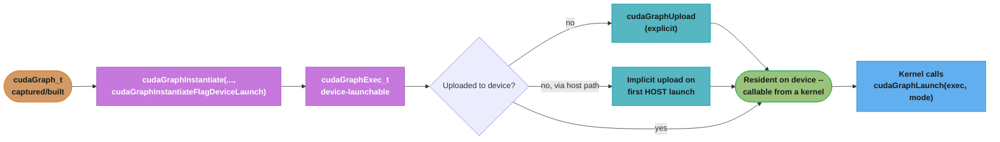
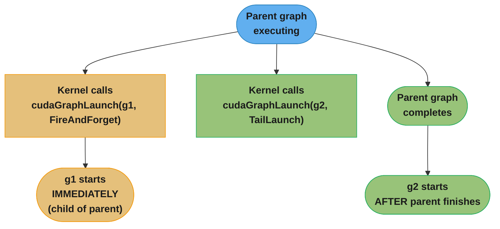
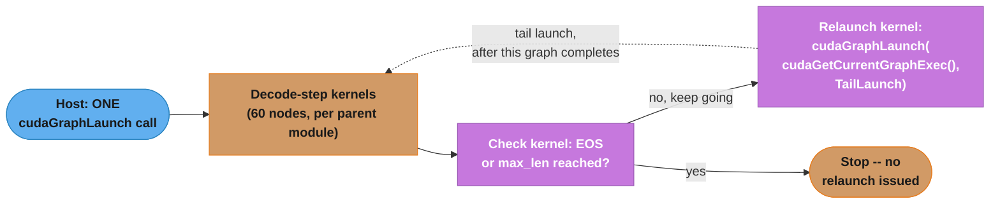
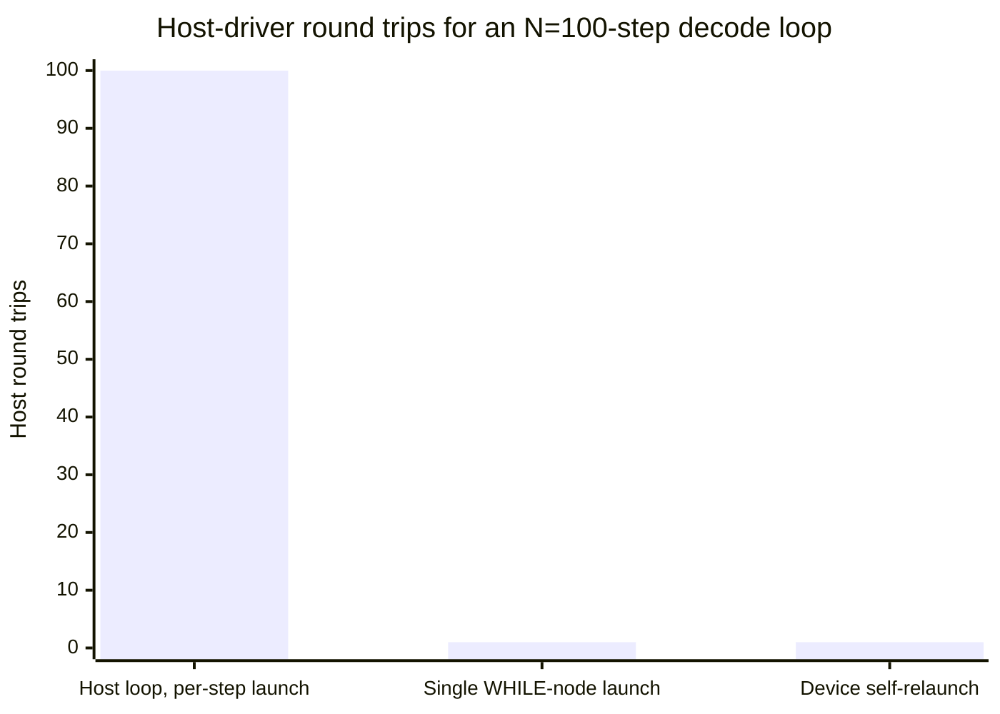

# Conditional Nodes and Device Graph Launch

This is a deep dive off [cuda_graphs](cuda_graphs.md). The parent module teaches the capture -> instantiate -> launch -> update lifecycle and states, as a core principle, that graphs "assume a static topology" with exactly one escape hatch: "a **conditional node**, whose body graph is itself static but whose execution (IF), repetition count (WHILE), or selected branch (SWITCH) is decided at replay time by a device-written condition value." The parent's own Technologies & Tools table lists the conditional-node and device-launch APIs by name, and one interview answer sketches WHILE nodes in a paragraph — but nowhere does the parent module show the code, the minimum toolkit version, or the compute-capability story, and it never covers device-side graph launch beyond that same table row. This file is that missing depth: full IF/WHILE/SWITCH mechanics with working code, and the device-side `cudaGraphLaunch` machinery (fire-and-forget, tail, and sibling launch) that lets a graph relaunch itself from a kernel with zero host round trips — the feature that takes the parent's decode-loop case study (one `cudaGraphLaunch` call per token, from the host) and removes the host from the loop entirely.

---

## 1. Concept Overview

A **static** CUDA graph is a bet that the exact same sequence of kernels runs on every replay — true of a fixed-shape training step, false the moment a workload's kernel sequence depends on a value only known at runtime. Two features close that gap without breaking the "topology is fixed" invariant graphs otherwise depend on:

- **Conditional nodes** — IF, WHILE, and SWITCH — let a device-written value control whether a body subgraph runs, how many times it repeats, or which of several bodies runs, *without* changing the parent graph's node count or structure. The decision moves onto the GPU; the DAG's shape never moves.
- **Device graph launch** — a graph instantiated with `cudaGraphInstantiateFlagDeviceLaunch` can be launched from inside a running kernel via a device-side `cudaGraphLaunch` call, including launching *itself* again. Combined with a WHILE node or a self-relaunching tail launch, an entire multi-iteration loop — a full autoregressive decode sequence, not just one token — can run without the CPU issuing a single instruction after the first launch.

Both features were introduced incrementally: device graph launch shipped in **CUDA 12.0**; IF and WHILE conditional nodes shipped in **CUDA 12.4**; the IF-node else-branch and SWITCH nodes shipped in **CUDA 12.8**, the release that added Blackwell support. NVIDIA's own documentation does not publish a compute-capability floor distinct from ordinary CUDA Graphs support for either feature — the gating factor in practice is the CUDA Toolkit version used to build against these APIs, not a specific SM architecture.

---

## 2. Intuition

> **One-line analogy**: An ordinary graph is a printed recipe card handed to the kitchen once — every step runs, in order, no matter what. A conditional node is a recipe card with one line that says "if the sauce hasn't thickened yet, repeat steps 4-6" — the chef (the GPU's own scheduler) checks a device-side gauge and decides, without ever calling back to the person who wrote the card.

**Mental model**: A conditional node wraps a **handle** — a small piece of device memory a kernel can write to — and a **body graph**. When the parent graph's execution reaches the conditional node, the GPU scheduler reads the handle's current value and decides what to do: for an IF node, run the body once if the value is non-zero (and the second body, if one exists, when it's zero); for a WHILE node, run the body, re-check the value, and repeat until it reads zero; for a SWITCH node, run whichever numbered body matches the value. The kernel that sets the handle's value — via `cudaGraphSetConditional` — lives *inside* one of the graph's own nodes, typically the last node of the body graph itself for a WHILE loop, so the loop's exit condition is computed and consumed entirely on the device.

**Why it matters**: The parent module's decode-loop case study collapses 60 kernel launches into one `cudaGraphLaunch` per token — a real win, but the host CPU still issues one graph launch *per token*, meaning a 200-token generation still costs 200 host-driver round trips (just 200 cheap ones instead of 12,000 expensive ones). A WHILE conditional node wrapping the per-token body, combined with device graph launch's tail-launch mode so the graph can relaunch itself, collapses that further: the host launches the graph **once**, and the GPU decides — reading an on-device "did we hit EOS or max length yet" flag a kernel writes after each token — whether to keep going, with no host involvement between the first token and the last.

**Key insight**: Conditional nodes and device graph launch solve two *different* halves of "dynamic behavior inside a graph." A conditional node changes **what runs within one graph launch** (a variable number of loop iterations, one of several branches) while the graph's own node count never changes. Device graph launch changes **what launches the next graph** — a kernel, instead of the host — which is a separate mechanism that can be combined with a conditional node (self-relaunch decode) or used on its own (a plain fire-and-forget child workflow triggered by a device-side decision). Conflating the two — believing a WHILE node alone removes host round trips, or that device launch alone handles variable trip counts — is the most common confusion this module exists to clear up.

---

## 3. Core Principles

- **A conditional node's body graph is itself a completely ordinary graph** — kernel nodes, memcpy/memset nodes, empty nodes, child graphs, and even nested conditional nodes are all legal inside it, recursively. What makes it "conditional" is only how the *parent* graph decides whether, or how many times, to run it — nothing about the body's own internal structure is special.
- **The handle is the sole channel between device decision and graph control flow.** `cudaGraphConditionalHandleCreate` allocates it; `cudaGraphSetConditional`, called from device code, is the only way to change what it holds; the graph's execution engine reads it at the conditional node, never anywhere else.
- **IF, WHILE, and SWITCH differ only in how many body graphs they own and how the handle's value selects among them.** IF owns one body (optionally two, with the second an else-branch since CUDA 12.8); WHILE owns exactly one body, re-entered on every non-zero read; SWITCH owns `size` bodies, running the one indexed by the handle's value, with an out-of-range value running nothing.
- **Body-graph node types are restricted, and the restriction is recursive.** Kernel, empty, memcpy, memset, child-graph, and conditional nodes are permitted inside a body graph (and inside any nested body graph); CUDA Dynamic Parallelism inside a body-graph kernel node is not permitted; memcpy/memset nodes inside a body are limited to device memory and pinned, device-mapped host memory.
- **Device graph launch is a separate mechanism from conditional nodes, gated by its own instantiation flag.** A graph must be built with `cudaGraphInstantiateFlagDeviceLaunch` and then **uploaded** to the device (`cudaGraphUpload`, an upload flag on `cudaGraphInstantiateWithParams`, or implicitly on its first host-side launch) before any kernel can launch it — skipping the upload step is a silent no-op waiting to happen, not a documented error path most authors check for up front.
- **A device-launched graph's own node-type restrictions are narrower than a conditional body's.** Only kernel, memcpy, memset, and child-graph nodes are permitted inside a graph instantiated for device launch — Dynamic Parallelism is again disallowed inside its kernel nodes, and memcpy is again limited to device and pinned device-mapped host memory.
- **Fire-and-forget, tail, and sibling launch differ in *when* the launched graph runs and *whose* execution environment it inherits — not in what work it does.** Fire-and-forget runs immediately, as a child of the launching graph; tail launch waits until the entire parent graph completes, in enqueue order, and is the mechanism a graph uses to relaunch itself; sibling launch runs in the *parent's* execution environment rather than the launching node's, a distinction that matters once launches are nested more than one level deep.
- **A device graph cannot launch concurrently with itself, and mixing a host-side and device-side launch of the same graph at once is undefined behavior.** These are hard invariants of the feature, not tuning advice — treat self-relaunch as strictly sequential by construction.

---

## 4. Types / Architectures / Strategies

### 4.1 IF nodes (`cudaGraphCondTypeIf`)

An IF node owns one or two body graphs. `phGraph_out[0]` runs once, exactly when the handle's value is non-zero at the moment the node executes. If the node was created with `size == 2` (available since CUDA 12.8), `phGraph_out[1]` is the else-branch, running exactly when the value is zero — before 12.8, an IF node could only express "maybe run this," never "run this or run that instead," and an else-branch had to be faked with two separate IF nodes checking complementary conditions.

### 4.2 WHILE nodes (`cudaGraphCondTypeWhile`)

A WHILE node owns exactly one body graph (`size` must be `1`). `phGraph_out[0]` runs, the handle is re-read, and the body runs again as long as the value stays non-zero — the loop terminates the first time the value reads zero. Because the handle is normally written by a kernel *inside* the body graph itself (checking a stop condition and calling `cudaGraphSetConditional` as its last action), the loop's exit condition is entirely self-contained within the graph: nothing outside the graph decides when to stop.

### 4.3 SWITCH nodes (`cudaGraphCondTypeSwitch`, CUDA 12.8+)

A SWITCH node owns `size` body graphs, any value greater than zero. `phGraph_out[n]` runs when the handle's value equals `n`; if the value is `>= size`, no body graph runs at all for that visit to the node — a silent no-op, not an error, which is worth knowing before assuming an out-of-range value fails loudly.

### 4.4 Instantiating and uploading a device-launchable graph



Three paths reach "resident on device," and the third — launching from the host once, which implicitly uploads — is the one most likely to be relied on by accident: code that only ever calls `cudaGraphLaunch` from the host, never noticing it also satisfied the device-launch upload prerequisite, will break the moment the first launch is moved to be device-initiated only.

### 4.5 Launch modes: fire-and-forget, tail, and sibling

| Mode | Stream constant | When it runs | Relationship to launching graph | Pending limit |
|---|---|---|---|---|
| Fire-and-forget | `cudaStreamGraphFireAndForget` | Immediately, submitted to the GPU right away | Runs as a **child** of the launching graph | Up to 120 pending per parent graph execution |
| Tail launch | `cudaStreamGraphTailLaunch` | Only after the entire parent graph completes | Runs after the launcher, in enqueue order — the mechanism behind self-relaunch | Up to 255 pending |
| Sibling launch | `cudaStreamGraphFireAndForgetAsSibling` | Immediately, like fire-and-forget | Runs in the **parent's** execution environment, as a sibling rather than a child of the launching node | Shares fire-and-forget's accounting |

Tail launch is the one that matters for a decode loop: a kernel inside the currently-executing graph calls `cudaGraphLaunch(cudaGetCurrentGraphExec(), cudaStreamGraphTailLaunch)` to relaunch the *same* graph after it finishes — the graph replaying itself, from the device, with no host CPU involved in issuing the next iteration.

---

## 5. Architecture Diagrams

### A WHILE node, unrolled across three iterations

```
Parent graph (captured once, instantiated once)
  |
  +-- ... upstream nodes ...
  |
  +-- WHILE conditional node (handle H)
  |     iteration 1: read H -- non-zero -> run body graph
  |                    body: [kernel A] -> [kernel B] -> [kernel sets H]
  |     iteration 2: read H -- non-zero -> run body graph again
  |                    body: [kernel A] -> [kernel B] -> [kernel sets H]
  |     iteration 3: read H -- ZERO -> loop ends, do not run body again
  |
  +-- ... downstream nodes ...

The parent graph's NODE COUNT never changes across replays or across
iterations -- one WHILE node, always. What varies is how many times its
body graph executes, decided entirely by what the body's own last kernel
writes into H. A host launch of the parent graph sees ONE cudaGraphLaunch
call regardless of whether the loop ran once or fifty times.
```

**Reading it.** The static-topology invariant from the parent module is preserved exactly: the graph's shape (one WHILE node, one body) is fixed at capture time and never changes, yet the *work performed* on a given launch is fully dynamic, bounded only by what a device-written condition allows.

### Fire-and-forget vs. tail launch, side by side



Fire-and-forget's graph runs concurrently with whatever else the parent graph is still doing; tail launch's graph strictly waits for the parent to finish first — which is exactly the ordering a self-relaunching decode loop needs: the next token's graph must not start until the current token's kernels have all completed.

### Self-relaunch: a graph that launches itself via tail launch



The dashed arrow is the self-relaunch: `RL` schedules the *same* graph exec to run again via tail launch, and because the relaunch is unconditional inside the kernel's own code path, the actual stopping decision lives in `CK` deciding whether to call the relaunch kernel's logic at all — which is exactly the WHILE-node pattern from §4.2, here expressed at the level of whole-graph relaunch rather than a body-graph iteration.

---

## 6. How It Works — Detailed Mechanics

### 6.1 An IF node with an else branch (CUDA 12.8+)

```cpp
#include <cuda_runtime.h>

// Kernel that decides the branch: writes 1 if the fast path applies,
// 0 otherwise. Runs BEFORE the IF node, as an ordinary graph node.
__global__ void decideBranchKernel(cudaGraphConditionalHandle handle,
                                    const float* metric, float threshold) {
    unsigned int take_fast_path = (metric[0] < threshold) ? 1u : 0u;
    cudaGraphSetConditional(handle, take_fast_path);
}

__global__ void fastPathKernel(float* data, int n) { /* ... */ }
__global__ void slowPathKernel(float* data, int n) { /* ... */ }

void buildIfElseGraph(cudaStream_t stream, float* data, const float* metric,
                       int n, float threshold) {
    cudaGraph_t graph;
    cudaGraphCreate(&graph, 0);

    // 1. Create the handle BEFORE any node that references it.
    cudaGraphConditionalHandle handle;
    cudaGraphConditionalHandleCreate(&handle, graph, /*defaultLaunchValue=*/0,
                                      cudaGraphCondAssignDefault);

    // 2. Add the decision kernel as an ordinary kernel node.
    cudaGraphNodeParams decideParams = {cudaGraphNodeTypeKernel};
    void* decideArgs[] = {&handle, &metric, &threshold};
    decideParams.kernel.func = reinterpret_cast<void*>(decideBranchKernel);
    decideParams.kernel.gridDim = {1, 1, 1};
    decideParams.kernel.blockDim = {1, 1, 1};
    decideParams.kernel.kernelParams = decideArgs;
    cudaGraphNode_t decideNode;
    cudaGraphAddNode(&decideNode, graph, nullptr, 0, &decideParams);

    // 3. Add the IF node, depending on the decision kernel, with size == 2
    //    to request an else-branch (CUDA 12.8+; size == 1 has no else-body).
    cudaGraphNodeParams ifParams = {cudaGraphNodeTypeConditional};
    ifParams.conditional.handle = handle;
    ifParams.conditional.type = cudaGraphCondTypeIf;
    ifParams.conditional.size = 2;
    cudaGraphNode_t ifNode;
    cudaGraphAddNode(&ifNode, graph, &decideNode, 1, &ifParams);

    // 4. Populate BOTH body graphs. CUDA allocated them; this code fills them.
    cudaGraph_t fastBody = ifParams.conditional.phGraph_out[0];  // non-zero
    cudaGraph_t slowBody = ifParams.conditional.phGraph_out[1];  // zero

    cudaGraphNodeParams fastKernelParams = {cudaGraphNodeTypeKernel};
    void* fastArgs[] = {&data, &n};
    fastKernelParams.kernel.func = reinterpret_cast<void*>(fastPathKernel);
    fastKernelParams.kernel.gridDim = {1, 1, 1};
    fastKernelParams.kernel.blockDim = {256, 1, 1};
    fastKernelParams.kernel.kernelParams = fastArgs;
    cudaGraphNode_t fastNode;
    cudaGraphAddNode(&fastNode, fastBody, nullptr, 0, &fastKernelParams);

    cudaGraphNodeParams slowKernelParams = {cudaGraphNodeTypeKernel};
    void* slowArgs[] = {&data, &n};
    slowKernelParams.kernel.func = reinterpret_cast<void*>(slowPathKernel);
    slowKernelParams.kernel.gridDim = {4, 1, 1};
    slowKernelParams.kernel.blockDim = {256, 1, 1};
    slowKernelParams.kernel.kernelParams = slowArgs;
    cudaGraphNode_t slowNode;
    cudaGraphAddNode(&slowNode, slowBody, nullptr, 0, &slowKernelParams);

    cudaGraphExec_t graphExec;
    cudaGraphInstantiate(&graphExec, graph, 0);
    cudaGraphLaunch(graphExec, stream);
    // Exactly one of fastPathKernel / slowPathKernel runs per replay,
    // decided by decideBranchKernel's write to `handle` -- the graph's
    // node count (one IF node, two possible bodies) never changes.
}
```

### 6.2 A WHILE node driving an on-device decode loop

```cpp
// Kernel that runs LAST inside the WHILE body: decides whether another
// iteration is needed and writes that decision into the loop's handle.
__global__ void checkStopKernel(cudaGraphConditionalHandle handle,
                                 const int* generated_token, int eos_id,
                                 int* step_count, int max_steps) {
    int tok = generated_token[0];
    *step_count += 1;
    bool keep_going = (tok != eos_id) && (*step_count < max_steps);
    cudaGraphSetConditional(handle, keep_going ? 1u : 0u);
}

void buildDecodeWhileGraph(cudaStream_t stream, /* decode-step buffers */
                            int* generated_token, int eos_id,
                            int* step_count, int max_steps) {
    cudaGraph_t graph;
    cudaGraphCreate(&graph, 0);

    cudaGraphConditionalHandle handle;
    // Default value 1: the loop always runs its body at least once.
    cudaGraphConditionalHandleCreate(&handle, graph, /*defaultLaunchValue=*/1,
                                      cudaGraphCondAssignDefault);

    cudaGraphNodeParams whileParams = {cudaGraphNodeTypeConditional};
    whileParams.conditional.handle = handle;
    whileParams.conditional.type = cudaGraphCondTypeWhile;
    whileParams.conditional.size = 1;   // WHILE owns exactly one body
    cudaGraphNode_t whileNode;
    cudaGraphAddNode(&whileNode, graph, nullptr, 0, &whileParams);

    cudaGraph_t body = whileParams.conditional.phGraph_out[0];

    // Populate `body` with the ~60 decode-step nodes from the parent
    // module's case study (layernorm, QKV, attention, out-proj, MLP,
    // sampling) -- omitted here for brevity; see cuda_graphs.md Section 14.
    cudaGraphNode_t lastDecodeNode = addDecodeStepNodes(body, /* ... */);

    // The stop-check kernel is the body's LAST node, depending on the
    // decode step's final node -- it must run after sampling produces
    // this iteration's token, and its write to `handle` is what the
    // WHILE node reads on the NEXT re-entry into the body.
    cudaGraphNodeParams checkParams = {cudaGraphNodeTypeKernel};
    void* checkArgs[] = {&handle, &generated_token, &eos_id, &step_count,
                          &max_steps};
    checkParams.kernel.func = reinterpret_cast<void*>(checkStopKernel);
    checkParams.kernel.gridDim = {1, 1, 1};
    checkParams.kernel.blockDim = {1, 1, 1};
    checkParams.kernel.kernelParams = checkArgs;
    cudaGraphNode_t checkNode;
    cudaGraphAddNode(&checkNode, body, &lastDecodeNode, 1, &checkParams);

    cudaGraphExec_t graphExec;
    cudaGraphInstantiate(&graphExec, graph, 0);
    cudaGraphLaunch(graphExec, stream);
    // ONE host-side cudaGraphLaunch call now runs the ENTIRE generation --
    // however many tokens it takes to hit EOS or max_steps -- with the
    // loop's continue/stop decision made and consumed entirely on-device.
}
```

### 6.3 Device-side self-relaunch via tail launch

```cpp
// Instantiate a graph for DEVICE launch, and upload it before any kernel
// can call cudaGraphLaunch on it.
cudaGraphExec_t buildDeviceLaunchableDecodeGraph(cudaGraph_t graph,
                                                   cudaStream_t stream) {
    cudaGraphExec_t graphExec;
    cudaGraphInstantiate(&graphExec, graph, cudaGraphInstantiateFlagDeviceLaunch);
    cudaGraphUpload(graphExec, stream);  // explicit upload -- required before
                                          // any device-side cudaGraphLaunch,
                                          // unless a prior HOST launch already
                                          // triggered an implicit upload.
    return graphExec;
}

// Kernel node INSIDE the graph: relaunches the CURRENTLY EXECUTING graph
// via tail launch -- i.e., itself -- once this launch's work completes.
__global__ void selfRelaunchKernel(const int* stop_flag) {
    if (*stop_flag == 0) {   // 0 == "keep generating"
        cudaGraphExec_t self = cudaGetCurrentGraphExec();
        cudaGraphLaunch(self, cudaStreamGraphTailLaunch);
        // Tail launch: this relaunch does not start until every node in
        // THIS execution of the graph -- including this kernel -- has
        // finished. No host round trip issues it.
    }
    // If stop_flag != 0, no relaunch is issued and the chain of
    // self-relaunches simply ends here.
}
```

`cudaGetCurrentGraphExec()` is what makes self-relaunch possible without the kernel needing the graph's `cudaGraphExec_t` handle passed in as an argument — it recovers the handle of whichever graph is currently executing, which is exactly the graph the kernel needs to relaunch when the goal is "run me again."

---

## 7. Real-World Examples

- **Speculative-decoding accept/reject loops** — a draft model proposes several tokens, a verifier kernel accepts a variable-length prefix of them; a WHILE or SWITCH node can express "keep processing accepted draft tokens until the first rejection" without the host ever seeing the per-step accept/reject decision.
- **Early-exit inference** — a per-layer confidence-threshold check that skips remaining transformer layers when a prediction is already confident enough is a natural IF-node candidate: a confidence kernel writes the handle, and the remaining layers' body graph either runs or is skipped for that forward pass.
- **Iterative solvers with a data-dependent convergence check** (referenced in NVIDIA's own conditional-node materials) — a WHILE node re-runs an iteration's kernels until a device-computed residual drops below a threshold, without round-tripping the residual to the host each iteration to decide whether to loop again.
- **vLLM- and TensorRT-LLM-style CUDA-graph decode**, extended past what the parent module's bucketed-graph-per-batch-size approach alone can do — a self-relaunching, EOS-conditioned graph (§6.2/§6.3) removes the fixed-iteration-count assumption a naively captured decode loop otherwise carries, letting one captured graph serve requests of genuinely varying output length instead of one graph per length bucket.
- **PyTorch `torch.while_loop` under CUDA graph capture** (PyTorch 2.14): `torch.cuda.CUDAGraph` captures the loop body into a WHILE conditional node driven by a scalar CUDA predicate tensor, the same mechanism its earlier `torch.cond` capture uses with an IF node. It needs CUDA 12.4+, and the usual `while_loop` constraints still apply: a fixed maximum trip count and tensor-only carried inputs. The use case is a variable-length step (a reduction over a variable-length index tensor, a loss over a variable number of packed sequences) whose output shape stays fixed, so the whole step stays inside one graph instead of copying a length to the host.
- **Device-orchestrated multi-stage pipelines** — a fire-and-forget child graph launched from inside a producer kernel to kick off an independent downstream stage (e.g., asynchronous logging, a background compaction pass) without blocking the producer's own graph on that work completing.

---

## 8. Tradeoffs

| Approach | Host round trips for an N-step loop | Handles variable N | Setup complexity | Debuggability |
|---|---|---|---|---|
| Host loop calling `cudaGraphLaunch` per step (parent module's case study) | N (one graph launch call per step) | Yes, trivially — the host `for` loop just stops | Low — ordinary host-side control flow | High — a breakpoint between steps is a normal host breakpoint |
| WHILE conditional node, single host launch | 1 (one launch covers the whole loop) | Yes — loop count is decided entirely on-device | Moderate — handle creation, body-graph population, a stop-check kernel | Lower — stepping through iterations requires GPU-side tooling, not host breakpoints |
| Device self-relaunch (tail launch) | 1 (same as above, but the relaunch decision itself also moves on-device) | Yes | Highest — device-launch instantiation, explicit upload, `cudaGetCurrentGraphExec` bookkeeping | Lowest — no host-visible boundary between "iterations" at all until the chain ends |
| IF/SWITCH node for branching (no loop) | 1 per graph launch, regardless of which branch | N/A — branch selection, not iteration count | Moderate — one decision kernel plus N body graphs | Moderate — the taken branch is visible in a profiler trace after the fact |



The WHILE-node and self-relaunch bars both collapse to 1, but they are not the same win: the WHILE node still requires one host-issued `cudaGraphLaunch` to *start* the whole loop, while self-relaunch demonstrates that even that single call could itself have been triggered by another device-side decision — the bar chart flattens at 1 either way because the parent module's decode case study was already down to N=1-per-token launches; the improvement these features add is going from N host launches to 1 for the *entire* generation, not from N to N-minus-something.

---

## 9. When to Use / When NOT to Use

**Use conditional nodes when:**
- A loop's trip count, or a branch's decision, is computed **from data already on the device** — a sampled token, a residual, a confidence score — and round-tripping that value to the host purely to decide "loop again or not" would itself become the launch-bound bottleneck the parent module's graphs feature exists to eliminate.
- The body work being conditionally run or repeated is itself substantial enough (many kernel nodes, as in a decode step) that the win from collapsing many host launches into one matters.
- The set of possible branches or the loop body's *structure* is known and fixed at capture time — only the *decision* of which branch or how many iterations is dynamic, never the node structure itself.

**Use device graph launch (fire-and-forget / tail / sibling) when:**
- A kernel needs to trigger further GPU work as a *consequence* of a decision it makes, without stalling on a host round trip to issue that work.
- A graph needs to relaunch itself an unbounded number of times bounded only by an on-device condition (§6.3) — the strongest form of removing the host from a hot loop.

**Do NOT reach for either when:**
- **The loop or branch count is small and the host is not the bottleneck.** A three-iteration loop with cheap kernels gains little from conditional-node bookkeeping overhead versus just capturing three sequential iterations directly, or even not using a graph at all.
- **The decision genuinely depends on host-side state** — user input arriving after the graph started, a value only available via a synchronous API outside CUDA. Conditional nodes only ever read a device-written handle; there is no path for host code to inject a value into a running graph's conditional decision.
- **Debuggability during development matters more than the host-round-trip win.** Both features push the "what happened and in what order" question further from ordinary host-side breakpoints and printf debugging; validate the *unconditioned* eager version of the logic first, exactly as the parent module's Best Practices recommend for graphs generally, before wrapping it in a conditional node or a self-relaunch chain.
- **The body graph or device-launched graph needs a node type outside the restricted set** (§3) — Dynamic Parallelism inside a body-graph or device-launched kernel node, host-callback nodes, or memcpy touching pageable host memory are all disallowed, and there is no workaround inside the feature itself; the work has to be restructured or kept outside the conditional/device-launch path.

---

## 10. Common Pitfalls

**BROKEN -> FIX: forgetting to upload a device-launchable graph before a kernel tries to launch it**

```cpp
// BROKEN: instantiates a graph for device launch but never uploads it,
// and the graph is never launched from the host first either -- so no
// implicit upload has happened when the kernel tries to launch it.
cudaGraphExec_t graphExec;
cudaGraphInstantiate(&graphExec, graph, cudaGraphInstantiateFlagDeviceLaunch);
// MISSING: cudaGraphUpload(graphExec, stream);

launcherKernel<<<1, 1, 0, stream>>>(graphExec);
// Inside launcherKernel: cudaGraphLaunch(graphExec, cudaStreamGraphFireAndForget);
// The graph was never made resident on the device -- the device-side
// launch call operates on an executable the device does not actually
// have a resident copy of yet.
```

```cpp
// FIX: upload explicitly before any device-side launch can occur, and
// do so on the same stream ordering the rest of the setup uses.
cudaGraphExec_t graphExec;
cudaGraphInstantiate(&graphExec, graph, cudaGraphInstantiateFlagDeviceLaunch);
cudaGraphUpload(graphExec, stream);       // FIX: make it resident on-device
cudaStreamSynchronize(stream);            // ensure upload completes before
                                           // any kernel that launches it runs

launcherKernel<<<1, 1, 0, stream>>>(graphExec);
// Now the device-side cudaGraphLaunch call inside launcherKernel operates
// on a graph the device actually has resident.
```

**Stated plainly.** "Instantiating for device launch" and "being launchable from a device" are two different states, and only an explicit `cudaGraphUpload` (or an incidental host-side launch, which most self-relaunch-only designs never perform) bridges them.

**Other common pitfalls:**
- **Creating a conditional handle after the node that references it, or against the wrong graph.** `cudaGraphConditionalHandleCreate` must run before any conditional node uses the handle, and the handle is created against a specific `cudaGraph_t` — passing it into a node in a different, unrelated graph is a correctness bug the API does not catch for you.
- **Assuming a WHILE node's body runs at least once by default.** The default value passed to `cudaGraphConditionalHandleCreate` (via `cudaGraphCondAssignDefault`) governs the very first read; a default of `0` means the body never runs at all on some launches, which is easy to get backwards relative to what the loop's semantics actually require.
- **Writing the conditional handle from a kernel that is not guaranteed to run before the conditional node re-reads it.** If the stop-check kernel is not correctly ordered as the last dependency inside the WHILE body, the conditional node can read a stale value from a prior iteration — an ordering bug that produces one extra or one fewer iteration, not a crash, making it easy to miss in testing.
- **Using a SWITCH node and assuming an out-of-range value is an error.** It is not — `phGraph_out[n]` simply does not run when the handle's value is `>= size`, silently doing nothing for that visit to the node. Code that relies on an out-of-range value being caught needs to add that check itself, typically in the kernel that writes the handle.
- **Mixing a host-side and device-side launch of the same `cudaGraphExec_t` concurrently.** This is explicitly undefined behavior per §3 — a design that sometimes launches a decode graph from the host (for the first token) and sometimes expects a prior device-side self-relaunch to still be in flight needs an explicit synchronization boundary between the two, not an assumption that the driver serializes them safely.
- **Putting a Dynamic-Parallelism kernel launch inside a conditional body or a device-launched graph.** Both node-type restrictions in §3 disallow it; the fix is to restructure the work as an ordinary graph node (kernel, memcpy, memset, or child graph) rather than a nested dynamic launch.

---

## 11. Technologies & Tools

| Tool / API | Purpose | Introduced |
|---|---|---|
| `cudaGraphConditionalHandleCreate` | Create a device-writable condition handle bound to a specific graph | CUDA 12.4 |
| `cudaGraphAddNode` with `cudaGraphNodeTypeConditional` | Add an IF, WHILE, or SWITCH node; populates `phGraph_out[]` with CUDA-owned body-graph handles | IF/WHILE: CUDA 12.4; SWITCH and IF-else: CUDA 12.8 |
| `cudaGraphSetConditional` | Device-callable — writes a new value into a condition handle from inside a kernel | CUDA 12.4 |
| `cudaGraphCondAssignDefault` | Flag on handle creation: sets the value read on the very first evaluation, before any kernel has written to the handle | CUDA 12.4 |
| `cudaGraphInstantiate(..., cudaGraphInstantiateFlagDeviceLaunch)` | Instantiate a graph so it can be launched from device code | CUDA 12.0 |
| `cudaGraphUpload` | Make an instantiated graph resident on the device — required before any device-side launch, unless a prior host launch triggered it implicitly | CUDA 12.0 (paired with device graph launch) |
| `cudaGraphLaunch` (called from device code) | Launch a graph from within a running kernel, in fire-and-forget, tail, or sibling mode | CUDA 12.0 |
| `cudaStreamGraphFireAndForget` / `cudaStreamGraphTailLaunch` / `cudaStreamGraphFireAndForgetAsSibling` | Stream constants selecting device-launch mode | CUDA 12.0 |
| `cudaGetCurrentGraphExec` | Returns the `cudaGraphExec_t` of the graph currently executing — enables self-relaunch without passing the handle in as a kernel argument | CUDA 12.0 |
| Nsight Systems | Visualize device-launched child/tail/sibling graphs and conditional-node body executions on the GPU timeline | See [profiling_and_performance_analysis](../profiling_and_performance_analysis/profiling_and_performance_analysis.md) |
| NVIDIA CUDA C++ Programming Guide, "CUDA Graphs" chapter | Primary source for conditional-node and device-graph-launch semantics, node-type restrictions, and pending-launch limits | Current CUDA Toolkit documentation |

---

## 12. Interview Questions with Answers

**Q: What problem do conditional graph nodes solve that a plain captured graph cannot?**
**Short:** They let a device-written value control whether a subgraph runs, how many times, or which branch runs, while the parent graph's topology stays fixed across replays.
A plain captured graph assumes the exact same kernel sequence runs on every replay — true for a fixed-shape training step, false whenever a loop's trip count or a branch's outcome depends on data only known at runtime. A conditional node (IF, WHILE, or SWITCH) lets a device-written handle control that decision at replay time while the parent graph's own node count and structure never change, preserving the static-topology requirement plain graphs otherwise need.

**Q: What are the three conditional node types, and what does each one's handle value control?**
**Short:** IF runs its body when the handle is non-zero (and an optional second body when zero); WHILE re-runs its one body while the handle stays non-zero; SWITCH runs the body indexed by the handle's value.
IF nodes run `phGraph_out[0]` when the handle is non-zero, and — since CUDA 12.8, with `size == 2` — run `phGraph_out[1]` as an else-branch when the handle is zero. WHILE nodes own exactly one body and re-run it as long as the handle stays non-zero at each re-check, ending on the first zero read. SWITCH nodes (also CUDA 12.8+) own `size` bodies and run whichever one is indexed by the handle's current value, running nothing if the value is out of range.

**Q: What CUDA Toolkit version introduced conditional nodes, and did every conditional node type arrive at once?**
**Short:** No — IF and WHILE nodes shipped in CUDA 12.4; the IF else-branch and SWITCH nodes followed in CUDA 12.8, the same release that added Blackwell support.
No. IF and WHILE nodes were introduced in CUDA 12.4. The IF node's optional else-branch (`size == 2`) and SWITCH nodes arrived later, in CUDA 12.8 — the same toolkit release that added NVIDIA Blackwell support. Code relying on an IF-node else-branch or a SWITCH node needs at least CUDA 12.8; code using only single-body IF or WHILE nodes only needs 12.4.

**Q: What node types are legal inside a conditional node's body graph?**
**Short:** Kernel, empty, memcpy, memset, child-graph, and conditional nodes — recursively, but kernel nodes inside a body cannot use CUDA Dynamic Parallelism.
Kernel, empty, memcpy, memset, child-graph, and conditional nodes — a body graph can itself contain nested conditional nodes, applied recursively. Kernel nodes inside a body graph cannot use CUDA Dynamic Parallelism, and memcpy/memset nodes inside a body are restricted to device memory and pinned, device-mapped host memory rather than arbitrary pageable host memory.

**Q: How does a kernel actually change what a WHILE node does on its next iteration?**
**Short:** By calling the device-side cudaGraphSetConditional on the loop's handle, typically as the last node in the body graph, right before the node's next re-check.
By calling `cudaGraphSetConditional(handle, value)` from device code — the only channel that changes what a conditional handle holds. The idiomatic placement is as the last node in the WHILE body's own dependency chain, so the write happens immediately before the WHILE node re-checks the handle for the next iteration; ordering it incorrectly relative to the body's other work risks the conditional node reading a stale value from a prior pass.

**Q: What does cudaGraphInstantiateFlagDeviceLaunch actually enable, and what step is easy to forget after using it?**
**Short:** It makes a graph launchable from device code, but the graph must also be uploaded to the device — via cudaGraphUpload or an implicit host launch — before any device-side launch will work.
It marks a `cudaGraphExec_t` as eligible for device-side launch. The step that's easy to forget is that instantiating with the flag does not, by itself, make the graph resident on the device — it must also be uploaded, either explicitly via `cudaGraphUpload`, via an upload flag passed to `cudaGraphInstantiateWithParams`, or implicitly the first time it is launched from the host. A design that only ever launches the graph from device code, never from the host, must call `cudaGraphUpload` explicitly or the device-side launch has nothing resident to launch.

**Q: What is the difference between fire-and-forget and tail launch, and why does that difference matter for a self-relaunching decode loop?**
**Short:** Fire-and-forget starts immediately as a child of the launcher; tail launch waits until the whole parent graph finishes — exactly the ordering a self-relaunching loop needs between iterations.
Fire-and-forget submits the launched graph to the GPU immediately, running as a child of the graph that launched it, concurrently with whatever else that graph is still doing. Tail launch instead waits until the entire launching graph has completed before starting, and pending tail launches run in enqueue order. A self-relaunching decode loop needs the *next* token's graph to wait until the *current* token's kernels — including sampling — have all finished, which is exactly tail launch's ordering guarantee; fire-and-forget would let the next iteration start before the current one's results were ready.

**Q: What does cudaGetCurrentGraphExec do, and why is it needed for self-relaunch?**
**Short:** It returns the graph exec handle of whichever graph is currently executing, letting a kernel relaunch its own enclosing graph without that handle being passed in as an argument.
It returns the `cudaGraphExec_t` handle of whichever device-launched graph is currently executing. Self-relaunch needs a kernel inside the graph to call `cudaGraphLaunch` on that same graph again — `cudaGetCurrentGraphExec` supplies that handle from inside the running kernel itself, without requiring the graph to have been built with a self-referential pointer baked in at capture time, which would be awkward since the exec handle does not exist yet when the graph's nodes are being defined.

**Q: How many host CPU round trips does an N=200-token decode loop need if it is wrapped in a WHILE conditional node versus the parent module's plain per-token cudaGraphLaunch approach?**
**Short:** One, versus 200 — the WHILE node's loop runs entirely on-device once the host issues a single launch, where the plain approach issues one host launch per token.
One, versus 200. The parent module's decode-loop case study collapses 60 kernel launches into 1 graph launch per token, but a 200-token generation still needs 200 host-issued `cudaGraphLaunch` calls. Wrapping the per-token body in a WHILE node whose stop condition (EOS token or max length) is written by an on-device kernel means the host issues exactly one `cudaGraphLaunch` for the entire generation, and the GPU decides internally how many of the 200 iterations to actually run.

**Q: Can a graph be launched from the host and from device code at the same time?**
**Short:** No — concurrent host and device launches of the same graph exec are explicitly undefined behavior, and a device graph also cannot launch concurrently with itself.
No. Mixing a host-side launch and a device-side launch of the same `cudaGraphExec_t` at the same time is explicitly undefined behavior, and a device-launched graph also cannot be launched concurrently with itself even from device code alone. Any design that might have both paths active needs an explicit synchronization point ensuring only one is ever in flight.

**Q: What happens if a SWITCH node's handle holds a value greater than or equal to size?**
**Short:** Nothing runs — an out-of-range SWITCH value is a silent no-op for that visit to the node, not an error.
No body graph runs for that visit to the node — it is a silent no-op, not a raised error. Code relying on out-of-range values being caught has to add that validation itself, typically inside whichever kernel computes and writes the handle's value before the SWITCH node is reached.

**Q: Why can't a body graph or a device-launched graph use CUDA Dynamic Parallelism inside one of its kernel nodes?**
**Short:** Both node-type restrictions explicitly disallow CDP inside kernel nodes belonging to a conditional body or a device-launchable graph — it's a stated limitation of both features.
Both restrictions are explicit, documented limitations of the respective features rather than a general CUDA Graphs limitation — an ordinary (non-conditional, non-device-launched) graph's kernel nodes can use Dynamic Parallelism. Work that needs a dynamically-launched child kernel inside a conditional body or a device-launched graph has to be restructured as an ordinary graph node (a child-graph node, or a kernel that does the equivalent work without CDP) instead.

**Q: What is the maximum number of pending fire-and-forget graphs versus tail-launched graphs per parent execution?**
**Short:** 120 pending fire-and-forget graphs versus 255 pending tail launches per parent graph execution.
Up to 120 pending fire-and-forget graphs (launched as children of the launching graph) and up to 255 pending tail launches (which run strictly after the parent completes, in enqueue order) per parent graph execution. A design issuing device-side launches in a tight loop needs to respect these ceilings rather than assuming unbounded fan-out.

**Q: A team wraps a decode loop's stop-check in a WHILE node but the loop runs one extra iteration past when EOS was generated. What's the most likely bug?**
**Short:** The stop-check kernel that writes the conditional handle is not correctly ordered as the body's last dependency, so the WHILE node re-reads a stale value from before the current iteration's EOS check ran.
The most likely cause is an ordering bug: the kernel that checks for EOS and calls `cudaGraphSetConditional` is not correctly positioned as the final dependency in the WHILE body's chain, so the conditional node's next re-read sees the handle's value from before the current iteration's check actually ran — effectively reading one iteration late. Fixing it means verifying the stop-check kernel genuinely depends on (and runs strictly after) every node whose output it needs to evaluate, including the token-sampling step.

**Q: Does using a conditional node change what node types are allowed anywhere else in the parent graph?**
**Short:** No — the restricted node-type set applies only inside the conditional node's own body graphs, not to the rest of the parent graph surrounding it.
No. The restricted set (kernel, empty, memcpy, memset, child-graph, and nested conditional nodes, with the CDP and memory-type limits from §3) applies only *inside* a conditional node's own body graphs. Nodes elsewhere in the parent graph, outside any conditional node's body, are unaffected and follow the ordinary CUDA Graphs node-type rules the parent module already documents.

**Q: Why might a team choose a self-relaunching device graph over a WHILE conditional node for a decode loop, or vice versa?**
**Short:** A WHILE node is simpler and keeps one host launch call visible in code; self-relaunch removes even that, at the cost of higher setup complexity and harder debugging, per the tradeoffs in Section 8.
A WHILE node is the simpler choice: one host-issued `cudaGraphLaunch` starts the whole loop, and the loop's mechanics are contained within ordinary graph-building code with a clear single entry point. Self-relaunch via device graph launch removes even that single host call being a "loop driver" in any meaningful sense — appropriate when the entire decode sequence, including its first launch, should be triggerable from another piece of device-side logic rather than host code — but it costs the explicit device-launch instantiation and upload bookkeeping from §6.3, and it is harder to reason about and debug than a WHILE node's single, contained loop.

---

## 13. Best Practices

- **Verify the exact CUDA Toolkit version before using an IF else-branch or a SWITCH node.** They require CUDA 12.8+; plain IF and WHILE nodes only require 12.4+ — check the build's minimum supported toolkit before assuming either is available.
- **Always position the handle-writing kernel as the true last dependency of a WHILE body.** An ordering mistake here produces a subtly wrong iteration count, not a crash, and is easy to miss without deliberately testing the exact iteration where the stop condition first becomes true.
- **Explicitly call `cudaGraphUpload` for any graph that is only ever launched from device code.** Do not rely on an incidental host launch to have triggered the implicit upload — a design that removes the host launch path entirely also removes that implicit trigger.
- **Set the conditional handle's default value deliberately, not by omission.** Whether a WHILE body should run at least once, or an IF node's branch should default to the "safe" side, is a real design decision `cudaGraphCondAssignDefault` controls — verify it matches the loop or branch's intended semantics.
- **Debug the eager (unconditioned, non-device-launched) version of the logic first**, exactly as the parent module recommends for graphs generally — validate correctness with ordinary host-driven control flow before wrapping it in a conditional node or a self-relaunch chain, where conventional breakpoint debugging stops working the way it does for host code.
- **Respect the 120 fire-and-forget / 255 tail-launch pending limits explicitly in any design that issues device-side launches in a loop**, rather than discovering the ceiling as a runtime failure under load.
- **Treat "concurrent host and device launch of the same graph" as a hard invariant to design around, not an edge case to hope never happens.** If both paths can plausibly launch the same graph, add an explicit synchronization boundary rather than relying on undefined behavior resolving favorably.

---

## 14. Case Study

### Scenario: converting a fixed-iteration decode graph to a dynamic-length one

A team has already applied the parent module's decode-graph optimization: a 12-layer, batch-1 decode step is captured into a CUDA graph, and the host issues one `cudaGraphLaunch` per generated token. Profiling shows this already collapsed the ~60-kernel-launch, 300-600us CPU tax per token down to roughly one launch's worth of overhead — the parent case study's exact result. The remaining cost the team now wants to remove: for a typical 150-token response, the host still issues 150 separate `cudaGraphLaunch` calls in a Python (or C++) loop, and at high request-concurrency, that per-token host-side loop overhead — scheduling the next launch, checking the sampled token against the EOS ID in host code — becomes measurable at the serving-engine level, competing with the host CPU's other duties (batching, KV-cache bookkeeping for other in-flight requests).

### BROKEN: host loop, one graph launch per token, EOS check on the host

```cpp
// BROKEN (not incorrect, but leaves the identified overhead in place):
// the host issues N graph launches for an N-token response, and checks
// the EOS condition on the host after copying the sampled token back.
struct HostDrivenDecodeLoop {
    cudaGraphExec_t decodeStepGraph;   // captures ONE token's ~60 kernels
    cudaStream_t stream;
    int eos_token_id;
    int max_tokens;

    int runToCompletion() {
        int tokens_generated = 0;
        int last_token = -1;
        while (last_token != eos_token_id && tokens_generated < max_tokens) {
            cudaGraphLaunch(decodeStepGraph, stream);   // 1 host round trip
            cudaStreamSynchronize(stream);
            // Host reads the sampled token back from device memory to
            // decide whether to loop again -- an extra D2H round trip
            // and host-side branch, on EVERY token, in addition to the
            // launch itself.
            copyTokenToHost(&last_token);
            tokens_generated++;
        }
        return tokens_generated;
        // 150-token response: 150 cudaGraphLaunch calls, 150 D2H copies,
        // 150 host-side EOS comparisons -- all host-CPU work that scales
        // linearly with response length.
    }
};
```

### FIX: a WHILE-conditional decode graph, one host launch per request

```cpp
// FIX: wrap the entire per-token decode step in a WHILE conditional
// node whose body IS the ~60-kernel decode step, plus a stop-check
// kernel that reads the sampled token and writes the loop's handle --
// all on-device. The host issues ONE launch per REQUEST, not per token.
struct GraphDrivenDecodeLoop {
    cudaGraphExec_t wholeRequestGraph;  // WHILE node wrapping the decode step
    cudaStream_t stream;
    int* d_step_count;                  // device-resident, read after completion

    void buildOnce(cudaGraph_t parentGraph, /* decode-step builder args */
                    int eos_token_id, int max_tokens) {
        cudaGraphConditionalHandle handle;
        cudaGraphConditionalHandleCreate(&handle, parentGraph,
                                          /*defaultLaunchValue=*/1,
                                          cudaGraphCondAssignDefault);

        cudaGraphNodeParams whileParams = {cudaGraphNodeTypeConditional};
        whileParams.conditional.handle = handle;
        whileParams.conditional.type = cudaGraphCondTypeWhile;
        whileParams.conditional.size = 1;
        cudaGraphNode_t whileNode;
        cudaGraphAddNode(&whileNode, parentGraph, nullptr, 0, &whileParams);

        cudaGraph_t body = whileParams.conditional.phGraph_out[0];
        cudaGraphNode_t lastStepNode = addDecodeStepNodes(body, /* ... */);

        cudaGraphNodeParams checkParams = {cudaGraphNodeTypeKernel};
        void* checkArgs[] = {&handle, /* sampled-token ptr */, &eos_token_id,
                              &d_step_count, &max_tokens};
        checkParams.kernel.func = reinterpret_cast<void*>(checkStopKernel);
        checkParams.kernel.gridDim = {1, 1, 1};
        checkParams.kernel.blockDim = {1, 1, 1};
        checkParams.kernel.kernelParams = checkArgs;
        cudaGraphNode_t checkNode;
        cudaGraphAddNode(&checkNode, body, &lastStepNode, 1, &checkParams);
        // checkStopKernel writes `handle` = 0 the moment EOS is sampled OR
        // step_count reaches max_tokens -- the loop's exit condition,
        // computed and consumed entirely on-device.

        cudaGraphInstantiate(&wholeRequestGraph, parentGraph, 0);
    }

    int runToCompletion() {
        cudaGraphLaunch(wholeRequestGraph, stream);   // 1 host round trip,
        cudaStreamSynchronize(stream);                // for the WHOLE request
        int step_count_result;
        cudaMemcpy(&step_count_result, d_step_count, sizeof(int),
                   cudaMemcpyDeviceToHost);
        return step_count_result;
        // 150-token response: 1 cudaGraphLaunch call, 1 final sync, 0
        // per-token D2H copies or host-side EOS comparisons during
        // generation -- all of that moved onto the device, inside the
        // WHILE node's body and its stop-check kernel.
    }
};
```

### Metrics: before vs. after, 150-token response, illustrative figures for this scenario

| Metric | Host-driven loop (BROKEN) | WHILE-conditional graph (FIX) |
|---|---|---|
| Host `cudaGraphLaunch` calls per response | 150 | 1 |
| Host D2H copies for EOS checking | 150 | 0 (one final copy of the step count, not per-token) |
| Host-side branch/loop overhead | Scales linearly with response length | Constant, independent of response length |
| GPU-side kernel work per token (unchanged) | ~60 kernels, same as parent module's case study | Identical — this fix does not change per-token compute |
| Host CPU availability for other request batching/bookkeeping during generation | Reduced — busy issuing launches and checking tokens | Freed almost entirely during the generation itself |

The per-token GPU compute is unchanged, exactly as the parent module's case study notes about its own fix — what moves is where the *loop-control* logic executes, from the host's serving loop to a kernel inside the graph's own body. Re-measure against a real serving engine before citing these figures as production numbers; the shape of the win (host overhead going from linear-in-response-length to constant) is what this case study establishes, not a specific millisecond figure.

**What the fix does not solve.** A single captured decode-step body graph still assumes a fixed batch size and fixed per-step kernel launch configuration, exactly as the parent module's §9 states — the WHILE node changes how many times that fixed body runs, not what the body itself can flexibly do. A request whose batch size changes mid-generation (a continuous-batching engine adding a new request into an in-flight batch) is not solved by this case study's fix and needs the bucketed-graph-per-batch-size strategy the parent module's §7 already describes, layered on top of, not instead of, the WHILE-node loop-collapsing shown here.

**Discussion questions:**
1. Why does the fix still need a final `cudaMemcpy` of the step count back to the host, when the whole point was to remove per-token host round trips — what would break if that final copy were also eliminated?
2. If the serving engine needs to know a request's generated tokens as they're produced (streaming output to the client), rather than only after the whole WHILE loop completes, how would that requirement change this design?
3. The case study's `checkStopKernel` writes the handle to 0 on EOS or max_tokens. What would need to change to also support a host-issued "cancel this request early" signal, given that conditional nodes only ever read device-written values?
4. Compare this fix's tradeoffs to the self-relaunch (tail-launch) pattern in Section 6.3 — for this specific decode-loop use case, what would self-relaunch add over the WHILE-node approach, and is that addition worth its higher setup complexity here?

---

**See also**: [cuda_graphs](cuda_graphs.md) for the capture/instantiate/launch/update
lifecycle this file assumes and the decode-loop case study this file's own case study
extends; [streams_events_and_concurrency](../streams_events_and_concurrency/streams_events_and_concurrency.md)
for the stream and event mechanics stream capture builds on; and
[profiling_and_performance_analysis](../profiling_and_performance_analysis/profiling_and_performance_analysis.md) for
using Nsight Systems to confirm a conditional node's body or a device-launched graph
actually executed the number of times, or took the branch, the design intended.
