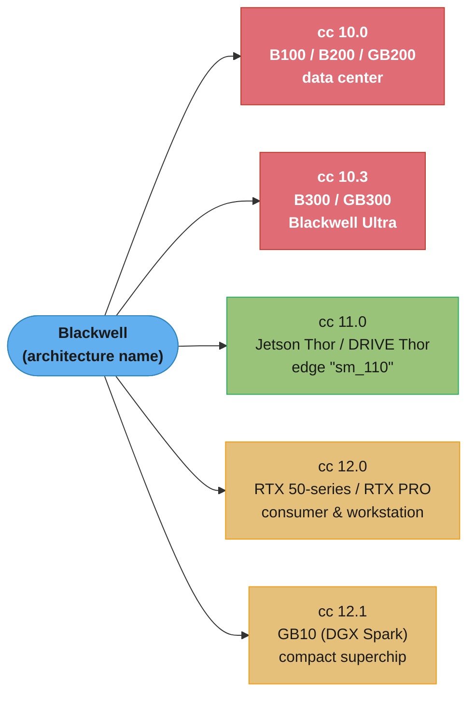
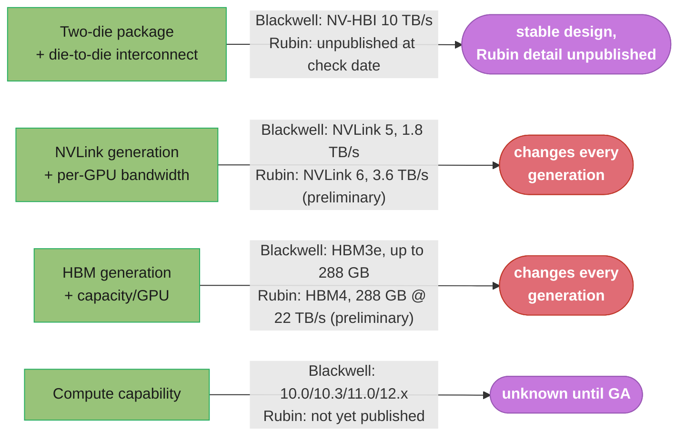

# Blackwell and Rubin Architecture

This is a deep dive off [gpu_hardware_architecture](gpu_hardware_architecture.md). The parent module's §4.1 generation table gives Blackwell and Rubin one row each — headline features and the compute-capability numbers a kernel author needs to gate on — and its §4.2 covers only that "5th-gen Tensor Cores add FP4/FP6 paths and a 2nd-gen Transformer Engine." This file starts where that row stops: the physical die-level design that makes a single Blackwell "GPU" actually two dies, the full compute-capability map across the Blackwell family (data-center, workstation, and edge parts all landed on different numbers), the NVLink-5 domain that GB200 NVL72 builds, and what is and is not yet verifiable about Rubin as of the date this file was checked. Everything the parent already states — the 65,536-register file, the three occupancy ceilings, the SM partition-scheduler mechanics — is assumed, not re-derived; this file is additive to §4.1/§4.2, not a replacement for either.

**A verification note, because this is the most version-sensitive material in the repository.** Every specific number below was checked against NVIDIA's own documentation or product pages, or against independent silicon analysis when NVIDIA does not publish the figure — each is marked which. Rubin in particular is explicitly **preliminary** per NVIDIA's own product page as of the check date; treat every Rubin number here as subject to change before general availability, not as a shipped, final spec.

---

## 1. Concept Overview

**Blackwell** is NVIDIA's GPU architecture generation after Hopper, spanning data-center parts (B100, B200, B300/Blackwell Ultra, and the GB200/GB300 superchips that pair a Blackwell GPU with a Grace CPU), workstation and server parts (the RTX PRO Blackwell line), consumer parts (GeForce RTX 50-series), and an edge/robotics SoC (Jetson Thor / DRIVE Thor). All of them share the same underlying Blackwell Streaming Multiprocessor design, but they do **not** share one compute capability — the family spans four distinct compute-capability numbers, each with different per-SM resource limits, which is the single most consequential fact for a kernel author targeting "Blackwell" as if it were one target.

**Rubin** is the architecture generation after Blackwell — the "R" in NVIDIA's now-annual cadence — first previewed publicly at GTC and CES 2026 and represented by the Vera Rubin NVL72 rack-scale platform. As of this file's check date, Rubin is in an early, explicitly preliminary state: NVIDIA's own product page carries the words "Preliminary information. All values are up to and subject to change," and no CUDA compute capability number for Rubin has yet appeared in NVIDIA's published compute-capability references. This module documents what is confirmed, flags what is not, and treats the distinction between "announced," "shipping to customers as early samples," and "generally available" as the load-bearing one it is for anything Rubin-related.

---

## 2. Intuition

> **One-line analogy**: A Hopper H100 is one full kitchen. A Blackwell B200 is two Hopper-sized kitchens built back-to-back with a pass-through window between them wide enough that the kitchen staff on either side barely notice it's there — from the head chef's (CUDA's) point of view, it's still one kitchen, one order queue, one set of walk-in coolers.

**Mental model**: Every Blackwell data-center part is built from **two reticle-limited dies** — a single die can only be as large as a lithography reticle allows to manufacture, and Blackwell's dies are already at that limit — connected by a dedicated 10 TB/s die-to-die interconnect NVIDIA calls **NV-HBI** (NVIDIA High-Bandwidth Interface). CUDA and the driver present the pair as **one logical GPU**: one `cudaDeviceProp`, one set of SMs a kernel can be scheduled across, one unified memory space. The parent module's occupancy math (§6) does not change because of this — it still operates per-SM — but the L2 cache is now **physically partitioned per die**, so a kernel whose working set straddles both dies' L2 partitions pays a cross-die hop that a single-die Hopper GPU never had to reason about.

**Why it matters**: Interviewers who ask "what's new in Blackwell" are rarely testing whether you memorized a keynote slide of TFLOPS. They are testing whether you know that (1) "Blackwell" is not one compute capability, so code compiled for `sm_100` (B200) is not guaranteed to run optimally, or at all, on `sm_120` (RTX 50) hardware with a smaller shared-memory budget; and (2) the headline "one GPU, 208 billion transistors" framing hides a genuinely two-die physical design whose interconnect bandwidth and L2 partitioning are exactly the kind of hardware detail that explains a real profiling anomaly (see §14).

**Key insight**: Every NVIDIA architecture generation since Volta has shipped **multiple** compute capabilities for the same architecture name (recall Ampere's 8.0 vs 8.6, Ada's 8.9). Blackwell pushes this further than any prior generation: four distinct compute-capability numbers (10.0, 10.3, 11.0, 12.x) span data center, edge, and consumer silicon that all get called "Blackwell" in marketing material, each with a materially different per-SM resource budget. Treating "compute capability" and "architecture name" as interchangeable is the single most common category error this module exists to correct.

---

## 3. Core Principles

- **A Blackwell data-center GPU is physically two dies presented as one logical device.** B100, B200, B300, and their GB200/GB300 superchip pairings all use this two-reticle-die design connected by NV-HBI; RTX 50-series consumer parts and the RTX PRO Blackwell workstation/server line are **single-die** — the dual-die design is a data-center-tier decision, not a Blackwell-wide one.
- **"Blackwell" is a marketing umbrella over four compute capabilities, not one.** 10.0 (B100/B200/GB200), 10.3 (B300/GB300, "Blackwell Ultra"), 11.0 (Jetson Thor / DRIVE Thor, the edge/robotics SoC), and 12.x (12.0 for RTX 50 GeForce and RTX PRO Blackwell; 12.1 for GB10/DGX Spark) — code that queries `cudaDeviceProp.major/minor` and branches only on `major == 10` silently mishandles every 11.x and 12.x Blackwell device it will ever see.
- **Data-center and consumer/workstation-tier Blackwell inherit different per-SM resource ceilings, exactly like Ampere's 8.0/8.6 split before it.** Compute capability 10.0 carries a larger per-SM shared-memory carveout and higher resident-warp ceiling than 12.0 — the same "data-center vs. consumer tier" split the parent module's §4.3 table already documents for 8.0/8.6/8.9/12.x, now repeated one generation later.
- **NVLink generation is tied to architecture, not to which die-count tier a part sits in.** Every Blackwell data-center part — B100 through B300/GB300 — uses 5th-generation NVLink; NVLink 6 is a **Rubin-generation** feature, not a Blackwell Ultra one, and confusing "Ultra" (a mid-generation memory/clock refresh) with "next generation" (a new NVLink and compute-capability number) is a common and easy mistake.
- **Rubin's numbers are a moving target until general availability, and NVIDIA says so explicitly.** The Vera Rubin NVL72 product page is marked preliminary; treat any Rubin figure — HBM4 capacity, bandwidth, NVLink 6 throughput — as the current best public estimate, not a locked spec, and never state a Rubin compute-capability number, because none has been published.
- **"Samples shipped" is not "generally available," and "in full production" is not "shipping in volume."** Rubin crossed the first of these milestones (early customer samples) before this file's check date; the second (volume availability) was targeted for the second half of 2026 as of NVIDIA's own CES announcement — both facts belong in an answer, never collapsed into "Rubin is out."

---

## 4. Types / Architectures / Strategies

### 4.1 The two-die design and NV-HBI

Every Blackwell **data-center** GPU — B100, B200, and B300 (Blackwell Ultra) alike — is built from two identical, reticle-limited dies on TSMC's custom 4NP process, connected by a dedicated die-to-die interconnect NVIDIA calls **NV-HBI**, running at 10 TB/s. The combined package carries approximately 208 billion transistors (roughly 2.6x an H100's transistor count). Because CUDA presents the pair as one logical device, none of the parent module's SM/occupancy vocabulary needs to change — but two physical consequences follow directly from the two-die design and matter for kernel authors:

- **L2 cache is partitioned per die**, not one flat pool. A kernel whose working set is resident in the "wrong" die's L2 partition relative to where its blocks are scheduled pays a cross-die interconnect hop that a single-die GPU (H100, A100, any consumer Blackwell part) never incurs.
- **NV-HBI bandwidth (10 TB/s) is enormous relative to PCIe or even NVLink**, which is precisely why the two dies can be presented as one GPU without becoming a multi-GPU programming problem — but it is still a finite, shared resource, not free bandwidth.

Consumer Blackwell (GeForce RTX 50-series) and the RTX PRO Blackwell workstation/server line are **single-die** parts; the two-die design is exclusive to the data-center B100/B200/B300 tier. The largest consumer die, GB202 (RTX 5090), carries 170 SMs and 21,760 CUDA cores on its own — a genuinely different, single-die chip, not a cut-down version of the data-center die.

### 4.2 Blackwell SM-level additions over Hopper

The parent module's §4.2 already states the headline: 5th-generation Tensor Cores adding FP4/FP6 precision paths, and a 2nd-generation Transformer Engine that manages precision per layer automatically. Two mechanics worth naming explicitly, both covered in depth in [tensor_cores_and_mixed_precision](../tensor_cores_and_mixed_precision/tensor_cores_and_mixed_precision.md) rather than re-taught here:

- **Dedicated Tensor Memory (`tcgen05`)** — Blackwell's 5th-generation Tensor Core instructions operate against a dedicated on-chip Tensor Memory region distinct from the register file and shared memory, addressed through the `tcgen05` instruction family, rather than staging MMA operands through registers the way Hopper's `wgmma` did.
- **FP4/FP6 as first-class Tensor Core precisions** — narrower than Hopper's narrowest native path (FP8), managed automatically per-layer by the 2nd-generation Transformer Engine so a model doesn't need hand-written per-layer precision selection to benefit.

### 4.3 Compute-capability map across the Blackwell family

| Compute capability | Parts | Tier | Max concurrent warps/SM | Shared memory/SM (max carveout) | Max shared memory/block (opt-in) |
|---|---|---|---|---|---|
| **10.0** | B100, B200, GB200 | Data center | 64 | 228 KB | 227 KB |
| **10.3** | B300, GB300 ("Blackwell Ultra") | Data center | 64 (same tier as 10.0) | 228 KB (same tier as 10.0) | 227 KB (same tier as 10.0) |
| **11.0** | Jetson Thor, DRIVE Thor | Edge / robotics / automotive SoC | — (edge-tier limits, not covered by the data-center/consumer tables above) | — | — |
| **12.0** | GeForce RTX 50-series, RTX PRO Blackwell (workstation and server editions) | Consumer / workstation | 48 | 128 KB | 99 KB |
| **12.1** | GB10 (DGX Spark) | Compact/desktop superchip | — (12.x tier limits as above, per NVIDIA's Blackwell Tuning Guide) | — | — |

The 10.0/12.0 warp and shared-memory figures above come directly from NVIDIA's Blackwell Tuning Guide and match the parent module's already-stated 2048-vs-1536-resident-thread split (64 warps x 32 = 2048; 48 warps x 32 = 1536) for the data-center-vs-consumer tier boundary the parent's §4.3 table generalizes across every generation since Ampere.

**11.0 is worth naming precisely because the parent module's audit trail flagged it as a known gap.** Jetson Thor's compute capability was **renamed from `sm_101` to `sm_110`** in CUDA Toolkit 13.0 — code built against the pre-13.0 naming (`sm_101`/`compute_101`) must be rebuilt against `sm_110`/`compute_110` under CUDA 13.0 and later toolkits. This is not a new architecture arriving late; it is the same Thor silicon whose compute-capability designation NVIDIA renumbered.

**Rubin's compute capability is not yet published.** No NVIDIA compute-capability reference — the Programming Guide's appendix, the `developer.nvidia.com/cuda-gpus` list, or any Rubin-specific documentation — assigns Rubin a `major.minor` number as of this file's check date. Do not guess one; when it is published, this table gets a fifth row.

### 4.4 NVLink 5 and the GB200/GB300 NVL72 domain

Every Blackwell data-center part — B100 through B300/GB300 — implements **5th-generation NVLink**, delivering roughly 1.8 TB/s of bidirectional bandwidth per GPU, about double Hopper's 4th-generation NVLink. NVIDIA's rack-scale GB200 NVL72 and GB300 NVL72 systems bind 72 Blackwell GPUs (and 36 Grace CPUs) into a single NVLink domain — every GPU in the domain can address every other GPU's memory at NVLink bandwidth, not just its immediate neighbors, through a layer of NVSwitches. This is the same NVLink-domain concept the parent module's `multi_gpu_programming_and_nccl` cross-reference already covers from the NCCL/collective-communication angle; this file adds only the generation-and-bandwidth number, not the programming model on top of it.

### 4.5 Blackwell Ultra: B300/GB300

Blackwell Ultra (B300, and the GB300 superchip pairing it with Grace) is a **mid-generation refresh**, not a new architecture: same two-die design, same TSMC 4NP process, same ~208 billion transistors, same 5th-generation NVLink — the changes are compute-capability (10.3 instead of 10.0), memory capacity (288 GB of HBM3e per GPU, up from B200's up-to-180 GB), and Tensor Core throughput (a stated 1.5x dense NVFP4 improvement over B200 in NVIDIA's own GB300 NVL72 materials). A GB300 NVL72 rack carries 72 GPUs totaling roughly 20 TB of HBM3e — consistent with 72 x 288 GB. Treating "Ultra" as a wholesale new architecture generation is the same mistake as treating Ada Lovelace's L40S as architecturally distinct from an RTX 4090 — it is the same silicon family with different binning, memory, and clocks.

### 4.6 Rubin and Vera Rubin NVL72

**Rubin** is the architecture generation after Blackwell. NVIDIA's Vera Rubin NVL72 product page — explicitly marked "Preliminary information. All values are up to and subject to change" as of this file's check date — states the following per-GPU figures for the Rubin GPU:

| Spec | Value | Source status |
|---|---|---|
| HBM4 capacity per GPU | 288 GB | NVIDIA product page, marked preliminary |
| HBM4 bandwidth per GPU | up to 22 TB/s | NVIDIA product page, marked preliminary |
| NVLink generation | 6th generation | NVIDIA product page, marked preliminary |
| NVLink bandwidth per GPU | 3.6 TB/s | NVIDIA product page, marked preliminary |
| NVLink-C2C bandwidth (per Vera-Rubin Superchip pairing) | 1.8 TB/s | NVIDIA product page, marked preliminary |
| GPUs per NVL72 rack | 72 | NVIDIA product page, marked preliminary |
| Total rack HBM4 | ~20.7 TB | NVIDIA product page, marked preliminary |
| Compute capability | **not yet published** | — |

Rubin's HBM4 figure has already moved once in public reporting during 2026: earlier press coverage cited a higher target bandwidth before memory suppliers reportedly could not hit it, and NVIDIA's own current product page states 22 TB/s. That revision history is itself the argument for treating every number in this section as provisional rather than final — the shape of the change (a target revised down to match what suppliers could actually deliver) is exactly what "preliminary, subject to change" means in practice, not a one-time disclaimer.

**Status as of this file's check date**: NVIDIA announced Vera Rubin NVL72 as "in full production" at CES in January 2026, with volume availability targeted for the second half of 2026; independent reporting describes early Rubin (VR200) samples having shipped to select customers ahead of that volume ramp. Do not compress "samples shipped to early customers" and "generally available" into one claim — they describe different points on the same rollout, and only the first had clearly happened as of the check date.

---

## 5. Architecture Diagrams

### Blackwell data-center package: two dies, one logical GPU

```
Blackwell data-center GPU package (B100 / B200 / B300) -- two-die design

+-----------------------------+     10 TB/s      +-----------------------------+
|          Die 0              |<---- NV-HBI ---->|          Die 1              |
|  SMs (partition of total)   |   (die-to-die     |  SMs (partition of total)   |
|  L2 partition (local half)  |    interconnect)  |  L2 partition (local half)  |
|  HBM3/HBM3e stacks (local)  |                   |  HBM3/HBM3e stacks (local)  |
+-----------------------------+                   +-----------------------------+
              |                                                 |
              +------------------- presented as ----------------+
                                    |
                        ONE cudaDeviceProp, ONE set of
                        SMs the CUDA scheduler dispatches
                        blocks across, ONE unified memory space

A kernel's blocks can land on either die -- the CUDA programming model
does not expose "which die." A working set resident in Die 0's L2
partition, accessed by a block scheduled on Die 1, pays the NV-HBI hop;
same-die L2 hits do not. This is invisible in source code and visible
only in Nsight Compute's L2 hit-rate and cross-die traffic counters.
```

Every generation's SM/occupancy math from the parent module's §6 still applies per-SM, unchanged — the two-die split is a fact about the memory hierarchy sitting *above* the SM, not about how any individual SM schedules warps.

### The compute-capability fan-out — one architecture name, four numbers



Four compute-capability numbers under one marketing name; a build targeting only `sm_100` silently excludes every consumer, edge, and compact-superchip Blackwell device, and a build targeting only `sm_120` silently excludes every data-center part.

### Blackwell -> Rubin: what actually changes generation-to-generation



NVLink generation and HBM generation are the two specs that reliably change every architecture generation and are worth checking fresh each time; compute capability is the one number that gates whether *code* needs to change at all, which is exactly why "not yet published" is the most important row in this diagram, not the least.

---

## 6. How It Works — Detailed Mechanics

### 6.1 Querying which Blackwell tier you're actually running on

The parent module's §6 already shows the canonical `cudaGetDeviceProperties` query. The Blackwell-specific addition is: **never branch on `major == 10` alone** — that silently groups B100/B200/GB200 (10.0) with B300/GB300 (10.3) as if they had identical resource ceilings, and it excludes 11.0 (Thor) and 12.x (consumer/workstation) entirely from anything meant to cover "every Blackwell device."

```cpp
#include <cstdio>
#include <cuda_runtime.h>

const char* blackwellTier(int major, int minor) {
    if (major == 10 && minor == 0) return "Blackwell data center (B100/B200/GB200)";
    if (major == 10 && minor == 3) return "Blackwell Ultra data center (B300/GB300)";
    if (major == 11 && minor == 0) return "Blackwell edge/robotics (Jetson Thor / DRIVE Thor)";
    if (major == 12 && minor == 0) return "Blackwell consumer/workstation (RTX 50 / RTX PRO)";
    if (major == 12 && minor == 1) return "Blackwell compact superchip (GB10 / DGX Spark)";
    return "Not a recognized Blackwell compute capability";
}

int main() {
    cudaDeviceProp prop;
    cudaGetDeviceProperties(&prop, 0);
    printf("Device: %s, compute capability %d.%d -> %s\n",
           prop.name, prop.major, prop.minor,
           blackwellTier(prop.major, prop.minor));
    // Do NOT write `if (prop.major == 10)` and assume one shared-memory
    // budget -- 10.0 and 10.3 happen to share the parent-module tier's
    // limits today, but that is a fact about the current generation's
    // binning, not a guarantee the next revision preserves.
    printf("Shared mem/SM (opt-in max): %zu bytes\n",
           prop.sharedMemPerBlockOptin);
    return 0;
}
```

### 6.2 Why the two-die design does not change the occupancy formula, but does change what a profile shows

The parent module's occupancy ceilings (register file, shared memory, thread/block count) are computed **per SM**, and every SM on a two-die Blackwell package is symmetric to every other SM regardless of which die it's on — so a single-SM occupancy calculation, run through the exact same `theoretical_occupancy()` function the parent module's §6 defines, needs no modification for Blackwell's two-die design. What changes is a *level above* that calculation: L2 residency. A kernel profiled on Hopper (one L2 pool) that shows a healthy L2 hit rate can show a measurably lower hit rate on Blackwell for the identical access pattern, purely because roughly half the time a block's data now lives in the *other* die's L2 partition — this is a data-locality effect Nsight Compute's per-die L2 counters expose, and the parent module's single-pool L2 model (written against H100/A100) does not predict it.

### 6.3 Cross-generation NVLink and memory numbers, side by side

```
                     Hopper       Blackwell     Blackwell Ultra   Rubin (VR200,
                     (H100)       (B200)        (B300)            preliminary)
NVLink generation      4             5              5                  6
NVLink BW/GPU       ~900 GB/s     ~1.8 TB/s      ~1.8 TB/s          ~3.6 TB/s
Memory type            HBM3       HBM3/HBM3e       HBM3e               HBM4
Memory/GPU            80 GB      up to 180 GB      288 GB              288 GB
Compute capability     9.0           10.0           10.3           not published
```

Read down the NVLink row: bandwidth roughly doubles Hopper->Blackwell and doubles again Blackwell->Rubin, while the *generation number* increments by exactly one each time — a reminder that "NVLink N" is a name for a bandwidth tier, not a fixed multiplier, and the actual TB/s figure is the number worth quoting, not the generation number alone.

---

## 7. Real-World Examples

- **NVIDIA B200 (Blackwell, SXM)**: two-die package, up to 180 GB HBM3/HBM3e, 5th-gen NVLink at ~1.8 TB/s/GPU, compute capability 10.0 — the default data-center Blackwell target for large-model training and inference as of 2026.
- **NVIDIA GB200 NVL72**: 72 B200-class GPUs and 36 Grace CPUs bound into one NVLink domain — the rack-scale unit `multi_gpu_programming_and_nccl` and `../../devops/ml_platform_and_gpu_infrastructure/` both reason about at the fleet-operations altitude; this module covers only the per-GPU hardware those systems are built from.
- **NVIDIA B300 / GB300 (Blackwell Ultra)**: same two-die design, 288 GB HBM3e/GPU, compute capability 10.3 — the memory-capacity-driven refresh aimed at larger KV-caches and MoE expert counts per GPU.
- **NVIDIA GeForce RTX 5090 (GB202, consumer Blackwell)**: single-die, 170 SMs, 21,760 CUDA cores, 32 GB GDDR7 (not HBM — consumer Blackwell uses GDDR7, a materially different memory technology from the data-center tier's HBM3e), compute capability 12.0.
- **Jetson Thor / DRIVE Thor (edge Blackwell)**: compute capability 11.0 (renamed from `sm_101` to `sm_110` in CUDA 13.0) — the robotics/automotive SoC tier, a different resource-limit profile from both the data-center and consumer tables in §4.3.
- **Vera Rubin NVL72 (Rubin, preliminary)**: 72-GPU rack, 288 GB HBM4/GPU at up to 22 TB/s, NVLink 6 at 3.6 TB/s/GPU — the generation succeeding Blackwell, with early samples shipped to select customers and volume availability targeted for the second half of 2026 as of NVIDIA's own CES 2026 announcement.

---

## 8. Tradeoffs

| Choice | What you gain | What it costs |
|---|---|---|
| Targeting only `sm_100` (cc 10.0) | Simplest build matrix for a data-center-only deployment | Silently excludes B300/GB300 (10.3), every consumer/workstation Blackwell part (12.x), and Thor (11.0) |
| Building a fat binary across 10.0, 10.3, 11.0, 12.0, 12.1 | One binary runs correctly on every Blackwell tier | Larger binary size, longer build time, and `ptxas`-tuned resource usage that is a compromise across tiers rather than optimal for any one |
| Relying on PTX forward compatibility (`compute_100` embedded, JIT at load time) instead of per-`sm_XX` SASS | Newer Blackwell/future-generation devices not explicitly targeted at build time can still run the kernel via JIT | JIT compilation cost at first launch on the untargeted device; performance may not match a native `sm_XX` build until profiled |
| Treating Blackwell Ultra (10.3) as "the same as 10.0" in code | Fewer branches, and today the two tiers do share the same per-SM resource ceilings | A future Ultra-tier revision that widens the resource ceilings (as data-center-vs-consumer splits have every generation since Ampere) breaks that assumption silently |
| Citing Rubin figures in a design doc today | Directionally correct planning for a generation known to be coming | Every number is explicitly preliminary; a spec locked into a design assuming today's Rubin figures may need revision before Rubin reaches general availability |

---

## 9. When to Use / When NOT to Use

**Reach for this file's level of detail when:**
- Writing a CUDA build matrix (`-gencode` flags) that must correctly cover every device a "Blackwell" deployment might actually run on, including consumer/workstation and edge tiers, not just the data-center parts a keynote slide shows.
- Explaining a profiling anomaly on a two-die Blackwell part (an L2 hit-rate regression versus an equivalent Hopper kernel) that the parent module's single-L2-pool model does not predict.
- Distinguishing what genuinely changed in Blackwell Ultra (compute capability, memory capacity) from what did not (die design, NVLink generation, process node) — the difference between an "Ultra" refresh and a true next generation.
- Discussing Rubin in an interview or a planning document, where precision about "preliminary," "samples shipped," and "volume availability" as three distinct, dated milestones is exactly what separates a credible answer from a keynote-recall one.

**Do NOT reach for this file's level of detail when:**
- The question is about SM-level occupancy mechanics that don't differ from Hopper — that is the parent module's §6, and this file explicitly does not re-derive it.
- The question is about Tensor Core precision formats or the Transformer Engine's per-layer precision management in depth — that is [tensor_cores_and_mixed_precision](../tensor_cores_and_mixed_precision/tensor_cores_and_mixed_precision.md)'s job.
- The question is about NVLink/NCCL collective communication programming, rather than the per-GPU bandwidth number — that is `multi_gpu_programming_and_nccl`'s job; this file states the bandwidth figure once and stops.
- A design decision would be materially affected by an exact Rubin spec — building against a number NVIDIA itself calls preliminary before it firms up is a self-inflicted risk, not a hardware-architecture question.

---

## 10. Common Pitfalls

1. **BROKEN -> FIX: gating a kernel's shared-memory tile size on `major == 10` alone.**

   ```cpp
   // BROKEN: assumes every "major == 10" Blackwell device shares the
   // data-center tier's 228 KB shared-memory carveout. It compiles and
   // runs on B100/B200/GB200 (cc 10.0) and even B300/GB300 (cc 10.3, same
   // tier today) -- but this code was never checked against 11.0 or 12.x,
   // and the author never intended to exclude those, they just didn't
   // know a "Blackwell" device could report a major version other than 10.
   cudaDeviceProp prop;
   cudaGetDeviceProperties(&prop, 0);
   size_t tileBytes = (prop.major == 10) ? (192 * 1024) : (48 * 1024);
   // On cc 12.0 (RTX 50 / RTX PRO Blackwell), max shared mem/block opt-in
   // is 99 KB -- the 48 KB fallback branch silently under-uses available
   // shared memory. On cc 11.0 (Thor), the fallback branch runs, and
   // nobody checked whether that ceiling is even correct for Thor.
   ```

   ```cpp
   // FIX: query the actual per-device ceiling instead of guessing from
   // the major version, and size the tile against what THIS device
   // reports, clamped to a known-safe floor if the query is unavailable.
   cudaDeviceProp prop;
   cudaGetDeviceProperties(&prop, 0);
   size_t maxOptIn = prop.sharedMemPerBlockOptin;   // ground truth, not a guess
   size_t tileBytes = std::min<size_t>(maxOptIn, 192 * 1024);
   cudaFuncSetAttribute(myKernel, cudaFuncAttributeMaxDynamicSharedMemorySize,
                         tileBytes);
   // Correct on cc 10.0/10.3 (227 KB ceiling), cc 12.0/12.1 (99 KB ceiling),
   // and any future compute capability this code has never seen, because
   // it reads the device's actual reported limit instead of pattern-
   // matching on the major version number.
   ```

   **Stated plainly.** "Blackwell" tells you the marketing generation; it does not tell you the resource budget. Query the budget.

2. **Treating Blackwell Ultra (B300/GB300) as an entirely new architecture generation rather than a refresh.** It shares the two-die design, NVLink generation, and process node with B100/B200 — what changed is compute capability (10.3), memory capacity, and Tensor Core throughput. Code or documentation written as if "Ultra" implies a new NVLink generation or a new die design is wrong on both counts.

3. **Assuming NVLink 6 exists on any Blackwell part.** NVLink 6 is a Rubin-generation feature. Every Blackwell data-center part, including B300/GB300 Ultra, uses 5th-generation NVLink at ~1.8 TB/s/GPU — an easy conflation because "Ultra" and "next generation" sound like the same kind of upgrade and are not.

4. **Citing a Rubin number as final in a document without the "preliminary" qualifier.** NVIDIA's own Vera Rubin NVL72 page states the figures are preliminary and subject to change, and the public HBM4 bandwidth target has already been revised once during 2026 reporting. An answer or a design doc that states a Rubin spec as settled fact is stating something NVIDIA itself has not yet claimed.

5. **Confusing consumer Blackwell's GDDR7 with data-center Blackwell's HBM3e.** They are different memory technologies serving different bandwidth/capacity/cost tradeoffs — an RTX 5090's 32 GB GDDR7 and a B200's up-to-180 GB HBM3/HBM3e are not the same kind of memory scaled differently, and code or capacity planning that assumes HBM-class bandwidth on a consumer Blackwell part will be wrong by a wide margin.

---

## 11. Technologies & Tools

| Tool / Resource | Purpose | Notes |
|---|---|---|
| `cudaGetDeviceProperties` (`.major`, `.minor`, `.sharedMemPerBlockOptin`) | Query the actual compute capability and resource ceilings at runtime | The only reliable way to distinguish the four+ Blackwell-family compute capabilities — see §6.1 |
| NVIDIA Blackwell Architecture Technical Overview (nvidia.com) | Primary source for die design, transistor count, NVLink generation/bandwidth | Marketing-adjacent but carries the concrete architecture-level numbers this file cites |
| NVIDIA Blackwell Tuning Guide (docs.nvidia.com, part of the CUDA Toolkit docs) | Primary source for per-compute-capability SM resource limits (warps/SM, shared memory/SM) | The authoritative source for the §4.3 table's 10.0/12.0 rows |
| NVIDIA Vera Rubin NVL72 product page (nvidia.com) | Primary, explicitly preliminary source for Rubin/VR200 specs | Re-check before citing any Rubin figure in new work — the page itself says values are subject to change |
| `developer.nvidia.com/cuda-gpus` | NVIDIA's per-product compute-capability listing | Confirms 12.0/12.1 assignments; does not yet list a Rubin compute capability |
| `nvcc -arch=` / `-gencode` flags | Target a specific compute capability (or several, via a fat binary) at build time | See [cuda_toolkit_and_compilation](../cuda_toolkit_and_compilation/cuda_toolkit_and_compilation.md) for the full compilation-pipeline treatment this file does not repeat |
| Nsight Compute | Per-die L2 hit-rate and cross-die traffic counters on two-die Blackwell parts | The tool that makes §6.2's cross-die L2 effect visible instead of theoretical |

---

## 12. Interview Questions with Answers

**Q: Is "Blackwell" one compute capability or several?**
**Short:** Several — Blackwell spans at least four compute capabilities (10.0, 10.3, 11.0, 12.x) across data-center, edge, and consumer/workstation parts.
Several. Data-center Blackwell (B100/B200/GB200) is compute capability 10.0; Blackwell Ultra (B300/GB300) is 10.3; the edge/robotics SoC (Jetson Thor / DRIVE Thor) is 11.0; and consumer/workstation Blackwell (GeForce RTX 50-series, RTX PRO Blackwell) is 12.0, with the compact GB10/DGX Spark superchip at 12.1. Code that branches only on the major version number `10` silently mishandles every 11.x and 12.x Blackwell device.

**Q: What is physically different about a Blackwell data-center GPU compared to a Hopper H100?**
**Short:** A Blackwell data-center GPU is two reticle-limited dies connected by a 10 TB/s NV-HBI interconnect, presented to software as one logical GPU; Hopper is a single die.
It is built from two reticle-limited dies — each die already at the maximum size a lithography reticle can manufacture — connected by NVIDIA's NV-HBI die-to-die interconnect at 10 TB/s. CUDA and the driver present the pair as one logical device with one `cudaDeviceProp`, but the L2 cache is physically partitioned per die, which a single-die Hopper GPU never had to account for.

**Q: Does the two-die Blackwell design change how the occupancy math from the parent hardware module works?**
**Short:** No — occupancy is computed per SM and every SM is symmetric across both dies; what changes is L2 locality, not the occupancy formula.
No. Registers, shared memory, and thread/block ceilings are per-SM quantities, and every SM on either die is symmetric to every other SM, so the exact same three-ceiling occupancy calculation from the parent module applies unchanged. What does change is L2 behavior: roughly half the time a block's working set now lives in the *other* die's L2 partition, which a kernel profiled against Hopper's single L2 pool never had to reason about — visible in Nsight Compute's per-die counters, not in the occupancy math.

**Q: Are B100, B200, and B300 the same compute capability?**
**Short:** No — B100 and B200 are compute capability 10.0; B300 (Blackwell Ultra) is 10.3.
No. B100 and B200 (and the GB200 superchip) are compute capability 10.0. B300 and GB300 — marketed as "Blackwell Ultra" — are compute capability 10.3, a distinct number reflecting the Ultra refresh even though the two tiers currently share the same per-SM resource ceilings (228 KB shared memory/SM, 64 max concurrent warps/SM).

**Q: What actually changed in Blackwell Ultra (B300/GB300) versus B100/B200?**
**Short:** Compute capability (10.3), memory capacity (288 GB HBM3e vs up to 180 GB), and Tensor Core throughput — not the die design, process node, or NVLink generation.
Compute capability moved to 10.3, per-GPU HBM3e capacity grew to 288 GB (from up to 180 GB), and Tensor Core throughput increased. The two-die design, TSMC 4NP process, ~208 billion transistor count, and 5th-generation NVLink are all unchanged from B100/B200 — Ultra is a mid-generation refresh, not a new architecture generation.

**Q: Does Blackwell Ultra use NVLink 6?**
**Short:** No — every Blackwell data-center part, including B300/GB300 Ultra, uses 5th-generation NVLink; NVLink 6 is a Rubin-generation feature.
No. Every Blackwell data-center part — B100 through B300/GB300 — implements 5th-generation NVLink at roughly 1.8 TB/s bidirectional per GPU. NVLink 6, at roughly 3.6 TB/s per GPU, is a Rubin-generation feature, not a Blackwell Ultra one; conflating "Ultra" with "next NVLink generation" is a common mistake because both sound like upgrades of the same kind.

**Q: What compute capability does NVIDIA's Rubin architecture use?**
**Short:** Not yet published — no NVIDIA compute-capability reference assigns Rubin a major.minor number as of this file's check date.
As of this file's check date, none has been published. NVIDIA's compute-capability references (the CUDA Programming Guide appendix, `developer.nvidia.com/cuda-gpus`) do not yet list a Rubin entry. Stating a specific number for Rubin today would be a guess, not a fact — the honest answer is that it is unknown until NVIDIA publishes it, likely alongside Rubin's general availability.

**Q: What is the memory technology and capacity difference between Blackwell and Rubin's data-center GPUs?**
**Short:** Blackwell data-center parts use HBM3e (up to 180-288 GB per GPU depending on tier); Rubin (preliminary) targets HBM4 at 288 GB and up to 22 TB/s per GPU.
Blackwell data-center GPUs use HBM3/HBM3e, topping out at up to 180 GB per GPU on B200 and 288 GB on B300 (Blackwell Ultra). Rubin moves to HBM4, with NVIDIA's preliminary Vera Rubin NVL72 figures citing 288 GB per GPU at up to 22 TB/s of bandwidth — a newer memory generation at comparable capacity to Blackwell Ultra but with more bandwidth, per NVIDIA's own explicitly-preliminary figures.

**Q: Has NVIDIA's own public Rubin specification changed since it was first announced?**
**Short:** Yes — the HBM4 bandwidth target was reported to have been revised downward during 2026 after memory suppliers reportedly could not meet the original figure.
Yes. Public reporting during 2026 described NVIDIA revising the HBM4 bandwidth target for Rubin (VR200) downward after memory suppliers could not hit the originally cited figure, landing on the 22 TB/s currently stated on NVIDIA's own product page. That revision is itself the concrete illustration of why NVIDIA's "preliminary, subject to change" language on the Rubin product page should be taken literally rather than as boilerplate.

**Q: What is the difference between Rubin "samples shipped" and Rubin "generally available"?**
**Short:** Samples shipped means early units reached select customers for validation; general/volume availability is the separate, later milestone NVIDIA targeted for the second half of 2026.
Sample shipment means early production units reached select customers — cloud providers and partners — for validation and integration work ahead of a wider launch; it is not the same claim as general or volume availability. NVIDIA announced Vera Rubin NVL72 as "in full production" at CES in January 2026 with volume availability targeted for the second half of 2026, and independent reporting separately described early VR200 samples reaching customers ahead of that volume ramp. An answer that says "Rubin is out" without distinguishing these two milestones is overclaiming.

**Q: Are RTX 50-series consumer GPUs and B200 data-center GPUs the same silicon?**
**Short:** No — RTX 50-series is a single-die GB202-class chip on GDDR7; B200 is a two-die package on HBM3/HBM3e, and they carry different compute capabilities (12.0 vs 10.0).
No. RTX 50-series (e.g., RTX 5090, 170 SMs, GB202 die) is a single-die consumer chip using GDDR7 memory, compute capability 12.0. B200 is the two-die data-center package using HBM3/HBM3e, compute capability 10.0. They share the Blackwell SM microarchitecture and Tensor Core generation but are physically different dies, different memory technologies, and different compute capabilities.

**Q: What is Jetson Thor's compute capability, and why does its designation matter for existing code?**
**Short:** Compute capability 11.0; it was renamed from sm_101 to sm_110 in CUDA Toolkit 13.0, so pre-13.0 code targeting sm_101 needs rebuilding.
Compute capability 11.0. Its SASS/PTX designation was renamed from `sm_101`/`compute_101` to `sm_110`/`compute_110` in CUDA Toolkit 13.0 — code built against the earlier naming under CUDA 12.8/12.9 needs to be rebuilt with the CUDA 13.0+ naming to target the same hardware correctly going forward.

**Q: If a build only targets `-gencode arch=compute_100,code=sm_100`, which Blackwell devices does it correctly cover?**
**Short:** Only compute-capability-10.0 devices (B100/B200/GB200) — it excludes B300/GB300 (10.3), Thor (11.0), and every consumer/workstation part (12.x) unless PTX JIT fallback applies.
Only compute-capability 10.0 devices — B100, B200, and GB200. B300/GB300 (10.3), Jetson Thor/DRIVE Thor (11.0), and every RTX 50-series/RTX PRO/GB10 device (12.x) are excluded from native SASS, and will only run at all if the build also embeds forward-compatible PTX the driver can JIT-compile at load time — and even then, JIT-compiled code is not guaranteed to perform as well as a native build tuned for that specific compute capability's resource ceilings.

**Q: Why does compute capability, not architecture marketing name, determine whether a kernel needs different tuning?**
**Short:** Per-SM resource ceilings (shared memory, resident warps) are defined per compute capability, and two parts sharing an architecture name can carry different ceilings.
Because the resource ceilings a kernel's launch configuration must respect — shared memory per SM, maximum resident warps, maximum shared memory per block — are documented per compute capability, not per architecture marketing name. Compute capability 10.0 and 12.0 are both "Blackwell," but 10.0 carries a 228 KB shared-memory-per-SM ceiling against 12.0's 128 KB, and a tile size tuned against the larger budget can simply fail to launch, or silently under-occupy, on the smaller one.

**Q: What evidence would tell you NVIDIA had assigned Rubin a compute capability, versus a rumor or estimate?**
**Short:** A listing in NVIDIA's own compute-capability references — the CUDA Programming Guide appendix or the developer.nvidia.com/cuda-gpus page — not a third-party estimate or leak.
An entry in NVIDIA's own primary compute-capability references — the CUDA C Programming Guide's compute-capabilities appendix, or the `developer.nvidia.com/cuda-gpus` listing — rather than a third-party estimate, leak, or extrapolation from the compute-capability numbering pattern of prior generations. Extrapolating "Rubin will probably be 13.0 because Blackwell was 10.x/11.x/12.x" is a plausible guess, not a fact, and this module deliberately does not state one.

**Q: Why might a kernel show a lower L2 hit rate on a Blackwell B200 than on an equivalent-generation single-die GPU, for the identical access pattern?**
**Short:** Blackwell data-center GPUs partition L2 cache per die; a block's working set can be resident in the other die's L2 partition, forcing a cross-die NV-HBI hop a single-die GPU never incurs.
Because B200's L2 cache is physically partitioned per die, not one flat pool. A block scheduled on Die 1 whose working set happens to be resident in Die 0's L2 partition pays the NV-HBI interconnect hop to fetch it — a locality effect that does not exist on a single-die GPU (Hopper H100, or consumer Blackwell), where every SM shares one L2 pool with uniform access cost. Nsight Compute's per-die L2 counters are the way to confirm this is the cause rather than assume it.

---

## 13. Best Practices

1. **Never branch kernel tuning on `cudaDeviceProp.major` alone for a Blackwell target.** Query `sharedMemPerBlockOptin` and the actual resident-thread ceiling per §6.1 — the major version number alone cannot distinguish 10.0 from 10.3, or tell you whether you are on 11.0 or 12.x at all.
2. **Build a fat binary (multiple `-gencode` targets) for any deployment that might span data-center and consumer/workstation Blackwell**, rather than assuming one compute capability covers "Blackwell" as a marketing name.
3. **State "Ultra" refreshes precisely** — compute capability and memory capacity/bandwidth changed for Blackwell Ultra; die design, process node, and NVLink generation did not. Do the same discipline for any future "Ultra"/"Super" naming pattern.
4. **Never cite a Rubin number without the preliminary qualifier**, and re-check NVIDIA's Vera Rubin product page before including a Rubin figure in new work — the public HBM4 bandwidth figure has already changed once during 2026.
5. **Distinguish "samples shipped," "in full production," and "volume/general availability" as three separate, dated claims** for any newly-announced architecture, Rubin included — collapsing them into "it's out" is the single most common overclaim in hardware-adjacent interview answers.
6. **Profile L2 behavior separately on two-die Blackwell parts** rather than assuming the single-L2-pool mental model from Hopper/Ampere/consumer Blackwell carries over unchanged.
7. **When in doubt about a Blackwell-family spec, check NVIDIA's Blackwell Tuning Guide and the compute-capabilities appendix directly** rather than a keynote recap or an aggregator site — the per-compute-capability resource tables in §4.3 came from exactly that primary source.

---

## 14. Case Study

**Scenario**: A team ports a tiled-GEMM kernel that was tuned and validated on an H100 fleet to a new B200 fleet, expecting the port to be close to a recompile-and-go given both are "just NVIDIA GPUs with big L2 caches." The kernel's shared-memory tile size and launch configuration are copied over unchanged, targeting `-gencode arch=compute_100,code=sm_100`. Correctness passes. Throughput is roughly in line with expectations for most input sizes — except one specific problem size, run repeatedly in production, which shows a **22% higher L2 miss rate** than the same problem size measured on H100, with no code difference between the two runs.

**Diagnosis**: The team's first hypothesis — a compute-capability-driven change in shared-memory ceiling causing register/tile spilling — is ruled out quickly: the tile size fits comfortably within cc 10.0's 227 KB per-block opt-in ceiling, well above what the kernel actually requests. Nsight Compute's L2 section is what actually explains it: on H100 (single die, one L2 pool), the kernel's per-block working set is a stable 100% local-pool hit for this problem size. On B200, the **same access pattern**, run against the **same launch configuration**, shows a meaningful fraction of L2 traffic crossing the NV-HBI die-to-die interconnect — because at this specific grid size, the block-to-SM assignment happens to place the blocks that reuse a shared operand tile across *both* dies rather than concentrated on one, something that never mattered on a single-die GPU because there was only ever one L2 pool to be resident in.

```cpp
// BROKEN (implicitly): the kernel and its launch configuration are correct
// and were never touched -- the "bug" is an assumption the team carried
// over from H100, not a line of code. The grid is sized purely by
// problem dimensions, with no awareness that Blackwell's L2 is now
// per-die and that block placement across dies affects reuse.
dim3 grid(gridDimFromProblemSize(M, N, tileM, tileN));  // unchanged from H100
dim3 block(tileThreadsX, tileThreadsY);                  // unchanged from H100
tiledGemmKernel<<<grid, block, tileSharedBytes>>>(A, B, C, M, N, K);
// Correct output. Throughput within expectations for MOST problem sizes.
// For this one grid shape, blocks that reuse the same operand tile land
// on SMs split across both dies -- something that was invisible on H100
// because there was only one L2 pool, so "which die" was never a
// variable that could affect reuse in the first place.
```

```cpp
// FIX: the kernel code itself doesn't change -- there is no per-die
// placement API to control block-to-SM assignment directly. The fix is
// diagnostic and architectural: profile per-die L2 behavior explicitly
// on Blackwell rather than assuming the H100 single-pool model still
// applies, and for problem sizes sensitive to this effect, restructure
// the tiling so that operand reuse happens WITHIN a smaller number of
// blocks (larger per-block tiles, fewer blocks reusing the same operand)
// rather than spread thin across many blocks that may land on either die.
dim3 grid(gridDimFromProblemSize(M, N, largerTileM, largerTileN));
dim3 block(tileThreadsX, tileThreadsY);
tiledGemmKernel<<<grid, block, largerTileSharedBytes>>>(A, B, C, M, N, K);
// Fewer, larger-tile blocks reuse more of their operand data WITHIN one
// block's lifetime on one SM, reducing how much cross-block reuse (and
// therefore cross-die L2 traffic) the access pattern depends on.
```

**What the diagnosis actually says.** "The kernel was never wrong; the mental model of the memory hierarchy it was designed against was." A single-L2-pool assumption, correct on every GPU the team had ever profiled against, silently stopped being universally true the moment the fleet moved to a two-die architecture — and the failure mode was not a compile error or a wrong answer, it was a throughput regression narrow enough (one problem size, 22% L2 miss-rate increase) to nearly ship unnoticed in a broader benchmark suite that averaged across many problem sizes.

**Metrics after the fix**: L2 miss rate for the affected problem size dropped from the 22%-elevated figure back in line with the kernel's other problem sizes; end-to-end throughput for that specific size improved by a measured 9% (illustrative figures for this scenario — re-measure against the actual fleet before citing). The fix cost some flexibility in tile-size selection across the full range of problem sizes, which is the tradeoff worth naming explicitly rather than presenting the larger-tile fix as a free win.

**Discussion questions:**
1. Why did this regression show up as a throughput anomaly on exactly one problem size rather than uniformly across all of them — what does that imply about how block-to-SM (and therefore block-to-die) assignment interacts with grid shape?
2. If Nsight Compute's per-die L2 counters had not existed, what indirect evidence (timing, occupancy, DRAM throughput) might have pointed toward a die-locality explanation instead of a register or shared-memory ceiling one?
3. Would this same failure mode be possible on a consumer Blackwell GPU (RTX 5090)? Why or why not, given §4.1's single-die-vs-two-die split?
4. The fix traded tile-size flexibility for reduced cross-die traffic. Sketch an alternative fix that instead tries to influence which die a block's data is allocated on in the first place — is that even possible with the CUDA programming model as described in this file and the parent module?

---

**See also**: [gpu_hardware_architecture](gpu_hardware_architecture.md) for the SM/occupancy
mechanics this file assumes and does not re-derive; [tensor_cores_and_mixed_precision](../tensor_cores_and_mixed_precision/tensor_cores_and_mixed_precision.md)
for the FP4/FP6/`tcgen05` programming model this file only names; [cuda_toolkit_and_compilation](../cuda_toolkit_and_compilation/cuda_toolkit_and_compilation.md)
for the `-gencode`/PTX-JIT mechanics behind §8's fat-binary tradeoff; and
[multi_gpu_programming_and_nccl](../multi_gpu_programming_and_nccl/multi_gpu_programming_and_nccl.md) for the
NVLink-domain programming model built on top of the per-GPU bandwidth figures this file states in §4.4.
