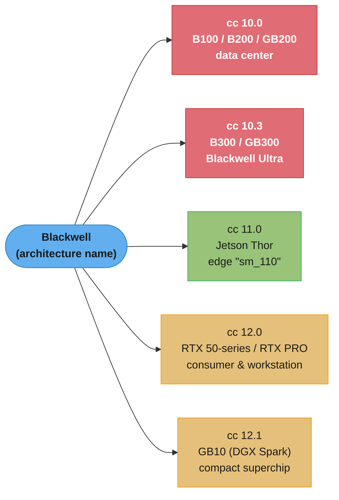
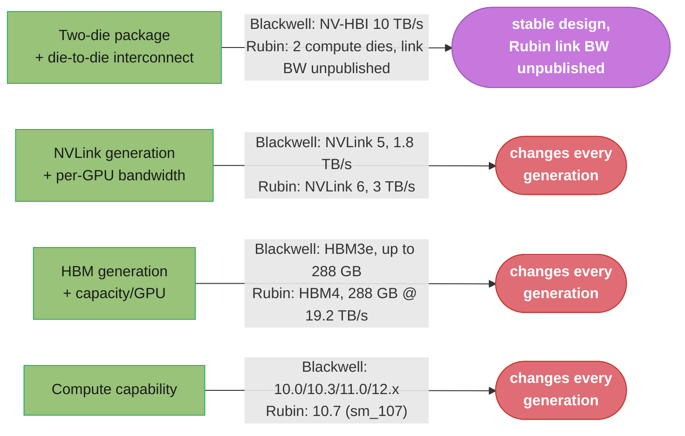

# Blackwell and Rubin Architecture

This is a deep dive off [gpu_hardware_architecture](gpu_hardware_architecture.md). The parent module's §4.1 generation table gives Blackwell and Rubin one row each — headline features and the compute-capability numbers a kernel author needs to gate on — and its §4.2 covers only that "5th-gen Tensor Cores add FP4/FP6 paths and a 2nd-gen Transformer Engine." This file starts where that row stops: the physical die-level design that makes a single Blackwell "GPU" actually two dies, the full compute-capability map across the Blackwell family (data-center, workstation, and edge parts all landed on different numbers), the NVLink-5 domain that GB200 NVL72 builds, and what is and is not yet verifiable about Rubin as of the date this file was checked. Everything the parent already states — the 65,536-register file, the three occupancy ceilings, the SM partition-scheduler mechanics — is assumed, not re-derived; this file is additive to §4.1/§4.2, not a replacement for either.

**A verification note, because this is the most version-sensitive material in the repository.** Every specific number below was checked against NVIDIA's own documentation, product pages, press releases, or release notes (re-checked 2026-11-25). Rubin's numbers have already moved once: NVIDIA's January 5, 2026 announcement gave NVLink 6 at 3.6 TB/s per GPU, and the shipping Vera Rubin NVL72 page now lists 3 TB/s. Quote the current product page, with its date, rather than the launch keynote.

---

## 1. Concept Overview

**Blackwell** is NVIDIA's GPU architecture generation after Hopper, spanning data-center parts (B100, B200, B300/Blackwell Ultra, and the GB200/GB300 superchips that pair a Blackwell GPU with a Grace CPU), workstation and server parts (the RTX PRO Blackwell line), consumer parts (GeForce RTX 50-series), and an edge/robotics SoC (Jetson Thor). All of them share the same underlying Blackwell Streaming Multiprocessor design, but they do **not** share one compute capability — the family spans four distinct compute-capability numbers, each with different per-SM resource limits, which is the single most consequential fact for a kernel author targeting "Blackwell" as if it were one target.

**Rubin** is the architecture generation after Blackwell, detailed in NVIDIA's January 5, 2026 launch press release and represented by the Vera Rubin NVL72 rack-scale platform, which NVIDIA's product page now lists as "Available Now." CUDA 13.4 assigned Rubin compute capability 10.7 (`sm_107`) as a developer preview: the 13.4.0 build was itself a developer preview, and even the 13.4 GA build (13.4.1) release notes call Vera Rubin support a developer preview "not intended for benchmarking, performance analysis, or production deployment." CUDA 13.5 adds general-availability support for Vera Rubin. This module documents what is confirmed and treats the distinction between "announced," "in full production," and "shipping" as the load-bearing one it is for anything Rubin-related.

---

## 2. Intuition

> **One-line analogy**: A Hopper H100 is one full kitchen. A Blackwell B200 is two Hopper-sized kitchens built back-to-back with a pass-through window between them wide enough that the kitchen staff on either side barely notice it's there — from the head chef's (CUDA's) point of view, it's still one kitchen, one order queue, one set of walk-in coolers.

**Mental model**: Every Blackwell data-center part is built from **two reticle-limited dies** — a single die can only be as large as a lithography reticle allows to manufacture, and Blackwell's dies are already at that limit — connected by a dedicated 10 TB/s die-to-die interconnect NVIDIA calls **NV-HBI** (NVIDIA High-Bandwidth Interface). CUDA and the driver present the pair as **one logical GPU**: one `cudaDeviceProp`, one set of SMs a kernel can be scheduled across, one unified memory space. The parent module's occupancy math (§6) does not change because of this — it still operates per-SM. What a kernel author has to keep in mind is L2 locality: NVIDIA has split L2 into two partitions joined by an L2 fabric since A100, each partition caching for the GPCs wired to it, and on a two-die package a partition boundary can also be a die boundary. NVIDIA does not publish how Blackwell's L2 partitions map onto the two dies, so "far partition means other die" is a hypothesis to check in a profile, not a documented fact.

**Why it matters**: Interviewers who ask "what's new in Blackwell" are rarely testing whether you memorized a keynote slide of TFLOPS. They are testing whether you know that (1) "Blackwell" is not one compute capability, so code compiled for `sm_100` (B200) is not guaranteed to run optimally, or at all, on `sm_120` (RTX 50) hardware with a smaller shared-memory budget; and (2) the headline "one GPU, 208 billion transistors" framing hides a genuinely two-die physical design whose interconnect is exactly the kind of hardware detail a kernel author should test for when a profile shows an L2 anomaly (see §14).

**Key insight**: Every NVIDIA architecture generation since Volta has shipped **multiple** compute capabilities for the same architecture name (recall Ampere's 8.0 vs 8.6, Ada's 8.9). Blackwell pushes this further than any prior generation: four distinct compute-capability numbers (10.0, 10.3, 11.0, 12.x) span data center, edge, and consumer silicon that all get called "Blackwell" in marketing material, each with a materially different per-SM resource budget. Treating "compute capability" and "architecture name" as interchangeable is the single most common category error this module exists to correct.

---

## 3. Core Principles

- **A Blackwell data-center GPU is physically two dies presented as one logical device.** B100, B200, B300, and their GB200/GB300 superchip pairings all use this two-reticle-die design connected by NV-HBI; RTX 50-series consumer parts and the RTX PRO Blackwell workstation/server line are **single-die** — the dual-die design is a data-center-tier decision, not a Blackwell-wide one.
- **"Blackwell" is a marketing umbrella over four compute capabilities, not one.** 10.0 (B100/B200/GB200), 10.3 (B300/GB300, "Blackwell Ultra"), 11.0 (Jetson Thor, the edge/robotics SoC), and 12.x (12.0 for RTX 50 GeForce and RTX PRO Blackwell; 12.1 for GB10/DGX Spark) — code that queries `cudaDeviceProp.major/minor` and branches only on `major == 10` silently mishandles every 11.x and 12.x Blackwell device it will ever see.
- **Data-center and consumer/workstation-tier Blackwell inherit different per-SM resource ceilings, exactly like Ampere's 8.0/8.6 split before it.** Compute capability 10.0 carries a larger per-SM shared-memory carveout and higher resident-warp ceiling than 12.0 — the same "data-center vs. consumer tier" split the parent module's §4.3 table already documents for 8.0/8.6/8.9/12.x, now repeated one generation later.
- **NVLink generation is tied to architecture, not to which die-count tier a part sits in.** Every Blackwell data-center part — B100 through B300/GB300 — uses 5th-generation NVLink; NVLink 6 is a **Rubin-generation** feature, not a Blackwell Ultra one, and confusing "Ultra" (a mid-generation memory/clock refresh) with "next generation" (a new NVLink and compute-capability number) is a common and easy mistake.
- **Rubin's numbers moved between announcement and shipment, so quote them with a date.** NVIDIA's January 2026 launch press release gave NVLink 6 at 3.6 TB/s per GPU and 260 TB/s per NVL72 rack; the shipping Vera Rubin NVL72 product page lists 3 TB/s and 216 TB/s. Treat any Rubin figure as "per NVIDIA's product page on date X." The compute capability is the stable exception: 10.7 (`sm_107`) since CUDA 13.4.
- **"In full production" is not "shipping," and a developer preview is not GA.** NVIDIA said Rubin was "in full production" on January 5, 2026; its May 31, 2026 press release said production shipments were "set to begin starting this fall"; the product page now says "Available Now." On the software side, CUDA 13.4 shipped Rubin support as a developer preview and CUDA 13.5 made it GA. Each is a separate dated milestone, never collapsed into "Rubin is out."

---

## 4. Types / Architectures / Strategies

### 4.1 The two-die design and NV-HBI

Every Blackwell **data-center** GPU — B100, B200, and B300 (Blackwell Ultra) alike — is built from two reticle-limited dies on TSMC's custom 4NP process, connected by a dedicated die-to-die interconnect NVIDIA calls **NV-HBI**, running at 10 TB/s. The combined package carries 208 billion transistors (roughly 2.6x an H100's 80 billion). Because CUDA presents the pair as one logical device, none of the parent module's SM/occupancy vocabulary needs to change — but two consequences matter for kernel authors:

- **L2 has been partitioned since A100, and on Blackwell a partition may sit across a die boundary.** NVIDIA's Ampere and Hopper architecture posts describe L2 split into partitions, each caching for the GPCs directly connected to it, with a fabric between them; Nsight Compute reports the traffic that crosses it as the "L2 Fabric" row. NVIDIA does not document how Blackwell's partitions map onto the two dies, so measure the L2 Fabric share rather than assume a cross-die cost.
- **NV-HBI bandwidth (10 TB/s) is enormous relative to PCIe or even NVLink**, which is precisely why the two dies can be presented as one GPU without becoming a multi-GPU programming problem — but it is still a finite, shared resource, not free bandwidth.

Consumer Blackwell (GeForce RTX 50-series) and the RTX PRO Blackwell workstation/server line are **single-die** parts; the two-die design is exclusive to the data-center B100/B200/B300 tier. The largest consumer die, GB202, is a separate chip from the data-center die: per NVIDIA's RTX Blackwell architecture whitepaper the full GB202 has 192 SMs, 24,576 CUDA cores and 128 MB of L2, and the RTX 5090 enables 170 of those SMs (21,760 CUDA cores) with 96 MB of L2.

### 4.2 Blackwell SM-level additions over Hopper

The parent module's §4.2 already states the headline: 5th-generation Tensor Cores adding FP4/FP6 precision paths, and a 2nd-generation Transformer Engine that manages precision per layer automatically. Two mechanics worth naming explicitly, both covered in depth in [tensor_cores_and_mixed_precision](../tensor_cores_and_mixed_precision/tensor_cores_and_mixed_precision.md) rather than re-taught here:

- **Dedicated Tensor Memory (`tcgen05`)** — Blackwell's 5th-generation Tensor Core instructions keep the accumulator matrix D in a dedicated on-chip Tensor Memory region, distinct from the register file and shared memory, addressed through the `tcgen05` instruction family. Hopper's `wgmma` kept the accumulator in the warpgroup's registers.
- **FP4/FP6 as first-class Tensor Core precisions** — narrower than Hopper's narrowest native path (FP8), managed automatically per-layer by the 2nd-generation Transformer Engine so a model doesn't need hand-written per-layer precision selection to benefit.

### 4.3 Compute-capability map across the Blackwell family

| Compute capability | Parts | Tier | Max concurrent warps/SM | Shared memory/SM (max carveout) | Max shared memory/block (opt-in) |
|---|---|---|---|---|---|
| **10.0** | B100, B200, GB200 | Data center | 64 | 228 KB | 227 KB |
| **10.3** | B300, GB300 ("Blackwell Ultra") | Data center | 64 (same tier as 10.0) | 228 KB (same tier as 10.0) | 227 KB (same tier as 10.0) |
| **11.0** | Jetson Thor (Jetson T5000, T4000) | Edge / robotics SoC | 48 (24 blocks, 1536 threads per SM) | 228 KB | 227 KB |
| **12.0** | GeForce RTX 50-series, RTX PRO Blackwell (workstation and server editions) | Consumer / workstation | 48 | 128 KB per the Blackwell Tuning Guide; 100 KB per the Programming Guide | 99 KB |
| **12.1** | GB10 (DGX Spark), RTX Spark N1X | Compact/desktop superchip | 48 (Programming Guide 12.x column) | 100 KB (Programming Guide 12.x column) | 99 KB |
| **10.7** | Rubin GPU (Vera Rubin NVL72); next generation, not Blackwell | Data center | 32 (16 blocks, 1024 threads per SM) | 328 KB (needs the oversized shared-memory mode) | 327 KB (needs the oversized shared-memory mode) |

The 10.0, 10.3, 11.0 and 10.7 figures come from the compute-capability tables of the CUDA Programming Guide v13.5 (last updated 2026-10-31). For 12.x the two NVIDIA sources disagree: the Programming Guide gives 24 resident blocks and 100 KB of shared memory per SM, while the Blackwell Tuning Guide (last updated 2026-11-02) gives compute capability 12.0 32 blocks and 128 KB. Both give 48 warps and 99 KB per block, so the 2048-vs-1536-resident-thread split (64 warps x 32 = 2048; 48 warps x 32 = 1536) the parent module's §4.3 table generalizes since Ampere holds either way. Read `cudaDevAttrMaxSharedMemoryPerMultiprocessor` on the real part rather than trusting either table.

**11.0 is worth naming precisely because the parent module's audit trail flagged it as a known gap.** Jetson Thor's compute capability was **renamed from `sm_101` to `sm_110`** in CUDA Toolkit 13.0 ("SM101 has been renumbered as SM110 from this release") — code built against the pre-13.0 naming (`sm_101`/`compute_101`) must be rebuilt against `sm_110`/`compute_110` under CUDA 13.0 and later toolkits. This is not a new architecture arriving late; it is the same Thor silicon whose compute-capability designation NVIDIA renumbered. Its limits mix the two tiers: the data-center shared-memory budget (228 KB per SM) with the consumer-tier warp and block ceilings (48 warps, 24 blocks).

**Rubin is compute capability 10.7 (`sm_107`)**, added in CUDA 13.4 as a developer preview and given GA support in CUDA 13.5. It is not a Blackwell part, but it sits in this table because its major version is 10: code that tests `major == 10` to mean "Blackwell data center" also matches Rubin. The Programming Guide's compute-capabilities appendix gives 10.7 328 KB of shared memory per SM and 327 KB per block, against 228 KB and 227 KB on 10.0/10.3, plus a 336 KB unified data cache against 256 KB. A footnote in that appendix makes the extra 100 KB opt-in: a kernel that uses the 328 KB configuration must set `cudaSharedMemoryModeAllowOversizedSharedMemory` through the `cudaFuncAttributeSharedMemoryMode` function attribute or the `cudaLaunchAttributeSharedMemoryMode` launch attribute; a kernel that does not set it cannot use the 328 KB configuration. The same appendix halves the resident-thread limits against 10.0: 32 warps (1024 threads) and 16 blocks per SM instead of 64 warps and 32 blocks, so an occupancy calculation copied from B200 can overstate Rubin's resident warps by up to 2x.

### 4.4 NVLink 5 and the GB200/GB300 NVL72 domain

Every Blackwell data-center part — B100 through B300/GB300 — implements **5th-generation NVLink**, delivering roughly 1.8 TB/s of bidirectional bandwidth per GPU, about double Hopper's 4th-generation NVLink. NVIDIA's rack-scale GB200 NVL72 and GB300 NVL72 systems bind 72 Blackwell GPUs (and 36 Grace CPUs) into a single NVLink domain — every GPU in the domain can address every other GPU's memory at NVLink bandwidth, not just its immediate neighbors, through a layer of NVSwitches. This is the same NVLink-domain concept the parent module's `multi_gpu_programming_and_nccl` cross-reference already covers from the NCCL/collective-communication angle; this file adds only the generation-and-bandwidth number, not the programming model on top of it.

### 4.5 Blackwell Ultra: B300/GB300

Blackwell Ultra (B300, and the GB300 superchip pairing it with Grace) is a **mid-generation refresh**, not a new architecture: same two-die design, same TSMC 4NP process, same ~208 billion transistors, same 5th-generation NVLink — the changes are compute-capability (10.3 instead of 10.0), memory capacity (288 GB of HBM3e per GPU, up from B200's up-to-180 GB), and Tensor Core throughput (a stated 1.5x dense NVFP4 improvement over B200 in NVIDIA's own GB300 NVL72 materials). A GB300 NVL72 rack carries 72 GPUs totaling roughly 20 TB of HBM3e — consistent with 72 x 288 GB. Treating "Ultra" as a wholesale new architecture generation is the same mistake as treating Ada Lovelace's L40S as architecturally distinct from an RTX 4090 — it is the same silicon family with different binning, memory, and clocks.

### 4.6 Rubin and Vera Rubin NVL72

**Rubin** is the architecture generation after Blackwell. NVIDIA's Vera Rubin NVL72 product page, which now reads "Available Now" (checked 2026-11-25), states the following figures:

| Spec | Value | Source |
|---|---|---|
| HBM4 capacity per GPU | 288 GB | NVIDIA Vera Rubin NVL72 product page |
| HBM4 bandwidth per GPU | 19.2 TB/s | NVIDIA Vera Rubin NVL72 product page |
| NVLink generation | 6th generation | NVIDIA Vera Rubin NVL72 product page |
| NVLink bandwidth per GPU | 3 TB/s (216 TB/s per NVL72 rack) | NVIDIA Vera Rubin NVL72 product page; the January 5, 2026 launch press release said 3.6 TB/s and 260 TB/s |
| NVLink-C2C bandwidth (per Vera Rubin Superchip) | 1.8 TB/s | NVIDIA Vera Rubin NVL72 product page |
| GPUs per NVL72 rack | 72 | NVIDIA Vera Rubin NVL72 product page |
| Total rack HBM4 | 20.7 TB | NVIDIA Vera Rubin NVL72 product page |
| Compute dies / transistors | 2 compute dies, 336B transistors | NVIDIA developer blog "Inside the NVIDIA Rubin Platform" |
| Compute capability | **10.7 (`sm_107`)** | CUDA 13.4 release notes (developer preview), CUDA 13.5 (GA support), Programming Guide compute-capability tables |

The NVLink figure is the one to watch: NVIDIA's own number fell from 3.6 TB/s per GPU at the January 2026 announcement to 3 TB/s on the shipping product page. That is the concrete reason to quote a Rubin spec with the page and the date you read it from, not from a launch keynote.

**What changes for a kernel author on `sm_107`.** CUTLASS 4.8 (released September 22, 2026) added the first Rubin GEMM support in CuTe C++ and CuTe DSL, and its release notes list the hardware deltas a Blackwell kernel has to adapt to:

- **Tensor Memory grows from 512 to 576 columns per SM** (256 KB to 288 KB). CUTLASS updated its 1-SM and 2-SM TMEM allocators for Rubin's exclusive allocation path, so a Blackwell TMEM budget compiles but leaves 64 columns unused.
- **Higher-throughput MMA shapes:** FP8 Tensor Core MMA with `MMA_K=64` and FP4 with `MMA_K=128`.
- **A new UE5M3 scale-factor type** for block-scaled GEMM with 32-element blocks, beside the E4M3 per-16-element scale that NVFP4 uses on Blackwell.
- **B collector reuse**, used by CUTLASS's dense, grouped, and grouped block-scaled GEMMs.
- **328 KB shared memory** behind the oversized-mode opt-in above; CUTLASS sets its SM107 shared-memory capacity to 327 KiB and adds launch support for that mode.
- **Driver floor:** the CUTLASS 4.8.0 release notes say executing `sm_107` kernels needs the R615 driver released with CUDA 13.4 GA, and that the R610 driver from the 13.4 developer preview is not enough. CUDA 13.5, the release with GA Rubin support, maps to the R620 branch.

Existing SM100 GEMM and convolution kernels build for the `sm_107a` and `sm_107f` targets without these features, so a Blackwell kernel runs on Rubin before it is tuned for it.

**Status**: NVIDIA's January 5, 2026 press release said "NVIDIA Rubin is in full production" with partner products in the second half of 2026. Its May 31, 2026 press release said Vera Rubin was ramping into full production, with server makers "manufacturing Vera Rubin-based systems at scale" and production shipments "set to begin starting this fall." The Vera Rubin NVL72 product page now reads "Available Now," and its news panel says partners are "shipping Vera Rubin-based systems." On the software side, CUDA 13.4 shipped Rubin support as a developer preview and CUDA 13.5 added GA support. Do not compress these into one claim: they are separate dated points on the same rollout.

---

## 5. Architecture Diagrams

### Blackwell data-center package: two dies, one logical GPU

```
Blackwell data-center GPU package (B100 / B200 / B300) -- two-die design

+-----------------------------+     10 TB/s      +-----------------------------+
|          Die 0              |<---- NV-HBI ---->|          Die 1              |
|  SMs (part of the total)    |   (die-to-die     |  SMs (part of the total)    |
|  L2 slices                  |    interconnect)  |  L2 slices                  |
|  HBM3e stacks               |                   |  HBM3e stacks               |
+-----------------------------+                   +-----------------------------+
              |                                                 |
              +------------------- presented as ----------------+
                                    |
                        ONE cudaDeviceProp, ONE set of
                        SMs the CUDA scheduler dispatches
                        blocks across, ONE unified memory space

A kernel's blocks can land on either die -- the CUDA programming model
does not expose "which die." Since A100, L2 has been split into two
partitions joined by an L2 fabric; NVIDIA does not publish how
Blackwell's partitions map onto the two dies. Nsight Compute's
"L2 Fabric" row shows how much L2 traffic crosses between partitions.
```

Every generation's SM/occupancy math from the parent module's §6 still applies per-SM, unchanged — the two-die split is a fact about the memory hierarchy sitting *above* the SM, not about how any individual SM schedules warps.

### The compute-capability fan-out — one architecture name, four numbers



Four compute-capability numbers under one marketing name; a build targeting only `sm_100` silently excludes every consumer, edge, and compact-superchip Blackwell device, and a build targeting only `sm_120` silently excludes every data-center part.

### Blackwell -> Rubin: what actually changes generation-to-generation



NVLink generation and HBM generation are the two specs that reliably change every architecture generation and are worth checking fresh each time; compute capability is the one number that gates whether *code* needs to change at all. Rubin's 10.7 shares major version 10 with data-center Blackwell, so a `major == 10` check cannot tell the two generations apart.

---

## 6. How It Works — Detailed Mechanics

### 6.1 Querying which Blackwell tier you're actually running on

The parent module's §6 already shows the canonical `cudaGetDeviceProperties` query. The Blackwell-specific addition is: **never branch on `major == 10` alone** — that silently groups B100/B200/GB200 (10.0) with B300/GB300 (10.3) as if they had identical resource ceilings, and it excludes 11.0 (Thor) and 12.x (consumer/workstation) entirely from anything meant to cover "every Blackwell device."

```cpp
#include <cstdio>
#include <cuda_runtime.h>

const char* blackwellTier(int major, int minor) {
    if (major == 10 && minor == 0) return "Blackwell data center (B100/B200/GB200)";
    if (major == 10 && minor == 3) return "Blackwell Ultra data center (B300/GB300)";
    if (major == 11 && minor == 0) return "Blackwell edge/robotics (Jetson Thor)";
    if (major == 12 && minor == 0) return "Blackwell consumer/workstation (RTX 50 / RTX PRO)";
    if (major == 12 && minor == 1) return "Blackwell compact superchip (GB10 / DGX Spark)";
    return "Not a recognized Blackwell compute capability";
}

int main() {
    cudaDeviceProp prop;
    cudaGetDeviceProperties(&prop, 0);
    printf("Device: %s, compute capability %d.%d -> %s\n",
           prop.name, prop.major, prop.minor,
           blackwellTier(prop.major, prop.minor));
    // Do NOT write `if (prop.major == 10)` and assume one shared-memory
    // budget -- 10.0 and 10.3 happen to share the parent-module tier's
    // limits today, but that is a fact about the current generation's
    // binning, not a guarantee the next revision preserves.
    printf("Shared mem/block (opt-in max): %zu bytes\n",
           prop.sharedMemPerBlockOptin);
    return 0;
}
```

### 6.2 Why the two-die design does not change the occupancy formula, but does change what a profile shows

The parent module's occupancy ceilings (register file, shared memory, thread/block count) are computed **per SM**, and every SM on a two-die Blackwell package is symmetric to every other SM regardless of which die it's on — so a single-SM occupancy calculation, run through the exact same `theoretical_occupancy()` function the parent module's §6 defines, needs no modification for Blackwell's two-die design. What changes is a *level above* that calculation: L2 locality. NVIDIA has split L2 into two partitions joined by an L2 fabric since A100 (its Ampere and Hopper architecture posts describe each partition caching for the GPCs directly connected to it), so H100 already has near and far L2. On a two-die Blackwell package the fabric may also cross NV-HBI, but NVIDIA does not publish that mapping. So when a kernel's L2 hit rate or latency differs between H100 and B200 for the identical access pattern, check Nsight Compute's "L2 Fabric" row, which counts operations crossing between the two L2 partitions, before blaming the die split. The occupancy formula cannot see any of this.

### 6.3 Cross-generation NVLink and memory numbers, side by side

```
                     Hopper       Blackwell     Blackwell Ultra   Rubin
                     (H100)       (B200)        (B300)            (VR200)
NVLink generation      4             5              5                  6
NVLink BW/GPU       ~900 GB/s     ~1.8 TB/s      ~1.8 TB/s           3 TB/s
Memory type            HBM3       HBM3/HBM3e       HBM3e               HBM4
Memory/GPU            80 GB      up to 180 GB      288 GB              288 GB
Compute capability     9.0           10.0           10.3               10.7
```

Read down the NVLink row: bandwidth doubles Hopper->Blackwell, then grows by about 1.7x Blackwell->Rubin on NVIDIA's shipping product page (the January 2026 launch figure of 3.6 TB/s would have been a second doubling), while the *generation number* increments by exactly one each time — a reminder that "NVLink N" is a name for a bandwidth tier, not a fixed multiplier, and the actual TB/s figure is the number worth quoting, not the generation number alone.

---

## 7. Real-World Examples

- **NVIDIA B200 (Blackwell, SXM)**: two-die package, up to 180 GB HBM3/HBM3e, 5th-gen NVLink at ~1.8 TB/s/GPU, compute capability 10.0 — the default data-center Blackwell target for large-model training and inference as of 2026.
- **NVIDIA GB200 NVL72**: 72 B200-class GPUs and 36 Grace CPUs bound into one NVLink domain — the rack-scale unit `multi_gpu_programming_and_nccl` and `../../devops/ml_platform_and_gpu_infrastructure/` both reason about at the fleet-operations altitude; this module covers only the per-GPU hardware those systems are built from.
- **NVIDIA B300 / GB300 (Blackwell Ultra)**: same two-die design, 288 GB HBM3e/GPU, compute capability 10.3 — the memory-capacity-driven refresh aimed at larger KV-caches and MoE expert counts per GPU.
- **NVIDIA GeForce RTX 5090 (GB202, consumer Blackwell)**: single-die, 170 of the full GB202's 192 SMs enabled, 21,760 CUDA cores, 96 MB L2, 32 GB GDDR7 (not HBM — consumer Blackwell uses GDDR7, a materially different memory technology from the data-center tier's HBM3e), compute capability 12.0.
- **Jetson Thor (edge Blackwell)**: compute capability 11.0 (renamed from `sm_101` to `sm_110` in CUDA 13.0) — the robotics SoC tier, which pairs the data-center 228 KB shared-memory budget with the consumer-tier 48-warp ceiling (§4.3).
- **Vera Rubin NVL72 (Rubin)**: 72-GPU rack, 288 GB HBM4/GPU at 19.2 TB/s, NVLink 6 at 3 TB/s/GPU, compute capability 10.7; the generation succeeding Blackwell. NVIDIA's May 31, 2026 press release put the start of production shipments in fall 2026, and the product page now reads "Available Now."

---

## 8. Tradeoffs

| Choice | What you gain | What it costs |
|---|---|---|
| Targeting only `sm_100` (cc 10.0) | Simplest build matrix for a data-center-only deployment | Silently excludes B300/GB300 (10.3), every consumer/workstation Blackwell part (12.x), and Thor (11.0) |
| Building a fat binary across 10.0, 10.3, 11.0, 12.0, 12.1 | One binary runs correctly on every Blackwell tier | Larger binary size, longer build time, and `ptxas`-tuned resource usage that is a compromise across tiers rather than optimal for any one |
| Relying on PTX forward compatibility (`compute_100` embedded, JIT at load time) instead of per-`sm_XX` SASS | Newer Blackwell/future-generation devices not explicitly targeted at build time can still run the kernel via JIT | JIT compilation cost at first launch on the untargeted device; performance may not match a native `sm_XX` build until profiled |
| Treating Blackwell Ultra (10.3) as "the same as 10.0" in code | Fewer branches, and today the two tiers do share the same per-SM resource ceilings | A future Ultra-tier revision that widens the resource ceilings (as data-center-vs-consumer splits have every generation since Ampere) breaks that assumption silently |
| Citing Rubin figures in a design doc | Concrete planning numbers for a generation that is now shipping | NVIDIA's own figures moved between the January 2026 launch and the shipping product page (NVLink 3.6 to 3 TB/s per GPU); a figure copied from a keynote rather than the current page, with its date, can be wrong |

---

## 9. When to Use / When NOT to Use

**Reach for this file's level of detail when:**
- Writing a CUDA build matrix (`-gencode` flags) that must correctly cover every device a "Blackwell" deployment might actually run on, including consumer/workstation and edge tiers, not just the data-center parts a keynote slide shows.
- Explaining a profiling anomaly on a two-die Blackwell part (an L2 hit-rate or latency regression versus an equivalent Hopper kernel), where Nsight Compute's L2 Fabric row is the first thing to check.
- Distinguishing what genuinely changed in Blackwell Ultra (compute capability, memory capacity) from what did not (die design, NVLink generation, process node) — the difference between an "Ultra" refresh and a true next generation.
- Discussing Rubin in an interview or a planning document, where precision about "in full production," "production shipments," and "developer preview vs GA toolkit support" as distinct, dated milestones is exactly what separates a credible answer from a keynote-recall one.

**Do NOT reach for this file's level of detail when:**
- The question is about SM-level occupancy mechanics that don't differ from Hopper — that is the parent module's §6, and this file explicitly does not re-derive it.
- The question is about Tensor Core precision formats or the Transformer Engine's per-layer precision management in depth — that is [tensor_cores_and_mixed_precision](../tensor_cores_and_mixed_precision/tensor_cores_and_mixed_precision.md)'s job.
- The question is about NVLink/NCCL collective communication programming, rather than the per-GPU bandwidth number — that is `multi_gpu_programming_and_nccl`'s job; this file states the bandwidth figure once and stops.
- A design decision would be materially affected by an exact Rubin spec copied from a launch keynote — re-read the current product page and record its date instead.

---

## 10. Common Pitfalls

1. **BROKEN -> FIX: gating a kernel's shared-memory tile size on `major == 10` alone.**

   ```cpp
   // BROKEN: assumes every "major == 10" Blackwell device shares the
   // data-center tier's 228 KB shared-memory carveout. It compiles and
   // runs on B100/B200/GB200 (cc 10.0) and even B300/GB300 (cc 10.3, same
   // tier today) -- but this code was never checked against 11.0 or 12.x,
   // and the author never intended to exclude those, they just didn't
   // know a "Blackwell" device could report a major version other than 10.
   cudaDeviceProp prop;
   cudaGetDeviceProperties(&prop, 0);
   size_t tileBytes = (prop.major == 10) ? (192 * 1024) : (48 * 1024);
   // On cc 12.0 (RTX 50 / RTX PRO Blackwell), max shared mem/block opt-in
   // is 99 KB -- the 48 KB fallback branch silently under-uses available
   // shared memory. On cc 11.0 (Thor), the per-block opt-in ceiling is
   // 227 KB, the same as 10.0, so the fallback branch throws away
   // almost four-fifths of it.
   ```

   ```cpp
   // FIX: query the actual per-device ceiling instead of guessing from
   // the major version, and size the tile against what THIS device
   // reports, clamped to a known-safe floor if the query is unavailable.
   cudaDeviceProp prop;
   cudaGetDeviceProperties(&prop, 0);
   size_t maxOptIn = prop.sharedMemPerBlockOptin;   // ground truth, not a guess
   size_t tileBytes = std::min<size_t>(maxOptIn, 192 * 1024);
   cudaFuncSetAttribute(myKernel, cudaFuncAttributeMaxDynamicSharedMemorySize,
                         tileBytes);
   // Correct on cc 10.0/10.3/11.0 (227 KB ceiling), cc 12.0/12.1 (99 KB ceiling),
   // and any future compute capability this code has never seen, because
   // it reads the device's actual reported limit instead of pattern-
   // matching on the major version number.
   ```

   **Stated plainly.** "Blackwell" tells you the marketing generation; it does not tell you the resource budget. Query the budget.

2. **Treating Blackwell Ultra (B300/GB300) as an entirely new architecture generation rather than a refresh.** It shares the two-die design, NVLink generation, and process node with B100/B200 — what changed is compute capability (10.3), memory capacity, and Tensor Core throughput. Code or documentation written as if "Ultra" implies a new NVLink generation or a new die design is wrong on both counts.

3. **Assuming NVLink 6 exists on any Blackwell part.** NVLink 6 is a Rubin-generation feature. Every Blackwell data-center part, including B300/GB300 Ultra, uses 5th-generation NVLink at ~1.8 TB/s/GPU — an easy conflation because "Ultra" and "next generation" sound like the same kind of upgrade and are not.

4. **Citing a Rubin number without the source and date.** NVIDIA's own NVLink 6 figure fell from 3.6 TB/s per GPU in the January 5, 2026 launch press release to 3 TB/s on the shipping Vera Rubin NVL72 product page. An answer or a design doc that repeats the keynote number states something NVIDIA's current page no longer claims.

5. **Confusing consumer Blackwell's GDDR7 with data-center Blackwell's HBM3e.** They are different memory technologies serving different bandwidth/capacity/cost tradeoffs — an RTX 5090's 32 GB GDDR7 and a B200's up-to-180 GB HBM3/HBM3e are not the same kind of memory scaled differently, and code or capacity planning that assumes HBM-class bandwidth on a consumer Blackwell part will be wrong by a wide margin.

---

## 11. Technologies & Tools

| Tool / Resource | Purpose | Notes |
|---|---|---|
| `cudaGetDeviceProperties` (`.major`, `.minor`, `.sharedMemPerBlockOptin`) | Query the actual compute capability and resource ceilings at runtime | The only reliable way to distinguish the four+ Blackwell-family compute capabilities — see §6.1 |
| NVIDIA Blackwell architecture page and Blackwell Ultra developer blog (nvidia.com) | Primary source for die design, transistor count, NV-HBI bandwidth, HBM3e capacity | Carries the 208B-transistor, two-die, 10 TB/s NV-HBI, 288 GB HBM3e figures this file cites |
| NVIDIA RTX Blackwell GPU architecture whitepaper | Primary source for GB202 and RTX 5090 configurations | Full GB202: 192 SMs, 24,576 CUDA cores; RTX 5090: 170 SMs, 21,760 CUDA cores |
| CUDA Programming Guide compute-capability tables and the Blackwell Tuning Guide (docs.nvidia.com) | Primary sources for per-compute-capability SM resource limits (warps/SM, blocks/SM, shared memory/SM) | The two disagree on 12.x blocks/SM and shared memory/SM — see §4.3 |
| NVIDIA Vera Rubin NVL72 product page (nvidia.com) | Primary source for Rubin/VR200 specs | Re-check before citing any Rubin figure in new work, and record the date you read it |
| `developer.nvidia.com/cuda-gpus` | NVIDIA's per-product compute-capability listing | Confirms 10.0, 10.3, 11.0 (Jetson T5000/T4000), 12.0 and 12.1 assignments; for Rubin's 10.7, check the Programming Guide compute-capability tables and the CUDA 13.4/13.5 release notes |
| `nvcc -arch=` / `-gencode` flags | Target a specific compute capability (or several, via a fat binary) at build time | See [cuda_toolkit_and_compilation](../cuda_toolkit_and_compilation/cuda_toolkit_and_compilation.md) for the full compilation-pipeline treatment this file does not repeat |
| Nsight Compute | L2 cache table, including the "L2 Fabric" row for operations crossing between the two L2 partitions | The tool that turns §6.2's partition-locality question into a measurement |

---

## 12. Interview Questions with Answers

**Q: Is "Blackwell" one compute capability or several?**
**Short:** Several — Blackwell spans at least four compute capabilities (10.0, 10.3, 11.0, 12.x) across data-center, edge, and consumer/workstation parts.
Several. Data-center Blackwell (B100/B200/GB200) is compute capability 10.0; Blackwell Ultra (B300/GB300) is 10.3; the edge/robotics SoC (Jetson Thor) is 11.0; and consumer/workstation Blackwell (GeForce RTX 50-series, RTX PRO Blackwell) is 12.0, with the compact GB10/DGX Spark superchip at 12.1. Code that branches only on the major version number `10` silently mishandles every 11.x and 12.x Blackwell device.

**Q: What is physically different about a Blackwell data-center GPU compared to a Hopper H100?**
**Short:** A Blackwell data-center GPU is two reticle-limited dies connected by a 10 TB/s NV-HBI interconnect, presented to software as one logical GPU; Hopper is a single die.
It is built from two reticle-limited dies — each die already at the maximum size a lithography reticle can manufacture — connected by NVIDIA's NV-HBI die-to-die interconnect at 10 TB/s. CUDA and the driver present the pair as one logical device with one `cudaDeviceProp`. L2 was already split into two partitions joined by a fabric on A100 and H100; what is new is that a die boundary now sits inside the GPU, and NVIDIA does not publish how the L2 partitions map onto it.

**Q: Does the two-die Blackwell design change how the occupancy math from the parent hardware module works?**
**Short:** No — occupancy is computed per SM and every SM is symmetric across both dies; L2 locality is a separate question you measure, not part of the occupancy formula.
No. Registers, shared memory, and thread/block ceilings are per-SM quantities, and every SM on either die is symmetric to every other SM, so the exact same three-ceiling occupancy calculation from the parent module applies unchanged. L2 locality is a separate question: L2 has been split into two partitions since A100, and on Blackwell the partition boundary may also cross NV-HBI. Nsight Compute's "L2 Fabric" row, which counts operations crossing between the partitions, measures it; the occupancy math cannot.

**Q: Are B100, B200, and B300 the same compute capability?**
**Short:** No — B100 and B200 are compute capability 10.0; B300 (Blackwell Ultra) is 10.3.
No. B100 and B200 (and the GB200 superchip) are compute capability 10.0. B300 and GB300 — marketed as "Blackwell Ultra" — are compute capability 10.3, a distinct number reflecting the Ultra refresh even though the two tiers currently share the same per-SM resource ceilings (228 KB shared memory/SM, 64 max concurrent warps/SM).

**Q: What actually changed in Blackwell Ultra (B300/GB300) versus B100/B200?**
**Short:** Compute capability (10.3), memory capacity (288 GB HBM3e vs up to 180 GB), and Tensor Core throughput — not the die design, process node, or NVLink generation.
Compute capability moved to 10.3, per-GPU HBM3e capacity grew to 288 GB (from up to 180 GB), and Tensor Core throughput increased. The two-die design, TSMC 4NP process, ~208 billion transistor count, and 5th-generation NVLink are all unchanged from B100/B200 — Ultra is a mid-generation refresh, not a new architecture generation.

**Q: Does Blackwell Ultra use NVLink 6?**
**Short:** No — every Blackwell data-center part, including B300/GB300 Ultra, uses 5th-generation NVLink; NVLink 6 is a Rubin-generation feature.
No. Every Blackwell data-center part — B100 through B300/GB300 — implements 5th-generation NVLink at roughly 1.8 TB/s bidirectional per GPU. NVLink 6, at 3 TB/s per GPU on NVIDIA's shipping Vera Rubin NVL72 page, is a Rubin-generation feature, not a Blackwell Ultra one; conflating "Ultra" with "next NVLink generation" is a common mistake because both sound like upgrades of the same kind.

**Q: What compute capability does NVIDIA's Rubin architecture use?**
**Short:** 10.7 (sm_107), a developer preview in CUDA 13.4 and GA in 13.5; major 10 matches Blackwell, and its 328 KB SMEM and 576-column TMEM need code changes to use.
Compute capability 10.7, compiled as `sm_107`. CUDA 13.4 added it, and even the 13.4 GA build (13.4.1) release notes call Vera Rubin support a developer preview, not meant for benchmarking, performance analysis, or production deployment; CUDA 13.5 adds GA support. The trap is the major version: Rubin is 10.x like B200 (10.0) and B300 (10.3), so a `major == 10` test silently treats Rubin as Blackwell. A Blackwell kernel still runs, but leaves Rubin's gains unused: the Programming Guide gives 10.7 328 KB of shared memory per SM, reachable only after the kernel sets `cudaSharedMemoryModeAllowOversizedSharedMemory`, and CUTLASS 4.8 lists Tensor Memory growing from 512 to 576 columns, FP8 MMA at `MMA_K=64`, FP4 at `MMA_K=128`, UE5M3 block-32 scale factors, and B collector reuse. Occupancy math changes too: the Programming Guide allows 32 resident warps and 16 blocks per SM on 10.7, half of 10.0's 64 warps and 32 blocks.

**Q: What is the memory technology and capacity difference between Blackwell and Rubin's data-center GPUs?**
**Short:** Blackwell data-center parts use HBM3e (up to 180-288 GB per GPU depending on tier); Rubin uses HBM4 at 288 GB and 19.2 TB/s per GPU.
Blackwell data-center GPUs use HBM3/HBM3e, topping out at up to 180 GB per GPU on B200 and 288 GB at 8 TB/s on B300 (Blackwell Ultra). Rubin moves to HBM4: NVIDIA's Vera Rubin NVL72 product page lists 288 GB per GPU at 19.2 TB/s — the same capacity as Blackwell Ultra with about 2.4x the bandwidth.

**Q: Has NVIDIA's own public Rubin specification changed since it was first announced?**
**Short:** Yes — NVLink 6 bandwidth per GPU went from 3.6 TB/s in the January 2026 launch press release to 3 TB/s on the shipping product page.
Yes. NVIDIA's January 5, 2026 Rubin launch press release said each GPU gets 3.6 TB/s of NVLink 6 bandwidth and a Vera Rubin NVL72 rack 260 TB/s. The shipping Vera Rubin NVL72 product page lists 3 TB/s per GPU and 216 TB/s per rack. That change is the concrete reason to quote a Rubin figure with the page and date you read it from, not from a launch keynote.

**Q: What is the difference between Rubin "in full production," "production shipments," and "GA toolkit support"?**
**Short:** They are separate dated milestones: full production announced January 2026, production shipments starting fall 2026, and GA CUDA support in 13.5 after a 13.4 developer preview.
They are separate claims with separate dates. NVIDIA's January 5, 2026 press release said "NVIDIA Rubin is in full production" with partner products in the second half of 2026. Its May 31, 2026 press release said Vera Rubin was ramping into full production, with production shipments "set to begin starting this fall," and the Vera Rubin NVL72 product page now reads "Available Now." On the software side, CUDA 13.4 shipped `sm_107` support as a developer preview not meant for production, and CUDA 13.5 made it GA. An answer that says "Rubin is out" without naming which of these milestones it means is overclaiming.

**Q: Are RTX 50-series consumer GPUs and B200 data-center GPUs the same silicon?**
**Short:** No — RTX 50-series is a single-die GB202-class chip on GDDR7; B200 is a two-die package on HBM3/HBM3e, and they carry different compute capabilities (12.0 vs 10.0).
No. RTX 50-series (e.g., the RTX 5090, which enables 170 of the full GB202 die's 192 SMs) is a single-die consumer chip using GDDR7 memory, compute capability 12.0. B200 is the two-die data-center package using HBM3/HBM3e, compute capability 10.0. They share the Blackwell SM microarchitecture and Tensor Core generation but are physically different dies, different memory technologies, and different compute capabilities.

**Q: What is Jetson Thor's compute capability, and why does its designation matter for existing code?**
**Short:** Compute capability 11.0; it was renamed from sm_101 to sm_110 in CUDA Toolkit 13.0, so pre-13.0 code targeting sm_101 needs rebuilding.
Compute capability 11.0. Its SASS/PTX designation was renamed from `sm_101`/`compute_101` to `sm_110`/`compute_110` in CUDA Toolkit 13.0 — code built against the earlier naming under CUDA 12.8/12.9 needs to be rebuilt with the CUDA 13.0+ naming to target the same hardware correctly going forward.

**Q: If a build only targets `-gencode arch=compute_100,code=sm_100`, which Blackwell devices does it correctly cover?**
**Short:** Only compute-capability-10.0 devices (B100/B200/GB200) — it excludes B300/GB300 (10.3), Thor (11.0), and every consumer/workstation part (12.x) unless PTX JIT fallback applies.
Only compute-capability 10.0 devices — B100, B200, and GB200. B300/GB300 (10.3), Jetson Thor (11.0), and every RTX 50-series/RTX PRO/GB10 device (12.x) are excluded from native SASS, and will only run at all if the build also embeds forward-compatible PTX the driver can JIT-compile at load time — and even then, JIT-compiled code is not guaranteed to perform as well as a native build tuned for that specific compute capability's resource ceilings.

**Q: Why does compute capability, not architecture marketing name, determine whether a kernel needs different tuning?**
**Short:** Per-SM resource ceilings (shared memory, resident warps) are defined per compute capability, and two parts sharing an architecture name can carry different ceilings.
Because the resource ceilings a kernel's launch configuration must respect — shared memory per SM, maximum resident warps, maximum shared memory per block — are documented per compute capability, not per architecture marketing name. Compute capability 10.0 and 12.0 are both "Blackwell," but 10.0 carries a 228 KB shared-memory-per-SM ceiling and a 227 KB per-block opt-in, against 12.0's 99 KB per block and 100 KB per SM (the Programming Guide; the Blackwell Tuning Guide says 128 KB per SM). A tile size tuned against the larger budget can simply fail to launch, or silently under-occupy, on the smaller one.

**Q: What evidence would tell you NVIDIA had assigned Rubin a compute capability, versus a rumor or estimate?**
**Short:** A listing in NVIDIA's own references, such as the CUDA Programming Guide compute-capabilities appendix or the CUDA Toolkit release notes, not a third-party estimate or leak.
An entry in NVIDIA's own primary references (the CUDA Programming Guide's compute-capabilities appendix, the CUDA Toolkit release notes, or the `developer.nvidia.com/cuda-gpus` listing) rather than a third-party estimate, leak, or extrapolation from the numbering pattern of prior generations. Rubin shows why: extrapolating "Rubin will probably be 13.0 because Blackwell was 10.x/11.x/12.x" was a plausible guess, and it was wrong. The CUDA 13.4 release notes and the appendix's 10.7 column are the evidence that settled it.

**Q: Why might a kernel show a lower L2 hit rate on a Blackwell B200 than on an H100, for the identical access pattern?**
**Short:** Check L2 partition locality first: both GPUs split L2 into two partitions joined by a fabric, and Nsight Compute's L2 Fabric row shows how much traffic crosses between them.
Start with L2 partition locality, and measure it rather than assume it. NVIDIA has split L2 into two partitions joined by an L2 fabric since A100; its Hopper architecture post describes each partition caching for the GPCs directly connected to it. So H100 already has near and far L2, and B200 adds a die boundary that NVIDIA does not publish a mapping for. Nsight Compute's L2 table has an "L2 Fabric" row for operations crossing between the two partitions: compare its share of traffic on both GPUs. If it grew on B200, block placement relative to the data is the cause; if not, look at capacity, eviction policy, or access order instead.

---

## 13. Best Practices

1. **Never branch kernel tuning on `cudaDeviceProp.major` alone for a Blackwell target.** Query `sharedMemPerBlockOptin` and the actual resident-thread ceiling per §6.1 — the major version number alone cannot distinguish 10.0 from 10.3, or tell you whether you are on 11.0 or 12.x at all.
2. **Build a fat binary (multiple `-gencode` targets) for any deployment that might span data-center and consumer/workstation Blackwell**, rather than assuming one compute capability covers "Blackwell" as a marketing name.
3. **State "Ultra" refreshes precisely** — compute capability and memory capacity/bandwidth changed for Blackwell Ultra; die design, process node, and NVLink generation did not. Do the same discipline for any future "Ultra"/"Super" naming pattern.
4. **Never cite a Rubin number without its source and date**, and re-check NVIDIA's Vera Rubin product page before including a Rubin figure in new work — NVIDIA's own NVLink 6 figure has already changed from 3.6 TB/s to 3 TB/s per GPU during 2026.
5. **Distinguish "in full production," "production shipments," and "GA toolkit support" as separate, dated claims** for any newly-announced architecture, Rubin included — collapsing them into "it's out" is the single most common overclaim in hardware-adjacent interview answers.
6. **Profile L2 partition locality on Blackwell data-center parts** with Nsight Compute's L2 Fabric row rather than assuming either a flat L2 or a documented per-die split.
7. **When in doubt about a Blackwell-family spec, check the CUDA Programming Guide's compute-capability tables and NVIDIA's Blackwell Tuning Guide directly** rather than a keynote recap or an aggregator site — and when the two disagree, as they do on 12.x, say so and query the device.

---

## 14. Case Study

**Scenario**: A team ports a tiled-GEMM kernel that was tuned and validated on an H100 fleet to a new B200 fleet, expecting the port to be close to a recompile-and-go given both are "just NVIDIA GPUs with big L2 caches." The kernel's shared-memory tile size and launch configuration are copied over unchanged, targeting `-gencode arch=compute_100,code=sm_100`. Correctness passes. Throughput is roughly in line with expectations for most input sizes — except one specific problem size, run repeatedly in production, which shows a **22% higher L2 miss rate** than the same problem size measured on H100, with no code difference between the two runs.

**Diagnosis**: The team's first hypothesis — a compute-capability-driven change in shared-memory ceiling causing register/tile spilling — is ruled out quickly: the tile size fits comfortably within cc 10.0's 227 KB per-block opt-in ceiling, well above what the kernel actually requests. Nsight Compute's L2 table is what actually explains it. Both GPUs split L2 into two partitions joined by an L2 fabric, and the table's "L2 Fabric" row counts the operations that cross between them. On H100 that row is a small share of this kernel's L2 traffic at this problem size. On B200, the **same access pattern**, run against the **same launch configuration**, sends a much larger share across the fabric: at this specific grid size, the blocks that reuse a shared operand tile land on SMs served by both partitions rather than concentrated near one. (Illustrative scenario; NVIDIA does not publish how B200's L2 partitions map onto its two dies, so the measurement, not the die diagram, is the evidence.)

```cpp
// BROKEN (implicitly): the kernel and its launch configuration are correct
// and were never touched -- the "bug" is an assumption the team carried
// over from H100, not a line of code. The grid is sized purely by
// problem dimensions, with no check of how much L2 traffic crosses the
// L2 fabric on the new part.
dim3 grid(gridDimFromProblemSize(M, N, tileM, tileN));  // unchanged from H100
dim3 block(tileThreadsX, tileThreadsY);                  // unchanged from H100
tiledGemmKernel<<<grid, block, tileSharedBytes>>>(A, B, C, M, N, K);
// Correct output. Throughput within expectations for MOST problem sizes.
// For this one grid shape, blocks that reuse the same operand tile land
// on SMs served by both L2 partitions, and the L2 Fabric row grows.
```

```cpp
// FIX: the kernel code itself doesn't change -- the CUDA C++ launch API
// has no way to pin a block to a die or an L2 partition. (CUDA 13.5 adds
// PTX queries for GPU locality domains on Blackwell and newer, so a
// kernel can now ask where it runs, but it still cannot choose.) The fix
// is diagnostic and architectural: compare the L2 Fabric row on both
// GPUs, and for problem sizes sensitive to this effect, restructure
// the tiling so that operand reuse happens WITHIN a smaller number of
// blocks (larger per-block tiles, fewer blocks reusing the same operand)
// rather than spread thin across many blocks that may land anywhere.
dim3 grid(gridDimFromProblemSize(M, N, largerTileM, largerTileN));
dim3 block(tileThreadsX, tileThreadsY);
tiledGemmKernel<<<grid, block, largerTileSharedBytes>>>(A, B, C, M, N, K);
// Fewer, larger-tile blocks reuse more of their operand data WITHIN one
// block's lifetime on one SM, reducing how much cross-block reuse (and
// therefore cross-partition L2 traffic) the access pattern depends on.
```

**What the diagnosis actually says.** "The kernel was never wrong; the mental model of the memory hierarchy it was designed against was." A flat-L2 assumption that had happened to hold well enough on H100 for this grid shape stopped holding on B200 — and the failure mode was not a compile error or a wrong answer, it was a throughput regression narrow enough (one problem size, 22% L2 miss-rate increase) to nearly ship unnoticed in a broader benchmark suite that averaged across many problem sizes.

**Metrics after the fix**: L2 miss rate for the affected problem size dropped from the 22%-elevated figure back in line with the kernel's other problem sizes; end-to-end throughput for that specific size improved by a measured 9% (illustrative figures for this scenario — re-measure against the actual fleet before citing). The fix cost some flexibility in tile-size selection across the full range of problem sizes, which is the tradeoff worth naming explicitly rather than presenting the larger-tile fix as a free win.

**Discussion questions:**
1. Why did this regression show up as a throughput anomaly on exactly one problem size rather than uniformly across all of them — what does that imply about how block-to-SM (and therefore block-to-die) assignment interacts with grid shape?
2. If Nsight Compute's L2 Fabric row had not existed, what indirect evidence (timing, occupancy, DRAM throughput) might have pointed toward a partition-locality explanation instead of a register or shared-memory ceiling one?
3. Would this same failure mode be possible on a consumer Blackwell GPU (RTX 5090)? What would you check in Nsight Compute to find out, rather than reasoning from the single-die-vs-two-die split alone?
4. The fix traded tile-size flexibility for reduced cross-partition traffic. Sketch an alternative fix that instead uses CUDA 13.5's PTX locality-domain queries to adapt work distribution — what can a kernel do with that information when it still cannot choose its SM?

---

**See also**: [gpu_hardware_architecture](gpu_hardware_architecture.md) for the SM/occupancy
mechanics this file assumes and does not re-derive; [tensor_cores_and_mixed_precision](../tensor_cores_and_mixed_precision/tensor_cores_and_mixed_precision.md)
for the FP4/FP6/`tcgen05` programming model this file only names; [cuda_toolkit_and_compilation](../cuda_toolkit_and_compilation/cuda_toolkit_and_compilation.md)
for the `-gencode`/PTX-JIT mechanics behind §8's fat-binary tradeoff; and
[multi_gpu_programming_and_nccl](../multi_gpu_programming_and_nccl/multi_gpu_programming_and_nccl.md) for the
NVLink-domain programming model built on top of the per-GPU bandwidth figures this file states in §4.4.
