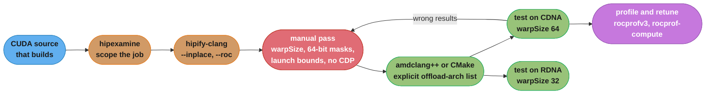
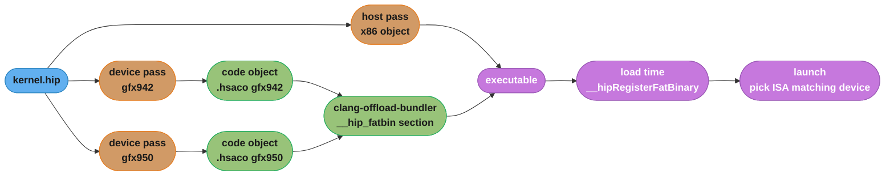

# HIP Programming and Porting

> **Version anchor (fetched 2026-11-25):** ROCm Core SDK 10.2.0 (2026-11-18) ships HIP 7.17.0. `hipcc` and `hipconfig` are documented as legacy tools; AMD recommends `amdclang++` directly or CMake-native HIP (`enable_language(HIP)`, CMake 3.21+). `hipify-clang` supports CUDA up to 13.2.0 with LLVM 23.1.x (recommended Clang 23.1.5). The HIP API 7.0 changes (CUDA-compatible `hipGetLastError`, 64-bit `_sync` warp builtins on by default, hipRTC split into its own library, `warpSize` early-folded) apply to every release from ROCm 7.0 on. ROCm 10.2.0 lists PyTorch 2.15.0 as supported. Targets: `gfx942` (MI300X / MI325X), `gfx950` (MI350X / MI355X), `gfx1200` / `gfx1201` (RDNA 4).

## 1. Concept Overview

**HIP** (Heterogeneous-computing Interface for Portability) is AMD's C++ runtime API and kernel language for its GPUs. It was designed as a near copy of the CUDA runtime API: `hipMalloc` mirrors `cudaMalloc`, `hipStream_t` mirrors `cudaStream_t`, `__global__`, `__shared__`, `threadIdx` and the `<<<grid, block, shmem, stream>>>` launch syntax all keep their CUDA meaning. HIP also exposes the CUDA driver API's module and context functions under `hipModule*` and `hipCtx*` (the latter deprecated), so one HIP API covers both CUDA APIs.

The near-copy design makes the first step of a port mechanical. The **HIPIFY** tools rewrite CUDA source into HIP source: `hipify-clang` parses the code with a real Clang front end, `hipify-perl` uses pattern matching. AMD's own scan of the `convolutionSeparable` sample from `cuda-samples` found 15 CUDA references to convert across 512 lines, with zero warnings. Most device code needs no change at all, because "HIP and CUDA have the same signatures for math and built-in functions except for the name" (HIP FAQ).

The second step is not mechanical, and it is where ports go wrong. HIP keeps CUDA's API shape but runs on hardware with different constants (see [AMD GPU Architecture: CDNA and RDNA](../amd_gpu_architecture_cdna_and_rdna/amd_gpu_architecture_cdna_and_rdna.md)). The five places where hipified code compiles and then misbehaves:

1. **Wavefront width.** `warpSize` is 64 on CDNA (`gfx9`) and 32 on RDNA (`gfx10+`). Every `32`, `0xffffffff`, `>> 5` and `& 31` in a CUDA kernel is a candidate bug.
2. **Mask width.** HIP's `__ballot`, `__activemask` and the `_sync` builtins use **64-bit** masks (`unsigned long long`) on every target.
3. **Launch bounds and registers.** HIP's `__launch_bounds__` second argument is minimum waves per execution unit, not blocks per multiprocessor, and `amdclang++` has no `--maxregcount`.
4. **Compiled targets.** HIP code objects contain native ISA per `gfx` target, with no PTX-style JIT fallback.
5. **Missing features.** HIP does not support dynamic parallelism (kernels launching kernels), and a few CUDA runtime behaviours changed in HIP 7.0 to match CUDA, which breaks code written against earlier HIP.

This module covers the HIP runtime API, the toolchain (`amdclang++`, `hipcc`, CMake), both HIPIFY tools, the wave64 porting traps, code objects and `--offload-arch`, error handling with a `HIP_CHECK` macro, and HIP on NVIDIA. Libraries (hipBLASLt, rocBLAS, MIOpen, hipCUB, Composable Kernel, Triton on AMD) are in [ROCm Libraries and Kernel DSLs](../rocm_libraries_and_kernel_dsls/rocm_libraries_and_kernel_dsls.md); profiling and `rocgdb` are in [ROCm Profiling and Debugging](../rocm_profiling_and_debugging/rocm_profiling_and_debugging.md). The CUDA side of each mechanism lives in [CUDA Programming Model and Kernels](../cuda_programming_model_and_kernels/cuda_programming_model_and_kernels.md), [Warp-Level Primitives and Cooperative Groups](../warp_level_primitives_and_cooperative_groups/warp_level_primitives_and_cooperative_groups.md) and [CUDA Toolkit and Compilation](../cuda_toolkit_and_compilation/cuda_toolkit_and_compilation.md). The survey-level comparison of HIP with SYCL, Metal and WebGPU stays in [GPU Portability: HIP, SYCL and Beyond](../gpu_portability_hip_sycl_and_beyond/gpu_portability_hip_sycl_and_beyond.md).

---

## 2. Intuition

> **One-line analogy**: HIPIFY is a translator who converts a recipe from US cups to metric grams perfectly, word for word. The dish still comes out wrong if the recipe said "fill one baking tray" and the new kitchen's trays are twice as wide. HIP translates the words; you still have to resize the trays.

**Mental model**: Split every CUDA program into three layers and port each one differently.

| Layer | Examples | Port effort |
|---|---|---|
| Host runtime calls | `cudaMalloc`, `cudaMemcpyAsync`, streams, events, graphs | mechanical: HIPIFY renames them |
| Library calls | cuBLAS, cuDNN, cuFFT, CUB, cuRAND | mostly mechanical: HIPIFY maps them to hipBLAS / rocBLAS, MIOpen, hipFFT, hipCUB, hipRAND / rocRAND |
| Kernel code tuned to NVIDIA constants | warp 32, 32-bit masks, block sizes, shared-memory tiles, `__launch_bounds__` | manual: re-derive from `warpSize` and target limits |

**Why it matters**: The first two layers make a port look finished. The third layer decides whether the result is correct and fast. The dangerous bugs are silent: a reduction that sums only lanes 0-31 of a wave64, or a lane mask built with `1 << lane` that becomes undefined behaviour once `lane` reaches 32. Neither crashes; both return plausible wrong numbers.

**Key insight**: Write wave-agnostic code once and both vendors benefit. A kernel whose every warp-level constant comes from `warpSize`, whose masks are `unsigned long long`, and whose block sizes are multiples of 64 runs correctly on CDNA (wave64), RDNA (wave32) and, through HIP on NVIDIA or the original CUDA source, on NVIDIA (warp 32). The port is the moment to remove the 32s, not just rename the API calls.

---

## 3. Core Principles

- **HIP mirrors the CUDA runtime API one-to-one where it can.** Names change prefix (`cuda` to `hip`), semantics are meant to match, and HIP 7.0 changed several behaviours (for example `hipGetLastError`) specifically to match CUDA more closely.
- **HIPIFY converts names, not assumptions.** It reports what it converted and what it could not; it never re-tunes a block size or widens a mask. `hipexamine-perl.sh` / `hipexamine.sh` scope the job before you start.
- **`warpSize` is a runtime property of the device.** 64 on `gfx9` (CDNA), 32 on `gfx10+` (RDNA), 32 on NVIDIA. In device code it is early-folded by the compiler since ROCm 7.0, so it can bound and unroll loops. On the host it must be queried.
- **All HIP lane masks are 64-bit.** `__ballot`, `__activemask`, `__match_any` return `unsigned long long`; the `_sync` builtins take an `unsigned long long` mask and statically assert its type.
- **Occupancy is controlled per execution unit.** `__launch_bounds__(MAX_THREADS_PER_BLOCK, MIN_WARPS_PER_EXECUTION_UNIT)`; there is no `--maxregcount`.
- **Device code is compiled ahead of time to named `gfx` targets.** `--offload-arch` decides which GPUs a binary runs on. There is no PTX equivalent that the runtime can JIT for an unlisted GPU.
- **Compile with `amdclang++` or CMake-native HIP.** `hipcc` is a legacy wrapper around `amdclang++` (or `nvcc` on NVIDIA); it still works and `--hipcc-verbose=7` shows what it does.
- **Check every API call and every launch.** Since HIP 7.0, `hipGetLastError` behaves as in CUDA: it returns the last real error recorded in the thread, not the result of the last call, so an unchecked failure can surface many calls later.

---

## 4. Types / Architectures / Strategies

### 4.1 The CUDA to HIP API map

| CUDA | HIP | Notes |
|---|---|---|
| `#include <cuda_runtime.h>` | `#include <hip/hip_runtime.h>` | `hip_runtime_api.h` is a subset |
| `cudaError_t`, `cudaSuccess` | `hipError_t`, `hipSuccess` | |
| `cudaMalloc` / `cudaFree` | `hipMalloc` / `hipFree` | HIP 7.0: `hipFree` no longer waits implicitly for `hipMallocAsync` allocations |
| `cudaMallocAsync`, `cudaFreeAsync` | `hipMallocAsync`, `hipFreeAsync` | `hipFreeAsync(nullptr)` returns `hipSuccess` since 7.0 |
| `cudaMallocManaged` | `hipMallocManaged` | under stream capture, allowed only in relaxed capture mode |
| `cudaMemcpy`, `cudaMemcpyAsync` | `hipMemcpy`, `hipMemcpyAsync` | also driver-style `hipMemcpyHtoD` / `DtoH` |
| `cudaMemcpyToSymbol` | `hipMemcpyToSymbol` | |
| `cudaStream_t`, `cudaStreamCreateWithFlags`, `cudaStreamNonBlocking` | `hipStream_t`, `hipStreamCreateWithFlags`, `hipStreamNonBlocking` | streams beyond `GPU_MAX_HW_QUEUES` (default 4) share hardware queues |
| `cudaEvent_t`, `cudaEventRecord`, `cudaEventElapsedTime` | `hipEvent_t`, `hipEventRecord`, `hipEventElapsedTime` | |
| `cudaDeviceSynchronize` | `hipDeviceSynchronize` | |
| `cudaGetLastError` | `hipGetLastError` | CUDA semantics since 7.0; old behaviour is `hipExtGetLastError` |
| `cuModuleLoad`, `cuLaunchKernel` | `hipModuleLoad`, `hipModuleLaunchKernel` | code objects are `.hsaco`, fat binaries `.hip_fatbin` |
| `cuCtx*` | `hipCtx*` | deprecated in HIP; use `hipSetDevice` and streams |
| `nvrtc*` | `hiprtc*` | separate library since 7.0, link it explicitly |
| `<<<g, b, s, st>>>` | `<<<g, b, s, st>>>` or `hipLaunchKernelGGL(k, g, b, s, st, args...)` | the macro expands to `<<<>>>` by default |
| `__CUDA_ARCH__` | `__HIP_DEVICE_COMPILE__` plus `__HIP_ARCH_HAS_*__` feature macros | |
| `cooperative_groups.h` | `hip/hip_cooperative_groups.h` | |
| `__ballot_sync(0xffffffff, p)` returns `unsigned` | `__ballot_sync(~0ull, p)` returns `unsigned long long` | 64-bit mask on every target |
| dynamic parallelism | not supported | restructure as host-launched kernels or a persistent kernel |

### 4.2 Library equivalents HIPIFY knows

The HIPIFY "Supported CUDA APIs" page lists these targets; `--roc` selects the `roc` column where both exist.

| CUDA library | HIP-prefixed (portable) | ROC-prefixed (AMD-optimized) |
|---|---|---|
| cuBLAS | hipBLAS | rocBLAS |
| cuSPARSE | hipSPARSE | rocSPARSE |
| cuRAND | hipRAND | rocRAND |
| cuSOLVER | hipSOLVER | |
| cuFFT | hipFFT | |
| cuTENSOR | hipTensor | |
| CUB | hipCUB | |
| cuDNN | | MIOpen |
| cuFile (Linux only) | hipFile | |

HIP's porting guide recommends the `roc` library when an application runs only on AMD, because "the `roc` libraries are optimized specifically for AMD GPUs". The `hip` libraries are thin portable wrappers. NCCL's counterpart RCCL is covered in [Multi-GPU on AMD: RCCL and xGMI](../multi_gpu_on_amd_rccl_and_xgmi/multi_gpu_on_amd_rccl_and_xgmi.md).

### 4.3 The two HIPIFY tools

| | `hipify-clang` | `hipify-perl` |
|---|---|---|
| Method | Clang front end builds an AST, matchers rewrite it | regular-expression pattern matching |
| Needs a CUDA install | yes (`--cuda-path`), up to CUDA 13.2.0 | no |
| Needs code that compiles | yes, plus all includes and defines (`-I`, `-D`) | no, works on code that does not even parse |
| Macros, templates, nested headers | handled through the preprocessor and AST | may miss them |
| Failure mode | reports an error on what it cannot translate | silently leaves or mangles what it does not match |
| Best for | the real port | a quick estimate, or code you cannot build |

Both share `--inplace` (writes the result, keeps a `<file>.prehip` backup), `--examine` (dry run with statistics), and directory wrappers (`hipconvertinplace.sh`, `hipconvertinplace-perl.sh`, `hipexamine.sh`, `hipexamine-perl.sh`).

### 4.4 Three ways to compile

| Toolchain | Command shape | Status |
|---|---|---|
| `amdclang++` | `amdclang++ -x hip --offload-arch=gfx942 k.hip -o k` | recommended for scripts and Makefiles |
| CMake-native HIP | `find_package(hip CONFIG REQUIRED)`, `enable_language(HIP)`, `CMAKE_HIP_ARCHITECTURES` | recommended for CMake projects (CMake 3.21+) |
| `hipcc` | `hipcc --offload-arch=gfx942 k.hip -o k` | legacy wrapper; `--hipcc-verbose=7` prints the real compiler command |
| `nvcc` for HIP on NVIDIA | `nvcc -x cu -I${ROCM_PATH}/include -D__HIP_PLATFORM_NVIDIA__ ...` | replaces `HIP_PLATFORM=nvidia hipcc` |

### 4.5 Porting strategies

| Strategy | What you maintain | When it fits |
|---|---|---|
| One-time port | HIP only (CUDA source retired) | moving a codebase to AMD permanently |
| Dual source | CUDA tree plus generated HIP tree (HIPIFY in CI) | CUDA stays primary; AMD is a second target |
| Single HIP source | HIP compiled with `amdclang++` for AMD and `nvcc` for NVIDIA | one team, both vendors, accepts HIP as the API |
| Portable DSL | Triton or library calls; little or no hand-written HIP | most kernels are GEMM / attention / elementwise |

---

## 5. Architecture Diagrams

### 5.1 The porting workflow



Caption: The red box is the step HIPIFY cannot do. Testing on both a wave64 (CDNA) and a wave32 (RDNA or NVIDIA) device is what catches a constant that is right for one width and wrong for the other.

### 5.2 How a HIP binary is built and loaded



Caption: `amdclang++` makes one host pass and one device pass per `--offload-arch`. If no bundled code object matches the device at launch, there is nothing to JIT and the launch fails with `hipErrorNoBinaryForGpu`.

### 5.3 A 64-lane ballot mask

```
  __ballot(pred) on a wave64 (CDNA): one bit per lane, 64 bits wide

  bit:  63 ............................ 32 31 ............................. 0
       +-----------------------------------+-----------------------------------+
       |  lanes 32..63 (upper half)        |  lanes 0..31 (lower half)         |
       +-----------------------------------+-----------------------------------+

  unsigned int m = __ballot(pred);          // keeps bits 0..31 only
  __popc(m)                                 // counts at most 32 of 64 voters
  unsigned long long m = __ballot(pred);    // keeps all 64
  __popcll(m)                               // correct count on wave64 and wave32

  On a wave32 (RDNA) the same 64-bit value has bits 32..63 = 0 ("unused").
```

Caption: HIP documents that the mask is 64-bit "even when compiled for a device with 32 threads per warp; on such devices the higher bits are unused". Storing it in a 32-bit variable is legal C++ and silently drops half the wave on CDNA.

### 5.4 Converting CUDA launch bounds

```
  CUDA:   __launch_bounds__(256, 2)        256 threads/block, >= 2 blocks per SM

  HIP CDNA (CU mode):    MIN_WARPS_PER_EU = (2 * 256) / (warpSize * 2) = 512 / 128 = 4
  HIP RDNA (WGP mode):   MIN_WARPS_PER_EU = (2 * 256) / (warpSize * 4) = 512 / 128 = 4
                                                        warpSize = 32 on RDNA ^^^

  HIP:    __launch_bounds__(256, 4)

  Register cap the compiler derives (CDNA): 512 VGPRs / 4 waves = 128 VGPRs per thread
```

Caption: The formulas are from HIP's porting guide. Copying the CUDA `2` straight across asks for only 2 waves per EU and lets the compiler use up to 256 VGPRs per thread, halving the occupancy the CUDA author intended.

---

## 6. How It Works — Detailed Mechanics

### 6.1 A complete HIP program with error checking

```cpp
// saxpy.hip
// build: amdclang++ -x hip --offload-arch=gfx942 --offload-arch=gfx950 -O3 saxpy.hip -o saxpy
#include <hip/hip_runtime.h>
#include <cstdio>
#include <cstdlib>
#include <vector>

#define HIP_CHECK(expr)                                                        \
    do {                                                                       \
        hipError_t e_ = (expr);                                                \
        if (e_ != hipSuccess) {                                                \
            std::fprintf(stderr, "HIP error %d '%s' at %s:%d: %s\n",           \
                         static_cast<int>(e_), hipGetErrorString(e_),          \
                         __FILE__, __LINE__, #expr);                           \
            std::exit(EXIT_FAILURE);                                           \
        }                                                                      \
    } while (0)

// Launch errors (bad config) surface immediately; execution errors surface at sync.
#define HIP_CHECK_LAUNCH()                                                     \
    do {                                                                       \
        HIP_CHECK(hipGetLastError());                                          \
    } while (0)

__global__ void __launch_bounds__(256)
saxpy(int n, float a, const float* __restrict__ x, float* __restrict__ y) {
    int i = blockIdx.x * blockDim.x + threadIdx.x;
    if (i < n) y[i] = a * x[i] + y[i];
}

int main() {
    const int n = 1 << 24;                         // 16,777,216 elements, 64 MiB per array
    std::vector<float> hx(n, 1.0f), hy(n, 2.0f);

    float *dx = nullptr, *dy = nullptr;
    HIP_CHECK(hipMalloc(&dx, n * sizeof(float)));
    HIP_CHECK(hipMalloc(&dy, n * sizeof(float)));

    hipStream_t s;
    HIP_CHECK(hipStreamCreateWithFlags(&s, hipStreamNonBlocking));
    HIP_CHECK(hipMemcpyAsync(dx, hx.data(), n * sizeof(float), hipMemcpyHostToDevice, s));
    HIP_CHECK(hipMemcpyAsync(dy, hy.data(), n * sizeof(float), hipMemcpyHostToDevice, s));

    hipEvent_t t0, t1;
    HIP_CHECK(hipEventCreate(&t0));
    HIP_CHECK(hipEventCreate(&t1));

    const int block = 256;                         // 4 wave64s on CDNA, 8 wave32s on RDNA
    const int grid = (n + block - 1) / block;      // 65,536 workgroups
    HIP_CHECK(hipEventRecord(t0, s));
    saxpy<<<grid, block, 0, s>>>(n, 3.0f, dx, dy);
    HIP_CHECK_LAUNCH();
    HIP_CHECK(hipEventRecord(t1, s));

    HIP_CHECK(hipMemcpyAsync(hy.data(), dy, n * sizeof(float), hipMemcpyDeviceToHost, s));
    HIP_CHECK(hipStreamSynchronize(s));            // execution errors are reported here

    float ms = 0.0f;
    HIP_CHECK(hipEventElapsedTime(&ms, t0, t1));
    const double gbps = 3.0 * n * sizeof(float) / (ms * 1e-3) / 1e9;   // 2 reads + 1 write
    std::printf("y[0]=%.1f (expect 5.0)  %.3f ms  %.0f GB/s\n", hy[0], ms, gbps);

    HIP_CHECK(hipEventDestroy(t0));
    HIP_CHECK(hipEventDestroy(t1));
    HIP_CHECK(hipStreamDestroy(s));
    HIP_CHECK(hipFree(dx));
    HIP_CHECK(hipFree(dy));
    return 0;
}
```

SAXPY moves 12 bytes per element and does 2 FLOP, an arithmetic intensity of about 0.17 FLOP/byte, so its speed is set by HBM: compare the printed GB/s with 5.3 TB/s on MI300X or 8 TB/s on MI355X. The CUDA original is identical except for the prefixes, which is the point of HIP. The error-handling pattern is the same as [the CUDA_CHECK idiom](../case_studies/cross_cutting/cuda_error_handling_and_launch_config_patterns.md).

### 6.2 Running HIPIFY

Scope first, then convert:

```bash
# 1. Dry run over a directory: what would convert, what will need hand work
cd src/kernels
hipexamine-perl.sh                      # fast estimate, no CUDA install needed
hipexamine.sh                           # hipify-clang based, needs the code to compile

# 2. Real conversion with the Clang-based tool, AMD-optimized libraries, in place
hipify-clang --cuda-path=/usr/local/cuda-13.2 \
    -I include -I third_party/cutlass/include -D USE_FP16=1 \
    --roc --inplace attention.cu softmax.cu
# originals are kept as attention.cu.prehip, softmax.cu.prehip

# 3. Find the constants HIPIFY never touches
grep -nE '0xffffffff|\b32\b|>> *5|& *31|__ballot|__activemask|__launch_bounds__|__CUDA_ARCH__' \
    attention.cu softmax.cu
```

HIP's porting guide shows the output format of the examine step on the `convolutionSeparable` sample:

```
[HIPIFY] info: file 'GLOBAL' statistics:
CONVERTED refs count: 15
TOTAL lines of code: 512
WARNINGS: 0
```

A clean scan says the API layer is mechanical. It says nothing about warp constants, which is why step 3 exists.

### 6.3 Building: amdclang++ and CMake

Direct invocation, per the HIPCC migration guide:

```bash
amdclang++ \
  --hip-path=${ROCM_PATH} \
  -x hip \
  --offload-arch=gfx942 --offload-arch=gfx950 --offload-arch=gfx1201 \
  -O3 -o attention attention.hip
```

`--offload-arch=native` targets whatever GPUs the build machine has, which is convenient on a workstation and wrong in CI. CMake-native HIP:

```cmake
cmake_minimum_required(VERSION 3.21)
project(attn LANGUAGES CXX HIP)

find_package(hip CONFIG REQUIRED)

# Never rely on the default: it comes from rocm_agent_enumerator on the build host.
set(CMAKE_HIP_ARCHITECTURES "gfx942;gfx950;gfx1201")

add_executable(attn attention.hip)
set_source_files_properties(attention.hip PROPERTIES LANGUAGE HIP)
target_link_libraries(attn PRIVATE hip::device)
```

`CMAKE_HIP_ARCHITECTURES` (added in CMake 3.21) is initialized from the architectures `rocm_agent_enumerator` reports, "and otherwise to a default chosen by the compiler". A build on an MI300X host therefore produces a `gfx942`-only binary unless the list is set.

### 6.4 Writing wave-agnostic warp code

The rules from HIP's language-extension reference, applied:

```cpp
#include <hip/hip_runtime.h>

// Lane-mask type per target family, from HIP's porting guide.
#if defined(__GFX8__) || defined(__GFX9__)
typedef uint64_t lane_mask_t;    // wave64 (CDNA)
#else
typedef uint32_t lane_mask_t;    // wave32 (RDNA)
#endif

// Stream compaction: each wave writes its kept elements contiguously.
__global__ void compact_positive(const float* in, float* out, int* counter, int n) {
    const int i = blockIdx.x * blockDim.x + threadIdx.x;
    const float v = (i < n) ? in[i] : -1.0f;
    const int keep = v > 0.0f;

    const unsigned long long vote = __ballot(keep);                 // 64-bit on every target
    const int lane = threadIdx.x % warpSize;
    const unsigned long long below =
        (lane == 0) ? 0ull : (vote & ((~0ull) >> (64 - lane)));    // lanes 0..lane-1
    const int rank = __popcll(below);
    const int total = __popcll(vote);

    int base = 0;
    if (lane == 0 && total > 0) base = atomicAdd(counter, total);
    base = __shfl(base, 0);                                          // width defaults to warpSize

    if (keep) out[base + rank] = v;
}
```

What each line protects against:

- `unsigned long long vote` and `__popcll`: a 32-bit `unsigned` and `__popc` would drop lanes 32-63 on CDNA.
- `(~0ull) >> (64 - lane)`: builds a mask of the lanes below this one without ever shifting by 64 (undefined) or by 32 on a 32-bit type (also undefined), the bug HIP's porting guide calls out for `1 << (threadIdx.x % warpSize)`.
- `threadIdx.x % warpSize`: never `% 32` or `& 31`.
- `__shfl(base, 0)`: the `width` parameter defaults to `warpSize`; passing a literal `32` would split a wave64 into two independent halves.

Since ROCm 7.0, `warpSize` is early-folded by the compiler, so `for (int o = warpSize / 2; o > 0; o /= 2)` unrolls as if the width were a literal. When a compile-time constant is unavoidable (to size a `__shared__` array, or to pick a mask type in a template), AMD's documented pattern is to query the warp size on the host and launch a kernel specialized on it:

```cpp
template <int WARP>
__global__ void block_reduce(const float* x, float* out, int n);   // uses WARP everywhere

void launch_block_reduce(const float* x, float* out, int n, hipStream_t s, int device) {
    int warp = 0;
    HIP_CHECK(hipDeviceGetAttribute(&warp, hipDeviceAttributeWarpSize, device));
    const int block = 256, grid = (n + block - 1) / block;
    if (warp == 64) block_reduce<64><<<grid, block, 0, s>>>(x, out, n);
    else            block_reduce<32><<<grid, block, 0, s>>>(x, out, n);
    HIP_CHECK(hipGetLastError());
}
```

### 6.5 The `_sync` builtins and their 64-bit masks

Since ROCm 7.0 the `_sync` variants are enabled by default (disable with `HIP_DISABLE_WARP_SYNC_BUILTINS`). Signatures from HIP's reference:

```cpp
unsigned long long __ballot_sync(unsigned long long mask, int predicate);
int  __any_sync(unsigned long long mask, int predicate);
int  __all_sync(unsigned long long mask, int predicate);
T    __shfl_sync(unsigned long long mask, T var, int srcLane, int width = warpSize);
T    __shfl_xor_sync(unsigned long long mask, T var, int laneMask, int width = warpSize);
T    __reduce_add_sync(unsigned long long mask, T var);     // int / unsigned by default
```

Three rules: every participating lane must have its own bit set; all lanes named in any mask must call the same builtin with the same mask; and the implementation static-asserts that the mask type is 64-bit. HIP notes that on AMD, masks that start at lane 0 and have no holes "use faster cross-lane operations". Extra element types for `__reduce_*_sync` (64-bit integers, `half`, `float`, `double`) need `HIP_ENABLE_EXTRA_WARP_SYNC_TYPES`. HIP's reference also states that "AMD GPUs guarantee, that all warp lanes are executed in lockstep", unlike NVIDIA GPUs with Independent Thread Scheduling, so the `_sync` forms exist for portability, not because AMD hardware needs reconvergence.

### 6.6 Replacing `__CUDA_ARCH__`

| CUDA idiom | HIP replacement |
|---|---|
| `#ifdef __CUDA_ARCH__` (device pass) | `#ifdef __HIP_DEVICE_COMPILE__` |
| `#if __CUDA_ARCH__ >= 600` for double atomics | `#if __HIP_ARCH_HAS_GLOBAL_INT64_ATOMICS__` or the specific feature macro |
| host check of compute capability | `hipGetDeviceProperties` then `prop.arch.hasWarpBallot`, `prop.gcnArchName` |
| `#ifdef __CUDACC__` | `#ifdef __HIPCC__` (defined for `.hip` files or `-x hip`) |
| platform switch | `__HIP_PLATFORM_AMD__` or `__HIP_PLATFORM_NVIDIA__` |
| per-family code (mask types) | `__GFX9__` (CDNA), and newer family macros for RDNA |

HIP's rationale: "replacing these macros with feature-specific macros, not architecture specific", because a numeric architecture comparison does not say which feature is required. On the host the `__HIP_ARCH_*` macros are 0 and must not be used; query device properties instead.

### 6.7 Code objects, modules and hipRTC

Kernels compiled into the executable are registered at load time (`__hipRegisterFatBinary`, `__hipRegisterFunction`) and launched through `<<<>>>`. To load code at runtime, use the module API with a code object built for the exact target:

```cpp
hipModule_t mod;
hipFunction_t fn;
HIP_CHECK(hipModuleLoad(&mod, "attention_gfx942.hsaco"));  // native ISA for one gfx target
HIP_CHECK(hipModuleGetFunction(&fn, mod, "attn_fwd"));

void* args[] = {&q, &k, &v, &o, &seq_len};
HIP_CHECK(hipModuleLaunchKernel(fn, grid_x, 1, 1, 256, 1, 1,
                                /*sharedMemBytes=*/0, stream, args, nullptr));
```

`hipModuleLoadDataEx` accepts JIT options for CUDA compatibility, but on HIP-Clang the code object is already compiled, so the options are ignored and the call behaves like `hipModuleLoadData`. ROCm 10.2.0 adds `hipModuleEnumerateFunctions` (list the kernels in a loaded module without knowing their names), `hipLibraryGetModule` and `hipKernelSetAttributeForDevice`. For true runtime compilation use hipRTC (`hiprtcCreateProgram`, `hiprtcCompileProgram`); since HIP 7.0 its symbols are no longer in the HIP runtime library and you must link the hipRTC library explicitly.

### 6.8 HIP API 7.0 behaviour changes that break old HIP code

| Change | Old HIP behaviour | HIP 7.0+ behaviour (CUDA-compatible) |
|---|---|---|
| `hipGetLastError` | returned the result of the last call, even `hipSuccess` | returns the last actual error in the thread; `hipExtGetLastError` keeps the old meaning |
| `_sync` warp builtins | opt-in | on by default, 64-bit mask, static assert on mask type |
| `warpSize` | compile-time constant | early-folded by the compiler, usable in loop bounds and unrolling |
| hipRTC | symbols inside the HIP runtime | separate library, link explicitly |
| `hipFree` | implicit wait for all allocations | no wait for `hipMallocAsync` / `hipMallocFromPoolAsync` memory |
| Kernel exceptions | abort the process | return an error unless core dumping is enabled |
| `hipPointerGetAttributes(nullptr)` | `hipErrorInvalidValue` | `hipSuccess` |
| HIP headers | pulled in extra STL headers | only required STL headers; add your own includes |

The `hipGetLastError` example from AMD's change notes: `hipMalloc` returns out-of-memory, `hipSetDevice(0)` succeeds, then `hipGetLastError()` returns the out-of-memory error, where before 7.0 it returned `hipSuccess`.

### 6.9 HIP on NVIDIA

HIP source can also be compiled for NVIDIA GPUs: the HIP headers map each `hip*` call onto the CUDA runtime, and the non-AMD back-end files live in AMD's `hipother` repository. With `hipcc` this was `HIP_PLATFORM=nvidia hipcc`; the HIPCC migration guide's direct replacement is:

```bash
nvcc -x cu \
  -I${ROCM_PATH}/include \
  -D__HIP_PLATFORM_NVIDIA__ \
  --gpu-architecture=sm_80 \
  -o attention attention.hip
```

Two cautions. First, the current HIP FAQ answers "What hardware does HIP support?" with "HIP supports AMD GPUs", so treat the NVIDIA path as a compatibility layer and test it on every ROCm upgrade. Second, everything in section 6.4 pays off here: wave-agnostic code with 64-bit masks compiles and runs on NVIDIA's 32-wide warps, where the upper mask bits are unused.

### 6.10 PyTorch on ROCm from the porting side

PyTorch's ROCm build reuses the `torch.cuda` namespace, so model code ports with no changes, and two habits from HIP-native code break it:

```python
import torch

# BROKEN: there is no 'hip' or 'rocm' device type
# x = torch.zeros(1024, device="hip")          # raises: 'rocm' or 'hip' are not valid

# FIX: the device type stays 'cuda'; detect the backend through torch.version
x = torch.zeros(1024, device="cuda")
if torch.version.hip is not None:
    backend = f"ROCm/HIP {torch.version.hip}"
elif torch.version.cuda is not None:
    backend = f"CUDA {torch.version.cuda}"
else:
    backend = "no GPU build"
print(backend, torch.cuda.get_device_properties(0).gcnArchName)
```

PyTorch 2.15's HIP notes also document `PYTORCH_NO_HIP_MEMORY_CACHING=1` (with `PYTORCH_NO_CUDA_MEMORY_CACHING=1` accepted "for ease of porting") to disable the caching allocator while hunting memory errors.

### 6.11 Debugging switches

| Variable | Effect | CUDA analogue |
|---|---|---|
| `AMD_SERIALIZE_KERNEL=3` | wait for completion before and after each kernel enqueue | `CUDA_LAUNCH_BLOCKING=1` |
| `HIP_LAUNCH_BLOCKING=1` | serialize kernel enqueue, same as `AMD_SERIALIZE_KERNEL` | `CUDA_LAUNCH_BLOCKING=1` |
| `AMD_SERIALIZE_COPY` | serialize copies | |
| `AMD_LOG_LEVEL=1..5` | errors (1) up to extra debug (5); `AMD_LOG_LEVEL_FILE` redirects | |
| `HIP_VISIBLE_DEVICES=0,2` | device indices visible to HIP; on Linux prefer `ROCR_VISIBLE_DEVICES` | `CUDA_VISIBLE_DEVICES` |
| `GPU_MAX_HW_QUEUES` | hardware queues per device per process, default 4 | |

With `AMD_LOG_LEVEL` set, a launch that exceeds `__launch_bounds__` prints the launch configuration and the declared bounds. Full debugging with `rocgdb` and address sanitizing is in [ROCm Profiling and Debugging](../rocm_profiling_and_debugging/rocm_profiling_and_debugging.md).

---

## 7. Real-World Examples

- **AMD's own HIPIFY sample.** HIP's porting guide runs `hipexamine-perl.sh` on `cuda-samples`' `convolutionSeparable`: 15 references converted (`cudaMalloc` x3, `cudaFree` x3, `cudaMemcpy` x2, `cudaDeviceSynchronize` x2, `cudaMemcpyToSymbol`, the two copy-direction enums, and the `cuda_runtime.h` and `cooperative_groups.h` includes) across 512 lines with 0 warnings. It is a fair picture of a host-heavy sample: almost everything that needs converting is a runtime call.
- **PyTorch.** PyTorch's HIP notes say PyTorch for HIP "intentionally reuses the existing `torch.cuda` interfaces", and that HIP "is used when converting existing CUDA applications like PyTorch to portable C++". ROCm 10.2.0 supports PyTorch 2.15.0, and PyTorch for ROCm now supports the `torch.cuda.gds` file APIs through AMD Infinity Storage hipFile.
- **HIPIFY tracking CUDA.** `hipify-clang` supports CUDA 7.0 through 13.2.0, and its supported-API tables can be regenerated with `hipify-clang --md --doc-format=full --doc-roc=joint`. When a codebase moves to a newer CUDA than HIPIFY supports, the Clang-based tool is the one that stops working first, because it must parse the new headers.
- **The hipcc deprecation path.** AMD now labels `hipcc` and `hipconfig` legacy and publishes flag-by-flag migrations (for example `hipconfig --platform` becomes the `HIP_PLATFORM` variable, and in CMake-native builds "the platform is determined automatically by `CMAKE_HIP_COMPILER`").

---

## 8. Tradeoffs

### 8.1 Choosing a HIPIFY tool

| Criterion | `hipify-clang` | `hipify-perl` |
|---|---|---|
| Accuracy on templates and macros | high | medium |
| Setup | CUDA install, includes, defines | none |
| Works on broken code | no | yes |
| Reports untranslatable constructs | yes, as errors | no |
| Speed on a large tree | slower (full parse) | fast |

### 8.2 Choosing a build path

| Criterion | `amdclang++` direct | CMake-native HIP | `hipcc` |
|---|---|---|---|
| Transparency of flags | full | full via `compile_commands.json` | hidden unless `--hipcc-verbose` |
| Multi-target builds | `--offload-arch` repeated | `CMAKE_HIP_ARCHITECTURES` | `--offload-arch` repeated |
| NVIDIA target | no (use `nvcc`) | CUDA language support | `HIP_PLATFORM=nvidia` |
| Status | recommended | recommended | legacy |

### 8.3 Keeping CUDA and HIP

| Strategy | Pros | Cons |
|---|---|---|
| Single HIP source for both vendors | one codebase, one review | depends on the NVIDIA compatibility layer; newest CUDA features arrive late |
| CUDA source plus HIPIFY in CI | CUDA stays native and current | generated code must stay wave-agnostic; failures surface late |
| Separate hand-tuned kernels per vendor | peak on both | double the maintenance and testing |
| Triton or libraries | least kernel code | less control in the last 10-20% |

### 8.4 Where a CUDA feature has no HIP equivalent

| CUDA feature | HIP status | Workaround |
|---|---|---|
| Dynamic parallelism | not supported | host-driven launches, graphs, persistent kernels with device-side queues |
| `--maxregcount` | not supported by `amdclang++` | `__launch_bounds__` per kernel |
| PTX inline assembly | not applicable | AMDGPU builtins, rocWMMA, Composable Kernel |
| PTX JIT for unknown GPUs | no equivalent | ship every target or a generic target |
| `cuCtx*` context juggling | `hipCtx*` deprecated | `hipSetDevice` and streams |

---

## 9. When to Use / When NOT to Use

**Use HIP (and this module) when:**
- You own CUDA C++ kernels or CUDA runtime code that must run on Instinct or Radeon GPUs.
- You want one C++ source that builds for AMD and NVIDIA and you are willing to make it wave-agnostic.
- You need AMD-specific control that a DSL does not expose: MFMA builtins, LDS layout, `__launch_bounds__` waves per EU, module loading at runtime.
- A library you depend on has a HIPIFY-mapped equivalent (hipBLAS / rocBLAS, MIOpen, hipFFT, hipCUB, hipRAND).

**Do not reach for hand-written HIP when:**
- The workload is PyTorch or JAX model code. It already runs on ROCm through `torch.cuda` / the ROCm build; port only the custom extensions.
- The kernel is a standard GEMM, attention or normalization. hipBLASLt, Composable Kernel, AITER or Triton on AMD will usually beat a fresh port; see [ROCm Libraries and Kernel DSLs](../rocm_libraries_and_kernel_dsls/rocm_libraries_and_kernel_dsls.md).
- The code depends on dynamic parallelism or on PTX-level tricks; plan a redesign first.
- You need Apple GPUs or a browser. HIP does not target them; see [Cross-Vendor GPU Concept Map](../cross_vendor_gpu_concept_map/cross_vendor_gpu_concept_map.md).

---

## 10. Common Pitfalls

**Pitfall 1: 32-bit lane masks built by shifting.** HIP's porting guide shows the exact bug: on wave64, `threadIdx.x % warpSize` reaches 63, and shifting a 32-bit `1` by 32 or more is undefined behaviour in C++.

```cpp
// BROKEN: CUDA lane-mask idioms on a wave64 device
__device__ int count_lanes_below_matching(int pred) {
    unsigned int lane = threadIdx.x % warpSize;          // 0..63 on CDNA
    unsigned int lt_mask = (1u << lane) - 1u;            // UB once lane >= 32
    unsigned int vote = __ballot(pred);                  // truncates a 64-bit ballot
    return __popc(vote & lt_mask);                       // wrong for lanes 32..63
}
```

```cpp
// FIX: 64-bit masks, a shift that never reaches the type width, 64-bit popcount
__device__ int count_lanes_below_matching(int pred) {
    const int lane = threadIdx.x % warpSize;
    const unsigned long long lt_mask = (lane == 0) ? 0ull : (~0ull >> (64 - lane));
    const unsigned long long vote = __ballot(pred);      // 64 bits on every target
    return __popcll(vote & lt_mask);
}
```

**Pitfall 2: Error checks that stopped meaning what they used to.** Code written for HIP before 7.0 sometimes relied on `hipGetLastError()` returning the result of the most recent call. Since 7.0 it returns the last real error in the thread, as CUDA does, so an old out-of-memory error can surface many calls later and be blamed on the wrong line. Check every call with `HIP_CHECK` at its call site; use `hipExtGetLastError` only where the old meaning is truly wanted.

**Pitfall 3: Copied launch bounds.** `__launch_bounds__(256, 2)` copied from CUDA asks HIP for 2 waves per EU, not 2 blocks per CU. Convert with HIP's formula (section 5.4). Because `amdclang++` has no `--maxregcount`, a build flag that used to cap registers globally silently stops working; move the cap into per-kernel launch bounds.

**Pitfall 4: A hipRTC program that no longer links.** Before HIP 7.0, hipRTC symbols were also exported by the HIP runtime library, so applications that called `hiprtcCompileProgram` linked without naming hipRTC. On 7.0 and later they fail at link time. Add the hipRTC library to the link line.

**Pitfall 5: Kernels that launch kernels.** A CUDA kernel using dynamic parallelism hipifies into code that does not compile, because HIP has no device-side launch. The redesign (host-driven phases, graphs, or a persistent kernel with a device-side work queue) is real work; find these in the examine step, not at the end.

**Pitfall 6: `width = 32` in shuffles.** CUDA code written as `__shfl_down_sync(mask, v, off, 32)` compiles in HIP and, on wave64, treats each wave as two independent 32-lane halves. A reduction then produces two partial results per wave. Use the default width (`warpSize`) unless sub-wave groups are the intent.

**Pitfall 7: `__shared__` arrays sized by warps of 32.** `__shared__ float partial[1024 / 32]` is big enough on wave64 (16 entries used of 32) but the indexing derived from it (`threadIdx.x / 32`) is wrong on wave64. Size for the narrowest wave (32) and index with `warpSize`.

**Pitfall 8: Testing only where it works.** A team that ports, then tests on RDNA laptops or on NVIDIA through HIP, sees `warpSize` 32 everywhere and passes every test. The wave64 bugs ship to the MI300X fleet. One CDNA runner in CI catches all of pitfalls 1, 6 and 7.

---

## 11. Technologies & Tools

| Tool | Role |
|---|---|
| HIP 7.17.0 | runtime API and kernel language (ROCm 10.2.0) |
| `amdclang++` | HIP-Clang compiler; `--offload-arch=gfxNNNN` or `native` |
| `hipcc`, `hipconfig` | legacy wrappers; `--hipcc-verbose=7` shows the real command |
| CMake 3.21+ | `enable_language(HIP)`, `find_package(hip CONFIG)`, `CMAKE_HIP_ARCHITECTURES` |
| `hipify-clang` | AST-based CUDA to HIP translator, CUDA up to 13.2.0 |
| `hipify-perl` | pattern-based translator, no CUDA install needed |
| `hipexamine.sh`, `hipexamine-perl.sh` | dry-run statistics per file and per directory |
| hipRTC | runtime compilation (separate library since HIP 7.0) |
| `clang-offload-bundler` | bundles per-target code objects into `__hip_fatbin` |
| `rocminfo`, `amd-smi` | device and partition inspection |
| `rocgdb`, `rocprofv3` | debugging and profiling (see the profiling module) |
| hipBLAS / rocBLAS, MIOpen, hipFFT, hipCUB, hipRAND / rocRAND, hipSOLVER, hipSPARSE / rocSPARSE, hipTensor, hipFile | library targets HIPIFY maps CUDA libraries onto |
| PyTorch 2.15 (ROCm build) | `torch.cuda` on AMD; `torch.version.hip` identifies it |

---

## 12. Interview Questions with Answers

**Q: A hipified kernel builds a lane mask with `(1u << lane) - 1` and passes tests on an NVIDIA GPU. Why does it fail on an MI300X?**
**Short:** On a wave64 device the lane index reaches 63, and shifting a 32-bit one by 32 or more is undefined behaviour, so masks for the upper half of the wave are garbage.
HIP's porting guide shows this exact pattern and explains that `threadIdx.x % warpSize` can exceed 31 on GCN and CDNA, which "would clear the 32-bit register to which the shift operation is applied" at best. On NVIDIA and RDNA the lane stops at 31, so tests there never see it. Use 64-bit masks, build "lanes below me" as `~0ull >> (64 - lane)` with a lane-0 special case, and count with `__popcll`. Run correctness tests on a CDNA device.

**Q: What does `__ballot` return in HIP, and what goes wrong if you store it in an `unsigned int`?**
**Short:** HIP's ballot returns a 64-bit unsigned long long on every target, and storing it in 32 bits silently drops the votes of lanes 32 to 63 on CDNA.
HIP's language-extension reference says all mask values returned or accepted by the warp built-ins are 64-bit, "even when compiled for a device with 32 threads per warp", where the high bits are unused. CUDA's ballot returns 32 bits, so ported code often keeps `unsigned` and `__popc`. The implicit narrowing compiles cleanly and halves every count on wave64. Declare masks as `unsigned long long` (or a `lane_mask_t` typedef) and use `__popcll`.

**Q: Is `warpSize` a compile-time constant in HIP?**
**Short:** Not on the host, and in device code it is a built-in the compiler early-folds since ROCm 7.0 rather than a constant expression you can size arrays with.
HIP's documentation says `warpSize` "can not be assumed to be a compile-time constant on the host" and must be queried with `hipDeviceGetAttribute(..., hipDeviceAttributeWarpSize, ...)`. Since ROCm 7.0 the compiler early-folds it in device code, so it works in loop bounds and enables unrolling. When a true constant is needed, query on the host and launch a kernel template specialized for 32 or 64, which is AMD's documented pattern. The value is 64 on `gfx9`, 32 on `gfx10+`, and 32 on NVIDIA.

**Q: HIPIFY converted every CUDA call and the code passes its tests. Is the port done?**
**Short:** No, HIPIFY only renames APIs and libraries, so block sizes, warp constants, LDS tiles and launch bounds still carry NVIDIA tuning that must be re-derived for AMD.
The examine step reports converted references and warnings; it never inspects literal 32s, mask widths, shared-memory budgets or `__launch_bounds__` meaning. A port can be functionally correct on a wave32 device and still wrong on wave64, or correct and at a third of attainable speed. After conversion, grep for warp-size literals and masks, convert launch bounds, test on CDNA, then profile. Plan the retune as a separate milestone.

**Q: How did `hipGetLastError` change in HIP 7.0?**
**Short:** It now returns the last actual error recorded in the calling thread, matching CUDA, instead of the result of the most recent HIP call.
AMD's HIP 7.0 change notes give the example: `hipMalloc` fails with out-of-memory, `hipSetDevice(0)` succeeds, and `hipGetLastError()` now returns the out-of-memory error where it used to return `hipSuccess`. Neither `hipSuccess` nor `hipErrorNotReady` counts as an error. The old behaviour is available as `hipExtGetLastError`. Code that relied on the old meaning can mis-attribute errors, so check each call where it happens.

**Q: Can a HIP kernel launch another kernel?**
**Short:** No, HIP does not support dynamic parallelism, so CUDA code that launches kernels from device code must be redesigned before it can be ported.
HIP's language-extension reference states "Unlike CUDA, HIP does not support dynamic parallelism, meaning that kernels can not be called from the device." Typical replacements are host-driven multi-phase launches, HIP graphs captured from streams, or a persistent kernel that pulls tasks from a device-side queue. Find these uses in the examine step. Treat each one as a design change, not a translation.

**Q: How do you cap registers per thread in HIP when `--maxregcount` is not available?**
**Short:** Use per-kernel __launch_bounds__ with a minimum-waves-per-EU value, from which the compiler derives the register limit, because amdclang++ does not support --maxregcount.
HIP's porting guide says `amdclang++` does not support `--maxregcount` and encourages `__launch_bounds__` because its parameters are more intuitive and work per kernel. The compiler caps registers at available registers divided by `MIN_WARPS_PER_EXECUTION_UNIT`; on CDNA that is 512 VGPRs per EU, so asking for 4 waves per EU caps a kernel at 128. If the compiler cannot meet the bound, compilation fails. In Triton on ROCm the same idea is the `waves_per_eu` hint.

**Q: Why does `__shfl_xor_sync(0xffffffff, v, off)` fail to compile on ROCm 7.0 and later?**
**Short:** HIP's _sync builtins take a 64-bit unsigned long long mask and include a static assert on the mask type, so a 32-bit literal mask is rejected at compile time.
Since ROCm 7.0 the `_sync` variants are enabled by default (opt out with `HIP_DISABLE_WARP_SYNC_BUILTINS`), and HIP's reference says the implementation "includes a static assert to check that the program source uses the correct type for the mask". The compile error is protecting you: a 32-bit full mask names only lanes 0-31 of a wave64. Replace it with `~0ull` or a computed 64-bit mask. Do not "fix" it by switching to the non-`_sync` form and keeping the 32-lane assumptions.

**Q: In PyTorch on ROCm, what device string do you use and how do you know you are on AMD?**
**Short:** The device type stays cuda because PyTorch's ROCm build reuses the torch.cuda interfaces, and torch.version.hip being set identifies a HIP build.
PyTorch's HIP notes show `torch.device('cuda:0')` and state "'rocm' or 'hip' are not valid, use 'cuda'". `torch.cuda.is_available()` returns True on both vendors; check `torch.version.hip` versus `torch.version.cuda` for vendor-specific paths. `torch.cuda.get_device_properties(0).gcnArchName` gives the `gfx` target. Branch on capabilities, not on the device string.

**Q: A HIP application fails on a new GPU with `hipErrorNoBinaryForGpu`. What happened and how do you fix it?**
**Short:** The fat binary has no code object for that GPU's gfx target, and HIP cannot JIT one, so you must rebuild with that target in the offload-arch list or use a generic target.
The error text is "No kernel image is available for execution on the device". It typically comes from a build that relied on defaults: `--offload-arch=native` or CMake's `CMAKE_HIP_ARCHITECTURES`, which is initialized from `rocm_agent_enumerator` on the build host. A `gfx942`-only binary has nothing for a `gfx950` MI355X. List every target in CI, or use a generic target such as `gfx9-4-generic` where its feature restrictions are acceptable.

**Q: When do you choose hipify-clang over hipify-perl?**
**Short:** Use hipify-clang for the real port because it parses the code into an AST and reports what it cannot translate, and use hipify-perl for quick estimates or code that does not build.
`hipify-clang` needs a CUDA installation (up to CUDA 13.2.0), all includes and defines, and code that compiles; in return it handles templates, macros and nested headers and errors out on constructs it cannot convert. `hipify-perl` uses pattern matching, needs no CUDA install, and works on code that is not even syntactically correct, but can miss or mangle complex constructs. Both support `--inplace` (with `.prehip` backups) and `--examine`. Scope with the Perl tool, convert with the Clang tool.

**Q: What is the difference between hipcc and amdclang++, and which should a new project use?**
**Short:** hipcc is a legacy wrapper that injects HIP flags and calls amdclang++ (or nvcc), and AMD recommends calling amdclang++ directly or using CMake-native HIP for new projects.
The HIPCC documentation marks `hipcc` and `hipconfig` as legacy. The direct form is `amdclang++ --hip-path=${ROCM_PATH} -x hip --offload-arch=...`, and `-x hip` also defines `__HIP_PLATFORM_AMD__`. CMake has had first-class HIP support since 3.21 via `enable_language(HIP)` and `find_package(hip CONFIG)`. To migrate an existing build, run `hipcc --hipcc-verbose=7` once to see the exact flags it passes.

**Q: How do you replace `__CUDA_ARCH__` checks when porting to HIP?**
**Short:** Use __HIP_DEVICE_COMPILE__ to detect the device pass and the feature-specific __HIP_ARCH_HAS macros, or host-side device properties, instead of numeric architecture comparisons.
HIP's porting guide replaces architecture numbers with feature macros such as `__HIP_ARCH_HAS_WARP_BALLOT__` or `__HIP_ARCH_HAS_GLOBAL_INT64_ATOMICS__`, because a number "does not properly specify what feature is required". On the host these macros are 0 and must not be relied on; use `hipGetDeviceProperties` and fields like `arch.hasWarpBallot` or `gcnArchName`. Family macros such as `__GFX9__` select wave64-specific types. Keep architecture checks feature-based so new targets inherit the right path.

**Q: How are HIP device binaries packaged, and can they be JIT-compiled for a GPU that was not targeted?**
**Short:** Each target gets a native-ISA .hsaco code object, the objects are bundled into a __hip_fatbin section, and there is no intermediate form the runtime can JIT for an unlisted target.
`amdclang++` runs one device pass per `--offload-arch`, and `clang-offload-bundler` embeds the results as `__hip_fatbin`; `__hipRegisterFatBinary` registers them at load. Module APIs load `.hsaco` or `.hip_fatbin` files directly. HIP's porting guide notes that `hipModuleLoadDataEx` ignores JIT options on HIP-Clang because the code is already compiled. For runtime compilation from source, use hipRTC.

**Q: How do you compile HIP source for an NVIDIA GPU?**
**Short:** Compile it with nvcc as CUDA, adding the ROCm include path and defining __HIP_PLATFORM_NVIDIA__, which makes the HIP headers map each hip call onto the CUDA runtime.
The HIPCC migration guide replaces `HIP_PLATFORM=nvidia hipcc ... --offload-arch=sm_80` with `nvcc -x cu -I${ROCM_PATH}/include -D__HIP_PLATFORM_NVIDIA__ --gpu-architecture=sm_80`, and CMake projects use CMake's CUDA language support. The non-AMD back-end files live in AMD's `hipother` repository. The current HIP FAQ lists AMD GPUs as the supported hardware, so test this path on each upgrade. Wave-agnostic code with 64-bit masks runs correctly on NVIDIA's 32-wide warps.

**Q: How do you convert CUDA's `__launch_bounds__(256, 2)` for an MI300X?**
**Short:** Convert minimum blocks per SM into minimum waves per execution unit, which for CDNA is blocks times threads divided by twice the warp size, giving __launch_bounds__(256, 4).
HIP's porting guide gives `MIN_WARPS_PER_EXECUTION_UNIT = (MIN_BLOCKS_PER_MULTIPROCESSOR * MAX_THREADS_PER_BLOCK) / (warpSize * 2)` for CDNA in CU mode, so `(2 x 256) / (64 x 2) = 4`. For RDNA in WGP mode the divisor is `warpSize * 4`, which with `warpSize` 32 also gives 4 here. The compiler then caps VGPRs at 512 / 4 = 128 per thread on CDNA. Copying the `2` unchanged lets the kernel use up to 256 VGPRs and halves the intended occupancy.

**Q: What does the `width` argument of HIP's shuffle functions do, and why is passing 32 dangerous?**
**Short:** It splits the wave into independent groups of width lanes, each indexed from zero, so width 32 on a wave64 turns one 64-lane shuffle into two separate 32-lane shuffles.
HIP's reference defines `width` as a power of two no larger than `warpSize`, defaulting to `warpSize`, with lane indices `laneIdx % width` inside each group. CUDA code often passes 32 explicitly because it equals the warp size there. On CDNA that makes a reduction stop at each half-wave and leaves two partial results. Omit the argument unless sub-wave groups are intended.

**Q: When should a ported application call rocBLAS instead of hipBLAS?**
**Short:** Use the roc libraries when the code runs only on AMD, because they are optimized for AMD GPUs, and keep the hip wrappers when one source must also build for NVIDIA.
HIP's porting guide recommends the `roc` version "for applications running on AMD GPUs, as they are optimized for AMD architectures", and HIPIFY's `--roc` option produces those calls directly. The `hip` libraries (hipBLAS, hipSPARSE, hipRAND) are thin portable layers over the vendor libraries. cuDNN maps only to MIOpen, and cuFFT to hipFFT. Pick per library based on whether NVIDIA builds still matter.

**Q: What belongs in a production `HIP_CHECK` setup, and how do you find which kernel actually failed?**
**Short:** Check every API return code at its call site, check hipGetLastError right after each launch, synchronize in debug builds, and serialize kernels with AMD_SERIALIZE_KERNEL to localize asynchronous failures.
A launch returns immediately, so configuration errors appear in `hipGetLastError()` after the launch, while execution faults surface at the next synchronizing call, often far from the culprit. Setting `AMD_SERIALIZE_KERNEL=3` (wait before and after each enqueue) or `HIP_LAUNCH_BLOCKING=1` makes each failure appear at its own launch, and `AMD_LOG_LEVEL` adds runtime diagnostics. Since HIP 7.0 kernel exceptions return an error instead of aborting the process unless core dumps are enabled. Keep the macro in release builds; the cost is a branch per call.

**Q: Why might a wave-level `_sync` operation with mask 0x00FF00FF be slower on AMD than one with mask 0x0000FFFF?**
**Short:** AMD documents that masks starting at lane zero with no holes use faster cross-lane operations than masks with gaps, so a contiguous mask of the same population is cheaper.
HIP's warp-reduction reference states that "masks that start from lane zero and have no holes use faster cross-lane operations and exhibit better performance". `0x0000FFFF` names lanes 0-15 contiguously; `0x00FF00FF` names 16 lanes with a gap. Arrange participating lanes contiguously from lane 0 when designing partial-wave algorithms. This matters most in tight loops such as per-row reductions in attention.

**Q: An application that compiled under ROCm 6 fails to link under ROCm 7 with undefined `hiprtc` symbols. Why?**
**Short:** Since HIP 7.0 the hipRTC symbols are no longer exported by the HIP runtime library, so programs using hipRTC must link the hipRTC library explicitly.
AMD's HIP 7.0 change notes say hipRTC has been a separate library since 6.0 but its symbols were still available from the HIP runtime until 7.0, which made the Linux behaviour match Windows and NVIDIA's nvRTC. The same release moved hipRTC device code to the `__hip_internal` namespace and removed hipRTC's own `int64_t`-style typedefs. Add the hipRTC library to the link line and rebuild. Programs that only use offline-compiled kernels are unaffected.

---

## 13. Best Practices

- Run `hipexamine` before converting and keep its report; it is the scope document for the port.
- Convert with `hipify-clang --roc` on code that builds, with the real `-I` and `-D` flags; keep the `.prehip` files until the port is merged.
- After HIPIFY, grep for `32`, `0xffffffff`, `>> 5`, `& 31`, `__ballot`, `__activemask`, `__launch_bounds__`, `__CUDA_ARCH__` and explicit shuffle widths.
- Make every mask `unsigned long long` (or `lane_mask_t`), every lane index `% warpSize`, every popcount `__popcll`.
- Convert `__launch_bounds__` with HIP's formula; never copy CUDA's second argument.
- Build with `amdclang++` or CMake-native HIP and an explicit target list; never let CI default to the build host's GPU.
- Wrap every HIP call in `HIP_CHECK` and check `hipGetLastError()` after every launch; synchronize in debug builds.
- Test on at least one wave64 (CDNA) and one wave32 (RDNA or NVIDIA) device.
- Prefer `roc` libraries for AMD-only code and `hip` libraries when NVIDIA builds remain.
- Keep the number of streams per device at or below `GPU_MAX_HW_QUEUES`.
- Retune after the port: block sizes in multiples of 64 on CDNA, LDS tiles per target, then profile.

---

## 14. Case Study

**Scenario.** A team owns a CUDA library of LLM sampling kernels: a top-k selection, a fused softmax with temperature, and a token-compaction step that gathers the IDs that pass a top-p threshold. It must run on MI300X inference nodes. The library has 6,800 lines of CUDA C++, uses CUB for block-wide scans, and calls cuRAND for sampling. File counts, VGPR counts and grep hits below are the scenario's own figures and are illustrative.

**Step 1: scope.** `hipexamine.sh` over the tree reports converted references in 14 files: runtime calls, CUB block primitives (to hipCUB), cuRAND (to hipRAND with `--roc` mapping to rocRAND), and the cooperative-groups header. Zero warnings. A separate grep finds 41 hits for `0xffffffff`, `& 31`, `>> 5` or an explicit `32` shuffle width, and 3 `__launch_bounds__(256, 2)`.

**Step 2: convert and build.** `hipify-clang --roc --inplace` with the real include paths, then a CMake build with `CMAKE_HIP_ARCHITECTURES="gfx942;gfx950"`. Everything compiles except 9 call sites of `__ballot_sync(0xffffffff, ...)` and `__shfl_xor_sync(0xffffffff, ...)`, which hit HIP's static assert on the 64-bit mask type.

**Step 3: the tempting wrong fix.** A developer makes the build green by dropping `_sync`:

```cpp
// BROKEN: compiles on ROCm 7+, silently wrong on wave64
__device__ int compact_ids(const float* probs, float threshold, int* out_ids,
                           int* out_count, int base_id) {
    const int lane = threadIdx.x & 31;                      // CUDA lane id
    const int keep = probs[threadIdx.x] >= threshold;
    const unsigned vote = __ballot(keep);                   // 64-bit result narrowed to 32
    const unsigned below = vote & ((1u << lane) - 1u);      // UB never hit: lane <= 31
    int slot = 0;
    if (lane == 0) slot = atomicAdd(out_count, __popc(vote));
    slot = __shfl(slot, 0, 32);                             // two independent half-waves
    if (keep) out_ids[slot + __popc(below)] = base_id + threadIdx.x;
    return keep;
}
```

On an MI300X this loses tokens. `threadIdx.x & 31` gives lanes 32-63 the same lane IDs as lanes 0-31; the narrowed ballot drops the upper half's votes; and the explicit width of 32 makes lane 32 read its slot from lane 32's own `slot`, not from lane 0's atomic. The unit tests ran on an RDNA workstation (wave32), where all of this happens to be right, so they passed. In the canary on MI300X, top-p sampling dropped valid candidates whenever a qualifying token sat in lanes 32-63, shifting the sampled distribution. Nothing crashed.

**Step 4: the wave-agnostic fix.**

```cpp
// FIX: lane from warpSize, 64-bit ballot and masks, default shuffle width
__device__ int compact_ids(const float* probs, float threshold, int* out_ids,
                           int* out_count, int base_id) {
    const int lane = threadIdx.x % warpSize;
    const int keep = probs[threadIdx.x] >= threshold;
    const unsigned long long all = ~0ull;
    const unsigned long long vote = __ballot_sync(all, keep);
    const unsigned long long below = (lane == 0) ? 0ull : (vote & (~0ull >> (64 - lane)));
    int slot = 0;
    if (lane == 0) slot = atomicAdd(out_count, __popcll(vote));
    slot = __shfl_sync(all, slot, 0);                       // width = warpSize
    if (keep) out_ids[slot + __popcll(below)] = base_id + threadIdx.x;
    return keep;
}
```

The same source is correct on wave64 (CDNA), wave32 (RDNA) and, compiled with `nvcc -D__HIP_PLATFORM_NVIDIA__`, on NVIDIA. The full-wave mask `~0ull` is valid on wave32 too, where the upper 32 bits are simply unused, as HIP documents.

**Step 5: launch bounds and occupancy.** The three `__launch_bounds__(256, 2)` became `__launch_bounds__(256, 4)` by HIP's CDNA formula (`(2 x 256) / (64 x 2)`). The softmax kernel had been compiled at 152 VGPRs (rounded to 160, 3 waves per EU); with the new bound the compiler held it at 128 VGPRs, 4 waves per EU. A tiny per-row reduction kernel launched with 32-thread blocks was rewritten to process 2 rows per 64-lane wave instead of 1 row per half-empty wave.

**Step 6: CI that would have caught it.**

```
  check                                     runs on               catches
  ---------------------------------------   -------------------   -------------------------------
  unit tests                                RDNA 4 (gfx1201)      API errors, wave32 logic
  unit tests                                MI300X CPX partition  wave64 masks, lane ids, widths
  distribution test: top-p mass vs CPU      MI300X                silent sampling skew
  build matrix                              CI (no GPU)           missing gfx targets
```

Caption: Running correctness on one CPX partition of an MI300X (one XCD, 38 CUs) costs an eighth of a GPU and is the cheapest wave64 coverage available. The distribution test compares sampled-token frequencies against a CPU reference over a fixed seed, because a compaction bug does not change output shapes.

**Takeaways.**
- HIPIFY plus a green build proved only that the API layer was ported. The wave64 bug lived entirely in code HIPIFY does not touch.
- The static assert on 64-bit masks was a gift; silencing it reintroduced the bug.
- Wave-agnostic code is one source for three architectures. The architecture background is in [AMD GPU Architecture: CDNA and RDNA](../amd_gpu_architecture_cdna_and_rdna/amd_gpu_architecture_cdna_and_rdna.md), the vocabulary across vendors in [Vendor Terminology and Numbers Reference](../case_studies/cross_cutting/vendor_terminology_and_numbers_reference.md), and the end-to-end port of an attention kernel in [Port an LLM Kernel to AMD MI300](../case_studies/port_an_llm_kernel_to_amd_mi300.md).
