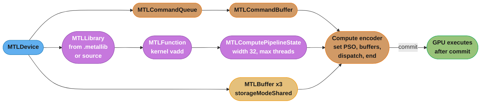
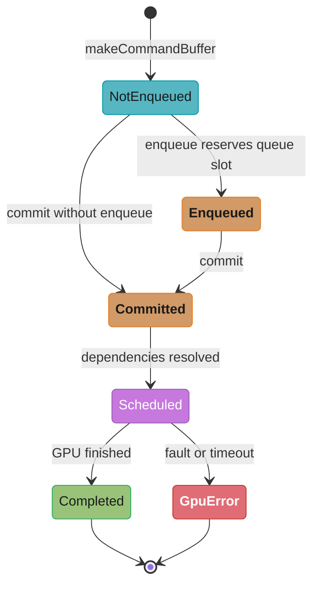
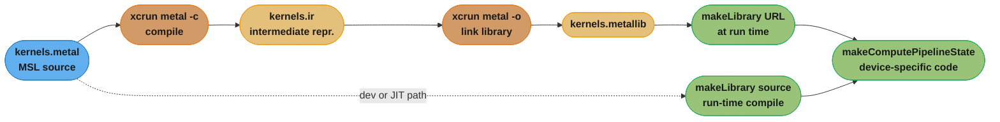
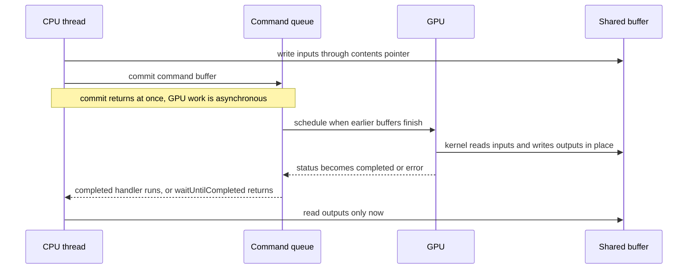

# Metal Compute Programming

> **Version anchor (fetched 2026-11-25):** Metal Shading Language Specification 4.1 (dated
> 2026-06-04): C++17-based since Metal 4; `-std=metal4.0` targets the OS 26 releases and
> `-std=metal4.1` the OS 27 releases; MSL 4.1 adds acquire/release memory orders on atomics and
> barriers and `atomic_float` add/sub in threadgroup memory. Metal 4 host types (`MTL4CommandQueue`,
> `MTL4CommandBuffer`, `MTL4ComputeCommandEncoder`, `MTL4CommandAllocator`, `MTL4ArgumentTable`,
> `MTLTensor`) are available from iOS 26 / macOS 26 on Apple7 (M1, A14) and later GPUs, per the
> Metal Feature Set Tables dated 2026-10-23. Limits used on this page: 1,024 threads and 32 KB
> threadgroup memory per threadgroup, 4 KB `setBytes`, 31 buffer slots, SIMD width 32
> (WWDC22 session 10159). Hardware context is in the Apple architecture module.

## 1. Concept Overview

Metal is Apple's only low-level GPU API, and compute is a first-class part of it. A compute
program has two halves. The **kernel** is written in the **Metal Shading Language (MSL)**, a
C++17-based language (C++14-based before Metal 4) with address-space qualifiers, built-in
vector types, SIMD-group functions and matrix types. The **host** side, in Swift or
Objective-C, creates a device, compiles the kernel into a **pipeline state**, allocates
**buffers**, records **dispatches** into a **command buffer** through a **compute command
encoder**, and **commits** that command buffer to a **command queue**.

The mapping to CUDA is close at the kernel level and different at the host level. A Metal
kernel looks like a CUDA kernel with attributes instead of built-in variables: `gid
[[thread_position_in_grid]]` instead of `blockIdx.x * blockDim.x + threadIdx.x`,
`threadgroup float tile[...]` instead of `__shared__`, `threadgroup_barrier(...)` instead of
`__syncthreads()`, `simd_shuffle_xor` instead of `__shfl_xor_sync`. The host model is not a
stream of launches, though: you record work into a command buffer object, and nothing runs
until you commit it. Work is ordered by the queue, synchronized by completion handlers, events
and fences, and errors surface on the command buffer's status, not as return codes.

Apple now ships two host programming models. **Metal 3** (the combined Metal 1, 2 and 3 API,
on every Apple GPU) uses `MTLCommandQueue`, transient `MTLCommandBuffer`s and per-encoder
`setBuffer` bindings with automatic hazard tracking. **Metal 4** (Apple7 and later, OS 26 and
later) adds `MTL4` types: reusable command buffers created from the device, command allocators,
argument tables, residency sets, explicit barriers because all resources are untracked, and
**tensors** with **Metal Performance Primitives** for matrix work on the GPU's Neural
Accelerators. Both models run on the same device and can be mixed during a migration.

This module teaches the programming model at kernel-author depth. The hardware facts it relies
on are in [Apple Silicon GPU Architecture](../apple_silicon_gpu_architecture/apple_silicon_gpu_architecture.md);
the CUDA concepts it maps onto are in
[CUDA Programming Model and Kernels](../cuda_programming_model_and_kernels/cuda_programming_model_and_kernels.md),
[Warp-Level Primitives and Cooperative Groups](../warp_level_primitives_and_cooperative_groups/warp_level_primitives_and_cooperative_groups.md)
and [Synchronization and Atomics](../synchronization_and_atomics/synchronization_and_atomics.md).
Framework-level paths (MPS, MLX, PyTorch MPS) are in
[Metal Performance Shaders, MLX and PyTorch MPS](../metal_performance_shaders_mlx_and_pytorch_mps/metal_performance_shaders_mlx_and_pytorch_mps.md).

---

## 2. Intuition

> **One-line analogy**: CUDA's host API is a phone call: each launch is dialed straight to the
> GPU's driver. Metal's is a letter: you write every instruction into an envelope (the command
> buffer), seal it (`endEncoding`), post it (`commit`), and the GPU reads it when it arrives. You
> learn the outcome from the reply (`completed` or `error`), not from the act of posting.

**Mental model**: Think in four nouns. A **pipeline state** is a compiled kernel plus its
launch limits. A **buffer** is bytes in unified memory. A **command buffer** is a recorded list
of passes. An **encoder** is the pen you record one pass with: bind pipeline, bind arguments,
dispatch, repeat, end. The queue orders command buffers; the GPU executes them asynchronously;
the CPU learns about completion through callbacks or events. Inside a kernel, think in three
scopes that each have their own sync primitive: the **SIMD-group** (32 threads; shuffles and
reductions with no barrier), the **threadgroup** (up to 1,024 threads; `threadgroup_barrier`),
and the **grid** (no in-kernel barrier; split into separate dispatches or use atomics).

**Why it matters**: The kernel half of a CUDA port translates almost line by line, so teams
underestimate the work. The bugs live in the other half: reading results before the command
buffer finishes, not checking `status` after a GPU fault, assuming automatic dependencies
between dispatches in a concurrent encoder or in Metal 4, trusting a NaN check under default
fast math. Every one of them compiles and passes a small test.

**Key insight**: Metal makes the CPU-GPU contract explicit where CUDA leaves it implicit.
There is no default stream that silently serializes everything and no `cudaMemcpy` that
silently synchronizes. That costs a few more lines of host code and buys predictable
overlap: you decide exactly where the CPU waits.

---

## 3. Core Principles

- **Record, then submit.** Nothing executes during encoding. `commit()` submits, and the GPU runs
  the command buffer asynchronously.
- **Completion is observed, never assumed.** Read results only after `waitUntilCompleted()`, a
  completed handler, or an `MTLSharedEvent` signal; then check `status` and `error`.
- **Command buffers on one queue run in queue order.** `enqueue()` reserves a slot, so worker
  threads can encode in parallel and commit in any order.
- **A default compute encoder is serial.** `makeComputeCommandEncoder()` dispatches serially;
  `.concurrent` lets dispatches overlap and makes you add `memoryBarrier` calls.
- **Metal 4 tracks nothing for you.** All resources are untracked; you add barriers between
  stages and make allocations resident with residency sets.
- **Every kernel argument has an address space.** `device`, `constant`, `threadgroup`, `thread`;
  the compiler enforces them and the hardware caches them differently.
- **Barriers are collective.** If any thread in a threadgroup executes `threadgroup_barrier`, all
  must; the same holds per SIMD-group for `simdgroup_barrier`.
- **SIMD-group functions need no barrier.** Data moves between the 32 lanes' registers directly.
- **The compiler defaults to fast math.** `-fmetal-math-mode` defaults to `fast`, which assumes no
  NaNs or INFs. Kernels that depend on IEEE edge cases must opt out.
- **Limits come from the pipeline.** `threadExecutionWidth` (32) and
  `maxTotalThreadsPerThreadgroup` are properties of the compiled kernel.

---

## 4. Types / Architectures / Strategies

### 4.1 The object model and its CUDA equivalents

| Metal object | Role | Closest CUDA concept |
|--------------|------|----------------------|
| `MTLDevice` | The GPU; factory for everything else | `cudaSetDevice` / device context |
| `MTLLibrary`, `MTLFunction` | Compiled MSL code and one kernel inside it | module (`cuModuleLoad`) and `CUfunction` |
| `MTLComputePipelineState` | Kernel compiled for this device, with its launch limits | `cudaFuncAttributes` plus the loaded kernel |
| `MTLBuffer` | Bytes in unified memory (`shared`, `private`) | `cudaMalloc` / `cudaMallocManaged` allocation |
| `MTLCommandQueue` | Ordered submission channel | stream |
| `MTLCommandBuffer` | Recorded, submit-once batch of passes | a captured sequence, loosely a CUDA graph launch |
| `MTLComputeCommandEncoder` | Records one compute pass | the sequence of `<<<>>>` launches in that pass |
| `MTLEvent`, `MTLSharedEvent`, `MTLFence` | GPU-GPU, GPU-CPU and intra-queue sync | `cudaEvent_t`, stream wait |
| `MTLHeap`, `MTLResidencySet` | Sub-allocation and residency control | memory pools |

### 4.2 Metal 3 vs Metal 4 host model

| Concern | Metal 3 model | Metal 4 model |
|---------|---------------|---------------|
| Queue | `MTLCommandQueue` (from `makeCommandQueue()`) | `MTL4CommandQueue` (from `makeMTL4CommandQueue()`) |
| Command buffer | Created from the queue, single use, has its own `commit()` | Created from the device, reusable via `beginCommandBuffer(allocator:)`, committed through the queue's `commit(_:options:)` |
| Encoding memory | Managed implicitly | `MTL4CommandAllocator`, reset per frame or batch |
| Compute, blit, acceleration-structure | Three encoder types | One `MTL4ComputeCommandEncoder` |
| Resource binding | `setBuffer(_:offset:index:)` per encoder | `MTL4ArgumentTable` (`setAddress(_:index:)`, `setResource(_:bufferIndex:)`) bound with `setArgumentTable(_:)` |
| Residency | `useResource` per encoder, or residency sets (macOS 15+) | Residency sets on the command buffer or queue |
| Hazards | Tracked by default for buffers | All resources untracked; `barrier(afterQueueStages:beforeStages:visibilityOptions:)` and fences |
| Retains | Command buffer retains resources by default | No strong references; you keep resources alive |
| ML | MPS, MPSGraph | Adds `MTLTensor`, MSL `tensor` types, Metal Performance Primitives, `MTL4MachineLearningCommandEncoder` |

### 4.3 MSL address spaces

| Address space | Scope and lifetime | Typical use | CUDA analogue |
|---------------|--------------------|-------------|---------------|
| `device` | All threads; buffer lifetime; read-write | Inputs and outputs | global memory pointer |
| `constant` | All threads; read-only | Small parameter blocks, lookup tables | `__constant__` / `const __restrict__` |
| `threadgroup` | One threadgroup; dispatch lifetime of that threadgroup | Tiles, partial reductions | `__shared__` |
| `thread` | One thread | Locals, registers | local / registers |
| `threadgroup_imageblock` | One tile's threadgroup | Tile shaders and imageblocks | no analogue |
| `ray_data`, `object_data` | Ray-tracing intersection and mesh/object stages | Specialized pipelines | no analogue |

From Apple7, the feature tables also list a **generic address space**, so a pointer need not
carry its address space in every signature.

### 4.4 Two ways to dispatch

| Method | You specify | Edge handling | Availability |
|--------|-------------|---------------|--------------|
| `dispatchThreads(_:threadsPerThreadgroup:)` | Exact grid size in threads | Metal makes partial edge threadgroups; no bounds check needed for the grid edge | Nonuniform threadgroup size, Apple4+ |
| `dispatchThreadgroups(_:threadsPerThreadgroup:)` | Number of whole threadgroups | Grid is rounded up; kernel must bounds-check | All |

Apple's documentation tells you to prefer `dispatchThreads` on Apple4 and later.

### 4.5 Synchronization toolbox

| Scope | Primitive | Notes |
|-------|-----------|-------|
| SIMD-group | `simdgroup_barrier(mem_flags)`, SIMD-group functions | Most SIMD-group exchange needs no barrier at all |
| Threadgroup | `threadgroup_barrier(mem_flags)` | Execution and memory barrier; `mem_threadgroup`, `mem_device`, `mem_texture`, `mem_none` |
| Memory ordering | `atomic_thread_fence(flags, order, scope)` (MSL 3.2+), memory orders on atomics and barriers (MSL 4.1) | `thread_scope_simdgroup`, `_threadgroup`, `_device` |
| Between dispatches, same encoder | Serial encoder ordering, or `memoryBarrier(scope:)` / `memoryBarrier(resources:)` in a concurrent encoder | |
| Between passes | Automatic for tracked resources in Metal 3; `MTLFence`; Metal 4 barriers | |
| Between command buffers or queues | `MTLEvent` (one device), `MTLSharedEvent` (CPU and other devices) | |
| CPU waits for GPU | `waitUntilCompleted()`, `addCompletedHandler(_:)`, `MTLSharedEvent.wait(untilSignaledValue:timeoutMS:)` | |

### 4.6 Matrix paths

| Path | Granularity | Types | When |
|------|-------------|-------|------|
| `simdgroup_matrix<T,8,8>` with `simdgroup_multiply_accumulate` | One SIMD-group, 8x8 tiles | `half`, `bfloat` (MSL 3.1+), `float` | Hand-written GEMM or attention on Apple7+, any OS with MSL 2.3+ |
| Metal 4 `tensor<...>` with Metal Performance Primitives `matmul2d` | Thread, one SIMD-group, or all SIMD-groups of a threadgroup | `char`, `half`, `float`; `bfloat` and `uchar` combos from OS 26.1 / 26.4; FP8, FP4, 2-bit and 4-bit integer formats in MSL 4.1 | New code on OS 26+; tuned for Apple silicon and drives the Neural Accelerators on M5-generation GPUs |
| MPS / MPSGraph | Whole operation | Framework-chosen | When you do not need a custom kernel |

The MSL 4.1 spec itself now says: "Instead of using simdgroup matrix multiplication, consider
using Tensors and Metal Performance Primitives."

---

## 5. Architecture Diagrams

### 5.1 Host objects for one compute pass (Metal 3 model)



Everything left of the encoder is created once and reused; only the command buffer and encoder
are created per submission in the Metal 3 model. Metal 4 also makes the command buffer reusable.

### 5.2 Command buffer lifecycle



These are the six `MTLCommandBufferStatus` values (`notEnqueued`, `enqueued`, `committed`,
`scheduled`, `completed`, `error`). Encoding happens only in `NotEnqueued` or `Enqueued`; the
CPU may read outputs only after `Completed`, and must check for `GpuError` because a GPU fault
does not throw on the host.

### 5.3 From source to pipeline state



Shipping apps precompile to a `.metallib` so the only run-time cost is pipeline creation;
compiling from source with `makeLibrary(source:options:)` is convenient for experiments and is
how `MTLCompileOptions` settings such as `mathMode` are applied at run time.

### 5.4 CPU, queue and GPU over one submission



The only arrow that copies data is none of them: the buffer is shared. The synchronization
arrows (completed handler, wait) are what make the final read safe.

### 5.5 How a 1D grid maps to threadgroups and SIMD-groups

```
  n = 1000 elements, threadsPerThreadgroup = 256 (8 SIMD-groups of 32)

  dispatchThreads(1000)                         dispatchThreadgroups(ceil(1000/256) = 4)
  ------------------------------------          ------------------------------------------
  TG0  threads    0-255   SG0..SG7 full          TG0  threads    0-255   SG0..SG7 full
  TG1  threads  256-511   SG0..SG7 full          TG1  threads  256-511   SG0..SG7 full
  TG2  threads  512-767   SG0..SG7 full          TG2  threads  512-767   SG0..SG7 full
  TG3  threads  768-999   232 threads:           TG3  threads  768-1023  256 threads:
       SG0..SG6 full (224), SG7 = 8 threads           24 threads have gid >= 1000
                                                      -> kernel MUST check gid < n
  total threads launched: 1000                   total threads launched: 1024
```

With `dispatchThreads`, the last threadgroup is partial and its last SIMD-group has 8 threads,
which is exactly the case the MSL spec describes ("the SIMD-group with the maximum index ...
may be smaller"). With `dispatchThreadgroups`, 24 extra threads run and read out of bounds
unless the kernel checks.

---

## 6. How It Works — Detailed Mechanics

### 6.1 Vector add, end to end (Metal 3 model, Swift host)

```swift
import Metal

let source = """
#include <metal_stdlib>
using namespace metal;

kernel void vadd(device const float* a [[buffer(0)]],
                 device const float* b [[buffer(1)]],
                 device float*       c [[buffer(2)]],
                 constant uint&      n [[buffer(3)]],
                 uint gid [[thread_position_in_grid]]) {
    if (gid < n) { c[gid] = a[gid] + b[gid]; }
}
"""

let device = MTLCreateSystemDefaultDevice()!
let library = try device.makeLibrary(source: source, options: nil)
let pso = try device.makeComputePipelineState(function: library.makeFunction(name: "vadd")!)
let queue = device.makeCommandQueue()!

let n = 1 << 24                                     // 16,777,216 floats = 64 MiB per buffer
let bytes = n * MemoryLayout<Float>.stride
let a = device.makeBuffer(length: bytes, options: .storageModeShared)!
let b = device.makeBuffer(length: bytes, options: .storageModeShared)!
let c = device.makeBuffer(length: bytes, options: .storageModeShared)!
let pa = a.contents().bindMemory(to: Float.self, capacity: n)
let pb = b.contents().bindMemory(to: Float.self, capacity: n)
for i in 0..<n { pa[i] = Float(i); pb[i] = 2 * Float(i) }

let cb = queue.makeCommandBuffer()!
let enc = cb.makeComputeCommandEncoder()!          // serial dispatch type by default
enc.setComputePipelineState(pso)
enc.setBuffer(a, offset: 0, index: 0)
enc.setBuffer(b, offset: 0, index: 1)
enc.setBuffer(c, offset: 0, index: 2)
var count = UInt32(n)
enc.setBytes(&count, length: MemoryLayout<UInt32>.stride, index: 3)   // up to 4 KB inline
let tgWidth = min(256, pso.maxTotalThreadsPerThreadgroup)              // 8 SIMD-groups
enc.dispatchThreads(MTLSize(width: n, height: 1, depth: 1),
                    threadsPerThreadgroup: MTLSize(width: tgWidth, height: 1, depth: 1))
enc.endEncoding()

cb.commit()
cb.waitUntilCompleted()
guard cb.status == .completed else {
    fatalError("GPU error: \(String(describing: cb.error))")
}
let pc = c.contents().bindMemory(to: Float.self, capacity: n)
print(pc[12_345])                                   // 37035.0 = 12345 + 24690
```

Three buffers of 64 MiB are 192 MiB of traffic, which at 153 GB/s (M5) is about 1.3 ms of pure
memory time and at 614 GB/s (M5 Max) about 0.33 ms: vector add is a bandwidth benchmark, not a
compute one, exactly as on CUDA.

### 6.2 Compiling offline

Apple's command-line flow compiles each source file to an intermediate representation, then
links a library:

```bash
xcrun -sdk macosx metal -std=metal4.1 -o reduce.ir -c reduce.metal
xcrun -sdk macosx metal -std=metal4.1 -o softmax.ir -c softmax.metal
xcrun -sdk macosx metal -o Kernels.metallib reduce.ir softmax.ir
# optional: bundle several .ir files into an archive first
xcrun -sdk macosx metal-ar -q Kernels.metalar reduce.ir softmax.ir
```

At run time load it with `device.makeLibrary(URL:)`, then build pipeline states. Apple's note
that "the Metal command-line tools for Windows use the same options" matters for teams that
build shader libraries on Windows CI.

### 6.3 Choosing threadgroup sizes

Apple's guidance: make the threadgroup a multiple of `threadExecutionWidth` and no larger than
`maxTotalThreadsPerThreadgroup`. For a 2D grid, Apple's own example uses width =
`threadExecutionWidth` and height = `maxTotalThreadsPerThreadgroup / width`:

```swift
let w = pso.threadExecutionWidth                   // 32
let h = pso.maxTotalThreadsPerThreadgroup / w      // 1024 / 32 = 32 if the kernel allows 1,024
let threadsPerThreadgroup = MTLSize(width: w, height: h, depth: 1)
let threadsPerGrid = MTLSize(width: image.width, height: image.height, depth: 1)
enc.dispatchThreads(threadsPerGrid, threadsPerThreadgroup: threadsPerThreadgroup)
```

For a 1920 x 1080 image with 32 x 32 threadgroups, `dispatchThreads` launches exactly 2,073,600
threads in 60 x 34 = 2,040 threadgroups, of which the bottom row is partial (1080 = 33 x 32 +
24). `dispatchThreadgroups` would launch 2,040 x 1,024 = 2,088,960 threads and 15,360 of them
must exit early.

### 6.4 SIMD-group functions: the CUDA warp-intrinsic map

| CUDA (sync variants) | MSL | Notes |
|----------------------|-----|-------|
| `__shfl_sync(m, v, lane)` | `simd_shuffle(v, lane)` | Lane need not be uniform |
| `__shfl_down_sync(m, v, d)` | `simd_shuffle_down(v, d)` | Upper `d` lanes keep their own value (no wrap) |
| `__shfl_up_sync(m, v, d)` | `simd_shuffle_up(v, d)` | |
| `__shfl_xor_sync(m, v, x)` | `simd_shuffle_xor(v, x)` | Integer or float scalars/vectors |
| (no direct analogue) | `simd_shuffle_rotate_down/up`, `simd_shuffle_and_fill_down/up` | Rotate wraps; fill takes values from a second operand |
| `__ballot_sync(m, p)` | `simd_ballot(p)` returning `simd_vote` (64-bit) | Mask bits 32-63 on 32-wide hardware |
| `__all_sync`, `__any_sync` | `simd_all`, `simd_any` | Active lanes only |
| `__reduce_add_sync` / CUB WarpReduce | `simd_sum`, `simd_product`, `simd_min`, `simd_max`, `simd_and`, `simd_or`, `simd_xor` | Result broadcast to all active lanes |
| CUB WarpScan | `simd_prefix_inclusive_sum`, `simd_prefix_exclusive_sum`, `..._product` | |
| `__activemask()` | `simd_active_threads_mask()` | Equivalent to `simd_ballot(true)` |
| `__syncwarp()` | `simdgroup_barrier(mem_flags)` | Rarely needed for register exchange |

There is no mask argument: MSL functions operate on the **active** threads of the SIMD-group.
SIMD-scoped permutes need Apple6 and reductions Apple7 per the feature tables.

### 6.5 A two-level reduction

```metal
#include <metal_stdlib>
using namespace metal;

// One partial per SIMD-group in threadgroup memory, then one atomic per threadgroup.
kernel void reduce_sum(device const float*  in      [[buffer(0)]],
                       device atomic_float* out     [[buffer(1)]],
                       constant uint&       n       [[buffer(2)]],
                       threadgroup float*   partial [[threadgroup(0)]],
                       uint gid  [[thread_position_in_grid]],
                       uint lane [[thread_index_in_simdgroup]],
                       uint sg   [[simdgroup_index_in_threadgroup]],
                       uint nsg  [[simdgroups_per_threadgroup]]) {
    float v = (gid < n) ? in[gid] : 0.0f;
    v = simd_sum(v);                               // 32 lanes -> 1, in registers
    if (lane == 0) { partial[sg] = v; }
    threadgroup_barrier(mem_flags::mem_threadgroup);
    if (sg == 0) {                                 // the whole SIMD-group 0 enters
        float t = (lane < nsg) ? partial[lane] : 0.0f;
        t = simd_sum(t);
        if (lane == 0) {
            atomic_fetch_add_explicit(out, t, memory_order_relaxed);
        }
    }
}
```

Host side: `enc.setThreadgroupMemoryLength(32 * MemoryLayout<Float>.stride, index: 0)` (128
bytes: one float for each of up to 32 SIMD-groups, and a multiple of 16 as the API requires).
For 2^24 inputs and 1,024-thread threadgroups this issues 16,384 atomics instead of 16.7
million, the same contention cut WWDC22 10159 describes ("one atomic per threadgroup"). Two
version facts apply: `atomic_float` add is supported in **device** memory from Metal 3, and in
**threadgroup** memory only from MSL 4.1. Float atomic order varies between runs, so the sum is
not bit-reproducible; see
[Parallel Patterns: Reduction, Scan, Histogram](../parallel_patterns_reduction_scan_histogram/parallel_patterns_reduction_scan_histogram.md)
for deterministic two-pass alternatives.

### 6.6 simdgroup_matrix: an 8x8 cooperative GEMM

```metal
#include <metal_stdlib>
#include <metal_simdgroup_matrix>
using namespace metal;

// C[M x N] = A[M x K] * B[K x N], row-major, M, N, K multiples of 8.
// One SIMD-group (32 threads) per threadgroup computes one 8x8 tile of C.
kernel void gemm_sg8(device const float* A   [[buffer(0)]],
                     device const float* B   [[buffer(1)]],
                     device float*       C   [[buffer(2)]],
                     constant uint3&     mnk [[buffer(3)]],
                     uint2 tg [[threadgroup_position_in_grid]]) {
    uint N = mnk.y, K = mnk.z;
    uint row = tg.y * 8, col = tg.x * 8;
    simdgroup_float8x8 acc = make_filled_simdgroup_matrix<float, 8, 8>(0.0f);
    simdgroup_float8x8 a, b;
    for (uint k = 0; k < K; k += 8) {
        simdgroup_load(a, A + row * K + k, K);     // elements_per_row = K
        simdgroup_load(b, B + k * N + col, N);
        simdgroup_multiply_accumulate(acc, a, b, acc);
    }
    simdgroup_store(acc, C + row * N + col, N);
}
```

Dispatch with `dispatchThreadgroups(MTLSize(width: N / 8, height: M / 8, depth: 1),
threadsPerThreadgroup: MTLSize(width: 32, height: 1, depth: 1))`. Three rules from the spec:
every operation must run under uniform control flow within the SIMD-group, the element-to-lane
mapping is unspecified (as with CUDA WMMA fragments, so per-element epilogues go through
memory), and the one-argument constructor `simdgroup_float8x8(x)` makes a **diagonal**
matrix, so zero-filling uses `make_filled_simdgroup_matrix`. A production kernel stages A and B
tiles in threadgroup memory and gives each SIMD-group a 2x2 or 4x4 grid of 8x8 accumulators;
compare the CUDA progression in
[Tensor Cores and Mixed Precision](../tensor_cores_and_mixed_precision/tensor_cores_and_mixed_precision.md).

### 6.7 Metal 4 tensors and Metal Performance Primitives

MSL 4 adds `tensor<ElementType, Extents, ...>`, a non-owning view with rank, extents and
strides, and `cooperative_tensor`, whose storage is partitioned across the threads of an
execution scope. Metal Performance Primitives (`<MetalPerformancePrimitives/MetalPerformancePrimitives.h>`,
namespace `mpp`) provides tuned tensor operations. This kernel is the spec's own `matmul2d`
example:

```metal
#include <metal_tensor>
#include <MetalPerformancePrimitives/MetalPerformancePrimitives.h>
using namespace metal;
using namespace mpp;

[[kernel]] void matrixMultiply(
    tensor<device half, dextents<int, 2>> a [[buffer(0)]],
    tensor<device half, dextents<int, 2>> b [[buffer(1)]],
    tensor<device half, dextents<int, 2>> c [[buffer(2)]],
    uint2 tgid [[threadgroup_position_in_grid]]) {
    // A matmul op for a threadgroup made of 4 SIMD-groups; each threadgroup owns a 64x32 tile.
    constexpr auto matmulDescriptor = tensor_ops::matmul2d_descriptor(64, 32, 0);
    tensor_ops::matmul2d<matmulDescriptor, execution_simdgroups<4>> matmulOp;

    auto mA = a.slice(0, tgid.y * 64);
    auto mB = b.slice(tgid.x * 32, 0);
    auto mC = c.slice(tgid.x * 32, tgid.y * 64);
    matmulOp.run(mA, mB, mC);                      // assumes C starts at zero
}
```

Launch it with 128 threads per threadgroup (4 SIMD-groups) and a grid of
`(N / 32, M / 64)` threadgroups. Details that matter in practice:

- `matmul2d_descriptor(M, N, K, transpose_left, transpose_right, relaxed_precision, mode)`;
  `relaxed_precision` lets the op truncate float mantissas, `mode::multiply_accumulate` makes it
  compute `C = A*B + C`.
- Execution scope is `execution_thread`, `execution_simdgroup` (N = 1) or
  `execution_simdgroups<N>` where N is 1 or the threadgroup's SIMD-group count; every thread in
  the scope must call `run`.
- If the op writes a tensor in `device` or `threadgroup` memory, insert the matching barrier
  (`threadgroup_barrier(mem_flags::mem_threadgroup)` or `simdgroup_barrier(...)`) before reading
  it; `cooperative_tensor` results need none.
- Supported (A, B, C) type combinations started with `char`, `half` and `float` in Metal 4, added
  `bfloat` combinations in OS 26.1 and `uchar` and 4-bit integer formats in OS 26.4, and FP8
  (`metal_fp8_e4m3_format`, `metal_fp8_e5m2_format`) and FP4 (`metal_fp4_e2m1_format`) in
  MSL 4.1.

On the host, tensors are `MTLTensor` resources created from a device (opaque, best-performing
layout) or over an existing `MTLBuffer` with explicit strides whose innermost stride is 1
(WWDC25 session 262); `MTLTensorUsage` is `.compute`, `.render` or `.machineLearning`.

### 6.8 The Metal 4 host flow

```swift
import Metal

// pso: a compiled MTLComputePipelineState; a, b, c: shared MTLBuffers.
let queue = device.makeMTL4CommandQueue()!
let allocator = device.makeCommandAllocator()!
let cmd = device.makeCommandBuffer()!                 // MTL4CommandBuffer, reusable

let tableDesc = MTL4ArgumentTableDescriptor()
tableDesc.maxBufferBindCount = 3
let table = try device.makeArgumentTable(descriptor: tableDesc)
table.setAddress(a.gpuAddress, index: 0)
table.setAddress(b.gpuAddress, index: 1)
table.setAddress(c.gpuAddress, index: 2)

let residency = try device.makeResidencySet(descriptor: MTLResidencySetDescriptor())
residency.addAllocations([a, b, c])
residency.commit()                                    // staged changes take effect here
queue.addResidencySet(residency)

cmd.beginCommandBuffer(allocator: allocator)
let enc = cmd.makeComputeCommandEncoder()!            // compute + blit + accel. structures
enc.setComputePipelineState(pso)
enc.setArgumentTable(table)
enc.dispatchThreads(threadsPerGrid: MTLSize(width: n, height: 1, depth: 1),
                    threadsPerThreadgroup: MTLSize(width: 256, height: 1, depth: 1))
enc.endEncoding()
cmd.endCommandBuffer()

let done = device.makeSharedEvent()!
queue.commit([cmd])
queue.signalEvent(done, value: 1)                     // after all prior work on this queue
_ = done.wait(untilSignaledValue: 1, timeoutMS: 5_000)
allocator.reset()                                     // reuse encoding memory next time
```

What changed from 6.1: the command buffer comes from the device and can be begun again; the
allocator owns encoding memory; bindings are GPU addresses in an argument table (an index at or
above `maxBufferBindCount` is an error); residency is declared once for the queue; and because
Metal 4 does not retain or track resources, keeping `a`, `b`, `c` alive and adding barriers
between dependent passes is your job.

### 6.9 Specializing kernels with function constants

```metal
constant bool kHasBias [[function_constant(0)]];

kernel void linear(device const half* x [[buffer(0)]],
                   device const half* w [[buffer(1)]],
                   device const half* bias [[buffer(2), function_constant(kHasBias)]],
                   device half* y [[buffer(3)]],
                   uint gid [[thread_position_in_grid]]) {
    float acc = 0.0f;
    // ... dot product ...
    if (kHasBias) { acc += float(bias[gid]); }     // folded away when false
    y[gid] = half(acc);
}
```

```swift
let values = MTLFunctionConstantValues()
var hasBias = true
values.setConstantValue(&hasBias, type: .bool, index: 0)
let fn = try library.makeFunction(name: "linear", constantValues: values)
```

One source, many pipelines: the compiler removes dead branches per specialization, which is the
Metal equivalent of instantiating a C++ template per configuration.

### 6.10 Floating-point math mode

The MSL compiler's `-fmetal-math-mode` defaults to `fast`, which lets the compiler assume no
NaNs, no INFs and no signed zeros, use reciprocals and reassociate. `relaxed` keeps the
reassociation but honors INFs and NaNs; `safe` disables value-changing transformations. At run
time the same choice is `MTLCompileOptions.mathMode` (`.fast`, `.relaxed`, `.safe`, macOS 15 /
iOS 18 and later), which replaces the older `fastMathEnabled` Boolean (default `true`).
Softmax with masked `-inf` logits, NaN-propagation checks and Kahan summation are the kernels
that need `relaxed` or `safe`.

### 6.11 Acquire and release (MSL 4.1)

Before MSL 4.1, atomic read-modify-write operations accepted only `memory_order_relaxed`, and
ordering came from barriers and (since MSL 3.2) `atomic_thread_fence`. MSL 4.1 adds
`memory_order_acquire`, `memory_order_release` and `memory_order_acq_rel` to atomics,
`threadgroup_barrier` and `simdgroup_barrier`, plus a `thread_scope` argument; the feature
tables list acquire/release atomics from Apple7. That makes the CUDA "last block finishes the
reduction" pattern expressible directly:

```metal
// Runs on one thread per threadgroup (for example lane 0 of SIMD-group 0), MSL 4.1 only.
// Writer: publish this threadgroup's partial, then increment the counter with release semantics.
partials[tgid] = my_partial;
uint ticket = atomic_fetch_add_explicit(done_count, 1u, memory_order_acq_rel);
if (ticket == num_groups - 1) {
    // Acquire side: every other group's partials[] write is now visible to this thread.
    float total = 0.0f;
    for (uint i = 0; i < num_groups; ++i) { total += partials[i]; }
    *result = total;
}
```

On earlier language versions, end the kernel and run a second dispatch instead; dispatch
boundaries in a serial encoder order device-memory writes.

---

## 7. Real-World Examples

- **llama.cpp's Metal backend** (`ggml/src/ggml-metal`) is a large, public body of hand-written
  MSL for quantized matrix-vector and attention kernels, dispatched from an Objective-C host
  layer; it is the best open reference for production Metal compute code.
- **Apple's "Customizing a PyTorch operation" sample** (WWDC23 session 10050) shows a custom
  Metal kernel wired into PyTorch as an operation, which is the path to take when an op is
  missing or slow in the MPS backend.
- **Metal 4 machine learning** (WWDC25 session 262): Apple's example frame runs vertex skinning
  in a compute pass, rasterizes, then upscales with a neural network on the same GPU timeline
  through `MTL4MachineLearningCommandEncoder`, and uses Shader ML (tensors in shaders) for
  neural texture decompression it says reaches 50% of the block-compressed footprint.
- **MLX** lets Python users JIT a custom Metal kernel (`mx.fast.metal_kernel`); see
  [Metal Performance Shaders, MLX and PyTorch MPS](../metal_performance_shaders_mlx_and_pytorch_mps/metal_performance_shaders_mlx_and_pytorch_mps.md).
- **Cross-vendor kernels**: the same fused kernel written in CUDA, HIP and MSL is the subject of
  [Ship One Kernel Across NVIDIA, AMD and Apple](../case_studies/ship_one_kernel_across_nvidia_amd_and_apple.md).

---

## 8. Tradeoffs

### 8.1 Dispatch and encoder choices

| Choice | Pros | Cons |
|--------|------|------|
| `dispatchThreads` | Exact grid, no bounds-check branch for grid edges | Needs Apple4+ (every current device) |
| `dispatchThreadgroups` | Explicit control of threadgroup count | Extra threads; kernel must bounds-check |
| Serial compute encoder (default) | Dispatches see each other's writes in order | No overlap between independent dispatches |
| Concurrent compute encoder | Independent dispatches overlap | You add `memoryBarrier` for every dependency |
| One big command buffer | Fewer commits, less CPU overhead | Coarser completion signal, longer error blast radius |
| Many small command buffers | Fine-grained progress and error isolation | More CPU submission overhead |

### 8.2 Metal 3 vs Metal 4 for compute

| Dimension | Metal 3 model | Metal 4 model |
|-----------|---------------|---------------|
| Hardware | All Apple GPUs (and Macs back to macOS 13 for Metal 3) | Apple7+ on OS 26+ |
| CPU overhead per pass | Higher: per-encoder bindings, tracked hazards, retains | Lower: argument tables, residency sets, no tracking |
| Correctness burden | Metal tracks buffer hazards | You write barriers and keep resources alive |
| ML integration | MPS / MPSGraph alongside | Tensors, MPP, ML encoder on the GPU timeline |
| Migration | n/a | Per queue: both models coexist, synchronized with `MTLEvent` |

### 8.3 Matrix implementations

| Option | Effort | Portability across Apple GPUs | Peak on M5 generation |
|--------|--------|-------------------------------|------------------------|
| Scalar MSL loops | Low | All | Lowest |
| `simdgroup_matrix` 8x8 | Medium | Apple7+ | Good, but Apple now points to tensors |
| MPP `matmul2d` on tensors | Medium | Metal 4 devices (Apple7+) | Tuned by Apple; drives Neural Accelerators |
| MPS / MPSGraph | Lowest | All | Tuned by Apple; no custom fusion |

---

## 9. When to Use / When NOT to Use

**Write a custom Metal kernel when:**
- An operation is missing or slow in MPS, MLX or PyTorch's MPS backend.
- You need fusion (dequantize + matmul, softmax + scale + mask) to cut memory traffic.
- You ship on Apple devices and want no framework dependency in the hot path.

**Prefer Metal 4 when:**
- Targets are OS 26+ on Apple7+ and CPU encoding overhead matters, or you need tensors, MPP or
  ML passes on the GPU timeline.

**Stay on the Metal 3 model when:**
- You must support older OS versions, or the code relies on automatic hazard tracking and the
  team cannot yet own barriers.

**Do not write Metal kernels when:**
- The op is a standard GEMM, convolution or reduction that MPS or MPSGraph already tunes.
- The code must also run on non-Apple GPUs and a portable layer is acceptable; see
  [GPU Portability: HIP, SYCL and Beyond](../gpu_portability_hip_sycl_and_beyond/gpu_portability_hip_sycl_and_beyond.md)
  and [Vulkan Compute Fundamentals](../vulkan_compute_fundamentals/vulkan_compute_fundamentals.md).

---

## 10. Common Pitfalls

### 10.1 Reading a shared buffer before the GPU finishes

```swift
// BROKEN: commit() only submits. The loop reads whatever is in memory right now:
// zeros, stale data from the last run, or a half-written result.
cb.commit()
let out = c.contents().bindMemory(to: Float.self, capacity: n)
print(out[0])
```

```swift
// FIX: wait (or use a completed handler / shared event), then check status.
cb.addCompletedHandler { buffer in
    guard buffer.status == .completed else {
        print("GPU error:", buffer.error as Any)
        return
    }
    let out = c.contents().bindMemory(to: Float.self, capacity: n)
    print(out[0])
}
cb.commit()
```

This bug is invisible in a debugger, because breakpoints give the GPU time to finish. It shows
up in production as results that are right "most of the time".

### 10.2 A barrier inside divergent control flow

```metal
// BROKEN: only SIMD-group 0 reaches the barrier. The spec requires every thread of the
// threadgroup to execute it if any thread does. Result: undefined behavior (hang or garbage).
if (sg == 0) {
    float t = simd_sum(lane < nsg ? partial[lane] : 0.0f);
    threadgroup_barrier(mem_flags::mem_threadgroup);
    if (lane == 0) { partial[0] = t; }
}
```

```metal
// FIX: hoist the barrier to uniform control flow; keep only divergent work in the branch.
threadgroup_barrier(mem_flags::mem_threadgroup);
if (sg == 0) {
    float t = simd_sum(lane < nsg ? partial[lane] : 0.0f);
    if (lane == 0) { partial[0] = t; }
}
```

### 10.3 dispatchThreadgroups without a bounds check

```metal
// BROKEN: grid rounded up to whole threadgroups. For n = 1000 and 256-thread groups,
// threads 1000-1023 read and write past the end of the buffers.
kernel void scale(device float* x [[buffer(0)]], constant float& s [[buffer(1)]],
                  uint gid [[thread_position_in_grid]]) {
    x[gid] *= s;
}
```

```metal
// FIX: pass n and guard, or switch the host to dispatchThreads.
kernel void scale(device float* x [[buffer(0)]], constant float& s [[buffer(1)]],
                  constant uint& n [[buffer(2)]],
                  uint gid [[thread_position_in_grid]]) {
    if (gid < n) { x[gid] *= s; }
}
```

### 10.4 A NaN or INF check removed by default fast math

```metal
// BROKEN: under the default -fmetal-math-mode=fast the compiler may assume no INFs or NaNs,
// so this guard for fully masked rows (all -inf logits) can be optimized away and the row
// produces NaN instead of zeros.
if (isinf(row_max)) { out[i] = 0.0h; return; }
```

```swift
// FIX: compile this pipeline with a math mode that honors INF and NaN.
let opts = MTLCompileOptions()
opts.mathMode = .relaxed            // keeps fast reassociation, honors INF and NaN
let lib = try device.makeLibrary(source: softmaxSource, options: opts)
```

Or build offline with `-fmetal-math-mode=relaxed` (or `safe`) for that file only, so the rest of
the library keeps full fast math.

### 10.5 A "zeroed" accumulator that is a diagonal matrix

```metal
// BROKEN: the one-scalar constructor creates a DIAGONAL matrix, not a filled one.
// With 0.0f this happens to be all zeros; with a bias of 1.0f it adds the identity.
simdgroup_float8x8 acc(1.0f);
```

```metal
// FIX: fill every element explicitly.
simdgroup_float8x8 acc = make_filled_simdgroup_matrix<float, 8, 8>(1.0f);
```

### 10.6 Assuming a concurrent encoder orders dependent dispatches

The typical failure: a pipeline switches to `makeComputeCommandEncoder(dispatchType: .concurrent)`
for a small speedup, and some fraction of runs now produce one corrupted layer output, because
the dispatch that consumes a buffer can overlap the dispatch that produces it. Nothing errors;
the race only shows in output checks. WWDC22 10159 is explicit that with
`MTLDispatchTypeConcurrent`, "barriers must be put in manually". Add
`enc.memoryBarrier(resources: [producedBuffer])` between producer and consumer, or keep that
pair in a serial encoder.

---

## 11. Technologies & Tools

| Tool | Purpose | Notes |
|------|---------|-------|
| Metal framework | Host API (Metal 3 and Metal 4 models) | Swift and Objective-C |
| Metal Shading Language | Kernel language | Spec 4.1, 2026-06-04 |
| `xcrun metal`, `metal-ar` | Offline compile to IR, archive, link to `.metallib` | Also shipped as Windows command-line tools |
| `MTLCompileOptions` | Run-time compile settings | `mathMode`, language version |
| Metal Performance Primitives | Tensor ops in MSL (`matmul2d`, `convolution2d`) | Metal 4 |
| Metal Performance Shaders / MPSGraph | Library kernels and graph runtime | No custom kernel needed |
| Xcode Metal debugger and shader profiler | Inspect dispatches, per-line cost, validation | See [Metal Profiling and Debugging](../metal_profiling_and_debugging/metal_profiling_and_debugging.md) |
| Metal API and shader validation | Catch binding, bounds and barrier misuse in development | Enable in the scheme |
| MLX `mx.fast.metal_kernel` | JIT custom MSL from Python | Covered in the MPS/MLX module |

---

## 12. Interview Questions with Answers

**Q: Why does reading a shared MTLBuffer right after commit() return stale or partial results?**
**Short:** commit() only submits the command buffer; the GPU runs it asynchronously, so the CPU must wait for completion through waitUntilCompleted, a completed handler or a shared event first.

Encoding records commands and `commit()` hands the command buffer to the queue; neither waits
for execution. A shared buffer is the same memory for both processors, so an immediate read
sees whatever is there at that instant. Wait with `waitUntilCompleted()` (blocking), register
`addCompletedHandler(_:)` before committing (asynchronous), or signal an `MTLSharedEvent` and
wait on it. Then check `status == .completed` before trusting the data.

**Q: Why does a GPU fault in a Metal kernel not throw an exception on the host?**
**Short:** Execution errors surface on the command buffer: its status becomes .error and its error property describes the fault, so code must check them after waiting or in the completed handler.

Submission and execution are decoupled, so there is no call that could throw at the moment the
GPU faults. `MTLCommandBufferStatus` ends in either `completed` or `error`, and `error` holds
the description. Code that only calls `waitUntilCompleted()` and then reads outputs will
consume garbage silently. Make the status check part of every completion path, and enable
Metal API and shader validation in development to catch out-of-bounds access before it faults.

**Q: What happens when threadgroup_barrier sits inside a branch that only some threads take?**
**Short:** Undefined behavior: the MSL spec requires that if any thread in a threadgroup executes the barrier, all of them must, so a divergent barrier can hang the GPU or corrupt data.

The spec states the rule for conditionals and for each loop iteration: if any thread enters
and executes the barrier, all threads must. It also notes that on Apple silicon a thread that
has already ended no longer participates or blocks the others, which makes early-`return`
patterns legal but does not make a barrier inside `if (sg == 0)` legal. Hoist barriers to
uniform control flow and keep only the divergent work inside the branch, exactly as with
`__syncthreads()` on CUDA.

**Q: Why can a kernel that checks for NaN or infinity silently stop working in Metal?**
**Short:** The Metal compiler defaults to fast math, which assumes no NaNs or INFs and may delete isnan or isinf checks; compile such kernels with math mode relaxed or safe.

`-fmetal-math-mode` defaults to `fast`, and fast mode permits "no NaNs" and "no INFs"
assumptions, reciprocal substitution and reassociation. A guard like `if (isinf(row_max))` is
then dead code to the optimizer. `relaxed` keeps most of the speed but honors INF and NaN;
`safe` turns off value-changing transformations. Set it per library with
`MTLCompileOptions.mathMode` or per file offline, so only the kernels that need IEEE edge cases
pay for them.

**Q: What is the difference between dispatchThreads and dispatchThreadgroups, and which needs a bounds check?**
**Short:** dispatchThreads takes the exact thread count and Metal builds partial edge threadgroups; dispatchThreadgroups launches whole threadgroups, rounding the grid up, so the kernel must bounds-check.

`dispatchThreads` needs nonuniform threadgroup support (Apple4 and later, so every current
device) and Apple recommends it. For n = 1000 with 256-thread groups it launches exactly 1,000
threads, the last threadgroup holding 232. `dispatchThreadgroups` with 4 groups launches 1,024
threads, and threads 1,000 to 1,023 must exit early or they read and write out of bounds. The
kernel can read `[[threads_per_threadgroup]]` to see the actual (possibly partial) size.

**Q: Why does `simdgroup_float8x8 acc(0.0f)` look fine but `acc(1.0f)` break a GEMM?**
**Short:** The one-scalar constructor builds a diagonal matrix with that value on the diagonal, not a filled matrix; use make_filled_simdgroup_matrix to set every element.

The MSL spec lists `simdgroup_matrix<T,Cols,Rows>(T dval)` as "Creates a diagonal matrix with
the given value" and `make_filled_simdgroup_matrix(T value)` as the fill. With zero the two
coincide, so the bug hides until someone initializes the accumulator with a bias or a scale,
at which point only 8 of 64 elements get it. Always use the fill function for accumulators.

**Q: Can you use atomic_float add in threadgroup memory?**
**Short:** Only from MSL 4.1; earlier versions support atomic_float add and sub in device memory only, so threadgroup float accumulation used SIMD reductions or integer atomics instead.

`atomic_float` arrived with Metal 3, and the spec restricted float add and sub to device
memory; MSL 4.1 adds threadgroup support. The feature tables put floating-point atomics at
Apple7. For portable code, reduce with `simd_sum` into a threadgroup array and let one thread
issue the device atomic. Float atomics are also order-dependent, so results vary in the last
bits between runs.

**Q: What memory orders do Metal atomics and barriers support?**
**Short:** Before MSL 4.1 atomic read-modify-write operations took only memory_order_relaxed; MSL 4.1 adds acquire, release and acq_rel to atomics and barriers, on Apple7 and later GPUs.

The spec's `memory_order` enum lists relaxed, acquire, release, acq_rel and seq_cst, with the
middle three marked "Metal 4.1 and later". MSL 3.2 added `atomic_thread_fence` with a
`thread_scope` (simdgroup, threadgroup, device) for Apple silicon. Until 4.1, the
"last-threadgroup finishes the job" pattern needed a fence or a second dispatch; with 4.1 an
`acq_rel` ticket counter expresses it directly. Relaxed is still the right order for plain
counters and histograms.

**Q: How do the core Metal compute objects map to CUDA concepts?**
**Short:** MTLDevice is the device, MTLCommandQueue a stream, MTLCommandBuffer a recorded batch, the compute encoder records launches, MTLComputePipelineState a compiled kernel, MTLBuffer an allocation.

The pairs are close enough to port, with two differences. A command buffer is recorded first
and submitted later, so it behaves more like a launched CUDA graph than like eager launches on
a stream. And a pipeline state bundles the compiled kernel with its launch limits
(`threadExecutionWidth`, `maxTotalThreadsPerThreadgroup`), which CUDA spreads across
`cudaFuncGetAttributes` and the occupancy API. Libraries (`MTLLibrary`) and functions
(`MTLFunction`) correspond to modules and kernel handles.

**Q: What are the lifecycle states of an MTLCommandBuffer?**
**Short:** notEnqueued, enqueued, committed, scheduled, then completed or error; enqueue reserves the queue position, commit submits, and only completed means outputs are safe to read.

A new command buffer is `notEnqueued` and accepts encoders. `enqueue()` reserves its place in
the queue's order, so several threads can encode buffers in parallel and commit in any order
while execution order stays fixed. `commit()` moves it to `committed`; once dependencies resolve
it is `scheduled`; it ends `completed` or `error`. `gpuStartTime` and `gpuEndTime` are 0 until it
finishes and give the GPU execution interval afterwards.

**Q: How is MSL compiled, and when does device-specific code get generated?**
**Short:** The metal tool compiles .metal files to an intermediate representation and links them into a .metallib; device code is produced when the app builds a pipeline state from an MTLFunction.

Offline: `xcrun metal -c` per source file, optionally `metal-ar` into an archive, then `xcrun
metal -o name.metallib` to link. At run time, `makeLibrary(URL:)` loads it and
`makeComputePipelineState(function:)` compiles for the actual GPU, which is the step to cache or
precompute (binary archives). `makeLibrary(source:options:)` compiles source at run time and is
where `MTLCompileOptions` such as `mathMode` apply. The split mirrors PTX-to-SASS on CUDA.

**Q: What address spaces does MSL have, and why must every pointer declare one?**
**Short:** device (read-write buffers), constant (read-only data), threadgroup (per-threadgroup shared memory) and thread (private), plus threadgroup_imageblock, ray_data and object_data for special stages.

The address space tells the compiler which memory and caches a pointer touches and what
synchronization applies: `threadgroup` data needs `threadgroup_barrier(mem_flags::mem_threadgroup)`,
device data `mem_device`. Overload resolution includes the address space, and kernel buffer
arguments must state it. `constant` suits small read-only parameter blocks; large read-only
arrays are usually `device const`. Apple7+ adds a generic address space for helper functions.

**Q: How do you write a two-level reduction in MSL?**
**Short:** Reduce 32 lanes in registers with simd_sum, write one partial per SIMD-group to threadgroup memory, barrier, reduce the partials with a second simd_sum, then do one atomic per threadgroup.

The first `simd_sum` needs no barrier because it exchanges registers within the SIMD-group. A
1,024-thread threadgroup has 32 SIMD-groups, so the partials array is 32 floats (128 bytes,
already a multiple of 16 for `setThreadgroupMemoryLength`). After `threadgroup_barrier`, SIMD-group
0 reduces the partials and lane 0 issues one `atomic_fetch_add_explicit`. That turns 2^24
device atomics into 16,384, the pattern WWDC22 10159 recommends for atomic contention.

**Q: How do serial and concurrent compute encoders differ?**
**Short:** makeComputeCommandEncoder() dispatches serially; the concurrent dispatch type lets dispatches overlap, and you must add memoryBarrier calls wherever one dispatch reads another's output.

The serial default gives the CUDA single-stream mental model: each dispatch sees the previous
one's writes. `makeComputeCommandEncoder(dispatchType: .concurrent)` removes those implicit
dependencies so independent dispatches can share the GPU, which helps when each dispatch is too
small to fill it. The price is manual ordering with `memoryBarrier(scope:)` or
`memoryBarrier(resources:)`, and missing one produces intermittent corruption, not an error.

**Q: What is simdgroup_matrix, and how does it compare with CUDA's WMMA fragments?**
**Short:** An 8x8 half, bfloat or float matrix spread across the 32 threads of a SIMD-group; simdgroup_multiply_accumulate computes d = a*b + c cooperatively, much like a WMMA fragment.

Declared in `<metal_simdgroup_matrix>` since MSL 2.3 and supported in hardware from Apple7, it
is loaded from and stored to threadgroup or device memory with an `elements_per_row` stride and
optional transpose. Like WMMA it needs uniform control flow, and like WMMA fragments its
element-to-thread mapping is unspecified, so per-element epilogues go through threadgroup
memory. The 8x8 shape is fixed, so larger tiles are grids of 8x8 accumulators.

**Q: What do Metal 4 tensors and Metal Performance Primitives add over simdgroup_matrix?**
**Short:** Tensors carry rank, extents and strides, and MPP's matmul2d runs an Apple-tuned GEMM at SIMD-group or threadgroup scope with more data types; Apple now recommends it over simdgroup matrix code.

`tensor<device half, dextents<int, 2>>` replaces raw pointers plus stride arithmetic, `slice`
selects a tile, and `matmul2d<descriptor, execution_simdgroups<4>>` performs `C = A*B (+ C)` with
transposes, relaxed precision and a growing list of formats (bfloat, uchar, int4, FP8, FP4).
`cooperative_tensor` keeps results in registers across the scope for fused epilogues. On M5-class
GPUs this is the documented way to drive the per-core Neural Accelerators directly.

**Q: What changes in the host API with Metal 4?**
**Short:** Command buffers come from the device and are reusable, allocators own encoding memory, argument tables hold bindings, residency sets make memory resident, and nothing is tracked, so you add barriers.

`makeMTL4CommandQueue()`, `makeCommandAllocator()` and `makeCommandBuffer()` live on the
device; you call `beginCommandBuffer(allocator:)`, encode, `endCommandBuffer()`, and commit an
array through the queue. One `MTL4ComputeCommandEncoder` covers compute, blit and
acceleration-structure work. Encoders have no `setBuffer`; an `MTL4ArgumentTable` holds GPU
addresses. Metal 4 treats all resources as untracked and does not retain them, so stage
barriers and object lifetimes are the app's responsibility.

**Q: How do you pass small constants to a kernel without allocating a buffer?**
**Short:** setBytes inlines up to 4 KB of data into the encoder's argument for that dispatch; anything larger or reused across dispatches belongs in an MTLBuffer.

`enc.setBytes(&params, length: MemoryLayout<Params>.stride, index: k)` copies the bytes at encode
time, so later changes to `params` on the CPU do not affect the recorded dispatch. The feature
tables cap inlined data at 4 KB on every family. In MSL, receive it as `constant Params& p
[[buffer(k)]]`. Above 4 KB, or when the same data feeds many dispatches, a shared buffer avoids
repeated copies.

**Q: How do you choose threadsPerThreadgroup for a Metal compute pipeline?**
**Short:** Use a multiple of threadExecutionWidth (32) no larger than the pipeline's maxTotalThreadsPerThreadgroup; for 2D, Apple's starting point is width = execution width and height = max / width.

Both values come from the compiled pipeline, and `maxTotalThreadsPerThreadgroup` can be below
1,024 for register-heavy kernels. Smaller threadgroups give the scheduler more flexibility;
larger ones amortize threadgroup-memory staging. Apple's rule of thumb is to use the smallest
multiple of the SIMD width that maps well to the workload, then confirm occupancy and limiters
in Xcode. A kernel can pin its size with `[[max_total_threads_per_threadgroup(N)]]` or, in
Metal 4, `[[required_threads_per_threadgroup(...)]]`.

**Q: What are function constants used for?**
**Short:** They specialize one MSL source at pipeline-creation time, so branches on a constant compile away, giving template-like variants without shipping a kernel per configuration.

Declare `constant bool kHasBias [[function_constant(0)]];`, set values with
`MTLFunctionConstantValues`, and create the function with `makeFunction(name:constantValues:)`.
Arguments can be conditional (`[[buffer(2), function_constant(kHasBias)]]`), so an unused bias
buffer need not be bound. The cost is one pipeline per specialization, so cache pipelines by
constant set and precompile the common ones.

**Q: What does setThreadgroupMemoryLength require, and what happens if allocations exceed the device limit?**
**Short:** The length must be a multiple of 16 bytes, and static plus dynamic threadgroup memory together must stay within the device limit (32 KB on current GPUs); over-allocation is invalid usage.

Apple's documentation for `setThreadgroupMemoryLength(_:index:)` requires a multiple of 16 and
says the sum of all threadgroup allocations "can't exceed the device limits", which you read
from `maxThreadgroupMemoryLength`, with the static part on the pipeline's
`staticThreadgroupMemoryLength`. Validate the sum on the host before dispatching and run with
Metal API validation enabled in development so misuse is reported where it happens.

**Q: How do you synchronize work across two command queues or with the CPU?**
**Short:** Use MTLEvent for GPU-to-GPU ordering on one device and MTLSharedEvent across the CPU, other devices and processes; the producer signals a value and the consumer waits for it.

Within one queue, order is automatic. Across queues, encode a signal on the producer's command
buffer (or call `signalEvent(_:value:)` on an `MTL4CommandQueue`) and a wait on the consumer.
`MTLSharedEvent` adds CPU-side `wait(untilSignaledValue:timeoutMS:)` and `notify(_:atValue:block:)`.
Events also bridge Metal 3 and Metal 4 queues during an incremental migration, which Apple
documents as the supported coexistence path.

---

## 13. Best Practices

1. **Check `status` on every completion path** and log `error`; never read outputs on an
   unchecked command buffer.
2. **Prefer `dispatchThreads`** and still pass `n` for kernels that index more than one element
   per thread.
3. **Size threadgroups from the pipeline**: multiples of `threadExecutionWidth`, at most
   `maxTotalThreadsPerThreadgroup`.
4. **Reduce in registers first** (`simd_sum`, `simd_max`), then threadgroup memory, then one
   atomic per threadgroup.
5. **Keep barriers in uniform control flow**; put divergence inside, never around, them.
6. **Opt specific kernels out of fast math** (`relaxed` or `safe`) when they depend on INF, NaN
   or summation order; leave the rest fast.
7. **Precompile `.metallib`s** and cache pipeline states; compile from source only in
   development or for genuine JIT needs.
8. **Use function constants** instead of copy-pasted kernel variants.
9. **For matrix work on OS 26+, start from MPP `matmul2d`** before hand-rolling `simdgroup_matrix`.
10. **In Metal 4, own lifetimes and barriers explicitly**: keep resources referenced until the
    shared event fires, and add a barrier between every producer and consumer stage.
11. **Run with Metal API and shader validation** in CI builds of tests.

---

## 14. Case Study

**Scenario.** A team ports a CUDA row-softmax kernel used for attention scores to Metal on an
M5 Max (40-core GPU, 614 GB/s). Input: 4,096 rows of 4,096 FP16 logits (32 MiB), output the same
size, so 64 MiB of traffic and a bandwidth floor of about 0.11 ms. Masked positions are
`-inf`; fully masked rows must output zeros. The CUDA kernel used one 256-thread block per
row, warp shuffles, and a shared-memory exchange between the 8 warps.

**The port, first pass.** `__shfl_xor_sync` loops became `simd_max` / `simd_sum`, `__shared__`
became a `threadgroup` array, `__syncthreads()` became `threadgroup_barrier`. It compiled on the
first try and passed unit tests on random data. In integration it failed two ways: fully
masked rows produced NaN, and roughly 1 dispatch in 300 hung the GPU, which surfaced as a
command buffer ending in `.error` that the host never checked, so the next layer consumed
garbage.

```metal
// BROKEN (excerpt): two defects.
// 1. The barrier sits inside "if (sg == 0)": divergent, undefined behavior (the hang).
// 2. The isinf guard relies on IEEE INF, but the library is built with default fast math,
//    which may assume no INFs and drop the guard (the NaN rows).
if (sg == 0) {
    float m = simd_max(lane < nsg ? scratch[lane] : -INFINITY);
    threadgroup_barrier(mem_flags::mem_threadgroup);
    if (lane == 0) { scratch[0] = m; }
}
float row_max = scratch[0];
if (isinf(row_max)) { /* fully masked */ for (uint c = tid; c < cols; c += tpg) yr[c] = 0.0h; return; }
```

```metal
// FIX: uniform barriers, and a finite sentinel instead of relying on INF semantics.
#include <metal_stdlib>
using namespace metal;

kernel void softmax_rows(device const half* x       [[buffer(0)]],
                         device half*       y       [[buffer(1)]],
                         constant uint&     cols    [[buffer(2)]],
                         threadgroup float* scratch [[threadgroup(0)]],   // one per SIMD-group
                         uint row  [[threadgroup_position_in_grid]],
                         uint tid  [[thread_index_in_threadgroup]],
                         uint tpg  [[threads_per_threadgroup]],
                         uint lane [[thread_index_in_simdgroup]],
                         uint sg   [[simdgroup_index_in_threadgroup]],
                         uint nsg  [[simdgroups_per_threadgroup]]) {
    device const half* xr = x + row * cols;
    device half*       yr = y + row * cols;

    // 1. Row max. -MAXFLOAT is finite, so fast math cannot reason it away.
    float m = -MAXFLOAT;
    for (uint c = tid; c < cols; c += tpg) { m = max(m, float(xr[c])); }
    m = simd_max(m);
    if (lane == 0) { scratch[sg] = m; }
    threadgroup_barrier(mem_flags::mem_threadgroup);          // every thread reaches it
    m = simd_max(lane < nsg ? scratch[lane] : -MAXFLOAT);
    threadgroup_barrier(mem_flags::mem_threadgroup);          // scratch is reused below

    // A fully masked row has every logit at or below the sentinel: write zeros.
    bool masked = (m <= -MAXFLOAT);

    // 2. Sum of exponentials.
    float s = 0.0f;
    if (!masked) {
        for (uint c = tid; c < cols; c += tpg) { s += exp(float(xr[c]) - m); }
    }
    s = simd_sum(s);
    if (lane == 0) { scratch[sg] = s; }
    threadgroup_barrier(mem_flags::mem_threadgroup);
    s = simd_sum(lane < nsg ? scratch[lane] : 0.0f);

    // 3. Normalize and store.
    float inv = masked ? 0.0f : 1.0f / s;
    for (uint c = tid; c < cols; c += tpg) {
        yr[c] = masked ? 0.0h : half(exp(float(xr[c]) - m) * inv);
    }
}
```

The masked-row branch is uniform across the threadgroup (every thread computes the same `m`),
so no barrier ends up in divergent control flow. The host side gained two lines:

```swift
// FIX (host): fail loudly instead of passing garbage to the next layer.
cb.addCompletedHandler { buffer in
    if buffer.status != .completed {
        metrics.increment("gpu.command_buffer.error")
        log.error("softmax dispatch failed: \(String(describing: buffer.error))")
    }
}
// Upstream producers now write -MAXFLOAT (not -inf) for masked logits, and the library that
// still contains isinf-based kernels is compiled with mathMode = .relaxed.
```

**Launch shape.** One threadgroup per row: `dispatchThreadgroups(MTLSize(width: 4096, height: 1,
depth: 1), threadsPerThreadgroup: MTLSize(width: 256, height: 1, depth: 1))` and
`setThreadgroupMemoryLength(32, index: 0)` (8 floats for 8 SIMD-groups, rounded up to a
multiple of 16). That is 4,096 x 256 = 1,048,576 threads, far above the 41K-82K an M5 Max needs
resident.

**Result (team-measured; the method, not the exact numbers, is the lesson).**

| Build | Correct on masked rows | Hangs per 10,000 runs | Time per 4,096 x 4,096 softmax | Share of 0.11 ms floor |
|-------|------------------------|-----------------------|-------------------------------|-------------------------|
| First port | No (NaN rows) | about 33 | 0.31 ms when it completed | 35% |
| Uniform barriers, finite sentinel | Yes | 0 | 0.29 ms | 38% |
| Plus `half4` vector loads, reading each row once into registers for both passes | Yes | 0 | 0.17 ms | 65% |

**Lessons.** Every line of the kernel had a one-to-one CUDA equivalent, and the two production
defects were still Metal-specific: the compiler's default fast math, and an error channel
(`status`) that only exists if you read it. The barrier bug would have been undefined on CUDA
too; Metal made it visible as a GPU error, which the team then learned to observe. The same
kernel, written once more for HIP and once for Vulkan, is compared in
[Ship One Kernel Across NVIDIA, AMD and Apple](../case_studies/ship_one_kernel_across_nvidia_amd_and_apple.md).
