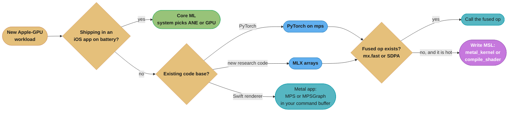
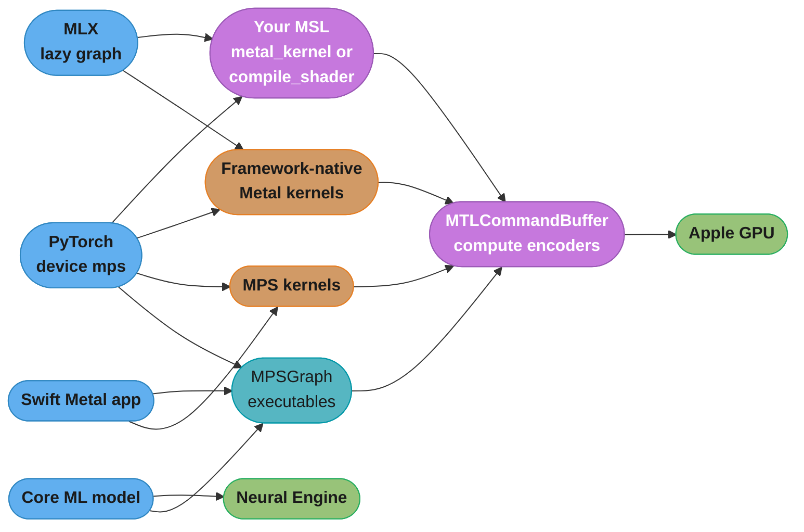
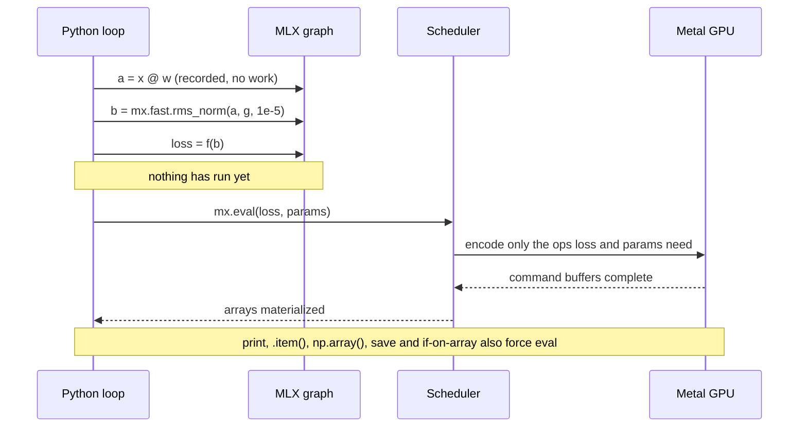
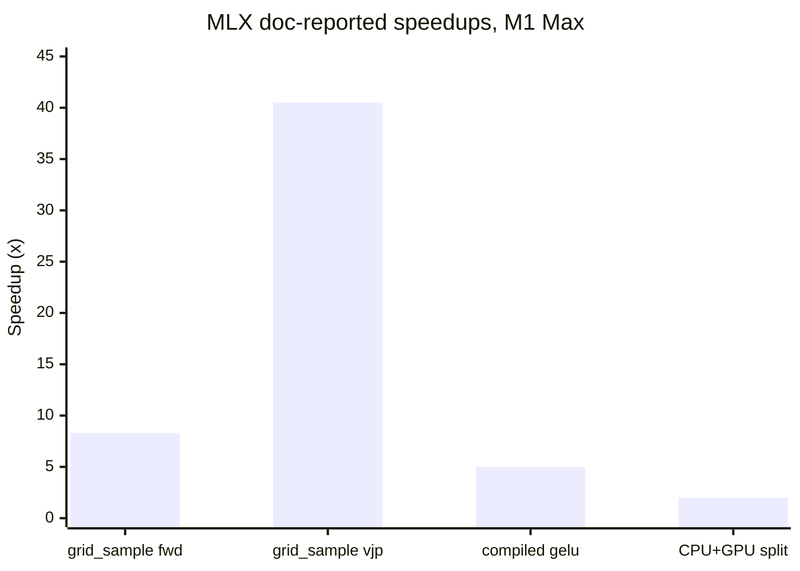

# Metal Performance Shaders, MLX and PyTorch MPS

> **Version anchor (fetched 2026-11-25):** MLX v0.32.5 (GitHub release, 2026-11-25); PyTorch 2.15.0 (2026-10-28), whose MPS backend requires macOS 15.0+ and has no `float64`; coremltools 9.0 (2025-11-10). Metal Performance Shaders ships since macOS 10.13 / iOS 9; MPSGraph since macOS 11 / iOS 14; MPSGraph `scaledDotProductAttention` and lookup-table `dequantize` since macOS 15 / iOS 18; Metal 4 `MTL4MachineLearningCommandEncoder` since macOS 26 / iOS 26.

## 1. Concept Overview

Raw Metal ([Metal Compute Programming](../metal_compute_programming/metal_compute_programming.md)) gives you a device, a command queue, command buffers and compute encoders, and you write every kernel in the Metal Shading Language (MSL). Almost nobody ships ML on Apple silicon that way. Between your model code and the GPU sit four layers that each own a different slice of the problem, and a kernel author has to know which layer is generating the Metal work before tuning anything:

| Layer | What it is | Closest CUDA-world analogue |
|-------|-----------|-----------------------------|
| **Metal Performance Shaders (MPS)** | Apple's library of hand-tuned compute and graphics kernels (`MPSKernel` subclasses such as `MPSMatrixMultiplication`), "fine-tuned for the unique characteristics of each Metal GPU family", encoded into your own `MTLCommandBuffer` | cuBLAS / cuDNN / NPP |
| **MPSGraph** (Metal Performance Shaders Graph) | A symbolic compute graph of tensors and operations that you compile into an `MPSGraphExecutable` and run; Apple's framework abstract says it can use the GPU, CPU and Neural Engine; executables serialize to `.mpsgraphpackage` | A graph compiler such as TensorRT or XLA |
| **MLX** | Apple's open-source array framework: lazy evaluation, arrays in unified memory, composable `grad`/`vmap`/`compile`, fused `mx.fast.*` ops and a JIT escape hatch `mx.fast.metal_kernel` for your own MSL | JAX-style transforms plus CuPy `RawKernel` |
| **PyTorch MPS backend** | `torch.device("mps")`: PyTorch's documentation says it maps graphs and primitives onto MPSGraph and MPS kernels; PyTorch 2.15 moved more ops to native Metal kernels and exposes `torch.mps.compile_shader` for your own MSL | The CUDA backend of PyTorch plus `load_inline` |

A fifth path, **Core ML**, is a hand-off rather than a layer you program: you convert a model with `coremltools` and the system picks CPU, GPU or Apple Neural Engine (ANE) per your `MLComputeUnits` choice. Metal 4 adds a sixth seam, the machine-learning pass, which runs a Core ML model inside a Metal command buffer next to your own compute work.

This module is the kernel author's view of those layers: what each one dispatches, where its fixed costs hide, how to drop from a framework op to your own MSL kernel (`mx.fast.metal_kernel`, `torch.mps.compile_shader`, an MLX C++ `Primitive`), and what breaks when CUDA habits are carried over. The hardware underneath (unified memory, SIMD-groups, threadgroup memory) is in [Apple Silicon GPU Architecture](../apple_silicon_gpu_architecture/apple_silicon_gpu_architecture.md); how to see what these layers actually submitted is in [Metal Profiling and Debugging](../metal_profiling_and_debugging/metal_profiling_and_debugging.md).

**Not here.** Choosing MLX, `mlx-lm`, Core ML or llama.cpp as an on-device LLM runtime, and the Core-ML-versus-MLX energy argument, belong to [Small Language Models and Edge AI](../../llm/small_language_models_and_edge_ai/small_language_models_and_edge_ai.md). This page links there and covers only the programming and kernel angle. The full on-device LLM build is the [Run LLM Inference on Apple Silicon](../case_studies/run_llm_inference_on_apple_silicon.md) case study. CUDA-side Python tooling (CuPy, Numba, `torch.utils.cpp_extension`) is in [Python GPU Ecosystem](../python_gpu_ecosystem/python_gpu_ecosystem.md).

---

## 2. Intuition

> **One-line analogy**: MPS is a toolbox of finished power tools, MPSGraph is a workshop foreman who reads your whole blueprint and plans the cuts, MLX is a workbench where nothing is cut until you say "go" (`mx.eval`), and PyTorch MPS is an interpreter translating instructions written for a different workshop (CUDA) into this one.

**Mental model.** On a discrete NVIDIA GPU the expensive boundary is the PCIe link, so CUDA habits revolve around keeping data on the device. On Apple silicon the CPU and GPU share one physical memory pool, so that boundary mostly disappears; MLX's documentation states it directly: "Apple silicon has a unified memory architecture. The CPU and GPU have direct access to the same memory pool." What does *not* disappear is the cost of turning work into Metal commands: building a graph, compiling a pipeline, encoding a dispatch, committing a command buffer. Every layer on this page is a different strategy for amortizing that encode-and-dispatch cost: MPS pre-builds the kernels, MPSGraph compiles a whole graph once, MLX defers and batches work until an evaluation point, and PyTorch MPS caches graphs and kernels per op and shape.

**Why it matters.** The failure mode on Apple silicon is rarely "the GEMM is slow" (MPS and MLX GEMMs are tuned by Apple). It is "the GEMM is fast but most of the wall time is graph rebuilds, per-op command buffers, a silent CPU fallback, or an `eval` inside the inner loop." Those costs are invisible from Python unless you know which layer produced them.

**Key insight.** Pick the highest layer that expresses your computation, and drop exactly one layer when you need a fused op the layer above lacks. A custom MSL kernel through `mx.fast.metal_kernel` or `torch.mps.compile_shader` keeps the framework's memory management and scheduling and replaces only the arithmetic, the same trade CuPy's `RawKernel` makes on CUDA. The MLX documentation's own fused `grid_sample` example went from 55.7 ms to 6.7 ms on an M1 Max by doing exactly that.

---

## 3. Core Principles

- **The memory is shared; the allocators are not always.** MLX arrays have no device: "rather than moving arrays to devices, you specify the device when you run the operation." PyTorch still models `cpu` and `mps` as separate devices with separate allocators, so `.to("mps")` produces a new tensor owned by the MPS allocator.
- **Lazy evaluation moves cost to evaluation points.** In MLX, "no computation actually happens. Instead a compute graph is recorded" until `mx.eval`, `print`, `.item()`, a NumPy conversion, `save`, or array-valued control flow forces it.
- **Each graph evaluation has a fixed overhead.** MLX documents that evaluating after every small op "is a bad idea because there is some fixed overhead with each graph evaluation", and that tens to thousands of operations per evaluation work well. Evaluate once per outer-loop iteration.
- **Compilation is keyed on shape, dtype and arity.** `mx.compile` recompiles when an input's shape or number of dimensions, dtype, or the number of inputs changes. Variable-shape loops pay compile cost repeatedly.
- **Fused framework ops come first.** `mx.fast.rms_norm`, `layer_norm`, `rope`, `scaled_dot_product_attention`, `cross_entropy` and `gated_delta_update`, and MPSGraph's fused `scaledDotProductAttention`, beat a hand-written composite of primitives and should be exhausted before writing MSL.
- **Custom kernels replace arithmetic, not plumbing.** `mx.fast.metal_kernel` generates the function signature, binds buffers, and dispatches with Metal's `dispatchThreads`; you write only the body. `torch.mps.compile_shader` compiles a full MSL source string and dispatches by default one thread per element of the first tensor argument.
- **Precision is a platform property, not an op property.** MSL has no `double`, so MPS has no `float64`, and no fallback flag can allocate one.
- **A fallback is a performance bug until proven otherwise.** `PYTORCH_ENABLE_MPS_FALLBACK=1` makes unsupported ops run on the CPU. That keeps a script running and can quietly route a hot op through the CPU every step.
- **Who decides GPU versus ANE is the system, not you.** Core ML's `MLComputeUnits.all` lets the OS choose; the Metal 4 machine-learning encoder "automatically chooses an inference engine, such as a device's GPU or Apple Neural Engine (ANE) for each machine learning model."

---

## 4. Types / Architectures / Strategies

### 4.1 The five entry points compared

| | MPS kernels | MPSGraph | MLX | PyTorch `mps` | Core ML |
|---|---|---|---|---|---|
| Unit of work | One `MPSKernel.encode(...)` into your command buffer | A compiled `MPSGraphExecutable` | A lazy graph evaluated at `mx.eval` | One ATen op per call (eager), or a `torch.compile` region | A compiled model |
| Who writes kernels | Apple | Apple (graph compiler fuses) | MLX team plus your `metal_kernel` | PyTorch team plus your `compile_shader` | Apple |
| Custom-kernel hatch | Your own MSL pipeline in the same command buffer | Not in-graph (use MPS or Metal around it) | `mx.fast.metal_kernel`, C++ `Primitive` with `eval_gpu` | `torch.mps.compile_shader`, `torch.mps.load_metallib` | None at runtime |
| Autodiff | No | `gradients(of:with:name:)` | `grad`, `vjp`, `jvp`, `custom_function` | Autograd | No |
| ANE access | No | Per the framework abstract: GPU, CPU and Neural Engine | No (GPU and CPU; a CUDA backend on Linux) | No | Yes (`.all`, `.cpuAndNeuralEngine`) |
| Language | Swift / Objective-C | Swift / Objective-C | Python, C++, Swift | Python | Swift; Python for conversion |

### 4.2 MPS: the kernel library

MPS covers image filters, convolutional and recurrent neural-network kernels, matrix and vector math (`MPSMatrixMultiplication` computes `C = alpha * op(A) * op(B) + beta * C`), linear-system solvers and ray-intersection acceleration. It is the right tool when you already have a Metal app and need one well-tuned GEMM or convolution in the same command buffer as your own kernels, because MPS encodes into *your* `MTLCommandBuffer` with no framework runtime in between. `MPSSupportsMTLDevice(_:)` tells you whether the device is supported.

### 4.3 MPSGraph: the graph compiler

MPSGraph builds a symbolic graph (`placeholder`, `matrixMultiplication`, `softMax`, `scaledDotProductAttention`, `quantize`/`dequantize`, `variable`, `gradients`), then either runs it directly (`run(feeds:targetTensors:targetOperations:)`), encodes it into an `MPSCommandBuffer` (`encode(to:feeds:targetTensors:targetOperations:executionDescriptor:)`), or compiles it once with `compile(with:feeds:targetTensors:targetOperations:compilationDescriptor:)` into an `MPSGraphExecutable` for repeated runs. Apple's WWDC24 session "Accelerate machine learning with Metal" states that frameworks such as PyTorch, TensorFlow and JAX build on MPSGraph, that it fuses SDPA into a single kernel, supports 8-bit and (new in 2024) 4-bit integer weights plus lookup-table quantization, and replaces a `dequantize` feeding a `matrixMultiplication` with one quantized matmul.

### 4.4 MLX: arrays, transforms and an escape hatch

MLX is the only layer here that is open source, lazy, and portable beyond Apple: `pip install mlx` targets Apple silicon on macOS 14.0+ with Python 3.10+, `pip install mlx[cuda12]` or `mlx[cuda13]` installs a CUDA backend on Linux (SM 7.5+), and `mlx[cpu]` a CPU-only Linux build. It has three escalation levels for kernel work:

1. **Compose ops** and let `mx.compile` fuse element-wise chains.
2. **Call `mx.fast.*`** fused kernels.
3. **Write MSL** with `mx.fast.metal_kernel` (JIT, Python) or a C++ `Primitive` whose `eval_gpu` loads a kernel from a `.metallib` you build with `mlx_build_metallib`.

### 4.5 PyTorch MPS: a backend, not a framework

PyTorch on Apple silicon is the same PyTorch with a different device. Its MPS-specific surface in 2.15:

| API | Purpose |
|-----|---------|
| `torch.backends.mps.is_available()` / `is_built()` | Availability (returns `False` on macOS 14 in 2.15) |
| `torch.mps.synchronize()` | Wait for all kernels in all streams |
| `torch.mps.Stream`, `current_stream()`, `default_stream()`, `torch.mps.stream()` | Public stream API, new in 2.15 |
| `torch.mps.event.Event(enable_timing=True)` | GPU timing; `record()` and `wait()` support only the default stream |
| `torch.mps.compile_shader(src)` / `load_metallib(path)` | Your own MSL kernels |
| `torch.mps.recommended_max_memory()`, `current_allocated_memory()`, `driver_allocated_memory()`, `empty_cache()` | Memory accounting |
| `torch.mps.profiler.profile()` / `metal_capture(fname)` | OS-signpost tracing and `.gputrace` capture |

### 4.6 Choosing the layer



Caption: the battery-powered shipping branch goes to Core ML (the edge-runtime choice owned by the `llm/` page); everything else picks a framework, then drops to MSL only for a hot op with no fused equivalent.

### 4.7 Custom-kernel hatches side by side

| | `mx.fast.metal_kernel` | `torch.mps.compile_shader` | MLX C++ `Primitive` | Raw Metal + MPS |
|---|---|---|---|---|
| You write | Kernel body only | Full MSL source, any number of kernels | C++ op, `eval_cpu`, `eval_gpu`, `vjp`/`jvp`, plus `.metal` files | Everything |
| Signature | Generated from `input_names`, `output_names`, template params and attributes used | Yours | Yours | Yours |
| Dispatch | `grid` total threads, `threadgroup` size (`dispatchThreads`) | `threads=` (default: `numel` of first tensor arg), `group_size=` | You encode on MLX's command encoder | You encode |
| Autodiff | Wrap in `mx.custom_function` and define `.vjp` | Wrap in `torch.autograd.Function` | `vjp`/`jvp` overrides | None |
| Compile cost | JIT; a new Metal library per `metal_kernel` construction | Compiled at the `compile_shader` call | Ahead of time | Your choice |
| Closest CUDA tool | CuPy `ElementwiseKernel` / `RawKernel` | `torch.utils.cpp_extension.load_inline` | A PyTorch C++/CUDA extension | CUDA C++ plus cuBLAS |

---

## 5. Architecture Diagrams

### 5.1 Who emits the Metal commands



Caption: every path except the Neural Engine branch ends in the same `MTLCommandBuffer`, which is why one Xcode GPU capture can show MPS, MPSGraph, MLX and your own kernels side by side (see [Metal Profiling and Debugging](../metal_profiling_and_debugging/metal_profiling_and_debugging.md)).

### 5.2 MLX lazy evaluation



Caption: one `mx.eval` per training or decode step lets MLX batch the whole step's work; any implicit evaluation (a `print(loss)` mid-step) splits it into two evaluations.

### 5.3 Unified memory versus a discrete copy

```
  Discrete GPU (CUDA habit)                 Apple silicon (MLX)
  -------------------------                 -------------------
  host DRAM        PCIe        VRAM         one DRAM pool
  [ x (CPU) ] --- copy ---> [ x (GPU) ]     [ x ]  <-- CPU stream reads it
                                              ^
                                              +---- GPU stream reads the same bytes

  y = mx.matmul(a, b, stream=mx.gpu)        no .to(device), no copy;
  z = mx.exp(y,       stream=mx.cpu)        MLX inserts the gpu -> cpu dependency
```

Caption: MLX's own example splits a 4096x512 by 512x4 matmul onto the GPU and 500 tiny `exp` calls onto the CPU and measures 2.8 ms all-GPU versus about 1.4 ms split on an M1 Max; the split only works because nothing has to be copied.

### 5.4 `metal_kernel` dispatch geometry

```
  kernel(..., grid=(4096, 1, 1), threadgroup=(256, 1, 1))

  grid = TOTAL threads (Metal dispatchThreads), not a count of threadgroups

  thread_position_in_grid.x:  0 ......... 255 | 256 ....... 511 | ... | 3840 ...... 4095
  threadgroup_position.x:          0          |        1        | ... |        15
  SIMD-groups per threadgroup:  256 / 32 = 8   (MLX's own example code uses
                                                 simdgroup_size = 32)

  CUDA equivalent:  <<< 4096 / 256 = 16 blocks, 256 threads >>>
  CUDA habit bug:   grid=(16, 1, 1) launches 16 threads total, not 16 threadgroups
```

Caption: the most common port bug from CUDA to `metal_kernel` is passing a block count where Metal expects a thread count; MLX's docs say `grid` and `threadgroup` "are parameters to the Metal dispatchThreads function", so `mx.prod(grid)` threads run.

### 5.5 MLX affine 4-bit packing

```
  one row of w, group_size = 64  ->  64 fp16 weights share 1 scale + 1 bias (both fp16)

  uint32 word 0: [w7 w6 w5 w4 w3 w2 w1 w0]   4 bits each, w0 in bits 0-3, w1 in bits 4-7
  uint32 word 1: [w15 ......... w8]
  ...                                          8 words = 64 weights = 1 group
  scales[g], biases[g]                         w_i ~= scale * q_i + bias

  bits per weight = 4 + (16 + 16) / 64 = 4.5
  7.0e9 weights x 4.5 bits / 8 = 3.94e9 bytes  (vs 14.0e9 bytes in fp16)
```

Caption: MLX documents that 4-bit affine quantization packs 8 elements per `uint32`, lowest bits first, with a scale and bias per group whose type matches the input; the 0.5-bit overhead is the per-group metadata, and halving `group_size` to 32 raises it to 5.0 bits per weight.

---

## 6. How It Works — Detailed Mechanics

### 6.1 An MPS GEMM inside your own command buffer

```swift
import Metal
import MetalPerformanceShaders

let device = MTLCreateSystemDefaultDevice()!
precondition(MPSSupportsMTLDevice(device))
let queue = device.makeCommandQueue()!

let (m, n, k) = (1024, 1024, 1024)
func matrix(_ rows: Int, _ cols: Int) -> MPSMatrix {
    // Recommended row stride; may pad beyond cols * 2 bytes
    let rowBytes = MPSMatrixDescriptor.rowBytes(fromColumns: cols, dataType: .float16)
    let desc = MPSMatrixDescriptor(rows: rows, columns: cols,
                                   rowBytes: rowBytes, dataType: .float16)
    let buf = device.makeBuffer(length: rows * rowBytes, options: .storageModeShared)!
    return MPSMatrix(buffer: buf, descriptor: desc)
}
let a = matrix(m, k), b = matrix(k, n), c = matrix(m, n)

let gemm = MPSMatrixMultiplication(device: device,
                                   transposeLeft: false, transposeRight: false,
                                   resultRows: m, resultColumns: n, interiorColumns: k,
                                   alpha: 1.0, beta: 0.0)
let cb = queue.makeCommandBuffer()!
cb.label = "mps-gemm"
gemm.encode(commandBuffer: cb, leftMatrix: a, rightMatrix: b, resultMatrix: c)
// your own compute encoder can follow here, in the same command buffer
cb.commit()
cb.waitUntilCompleted()
```

Three details carry over from cuBLAS and two do not. Carry over: `alpha`/`beta` semantics, transposes, and "encode many, commit once". Do not carry over: there is no handle or stream object (the command buffer plays the stream's role), and row stride is a descriptor property (`rowBytes`), so a tightly packed NumPy buffer and MPS's recommended stride can differ.

### 6.2 MPSGraph: build once, compile once, run many

```swift
import MetalPerformanceShadersGraph

let graph = MPSGraph()
let x = graph.placeholder(shape: [1, 4096], dataType: .float16, name: "x")
let w = graph.placeholder(shape: [4096, 4096], dataType: .float16, name: "w")
let y = graph.matrixMultiplication(primary: x, secondary: w, name: "proj")
let p = graph.softMax(with: y, axis: -1, name: "probs")

// Compile once into an executable for fixed shapes
let gdev = MPSGraphDevice(mtlDevice: device)
let exe = graph.compile(with: gdev,
                        feeds: [x: MPSGraphShapedType(shape: [1, 4096], dataType: .float16),
                                w: MPSGraphShapedType(shape: [4096, 4096], dataType: .float16)],
                        targetTensors: [p], targetOperations: nil,
                        compilationDescriptor: nil)

// Or the simple path: run the graph directly with feeds bound to MTLBuffers
let xData = MPSGraphTensorData(xBuf, shape: [1, 4096], dataType: .float16)
let wData = MPSGraphTensorData(wBuf, shape: [4096, 4096], dataType: .float16)
let out = graph.run(feeds: [x: xData, w: wData], targetTensors: [p], targetOperations: nil)
```

The transformer-oriented operations Apple added for macOS 15 / iOS 18, as presented in WWDC24 "Accelerate machine learning with Metal":

| Operation | What it buys |
|-----------|-------------|
| `scaledDotProductAttention(query:key:value:mask:scale:name:)` | Q·Kᵀ, scale, mask, softmax and ·V in one kernel |
| `sliceUpdateDataTensor(_:update:starts:ends:strides:name:)` on a `variable`, then `assign` | In-place KV-cache append instead of a new tensor per token |
| `dequantize(_:LUTTensor:name:)` | 4- or 8-bit indices into a lookup table of points you choose |
| `dequantize(_:scaleTensor:zeroPointTensor:dataType:axis:name:)` | Per-block scale and zero point |
| `dequantize` feeding `matrixMultiplication` | Rewritten by MPSGraph into one quantized matmul that dequantizes on the fly |

### 6.3 MLX: where the work actually happens

```python
import mlx.core as mx
import mlx.nn as nn

model = MyModel()                      # weights not materialized yet
model.load_weights("w_fp16.safetensors")

loss_and_grad = nn.value_and_grad(model, loss_fn)

for step, batch in enumerate(loader):
    loss, grads = loss_and_grad(model, batch)   # recorded, not run
    optimizer.update(model, grads)              # recorded, not run
    mx.eval(loss, model.parameters())           # ONE evaluation per step
    if step % 100 == 0:
        print(step, loss.item())                # already evaluated: no extra graph run
```

Rules the MLX docs state and that matter for kernel performance:

- Implicit evaluation happens on `print`, NumPy conversion, `memoryview` access, `save`, `.item()` and on array-valued Python control flow (`if y > 0:`).
- Calling `mx.eval` on an already-evaluated array is "effectively a no-op".
- Streams pick the device per op (`stream=mx.gpu` / `mx.cpu`); MLX inserts cross-stream dependencies automatically.

`mx.compile` fuses element-wise chains into one kernel. MLX's documented example compiles `gelu` (`x * (1 + erf(x / sqrt(2))) / 2`) on a 32x1000x4096 array and measures 15.5 ms eager versus 3.1 ms compiled on an M1 Max, a 5x gain from removing intermediate round trips through memory. The compiled function is cached; it recompiles when an input shape or rank, dtype, or the number of inputs changes, and compiling a fresh `lambda` inside a loop recompiles every iteration. Inside a compiled function you cannot print arrays (they are placeholders while tracing); `mx.disable_compile()` or `MLX_DISABLE_COMPILE` turns compilation off for debugging.

Memory knobs live at the top level of `mlx.core` in v0.32.5: `get_active_memory`, `get_peak_memory`, `get_cache_memory`, `set_memory_limit`, `set_cache_limit`, `clear_cache`, and `set_wired_limit`. The wired limit (default `0`, useful on macOS 15+) is the number of bytes of MLX allocations kept resident; setting it above the system wired limit is an error, the system limit is `device_info()["max_recommended_working_set_size"]`, and it can be raised with `sudo sysctl iogpu.wired_limit_mb=<MB>`.

### 6.4 `mx.fast.metal_kernel`: what you write and what MLX generates

You pass a kernel *body*; MLX builds the signature from the inputs' dtypes, `output_dtypes`, `template` parameters, and any MSL attribute names your body mentions (MLX supports every attribute in MSL spec Table 5.8). Referencing `inp_shape`, `inp_strides` or `inp_ndim` adds those arguments too. For the documented `myexp` example, MLX generates:

```metal
template <typename T>
[[kernel]] void custom_kernel_myexp_float_float16_t_float16_t(
  const device float16_t* inp [[buffer(0)]],
  device float16_t* out [[buffer(1)]],
  uint3 thread_position_in_grid [[thread_position_in_grid]]) {
        uint elem = thread_position_in_grid.x;
        T tmp = inp[elem];
        out[elem] = metal::exp(tmp);
}
```

The options that change behavior:

| Option | Default | Effect |
|--------|---------|--------|
| `ensure_row_contiguous` | `True` | Copies non-contiguous inputs first; set `False` and index with `elem_to_loc(elem, a_shape, a_strides, a_ndim)` to avoid the copy |
| `atomic_outputs` | `False` | Declares outputs as `device atomic<T>*` for scatter-style writes |
| `init_value` (call argument) | none | Fills outputs before the kernel runs, so a scatter can update a subset |
| `compile_options={"math_mode": ...}` | `"safe"` | `"safe"` keeps IEEE special values (`exp(-inf) == 0`); `"relaxed"` and `"fast"` trade that away |
| `header` | `""` | Helper functions and includes placed before the generated kernel |
| `verbose=True` (call argument) | `False` | Prints the generated source |

A fused SwiGLU gate (`silu(gate) * up`) and a per-row sum that uses SIMD-group reductions and threadgroup memory:

```python
import mlx.core as mx

silu_mul = mx.fast.metal_kernel(
    name="silu_mul",
    input_names=["gate", "up"],
    output_names=["out"],
    source="""
        uint i = thread_position_in_grid.x;
        float g = float(gate[i]);
        out[i] = T(g / (1.0f + metal::exp(-g)) * float(up[i]));
    """,
)

row_sum = mx.fast.metal_kernel(
    name="row_sum",
    input_names=["x"],
    output_names=["out"],
    source="""
        threadgroup float partial[32];
        uint row  = threadgroup_position_in_grid.x;
        uint tid  = thread_position_in_threadgroup.x;
        uint tpg  = threads_per_threadgroup.x;
        uint cols = x_shape[1];
        float acc = 0.0f;
        for (uint c = tid; c < cols; c += tpg) {
            acc += float(x[row * cols + c]);
        }
        acc = simd_sum(acc);                       // reduce 32 lanes in registers
        if (thread_index_in_simdgroup == 0) {
            partial[simdgroup_index_in_threadgroup] = acc;
        }
        threadgroup_barrier(mem_flags::mem_threadgroup);
        if (simdgroup_index_in_threadgroup == 0) {
            uint nsg = (tpg + threads_per_simdgroup - 1) / threads_per_simdgroup;
            float v = thread_index_in_simdgroup < nsg ? partial[thread_index_in_simdgroup] : 0.0f;
            v = simd_sum(v);
            if (thread_index_in_simdgroup == 0) {
                out[row] = T(v);
            }
        }
    """,
)

def fused_swiglu(gate: mx.array, up: mx.array) -> mx.array:
    return silu_mul(
        inputs=[gate, up],
        template=[("T", gate.dtype)],
        grid=(gate.size, 1, 1),            # total threads
        threadgroup=(256, 1, 1),
        output_shapes=[gate.shape],
        output_dtypes=[gate.dtype],
    )[0]

def rows(x: mx.array, tg: int = 256) -> mx.array:
    r = x.shape[0]
    return row_sum(
        inputs=[x],
        template=[("T", x.dtype)],
        grid=(r * tg, 1, 1),               # one threadgroup per row
        threadgroup=(tg, 1, 1),
        output_shapes=[(r,)],
        output_dtypes=[x.dtype],
    )[0]

a = mx.random.normal((4096, 1024)).astype(mx.float16)
assert mx.allclose(rows(a), a.astype(mx.float32).sum(axis=1).astype(mx.float16),
                   atol=1e-1, rtol=1e-2)
```

The kernels are built once at module import; MLX's docs warn that "every time you make a kernel, a new Metal library is created and possibly JIT compiled." `fused_swiglu` needs no bounds check because `grid` equals the element count exactly and `dispatchThreads` launches exactly that many threads; if you round the grid up yourself, add a bounds check such as `if (i >= gate_shape[0] * gate_shape[1]) return;`.

**Making it differentiable.** Wrap the call in `@mx.custom_function` and define `@f.vjp`. The MLX docs' `grid_sample` backward pass uses `atomic_outputs=True`, `init_value=0`, `atomic_fetch_add_explicit(..., memory_order_relaxed)`, and a `simd_sum` before the atomic so only lane 0 of each SIMD-group issues it; the documented results are 55.7 ms to 6.7 ms forward (8x) and 676.4 ms to 16.7 ms backward (about 40x) on an M1 Max for `x` of shape (8, 1024, 1024, 64).

**When to go to C++.** A C++ `Primitive` subclass implements `eval_cpu`, `eval_gpu`, `jvp` and `vjp`; `eval_gpu` fetches a kernel with `d.get_kernel(kname, lib)` from a library built by `mlx_build_metallib` and encodes on `mx::metal::get_command_encoder(s)`. Choose it when you need a precompiled `.metallib`, several kernels per op, or a CPU implementation as well.

### 6.5 PyTorch MPS: device, fallback, memory and custom shaders

```python
import torch

assert torch.backends.mps.is_available(), "needs macOS 15+ and an MPS build"
dev = torch.device("mps")

x = torch.randn(4096, 4096, device=dev, dtype=torch.float16)
w = torch.randn(4096, 4096, device=dev, dtype=torch.float16)

for _ in range(3):                      # warm up kernel and graph caches
    x @ w
torch.mps.synchronize()

# Timing: GPU work is asynchronous; measure with events
start = torch.mps.event.Event(enable_timing=True)
end = torch.mps.event.Event(enable_timing=True)
start.record()
for _ in range(20):
    y = x @ w
end.record()
end.synchronize()
print(f"{start.elapsed_time(end) / 20:.3f} ms per GEMM")

print(torch.mps.current_allocated_memory() / 2**30, "GiB allocated")
print(torch.mps.recommended_max_memory() / 2**30, "GiB recommended max")
```

Environment variables, all read at process start (PyTorch 2.15 docs):

| Variable | Default | Meaning |
|----------|---------|---------|
| `PYTORCH_ENABLE_MPS_FALLBACK` | off | `1` runs unsupported ops on the CPU instead of raising |
| `PYTORCH_MPS_HIGH_WATERMARK_RATIO` | 1.7 | Hard cap on allocations as a multiple of `recommendedMaxWorkingSetSize`; `0.0` disables the cap and "may cause system failure if system-wide OOM occurs" |
| `PYTORCH_MPS_LOW_WATERMARK_RATIO` | 1.4 unified, 1.0 discrete | Soft cap that triggers garbage collection and more frequent command-buffer commits |
| `PYTORCH_MPS_FAST_MATH` | off | `1` enables Metal fast math for MPS kernels |
| `PYTORCH_MPS_PREFER_METAL` | off | `1` uses Metal kernels instead of MPSGraph for matmul |
| `PYTORCH_MPS_METAL_VERSION` | newest | Caps the Metal language version; below `4.0` loads the Metal 3 shader library and disables the MetalPerformancePrimitives kernels even on macOS 26 |
| `PYTORCH_DEBUG_MPS_ALLOCATOR` | off | Verbose allocator logging |

**Your own MSL from PyTorch.** `torch.mps.compile_shader` compiles a source string; each `kernel` becomes a callable. From the 2.15 C++ binding: tensor arguments bind to buffer indices in order; Python `float` scalars bind as 32-bit `float` and Python `int` scalars as 64-bit integers unless you pass `arg_casts` (`"fp16"`, `"bf16"`, `"int32"`, `"int16"`, `"int8"`, `"uint8"`); `threads=` (up to 3 dimensions) and `group_size=` set the dispatch; and if `threads` is omitted it defaults to `numel()` of the **first tensor argument**. Each kernel object also exposes `max_threads_per_threadgroup`, `thread_execution_width` and `static_thread_group_memory_length`.

```python
lib = torch.mps.compile_shader(r"""
#include <metal_stdlib>
using namespace metal;
kernel void silu_mul(device half* out        [[buffer(0)]],
                     const device half* gate [[buffer(1)]],
                     const device half* up   [[buffer(2)]],
                     uint i [[thread_position_in_grid]]) {
    float g = float(gate[i]);
    out[i] = half(g / (1.0f + exp(-g)) * float(up[i]));
}
""")

gate = torch.randn(8, 11008, device="mps", dtype=torch.float16)
up = torch.randn_like(gate)
out = torch.empty_like(gate)
lib.silu_mul(out, gate, up)                 # threads = out.numel(), out is first
torch.testing.assert_close(out, torch.nn.functional.silu(gate) * up,
                           atol=2e-3, rtol=2e-3)
print(lib.silu_mul.max_threads_per_threadgroup, lib.silu_mul.thread_execution_width)
```

**What changed in 2.15 for kernel authors.** The release notes list: the MPS backend requires macOS 15; a public stream API; `float8_e4m3fn` tensors and `scaled_mm` inputs; native MPS `grouped_mm` for mixture-of-experts (1.32-1.34x tokens/s on MoE decode, per the release highlights) and `_int_mm`; more ops moved to native Metal kernels (softmax, `nll_loss`, padding, `where`) "cutting launch overhead and driver memory growth with variable shapes"; `torch.compile` coverage of more math ops on MPS; errors raised for MPS command-buffer failures such as out-of-memory "instead of returning wrong outputs"; and `torch.use_deterministic_algorithms(True)` raising on nondeterministic MPS ops.

### 6.6 The Core ML hand-off and Metal 4 machine-learning passes

```python
import coremltools as ct
import torch

traced = torch.jit.trace(model.eval(), torch.randn(1, 3, 224, 224))
mlmodel = ct.convert(
    traced,
    inputs=[ct.TensorType(shape=(1, 3, 224, 224))],
    compute_units=ct.ComputeUnit.CPU_AND_GPU,   # or ALL, CPU_ONLY, CPU_AND_NE
    minimum_deployment_target=ct.target.macOS26,
)
mlmodel.save("Classifier.mlpackage")
```

`MLComputeUnits` has four values: `.all` ("allow the OS to select the best processing unit to use (including the neural engine, if available)"), `.cpuOnly`, `.cpuAndGPU` and `.cpuAndNeuralEngine`. coremltools 9.0 adds macOS 26 / iOS 26 deployment targets, int8 model inputs and outputs, model state read and write, and an `AllowLowPrecisionAccumulationOnGPU` optimization hint.

Metal 4 adds the *machine-learning pass*: convert the Core ML model to a Metal ML package with `metal-package-builder` (bundled with Xcode 26 and later), load it as an `MTL4MachineLearningPipelineState`, give it `MTLTensor` inputs and outputs plus an `MTLHeap` for intermediates, and call `dispatchNetwork(intermediatesHeap:)` on an `MTL4MachineLearningCommandEncoder`. The pass runs in the same command buffer as your render and compute passes, synchronized with stage barriers, and the system picks GPU or ANE per model. The encoder cannot build or edit a network; Apple points to Core ML or MPSGraph for that.

### 6.7 Decode arithmetic: why weight bytes, not FLOPs, set the speed

Single-stream decode touches every weight once per token and does about 2 FLOPs per weight, so arithmetic intensity is about `2 / bytes_per_weight` FLOP/byte: 1.0 for fp16, 3.6 for MLX 4-bit at group 64 (4.5 bits per weight). Both sit far left of any GPU's ridge point (see [Roofline and Arithmetic Intensity](../case_studies/cross_cutting/roofline_and_arithmetic_intensity.md)), so the upper bound is:

```
tokens/s  <=  memory_bandwidth / bytes_per_token

  7.0e9-weight model, assume bandwidth B = 400 GB/s (illustrative; read your machine's spec)
  fp16:        14.0  GB per token ->  400 / 14.0   = 28.6 tokens/s ceiling
  4-bit g64:    3.94 GB per token ->  400 / 3.94   = 101.5 tokens/s ceiling   (3.6x)
  4-bit g32:    4.38 GB per token ->  400 / 4.375  = 91.4 tokens/s ceiling
```

That is why every layer here invests in quantized matmul (MLX `quantized_matmul`, MPSGraph's dequantize-plus-matmul rewrite) rather than faster fp16 GEMM: in decode the GEMM is a GEMV, and the only lever is bytes.

---

## 7. Real-World Examples

**MLX's own measured kernels.** The MLX documentation reports four before-and-after numbers on an M1 Max, all from moving work into fewer, fused Metal dispatches or onto the right device:



Caption: 55.7 to 6.7 ms, 676.4 to 16.7 ms, 15.5 to 3.1 ms and 2.8 to 1.4 ms respectively; the largest win is the backward pass, where a fused kernel with SIMD-group pre-reduction and relaxed atomics replaces a long chain of gathers and masked multiplies.

**MLX's own Metal kernel churn.** The v0.32.5 release notes (2026-11-25) are a catalogue of exactly the kernel-level issues this page describes: SDPA vector kernels for `head_dim` 256 on M1/M2, a threadgroup-size fix for SDPA on M1/M2, staged quantized-matmul kernels with split-K, `qmv` kernels for 6-16 rows with large N and K, an `sdpa_split` kernel for speculative decoding, and fixes for Metal grid truncation in softmax/logsumexp/rms_norm/layer_norm past 2^27 rows and for FFT reads and writes past the buffer end in partial threadgroups. The same release fixes CUDA-backend bugs, because MLX now ships both.

**PyTorch MPS in 2.15.** The release headline for Apple silicon is FP8 (`float8_e4m3fn`, `_scaled_mm`) and a native `grouped_mm` with a decode fast path reported at 1.32-1.34x tokens/s on MoE decode. The bug-fix list is equally instructive: silent wrong results for large MPS tensors in `torch.cat`, `arange`/`linspace`, `nll_loss`, padding and pooling; NaN/Inf not propagating through `addmm` with `beta=0`; and command-buffer failures such as out-of-memory that previously produced wrong outputs instead of errors.

**MPSGraph under other frameworks.** Apple's WWDC24 session states that PyTorch, TensorFlow and JAX build on MPSGraph, and that Core ML uses MPSGraph for GPU acceleration. A capture of a PyTorch MPS step therefore shows MPSGraph executables, MPS kernels and, increasingly, PyTorch's own Metal kernels in the same command buffers.

**Edge LLM runtimes.** `mlx-lm` (v0.32.2, 2026-10-16) is the reference user of MLX's quantized matmul and SDPA kernels. Runtime choice and on-device deployment are covered in [Small Language Models and Edge AI](../../llm/small_language_models_and_edge_ai/small_language_models_and_edge_ai.md); the kernel-by-kernel build is in [Run LLM Inference on Apple Silicon](../case_studies/run_llm_inference_on_apple_silicon.md).

---

## 8. Tradeoffs

| Dimension | MPS kernels | MPSGraph | MLX | PyTorch `mps` |
|-----------|------------|----------|-----|---------------|
| Fixed cost per call | One encode | Graph build and compile, amortized by `MPSGraphExecutable` | One graph evaluation per `mx.eval` | One op dispatch, plus graph or kernel cache lookups per shape |
| Dynamic shapes | Free (new kernel object) | Recompile per shape for a fixed-shape executable | Free eager; `mx.compile` recompiles per shape | Native-Metal ops handle variable shapes better than MPSGraph-backed ones (2.15 notes) |
| Fusion | None across kernels | Graph compiler | `mx.compile` element-wise fusion plus `mx.fast` | `torch.compile` on MPS, plus native fused ops |
| Custom kernel friction | Low (you own the command buffer) | High | Lowest (`metal_kernel`) | Low (`compile_shader`) |
| Ecosystem | Swift apps | Swift apps, Core ML backend | `mlx-lm`, research code | Everything written for PyTorch |
| Portability | Apple only | Apple only | Apple; CUDA and CPU on Linux | Any PyTorch backend |

| Custom-kernel route | Gains | Costs |
|---------------------|-------|-------|
| `mx.fast.metal_kernel` | Ten lines; signature generated; works with `custom_function` autodiff | JIT per construction; body only; MLX-only |
| `torch.mps.compile_shader` | Full MSL control in PyTorch, no build system | Dispatch defaults surprise (first tensor's `numel`), scalar typing rules, no autograd unless you add it |
| MLX C++ `Primitive` | AOT `.metallib`, multiple kernels, CPU path | C++, CMake or setuptools, nanobind bindings |
| MPSGraph only | No MSL at all | Cannot express a truly new op inside the graph |

---

## 9. When to Use / When NOT to Use

**Use MPS kernels** when a Swift Metal app needs a tuned GEMM, convolution or image filter in the same command buffer as its own kernels. **Do not** use MPS for a whole model; use MPSGraph, Core ML or a framework.

**Use MPSGraph** when a Swift app runs a fixed-shape network on the GPU and needs fine control of synchronization and memory alongside other Metal work, or when you want SDPA, KV-cache slice updates and LUT quantization without writing kernels. **Do not** use it for a research loop that changes shapes every step.

**Use MLX** for new Apple-silicon research and LLM work in Python or Swift where you want lazy batching, unified-memory streams, quantized kernels and the easiest custom-kernel path. **Do not** use it to ship a battery-sensitive iPhone feature (that is Core ML's job, per the `llm/` page) or when your team's code and tooling are PyTorch.

**Use PyTorch MPS** to run existing PyTorch code on a Mac for development, fine-tuning and evaluation. **Do not** assume CUDA performance parity per op, rely on `float64`, or leave `PYTORCH_ENABLE_MPS_FALLBACK=1` on in a benchmark.

**Use a custom MSL kernel** only after confirming in a capture that a hot op is several dispatches or memory round trips that a fused op does not cover. **Do not** write one to replace an `mx.fast` or MPSGraph op that already exists.

---

## 10. Common Pitfalls

**1. Evaluating inside the inner loop.** A decode loop that prints or `.item()`s a scalar every layer splits one step into dozens of graph evaluations, each with fixed overhead.

```python
# BROKEN: evaluation per op, the pattern the MLX docs call "a bad idea"
for _ in range(100):
    a = a + b
    mx.eval(a)
    b = b * 2
    mx.eval(b)

# FIX: one evaluation per outer iteration
for _ in range(100):
    a = a + b
    b = b * 2
    mx.eval(a, b)
```

**2. Building a `metal_kernel` per call.** Constructing `mx.fast.metal_kernel` inside the function you call each step creates "a new Metal library" each time, which is "possibly JIT compiled." Build it once at import, call it many times.

**3. CUDA grid habits in `metal_kernel`.** `grid=(n_blocks, 1, 1)` launches `n_blocks` threads, not `n_blocks` threadgroups; most of the output stays unwritten.

```python
# BROKEN: CUDA-style block count; only 16 threads run for 4096 elements
out = kern(inputs=[x], grid=(4096 // 256, 1, 1), threadgroup=(256, 1, 1),
           output_shapes=[x.shape], output_dtypes=[x.dtype])[0]

# FIX: grid is the total thread count (Metal dispatchThreads)
out = kern(inputs=[x], grid=(x.size, 1, 1), threadgroup=(256, 1, 1),
           output_shapes=[x.shape], output_dtypes=[x.dtype])[0]
```

**4. `compile_shader` dispatch size taken from the wrong tensor.** With no `threads=`, PyTorch dispatches `numel()` of the first tensor argument. Put the big input first and a per-row kernel writes past the end of its output.

```python
# BROKEN: x (R*C elements) is first, so R*C threads run and rows >= R write past out
lib = torch.mps.compile_shader(r"""
kernel void row_max(const device float* x [[buffer(0)]],
                    device float* out     [[buffer(1)]],
                    constant long& cols   [[buffer(2)]],
                    uint row [[thread_position_in_grid]]) {
    float m = -INFINITY;
    for (long c = 0; c < cols; ++c) m = max(m, x[row * cols + c]);
    out[row] = m;
}""")
lib.row_max(x, out, x.shape[1])

# FIX: pass threads explicitly (or put the output first)
lib.row_max(x, out, x.shape[1], threads=out.numel())
```

The `constant long&` matches PyTorch's default of binding a Python `int` as a 64-bit integer; use `arg_casts="int32"` with `constant int&` if you want 32 bits.

**5. `float64` on MPS.** Code ported from SciPy that creates `torch.float64` tensors fails with `TypeError: Cannot convert a MPS Tensor to float64 dtype`, and `PYTORCH_ENABLE_MPS_FALLBACK=1` does not help because "tensors with double-precision types cannot be allocated or copied to MPS in the first place." Move the double-precision computation to the CPU explicitly, or reformulate in `float32` with compensated summation (see [Debugging, Correctness and Numerics](../debugging_correctness_and_numerics/debugging_correctness_and_numerics.md)).

**6. The silent CPU fallback.** With fallback on, an unsupported op in a training step bounces its tensors to the CPU every iteration. The script runs; the step is several times slower; nothing warns in a long log. Run benchmarks with fallback off so missing ops raise.

**7. Timing asynchronous work on the CPU clock.** `time.perf_counter()` around `y = x @ w` measures encoding, not execution. Use `torch.mps.synchronize()` before both timestamps, or `torch.mps.event.Event(enable_timing=True)`; in MLX, `mx.eval` the result inside the timed region and warm up first (the MLX docs' `timeit` helper runs 10 warm-up iterations).

**8. Recompile storms with `mx.compile`.** Compiling a decode step whose KV length grows by one each token recompiles part of the stack every step (shape change), and compiling a `lambda` inside a loop recompiles every iteration. Compile the shape-stable inner block, or pad to buckets.

**9. `math_mode="fast"` breaking masks.** A masked softmax relies on `exp(-inf) == 0`. MLX's default `"safe"` math mode guarantees it; `"relaxed"` or `"fast"` can turn masked positions into NaNs. Opt in only for kernels with no special values.

**10. `PYTORCH_MPS_HIGH_WATERMARK_RATIO=0.0` as an OOM "fix".** It removes the allocator's hard cap. The process then competes with the OS for unified memory, and PyTorch's own docs warn this "may cause system failure if system-wide OOM occurs". Lower the batch, or set a ratio below `1.0` to fail early and predictably.

---

## 11. Technologies & Tools

| Tool | Role |
|------|------|
| **Metal Performance Shaders** | Apple's tuned kernel library (GEMM, CNN, image, solvers) encoded into your `MTLCommandBuffer` |
| **Metal Performance Shaders Graph** | Symbolic graph compiler; `MPSGraphExecutable`, `.mpsgraphpackage` serialization, SDPA, quantize and dequantize |
| **MLX** | Apple's open-source lazy array framework for Apple silicon, with CUDA and CPU backends on Linux (v0.32.5) |
| **`mx.fast.metal_kernel`** | JIT custom MSL kernels from Python with generated signatures |
| **`mlx-lm`** | LLM loading, quantization and generation on MLX (v0.32.2); runtime choice lives in `llm/` |
| **PyTorch MPS backend** | `torch.device("mps")`, `torch.mps.*`, `compile_shader`, `load_metallib` (2.15) |
| **coremltools** | Converts PyTorch and other models to Core ML; sets `compute_units` and deployment target (9.0) |
| **Core ML** | System runtime that schedules a model on CPU, GPU or ANE |
| **`metal-package-builder`** | Xcode 26+ tool that turns a Core ML model into a Metal ML package for Metal 4 machine-learning passes |
| **Xcode Metal debugger** | Captures and inspects all of the above in one GPU trace; see [Metal Profiling and Debugging](../metal_profiling_and_debugging/metal_profiling_and_debugging.md) |

---

## 12. Interview Questions with Answers

**Q: Why does an MLX loop that calls `mx.eval` after every small operation run slower than one that evaluates once per iteration?**
**Short:** Each graph evaluation pays a fixed scheduling and dispatch overhead, so per-op evaluation multiplies that cost; evaluate once per outer-loop iteration.
MLX records a graph and runs it only at an evaluation point, and its docs state there is "some fixed overhead with each graph evaluation". Evaluating after each op turns one batch of work into many tiny ones and prevents MLX from scheduling the step as a unit. The documented sweet spot is tens to thousands of operations per evaluation, so call `mx.eval(loss, model.parameters())` once per training or decode step.

**Q: Does `tensor.to("mps")` in PyTorch avoid a copy because Apple silicon has unified memory?**
**Short:** No; PyTorch treats `mps` as a separate device with its own allocator, so `.to("mps")` materializes a new MPS tensor, unlike MLX arrays, which have no device.
Unified memory removes the PCIe hop, not PyTorch's device model. A CPU tensor lives in the CPU allocator and an MPS tensor in the MPS allocator, so moving between them produces a new tensor. MLX is different by design: arrays live in unified memory and you pick the device per operation (`stream=mx.gpu`), so no transfer exists. The practical rule for PyTorch on a Mac is the same as on CUDA: create tensors on `mps` and keep them there.

**Q: Why does `torch.ones(3, dtype=torch.float64, device="mps")` fail even with `PYTORCH_ENABLE_MPS_FALLBACK=1`?**
**Short:** Metal Shading Language has no `double`, so MPS cannot even allocate a float64 tensor; the fallback flag reroutes unsupported ops, not unsupported dtypes.
PyTorch's MPS notes call this "a fundamental limitation of Metal Shading Language rather than an unimplemented PyTorch operator." The fallback flag applies to operators, but a float64 tensor cannot be allocated or copied to MPS at all, and `.to("mps")` raises rather than silently downcasting. Keep double-precision work on the CPU, or reformulate in float32 with compensated or pairwise summation.

**Q: What does `PYTORCH_ENABLE_MPS_FALLBACK=1` do, and why can it hide a performance regression?**
**Short:** It runs ops that MPS does not implement on the CPU instead of raising, so a hot unsupported op silently bounces through the CPU every step.
The flag converts a hard error into a per-call CPU execution. The script keeps working, which is the point for development, but the op's inputs and outputs cross allocators on each call and the CPU executes the arithmetic. In a benchmark or a long training run that looks like an unexplained slowdown. Leave fallback off when measuring so a missing op fails loudly, then replace it with a supported formulation or a `compile_shader` kernel.

**Q: Why can wrapping an MPS matmul in `time.perf_counter()` report a time far below the real kernel time?**
**Short:** MPS work is asynchronous, so the CPU clock measures only encoding unless you synchronize or use `torch.mps.event.Event(enable_timing=True)`.
The Python call returns once the work is encoded and committed; the GPU finishes later. Correct timing either calls `torch.mps.synchronize()` before both timestamps or records start and end events and reads `elapsed_time()` after `end.synchronize()`. In 2.15 event `record()` and `wait()` support only the default stream. MLX has the same trap: `mx.eval` the result inside the timed region and warm up first.

**Q: In `torch.mps.compile_shader`, how many threads are dispatched when you do not pass `threads=`?**
**Short:** It dispatches `numel()` of the first tensor argument, so argument order silently sets the grid size and can cause out-of-bounds writes.
The 2.15 binding walks the arguments and, if `threads` is unset, takes it from the first tensor it binds. A per-row kernel whose large input comes first therefore launches one thread per input element and writes past the end of its per-row output. Pass `threads=` (and `group_size=`) explicitly for anything that is not a one-thread-per-element map over the first tensor. Python `int` scalars bind as 64-bit integers by default, so match them with `long` or pass `arg_casts`.

**Q: Why should an `mx.fast.metal_kernel` be constructed once at import rather than inside the function called each step?**
**Short:** Each construction creates a new Metal library that may be JIT-compiled, so per-call construction pays compile cost every step.
The MLX docs say exactly this and recommend building the kernel once with `fast.metal_kernel()` and reusing it. The callable returned is cheap to invoke with new inputs, template values, grid and output shapes. A per-call construction turns a short dispatch into a compile, which shows up in a capture as gaps between kernels rather than slow kernels.

**Q: What does `metal_kernel`'s default `math_mode="safe"` protect, and when is `"fast"` a correctness bug?**
**Short:** Safe mode keeps IEEE special values such as `exp(-inf) == 0`, which masked softmax depends on; fast or relaxed math can turn masked lanes into NaNs.
Causal and sliding-window masks set logits to negative infinity and rely on exponentiation returning exactly zero. MLX compiles custom kernels with `{"math_mode": "safe"}` for that reason. `"relaxed"` and `"fast"` may change special-value behavior for speed, which is acceptable for a kernel with no infinities or NaNs, such as a plain SwiGLU on finite activations, and wrong for anything masked.

**Q: Why can wrapping a decode step in `mx.compile` make it slower?**
**Short:** Compiled functions are cached per input shape, rank, dtype and arity, so a KV cache that grows each token or a lambda compiled in a loop recompiles repeatedly.
MLX traces and compiles on first call and reuses the result while inputs keep the same shapes, dtypes and count. A shape change reruns part of the compilation stack and a dtype change reruns all of it. A decode step whose sequence dimension grows every token, or `mx.compile(lambda ...)` inside a loop, therefore pays compile cost repeatedly. Compile the shape-stable block, bucket shapes, and debug with `mx.disable_compile()` because arrays are placeholders inside a compiled trace.

**Q: How does MLX turn the body you pass to `mx.fast.metal_kernel` into a full Metal function?**
**Short:** It generates the signature from input dtypes, output dtypes, template parameters and any MSL attributes or shape names your body references, then instantiates the template.
Each input becomes `const device <dtype>* name [[buffer(i)]]`, each output `device <dtype>* name`, each `template` entry a template parameter (dtype, `int` or `bool`), and each attribute such as `thread_position_in_grid` an argument carrying that attribute. Mentioning `a_shape`, `a_strides` or `a_ndim` adds those too. `verbose=True` prints the result. The documented `myexp` example instantiates `custom_kernel_myexp_float_float16_t_float16_t<float>`.

**Q: What do `grid` and `threadgroup` mean in an MLX `metal_kernel` call, and how do they differ from CUDA's launch parameters?**
**Short:** `grid` is the total thread count passed to Metal `dispatchThreads`, not a number of threadgroups, so a CUDA-style block count launches far too few threads.
MLX documents that the two arguments go straight to `dispatchThreads`, which launches `prod(grid)` threads in threadgroups of the given size. CUDA's `<<<gridDim, blockDim>>>` counts blocks; porting `n / 256` into `grid` launches only `n / 256` threads. A one-threadgroup-per-row reduction therefore uses `grid=(rows * tg, 1, 1)` and `threadgroup=(tg, 1, 1)`.

**Q: What is MPSGraph, and how does it differ from MPS kernels?**
**Short:** MPS is a library of individually encoded tuned kernels; MPSGraph is a symbolic graph you compile into an executable, letting Apple's compiler fuse and schedule whole subgraphs.
With MPS you encode `MPSMatrixMultiplication` and friends one by one into your own command buffer. With MPSGraph you declare placeholders and operations, then run, encode or compile the graph into an `MPSGraphExecutable`, which can be serialized to `.mpsgraphpackage`. MPSGraph supplies autodiff (`gradients(of:with:name:)`), fused SDPA and quantized matmul. Apple says PyTorch, TensorFlow and JAX build on it, and Core ML uses it for GPU acceleration.

**Q: How does MPSGraph make a quantized-weight matmul memory efficient?**
**Short:** When a `dequantize` feeds a `matrixMultiplication`, MPSGraph rewrites the pair into one quantized matmul that dequantizes on the fly instead of storing a dequantized copy.
Apple's WWDC24 session describes 8-bit and 4-bit integer weights with per-tensor or per-block scale and zero point, plus lookup-table quantization where 4- or 8-bit indices select from points you choose. You write `dequantize` then `matrixMultiplication`; the graph compiler fuses them so full-precision weights never hit memory. Because decode is bandwidth-bound, that fusion is where the speedup comes from.

**Q: How does MLX pack 4-bit affine weights, and what is the effective bits per weight at group size 64?**
**Short:** Eight 4-bit values pack into each uint32 lowest bits first, with an fp16 scale and bias per 64-weight group, giving 4 + 32/64 = 4.5 bits per weight.
`mx.quantize` defaults to affine mode, 4 bits and group size 64; it computes per-group min and max, a scale `(max - min) / (2^b - 1)`, and rounds. Scales and biases take the input's type, so fp16 input adds 32 bits per group. A 7e9-weight model drops from 14.0 GB in fp16 to about 3.94 GB. MLX also supports `mxfp4` and `mxfp8` (group 32, E8M0 scale) and `nvfp4` (group 16, E4M3 scale), which carry no bias.

**Q: When does an MLX array get evaluated even though you never called `mx.eval`?**
**Short:** Printing it, converting it to NumPy or a memoryview, saving it, calling `.item()`, or using an array in Python control flow all force evaluation.
These implicit evaluations are documented and easy to trigger by accident inside a step, for example `losses.append(loss.item())` before the main `mx.eval`, which computes only the forward pass first and then the rest separately. `if y > 0:` on an array also evaluates. Keep logging after the step's single evaluation and avoid array-valued branches in hot loops.

**Q: How does MLX use unified memory to run parts of one computation on the CPU and GPU concurrently?**
**Short:** Operations take a `stream` argument choosing the device, arrays need no transfer, and MLX inserts cross-stream dependencies automatically, so CPU and GPU can overlap.
`mx.add(a, b, stream=mx.cpu)` and `mx.add(a, b, stream=mx.gpu)` read the same arrays. If a GPU op consumes a CPU op's output, MLX waits for it. The documented example puts a large matmul on the GPU and 500 tiny `exp` ops on the CPU, cutting 2.8 ms to about 1.4 ms on an M1 Max because tiny ops are overhead-bound on the GPU.

**Q: What does `PYTORCH_MPS_HIGH_WATERMARK_RATIO` control, and what does setting it to `0.0` do?**
**Short:** It is the allocator's hard cap as a multiple of the device's recommended working set (default 1.7); `0.0` removes the cap and risks system-wide OOM.
At `1.0` the cap equals `recommendedMaxWorkingSetSize`, which `torch.mps.recommended_max_memory()` reports; values above 1.0 allow more, and `0.95` would fail allocations past 95% of it. The low watermark (1.4 on unified memory) is a soft limit that triggers garbage collection and more frequent command-buffer commits. On a unified-memory Mac the GPU allocator competes with the OS, so removing the cap trades a clean OOM error for possible system instability.

**Q: How does a Core ML model run inside a Metal 4 command buffer, and who decides between GPU and Neural Engine?**
**Short:** `metal-package-builder` turns it into a Metal ML package, an `MTL4MachineLearningCommandEncoder` dispatches it with tensors and a scratch heap, and the system picks GPU or ANE per model.
The machine-learning pass sits in the same command buffer as render and compute passes, synchronized by stage barriers, so a compute pass can produce the model input and a later pass consume the output without a CPU round trip. You supply an `MTL4MachineLearningPipelineState`, `MTLTensor` inputs and outputs, and an `MTLHeap` for intermediates. If the system runs the model on the ANE, the GPU stays free for independent work. The encoder only runs models; building or editing networks belongs to Core ML or MPSGraph.

**Q: When do `atomic_outputs=True` and `init_value` matter in an MLX custom kernel?**
**Short:** For scatter-style kernels such as a backward pass where many threads add into the same output element, which needs atomic outputs pre-filled with a known value.
`init_value=0` fills every output before the kernel runs, so the kernel can update only the elements it touches. `atomic_outputs=True` declares outputs as `device atomic<T>*`. MLX's `grid_sample` backward example first reduces within each SIMD-group with `simd_sum`, then has only lane 0 issue `atomic_fetch_add_explicit` with relaxed ordering, cutting atomic traffic 32-fold, and reports 676.4 ms down to 16.7 ms on an M1 Max.

**Q: What does `mx.set_wired_limit` do, and why can it fail?**
**Short:** It sets how many bytes of MLX allocations the OS keeps resident (default 0, macOS 15+), and it errors if set above the system wired limit.
Wiring keeps model weights from being paged out between steps. The system ceiling is `device_info()["max_recommended_working_set_size"]`, raised with `sudo sysctl iogpu.wired_limit_mb=<MB>`, and the limit should stay strictly below total memory. Arrays that wrap caller-owned memory without a copy are not wired. Pair it with `set_memory_limit` and `set_cache_limit` for a predictable memory envelope.

---

## 13. Best Practices

- Start at the highest layer that expresses the computation; drop one layer only for a hot op with no fused equivalent, confirmed in a GPU capture.
- In MLX, call `mx.eval` exactly once per step on everything the step produces, and keep logging and `.item()` after it.
- Build `mx.fast.metal_kernel` and `torch.mps.compile_shader` objects once at import, never inside the step function.
- Pass the total thread count as `grid` in MLX and explicit `threads=`/`group_size=` in PyTorch; add bounds checks whenever the grid is rounded up.
- Keep `math_mode="safe"` for any kernel that sees masks, infinities or NaNs.
- Run every benchmark with `PYTORCH_ENABLE_MPS_FALLBACK` unset, time with events or synchronization, and warm up first.
- Compile only shape-stable regions; bucket variable dimensions before `mx.compile` or MPSGraph compilation.
- Treat memory as one budget shared with the OS: read `recommended_max_memory()` or `device_info()`, set allocator caps below it, and never disable the high watermark.
- Quantize weights for decode and verify that the dequantize is fused into the matmul (MPSGraph rewrite, MLX `quantized_matmul`) rather than materialized.
- Validate a new kernel against the framework's reference op with `mx.allclose` or `torch.testing.assert_close` at tolerances that match the dtype, at more than one threadgroup size.

---

## 14. Case Study

**Scenario.** A team fine-tunes a 7B-parameter decoder on Apple-silicon Macs for internal evaluation. Their PyTorch code imports a CUDA-only fused SwiGLU extension and a custom per-row L2 norm; on a Mac the code falls back to unfused eager PyTorch, and one op in the norm path is unsupported on MPS, so the team set `PYTORCH_ENABLE_MPS_FALLBACK=1`. Steps run, but slowly. They also maintain an MLX port of the same model for decode experiments. Numbers below are illustrative unless attributed; measure on your own machine.

**Step 1: find out which layer is slow.** With fallback unset, the step raises on the unsupported op, confirming the bounce through the CPU. A `torch.mps.profiler.metal_capture("step")` GPU capture (run with `MTL_CAPTURE_ENABLED=1`) shows, for the unfused SwiGLU written as `F.silu(gate) * up`, two dispatches and a full write and read of an intermediate the size of `gate` (8 x 11008 fp16 per layer in decode).

**Step 2: fuse with the smallest hatch.** The PyTorch side uses `torch.mps.compile_shader` (Section 6.5's `silu_mul`) wrapped in a `torch.autograd.Function` whose backward uses ordinary PyTorch ops at first. The MLX side uses Section 6.4's `silu_mul` `metal_kernel` wrapped in `mx.custom_function`. Both are validated against the unfused reference with `assert_close` / `allclose` at fp16 tolerances.

**Step 3: the per-row norm kernel and its race.** The first version of the row reduction (sum of squares, then square root) drops the barrier between writing per-SIMD-group partials and reading them:

```python
# BROKEN: SIMD-group 0 reads partial[] before the other SIMD-groups have written it
source_broken = """
    threadgroup float partial[32];
    uint row = threadgroup_position_in_grid.x;
    uint tid = thread_position_in_threadgroup.x;
    uint tpg = threads_per_threadgroup.x;
    uint cols = x_shape[1];
    float acc = 0.0f;
    for (uint c = tid; c < cols; c += tpg) { float v = float(x[row * cols + c]); acc += v * v; }
    acc = simd_sum(acc);
    if (thread_index_in_simdgroup == 0) { partial[simdgroup_index_in_threadgroup] = acc; }
    // missing threadgroup_barrier: reads below race with writes above
    if (simdgroup_index_in_threadgroup == 0) {
        uint nsg = (tpg + threads_per_simdgroup - 1) / threads_per_simdgroup;
        float v = thread_index_in_simdgroup < nsg ? partial[thread_index_in_simdgroup] : 0.0f;
        v = simd_sum(v);
        if (thread_index_in_simdgroup == 0) { out[row] = T(metal::sqrt(v)); }
    }
"""

# FIX: a threadgroup barrier orders the partial writes before the final reduction
source_fixed = source_broken.replace(
    "// missing threadgroup_barrier: reads below race with writes above",
    "threadgroup_barrier(mem_flags::mem_threadgroup);",
)
row_l2 = mx.fast.metal_kernel(name="row_l2", input_names=["x"], output_names=["out"],
                              source=source_fixed)
```

The broken kernel passes a test with `threadgroup=(32, 1, 1)` (one SIMD-group, no cross-group read) and fails intermittently at 256 threads, where eight SIMD-groups write `partial[0..7]`. That pattern, correct at one SIMD-group and flaky above it, is the Metal twin of the missing `__syncthreads()` in [Synchronization and Atomics](../synchronization_and_atomics/synchronization_and_atomics.md); a capture of the dispatch and the shader debugger in [Metal Profiling and Debugging](../metal_profiling_and_debugging/metal_profiling_and_debugging.md) are how it gets pinned down.

**Step 4: check the arithmetic, not just the timing.** For decode at batch 1, Section 6.7's bound applies: the fused SwiGLU removes one write and one read of an 8 x 11008 fp16 intermediate per layer (2 x 176 KB = 352 KB), small against roughly 440 MB of fp16 weights read per layer (14.0 GB over an assumed 32 layers), so the decode win comes from quantizing weights (14.0 GB to about 3.94 GB at 4-bit, group 64), not from fusing activations. In training, with batch times sequence in the thousands of rows, the activation round trip is a large term and the fusion pays.

**Step 5: guard rails that stay.** Benchmarks run with fallback unset; timings use `torch.mps.event.Event` or `mx.eval` inside a warmed-up loop; kernels are constructed once at import; every custom kernel has a reference test at 32 and 256 threads per threadgroup; and `PYTORCH_MPS_HIGH_WATERMARK_RATIO` stays at its default with batch size tuned to `recommended_max_memory()`.

**Outcome (illustrative).** Removing the CPU fallback and fusing the two ops took the PyTorch step from CPU-bound to GPU-bound; switching the MLX decode path to 4-bit weights moved its ceiling by the 3.6x byte ratio. The lesson generalizes: on Apple silicon, find the layer that emitted the work, fuse only where bytes or dispatch count say so, and let bandwidth arithmetic decide what "fast" can mean. Related reading: [Triton and Kernel DSLs](../triton_and_kernel_dsls/triton_and_kernel_dsls.md) for the CUDA-side equivalent of "drop one layer", and [Cross-Vendor GPU Concept Map](../cross_vendor_gpu_concept_map/cross_vendor_gpu_concept_map.md) for mapping SIMD-groups, threadgroup memory and `dispatchThreads` to CUDA and HIP terms.
