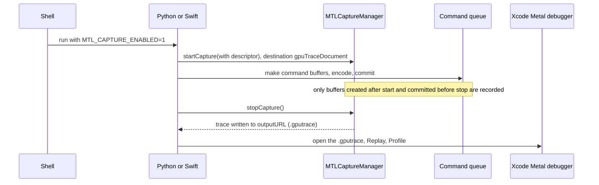
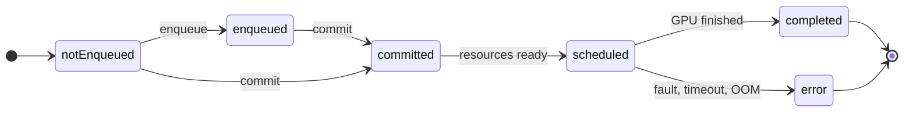
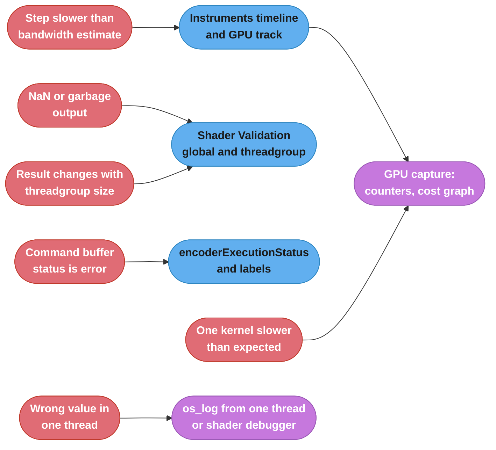

# Metal Profiling and Debugging

> **Version anchor (fetched 2026-11-25):** Xcode 27.3 is the newest entry in Apple's Xcode release notes; Xcode 26 updated the Metal debugger for Metal 4 (machine-learning tensor and graph visualization, per-stage dependencies). The shader cost graph and performance heat maps (introduced in Xcode 15) need an M3 or A17 Pro GPU or later. Shader logging needs Metal 3.2 (macOS 15 / iOS 18 and later). `MTL_CAPTURE_ENABLED=1` enables programmatic capture on macOS 14 and later. Framework hooks: PyTorch 2.15 `torch.mps.profiler`, MLX v0.32.5 `mx.metal.start_capture`.

## 1. Concept Overview

On NVIDIA hardware a kernel author reaches for four tools: Nsight Systems for the timeline, Nsight Compute for one kernel's counters, `compute-sanitizer` for memory errors, and `printf` or `cuda-gdb` for logic. Apple's toolchain covers the same four jobs, with different names and one large structural difference: almost everything hangs off a **GPU trace** (a `.gputrace` capture) that you replay in Xcode's **Metal debugger**, rather than off a separate profiler binary.

| Job | NVIDIA tool | Apple tool |
|-----|-------------|------------|
| Where does wall time go across CPU and GPU? | Nsight Systems | Instruments: the Game Performance template, which bundles the Metal Application, GPU, Metal Resource Events, Time Profiler and other instruments ("Metal system trace") |
| Why is this one kernel slow? | Nsight Compute | Metal debugger Performance view: timeline, counters (occupancy, limiters, bandwidth), shader cost graph, performance heat maps, pipeline statistics |
| Is this kernel reading or writing out of bounds? | `compute-sanitizer` | Shader Validation (`MTL_SHADER_VALIDATION=1`) |
| Am I calling the API wrong? | CUDA error codes, `cudaGetLastError` | API Validation (`MTL_DEBUG_LAYER=1`), command-buffer `status` and `error` |
| What value does thread 7 see? | `printf`, `cuda-gdb` | Shader logging (`os_log` in MSL), the Metal debugger's shader debugger |
| Live frame-time overlay | none built in | Metal Performance HUD (`MTL_HUD_ENABLED=1`) |
| GPU timestamps from code | `cudaEventElapsedTime`, CUPTI | `MTLCommandBuffer.gpuStartTime` / `gpuEndTime`, counter sample buffers |
| Scripted trace inspection | `ncu --import`, Nsight Python | the `gpudebug` command-line tool |

This module is the compute-kernel author's workflow through those tools: how to make a kernel or a whole MLX or PyTorch step capturable, how to read what the Metal debugger reports for a compute dispatch, how to catch the bugs that only show up while a shader runs, and how to get trustworthy GPU timings from code. It assumes the Metal object model in [Metal Compute Programming](../metal_compute_programming/metal_compute_programming.md) and the SIMD-group and occupancy vocabulary in [Apple Silicon GPU Architecture](../apple_silicon_gpu_architecture/apple_silicon_gpu_architecture.md). The CUDA side of the same discipline is [Profiling and Performance Analysis](../profiling_and_performance_analysis/profiling_and_performance_analysis.md) and the [Nsight Profiling Workflow](../case_studies/cross_cutting/nsight_profiling_workflow.md); the AMD side is [ROCm Profiling and Debugging](../rocm_profiling_and_debugging/rocm_profiling_and_debugging.md).

**Not here.** Which framework layer emitted a given dispatch (MPS, MPSGraph, MLX, PyTorch) is in [Metal Performance Shaders, MLX and PyTorch MPS](../metal_performance_shaders_mlx_and_pytorch_mps/metal_performance_shaders_mlx_and_pytorch_mps.md). Graphics-only views (geometry, attachments, overdraw) are out of scope except where they share a mechanism with compute.

---

## 2. Intuition

> **One-line analogy**: Instruments is the dashcam that records the whole trip, the Metal debugger is the mechanic's lift where one captured trip is put up and taken apart bolt by bolt, Shader Validation is the alarm wired to every door, and the HUD is the speedometer you glance at while driving.

**Mental model.** Every investigation is a funnel. The HUD or a wall-clock regression says *something* is slow. Instruments, over seconds of real execution, says *which* frames, command buffers or CPU threads are responsible. A GPU capture of one representative slice says *which* encoder and pipeline dominate. The Performance view says *why*: occupancy, a limiter, bandwidth, or a specific source line with high cost or divergence. Correctness follows the same funnel in reverse order of cost: command-buffer error checks are nearly free, API Validation costs a little CPU, Shader Validation instruments every shader, and the shader debugger replays one dispatch thread by thread.

**Why it matters.** Apple GPUs run vertex, fragment and compute work concurrently "whenever possible", and the frameworks on top (MLX, PyTorch MPS, MPSGraph) batch many kernels into few command buffers. A CPU stopwatch around a Python call therefore measures encoding, not execution, and a slow step can hide behind a fast kernel. Without a trace you are guessing.

**Key insight.** Make the work *nameable* before you profile it. Labels on command queues, command buffers, encoders and pipelines, debug groups around phases, and embedded shader source in debug builds are what turn a trace from "dispatch 412" into "attention/softmax, line 37, 41% divergence". MLX's `MLX_METAL_DEBUG` build option exists for exactly that reason: it records shader source at compile time and labels Metal objects "improving capture readability".

---

## 3. Core Principles

- **Capture is opt-in.** Programmatic capture needs the `MetalCaptureEnabled` Info.plist key or, on macOS 14 and later, `MTL_CAPTURE_ENABLED=1`; MLX and PyTorch both document the environment variable.
- **A capture contains only what was committed inside it.** `MTLCaptureManager` records command buffers created after capture starts and committed before it stops.
- **Validation changes behavior, so know how.** Shader Validation's default fail mode is `zerofill`: "invalid reads return 0" and invalid writes are dropped. A bug can look fixed under validation; read the report, not the output.
- **Errors are reported asynchronously.** A command buffer's `status` becomes `.error` and its `error` property explains why only after the GPU finishes; nothing throws at `commit()`.
- **GPU time is read after completion.** `gpuStartTime` and `gpuEndTime` "remain 0.0 until the GPU finishes running the command buffer."
- **Apple GPUs sample counters at stage boundaries.** Apple documents that "Apple silicon supports sampling at the stage boundary", while a typical immediate-mode GPU samples between commands. Per-dispatch timestamps therefore come from putting a dispatch in its own compute pass.
- **Profile in Concurrent mode, attribute in Serial mode.** The Metal debugger profiles in Concurrent mode by default, which matches runtime behavior; Serial mode runs each pass alone for per-pass precision but "doesn't represent runtime performance."
- **Occupancy is evidence, not a verdict.** Apple's guidance is explicit that "neither high nor low occupancy is automatically an indicator of a problem"; correlate it with limiter counters.
- **Per-line costs need hardware and source.** The shader cost graph and heat maps exist on M3 / A17 Pro and later, and every source-level view needs shader source embedded in the build (`Produce Debugging Information` set to "Yes, include source code", or a separate symbol file).

---

## 4. Types / Architectures / Strategies

### 4.1 The tool ladder by cost

| Rung | Tool | Enable | Overhead (quotes are Apple's) | Answers |
|------|------|--------|----------------------------|---------|
| 0 | Command-buffer `status` / `error`, `encoderExecutionStatus` | Code; `MTLCommandBufferDescriptor.errorOptions` | "can slightly reduce your app's CPU runtime performance" (error options) | Did the GPU fault, time out or run out of memory, and in which encoder? |
| 1 | Metal Performance HUD | Scheme "Show Graphics Overview", or `MTL_HUD_ENABLED=1` | Overlay only | Frame time, GPU time, memory; chart of the last 120 frame intervals |
| 2 | API Validation | Scheme Diagnostics, or `MTL_DEBUG_LAYER=1` | "small, but measurable, impact on CPU performance" | Wrong API usage while encoding |
| 3 | Shader logging | `-fmetal-enable-logging` or `MTLCompileOptions.enableLogging`, plus `MTL_LOG_LEVEL` | Logging "incurs an overhead, regardless of whether the system prints messages" | Values inside a running shader |
| 4 | Shader Validation | Scheme Diagnostics, or `MTL_SHADER_VALIDATION=1` | Instruments every GPU function; slower shaders and compile times | Out-of-bounds, null and non-resident resources, bad casts, stack overflow, tensor misuse |
| 5 | Instruments (Game Performance template) | Product > Profile, or `xctrace record` | Light; performance-limiter counters off by default | CPU and GPU timeline over seconds |
| 6 | GPU capture plus Metal debugger | Capture button, `MTLCaptureManager`, `mx.metal.start_capture`, `torch.mps.profiler.metal_capture` | "tiny, but measurable" CPU effect to enable capture; replay and profiling offline | Dependencies, memory, per-encoder and per-pipeline cost, counters, per-line cost, shader debugging |

### 4.2 What the Metal debugger shows for compute work

| View | Use for a compute kernel | Requirement |
|------|--------------------------|-------------|
| Summary and Dependencies viewer | Which encoders feed which; overserialized work | Any capture |
| Memory viewer | Allocation sizes, unused or duplicated buffers | Any capture |
| Performance timeline | Encoders and shaders on Vertex, Fragment and Compute tracks; Occupancy, Limiter and Bandwidth counter tracks | Apple GPU |
| Performance counters | Per-encoder or per-command counters; editable counter sets | Apple GPU (non-Apple GPUs get a different counter view) |
| Pipeline statistics | Compiler metrics and per-stage time for a pipeline | Any capture |
| Shader cost graph | Flame graph of the costliest functions; per-line Cost, Number of Instructions, Thread Divergence; instruction-type and data-type breakdown | M3 / A17 Pro or later, embedded source |
| Performance heat maps | Shader Execution Cost, ALU Cost, Non-ALU Cost, Thread Divergence, Control Flow Divergence, Inactive Threads, Instruction Count per thread or SIMD-group | M3 / A17 Pro or later; available for compute dispatches, not for compute encoders or compute pipeline states |
| Shader debugger | Step one thread of a dispatch, inspect variables, edit and reload | Embedded source |

### 4.3 CUDA and ROCm habits that do and do not transfer

| CUDA habit | Metal reality |
|------------|---------------|
| `cudaGetLastError()` after a launch | No synchronous launch error; check `commandBuffer.status` and `error` in a completion handler or after `waitUntilCompleted()` |
| `CUDA_LAUNCH_BLOCKING=1` to localize a fault | `MTLCommandBufferDescriptor.errorOptions = .encoderExecutionStatus` reports per-encoder `errorState`; PyTorch's `torch.mps.profiler.profile(wait_until_completed=True)` waits on each encoded op |
| `cudaEventRecord` around one kernel | Timestamps sample at stage boundaries on Apple GPUs: use one compute pass per region, or `gpuStartTime`/`gpuEndTime` per command buffer |
| `printf` from every thread | `os_log` from one or a few threads; a full log buffer drops messages |
| `compute-sanitizer --tool memcheck` | Shader Validation with `GLOBAL_MEMORY` and `THREADGROUP_MEMORY` checks; default `zerofill` masks the symptom |
| `--tool racecheck` for shared memory | No direct equivalent named in Apple's validation docs; find races by testing at several threadgroup sizes and stepping in the shader debugger |
| NVTX ranges | `pushDebugGroup` / `popDebugGroup`, `insertDebugSignpost`; OS signposts from `torch.mps.profiler` |

---

## 5. Architecture Diagrams

### 5.1 The investigation funnel

```mermaid
flowchart LR
    classDef sym fill:#e06c75,stroke:#c0392b,color:#fff,font-weight:bold
    classDef cheap fill:#98c379,stroke:#27ae60,color:#1a1a1a,font-weight:bold
    classDef mid fill:#61afef,stroke:#2e86c1,color:#1a1a1a,font-weight:bold
    classDef deep fill:#c678dd,stroke:#9b59b6,color:#fff,font-weight:bold
    classDef fixn fill:#d19a66,stroke:#e67e22,color:#1a1a1a,font-weight:bold

    slow(["Symptom:<br/>slow or wrong"])
    errs(["Check status, error,<br/>encoder errorState"])
    valid(["API and Shader<br/>Validation"])
    hud(["HUD:<br/>GPU time per frame"])
    inst(["Instruments:<br/>Game Performance"])
    cap(["GPU capture<br/>.gputrace"])
    perf(["Performance view:<br/>timeline and counters"])
    cost(["Cost graph and<br/>heat maps"])
    dbg(["Shader debugger<br/>and os_log"])
    fixit(["Fix, then re-measure<br/>same capture scope"])

    slow -->|"wrong output"| errs
    errs --> valid
    valid --> dbg
    slow -->|"slow"| hud
    hud --> inst
    inst --> cap
    cap --> perf
    perf --> cost
    cost --> fixit
    dbg --> fixit

    class slow sym
    class errs,hud cheap
    class valid,inst mid
    class cap,perf,cost,dbg deep
    class fixit fixn
```



Caption: correctness starts with the cheapest signal (did the command buffer fail, and where) before paying for instrumentation; performance narrows from seconds of trace to one capture to one line.

### 5.2 Programmatic capture from a script



Caption: `mx.metal.start_capture(path)` / `stop_capture()` and `torch.mps.profiler.metal_capture(fname)` wrap the same manager; MLX requires that the output path does not already exist.

### 5.3 Command buffer lifecycle and where errors surface



Caption: `MTLCommandBufferStatus` has six states; only after reaching `completed` or `error` are `gpuStartTime`, `gpuEndTime`, `error` and `logs` meaningful, which is why every check belongs in a completion handler or after `waitUntilCompleted()`.

### 5.4 Reading divergence in the shader cost graph

```
  One SIMD-group = 32 threads executing one shader line

  if (tid < 8) { heavy(); }     lanes:  0..7 active   8..31 masked
                                        ########......................

  Instructions Executed (Total)  = counts masked lanes too        = 32 lanes x N instr
  Instructions Executed (Active) = active lanes only              =  8 lanes x N instr
  Divergence = 1 - Active / Total = 1 - 8/32 = 0.75   (75% of issued work wasted)

  Same branch at a SIMD-group-aligned boundary:  if (simd_id < 2) heavy();
  whole SIMD-groups either run or skip  ->  Active / Total = 1.0  ->  divergence 0.0
```

Caption: the cost graph defines Divergence as "1 - the number of active instructions divided by the total number of instructions", counting threads masked by "conditional branches" or "the shape of the geometry"; a tail dispatch that leaves part of the last SIMD-group idle shows up the same way as an `if`.

### 5.5 Where Apple GPUs can take a timestamp

```
  command buffer
  |-- compute pass A (encoder) --------------|-- compute pass B ---------|
  ^ startOfEncoderSampleIndex 0              ^ end 1   ^ start 2         ^ end 3
       dispatch a1     dispatch a2                 dispatch b1
       (no sample between a1 and a2 on Apple GPUs: stage boundaries only)

  gpuStartTime ............................................................. gpuEndTime
  (per command buffer, host seconds, valid after completion)
```

Caption: to time `a2` alone on Apple silicon, give it its own compute pass with a sample-buffer attachment; the `sampleCounters(sampleBuffer:sampleIndex:barrier:)` encoder method exists for GPUs that support dispatch or draw boundaries, which Apple's GPUs do not.

### 5.6 Symptom to first tool



Caption: a result that depends on threadgroup size is the signature of a missing barrier or an out-of-range threadgroup index, so it goes to Shader Validation first; "slower than the estimate" goes to the timeline before any kernel view, because dispatch gaps are invisible inside a single kernel's counters.

---

## 6. How It Works — Detailed Mechanics

### 6.1 Turn on the cheap checks first

```bash
# API Validation: wrong API usage while encoding; asserts by default
export MTL_DEBUG_LAYER=1
export MTL_DEBUG_LAYER_ERROR_MODE=nslog          # assert (default), ignore or nslog

# Shader Validation: instrument every GPU function
export MTL_SHADER_VALIDATION=1
export MTL_SHADER_VALIDATION_REPORT_TO_STDERR=1  # print reports to stderr
export MTL_SHADER_VALIDATION_ABORT_ON_FAULT=1    # stop at the first error
# export MTL_SHADER_VALIDATION_FAIL_MODE=allow   # default zerofill hides symptoms

# Narrow instrumentation to the pipelines you suspect
export MTL_SHADER_VALIDATION_DEFAULT_STATE=none
export MTL_SHADER_VALIDATION_ENABLE_PIPELINES="row_l2"   # pipeline labels or UIDs

python3 train_step.py
```

What each Shader Validation check covers, from Apple's documentation:

| Variable | Checks |
|----------|--------|
| `MTL_SHADER_VALIDATION_GLOBAL_MEMORY=1` | All global (device) memory accesses |
| `MTL_SHADER_VALIDATION_THREADGROUP_MEMORY=1` | All threadgroup memory accesses |
| `MTL_SHADER_VALIDATION_TEXTURE_USAGE=1` | Texture member functions, nil and non-resident textures, type mismatches |
| `MTL_SHADER_VALIDATION_STACK_OVERFLOW=1` | Indirect and recursive calls beyond `maxCallStackDepth` |
| `MTL_SHADER_VALIDATION_TENSOR_VALIDATION` | Tensor operations with invalid arguments (default 1) |
| `MTL_SHADER_VALIDATION_GENERIC_ADDRESS_SPACE` | Casts from generic to specific address spaces (default 1) |
| `MTL_SHADER_VALIDATION_NAN_INF` | INF or NaN written to vertex interpolants (default 1) |
| `MTL_SHADER_VALIDATION_FAIL_MODE` | `zerofill` (default: invalid reads return 0, invalid writes dropped) or `allow` (may fail the command buffer) |

The validation layer also lists "Misuse of Metal Performance Primitives" (tensor ranks, alignment, strides) and resources missing from a residency set among the errors it detects. `man MetalValidation` in Terminal prints the full list. One limit to remember: API Validation "only checks unretained resource references from instances of `MTLCommandBuffer` and not from `MTL4CommandBuffer`."

### 6.2 Make GPU faults loud in code

```swift
import Metal

let desc = MTLCommandBufferDescriptor()
desc.errorOptions = .encoderExecutionStatus      // per-encoder status on failure
let cb = queue.makeCommandBuffer(descriptor: desc)!
cb.label = "decode-step-41"

let enc = cb.makeComputeCommandEncoder()!
enc.label = "attention"
enc.pushDebugGroup("softmax")
enc.setComputePipelineState(softmaxPSO)
// ... set buffers, dispatchThreads ...
enc.popDebugGroup()
enc.endEncoding()

cb.addCompletedHandler { cb in
    if cb.status == .error, let err = cb.error as NSError? {
        print("command buffer \(cb.label ?? "") failed: code \(err.code)")
        if let infos = err.userInfo[MTLCommandBufferEncoderInfoErrorKey]
                as? [MTLCommandBufferEncoderInfo] {
            for info in infos {
                // .completed, .affected, .pending, .faulted or .unknown
                print("  encoder \(info.label): \(info.errorState.rawValue), signposts \(info.debugSignposts)")
            }
        }
        return
    }
    let ms = (cb.gpuEndTime - cb.gpuStartTime) * 1000.0
    print("\(cb.label ?? ""): \(String(format: "%.3f", ms)) ms GPU")
}
cb.commit()
```

`MTLCommandBufferError.Code` distinguishes `timeout`, `pageFault`, `notPermitted`, `outOfMemory`, `invalidResource`, `memoryless`, `deviceRemoved`, `stackOverflow`, `accessRevoked` and `internal`. With `.encoderExecutionStatus`, each `MTLCommandBufferEncoderInfo` names an encoder by its label, lists its debug signposts, and carries an `errorState` of `completed`, `affected`, `pending`, `faulted` or `unknown`: the labels you set are what make this report readable.

### 6.3 Timing from code

Two granularities are available without Xcode:

1. **Per command buffer:** `gpuEndTime - gpuStartTime` in seconds of host time, valid after completion (shown above).
2. **Per compute pass:** a timestamp counter sample buffer attached to a compute pass descriptor.

```swift
// Find the timestamp counter set
guard let tsSet = device.counterSets?.first(where: { $0.name == MTLCommonCounterSet.timestamp.rawValue })
else { fatalError("no timestamp counters") }

let sbDesc = MTLCounterSampleBufferDescriptor()
sbDesc.counterSet = tsSet
sbDesc.sampleCount = 2
sbDesc.storageMode = .shared
let samples = try device.makeCounterSampleBuffer(descriptor: sbDesc)

// One compute pass per region you want to time (stage-boundary sampling)
let passDesc = MTLComputePassDescriptor()
passDesc.sampleBufferAttachments[0].sampleBuffer = samples
passDesc.sampleBufferAttachments[0].startOfEncoderSampleIndex = 0
passDesc.sampleBufferAttachments[0].endOfEncoderSampleIndex = 1

let enc = cb.makeComputeCommandEncoder(descriptor: passDesc)!
enc.label = "gemv-q4"
// ... encode exactly the dispatch to time ...
enc.endEncoding()
cb.commit()
cb.waitUntilCompleted()

if let data = try? samples.resolveCounterRange(0..<2) {
    let ts = data.withUnsafeBytes { Array($0.bindMemory(to: MTLCounterResultTimestamp.self)) }
    let ticks = ts[1].timestamp - ts[0].timestamp   // GPU clock ticks, not nanoseconds
    print("gemv-q4: \(ticks) GPU ticks")
}
```

GPU timestamps use the GPU's clock. To convert them to CPU time, Apple's procedure is to call `device.sampleTimestamps()` before and after the work, which returns a (CPU, GPU) pair each time, and map linearly between the two pairs; Apple warns to call it "sparingly because doing so may trap to the kernel."

```
cpu_time(gpu_ts) = cpu0 + (gpu_ts - gpu0) * (cpu1 - cpu0) / (gpu1 - gpu0)
```

Framework equivalents: `torch.mps.event.Event(enable_timing=True)` with `elapsed_time()` in PyTorch, and in MLX timing an `mx.eval` inside a warmed-up loop (see [Metal Performance Shaders, MLX and PyTorch MPS](../metal_performance_shaders_mlx_and_pytorch_mps/metal_performance_shaders_mlx_and_pytorch_mps.md) §6.5 and §10).

### 6.4 Capturing a GPU trace

**From Swift**, scope the capture to a device, a command queue or an `MTLCaptureScope`, and write a file you can open later:

```swift
let mgr = MTLCaptureManager.shared()
guard mgr.supportsDestination(.gpuTraceDocument) else { fatalError("no trace support") }
let cd = MTLCaptureDescriptor()
cd.captureObject = queue                       // or device, or an MTLCaptureScope
cd.destination = .gpuTraceDocument
cd.outputURL = URL(fileURLWithPath: "/tmp/step.gputrace")
try mgr.startCapture(with: cd)
runOneStep(queue)                              // create AND commit buffers in here
mgr.stopCapture()
```

**From MLX** (build with `CMAKE_ARGS="-DMLX_METAL_DEBUG=ON"` to record shader source and label Metal objects):

```python
import mlx.core as mx

a = mx.random.uniform(shape=(512, 512))
b = mx.random.uniform(shape=(512, 512))
mx.eval(a, b)                                   # keep setup out of the trace

mx.metal.start_capture("mlx_trace.gputrace")    # path must not already exist
for _ in range(10):
    mx.eval(mx.add(a, b))
mx.metal.stop_capture()
# run as: MTL_CAPTURE_ENABLED=1 python3 capture.py
```

**From PyTorch:**

```python
import torch

x = torch.randn(4096, 4096, device="mps", dtype=torch.float16)
model_step(x)                                   # warm caches outside the capture
torch.mps.synchronize()

if torch.mps.profiler.is_metal_capture_enabled():   # requires MTL_CAPTURE_ENABLED
    with torch.mps.profiler.metal_capture("step"):
        model_step(x)
        torch.mps.synchronize()

# OS-signpost intervals per op, for Instruments' timeline
with torch.mps.profiler.profile(mode="interval,event", wait_until_completed=False):
    model_step(x)
```

`profile(mode=...)` emits OS signposts: `"interval"` traces each operation's duration, `"event"` marks completions. `wait_until_completed=True` waits for each encoded operation, which "helps generating single dispatches on the trace's timeline" and slows the run. `PYTORCH_MPS_LOG_PROFILE_INFO` and `PYTORCH_MPS_TRACE_SIGNPOSTS` set the profiler's log and signpost bitmasks.

A captured trace replays only on "devices of the same type, the same GPU, and the same operating system"; plan to profile on the machine class you ship on.

### 6.5 Reading a capture of compute work

1. **Summary and Dependencies.** Confirm the encoders you expected exist, in the order you expected, and that independent passes are not serialized by an unnecessary dependency. MLX's documentation points to the Dependencies view as "a great overview of all operations."
2. **Performance timeline.** Click Profile (or enable "Profile after Replay"). The Compute track shows each pass's start and duration with overlap; below it, counter tracks show Occupancy, Limiter and Bandwidth. The default GPU performance state matches capture time; the GPU Profiler button can force a state and switch between Concurrent (default) and Serial execution modes.
3. **Counters.** Switch between Encoders and GPU Commands granularity. The debugger collects data with passes running without overlap and includes deterministic counters.
4. **Shader cost graph** (M3 / A17 Pro and later). Select a compute pipeline state; the flame graph left-aligns the costliest functions, and the gutter shows per-line weights. Switch the gutter between Cost, Number of Instructions and Thread Divergence. Hovering a line breaks it into instruction types (Math, Load, Store, Atomic, Barrier, Synchronization, Control Flow and others) and data types (Float16, Float32, Integer, Bits).
5. **Heat maps** (M3 / A17 Pro and later). For a compute dispatch, pixels map to thread locations; when the grid exceeds 8192 in x or y, each pixel is a SIMD-group. Control Flow Divergence separates `if`-driven divergence from Inactive Threads caused by grid dimensions.
6. **Shader debugger.** Select the dispatch, choose a thread position, step through source, inspect variables, edit and reload.

### 6.6 Occupancy and limiters: reading the numbers

Apple defines occupancy as how much of the GPU's maximum concurrent thread capacity is in use. Low occupancy is likely when shaders "have exhausted some internal resources, such as thread, threadgroup, or imageblock memory", when threads finish faster than the GPU can launch new ones, or when the dispatch grid is too small. Very high occupancy can still be poor if threads thrash the caches. The decision table:

| Occupancy | Limiter counters | Reading | Next step |
|-----------|-----------------|---------|-----------|
| Low | Low | GPU starved: grid too small or launch-bound | Bigger or fused dispatches, fewer command buffers |
| Low | High on one unit | Resource cap (threadgroup memory, registers) limits concurrency | Shrink threadgroup memory or register use per thread; check the pipeline's maximum theoretical occupancy |
| High | High on memory | Bandwidth-bound | Reduce bytes: quantize, fuse, improve locality ([Roofline and Arithmetic Intensity](../case_studies/cross_cutting/roofline_and_arithmetic_intensity.md)) |
| High | High on ALU | Compute-bound | Lower precision math, fewer instructions; cost graph per-line breakdown |
| Very high | Memory high, cache poor | Cache thrashing | Fewer or smaller memory accesses, better temporal locality |

### 6.7 Shader logging

```metal
#include <metal_stdlib>
using namespace metal;

constant os_log logger(/*subsystem=*/"com.example.kernels", /*category=*/"row_l2");

kernel void row_l2(device const half* x [[buffer(0)]],
                   device half* out     [[buffer(1)]],
                   constant uint& cols  [[buffer(2)]],
                   uint row [[threadgroup_position_in_grid]],
                   uint tid [[thread_position_in_threadgroup]]) {
    if (row == 0 && tid == 0) {                 // log from ONE thread
        logger.log_debug("cols=%u first=%f", cols, float(x[0]));
    }
    // ...
}
```

Build with `-fmetal-enable-logging` (Xcode "Other Metal Compiler Flags", `xcrun metal -std=metal3.2 -fmetal-enable-logging`, or `MTLCompileOptions.enableLogging = true`). Run with `MTL_LOG_LEVEL` (default `MTLLogLevelDebug`) and `MTL_LOG_BUFFER_SIZE` (default 1024 bytes, minimum 1 KB, maximum 1 GB). Messages are drained only after the command buffer finishes, their order is not guaranteed, and once the buffer is full "the system discards any subsequent messages." Set `MTL_LOG_TO_STDERR=1` to print to stderr. To scope logging to one queue or command buffer, attach an `MTLLogState` through the descriptor's `logState` (macOS 15 / iOS 18). MLX debug builds (`DEBUG=1 pip install -e .`) expose the same mechanism through an `mlx::os_log` shim, run with `MTL_LOG_LEVEL=MTLLogLevelDebug MTL_LOG_TO_STDERR=1`.

### 6.8 Instruments and the HUD

Instruments' Game Performance template (Product > Profile, or Command-I) combines Points of Interest, System Load, Thread State Trace, System Call Trace, Virtual Memory Trace, Time Profiler, Thermal State, Metal Resource Events, Metal Application, GPU and Display instruments. Performance-limiter counters are off by default; enable them under Recording Options > Counter Set > Performance Limiters. For compute work the useful tracks are the GPU track (which shader stages ran, for how long, with what gaps), the CPU threads that encode work, and signpost intervals such as those the PyTorch MPS profiler emits. The Instruments CLI is `xctrace`; Xcode 27 added `--show-recording-options` and `--recording-options <json path>` to `xctrace record`, and time-range arguments to `xctrace export`.

The Metal Performance HUD (`MTL_HUD_ENABLED=1`, or Settings > Developer > Graphics HUD on iOS) overlays the Metal device, memory allocated by the app and Metal, average FPS, GPU time and frame interval, and a chart of the last 120 frame intervals; `MTL_HUD_LOG_ENABLED=1` logs per-frame statistics. It is aimed at apps that present frames; for headless compute scripts, Instruments and command-buffer timings are the equivalents.

### 6.9 Scripted trace inspection with `gpudebug`

```bash
# Open a trace in a reusable session (prints "Session <id> created."), then query it
gpudebug -t step.gputrace -c "list"
gpudebug -s 412 -c "go commands/cb0" -c "list"      # children and the actions each supports
gpudebug -s 412 -c "go performance" -c "list"
gpudebug --terminate 412

# One-shot query (pays the full trace load each time)
gpudebug --oneshot -t step.gputrace -c "go commands/cb0" -c "list"
```

The tool presents a trace as a navigable tree whose root has `commands`, `performance`, `api_calls` and `resources`; `list` shows children with the actions each node supports, and `info` and `fetch` need the background replayer. Apple documents it as "well-suited for AI agents": point an agent at `man gpudebug` and a `.gputrace` and it can explore the trace by following advertised actions. Session reuse matters because trace load and replayer startup "can take seconds to minutes."

### 6.10 A reproducible step-timing harness

Every number you compare across commits should come from the same harness: warm-up outside the measurement, GPU-side completion inside it, several repetitions, a robust statistic, and an opt-in capture of exactly one step.

```python
import os
import statistics
import time
from typing import Callable

def time_mlx(step: Callable[[], object], warmup: int = 10, reps: int = 50) -> float:
    import mlx.core as mx
    for _ in range(warmup):
        mx.eval(step())                    # compile, JIT and caches happen here
    samples = []
    for _ in range(reps):
        t0 = time.perf_counter()
        mx.eval(step())                    # completion is inside the timed region
        samples.append((time.perf_counter() - t0) * 1e3)
    if os.environ.get("MTL_CAPTURE_ENABLED") == "1":
        mx.metal.start_capture("one_step.gputrace")   # path must not exist yet
        mx.eval(step())
        mx.metal.stop_capture()
    return statistics.median(samples)

def time_torch_mps(step: Callable[[], object], warmup: int = 10, reps: int = 50) -> float:
    import torch
    for _ in range(warmup):
        step()
    torch.mps.synchronize()
    start = torch.mps.event.Event(enable_timing=True)
    end = torch.mps.event.Event(enable_timing=True)
    samples = []
    for _ in range(reps):
        start.record()
        step()
        end.record()
        end.synchronize()
        samples.append(start.elapsed_time(end))
    if torch.mps.profiler.is_metal_capture_enabled():
        with torch.mps.profiler.metal_capture("one_step"):
            step()
            torch.mps.synchronize()
    return statistics.median(samples)
```

Run it twice: once plain for the number, once with `MTL_CAPTURE_ENABLED=1` for the trace. Never take the number from the capture run, and never time with validation layers enabled.

---

## 7. Real-World Examples

**MLX's own debug workflow.** MLX ships a documented path for kernel authors: build with `MLX_METAL_DEBUG` to embed shader source and label objects, capture with `mx.metal.start_capture`, open the trace in Xcode, and use the Dependencies view; or generate an Xcode project with `cmake .. -DMLX_METAL_DEBUG=ON -G Xcode` and run the `metal_capture` example scheme. For in-kernel prints, a `DEBUG=1` build plus `mlx::os_log`. The v0.32.5 release notes show the class of bugs this workflow exists to find: Metal grid truncation past 2^27 rows in softmax, logsumexp, rms_norm and layer_norm; FFT reads and writes past the buffer end in partial threadgroups; a flipped bounds check in a large-filter convolution loader; and `any`/`all` wrong for int8 and uint8 on Metal.

**PyTorch MPS hardening in 2.15.** The release notes record fixes for "Metal debug-layer validation failures", for MPS command-buffer failures such as out-of-memory that returned wrong outputs instead of raising, for crashes and hangs when running MPS ops from multiple threads and in MPS event `elapsed_time()`, and for silent wrong results on large tensors in `torch.cat`, `arange`/`linspace`, `nll_loss`, padding and pooling. Each is the kind of defect that only command-buffer error checks and validation layers surface reliably.

**Apple's profiling-tools walkthrough.** In the "Discover new Metal profiling tools for M3 and A17 Pro" tech talk, Apple profiles a GPU-driven street-rendering workload in Xcode 15: the Shaders tab ranks passes and pipeline states by cost, the G-buffer pass accounts for about 50% of the total cost, and the shader cost graph's flame graph leads from that pipeline to its expensive functions and lines. The same flow applies to a compute pipeline.

**Instruments on a stutter.** Apple's Instruments guide walks through a frame whose fragment shader ran 74.64 ms against a 16.67 ms budget at 60 fps, found by hovering the GPU track at a long display interval. For compute, the same reading applies to a decode step that misses its latency budget: find the long interval, then the stage and pipeline under it.

---

## 8. Tradeoffs

| Tool | Fidelity | Overhead | Scope | Best for |
|------|----------|----------|-------|----------|
| `status`/`error` + `encoderExecutionStatus` | Exact for failures | Slight CPU | Every run | Production guard rail |
| `gpuStartTime`/`gpuEndTime` | Per command buffer | None | Every run | Regression dashboards |
| Counter sample buffers | Per pass (Apple) | Small | Targeted runs | Microbenchmarks in code |
| HUD | Per frame | Overlay | Interactive apps | Spotting variance |
| Instruments | Seconds, many threads | Light | Whole app | CPU-GPU overlap, stalls, encoding threads |
| GPU capture + Performance view | One slice, counters | Replay offline | One scope | Why a kernel is slow |
| Cost graph / heat maps | Per line, per SIMD-group | Replay offline | One pipeline | Divergence and instruction mix (M3 / A17 Pro+) |
| API Validation | Encoding errors | Small CPU | Development | API misuse |
| Shader Validation | Runtime memory and resource errors | Large GPU, compile time | Development, targeted pipelines | Out-of-bounds and bad casts |
| `os_log` | Values | Always on once compiled in | One kernel | Logic bugs |

| Decision | Option A | Option B |
|----------|---------|---------|
| Execution mode when profiling | Concurrent: runtime-representative, overlapping passes | Serial: exact per-pass cost, not runtime-representative |
| Validation fail mode | `zerofill`: run continues, symptoms masked | `allow`: real behavior, may fail the command buffer |
| Validation scope | All pipelines: complete, slow | `DEFAULT_STATE=none` + enabled list: fast, focused |
| Capture granularity | Whole device: everything, large trace | `MTLCaptureScope` or one queue: small, targeted |

---

## 9. When to Use / When NOT to Use

**Use command-buffer error checks** in every build, including release: they cost nearly nothing and are the only signal a production GPU fault leaves. **Do not** rely on output inspection to detect a fault.

**Use API Validation** in every development and CI run of Metal host code. **Do not** benchmark with it on; it changes CPU timing.

**Use Shader Validation** when results are wrong, nondeterministic, or differ by threadgroup size, and in CI for custom-kernel tests on a small input. **Do not** leave it on for performance work, and do not trust a clean-looking output while it runs in `zerofill` mode.

**Use Instruments** when the question involves CPU threads, encoding cost, system load or thermals. **Do not** expect per-line shader costs from it.

**Use a GPU capture and the Performance view** when a specific step or kernel is slow and you need counters, occupancy or source-level cost. **Do not** capture minutes of work; scope the capture to one representative step.

**Use shader logging** to confirm a value or branch in a few threads. **Do not** log from every thread of a large dispatch.

---

## 10. Common Pitfalls

**1. Ignoring the command buffer's error.** A Swift host that commits and reads results without checking status happily consumes garbage after a page fault or timeout.

```swift
// BROKEN: a faulted command buffer is indistinguishable from a successful one
cb.commit()
cb.waitUntilCompleted()
let result = outBuf.contents().bindMemory(to: Float.self, capacity: n)
consume(result)

// FIX: request encoder status and check before reading
let d = MTLCommandBufferDescriptor()
d.errorOptions = .encoderExecutionStatus
let cb2 = queue.makeCommandBuffer(descriptor: d)!
// ... encode ...
cb2.commit()
cb2.waitUntilCompleted()
guard cb2.status == .completed else {
    fatalError("GPU error: \(String(describing: cb2.error))")
}
consume(outBuf.contents().bindMemory(to: Float.self, capacity: n))
```

PyTorch 2.15 moved in the same direction, raising errors for MPS command-buffer failures such as out-of-memory "instead of returning wrong outputs."

**2. Logging from every thread.** A 1M-thread dispatch where each thread logs one line overruns the default 1024-byte log buffer almost immediately; later messages are discarded and the run slows.

```metal
// BROKEN: every thread logs; the buffer fills and messages drop
kernel void k(device float* y [[buffer(0)]], uint i [[thread_position_in_grid]]) {
    metal::os_log_default.log_debug("i=%u y=%f", i, y[i]);
}

// FIX: log only the thread under suspicion (and raise MTL_LOG_BUFFER_SIZE if needed)
kernel void k2(device float* y [[buffer(0)]], uint i [[thread_position_in_grid]]) {
    if (i == 4095) { metal::os_log_default.log_debug("i=%u y=%f", i, y[i]); }
}
```

**3. Reading GPU times too early.** `gpuStartTime` and `gpuEndTime` are `0.0` until the command buffer finishes, so a timer read right after `commit()` reports zero or negative durations. Read them in `addCompletedHandler` or after `waitUntilCompleted()`.

**4. Expecting per-dispatch timestamps on Apple GPUs.** Code ported from a desktop GPU path that calls `sampleCounters(sampleBuffer:sampleIndex:barrier:)` between dispatches gets nothing useful on Apple silicon, which samples at stage boundaries. Check `device.supportsCounterSampling(.atDispatchBoundary)`, and on Apple GPUs time a dispatch by giving it its own compute pass with `startOfEncoderSampleIndex` and `endOfEncoderSampleIndex`.

**5. "Validation made the bug go away."** An out-of-bounds read under Shader Validation's default `zerofill` returns 0, and an out-of-bounds write is dropped, so a NaN or a corrupted neighbor buffer can vanish when validation is on. Read the validation report, then reproduce with `MTL_SHADER_VALIDATION_FAIL_MODE=allow` if you need to see the real failure.

**6. A capture that contains nothing.** Starting a capture after the command buffers were created, or stopping it before they were committed, yields an empty or partial trace; so does forgetting `MTL_CAPTURE_ENABLED=1` (or the Info.plist key). In MLX, evaluate setup arrays before `start_capture` so the trace holds only the step, and pick a fresh output path because MLX requires that it does not already exist.

**7. Profiling in Serial mode and calling it the runtime.** Serial mode makes each pass wait for the previous one; per-pass numbers become cleaner but total time no longer reflects concurrent execution. Report runtime numbers from Concurrent mode.

**8. No source in the trace.** Without "Produce Debugging Information: Yes, include source code" (or a symbol file, or `MLX_METAL_DEBUG` for MLX), the cost graph and shader debugger have no source lines to attribute cost to. Turn it off again for release builds.

**9. Comparing traces across machines.** Replaying a `.gputrace` on a different GPU or OS "may not work or behave the same." Capture and replay on the same machine class.

**10. Looking for per-line costs on an M1 or M2.** The shader cost graph and heat maps exist on M3 / A17 Pro and later; on older Apple GPUs use the Performance timeline, counters and pipeline statistics instead, or capture on newer hardware.

**11. Capturing the cold first step.** The first call of an MLX compiled function or a new `metal_kernel`, or the first PyTorch MPS op at a new shape, includes graph building, JIT compilation and pipeline creation. A capture or a timing of that call profiles the compiler, not the kernel.

```python
# BROKEN: the captured step includes compilation and pipeline creation
mx.metal.start_capture("cold.gputrace")
mx.eval(compiled_step(x))
mx.metal.stop_capture()

# FIX: warm up first, then capture one steady-state step
for _ in range(3):
    mx.eval(compiled_step(x))
mx.metal.start_capture("warm.gputrace")
mx.eval(compiled_step(x))
mx.metal.stop_capture()
```

**12. Shipping debug settings.** "Produce Debugging Information: Yes, include source code", logging compile flags and `os_log` calls left in hot kernels all cost size or time in release builds; Apple's guidance is to reset the Release setting to No when finished, and logging "incurs an overhead, regardless of whether the system prints messages." Gate them on a build configuration.

---

## 11. Technologies & Tools

| Tool | Role |
|------|------|
| **Xcode Metal debugger** | Replays a `.gputrace`: Summary, Dependencies, Memory, Performance timeline, counters, shader cost graph, heat maps, shader debugger |
| **Instruments** | Timeline profiler; the Game Performance template bundles Metal Application, GPU, Metal Resource Events, Time Profiler and system instruments |
| **xctrace** | Instruments' command-line recorder and exporter |
| **gpudebug** | Command-line, scriptable navigator for GPU traces; documented for use by AI agents |
| **Metal API Validation** | Debug layer for host-side API misuse (`MTL_DEBUG_LAYER`) |
| **Metal Shader Validation** | Instrumented shaders for memory, resource and cast errors (`MTL_SHADER_VALIDATION`) |
| **Metal Performance HUD** | Real-time overlay of frame time, GPU time and memory (`MTL_HUD_ENABLED`) |
| **MTLCaptureManager** | Programmatic capture to Xcode or a `.gputrace` file |
| **MTLCounterSampleBuffer** | GPU counter and timestamp sampling from code |
| **Metal shader logging** | `os_log` from MSL, Metal 3.2+ |
| **torch.mps.profiler** | OS-signpost tracing and `.gputrace` capture for PyTorch MPS |
| **mlx.core.metal** | `start_capture`, `stop_capture`, `device_info` for MLX |

---

## 12. Interview Questions with Answers

**Q: Why can an out-of-bounds bug in a Metal kernel seem to disappear when you enable Shader Validation?**
**Short:** Shader Validation's default fail mode is zerofill: invalid reads return 0 and invalid writes are dropped, so the symptom can vanish while the report still names the bug.
Apple documents `MTL_SHADER_VALIDATION_FAIL_MODE` with two values: `zerofill` (default) and `allow`. In `zerofill` a stray read of a neighbor buffer returns 0 instead of garbage or NaN, and a stray write never lands, so a corrupted result may look correct. The fix lives in the validation report printed to the Issue navigator or stderr (`MTL_SHADER_VALIDATION_REPORT_TO_STDERR=1`), not in the output. Use `allow` when you need to reproduce the real failure, accepting that the command buffer may fail.

**Q: Why does a programmatic Metal capture from a Python script come back empty?**
**Short:** Capture must be enabled with `MTL_CAPTURE_ENABLED=1` or the Info.plist key, and only command buffers created after the start and committed before the stop are recorded.
On macOS 14 and later the environment variable enables capture for any Metal process; MLX and PyTorch both document it. `MTLCaptureManager` then records only command buffers created after `startCapture` and committed before `stopCapture`, so work queued earlier or committed later is missing. In MLX, `mx.eval` setup arrays before `mx.metal.start_capture` and use a path that does not exist yet; in PyTorch, check `torch.mps.profiler.is_metal_capture_enabled()` before using `metal_capture`.

**Q: Why does reading `gpuStartTime` immediately after `commit()` return 0?**
**Short:** GPU start and end times stay 0.0 until the GPU finishes the command buffer; read them in a completion handler or after `waitUntilCompleted()`.
`commit()` only submits work; the GPU runs it later. Apple's documentation states the values "remain 0.0 until the GPU finishes running the command buffer." Both are host time in seconds relative to mach time, so `gpuEndTime - gpuStartTime` is the command buffer's GPU duration once valid. That is the cheapest always-on GPU timing available and works in release builds.

**Q: Why can't you time a single dispatch on an Apple GPU by sampling counters between dispatches?**
**Short:** Apple GPUs sample counters at stage boundaries, not between commands, so per-dispatch timing requires putting the dispatch in its own compute pass with a sample-buffer attachment.
Apple's counter documentation says "Apple silicon supports sampling at the stage boundary" while immediate-mode GPUs sample between commands. `sampleCounters(sampleBuffer:sampleIndex:barrier:)` serves the command-boundary case, and `supportsCounterSampling(_:)` reports which boundaries a device has. On Apple GPUs, set `startOfEncoderSampleIndex` and `endOfEncoderSampleIndex` on a `MTLComputePassDescriptor`'s sample-buffer attachment and resolve the two timestamps. The values are GPU clock ticks; convert with `sampleTimestamps()` pairs.

**Q: How do you find out which encoder failed when a command buffer ends in `.error`?**
**Short:** Create it with `errorOptions = .encoderExecutionStatus`, then read `MTLCommandBufferEncoderInfo` entries from the error's user info, each with a label, debug signposts and an error state.
The error's code says what went wrong (`timeout`, `pageFault`, `outOfMemory`, `invalidResource`, `stackOverflow` and others). The encoder infos under `MTLCommandBufferEncoderInfoErrorKey` say where: each encoder's `errorState` is `completed`, `affected`, `pending`, `faulted` or `unknown`, and its label and signposts identify it. Labels are therefore part of error handling, not decoration. The option "can slightly reduce" CPU performance, which is acceptable in debug and often in production.

**Q: Why do shader log messages go missing or arrive out of order?**
**Short:** The log buffer defaults to 1024 bytes and drops messages once full, and it drains only after the command buffer finishes, without preserving order.
Logging functions run once per thread, so a large dispatch that logs from every thread fills the buffer almost immediately. `MTL_LOG_BUFFER_SIZE` can be raised (1 KB to 1 GB), but the documented practice is to log from one or a few chosen threads. Because draining depends on command-buffer duration, "the system may not maintain the sequence of messages." Logging also requires Metal 3.2 and the `-fmetal-enable-logging` compile option or `MTLCompileOptions.enableLogging`.

**Q: Why can Metal debugger timings taken in Serial execution mode mislead you about runtime performance?**
**Short:** Serial mode forces each pass to wait for the previous one, giving precise per-pass costs but removing the overlap that happens at runtime.
Apple GPUs run vertex, fragment and compute work concurrently whenever possible, and the debugger profiles in Concurrent mode by default for that reason. Serial mode is for attribution: which pass costs what when it runs alone. Its total time is not the frame or step time your users see. Report runtime numbers from Concurrent mode, and use Serial only to apportion cost between overlapping passes.

**Q: Why might the shader cost graph show nothing for your kernel on a Mac?**
**Short:** The cost graph and heat maps need an M3 or A17 Pro GPU or later, and source-level views need shader source embedded via debug info or a symbol file.
Apple introduced these tools in Xcode 15 with the Apple family 9 GPUs' new shader core architecture. On earlier Apple GPUs the Performance timeline, counters and pipeline statistics still work. On any GPU, the per-line gutter needs source: set "Produce Debugging Information" to "Yes, include source code" for debug builds, generate a symbol file for release builds, or build MLX with `MLX_METAL_DEBUG`.

**Q: What does API Validation catch that Shader Validation does not, and vice versa?**
**Short:** API Validation checks host-side Metal calls as you create resources and encode commands; Shader Validation instruments GPU functions to catch errors visible only while shaders run.
API Validation (`MTL_DEBUG_LAYER=1`) flags misuse such as invalid encoder state and resource creation errors, at a small CPU cost; it asserts by default, or logs with `MTL_DEBUG_LAYER_ERROR_MODE=nslog`. Shader Validation (`MTL_SHADER_VALIDATION=1`) adds checks for out-of-bounds global and threadgroup memory access, null or non-resident resources, bad address-space casts, stack overflow and tensor misuse, at a real GPU and compile-time cost. Run both while developing a new kernel.

**Q: How do you limit Shader Validation to one pipeline to keep a large workload usable?**
**Short:** Set `MTL_SHADER_VALIDATION_DEFAULT_STATE=none`, then list the pipelines to instrument in `MTL_SHADER_VALIDATION_ENABLE_PIPELINES` by label or validation UID.
By default every pipeline is instrumented (`DEFAULT_STATE=all`), which can slow a full model step dramatically. Switching the default off and enabling only the suspect kernel cuts the overhead to that pipeline. `MTL_SHADER_VALIDATION_DISABLE_PIPELINES` does the inverse, and `MTL_SHADER_VALIDATION_DUMP_PIPELINES=1` is listed among the settings. This is another reason to label pipelines.

**Q: How does the shader cost graph define divergence, and how should you read a high value?**
**Short:** Divergence is 1 minus active instructions over total instructions, so a value of 0.75 means three quarters of issued SIMD-group work came from masked-off threads.
Total counts all threads of each SIMD-group, including those masked by branches or by the dispatch shape; Active counts only threads doing work. A branch taken by 8 of 32 lanes yields 0.75 on that line. The heat maps separate Control Flow Divergence (branches) from Inactive Threads (grid shape), which tells you whether to restructure the branch to SIMD-group granularity or fix the grid and tail handling.

**Q: What do occupancy counters tell you, and why is low occupancy not automatically a problem?**
**Short:** Occupancy is the share of the GPU's maximum concurrent threads in use; low values matter only if limiter counters show the GPU idle or capped by a resource.
Apple lists three causes of low occupancy: shaders exhausting internal resources such as threadgroup memory, threads finishing faster than new ones launch, and dispatch grids too small to fill the GPU. If limiter counters are also low, the GPU is simply doing little work; if one limiter is high, a resource or unit is the cap. Very high occupancy can even hurt through cache thrashing. Correlate occupancy with limiters before changing threadgroup size.

**Q: How do labels and debug groups change what you can learn from a capture or a GPU error?**
**Short:** Labels name queues, buffers, encoders and pipelines in every Metal tool and in error reports, and debug groups group commands so a trace and an encoder error map back to code.
`label` properties appear in the debugger, Instruments and `MTLCommandBufferEncoderInfo`; `pushDebugGroup`/`popDebugGroup` on command buffers and encoders build nested groups; `insertDebugSignpost` marks points inside an encoder; `MTLBuffer.addDebugMarker(_:range:)` marks byte ranges. None of these change execution. They are the Metal equivalent of NVTX ranges and should be added before profiling, not after.

**Q: How do you produce a GPU trace from an MLX or PyTorch workload without an Xcode project?**
**Short:** Run with `MTL_CAPTURE_ENABLED=1`, wrap the step in `mx.metal.start_capture`/`stop_capture` or `torch.mps.profiler.metal_capture`, then open the `.gputrace` in Xcode.
Both frameworks wrap `MTLCaptureManager` writing a trace document. Warm up and evaluate setup outside the capture so the trace holds one representative step. For MLX, building with `MLX_METAL_DEBUG=ON` embeds shader source and labels objects, which the Performance view and shader debugger need for source attribution. The trace replays only on the same device type, GPU and OS.

**Q: What does `torch.mps.profiler.profile` record, and when should you set `wait_until_completed=True`?**
**Short:** It emits OS signposts per MPS operation (interval, event or both) for Instruments; waiting per op isolates each dispatch on the timeline at a large performance cost.
`mode="interval"` records each operation's execution span and `mode="event"` marks completions. By default ops overlap and batch into command buffers, so one signpost interval can cover several dispatches. `wait_until_completed=True` waits for each encoded op, which yields single dispatches per interval and is right for attributing cost, but wrong for measuring throughput. `PYTORCH_MPS_TRACE_SIGNPOSTS` and `PYTORCH_MPS_LOG_PROFILE_INFO` adjust what the profiler emits.

**Q: How do you convert GPU timestamps from a counter sample buffer into CPU time?**
**Short:** Call `sampleTimestamps()` before and after the work to get two (CPU, GPU) clock pairs, then map GPU ticks to CPU time linearly between them.
GPU and CPU clocks run on different hardware, so raw GPU timestamps are not comparable with CPU times. Two simultaneous samples establish the line `cpu = cpu0 + (gpu - gpu0) * (cpu1 - cpu0) / (gpu1 - gpu0)`. Apple advises calling `sampleTimestamps()` sparingly because it "may trap to the kernel." Use the converted times to line up GPU passes with CPU-side events such as encoding threads or signposts.

**Q: Can you replay a GPU trace captured on one Mac on a different Mac?**
**Short:** Only reliably on a device of the same type with the same GPU and OS; elsewhere replay may fail or behave differently.
Apple's replay documentation spells out the compatibility rule and gives the example of a trace captured on a Mac with an AMD GPU not working on an M1 Mac. Performance numbers from a replay also depend on that hardware. For a team, this means profiling captures belong to the machine class you care about, and shared traces need the capturing machine's model and OS recorded alongside them.

**Q: How can a script or an AI agent investigate a GPU trace without the Xcode UI?**
**Short:** Use `gpudebug`, which exposes the trace as a navigable tree with `list`, `go`, `info` and `fetch`, and supports reusable sessions or `--oneshot` queries.
`gpudebug -t trace.gputrace` opens a session and an interactive prompt; `-c` runs commands non-interactively; `-s <id>` reuses a loaded session so the replayer is not restarted; `--terminate` ends it. Each node lists the actions it supports, so a tool can explore an unfamiliar trace without prior knowledge of its structure, which is why Apple documents it for AI agents. Reference: `man gpudebug`.

**Q: Which Apple tools play the roles of Nsight Systems and Nsight Compute?**
**Short:** Instruments (Game Performance template with the Metal Application and GPU instruments) is the system-wide timeline; the Metal debugger's Performance view on a GPU capture is the per-kernel analyzer.
Instruments records seconds of execution across CPU threads, system calls, thermal state and GPU stages, like Nsight Systems. The Metal debugger replays one captured slice and adds counters (occupancy, limiters, bandwidth), pipeline statistics, the shader cost graph and heat maps, like Nsight Compute's per-kernel view. The structural difference is that Apple's per-kernel analysis runs on a replayed `.gputrace`, so capture scope and replay hardware matter.

**Q: What does the Metal Performance HUD show, and how do you enable it without editing an Xcode scheme?**
**Short:** It overlays the Metal device, memory used, average FPS, GPU time, frame interval and a 120-frame interval chart; set `MTL_HUD_ENABLED=1`, or use Developer settings on iOS.
The HUD is a real-time overlay for spotting variance and choosing what to capture next; `MTL_HUD_LOG_ENABLED=1` also logs per-frame statistics, and an Info.plist key (`MetalHudEnabled`) enables it programmatically. On iOS, iPadOS and tvOS a development-provisioned device exposes Show Graphics HUD under Settings > Developer. It is built around presented frames, so a headless compute script gets more from command-buffer timings and Instruments.

---

## 13. Best Practices

- Label every command queue, command buffer, encoder, pipeline and long-lived buffer, and wrap phases in debug groups before the first profiling session.
- Check `status` and `error` on every command buffer, with `errorOptions = .encoderExecutionStatus` in debug and CI builds.
- Run API Validation in every development run; run Shader Validation on custom-kernel tests, narrowed to the pipelines under test.
- Treat a clean output under `zerofill` validation as unproven; read the report.
- Keep shader source in debug builds (and a symbol file for release) so the cost graph and shader debugger can attribute cost to lines.
- Capture one warmed-up, representative step with a narrow scope; record the machine model and OS with the trace.
- Profile in Concurrent mode for runtime numbers; use Serial mode only for attribution.
- Read occupancy together with limiter and bandwidth counters, and compare against the roofline before changing launch geometry.
- Time from code with `gpuStartTime`/`gpuEndTime` per command buffer, or per compute pass with timestamp sample buffers; never with a CPU clock around `commit()`.
- Log from one thread, raise `MTL_LOG_BUFFER_SIZE` deliberately, and remove logging before measuring performance.

---

## 14. Case Study

**Scenario.** A team ships a custom MLX kernel for a 1-D three-point smoothing filter over activation rows (a stand-in for any stencil with a halo). Unit tests pass at small sizes, but in a long run the outputs occasionally contain wrong values at the start of rows, and the kernel is slower than the bandwidth estimate predicts. Numbers are illustrative unless attributed. The debugging uses only command-line and Python entry points, then Xcode for the capture.

**The kernel as first written:**

```python
import mlx.core as mx

# BROKEN: tile has no room for the halo, and the left halo reads x[-1] at row start
smooth_broken = mx.fast.metal_kernel(
    name="smooth3",
    input_names=["x"],
    output_names=["out"],
    source="""
        threadgroup float tile[256];                  // needs 256 + 2 slots
        uint gid  = thread_position_in_grid.x;
        uint tid  = thread_position_in_threadgroup.x;
        uint tpg  = threads_per_threadgroup.x;
        tile[tid + 1] = float(x[gid]);                // tid = 255 writes tile[256]
        if (tid == 0)       { tile[0]       = float(x[gid - 1]); }   // gid = 0 reads x[-1]
        if (tid == tpg - 1) { tile[tpg + 1] = float(x[gid + 1]); }   // writes tile[257]
        threadgroup_barrier(mem_flags::mem_threadgroup);
        out[gid] = T((tile[tid] + tile[tid + 1] + tile[tid + 2]) / 3.0f);
    """,
)
```

**Step 1: make the failure loud.** The tests had passed at small sizes: out-of-range threadgroup and device accesses are undefined behavior, and undefined behavior is under no obligation to produce a visible error. Running the test under validation:

```bash
MTL_SHADER_VALIDATION=1 \
MTL_SHADER_VALIDATION_REPORT_TO_STDERR=1 \
MTL_SHADER_VALIDATION_THREADGROUP_MEMORY=1 \
MTL_SHADER_VALIDATION_GLOBAL_MEMORY=1 \
python3 -m pytest tests/test_smooth.py -x
```

Validation reports two classes of error: threadgroup-memory accesses beyond the 256-element `tile`, and a global-memory read before the start of `x`. Note what the output does under the default `zerofill`: the out-of-range read of `x[-1]` returns 0, which happens to resemble zero padding, so the first element looks plausible. The report, not the output, is the evidence.

**Step 2: fix both bugs.**

```python
# FIX: size the tile for the halo, and clamp the halo reads at the array edges
smooth = mx.fast.metal_kernel(
    name="smooth3",
    input_names=["x"],
    output_names=["out"],
    source="""
        threadgroup float tile[256 + 2];
        uint gid  = thread_position_in_grid.x;
        uint tid  = thread_position_in_threadgroup.x;
        uint tpg  = threads_per_threadgroup.x;
        uint n    = x_shape[0];
        tile[tid + 1] = float(x[gid]);
        if (tid == 0)       { tile[0]       = gid > 0     ? float(x[gid - 1]) : 0.0f; }
        if (tid == tpg - 1) { tile[tpg + 1] = gid + 1 < n ? float(x[gid + 1]) : 0.0f; }
        threadgroup_barrier(mem_flags::mem_threadgroup);
        out[gid] = T((tile[tid] + tile[tid + 1] + tile[tid + 2]) / 3.0f);
    """,
)

def run(x: mx.array) -> mx.array:
    assert x.size % 256 == 0, "grid must be a multiple of the threadgroup here"
    return smooth(inputs=[x], template=[("T", x.dtype)], grid=(x.size, 1, 1),
                  threadgroup=(256, 1, 1), output_shapes=[x.shape],
                  output_dtypes=[x.dtype])[0]
```

The test suite now runs at threadgroup sizes 32 and 256 and at array lengths that put a threadgroup boundary at the array edge, with validation on in CI for this pipeline only (`MTL_SHADER_VALIDATION_DEFAULT_STATE=none` plus `MTL_SHADER_VALIDATION_ENABLE_PIPELINES`). The 256-element assumption is also written down: tile size and threadgroup size must change together.

**Step 3: confirm the bug is gone at the command-buffer level.** Validation is off again for performance work, so the remaining guard is cheap: the Swift host that also uses this filter creates its command buffers with `errorOptions = .encoderExecutionStatus` and checks `status` in a completion handler, so any future fault names its encoder by label.

**Step 4: find the slowness.** A capture of ten warmed-up calls (`MTL_CAPTURE_ENABLED=1`, `mx.metal.start_capture("smooth.gputrace")`, an MLX build with `MLX_METAL_DEBUG=ON` for source and labels) opened in Xcode shows the Compute track full of very short dispatches with gaps between them: the model calls the filter once per row, 4096 rows of 256 elements, so each dispatch covers one threadgroup. The Occupancy track is low and the limiter counters are low too, the "GPU starved" row of §6.6. The fix is in the caller, not the kernel: reshape the batch so one dispatch covers all rows (grid 4096 x 256 = 1,048,576 threads), with the edge clamp computed per row from `gid % row_len`. On an M3-class machine, the shader cost graph for the fused dispatch then shows the cost concentrated on the load lines and near-zero divergence except on the two halo branches, consistent with a bandwidth-bound stencil.

**Step 5: measure, then stop.** Timing from code uses `gpuEndTime - gpuStartTime` of the command buffer (in Swift) and a warmed-up `mx.eval` loop (in MLX). Arithmetic for the fused version: 1,048,576 fp16 elements read and written once is about 4.2 MB of traffic per call (2 bytes x 2 x 1,048,576), so at an assumed 400 GB/s (illustrative) the floor is about 10.5 us; once the measured time is within a small factor of that, further kernel tuning is not worth it (see [Roofline and Arithmetic Intensity](../case_studies/cross_cutting/roofline_and_arithmetic_intensity.md)).

**Lessons.** The bug was invisible at small sizes and partly masked by validation's own `zerofill`; the report, not the output, located it. The slowness was not in the kernel at all but in dispatch granularity, which only a timeline view shows. The same two-pass method, correctness funnel first and then performance funnel, is the CUDA method in [Debugging, Correctness and Numerics](../debugging_correctness_and_numerics/debugging_correctness_and_numerics.md) and [Profiling and Performance Analysis](../profiling_and_performance_analysis/profiling_and_performance_analysis.md), mapped onto Apple's tools; the vendor-neutral vocabulary is in the [Cross-Vendor GPU Concept Map](../cross_vendor_gpu_concept_map/cross_vendor_gpu_concept_map.md).
