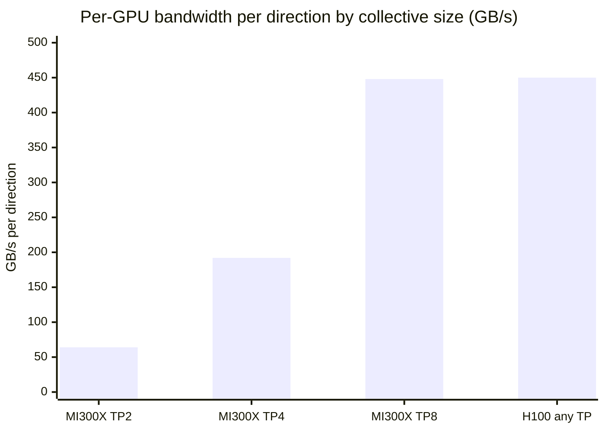
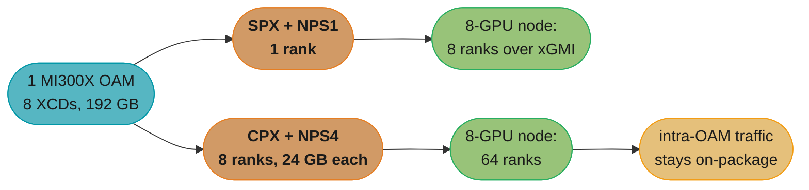
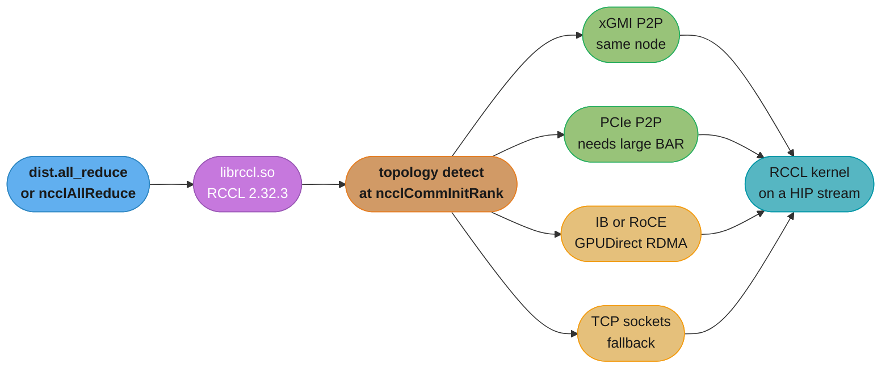
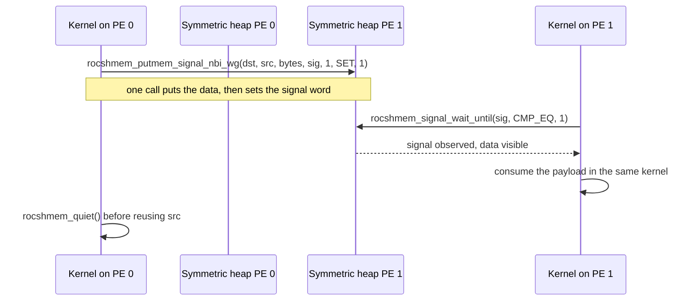
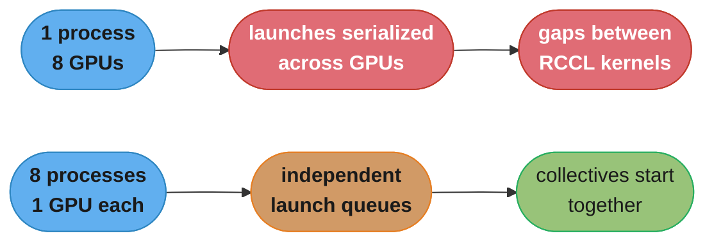

# Multi-GPU on AMD: RCCL and xGMI

> **Version anchor (fetched 2026-11-25):** ROCm Core SDK 10.2.0 (release notes dated 2026-11-18) ships RCCL 2.32.3 ("compatibility with NCCL 2.32.3"), rocSHMEM 3.8.0 and HIP 7.17.0. RCCL 2.32.3 has removed its MSCCL and MSCCL++ integration. An AMD Instinct MI300X has seven x16 AMD Infinity Fabric (xGMI) links to its seven peers plus one PCIe Gen 5 x16 link to the host (AMD's MI300X product page lists 8 Infinity Fabric links; on an 8-GPU platform 7 of them connect to peers). AMD quotes 128 GB/s per link and an 896 GB/s "P2P ring peak aggregate" per GPU, both bidirectional. An MI355X also has seven peer links, quoted at 144 GB/s each.

## 1. Concept Overview

An 8-GPU AMD Instinct server has no switch between its GPUs. Each MI300X, MI325X, MI350X or MI355X module connects straight to every other module through its own **xGMI** link. xGMI is AMD's name for the GPU-to-GPU form of Infinity Fabric. Seven links per GPU make a fully connected mesh of 28 point-to-point links. A host-side PCIe Gen 5 x16 link connects each GPU to a CPU socket. The NIC for scale-out also hangs off PCIe. The NVIDIA design that [`multi_gpu_programming_and_nccl`](../multi_gpu_programming_and_nccl/multi_gpu_programming_and_nccl.md) teaches routes every GPU's NVLink ports into NVSwitch chips. An AMD node instead hard-wires one link per GPU pair. The two layouts make the same 8-GPU collective almost equally fast and make a 2-GPU copy very different. This module is about that difference.

The software layer is **RCCL** (ROCm Communication Collectives Library). RCCL keeps the NCCL API: the same `ncclComm_t`, the same `ncclAllReduce`, the same `NCCL_DEBUG` variable. RCCL 2.32.3 declares compatibility with NCCL 2.32.3. RCCL implements all-reduce, all-gather, reduce, broadcast, reduce-scatter, gather, scatter, all-to-all and all-to-allv with ring and tree algorithms. It uses PCIe and xGMI inside a node, and InfiniBand, RoCE or TCP/IP sockets between nodes. PyTorch's `"nccl"` backend on a ROCm build loads RCCL. PyTorch on ROCm supports only the `"nccl"` and `"gloo"` backends for `torch.distributed`.

Three more pieces complete the picture. The **HIP peer-access API** (`hipDeviceCanAccessPeer`, `hipDeviceEnablePeerAccess`, `hipMemcpyPeer`) is the point-to-point layer under RCCL. **rocSHMEM** is an OpenSHMEM-like library with a symmetric heap. A kernel calls `rocshmem_putmem` and other device functions on it, with no host-side collective call. **Compute and memory partition modes** (SPX/CPX, NPS1/NPS4 on MI300X; DPX/NPS2 on MI350X and MI355X) can turn one physical GPU into several logical ones. That changes how many ranks a node has and what bandwidth each one sees.

This module stays at the programming altitude. Ring vs tree algorithms, the `2(N-1)/N` all-reduce cost and the ordering rules for collectives are the same as in NCCL. They are taught once in [`multi_gpu_programming_and_nccl`](../multi_gpu_programming_and_nccl/multi_gpu_programming_and_nccl.md) and not repeated here. The chiplet layout (XCDs, IODs, Infinity Cache) lives in [`amd_gpu_architecture_cdna_and_rdna`](../amd_gpu_architecture_cdna_and_rdna/amd_gpu_architecture_cdna_and_rdna.md). Porting single-GPU kernels lives in [`hip_programming_and_porting`](../hip_programming_and_porting/hip_programming_and_porting.md). Profiling the kernels around a collective lives in [`rocm_profiling_and_debugging`](../rocm_profiling_and_debugging/rocm_profiling_and_debugging.md). Kubernetes scheduling of AMD GPUs belongs to [`devops/ml_platform_and_gpu_infrastructure`](../../devops/ml_platform_and_gpu_infrastructure/ml_platform_and_gpu_infrastructure.md).

---

## 2. Intuition

> **One-line analogy**: An NVSwitch node is eight houses on a ring road with a big interchange in the middle: any house can drive to any other house on the full-width highway. An MI300X node is eight houses with a private two-lane road from each house to each of the seven others, and no interchange. If every house sends mail to every other house at once, all seven roads are busy and the totals are about the same. If two houses only talk to each other, they get one private road and the other six roads sit empty.

**Mental model**: Think of each MI300X as having seven pipes, each carrying 64 GB/s in each direction. The total is 448 GB/s per direction per GPU. You only get that total when traffic goes to all seven peers at the same time. An 8-GPU all-reduce, all-gather or all-to-all does that. A 2-GPU tensor-parallel group uses one pipe (64 GB/s per direction). A 4-GPU group uses three pipes (192 GB/s per direction). So on AMD the GPU count in a collective controls the available link bandwidth, not only the algorithm's step count.

**Why it matters**: Most multi-GPU code is written and tuned on NVSwitch systems, where any subset of GPUs sees the full per-GPU NVLink bandwidth. Move that code to an AMD node and a TP2 or TP4 layout that was cheap on H100 becomes communication-bound. The AMD workload-optimization guide says it plainly: avoid 2-GPU and 4-GPU collectives on MI300X, and use either 1 GPU or all 8. Nothing in the code shows this. The same `ncclAllReduce` call simply runs on fewer pipes.

**Key insight**: Two numbers settle most AMD multi-GPU questions. The first is **64 GB/s per direction per link** on MI300X and MI325X (72 GB/s on MI355X). The second is **the number of peers each GPU talks to at the same time**. Multiply them and you have the bandwidth ceiling for that pattern. Everything else in this module is about getting RCCL, HIP or rocSHMEM to reach that ceiling.

---

## 3. Core Principles

- **One link per GPU pair, no switch.** MI300X uses seven of its x16 Infinity Fabric links to form a fully connected 8-GPU system. Any pair has exactly one direct link. The per-pair bandwidth is the per-link bandwidth: 64 GB/s in each direction on MI300X.
- **Quote bandwidth per direction, and say so.** AMD's 128 GB/s per link and 896 GB/s per GPU are bidirectional sums. NVIDIA's 900 GB/s for H100 NVLink 4 is also a bidirectional sum. Halve each one once before you compare. A one-way copy or one ring hop sees the per-direction figure.
- **The RCCL API is the NCCL API.** Include `<rccl/rccl.h>`, link `librccl`, and the `nccl*` calls, `ncclUniqueId` rendezvous and `NCCL_*` environment variables carry over. Differences are in defaults, extra `RCCL_*` knobs, and features that were removed (MSCCL and MSCCL++).
- **One process per GPU.** AMD's guide says RCCL performs best in one-process-per-GPU mode, because ROCm serializes kernel launches on several GPUs driven from one process.
- **Peer access is opt-in, and the fallback is silent.** Without `hipDeviceEnablePeerAccess`, a device-to-device `hipMemcpy` still works but stages through host memory. On PCIe-connected AMD GPUs, P2P also needs `HSA_FORCE_FINE_GRAIN_PCIE=1` and large-BAR support.
- **Partition modes change the rank count.** In CPX mode each MI300X XCD appears as its own GPU, so one OAM becomes eight devices. NPS4 memory partitioning works only together with CPX on MI300X. RCCL treats each logical device as a rank.
- **GPU-initiated communication is a different library.** RCCL collectives are issued from the host on a stream. rocSHMEM lets a kernel `put`, `get` and signal on a symmetric heap directly. Pick rocSHMEM when the communication has to sit inside the compute kernel.
- **Defaults move between releases.** The default multi-node channel count on MI350X dropped from 64 to 48 in RCCL 2.30.4 (ROCm 7.14) and returns to 64 in ROCm 10.0. Before you compare two runs, confirm the channel count in the `NCCL_DEBUG=INFO` log.

---

## 4. Types / Architectures / Strategies

### 4.1 Interconnect paths on an AMD Instinct node

| Path | Mechanism | Per direction | Bidirectional (as quoted) |
|------|-----------|---------------|---------------------------|
| One xGMI link, MI300X / MI325X | 16 lanes at up to 32 Gb/s each | 64 GB/s | 128 GB/s (AMD product pages) |
| All 7 peer links, MI300X / MI325X | Every GPU sends to all 7 peers at once | 448 GB/s | 896 GB/s (CDNA 3 white paper) |
| One xGMI link, MI355X | One of 7 peer links | 72 GB/s | 144 GB/s (AMD product page) |
| All 7 peer links, MI355X | Every GPU sends to all 7 peers at once | 504 GB/s | 1,008 GB/s ("over 1 TB/s", ROCm MI350 page) |
| Host link | PCIe Gen 5 x16 to a CPU socket | 64 GB/s | 128 GB/s |
| Host-staged copy | GPU to host RAM, then host RAM to GPU | 64 GB/s, paid twice | n/a |
| Scale-out NIC, 400 Gb/s | GPUDirect RDMA from GPU memory to the NIC | 50 GB/s | n/a |



*At 8 GPUs, an MI300X uses all seven links and reaches 448 GB/s per direction, level with H100 NVLink 4 at 450. At 2 or 4 GPUs it uses 1 or 3 links. An NVSwitch node gives any subset the full 450.*

**In plain terms.** "On AMD, the bandwidth you get depends on how many peers you talk to at once. On NVSwitch, it does not."

Two unit conversions cause most of the mistakes. Links are rated in gigabits per second (Gb/s) per lane, and memory traffic is measured in gigabytes per second (GB/s), a factor of 8. Vendors quote link totals as bidirectional sums, while a one-way copy sees one direction, a factor of 2.

| Symbol | What it is |
|--------|------------|
| `32 Gb/s` | MI300X Infinity Fabric lane rate ("up to 32Gbps", CDNA 3 white paper) |
| `x16` | Lanes per link |
| `64 GB/s` | One link, one direction: `16 x 32 / 8` |
| `128 GB/s` | One link, both directions added: AMD's quoted per-link figure |
| `7` | Peer links per GPU in an 8-GPU node |
| `896 GB/s` | `7 x 128`, AMD's "P2P ring peak aggregate I/O bandwidth" |
| `1,024 GB/s` | `896 + 128` for the PCIe host link: AMD's "total peak aggregate I/O bandwidth" |

**Walk one example.** Rebuild AMD's published totals from the lane rate:

```
  one lane                 : 32 Gb/s
  one link, one direction  : 16 lanes x 32 Gb/s / 8 bits    =  64 GB/s
  one link, both directions: 2 x 64                         = 128 GB/s   <- AMD per-link figure
  seven peer links, both   : 7 x 128                        = 896 GB/s   <- AMD P2P aggregate
  plus PCIe Gen5 x16 host  : 896 + 128                      = 1,024 GB/s <- AMD total I/O

  what a TP group can use, per direction, per GPU:
    TP2 : 1 peer  x 64 GB/s = 64 GB/s   (14% of 448)
    TP4 : 3 peers x 64 GB/s = 192 GB/s  (43% of 448)
    TP8 : 7 peers x 64 GB/s = 448 GB/s  (100%)
```

The derived 64 GB/s per direction matches the Character.ai and DigitalOcean engineering write-up on MI325X: "Every GPU has a dedicated 128 GB/s bidirectional link to every other GPU."

### 4.2 RCCL vs NCCL: what carries over and what does not

| Item | NCCL (NVIDIA) | RCCL 2.32.3 (AMD) |
|------|---------------|-------------------|
| Header / library | `nccl.h`, `libnccl.so` | `rccl/rccl.h`, `librccl.so` |
| Core API | `ncclCommInitRank`, `ncclAllReduce`, `ncclGroupStart/End` | Same names and signatures |
| Diagnostics | `NCCL_DEBUG=INFO`, `NCCL_DEBUG_SUBSYS` | Same; RCCL 2.32.3 adds the `ATTN` log level and `NCCL_DEBUG_LEVELS` |
| Intra-node transport | NVLink, NVSwitch, NVLS | xGMI, PCIe P2P; symmetric-memory path when all local ranks are P2P capable |
| Custom algorithms | Tuner plugins | Tuner plugins; MSCCL and MSCCL++ integration removed, `mscclLoadAlgo` and siblings kept as no-ops |
| Extra knobs | n/a | `RCCL_ENABLE_CONTEXT_TRACKING`, `RCCL_TUNER_EMBEDDED_CONFIG`, `RCCL_CE_AR_*` |
| Benchmark suite | `nccl-tests` | `rccl-tests` (same `-b -e -f -g` flags, same busbw definition) |
| Replay tool | n/a | RCCL Replayer: replays per-rank collective logs with dummy data |

### 4.3 Partition modes and what they do to the rank count

| Mode | GPU | What one physical GPU becomes | Notes |
|------|-----|-------------------------------|-------|
| SPX + NPS1 | MI300X, MI350X, MI355X | 1 device, all 8 XCDs, all HBM | Default. Workgroups go round-robin to the XCDs |
| CPX + NPS1 | MI300X | 8 devices, one per XCD, each sees all HBM | You choose which XCD runs a workgroup |
| CPX + NPS4 | MI300X | 8 devices, each with a quarter of the HBM stacks as its NUMA domain | NPS4 needs CPX on MI300X |
| DPX + NPS2 | MI350X, MI355X | 2 devices, 4 XCDs and one 144 GB pool each | RCCL supports DPX/NPS2 on MI350 Series; MI350X does not support NPS4 |



*CPX multiplies the rank count by 8. Traffic between two XCDs of the same OAM stays inside the package and never touches an xGMI link. That is why the CPX benchmarks in the RCCL docs report single-OAM numbers.*

### 4.4 Communication libraries and when each fits

| Library | Who issues the operation | Typical use |
|---------|--------------------------|-------------|
| RCCL | Host, enqueued on a HIP stream | Gradient all-reduce, FSDP all-gather and reduce-scatter, tensor-parallel all-reduce, MoE all-to-all |
| RCCL device API (`ncclDevComm`, `ncclGetLsaPointer`) | Kernel, over registered symmetric windows | Fusing a peer read or write into your own kernel, with RCCL's communicator and barriers |
| rocSHMEM 3.8.0 | Kernel or host; OpenSHMEM-like puts, gets, atomics, signals | Fine-grained one-sided traffic inside a kernel, for example MoE dispatch |
| HIP peer access (`hipMemcpyPeer`) | Host | One-off bulk copies between two GPUs, weight loading, KV-cache moves |
| HIP IPC (`hipIpcGetMemHandle`) | Host, across processes | Sharing one device allocation between processes on the same node |

### 4.5 rocSHMEM backends

| Backend (`ROCSHMEM_BACKEND`) | Path | When it is chosen |
|------------------------------|------|-------------------|
| `ipc` | Direct loads and stores to peer GPU memory over xGMI or PCIe | Ranks on the same node |
| `ro` | Reverse offload: the GPU posts a request, a host thread runs the network call | Inter-node, when GPU-direct NIC access is not available |
| `gda` | GPU Direct Async: the GPU drives the NIC queue pairs itself | Inter-node on supported NICs |
| empty (default) | Auto-select | rocSHMEM picks the most appropriate backend when built with all of them |

---

## 5. Architecture Diagrams

### The 8-GPU xGMI full mesh as a link matrix

```
             GPU0  GPU1  GPU2  GPU3  GPU4  GPU5  GPU6  GPU7   links used
   GPU0       --    L     L     L     L     L     L     L        7
   GPU1       L     --    L     L     L     L     L     L        7
   GPU2       L     L     --    L     L     L     L     L        7
   GPU3       L     L     L     --    L     L     L     L        7
   GPU4       L     L     L     L     --    L     L     L        7
   GPU5       L     L     L     L     L     --    L     L        7
   GPU6       L     L     L     L     L     L     --    L        7
   GPU7       L     L     L     L     L     L     L     --       7

   L = one dedicated x16 xGMI link, 64 GB/s each way (MI300X / MI325X)
   28 links total = 8 x 7 / 2.  No switch.  Every pair is one hop.
```

*Every cell is a separate physical link. A pair of GPUs can only ever use its own cell, so a 2-GPU copy is capped at 64 GB/s per direction no matter how idle the other 27 links are.*

### Two TP4 groups on one node: which links carry traffic

```
   TP group A = {0,1,2,3}          TP group B = {4,5,6,7}

             GPU0  GPU1  GPU2  GPU3  GPU4  GPU5  GPU6  GPU7
   GPU0       --    A     A     A     .     .     .     .
   GPU1       A     --    A     A     .     .     .     .
   GPU2       A     A     --    A     .     .     .     .
   GPU3       A     A     A     --    .     .     .     .
   GPU4       .     .     .     .     --    B     B     B
   GPU5       .     .     .     .     B     --    B     B
   GPU6       .     .     .     .     B     B     --    B
   GPU7       .     .     .     .     B     B     B     --

   A, B = link carries tensor-parallel all-reduce traffic
   .    = link idle for TP traffic (16 of 28 links)
   per GPU: 3 active links x 64 GB/s = 192 GB/s each way
```

*Splitting a node into two TP4 groups leaves 16 of the 28 links idle for tensor-parallel traffic. Each group pays 192 GB/s per direction per GPU instead of 448. Whether that is a good trade depends on how much communication the model does per token; §7 has a production case where it was.*

### Where an RCCL call goes



*RCCL chooses transports once, at communicator init, from the detected topology. A missing peer-access capability or an unexpected PCIe layout shows up as a different transport line in the `NCCL_DEBUG=INFO` log, not as an error.*

### A rocSHMEM put with a completion signal



*The whole exchange happens inside running kernels. No host thread calls a collective, so there is no launch gap between "data ready" and "data sent".*

---

## 6. How It Works — Detailed Mechanics

### 6.1 Peer access with HIP, checked the way RCCL checks it

```cpp
#include <hip/hip_runtime.h>
#include <cstdio>
#include <cstdlib>

#define HIP_CHECK(expr)                                                        \
    do {                                                                       \
        hipError_t _e = (expr);                                                \
        if (_e != hipSuccess) {                                                \
            std::fprintf(stderr, "HIP error %s at %s:%d\n",                    \
                         hipGetErrorString(_e), __FILE__, __LINE__);           \
            std::exit(EXIT_FAILURE);                                           \
        }                                                                      \
    } while (0)

int main() {
    int n = 0;
    HIP_CHECK(hipGetDeviceCount(&n));
    for (int a = 0; a < n; ++a) {
        HIP_CHECK(hipSetDevice(a));
        for (int b = 0; b < n; ++b) {
            if (a == b) continue;
            int can = 0;
            HIP_CHECK(hipDeviceCanAccessPeer(&can, a, b));
            uint32_t linkType = 0, hops = 0;
            HIP_CHECK(hipExtGetLinkTypeAndHopCount(a, b, &linkType, &hops));
            int rank = 0;
            HIP_CHECK(hipDeviceGetP2PAttribute(&rank, hipDevP2PAttrPerformanceRank, a, b));
            std::printf("GPU%d -> GPU%d  p2p=%d  linkType=%u  hops=%u  perfRank=%d\n",
                        a, b, can, linkType, hops, rank);
            if (can) {
                hipError_t e = hipDeviceEnablePeerAccess(b, 0);
                if (e != hipSuccess && e != hipErrorPeerAccessAlreadyEnabled) HIP_CHECK(e);
            }
        }
    }
    return 0;
}
```

On an 8x MI300X node every pair should report `p2p=1` and `hops=1`. `hipExtGetLinkTypeAndHopCount` is an AMD extension that returns the HSA link type and the hop count. A pair that reports more than one hop, or a link type that is not xGMI, means the platform is not the fully connected mesh you think it is. Every collective plan that assumes one hop is then wrong.

### 6.2 A peer copy: one link, one direction

```cpp
// HIP_CHECK as in 6.1. Assumes peer access was enabled in both directions as in 6.1.
const size_t bytes = size_t(1) << 30;           // 1 GiB
float *src = nullptr, *dst = nullptr;
HIP_CHECK(hipSetDevice(0)); HIP_CHECK(hipMalloc(&src, bytes));
HIP_CHECK(hipSetDevice(1)); HIP_CHECK(hipMalloc(&dst, bytes));

hipStream_t s; HIP_CHECK(hipSetDevice(0)); HIP_CHECK(hipStreamCreate(&s));
hipEvent_t t0, t1; HIP_CHECK(hipEventCreate(&t0)); HIP_CHECK(hipEventCreate(&t1));
HIP_CHECK(hipEventRecord(t0, s));
HIP_CHECK(hipMemcpyPeerAsync(dst, 1, src, 0, bytes, s));   // one direction, one xGMI link
HIP_CHECK(hipEventRecord(t1, s));
HIP_CHECK(hipEventSynchronize(t1));
float ms = 0.f; HIP_CHECK(hipEventElapsedTime(&ms, t0, t1));
std::printf("GPU0 -> GPU1: %.2f GB/s\n", (bytes / 1e9) / (ms / 1e3));
```

The ceiling for this copy is the single link between GPU 0 and GPU 1:

```
  1 GiB = 1.074 GB
  one xGMI link, one direction   : 1.074 / 64  = 16.8 ms   (floor)
  host-staged, PCIe Gen5 x16 x 2 : 2 x 1.074 / 64 = 33.6 ms
  ratio                          : 2.0x
```

On NVSwitch the same copy runs against 450 GB/s per direction. On MI300X a pairwise copy is only about 2x better than staging through the host. To use more than one link, spread the traffic across several peers, which is exactly what an 8-GPU collective does.

### 6.3 Raw RCCL: one process per GPU with an `ncclUniqueId` rendezvous

```cpp
#include <hip/hip_runtime.h>
#include <rccl/rccl.h>
#include <mpi.h>
#include <cstdio>
#include <cstdlib>
// HIP_CHECK as defined in 6.1.

#define NCCLCHECK(cmd)                                                         \
    do {                                                                       \
        ncclResult_t _r = (cmd);                                               \
        if (_r != ncclSuccess) {                                               \
            std::fprintf(stderr, "RCCL error %s at %s:%d\n",                   \
                         ncclGetErrorString(_r), __FILE__, __LINE__);          \
            std::exit(EXIT_FAILURE);                                           \
        }                                                                      \
    } while (0)

int main(int argc, char** argv) {
    MPI_Init(&argc, &argv);
    int rank = 0, world = 0;
    MPI_Comm_rank(MPI_COMM_WORLD, &rank);
    MPI_Comm_size(MPI_COMM_WORLD, &world);

    // Local rank picks the GPU. Every rank still SEES all GPUs on the node.
    MPI_Comm local;
    MPI_Comm_split_type(MPI_COMM_WORLD, MPI_COMM_TYPE_SHARED, rank, MPI_INFO_NULL, &local);
    int localRank = 0; MPI_Comm_rank(local, &localRank);
    HIP_CHECK(hipSetDevice(localRank));

    ncclUniqueId id;
    if (rank == 0) NCCLCHECK(ncclGetUniqueId(&id));
    MPI_Bcast(&id, sizeof(id), MPI_BYTE, 0, MPI_COMM_WORLD);

    ncclComm_t comm;
    NCCLCHECK(ncclCommInitRank(&comm, world, id, rank));

    const size_t count = size_t(256) << 20;      // 256 Mi floats = 1 GiB
    float* buf = nullptr; HIP_CHECK(hipMalloc(&buf, count * sizeof(float)));
    hipStream_t s; HIP_CHECK(hipStreamCreate(&s));

    NCCLCHECK(ncclAllReduce(buf, buf, count, ncclFloat, ncclSum, comm, s));
    HIP_CHECK(hipStreamSynchronize(s));

    NCCLCHECK(ncclCommDestroy(comm));
    HIP_CHECK(hipFree(buf));
    MPI_Finalize();
    return 0;
}
```

Build with `hipcc -O3 ar.cpp -lrccl -lmpi`. Three points are specific to AMD:

- **One process per GPU.** AMD's tuning guide gives the reason: one process driving several GPUs hits kernel-launch latency because ROCm serializes kernel launches on multiple GPUs from one process.
- **Let every rank see every GPU.** RCCL 2.32.3 in ROCm 10.2.0 has a known issue: if each rank sees only one GPU (Slurm `--gpu-bind=closest`, or a per-rank `HIP_VISIBLE_DEVICES` / `ROCR_VISIBLE_DEVICES`), `ncclCommInitRank` returns `ncclInternalError`. The documented workaround is the pattern above: expose all GPUs, then select one by local rank.
- **Same busbw arithmetic.** The theoretical floor for this 1 GiB all-reduce at 8 GPUs, using all seven links:

```
  bytes each GPU sends   = 2 x (N-1)/N x S = 2 x 7/8 x 1.074 GB = 1.879 GB
  per-direction ceiling  = 7 links x 64 GB/s                    = 448 GB/s
  floor                  = 1.879 / 448                          = 4.19 ms
  same call, TP4 group   : 2 x 3/4 x 1.074 = 1.611 GB over 192 GB/s = 8.39 ms
  same call, TP2 group   : 2 x 1/2 x 1.074 = 1.074 GB over  64 GB/s = 16.8 ms
```

Halving the group from 8 to 4 GPUs sends fewer bytes per GPU but doubles the time, because the link count falls faster than the byte count.

### 6.4 PyTorch on ROCm

```python
import os
import torch
import torch.distributed as dist

def main() -> None:
    # torchrun sets RANK, WORLD_SIZE, LOCAL_RANK, MASTER_ADDR, MASTER_PORT.
    local_rank = int(os.environ["LOCAL_RANK"])
    assert torch.version.hip is not None, "expected a ROCm build of PyTorch"
    torch.cuda.set_device(local_rank)                 # torch.cuda is reused on ROCm
    dist.init_process_group(backend="nccl")           # "nccl" loads RCCL on ROCm

    x = torch.ones(256 * 1024 * 1024, device="cuda")  # 1 GiB of fp32
    dist.all_reduce(x, op=dist.ReduceOp.SUM)
    torch.cuda.synchronize()
    if dist.get_rank() == 0:
        print("sum per element:", x[0].item())        # equals world size
    dist.destroy_process_group()

if __name__ == "__main__":
    main()
```

Run it with `torchrun --nproc_per_node=8 ar.py`. PyTorch intentionally reuses the `torch.cuda` interfaces on ROCm, so device strings stay `"cuda"`. The RCCL that runs is the `librccl.so` bundled under `site-packages/torch/lib/` in a wheel install, not necessarily the one in `/opt/rocm/lib`. The RCCL docs make this point for CPX mode: CPX support arrived in ROCm 6.3.0, so a wheel that bundles an older RCCL needs that library replaced before CPX works.

For FSDP on MI300X, AMD's guide reports that RCCL streams and compute streams do not always overlap well, and recommends two settings:

```bash
export TORCH_NCCL_HIGH_PRIORITY=1   # make every RCCL stream high priority
export GPU_MAX_HW_QUEUES=2          # HIP runtime: limit hardware queues
```

The guide's reasoning: hardware efficiency is best with 4 or fewer HIP streams, and these two settings give two compute streams and two RCCL streams.

### 6.5 rocSHMEM inside a kernel

```cpp
#include <hip/hip_runtime.h>
#include <rocshmem/rocshmem.hpp>
#include <cstdint>
using namespace rocshmem;
// HIP_CHECK as defined in 6.1.

__global__ void ring_put(float* sym_dst, const float* sym_src, size_t n, uint64_t* sig) {
    int me = rocshmem_my_pe();
    int npes = rocshmem_n_pes();
    int right = (me + 1) % npes;
    // Workgroup-wide put-with-signal: every thread calls it with identical arguments.
    // The data lands in sym_dst on PE `right`, then sig on that PE is set to 1.
    rocshmem_putmem_signal_nbi_wg(sym_dst, sym_src, n * sizeof(float),
                                  sig, 1, ROCSHMEM_SIGNAL_SET, right);
    if (threadIdx.x == 0) {
        rocshmem_signal_wait_until(sig, ROCSHMEM_CMP_EQ, 1);  // left neighbour's data is here
        rocshmem_quiet();                                      // our own puts are complete
    }
    __syncthreads();
    // sym_dst now holds the left neighbour's data; use it in this kernel.
}

int main() {
    // Select the GPU BEFORE rocshmem_init (rank-to-GPU mapping comes from the launcher).
    HIP_CHECK(hipSetDevice(/* local rank */ 0));
    rocshmem_init();
    size_t n = size_t(1) << 20;
    auto* src = static_cast<float*>(rocshmem_malloc(n * sizeof(float)));      // collective
    auto* dst = static_cast<float*>(rocshmem_malloc(n * sizeof(float)));      // collective
    auto* sig = static_cast<uint64_t*>(rocshmem_malloc(sizeof(uint64_t)));    // collective
    HIP_CHECK(hipMemset(sig, 0, sizeof(uint64_t)));
    rocshmem_barrier_all();
    ring_put<<<1, 256>>>(dst, src, n, sig);
    HIP_CHECK(hipDeviceSynchronize());
    rocshmem_free(src); rocshmem_free(dst); rocshmem_free(sig);
    rocshmem_finalize();
    return 0;
}
```

Facts from the rocSHMEM 3.8.0 reference that this code depends on:

- `rocshmem_init()` requires `hipSetDevice` first. `rocshmem_malloc` is collective: every PE must call it, in the same order.
- Device calls with no suffix are called by one thread. `_wave` calls need every lane of the wavefront, and `_wg` calls need every thread of the workgroup, with identical arguments. Different arguments are undefined behavior.
- `_nbi` calls return once the request is posted. `rocshmem_quiet()` completes them.
- The symmetric heap defaults to 1 GiB per PE (`ROCSHMEM_HEAP_SIZE=1073741824`), with up to 32 contexts and 40 teams by default.
- Compile with `-fgpu-rdc` and link with `--hip-link`, `librocshmem.a` and an MPI library. Launch with `mpiexec`, for example `mpiexec --map-by numa --mca pml ucx --mca osc ucx -np 8 ./app`.

### 6.6 Checking the node before you blame RCCL

```bash
amd-smi topology            # link type and hops between every GPU pair
amd-smi xgmi                # xGMI link status and counters
cat /proc/sys/kernel/numa_balancing     # AMD's RCCL guides expect 0
sudo sysctl kernel.numa_balancing=0

# Raw copy bandwidth between all pairs, independent of RCCL:
USE_FINE_GRAIN=1 GFX_UNROLL=2 ./TransferBench a2a 64M 8

# Collective bandwidth with RCCL's own harness (one process per GPU):
mpirun -np 8 --bind-to numa ./build/all_reduce_perf -b 8 -e 1G -f 2 -g 1

# What RCCL decided at init: transports, channels, algorithms.
NCCL_DEBUG=INFO NCCL_DEBUG_SUBSYS=INIT,TUNING,COLL ./your_app
```

Read the results against the arithmetic in 6.3. An 8-GPU `all_reduce_perf` whose large-message busbw is far below the 448 GB/s per-direction ceiling, on a node where `amd-smi topology` shows one-hop xGMI everywhere, points at configuration (NUMA balancing, channel count, process layout), not at the links. For multi-node runs, AMD's guide also asks you to check `lspci -vvv | grep -i acsctl` for `SrcValid+` and to disable PCIe ACS, which would otherwise send GPUDirect RDMA traffic up through the root complex.

### 6.7 Knobs that matter on AMD

| Variable | Default | Effect | Source of the advice |
|----------|---------|--------|----------------------|
| `NCCL_MIN_NCHANNELS` | topology-chosen | More channels, more bandwidth, more CUs used by RCCL. RCCL already uses 32 channels for 2 GPUs and 24 for 4 GPUs on an 8x MI300X node | RCCL usage tips; AMD tuning guide suggests 112 for end-to-end workloads |
| `NCCL_MAX_NCHANNELS` + `NCCL_MIN_NCHANNELS` = 64 | 48 on MI350X multi-node in ROCm 7.14 | Restores the pre-7.14 channel count; ROCm 10.0 returns to 64 | RCCL usage tips |
| `HSA_FORCE_FINE_GRAIN_PCIE=1` | unset | Enables P2P between PCIe-connected GPUs; needs large BAR | RCCL usage tips |
| `HSA_NO_SCRATCH_RECLAIM=1` | unset | MI200 (gfx90a) on ROCm 7.13+: removes per-launch scratch reclaim that makes sub-16 MB collectives roughly 5-10x slower | RCCL usage tips |
| `NCCL_IGNORE_CPU_AFFINITY=1` | unset | Use GPU affinity only, ignore the launcher's CPU mask | RCCL usage tips |
| `RCCL_ENABLE_CONTEXT_TRACKING=1` | 0 | Context tracking; can help in some scenarios | RCCL usage tips |
| `NCCL_CUMEM_ENABLE=1` | `-2` (auto only on gfx1250) | Virtual memory management, needed for the symmetric-memory path and for `ncclCommSuspend` to free memory | RCCL usage tips |
| `TORCH_NCCL_HIGH_PRIORITY=1`, `GPU_MAX_HW_QUEUES=2` | unset | FSDP compute and communication overlap on MI300X | AMD workload guide |
| `HIP_FORCE_DEV_KERNARG=1` | unset | Used in AMD's CPX all-reduce benchmarks | RCCL usage tips |

### 6.8 Hangs, stalls and idle communicators

RCCL 2.32.3 brings over NCCL's RAS machinery and adds to it. `NCCL_PROGRESS_COUNTERS=1` (with `NCCL_RAS_ENABLE=1`, the default) mirrors device progress counters to host memory, and a RAS monitor warns when a communicator's counters stop moving. `NCCL_RUN_RAS_DIAGNOSTICS` checks PCI topology, IOMMU mode and ATS state of GPU and NIC pairs. Init logs at the new `ATTN` level report ranks that run RCCL builds from different git revisions, which is a common cause of mismatched behavior in heterogeneous fleets.

For long-lived processes that hold several communicators, `ncclCommSuspend(comm, NCCL_SUSPEND_MEM)` releases a communicator's dynamic GPU memory while it is idle and `ncclCommResume` takes it back. It frees physical memory only with VMM support: `NCCL_CUMEM_ENABLE=1`, ROCm 7.12 or later, Linux 6.8 or later. Without VMM both calls succeed and free nothing.

To reproduce a collective bug offline, capture per-rank logs with `NCCL_DEBUG=INFO NCCL_DEBUG_SUBSYS=COLL NCCL_DEBUG_FILE=run.%h.%p.log`, concatenate them, and replay them with the RCCL Replayer. It reissues the same collectives with dummy data and has no dependency on the application.

---

## 7. Real-World Examples

**Microsoft Azure ND MI300X v5.** Microsoft's VM documentation describes 8 MI300X GPUs per VM, connected by 4th-gen Infinity Fabric with "128 GB/s bandwidth per GPU and 896 GB/s aggregate bandwidth". By AMD's own white paper the 128 GB/s is per link, so a pair of GPUs gets 64 GB/s each way. Each GPU has its own 400 Gb/s NVIDIA Quantum-2 CX7 InfiniBand connection with GPUDirect RDMA, for 3.2 Tb/s per VM, and the scale-out path is RCCL.

**Character.ai on MI325X (DigitalOcean and AMD, January 2026).** Serving Qwen3-235B FP8 with vLLM and AITER kernels for a 5,600-token input and 140-token output workload, the team compared one TP8 instance per 8-GPU server against two TP4 instances. A single TP4 group was never better than TP8 on time to first token or time per output token. Reading the curves at the target concurrency of 64, the team computed about 2x the QPS for two TP4 groups (DP2/TP4/EP4) against one TP8 group, with the p90 latency targets still met. Under similar latency and concurrency conditions the write-up summarizes the result as about 45% more throughput than DP1/TP8/EP8 and about 91% more than the earlier non-optimized setup. Placement still mattered: the ROCm Kubernetes device plugin scores GPU subsets so that a TP4 pod stays on one NUMA node, because a vLLM process driving GPUs across both CPU sockets sends kernel-launch traffic over the CPU-to-CPU link.

**Databricks / MosaicML on MI250 (October 2023).** On a 32-node cluster of 4x MI250 per node with an 800 Gb/s inter-node network, LLM Foundry training held 166 TFLOP/s per GPU at one node and 159 TFLOP/s per GPU at 128 GPUs with a constant global batch size. The stack was unchanged PyTorch FSDP over RCCL.

**vLLM on MI300X (Embedded LLM and Hot Aisle, October 2024).** The guest post on the vLLM blog lists disabling NUMA balancing and tuning `NCCL_MIN_NCHANNELS` among its AMD-specific settings. It recommends the minimum tensor-parallel size that fits the model for throughput, with several instances per node, and TP equal to the GPU count for latency.

**Moreh (August 2023).** Moreh reported training a 221B-parameter Korean language model on a cluster of 1,200 AMD MI250 GPUs through its MoAI platform.

**AMD's own CPX benchmarks.** The RCCL documentation reports that an optimized CPX all-reduce across the 8 XCD partitions of one MI300X OAM peaks at about 340 GB/s bus bandwidth. A PyTorch all-reduce benchmark on one OAM peaked at about 170 GB/s with ROCm 6.2.4 and at about 315 GB/s with the optimized CPX path.

---

## 8. Tradeoffs

### NVSwitch node vs xGMI full mesh

| Property | NVSwitch (H100 HGX) | xGMI mesh (MI300X platform) |
|----------|---------------------|-----------------------------|
| Topology | Every GPU to a switch layer | Every GPU to every other GPU, no switch |
| Per GPU, per direction, all peers | 450 GB/s | 448 GB/s |
| One pair, per direction | 450 GB/s | 64 GB/s (one link) |
| TP2 / TP4 groups | Full bandwidth | 1 or 3 links |
| In-network reduction | NVLS on NVLink 4 NVSwitch and later | None; reductions run on GPU CUs |
| Scale of one fast domain | 8 GPUs per HGX; larger NVLink domains on GB200 NVL72 | 8 GPUs per node |
| Extra hardware | NVSwitch chips | None between GPUs |

### Choosing a communication layer

| Choice | Strength | Cost |
|--------|----------|------|
| RCCL host collectives | Topology-aware, battle-tested, one call per collective, framework support | A kernel launch per collective; coarse grain; ties up CUs for channels |
| RCCL device API | Peer access from your own kernel with RCCL's barriers | Needs symmetric windows, `NCCL_CUMEM_ENABLE=1`, P2P-capable ranks |
| rocSHMEM | One-sided puts and signals inside a kernel, inter-node through `gda` or `ro` | MPI dependency, `-fgpu-rdc` builds, your own synchronization protocol |
| `hipMemcpyPeer` | Simplest bulk copy | One link per pair; no reduction |

### Partition modes

| Mode | Gain | Cost |
|------|------|------|
| SPX + NPS1 | One device per GPU, simple rank math | No control over which XCD runs a workgroup |
| CPX + NPS4 (MI300X) | XCD-level placement; AMD reports large intra-OAM all-reduce gains | 8x the ranks; each rank has a quarter of HBM as its NUMA domain; needs RCCL from ROCm 6.3 or later |
| DPX + NPS2 (MI350X/MI355X) | Two 144 GB pools, less cross-IOD traffic | 2x ranks, half the memory per rank |

---

## 9. When to Use / When NOT to Use

**Use RCCL collectives when**
- The job is data-parallel or FSDP training, or tensor-parallel inference, through PyTorch, JAX or vLLM. These call RCCL already.
- The group covers all 8 GPUs of a node, so every xGMI link carries traffic.
- You need inter-node collectives over InfiniBand or RoCE with GPUDirect RDMA.

**Use rocSHMEM or the RCCL device API when**
- Communication must start inside a running kernel, for example token dispatch in an MoE layer, where a host-issued collective would add a launch and a stream wait per step.
- You want one-sided puts with a signal flag instead of a matched send and receive.

**Use plain `hipMemcpyPeer` when**
- You move a weight shard or KV-cache block from one GPU to another once, outside the hot loop.

**Do NOT**
- Assume a TP2 or TP4 layout tuned on an NVSwitch node keeps its communication cost on MI300X. Recompute with 64 GB/s per link per direction, and measure.
- Drive 8 GPUs from one process with RCCL and expect peak bandwidth. ROCm serializes the launches.
- Restrict each rank to a single visible GPU on ROCm 10.2.0 RCCL 2.32.3. Communicator init fails.
- Compare an AMD bidirectional figure with a per-direction figure from anywhere else.
- Reach for MSCCL algorithm files on RCCL 2.32.3. The integration is gone and the entry points are no-ops.

---

## 10. Common Pitfalls

**BROKEN: binding each rank to one GPU through the environment on ROCm 10.2.0**

```bash
# BROKEN -- each rank sees exactly one GPU
# srun --gpu-bind=closest ...   or, equivalently:
export HIP_VISIBLE_DEVICES=$SLURM_LOCALID
python train.py
# RCCL 2.32.3: ncclCommInitRank -> ncclInternalError
# "internal error - please report this issue to the NCCL developers"
```

The ROCm 10.2.0 release notes list this as a known issue: jobs where each rank sees only one GPU fail communicator initialization. Jobs where each rank sees two or more GPUs, or all of them, are not affected.

```python
# FIX -- every rank sees all 8 GPUs; the process picks its own by local rank
import os, torch, torch.distributed as dist
local_rank = int(os.environ["LOCAL_RANK"])   # do NOT set HIP_VISIBLE_DEVICES per rank
torch.cuda.set_device(local_rank)
dist.init_process_group(backend="nccl")
```

The documented workaround makes the application responsible for picking the GPU nearest its CPU binding. If it does not, CPU-to-GPU locality is lost. The other documented option is to build RCCL from a revision that contains the fix and preload it.

**BROKEN: a device-to-device copy that silently goes through the host**

```cpp
// BROKEN -- no peer access enabled; HIP still completes the copy,
// but through a staging buffer in host memory
HIP_CHECK(hipSetDevice(0));
HIP_CHECK(hipMemcpy(dst_on_gpu1, src_on_gpu0, bytes, hipMemcpyDeviceToDevice));
```

The HIP documentation states it: without peer access, the call "still works but internally uses a staging buffer in host memory, which incurs a performance penalty". For 1 GiB that is two PCIe hops, about 33.6 ms instead of about 16.8 ms over the direct link.

```cpp
// FIX -- enable peer access in both directions once, then copy peer to peer
int can01 = 0, can10 = 0;
HIP_CHECK(hipDeviceCanAccessPeer(&can01, 0, 1));
HIP_CHECK(hipDeviceCanAccessPeer(&can10, 1, 0));
if (can01 && can10) {
    HIP_CHECK(hipSetDevice(0)); HIP_CHECK(hipDeviceEnablePeerAccess(1, 0));
    HIP_CHECK(hipSetDevice(1)); HIP_CHECK(hipDeviceEnablePeerAccess(0, 0));
}
HIP_CHECK(hipMemcpyPeer(dst_on_gpu1, 1, src_on_gpu0, 0, bytes));
```

**Other frequent pitfalls**

- **Porting a TP2 inference layout from H100 unchanged.** On NVSwitch the pair gets 450 GB/s per direction; on MI300X it gets one 64 GB/s link. The all-reduce in every transformer layer gets about 7x slower per byte. AMD's guide recommends 1 GPU or all 8.
- **Reading 896 GB/s as "per-GPU one-way bandwidth".** It is seven links, both directions added. One direction to all peers is 448 GB/s, and one peer is 64 GB/s.
- **Leaving NUMA auto-balancing on.** AMD's RCCL troubleshooting guide sets `kernel.numa_balancing=0` before any benchmark, and the vLLM MI300X guide lists it among the settings that improved serving.
- **Forgetting the scratch-reclaim setting on MI200.** On gfx90a with ROCm 7.13 or later, RCCL documents a fixed per-launch cost that makes collectives under 16 MB roughly 5-10x slower until `HSA_NO_SCRATCH_RECLAIM=1` is set.
- **Comparing rccl-tests across ROCm 7.14 without checking channels.** On MI350X/MI355X multi-node SPX, RCCL 2.30.4 reduced the default from 64 to 48 channels to free CUs for compute. Standalone benchmarks look worse; overlapped training may look better. Read the channel count from `NCCL_DEBUG=INFO` first.
- **Enabling CPX with the RCCL bundled in an old PyTorch wheel.** CPX support arrived with ROCm 6.3.0. A wheel built against ROCm 6.2 carries an older `librccl.so` and does not get the CPX path.
- **Mixing NIC configurations across ranks.** Different `NCCL_SOCKET_IFNAME` or `NCCL_IB_HCA` values per rank give ranks different NET device counts. RCCL now logs the mismatch at init; `NCCL_IGNORE_NET_MISMATCH=0` turns it into an `ncclSystemError`.
- **Leaving PCIe ACS on in a multi-node cluster.** AMD's guide checks for `SrcValid+` in `lspci -vvv` output and disables ACS; with ACS on, GPU-to-NIC traffic is redirected up through the root complex.
- **Calling a `_wg` rocSHMEM routine from only some threads.** Every thread of the workgroup must call it with the same arguments. Calling it under `if (threadIdx.x == 0)` is undefined behavior, typically a hang.

---

## 11. Technologies & Tools

| Tool | Role |
|------|------|
| **RCCL** | AMD's NCCL-compatible collective library; ring and tree algorithms over xGMI, PCIe, InfiniBand, RoCE and TCP |
| **rccl-tests** | Bandwidth and correctness harness for RCCL collectives; same flags and busbw definition as nccl-tests |
| **RCCL Replayer** | Replays per-rank collective logs with dummy data to reproduce hangs and slowdowns |
| **TransferBench** | Measures simultaneous copies between chosen devices, independent of RCCL |
| **rocSHMEM** | OpenSHMEM-like, GPU-initiated communication over a symmetric heap; `ipc`, `ro` and `gda` backends |
| **HIP peer API** | `hipDeviceCanAccessPeer`, `hipDeviceEnablePeerAccess`, `hipMemcpyPeer(Async)`, `hipDeviceGetP2PAttribute`, `hipExtGetLinkTypeAndHopCount` |
| **HIP IPC** | `hipIpcGetMemHandle`, `hipIpcOpenMemHandle` for sharing device memory between processes |
| **amd-smi** | `amd-smi topology`, `amd-smi xgmi`, and partition control with `amd-smi set --compute-partition` / `--memory-partition` |
| **NPKit** | Fine-grained trace events inside RCCL collective kernels |
| **ROCm Kubernetes device plugin** | Allocates `amd.com/gpu` and scores GPU subsets by NUMA node and xGMI connectivity |
| **PyTorch on ROCm** | `torch.distributed` with the `"nccl"` backend, which loads RCCL |

The order of use matters. Start with `amd-smi topology` and TransferBench to prove the hardware. Then run rccl-tests to prove the library. Profile the application only after both match the arithmetic in §6. Use the RCCL Replayer when the application hangs and the benchmarks do not.

---

## 12. Interview Questions with Answers

**Q: Why does a 2-GPU tensor-parallel job on MI300X spend far more time in all-reduce than the same job on 8 MI300X GPUs?**
**Short:** Each MI300X pair shares one xGMI link of 64 GB/s per direction, so a 2-GPU group uses 1 of 7 links while an 8-GPU group uses all 7 for 448 GB/s per direction.
The MI300X node is a full mesh with no switch: seven x16 Infinity Fabric links per GPU, one to each peer. A 2-GPU collective can only use the one link between that pair, 64 GB/s in each direction. An 8-GPU collective drives all seven links at once, 448 GB/s per direction per GPU. AMD's MI300X workload guide therefore says to avoid 2-GPU and 4-GPU collectives and to use either a single GPU or all eight. On an NVSwitch node the same TP2 group would get the full 450 GB/s per direction, which is why a layout tuned on H100 can become communication-bound when moved unchanged.

**Q: AMD quotes 128 GB/s per Infinity Fabric link and 896 GB/s per MI300X; NVIDIA quotes 900 GB/s NVLink per H100. Which is faster for a one-way copy between two GPUs?**
**Short:** The H100 pair, about 450 GB/s per direction through NVSwitch, against 64 GB/s per direction on the single MI300X link between the pair; all three quoted figures are bidirectional sums.
Normalize first: every number quoted is a bidirectional sum. Per direction, one MI300X link is 64 GB/s, all seven links are 448 GB/s, and H100 NVLink 4 is 450 GB/s. A one-way copy between two MI300X GPUs uses one link, 64 GB/s, while the H100 pair reaches through the switch at about 450 GB/s. For an all-GPU collective the two are within 1% of each other. The interview trap is comparing 896 with 900 and calling it a draw for every pattern, or comparing 896 bidirectional with someone's per-direction number.

**Q: An RCCL job on ROCm 10.2.0 fails in `ncclCommInitRank` with an "internal error" when Slurm binds each rank to its closest GPU. What is wrong and how do you fix it?**
**Short:** RCCL 2.32.3 has a known issue where init fails if each rank sees only one GPU; let every rank see all GPUs and select one by local rank, or preload a fixed RCCL build.
The ROCm 10.2.0 release notes list it: with `--gpu-bind=closest`, or a per-rank `HIP_VISIBLE_DEVICES` or `ROCR_VISIBLE_DEVICES`, each rank sees one GPU and `ncclCommInitRank` returns `ncclInternalError`. Jobs where ranks see two or more GPUs are fine. The workaround is to expose all GPUs on the node and call `hipSetDevice(local_rank)` or `torch.cuda.set_device(local_rank)`; the application then has to keep CPU-to-GPU locality itself. Alternatively, build RCCL from a revision that contains the fix and preload it ahead of the packaged library.

**Q: Does code written against NCCL need changes to run on RCCL?**
**Short:** Very little: RCCL keeps the nccl* API and NCCL_* variables, so you change the header to rccl/rccl.h and link librccl, but MSCCL is gone and several defaults differ.
RCCL 2.32.3 declares compatibility with NCCL 2.32.3, and the communicator, collective, group and unique-ID calls have the same names and signatures. Framework code needs no change at all, because PyTorch's `"nccl"` backend loads RCCL on ROCm. What does change is around the edges: MSCCL and MSCCL++ integration was removed and its entry points are no-ops, RCCL adds `RCCL_*` knobs such as context tracking and embedded tuner configs, and channel defaults are set per GPU architecture. Re-run rccl-tests on the new platform rather than assuming NCCL tuning carries over.

**Q: Why does AMD recommend one process per GPU for RCCL?**
**Short:** ROCm serializes kernel launches on multiple GPUs driven from one process, so a single process feeding 8 GPUs adds launch latency to every collective.
AMD's tuning guide gives that exact reason: one process driving several GPUs runs into kernel-launch latency because ROCm serializes launches across those GPUs. Each RCCL collective is a kernel per GPU, so the serialization lands on the critical path of every all-reduce. The production pattern is `torchrun --nproc_per_node=8` or `mpirun -np 8`, with an `ncclUniqueId` broadcast and `ncclCommInitRank` per process. It is the same pattern NCCL users already use, for a different reason.

**Q: What happens on AMD if you `hipMemcpy` between two GPUs without enabling peer access?**
**Short:** The copy still succeeds, but HIP stages it through a host-memory buffer, crossing PCIe twice instead of using the direct xGMI link.
HIP's documentation says that without peer access the call "still works but internally uses a staging buffer in host memory, which incurs a performance penalty". For 1 GiB that is two PCIe Gen 5 x16 hops at 64 GB/s, about 33.6 ms, against about 16.8 ms over the direct xGMI link. Nothing fails, which is why the problem hides. Check `hipDeviceCanAccessPeer` in both directions, call `hipDeviceEnablePeerAccess` from each side, and use `hipMemcpyPeer` or `hipMemcpyPeerAsync`.

**Q: What does `HSA_FORCE_FINE_GRAIN_PCIE=1` do, and when do you need it?**
**Short:** It enables peer-to-peer access between AMD GPUs that are connected over PCIe rather than xGMI, and it needs GPUs and a platform with large-BAR support.
RCCL's usage tips document it as the setting that turns on peer-to-peer transport on machines with PCIe-connected GPUs. It applies to workstation and PCIe-card setups, not to the xGMI mesh inside an OAM baseboard. It requires P2P-capable GPUs and proper large BAR addressing. If the BAR is too small, enabling the variable does not create the capability.

**Q: How do CPX and NPS4 partition modes change multi-GPU programming on MI300X?**
**Short:** CPX exposes each of the 8 XCDs as its own GPU and NPS4 gives each a quarter of HBM as its NUMA domain, so one OAM becomes 8 RCCL ranks whose mutual traffic stays on-package.
In SPX mode the 8 XCDs form one device and workgroups are spread round-robin across them. In CPX mode each XCD is a separate logical GPU, so you control placement, and an 8-GPU node becomes 64 devices. On MI300X, NPS4 is available only together with CPX. AMD reports that an optimized CPX all-reduce across the 8 XCDs of one OAM peaks at about 340 GB/s bus bandwidth, and a PyTorch benchmark rose from about 170 to about 315 GB/s. The catch is software: CPX support in RCCL arrived in ROCm 6.3.0, so the RCCL bundled in an older PyTorch wheel has to be replaced.

**Q: After moving MI350X nodes to ROCm 7.14, standalone rccl-tests bandwidth drops but training throughput does not. Why?**
**Short:** RCCL 2.30.4 cut the default multi-node channel count on MI350X SPX from 64 to 48 to leave more CUs for overlapped compute, trading raw collective bandwidth for compute.
RCCL channels run on compute units. Fewer channels mean lower bandwidth in an isolated benchmark, but more CUs for kernels that run concurrently with communication. The RCCL docs describe this as deliberate and give the way back: set both `NCCL_MAX_NCHANNELS=64` and `NCCL_MIN_NCHANNELS=64`, where 64 is the effective ceiling for multi-node jobs. ROCm 10.0 restores 64 as the default. Always read the channel count from `NCCL_DEBUG=INFO NCCL_DEBUG_SUBSYS=INIT,TUNING,COLL` before comparing two runs.

**Q: What is rocSHMEM, and when would you choose it over RCCL?**
**Short:** rocSHMEM is an OpenSHMEM-like library that lets GPU kernels put, get and signal on a symmetric heap; choose it when communication must happen inside a running kernel.
RCCL collectives are enqueued by the host on a stream, one launch per collective, which suits large, regular operations. rocSHMEM allocates a symmetric heap on every PE (1 GiB per PE by default) and exposes device functions such as `rocshmem_putmem_nbi_wg`, `rocshmem_quiet` and `rocshmem_int_wait_until`. A kernel can send data the moment it is produced and wait on a flag without returning to the host. Use it for fine-grained or irregular patterns like MoE dispatch; keep RCCL for gradient all-reduce and FSDP. Building needs `-fgpu-rdc`, `--hip-link` and an MPI library.

**Q: What do the `_wave` and `_wg` suffixes on rocSHMEM device routines mean?**
**Short:** They are collective at wavefront or workgroup scope: every lane of the wavefront, or every thread of the workgroup, must call the routine with identical arguments, and it blocks until that scope completes.
A routine with no suffix is called by a single thread. A `_wave` routine must be called by all lanes of the 64-wide CDNA wavefront with the same parameters, and a `_wg` routine by every thread of the workgroup. Different parameters are undefined behavior. The documentation allows calling them in divergent paths but recommends against it. A `_wg` put guarded by `if (threadIdx.x == 0)` is the classic way to hang a rocSHMEM kernel.

**Q: How do you verify an AMD node's GPU topology before blaming RCCL for low bandwidth?**
**Short:** Check `amd-smi topology` and `amd-smi xgmi` for one-hop xGMI between all pairs, measure raw copies with TransferBench, then compare rccl-tests busbw to 448 GB/s per direction.
Work bottom-up. `amd-smi topology` shows link type and hop count for every pair; in code, `hipExtGetLinkTypeAndHopCount` and `hipDeviceGetP2PAttribute` give the same answer. TransferBench (`./TransferBench a2a 64M 8`) measures copies without RCCL. Then `all_reduce_perf -b 8 -e 1G -f 2 -g 1` under `mpirun -np 8` measures the library. Compare large-message busbw with the seven-link ceiling of 448 GB/s per direction. If hardware and library both look right, the application layout is the problem.

**Q: What is the theoretical floor for a 1 GiB fp32 all-reduce across 8 MI300X GPUs, and how does it change at TP4?**
**Short:** About 4.2 ms at 8 GPUs, since each GPU sends 1.88 GB over 448 GB/s per direction; a 4-GPU group sends 1.61 GB over 192 GB/s, about 8.4 ms.
A ring-style all-reduce sends `2(N-1)/N x S` bytes per GPU. At N=8 and S=1.074 GB that is 1.879 GB, and with all seven links at 64 GB/s per direction the ceiling is 448 GB/s, so the floor is 4.19 ms. At N=4 each GPU sends 1.611 GB but uses only three links, 192 GB/s, giving 8.39 ms. The smaller group sends fewer bytes and still takes twice as long, because on a mesh the link count falls faster than the byte count. Use the floor to judge rccl-tests results.

**Q: Why does AMD recommend `TORCH_NCCL_HIGH_PRIORITY=1` and `GPU_MAX_HW_QUEUES=2` for FSDP on MI300X?**
**Short:** AMD reports that RCCL and compute HIP streams do not always overlap well under FSDP; high-priority RCCL streams and two hardware queues give two compute and two RCCL streams, which runs best.
FSDP depends on all-gather and reduce-scatter running during forward and backward compute. AMD's workload guide states that on MI300X the RCCL streams and compute streams do not always overlap well, that hardware efficiency is highest with four or fewer HIP streams, and that these two settings make every RCCL stream high priority and cap the runtime at two hardware queues. The guide also notes that RCCL queries node topology at startup on MI300 systems, so manual channel tuning is often unnecessary after these two are set.

**Q: What decides whether RCCL uses its symmetric-memory path for all-reduce, all-gather and reduce-scatter?**
**Short:** A check at ncclCommInitRank: all local ranks must be peer-to-peer capable, NCCL_CUMEM_ENABLE=1 and NCCL_WIN_ENABLE=1 must hold, and GIN must be available or the communicator must be a single-node team.
The symmetric path uses virtual-memory-backed buffers registered as symmetric windows with `ncclCommWindowRegister(..., NCCL_WIN_COLL_SYMMETRIC)`, so every rank can address them directly. `ncclMemAlloc` only allocates suitable memory; the explicit registration is still required. Since NCCL 2.28.7, and in RCCL, the decision does not depend on `NCCL_P2P_LEVEL`: restricting P2P distance changes the flat transport schedule but does not disable the symmetric path. When it is off, the init log prints a line starting `Symmetric memory is not supported` and names the missing prerequisite.

**Q: A long-running service holds several RCCL communicators that are idle most of the time. How do you get their GPU memory back without destroying them?**
**Short:** Call ncclCommSuspend with NCCL_SUSPEND_MEM while idle and ncclCommResume before reuse; it frees physical memory only with VMM, meaning NCCL_CUMEM_ENABLE=1, ROCm 7.12+ and Linux 6.8+.
`ncclCommSuspend` releases the dynamic GPU memory a communicator holds for channel buffers and transport FIFOs, and `ncclCommResume` reacquires it. A collective issued while suspended fails with `ncclInvalidUsage`. `ncclCommMemStats` reports how much memory can be released and whether the communicator is suspended. Several communicators can be suspended together inside `ncclGroupStart`/`ncclGroupEnd`. Without VMM support both calls succeed but release nothing, so check the stats instead of assuming.

**Q: What does `HSA_NO_SCRATCH_RECLAIM=1` fix on MI200-series systems?**
**Short:** On gfx90a with ROCm 7.13 or later it removes a per-launch scratch-memory reclaim that otherwise makes RCCL collectives under 16 MB roughly 5-10x slower.
RCCL's usage tips describe a fixed overhead that the runtime adds to every collective launch on MI210, MI250 and MI250X when scratch reclaim is active. Large collectives hide it; small ones, below about 16 MB, are dominated by it, with latency roughly 5-10x worse than on earlier ROCm releases. Setting the variable removes the overhead. It is a good example of why small-message latency must be part of any RCCL regression test after a ROCm upgrade.

**Q: MI355X lists 144 GB/s per Infinity Fabric link. What should you plan for a one-way transfer between two MI355X GPUs?**
**Short:** About 72 GB/s, because 144 GB/s follows AMD's bidirectional per-link convention; all seven links give about 504 GB/s per direction, roughly 1 TB/s aggregate.
AMD's product page lists seven Infinity Fabric links at 144 GB/s each for MI355X, and the ROCm MI350 page describes "over 1 TB/s of aggregate communication bandwidth per GPU". Seven times 144 is 1,008 GB/s, which only matches that aggregate as a bidirectional sum, the same convention as MI300X's 128 and 896. So one pair gets about 72 GB/s each way and an 8-GPU collective about 504 GB/s per direction. The topology is the same fully connected 8-GPU mesh, so the TP2 and TP4 caveats from MI300X still apply.

---

## 13. Best Practices

- State a direction with every bandwidth number in design docs: "64 GB/s per direction per xGMI link", never "128 GB/s".
- Size tensor-parallel groups for the mesh: on MI300X, MI325X and MI355X prefer TP8 or no tensor parallelism; if you choose TP4 for throughput, measure it as Character.ai did and keep each group on one NUMA node.
- Run one process per GPU, expose every GPU to every rank on ROCm 10.2.0, and pick the device by local rank.
- Set `kernel.numa_balancing=0` and, for multi-node clusters, disable PCIe ACS before any benchmark.
- Prove the node bottom-up: `amd-smi topology`, TransferBench, rccl-tests, then the application. Keep the 448 GB/s per direction ceiling next to every busbw result.
- Record `NCCL_DEBUG=INFO` init output in CI artifacts so channel counts, transports and RCCL versions are visible across ROCm upgrades.
- Pin the RCCL your framework actually loads. In a wheel install it is `torch/lib/librccl.so`, not `/opt/rocm/lib`.
- Use rocSHMEM or the RCCL device API only where a host-issued collective is measurably on the critical path; RCCL collectives remain the default.
- Re-test small-message latency after every ROCm upgrade; scratch-reclaim style regressions show up only below about 16 MB.

---

## 14. Case Study

**Scenario.** A team moves a Llama-class 70B fine-tuning job from an 8x H100 node to an 8x MI300X node. The training code is unchanged PyTorch FSDP; for convenience during bring-up, an engineer runs it as one Python process that drives all eight GPUs with threads, the way an old single-node script on the H100 box was written. Step time is 1.9x the H100 step time (an illustrative scenario figure), and `rocprofv3` timelines show long gaps between the RCCL kernels on different GPUs at every all-gather. rccl-tests on the same node reaches the expected large-message bus bandwidth.

### Diagram — one process vs one process per GPU



### Investigation and fix

The library is healthy, because rccl-tests uses one process per GPU (`mpirun -np 8 ... -g 1`) and reaches the expected bandwidth. The application differs in one way: a single process issues every GPU's collective kernels. AMD's tuning guide names this exact cause, ROCm serializing kernel launches on multiple GPUs from one process. Every FSDP all-gather starts on GPU 0, then GPU 1, and so on, and each collective waits for its slowest participant.

```python
# BROKEN -- one process, eight GPUs, one thread per GPU.
# ROCm serializes the kernel launches of all eight devices behind one process,
# so each RCCL collective starts at staggered times and every rank waits.
import threading, torch, torch.distributed as dist

def worker(rank: int) -> None:
    torch.cuda.set_device(rank)
    dist.init_process_group("nccl", rank=rank, world_size=8,
                            init_method="tcp://127.0.0.1:29500")
    train_loop(rank)                      # FSDP all-gather / reduce-scatter inside

threads = [threading.Thread(target=worker, args=(r,)) for r in range(8)]
for t in threads: t.start()
for t in threads: t.join()
```

```python
# FIX -- one process per GPU through torchrun; every process sees all 8 GPUs
# (required on ROCm 10.2.0 / RCCL 2.32.3) and selects its own by LOCAL_RANK.
#   TORCH_NCCL_HIGH_PRIORITY=1 GPU_MAX_HW_QUEUES=2 \
#   torchrun --nproc_per_node=8 train.py
import os, torch, torch.distributed as dist

local_rank = int(os.environ["LOCAL_RANK"])
torch.cuda.set_device(local_rank)
dist.init_process_group(backend="nccl")   # loads RCCL on ROCm
train_loop(local_rank)
```

The two environment variables come from AMD's FSDP guidance for MI300X: high-priority RCCL streams and a cap of two hardware queues, which gives two compute and two RCCL streams. The team also set `kernel.numa_balancing=0` on the node, as AMD's RCCL troubleshooting steps require before measurement.

What to report after the fix, using the numbers this module has already established:

```
  per-GPU all-gather traffic for FSDP on 8 GPUs uses all 7 xGMI links
  ceiling per direction : 7 x 64 GB/s = 448 GB/s   (H100 NVLink 4: 450 GB/s)
  so at TP/FSDP width 8 the two nodes have the same communication ceiling;
  any remaining gap is launch scheduling, stream overlap or kernels, not links
```

The lesson generalizes: on an AMD 8-GPU node, an 8-way FSDP or data-parallel job has the same link ceiling as an NVSwitch node. A gap therefore points at process layout, stream overlap or kernel quality, which [`rocm_profiling_and_debugging`](../rocm_profiling_and_debugging/rocm_profiling_and_debugging.md) covers. A gap in a 2-way or 4-way group, by contrast, can be the mesh itself.

### Interview Discussion Points

- Why is the 8-GPU communication ceiling on MI300X almost identical to H100's, while the 2-GPU ceiling is about 7x lower?
- How would you prove that a slowdown is launch serialization and not link bandwidth, using only rccl-tests, TransferBench and a timeline?
- When would you accept a TP4 layout on an xGMI mesh despite using 3 of 7 links, and what would you measure to justify it?
- Which RCCL init-log lines would you keep in CI to catch a ROCm upgrade that changes channels or transports?
- Where would rocSHMEM replace an RCCL call in an MoE layer, and what synchronization would you have to write yourself?

For the vocabulary mapping across vendors (wavefront vs warp, xGMI vs NVLink, RCCL vs NCCL), see [`cross_vendor_gpu_concept_map`](../cross_vendor_gpu_concept_map/cross_vendor_gpu_concept_map.md). For the AMD-side kernel libraries that run between these collectives, see [`rocm_libraries_and_kernel_dsls`](../rocm_libraries_and_kernel_dsls/rocm_libraries_and_kernel_dsls.md). For a full kernel port to MI300X, see [`../case_studies/port_an_llm_kernel_to_amd_mi300.md`](../case_studies/port_an_llm_kernel_to_amd_mi300.md).
