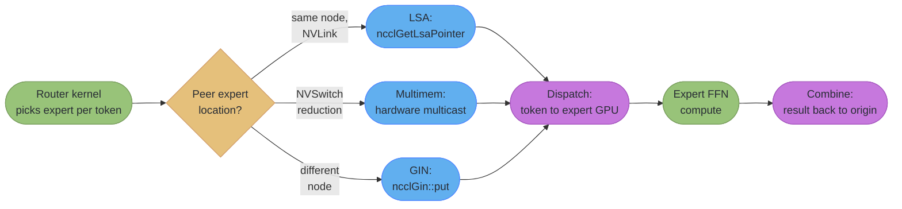
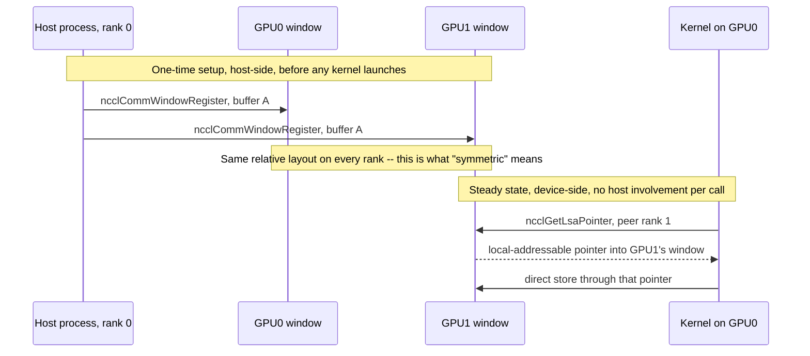

# Device-Initiated Communication

This is a deep dive off [multi_gpu_programming_and_nccl](multi_gpu_programming_and_nccl.md). The parent module teaches host-launched collectives — `ncclAllReduce` issued from CPU code onto a stream, the ring/tree math, and NVSwitch topology. This file stays at the same wire-level altitude but moves the *issue point* of a transfer from the host into the kernel itself: what it takes for a `__global__` function to `put()` a tile of data into a peer GPU's memory without ever returning control to the CPU, and why NCCL 2.28 added an entire second API surface to make that possible.

---

## 1. Concept Overview

Every collective in the parent module is **stream-ordered from the host**: a CPU thread calls `ncclAllReduce`, which enqueues work onto a CUDA stream, and that work cannot begin moving bytes until every prior operation on that stream — including the kernel that produced the data — has fully retired. That ordering is not a minor inefficiency; it is a hard floor under every fusion opportunity. If GPU0 finishes computing tile 3 of 8 while tiles 4-8 are still in flight, a host-launched all-reduce cannot start moving tile 3 early — it waits for the whole kernel, then for the host to notice, then for the collective to be scheduled.

**Device-initiated communication** removes that floor by giving a running kernel the ability to issue the transfer itself, the instant the data it needs is ready, from inside the same warp that just finished computing it. NCCL 2.28 introduced a **device API** for exactly this: instead of calling `ncclAllReduce()` from host code, a kernel calls primitives like `ncclGetLsaPointer()` or `ncclGin::put()` from device code, addressing a peer GPU's memory the way it would address its own. NVSHMEM pioneered this PGAS (partitioned global address space) style of GPU-to-GPU communication years earlier, and the production consumer that made it mainstream — DeepSeek's DeepEP, MoE dispatch/combine kernels — is exactly the kind of workload where a host-launched collective's floor is unacceptable: an MoE layer's tokens are routed to experts on other GPUs in a pattern that is only known after the router kernel runs, not before.

This file covers, in order: why the host-launched floor exists and what it costs; symmetric memory windows, the memory-registration precondition device-initiated communication needs; the three device-API modes (LSA, Multimem, GIN) and when to reach for each; Copy Engine collectives, the *other* half of NCCL 2.28, which sidesteps the SM-occupancy question entirely; NVSHMEM and IBGDA as the other production route to the same goal; and DeepEP as the worked example tying all of it to real measured numbers. Strategic questions this file stays out of — MoE routing algorithms, capacity factors, expert-parallel degree selection — belong to [`llm/mixture_of_experts`](../../llm/mixture_of_experts/mixture_of_experts.md); parallelism strategy (ZeRO, FSDP, tensor/pipeline decomposition) belongs to [`ml/distributed_training`](../../ml/distributed_training/distributed_training.md). This file stays at the wire.

---

## 2. Intuition

> **One-line analogy**: A host-launched collective is a chef who cooks all eight courses, plates them, and only then calls the waiter to start serving — even though the appetizer was ready twenty minutes before the dessert. Device-initiated communication is the chef handing each plate directly to the waiter the moment it's done, so course 1 is on the table while course 8 is still on the stove.

**Mental model**: Every collective in the parent module — ring, tree, NVLS — answers the question "how do N GPUs move bytes efficiently, once told to." Device-initiated communication answers a different question: "who is allowed to tell them to, and when." A host-launched `ncclAllReduce` requires a round trip through the CPU and the CUDA stream-ordering machine before a single byte moves; a device-initiated `put()` requires nothing but a live pointer into a peer's memory window and a running warp. The cost of that round trip is invisible when communication and compute are two cleanly separated phases of a training step. It becomes the dominant cost the moment you want the two phases to overlap at fine grain — a single MoE expert's output, one attention tile, one GEMM K-slice — because the round trip's latency does not shrink just because the payload did.

**Why it matters**: MoE inference and training now spend a comparable fraction of step time in expert-parallel dispatch/combine as in the GEMMs themselves, and that communication is inherently kernel-shaped — which tokens go where is a result computed *by* a kernel, not known before it runs. A host-launched collective cannot start until the routing kernel exits; a device-initiated `put()` inside the routing kernel can start the instant a token's destination is decided. Section 7's DeepEP numbers are what that difference is worth in production.

**Key insight**: Device-initiated communication does not make bytes move faster than a ring or NVLS would — the wire is the wire. What it buys is **overlap you cannot get any other way**: communication issued from inside a kernel can interleave with that kernel's own compute at sub-launch granularity, and Copy Engine collectives push the idea further still by removing SMs from the picture entirely. Both are answers to the same question the parent module's Section 4.7 raised — inference is far more latency-sensitive than training to every extra hop — just answered by changing who issues the transfer instead of which algorithm carries it.

---

## 3. Core Principles

- **Stream ordering is the floor a host-launched collective cannot go below.** A `ncclAllReduce` on a stream cannot begin until every prior stream operation — including the kernel producing its input — has completed. Device-initiated communication is the only way to move a byte before its producing kernel has fully retired.
- **Symmetric memory is the precondition, not an optimization.** A device-side `put`/`get`/pointer-dereference has no host round trip to negotiate the peer address at call time, so every rank's window must already have an identical virtual layout, registered up front with `ncclCommWindowRegister()`. Without that registration, there is no address for a kernel to compute a peer pointer against.
- **The three device-API modes ride three different physical paths, and none is a drop-in replacement for another.** LSA is a load/store over P2P (NVLink or PCIe P2P); Multimem is NVLink SHARP's hardware multicast; GIN is the only one of the three that crosses the network. Picking wrong is a topology error, not a style choice — LSA calls issued between nodes have no path.
- **A communication kernel competes with your compute kernel for the same SMs.** Every SM occupied issuing `put`s and waiting on barriers is an SM not running your GEMM or attention kernel — this is why DeepEP tracks SM count as a first-class metric (Section 7) and why Copy Engine collectives (Section 4.3) exist at all: they move CE-collective traffic through hardware that is otherwise idle.
- **Device-side synchronization needs its own barrier primitive.** A host-launched collective's "done" signal is the stream returning; a device-initiated one has no stream to return to, so `ncclLsaBarrierSession` and `ncclGinBarrierSession` exist specifically to let a kernel block until a set of peer devices (or peer network ranks) have reached the same point — the device-side equivalent of `cudaStreamSynchronize`.
- **One-sided RMA (`put`/`get`) has no implicit handshake.** Unlike a collective, where every rank calls the same function, a `put()` is issued by one side only; the receiving side learns the data arrived through an explicit signal (a barrier, a flag write, a counter), never through the call itself blocking until received.
- **Removing the CPU from the network doorbell (IBGDA) is the network-side mirror of removing it from the memory path (GPUDirect RDMA).** GPUDirect RDMA already lets a NIC DMA straight into GPU memory (parent module §4.2); IBGDA goes one step further and lets the *kernel itself* post the network work request, so the CPU is never on the path even to ring the doorbell.

---

## 4. Types / Architectures / Strategies

### 4.1 The three NCCL device-API modes

| Mode | Physical path | Device-side primitive | Reaches |
|------|---------------|------------------------|---------|
| **LSA** (Load/Store Accessible) | CUDA P2P — NVLink, and some PCIe P2P paths | `ncclGetLsaPointer()` — returns a locally-addressable pointer into a peer's symmetric window | Peers reachable by ordinary load/store, intra-node |
| **Multimem** | NVLink SHARP hardware multicast | `ncclGetLsaMultimemPointer()` | NVSwitch fabrics with SHARP — same footprint as NVLS in the parent module, now callable from inside a kernel |
| **GIN** (GPU-Initiated Networking) | The network — RDMA-capable NIC, driven from the kernel | `ncclGin::put()` / `ncclGin::get()` (one-sided RMA) | Cross-node, since NCCL 2.28.7. NCCL 2.31 adds an AWS EFA GDA backend and device-side timeouts on blocking calls; NCCL 2.32 adds a TCP socket backend |

Decision table:

| If your peer is… | Use | Because |
|---|---|---|
| On the same node, NVLink-connected | LSA | Cheapest possible path — a dereferenced pointer, no network stack |
| On the same NVSwitch fabric, and the op is a reduction/broadcast pattern | Multimem | Offloads the reduction into the switch ASIC, same as NVLS |
| On a different node | GIN | The only one of the three that crosses a NIC |
| Unknown at compile time (heterogeneous cluster) | Query topology host-side, branch per-peer | Mixing LSA and GIN calls to the wrong peer class has no fallback — it is a correctness bug, not a slow path |

### 4.2 Symmetric memory windows

"Symmetric" means every rank's window occupies the **same relative virtual-address layout** — so that a device-side pointer computed as "peer's base address + my local offset" is valid without any host-mediated address exchange at call time. This is registered once, host-side, with `ncclCommWindowRegister()`, and depends on GPU virtual-memory management to place each rank's window predictably. Without it, a device-side `put()` would need to look up the peer's address in a table on every call — exactly the kind of indirection the whole point of device-initiated communication is to avoid.

### 4.3 Copy Engine (CE) collectives — the zero-SM path

NCCL 2.28's other major addition offloads AllGather and AlltoAll onto the GPU's **copy engines** — the same DMA hardware that already executes `cudaMemcpyAsync` — instead of an SM-resident kernel. Measured on 8 Blackwell GPUs at a 4 GB message: CE Multicast AllGather peaks at **~780 GB/s**, versus **~620 GB/s** for the SM-based ("SM NonSymmetric") path — a 1.25x bandwidth gain NVIDIA attributes directly to CE Multicast over SM Symmetric. The number that matters more than the 1.25x, though, is the SM count: **zero**. A GEMM or attention kernel that is already SM-starved (every SM busy with useful FLOPs) has no room to also host a communication kernel; a CE collective needs none of them.

**Walk one example.** Confirming NVIDIA's "1.25x" figure and what it costs in wall-clock time for a 4 GB AllGather:

```
  message = 4 GB

  CE Multicast : 780 GB/s  -> time = 4 GB / 780 GB/s  = 5.13 ms
  SM NonSym.   : 620 GB/s  -> time = 4 GB / 620 GB/s  = 6.45 ms

  ratio = 780 / 620                                     = 1.258x   (matches "1.25x")
  time saved = 6.45 - 5.13                              = 1.32 ms per collective

  Same collective repeated every layer of an MoE forward pass (illustrative,
  32 layers): 32 x 1.32 ms = 42.2 ms of latency avoided per forward pass --
  on TOP of the SMs never being taken away from the GEMMs in the first place.
```

The bandwidth gain alone is worth having; the zero-SM property is worth more, because it is the only path of the three in this section (LSA/Multimem/GIN vs. CE) whose cost to the surrounding compute kernel is provably zero rather than "however many SMs the barrier session and put/get calls end up using."

### 4.4 One-shot vs. two-shot allreduce

The classic small-vs-large-message tradeoff from the parent module's ring-vs-tree section (§4.4) reappears at the device level:

- **One-shot**: every rank writes its full contribution directly into every peer's window in a single round, then each rank reduces locally. Minimal latency (one hop), but total traffic scales with `N` per rank — fine for small messages, wasteful for large ones.
- **Two-shot**: a reduce-scatter round (each rank ends with one reduced shard, written via peer pointers or `put`) followed by an all-gather round (shards broadcast back out) — the same `2·(N-1)/N · size` decomposition as the host-launched ring, just issued from device code instead of a host-launched kernel per phase.

A device-initiated one-shot allreduce is the natural choice for a small activation tensor fused directly into an attention or MoE kernel's epilogue; a device-initiated two-shot is the shape a large fused-gradient reduction takes when the kernel author wants ring-level bandwidth efficiency without giving up kernel-level fusion.

### 4.5 NVSHMEM and IBGDA — the other PGAS route

**NVSHMEM** is NVIDIA's implementation of the OpenSHMEM PGAS model for GPUs: every GPU exposes a symmetric heap, and any GPU can `nvshmem_put`/`nvshmem_get` into any other GPU's heap from inside a kernel, addressed as a flat global space rather than through a stream-ordered collective call. It predates the NCCL device API by years and is the substrate a great deal of fine-grained overlap work (custom MoE kernels, some inference engines) was built on before NCCL grew its own device API.

**IBGDA** (GPUDirect Async, kernel-initiated networking) is the mechanism that removes the CPU from the *network doorbell* specifically — normally, even a GPUDirect RDMA transfer needs the CPU to post the work request that tells the NIC to start moving bytes; IBGDA lets the GPU post that work request itself, from inside the kernel, so the CPU is never invoked, not even to ring a doorbell. It is the network-side analog of what LSA/Multimem already give you intra-node for free (a kernel touching memory directly): a kernel driving the network directly.

Where NVSHMEM's symmetric heap and NCCL's symmetric window overlap conceptually — both require every rank's addressable region to share a layout so a device-side pointer computation is valid without a lookup — they differ in scope: NVSHMEM's heap is a whole-process abstraction any kernel in that process can address, while an NCCL window is registered per-buffer via `ncclCommWindowRegister()`, scoped to exactly the allocation the caller opted in. Neither is a superset of the other; a codebase already built around NVSHMEM's heap model does not get NCCL windows for free by upgrading NCCL, and the reverse is equally true.

### 4.6 DeepEP as the production consumer

DeepEP (DeepSeek's expert-parallel communication library) is the clearest real-world case where device-initiated communication is not an optimization but a requirement: MoE dispatch and combine move tokens whose destination GPU is a runtime result of the router kernel, in a fine-grained, small-message, latency-sensitive pattern that a host-launched collective's floor makes unworkable. **DeepEP v2 moved off NVSHMEM and onto the NCCL Gin backend** — a fact worth stating plainly because most existing write-ups still describe DeepEP as NVSHMEM-based, which was true of v1 but is no longer the architecture. v2 also unifies the previously separate high-throughput and low-latency kernels behind a single `ElasticBuffer` interface and ships experimental primitives (pipeline parallelism, context parallelism, a remote-memory-access feature called "Engram") explicitly "designed for zero or minimal SM occupation" — the same SM-budget concern that motivates Copy Engine collectives in Section 4.3.



*The router kernel's output — which expert each token goes to — decides the communication mode on the fly; a host-launched collective cannot even begin this decomposition until the router kernel has fully retired, which is exactly the floor Section 1 describes.*

---

## 5. Architecture Diagrams

### Host-launched vs. device-initiated: where the floor sits

```
HOST-LAUNCHED (parent module) -- communication cannot start until the kernel
retires and the host notices:

  Kernel producing data:  [==================================] done
  Host notices, enqueues:                                       [.]
  ncclAllReduce starts:                                            [====]
                           |------- entire kernel duration -------|

  Tile 1 was ready at t=10%, but the first byte does not move until t=100%.

DEVICE-INITIATED -- a kernel issues put() the instant ITS tile is ready:

  Kernel producing tile 1: [====] done -> put() issued immediately
  Kernel producing tile 2:       [====] done -> put() issued immediately
  Kernel producing tile 3:             [====] done -> put() issued immediately
  Kernel producing tile 4:                   [====] done -> put() issued immediately
                           |--- tile 1 traffic already landed by here ---|

  Communication and compute overlap at TILE granularity, not KERNEL
  granularity -- this is what "fusing communication into compute" means.
```

*Same total work, same wire, same bytes — the only variable that changed is when the first byte is allowed to leave. That variable is the entire value proposition of the device API.*

### Symmetric memory window registration and device-side addressing



*Registration happens once, host-side, before any kernel that will use the window launches. After that, every device-side call is a local pointer dereference or a one-sided RMA — no host round trip, no stream wait, which is the entire mechanism behind Section 1's "removes the floor" claim.*

### SM budget: what a communication kernel costs a compute kernel

```
SM occupancy on an 8-GPU node, 132 SMs/GPU (illustrative allocation):

  Ring all-reduce (host-launched, parent module):
  [####################################################......] compute kernel
  [..............................................######......] comm kernel (few SMs)

  DeepEP dispatch, SM90, EP 8x4 topology -- 6 SMs used (from Section 7's table):
  [##########################################################.] compute: 126/132 SMs free
  [............................................................] comm:     6/132 SMs

  DeepEP dispatch, SM90, EP 8x2 topology -- 12 SMs used:
  [########################################################....] compute: 120/132 SMs free
  [............................................................] comm:    12/132 SMs

  Copy Engine (CE) collective -- 0 SMs, runs on dedicated DMA hardware:
  [############################################################] compute: 132/132 SMs free
  [ CE hardware, not an SM at all ]

  Every SM a communication kernel occupies is one fewer SM running your GEMM
  or attention kernel -- this is why DeepEP's own README reports SM count
  per topology as a first-class column, not a footnote.
```

*The EP 8x2 vs EP 8x4 rows are the same operation at two different topology configurations from DeepEP's own measured table (Section 7) — doubling the SM budget (6 to 12) buys higher per-GPU RDMA bandwidth (61 to 90 GB/s). That is a real tradeoff a kernel author makes, not a free upgrade.*

**Worked example: one-shot vs. two-shot bytes moved per rank.** Take an 8-rank expert-parallel group (`N = 8`) dispatching a `size = 256 KB` batch of token activations:

```
  ONE-SHOT: every rank writes its full contribution to every OTHER rank
    bytes per rank = (N - 1) x size = 7 x 256 KB           = 1,792 KB

  TWO-SHOT: reduce-scatter (N-1 hops of size/N) + all-gather (N-1 hops of size/N)
    bytes per rank = 2 x (N - 1)/N x size = 2 x 7/8 x 256 KB =   448 KB

  one-shot / two-shot = 1,792 / 448                          =    4.0x

  At N = 64 the gap widens sharply:
    one-shot: (64 - 1) x 256 KB                              = 16,128 KB
    two-shot: 2 x 63/64 x 256 KB                              =    504 KB
    ratio                                                     =   32.0x
```

*This is the same asymmetry the parent module's ring-vs-naive comparison makes for host-launched collectives (its Section 5 "naive everyone-sends-to-everyone" arithmetic) — one-shot IS that naive shape, issued from device code instead of host code, and it inherits the identical scaling problem. One-shot still wins on latency (a single round) for messages small enough that the byte cost barely matters; two-shot wins the moment `N` or `size` grows enough that the byte cost dominates the round-trip savings, exactly mirroring the message-size crossover the parent module's Section 4.4 walks for ring vs. tree.*

---

## 6. How It Works — Detailed Mechanics

### 6.1 Host-side setup: `ncclDevCommRequirements` and `ncclDevCommCreate`

Before any kernel can call a device-API primitive, the host process must build a **device communicator** describing what the kernel will need — how many barrier sessions, whether multimem is required, how many GIN signals — because these are resources NCCL must provision up front, not negotiate lazily inside a kernel.

```cpp
#include <nccl_device.h>

ncclDevCommRequirements reqs = NCCL_DEV_COMM_REQUIREMENTS_INITIALIZER;
reqs.lsaBarrierCount      = 1;      // one LSA barrier session used by the kernel below
reqs.lsaMultimem          = false;  // this kernel only needs LSA, not multimem
reqs.worldGinBarrierCount = 1;      // one cross-node GIN barrier session
reqs.ginSignalCount       = 4;      // one-sided put()/get() completion signals
reqs.ginConnectionType    = ncclGinConnTypeDefault;

ncclDevComm devComm;
NCCLCHECK(ncclDevCommCreate(comm, &reqs, &devComm));

// devComm is now passed into the kernel launch (by value or via a
// __grid_constant__ parameter, same discipline as a TMA descriptor --
// see cuda_memory_model_and_hierarchy Section 6.7 for that pattern).
myFusedKernel<<<grid, block>>>(devComm, /* ... */);
```

Symmetric buffers must already be registered before this point:

```cpp
void* d_buf;
cudaMalloc(&d_buf, N * sizeof(float));
ncclWindow_t win;
NCCLCHECK(ncclCommWindowRegister(comm, d_buf, N * sizeof(float), &win, /*flags=*/0));
// win now has the same relative layout on every rank -- this is what makes
// a peer pointer computable without a host-mediated address lookup.
```

### 6.2 Device-side LSA: a kernel writing directly into a peer's window

```cpp
__global__ void fusedComputeAndLsaPut(ncclDevComm devComm, ncclWindow_t win,
                                       const float* localTile, int peerRank, int n) {
    int tid = blockIdx.x * blockDim.x + threadIdx.x;
    if (tid >= n) return;

    // ... compute localTile[tid] here, fused into the same kernel ...

    // Get a locally-addressable pointer into peerRank's symmetric window --
    // no host round trip, no stream boundary, just a pointer computation.
    float* peerPtr = (float*)ncclGetLsaPointer(devComm, win, peerRank);
    peerPtr[tid] = localTile[tid];   // direct store over NVLink P2P

    // Every thread in the group must reach this point before any thread
    // trusts a peer's write has landed -- see 6.3 for why.
    ncclLsaBarrierSession(devComm, /*barrierIdx=*/0).sync();
}
```

The store on the line above is not a `memcpy` call — it is an ordinary pointer write through an address the driver has mapped to point at another GPU's physical memory, exactly the same P2P mechanism `cudaMemcpyPeer` (parent module §6.1) uses, just issued from inside a kernel instead of from host code between kernel launches.

### 6.3 Device-side barrier: why a `put()` needs an explicit signal

A one-sided `put()` has no return-value acknowledgment that the receiver has consumed the data — that is the entire point of "one-sided": the sender does not wait. Correctness therefore depends on an explicit barrier separating "writes issued" from "writes visible to a reader":

```cpp
__global__ void allToAllViaLsa(ncclDevComm devComm, ncclWindow_t win,
                                const float* localData, float* gathered, int n) {
    int tid = threadIdx.x;
    int myRank = blockIdx.y;

    // Phase 1: every rank writes its own tile into every peer's window
    for (int peer = 0; peer < gridDim.y; ++peer) {
        float* peerPtr = (float*)ncclGetLsaPointer(devComm, win, peer);
        peerPtr[myRank * n + tid] = localData[tid];
    }

    // Phase 2: barrier -- without this, a thread could read a peer's slot
    // before that peer's write has landed, and get stale or torn data.
    ncclLsaBarrierSession(devComm, /*barrierIdx=*/0).sync();

    // Phase 3: now every rank's contribution is guaranteed visible
    gathered[myRank * n + tid] = localData[tid];  // local copy already valid
}
```

This is the device-side analog of the mbarrier phase-parity discipline `synchronization_and_atomics` §6.6 already teaches for intra-block producer/consumer handoff — the same "arrive, then wait for everyone to arrive before trusting the data" shape, just scoped across GPUs instead of across warps. This file does not re-derive that mechanism; see that module for the phase-parity rules themselves.

### 6.4 GIN: one-sided RMA across the network

```cpp
__global__ void ginDispatchToken(ncclDevComm devComm, ncclWindow_t remoteWin,
                                  const float* token, int destRank, int destOffset, int n) {
    // ncclGin::put -- a one-sided write to a rank possibly on a different
    // NODE, driven from inside the kernel. No host CPU is on this path.
    ncclGin::put(devComm, remoteWin, destOffset, token, n, destRank);

    // A GIN barrier session is the network-crossing equivalent of the
    // LSA barrier above -- it also synchronizes ranks that are not on the
    // same NVLink domain, which an LSA barrier cannot reach.
    ncclGinBarrierSession(devComm, /*barrierIdx=*/0).sync();
}

__global__ void ginFetchResult(ncclDevComm devComm, ncclWindow_t remoteWin,
                                float* localDst, int srcRank, int srcOffset, int n) {
    // ncclGin::get -- pull data from a remote rank's window into local memory.
    ncclGin::get(devComm, localDst, remoteWin, srcOffset, n, srcRank);
}
```

GIN requires Volta or later and driver >= 510.40.3; compiling GIN code needs CUDA 12.2+, and the host-side RMA setup APIs need CUDA 12.5+. Host-backed symmetric buffers (as opposed to device-resident ones) must use `CU_MEM_LOCATION_TYPE_HOST_NUMA`. As with any NCCL deployment, the compile-time NCCL version linked into your binary must not exceed the runtime version loaded on the machine.

### 6.5 Copy Engine collectives: the host-side call that costs zero SMs

Unlike the device-API calls above, CE collectives are still issued from the **host** — the zero-SM property is about which hardware unit executes the transfer, not about who issues it:

```cpp
// Host-launched, but the actual bytes move through the copy engines,
// not an SM-resident kernel -- compare against ncclAllGather's SM cost.
NCCLCHECK(ncclAllGather(sendbuf, recvbuf, N, ncclFloat, comm, stream));
// NCCL 2.28 selects the CE-Multicast path automatically when the topology
// and message size favor it; NCCL_ALGO can pin it for benchmarking the
// same way it pins Ring/Tree/NVLS in the parent module's Section 4.6.
```

The choice between a device-API kernel-fused collective (Sections 6.2-6.4) and a CE collective is a choice about *where the SM budget should go*: fuse communication into a compute kernel when the whole point is overlapping communication with THAT kernel's own compute; reach for a CE collective when the collective is logically separate from any one kernel and you would rather not spend any SMs on it at all.

### 6.6 One-shot vs. two-shot allreduce, in code shape

```cpp
// ONE-SHOT: every rank writes its full contribution to every peer directly.
// Minimal latency (one round), traffic scales with N per rank -- good for
// small messages (a single activation tensor in a tensor-parallel decode step).
__global__ void oneShotAllReduce(ncclDevComm devComm, ncclWindow_t win, float* buf, int n) {
    for (int peer = 0; peer < N_RANKS; ++peer) {
        if (peer == myRank()) continue;
        float* peerPtr = (float*)ncclGetLsaPointer(devComm, win, peer);
        atomicAdd(&peerPtr[threadIdx.x], buf[threadIdx.x]);  // reduce on arrival
    }
    ncclLsaBarrierSession(devComm, 0).sync();
}

// TWO-SHOT: reduce-scatter round, then all-gather round -- same 2(N-1)/N
// decomposition as the parent module's ring (Section 5 there), issued from
// device code instead of a host-launched collective per phase. Preferred
// for large messages where one-shot's O(N) per-rank traffic gets expensive.
```

### 6.7 Debugging device-initiated code

Topology detection still happens at communicator setup — `ncclCommInitRank`/`ncclCommInitAll` for the base communicator, then `ncclDevCommCreate` layered on top — so the parent module's `NCCL_DEBUG=INFO` (its Section 4.6) remains the first thing to set when a device-initiated job hangs or underperforms: it still prints the detected topology and chosen transport before any kernel that uses the device API ever launches. What changes for device-initiated code is where a bug can hide once setup succeeds:

- A hang inside a kernel at a `ncclLsaBarrierSession`/`ncclGinBarrierSession` call looks identical, from the host's point of view, to any other stuck kernel — `cuda-gdb`/Nsight Compute attached to the kernel is the tool, not `NCCL_DEBUG`, because the communicator itself set up fine and the stall is inside device code NCCL cannot see once the kernel has launched.
- A wrong-but-not-crashing result (Section 10's second pitfall) will not show up in NCCL's own logging at all, since nothing failed at the NCCL-call level — the barrier session returned, the pointer dereference succeeded, the data was simply read before or after the wrong peer's write landed. This class of bug is caught by correctness checking (compare against a host-launched reference collective on the same input) rather than by any communication-layer log.
- A version mismatch on GIN's CUDA/driver floor (Section 6.4) fails at build or `ncclDevCommCreate` time with an explicit error, unlike a stale topology assumption, which fails silently as reduced bandwidth — treat a `ncclDevCommCreate` failure as a version/capability check first, before assuming it is a bug in the requirements struct.

---

## 7. Real-World Examples

- **DeepEP** (github.com/deepseek-ai/DeepEP) — MoE dispatch and combine kernels with FP8 support, the clearest production case for device-initiated communication. v2 moved off NVSHMEM onto the NCCL Gin backend, unifying high-throughput and low-latency paths behind a single `ElasticBuffer` interface. Requires Hopper (SM90) or later, CUDA 12.3+ on SM90, PyTorch 2.10+, NCCL 2.30.4+.

  | GPU | NIC | Topology | Dispatch BW | Combine BW | SMs used |
  |---|---|---|---|---|---|
  | SM90 (Hopper) | CX7 | EP 8x2 | 90 GB/s RDMA | 81 GB/s RDMA | 12 |
  | SM90 | CX7 | EP 8x4 | 61 GB/s RDMA | 61 GB/s RDMA | 6 |
  | SM100 (Blackwell) | CX7 | EP 8x2 | 90 GB/s RDMA | 91 GB/s RDMA | 12 |
  | SM100 | — | EP 8 (intranode) | 726 GB/s NVLink | 740 GB/s NVLink | 64 (max) |

  Read the last row against the parent module's ~900 GB/s per-direction NVLink 5 ceiling: 726-740 GB/s is roughly 80-82% of the wire, which is a strong result for a collective sharing bandwidth with every other kernel on the GPU. The 90 GB/s internode RDMA figure is the library's own measured number against a ConnectX-7 NIC — present it as measured, since a 400 Gb/s (50 GB/s per direction) single port cannot alone explain it, and re-deriving a NIC-count assumption from that gap is not something this file will do.

- **NCCL EP** (`nccl-ep-v0.1.0`, released June 8, 2026 in the NVIDIA/nccl repository): NVIDIA's own MoE expert-parallel dispatch/combine library, built on the NCCL device API's LSA and GIN modes. It covers the same job as DeepEP. HT (high-throughput) mode supports flat and expert-major layouts; LL (low-latency) mode supports expert- and rank-major layouts with a top-K limit of 9. Its handles work inside CUDA Graphs, and an active-rank mask marks failed ranks so the remaining ranks keep communicating instead of aborting the process.
- **NVSHMEM-based inference kernels** — before NCCL's device API existed, custom tensor-parallel and expert-parallel kernels reached for NVSHMEM directly to get one-sided `put`/`get` from inside a kernel; NVSHMEM remains the PGAS substrate of choice where a project's build does not yet track NCCL 2.28+.
- **IBGDA-enabled inference engines** — serving stacks that need to post RDMA work requests from inside a GPU kernel (rather than via a CPU-mediated doorbell) use IBGDA specifically to keep the CPU off the per-token dispatch path in expert-parallel serving.
- **Copy Engine collectives in bandwidth-bound AllGather/AlltoAll steps** — any workload whose SMs are already saturated by compute (a GEMM-bound MoE FFN, a fully-occupied attention kernel) is a candidate for routing its AllGather/AlltoAll through NCCL 2.28's CE path instead of an SM-resident collective kernel, trading a modest bandwidth difference (780 vs. 620 GB/s measured, Section 4.3) for zero SM contention.
- **vLLM and TensorRT-LLM tensor-parallel inference**, per the parent module's Section 7, already issue host-launched `ncclAllReduce` after every sharded block; the device-API and CE-collective paths in this file are the next step past that for the specific case where the collective and the surrounding compute kernel should be fused rather than sequenced.
- **`ncclDevCommRequirements`'s `ginConnectionType` field** exists because GIN can be provisioned over more than one connection style for a given node; a deployment picks the type its NIC/driver combination supports, the same way the parent module's `NCCL_IB_HCA` restricts which InfiniBand adapter a host-launched collective may use for GPUDirect RDMA — device-initiated networking still has to be told which physical path it may take.
- **PyTorch 2.10+ and CUDA 12.3+ (SM90) requirements gating DeepEP** reflect that device-initiated communication is not a drop-in for an older stack — a team evaluating whether to adopt it has to check toolkit and framework floors alongside the GPU generation, not just whether the hardware is Hopper-class or newer.

---

## 8. Tradeoffs

| Choice | Pros | Cons |
|--------|------|------|
| Host-launched collective (parent module) | Simple mental model, no symmetric-window setup, works with any NCCL version | Stream-ordered floor: cannot start until the producing kernel fully retires |
| Device-API LSA | Cheapest device-initiated path (a pointer dereference), lowest latency intra-node | Only reaches P2P-capable peers — no path across nodes |
| Device-API Multimem | Offloads reduction into the switch ASIC, same as NVLS but callable from inside a kernel | Requires NVLink SHARP hardware (NVSwitch, Hopper-class fabric or later) |
| Device-API GIN | The only device-initiated path that crosses the network; removes host round trip for cross-node fusion | Needs Volta+/driver >= 510.40.3, CUDA 12.2+ (12.5+ for host RMA setup); more setup than LSA |
| Copy Engine (CE) collectives | Zero SM occupancy — frees the SM budget entirely for compute; 1.25x over SM-based AllGather in NVIDIA's own measurement | Host-launched only (not fusable into a kernel's own compute the way the device API is); limited to AllGather/AlltoAll shapes |
| One-shot device-initiated allreduce | Minimal latency, single round | Per-rank traffic scales with N — poor for large messages |
| Two-shot device-initiated allreduce | Bandwidth-optimal `2(N-1)/N` traffic, same as the host-launched ring | More rounds, more barrier overhead than one-shot |
| NVSHMEM | Mature, broad ecosystem adoption predating NCCL's device API | A separate library/build dependency from NCCL, with its own symmetric-heap model to learn |
| IBGDA | Removes the CPU from the network doorbell entirely | Adds a dependency on RDMA-capable NICs and driver support for kernel-posted work requests |

---

## 9. When to Use / When NOT to Use

**Use device-initiated communication when:**
- The data to be communicated is produced incrementally by a kernel (per-tile, per-token, per-expert), and starting the transfer only after the whole kernel exits would waste real overlap opportunity.
- You are writing an MoE dispatch/combine path, or any pattern where the communication destination is a runtime result of the same kernel producing the data (routing decisions).
- Latency-sensitive small messages dominate — a tensor-parallel decode step, an expert-parallel token dispatch — where the host round trip of a stream-ordered collective is a meaningful fraction of total latency.
- Your compute kernel is *not* SM-starved and can spare a handful of SMs (6-12, per DeepEP's measured table) to run communication concurrently with compute.

**Avoid or reconsider when:**
- Your compute kernel is already SM-starved (every SM busy with useful FLOPs) — reach for Copy Engine collectives instead, which cost zero SMs, or stay with a host-launched collective if fusion is not the goal.
- The communication pattern is a simple, large, phase-separated collective (a full-buffer gradient all-reduce at the end of a training step) — the parent module's host-launched ring or NVLS already hits the bandwidth-optimal floor, and device-initiated fusion buys nothing when there is no overlap opportunity to exploit.
- Your NCCL version predates 2.28, or your driver/CUDA toolkit does not meet GIN's minimums (Section 6.4) — the device API simply is not available, and NVSHMEM or a host-launched collective is the only option.
- You need the simplest possible correctness story for a first working implementation — device-initiated code has no implicit stream-ordering guardrail, so the failure modes in Section 10 are all self-inflicted correctness bugs rather than performance bugs.

| Signal | Decision |
|--------|----------|
| Data is ready incrementally, destination known only at runtime | Device-API (LSA/Multimem/GIN depending on peer location) |
| Compute kernel already SM-starved | Copy Engine collective (zero SM) |
| Large, phase-separated, whole-buffer collective | Host-launched ring/tree/NVLS (parent module) — no fusion opportunity to exploit |
| Cross-node, latency-sensitive, small message | GIN, or IBGDA if writing below NCCL's abstraction |
| NCCL < 2.28 or driver/CUDA below GIN's minimums | NVSHMEM, or stay host-launched |

---

## 10. Common Pitfalls

**BROKEN: issuing a device-side `put()` without registering a symmetric window first**

```cpp
// BROKEN -- d_buf was never passed through ncclCommWindowRegister
float* d_buf;
cudaMalloc(&d_buf, N * sizeof(float));

__global__ void badKernel(ncclDevComm devComm, ncclWindow_t win, float* d_buf, int n) {
    // win is uninitialized / does not correspond to d_buf's layout --
    // ncclGetLsaPointer either returns a bogus pointer or the call fails
    // at runtime, and on some paths this manifests as a silent wrong-data
    // bug rather than a crash, because the pointer arithmetic still "works",
    // it just points at memory nobody registered as symmetric.
    float* peerPtr = (float*)ncclGetLsaPointer(devComm, win, 1);
    peerPtr[threadIdx.x] = d_buf[threadIdx.x];
}
```

Device-side addressing has no host round trip to catch a bad window at call time the way a host-launched `ncclAllReduce` would reject a malformed argument before ever touching the GPU — the whole performance win of skipping that round trip is also what removes the safety net.

```cpp
// FIX -- register the window before any kernel that will address it launches
float* d_buf;
cudaMalloc(&d_buf, N * sizeof(float));
ncclWindow_t win;
NCCLCHECK(ncclCommWindowRegister(comm, d_buf, N * sizeof(float), &win, /*flags=*/0));

goodKernel<<<grid, block>>>(devComm, win, d_buf, N);
// Inside goodKernel, ncclGetLsaPointer(devComm, win, peer) now returns a
// pointer into a window with the SAME relative layout on every rank.
```

**BROKEN: a `put()` with no barrier, read before the write has landed**

```cpp
// BROKEN -- thread reads gathered[] before the peer's put() is guaranteed visible
float* peerPtr = (float*)ncclGetLsaPointer(devComm, win, peer);
peerPtr[tid] = myData[tid];         // one-sided write, no acknowledgment
float result = gathered[tid];       // may read stale data -- no barrier between
                                     // "I wrote" and "you may now read"
```

A one-sided `put()` is exactly that — one-sided. There is no implicit synchronization the way a host-launched collective's stream-ordering provides; a thread on the receiving side that reads before every writer has reached the same point sees a torn or stale value, and this bug is nondeterministic (it depends on scheduling), which makes it far worse to debug than the host-launched mismatched-collective deadlock in the parent module's Section 10 — that one hangs loudly, this one produces silently wrong numbers.

```cpp
// FIX -- an explicit barrier session separates "writes issued" from "safe to read"
float* peerPtr = (float*)ncclGetLsaPointer(devComm, win, peer);
peerPtr[tid] = myData[tid];
ncclLsaBarrierSession(devComm, /*barrierIdx=*/0).sync();   // every rank waits here
float result = gathered[tid];   // now guaranteed visible
```

**Other frequent pitfalls:**
- Mixing LSA calls against a peer that is actually on a different node — LSA rides P2P (NVLink/PCIe), which simply has no path across nodes; use GIN for any peer whose location is not guaranteed intra-node.
- Under-provisioning `ncclDevCommRequirements` — requesting fewer `lsaBarrierCount`/`ginSignalCount` than the kernel actually uses at launch time is a resource-exhaustion bug discovered at runtime, not compile time, since the requirements are a host-side capacity reservation the kernel's device code has no way to check against.
- Forgetting that GIN needs CUDA 12.2+ to compile and 12.5+ for the host-side RMA setup APIs, and driver >= 510.40.3 — building against a newer NCCL than the runtime driver supports fails with a version mismatch that is easy to misdiagnose as a code bug.
- Assuming a device-initiated collective is automatically faster than a host-launched one — it is not; the wire bandwidth is identical (Section 2's key insight). Reaching for the device API on a large, phase-separated collective with no overlap opportunity adds symmetric-window setup complexity for zero benefit over the parent module's host-launched ring/NVLS.
- Spending SMs on a device-API fused collective when the compute kernel is already SM-starved — this is the exact scenario Copy Engine collectives exist to avoid (Section 4.3); reach for CE instead of the device API when SM budget, not latency, is the binding constraint.
- Believing DeepEP is still NVSHMEM-based because older documentation or blog posts say so — v2 runs on the NCCL Gin backend; code or configuration written against an NVSHMEM assumption for DeepEP v2 will not match its actual dependency surface.

---

## 11. Technologies & Tools

| Tool | Role |
|------|------|
| **NCCL device API** (NCCL 2.28+) | `ncclDevCommCreate`, `ncclGetLsaPointer`, `ncclGetLsaMultimemPointer`, `ncclLsaBarrierSession`, `ncclGin::put`/`get`, `ncclGinBarrierSession` — the primitives this file covers |
| **NCCL 2.31** (2.31.2, August 2026) | `ncclCollConfig_t` and `nccl*Config` APIs set algorithm and CTA options per collective call; CFT host and device APIs register window memory with CUDA logical endpoints (Blackwell, CUDA 13.3+); EFA GDA GIN backend for Put, Signal, and Flush; device-side timeouts on blocking GIN calls (Flush, Wait, WaitSignal, WaitCounter); TMA kernels on by default on Blackwell for symmetric registered memory |
| **NCCL 2.32** (2.32.3, September 2026) | Initial Rubin (`sm107`) support without Rubin performance tuning; socket-based GIN over TCP; ring-based hierarchical copy-engine AllGather (`NCCL_HIER_CE_COLL_AG_RAIL_RING_ENABLE`); optional TLS for NCCL-owned socket traffic via `ncclSetEncryption` (OpenSSL 3 builds only); RAS GPU-resident progress counters for diagnosing stalled collective kernels |
| **NCCL EP** (v0.1.0, June 2026) | MoE dispatch/combine on LSA and GIN, HT and LL modes, CUDA-Graph-compatible handles, active-rank mask for failed ranks |
| **nccl4py** (0.6.0, September 23, 2026) | NCCL's Python bindings; 0.6.0 adds experimental CuTe DSL device functions for reduce and copy over LSA windows, multimem pointers, and local tensors (`lsa_reduce_sum()`, `multimem_copy()`, `local_reduce_sum_copy()`) |
| **`ncclCommWindowRegister`** | Registers a buffer as a symmetric memory window across every rank — the precondition for any device-side addressing |
| **Copy Engine (CE) collectives** (NCCL 2.28+) | Host-launched AllGather/AlltoAll that execute on copy-engine DMA hardware instead of an SM-resident kernel — zero SM occupancy |
| **NVSHMEM** | NVIDIA's PGAS library for GPU-to-GPU one-sided `put`/`get`, addressed from inside a kernel; predates and remains an alternative to the NCCL device API |
| **IBGDA** (GPUDirect Async, kernel-initiated networking) | Lets a kernel post an RDMA work request directly, removing the CPU from the network-doorbell step entirely |
| **DeepEP** (github.com/deepseek-ai/DeepEP) | MoE dispatch/combine kernels with FP8 support; v2 runs on the NCCL Gin backend behind a unified `ElasticBuffer` interface |
| **`EventOverlap`** | DeepEP's interface for overlapping communication with independent computation on separate streams |
| **ConnectX-7 (CX7)** | The RDMA-capable NIC DeepEP's measured internode numbers (Section 7) are reported against |
| **`torch.library.custom_op`** | The registration path a device-initiated fused kernel typically needs to become a differentiable, graph-capturable PyTorch operator — owned by `python_gpu_ecosystem`, not re-taught here |

---

## 12. Interview Questions with Answers

**Q: Why can't a host-launched `ncclAllReduce` start moving bytes before its producing kernel finishes?**
**Short:** NCCL calls are stream-ordered, so a collective enqueued on a stream cannot begin until every prior operation on that stream, including the producing kernel, has retired.
A stream executes operations in the order they were enqueued, so `ncclAllReduce` — itself just another stream operation — cannot begin until every prior operation on that stream, including the kernel that produced its input, has fully retired. This is a hard floor, not a scheduling quirk: even if 90% of the kernel's output tiles were ready early, none of them can move until the whole kernel exits. Device-initiated communication exists specifically to remove this floor by letting the kernel issue the transfer itself.

**Q: What does "symmetric memory window" mean, and why does device-initiated communication require it?**
**Short:** It means every rank's buffer has the same relative virtual layout, registered via ncclCommWindowRegister, so a kernel can compute a valid peer pointer with no host lookup.
It means every rank's buffer occupies the same relative virtual-address layout, registered up front with `ncclCommWindowRegister()`. A device-side call has no host round trip available to negotiate a peer's address at call time the way a host-launched collective's setup phase could, so the only way a kernel can compute a valid pointer into a peer's memory is if that layout is already guaranteed identical across ranks before the kernel ever launches.

**Q: What's the difference between the NCCL device API's LSA, Multimem, and GIN modes, and how do you pick?**
**Short:** LSA rides P2P load/store for intra-node peers, Multimem uses NVLink SHARP hardware multicast, and GIN is the only mode that crosses the network.
LSA rides CUDA P2P (NVLink or PCIe P2P) for peers reachable by ordinary load/store, intra-node only. Multimem uses NVLink SHARP's hardware multicast for reduction/broadcast patterns on an NVSwitch fabric. GIN (GPU-Initiated Networking, since NCCL 2.28.7) is the only one of the three that crosses a NIC to reach a different node. Picking wrong is a correctness error, not a slow path — an LSA call issued against a cross-node peer has no path to take at all.

**Q: A device-initiated `put()` writes into a peer's window, then another thread reads the result and gets stale data. What's missing?**
**Short:** A barrier session — put() is one-sided with no implicit acknowledgment, so a reader must wait at ncclLsaBarrierSession or ncclGinBarrierSession before trusting the data arrived.
A barrier session is missing. `put()` is a one-sided operation with no implicit acknowledgment that the receiver has consumed or even seen the data, unlike a host-launched collective whose stream-ordering guarantees completion before the next stream operation runs. The fix is an explicit `ncclLsaBarrierSession` (intra-node) or `ncclGinBarrierSession` (cross-node) separating "writes issued" from "safe to read," the same arrive/wait discipline `synchronization_and_atomics` teaches for intra-block mbarrier phase parity, scoped across GPUs instead of warps.

**Q: Does device-initiated communication move bytes faster than a host-launched collective?**
**Short:** No — the wire bandwidth is identical either way; what device-initiated communication buys is overlap at tile/token granularity that a host-launched collective's floor cannot reach.
No — the physical link bandwidth is exactly the same whether a byte is pushed by a host-launched collective or a kernel's own `put()`. What changes is *when* the transfer is allowed to start: device-initiated communication can begin the instant a kernel's own tile of data is ready, overlapping communication with that same kernel's remaining compute, which a stream-ordered host-launched collective structurally cannot do. Reaching for the device API on a large, phase-separated collective with no overlap opportunity buys nothing over the parent module's host-launched ring.

**Q: What are Copy Engine (CE) collectives, and why do they matter for an SM-starved kernel?**
**Short:** CE collectives offload AllGather/AlltoAll onto copy-engine DMA hardware instead of an SM-resident kernel, so they cost zero SMs and free that budget for compute.
CE collectives, new in NCCL 2.28, offload AllGather and AlltoAll onto the GPU's copy engines — the same DMA hardware `cudaMemcpyAsync` uses — instead of running as an SM-resident kernel. Measured on 8 Blackwell GPUs, CE Multicast AllGather peaks at ~780 GB/s versus ~620 GB/s for the SM-based path, a 1.25x gain, but the number that matters more for a kernel author is zero SMs consumed. A GEMM or attention kernel that is already using every SM for useful FLOPs has no room to also host a communication kernel, and CE collectives are the way to move that traffic without taking any of those SMs away.

**Q: What happened to DeepEP's NVSHMEM dependency?**
**Short:** DeepEP v2 removed it — dispatch and combine now run on the NCCL Gin backend, unified behind a single ElasticBuffer interface.
DeepEP v2 moved off NVSHMEM entirely and onto the NCCL Gin backend, which NVIDIA describes as "header-only & lightweight." This unified the previously separate high-throughput and low-latency kernel paths behind a single `ElasticBuffer` interface. This is worth stating explicitly because a lot of existing documentation and commentary still describes DeepEP as NVSHMEM-based — accurate for v1, wrong for the current architecture.

**Q: What is NCCL EP, and what does it offer that a third-party MoE library like DeepEP does not?**
**Short:** NVIDIA's own MoE dispatch/combine library on the NCCL device API (v0.1.0, June 2026), shipped in the NCCL repo, with an active-rank mask that routes around failed ranks.
NCCL EP is an NCCL API extension for Mixture-of-Experts dispatch and combine, released as v0.1.0 on June 8, 2026 in the NVIDIA/nccl repository. It runs on the device API's LSA mode inside a node and GIN across nodes, and offers two modes like DeepEP: HT (high-throughput, flat and expert-major layouts) and LL (low-latency, expert- and rank-major layouts, top-K up to 9). Two points set it apart. It is versioned and tested with NCCL itself, so a team does not track a separate project's CUDA, PyTorch, and NCCL floors. And it has an active-rank mask: a failed rank is marked and left out of later dispatches, so the job keeps running instead of aborting. Its handles are CUDA-Graph compatible, which matters for decode loops that replay a captured graph per token.

**Q: In DeepEP's measured table, EP 8x2 uses 12 SMs at 90 GB/s RDMA while EP 8x4 uses 6 SMs at 61 GB/s. What does that tradeoff represent?**
**Short:** Doubling the SM budget from 6 to 12 buys roughly 1.5x higher per-GPU RDMA bandwidth — a direct SM-for-bandwidth tradeoff a kernel author chooses explicitly.
It represents a direct SM-for-bandwidth tradeoff: doubling the communication kernel's SM allocation from 6 to 12 raises measured RDMA dispatch bandwidth from 61 to 90 GB/s, roughly 1.5x. Since every SM spent on communication is an SM not running the MoE FFN's GEMMs, a kernel author picks the topology (EP 8x2 vs. 8x4) based on whether the workload is more bandwidth-starved or more SM-starved at that point in the pipeline — there is no universally correct choice.

**Q: What does IBGDA remove from the network path that GPUDirect RDMA alone does not?**
**Short:** IBGDA lets the GPU kernel itself post the RDMA work request, so the CPU is never invoked even to ring the network doorbell that GPUDirect RDMA still needs.
GPUDirect RDMA already lets a NIC DMA data straight into or out of GPU memory, bypassing the host memory bounce buffer — but the CPU is still normally needed to post the work request that tells the NIC to start. IBGDA (GPUDirect Async, kernel-initiated networking) removes that last CPU touchpoint too, letting the kernel post the work request itself. It is the network-side mirror of what LSA already gives you intra-node for free: a kernel driving the transfer directly, with no CPU on the critical path at all.

**Q: What CUDA/driver versions does GIN require, and why does that matter for a deployment?**
**Short:** GIN needs Volta or later, driver 510.40.3+, CUDA 12.2+ to compile, and CUDA 12.5+ for the host RMA setup APIs — mismatches fail at build or load time.
GIN needs Volta (SM70) or later, driver version 510.40.3 or newer, CUDA 12.2+ to compile GIN device code, and CUDA 12.5+ for the host-side RMA setup APIs. It matters because a mismatch — building against a newer NCCL than the deployed driver supports, or targeting an older CUDA toolkit than the host APIs need — fails as a version error at build or load time, not as a silent slowdown, so it needs to be checked before a device-initiated cross-node path is assumed to work.

**Q: One-shot vs. two-shot device-initiated allreduce — when does each win?**
**Short:** One-shot minimizes latency for small messages but its per-rank traffic scales with N, while two-shot keeps the bandwidth-optimal 2(N-1)/N cost for large messages.
One-shot has every rank write its full contribution directly to every peer in a single round — minimal latency, but total per-rank traffic scales with N, so it is a poor choice for large messages. Two-shot runs a reduce-scatter round followed by an all-gather round, the same `2(N-1)/N · size` decomposition as the parent module's host-launched ring, and wins for large messages where one-shot's O(N) traffic would dominate. The crossover is a message-size threshold, exactly as it is for the host-launched ring-vs-tree choice.

**Q: Why is under-provisioning `ncclDevCommRequirements` a runtime bug rather than a compile-time one?**
**Short:** The requirements are a host-side resource reservation the device code cannot validate itself, so requesting too few barrier or signal slots fails only when the kernel actually runs.
`ncclDevCommRequirements` (via `ncclDevCommCreate`) is a host-side capacity reservation — how many LSA barrier sessions, GIN barrier sessions, and GIN signals the kernel will use. The kernel's device code has no way to check this reservation against its own actual usage at compile time, so requesting fewer than the kernel needs surfaces only as a runtime resource-exhaustion failure when the kernel actually executes the over-budget call, which can be well after the kernel has otherwise appeared to work correctly on smaller inputs.

**Q: Why does a missing barrier after a device-side `put()` produce a nondeterministic bug rather than a crash?**
**Short:** The write and read both target valid memory, so the race depends on scheduling timing — sometimes the data has landed, sometimes it hasn't, with no error either way.
Both the write (into the peer's window) and the subsequent read target perfectly valid, correctly-mapped memory — there is no invalid address to fault on. Whether the read observes the write depends entirely on scheduling: which warp reaches the read first, how busy the interconnect is, how the driver ordered the physical transfer. That makes it strictly harder to debug than the parent module's mismatched-collective deadlock, which at least hangs loudly and immediately; a missing barrier here produces silently wrong numbers that may only appear under specific timing or load.

**Q: How does device-initiated communication relate to NVSHMEM, historically and today?**
**Short:** NVSHMEM pioneered kernel-callable one-sided GPU communication years before NCCL's device API existed, and both now coexist as separate PGAS-style options.
NVSHMEM implemented the PGAS (partitioned global address space) model for GPUs — a symmetric heap any GPU can `put`/`get` into from inside a kernel — years before NCCL grew its own device API in version 2.28. A great deal of existing fine-grained-overlap kernel code, including DeepEP v1, was built on NVSHMEM specifically because it was the only option at the time. The two now coexist: NVSHMEM remains valid where a codebase's build does not yet track NCCL 2.28+, while newer work (DeepEP v2) has migrated onto the NCCL device API's Gin backend.

**Q: Why does GIN need its own barrier primitive (`ncclGinBarrierSession`) separate from the LSA one?**
**Short:** An LSA barrier only synchronizes peers reachable by load/store, intra-node, while GIN's barrier also synchronizes ranks on other nodes that LSA has no path to.
`ncclLsaBarrierSession` synchronizes ranks reachable via P2P load/store, which is inherently intra-node — LSA has no path across a network boundary. A device-initiated collective that spans multiple nodes needs a barrier that can also block on ranks reached only through GIN's network path, which is exactly what `ncclGinBarrierSession` provides. Using the wrong barrier for a multi-node group would simply never observe the cross-node ranks' progress.

**Q: One-shot dispatch moves `(N-1) x size` bytes per rank versus two-shot's `2(N-1)/N x size` — at what point does that difference start to matter?**
**Short:** The gap grows with N: about 4x at N=8 and 32x at N=64, so one-shot stays fine for small N or small messages but two-shot wins as either grows.
The gap scales with `N`: at `N = 8` one-shot moves about 4x the bytes two-shot does, and at `N = 64` that gap widens to roughly 32x, because one-shot's per-rank cost grows linearly with `N` while two-shot's stays bounded near `2 x size`. One-shot remains the right choice when the message is small enough or `N` is small enough that its single round trip's latency saving outweighs the extra bytes; two-shot wins once either factor grows enough that the byte cost dominates.

**Q: Why is a device-side `put()` into an unregistered symmetric window a silent bug rather than an immediate crash?**
**Short:** The pointer arithmetic still resolves to some address, so it can write to unintended memory instead of faulting, since there's no host-side check at call time.
Because there is no host round trip at call time to validate the window the way a host-launched collective's argument checking would, `ncclGetLsaPointer` against an unregistered or mismatched window can still return an address that resolves to *some* memory — it just isn't the memory the caller intended, and isn't guaranteed to have the same layout on every rank. The write can land somewhere valid-looking rather than faulting, which is what makes it a data-corruption bug discovered later rather than a crash discovered immediately.

**Q: Why does DeepEP report SM count as a first-class column in its measured benchmark table, rather than just bandwidth?**
**Short:** Because every SM the dispatch/combine kernel occupies is one fewer SM available to the expert FFN's GEMMs running concurrently on the same GPU.
Because a device-initiated communication kernel is not free in the way a host-launched collective's off-SM DMA traffic can feel — it consumes real SM occupancy that a concurrently running expert-FFN GEMM would otherwise use. Reporting SM count alongside bandwidth lets a kernel author see the actual tradeoff being made (Section 5's worked example: 6 SMs at 61 GB/s versus 12 SMs at 90 GB/s), rather than only seeing the bandwidth number and assuming it was free.

---

## 13. Best Practices

- **Default to a host-launched collective; reach for the device API only when there is a real overlap opportunity to exploit.** The wire bandwidth is identical either way (Section 2's key insight) — device-initiated communication earns its added setup complexity only when fine-grained fusion with compute is the actual goal, not as a blanket "faster" upgrade.
- **Provision `ncclDevCommRequirements` generously during development, then tighten.** Under-provisioning barrier/signal counts fails at runtime, not compile time (Section 10), so an early pass with headroom avoids chasing a resource-exhaustion bug that only reproduces at a specific input size.
- **Never issue a device-side `put()` without a barrier session downstream of it before any reader trusts the destination.** Treat every one-sided write as unobserved until a `ncclLsaBarrierSession`/`ncclGinBarrierSession` proves otherwise — the same discipline `synchronization_and_atomics` teaches for mbarrier phase parity, just scoped across GPUs.
- **Match the device-API mode to the peer's actual location, and verify topology rather than assume it.** LSA has no path across nodes; picking the wrong mode is a silent correctness failure, not a graceful fallback.
- **Reach for Copy Engine collectives when the compute kernel is SM-starved, and for the device API when it is not.** These are complementary answers to the same SM-budget question, not competing options for the same job — pick based on which resource (SMs vs. latency) is actually binding.
- **Verify DeepEP's dependency surface against the version you actually deploy, not against older commentary.** v1's NVSHMEM dependency and v2's NCCL Gin dependency are architecturally different; check the README/requirements for the pinned version before assuming either.
- **Benchmark measured bandwidth against the correct per-direction ceiling, exactly as the parent module's `nccl-tests` section teaches for host-launched collectives.** A device-initiated collective's `busbw` should still be read against NVLink's per-direction figure (~900 GB/s on B200), not the bidirectional headline — the unit-convention trap does not go away just because the call moved into a kernel.
- **Keep symmetric-window registration and kernel launch in the same code path, not scattered across setup code that can drift out of sync.** A window registered once at startup but a kernel that later assumes a different buffer layout is exactly the class of bug Section 10's first pitfall describes, and it is easiest to prevent by keeping registration adjacent to the kernel that depends on it.

---

## 14. Case Study

**Scenario**: An 8-GPU (SM90, Hopper) node runs a mixture-of-experts inference server. The MoE layer's router kernel computes, per token, which of several experts (potentially on a different GPU) should process it — a result known only after the router kernel executes. The team's first implementation used a host-launched `ncclAlltoAll`-style dispatch issued after the router kernel returned, and per-token latency was dominated by that dispatch step.

**BROKEN — host-launched dispatch, paying the full stream-ordering floor:**

```cpp
// Router kernel computes per-token expert assignment, writes to routingTable
routerKernel<<<grid, block, 0, stream>>>(tokens, routingTable, numTokens);

// BROKEN: dispatch cannot start until routerKernel has FULLY retired --
// even though token 0's destination was known almost immediately, and
// token numTokens-1's destination might be the very last thing computed.
NCCLCHECK(ncclGroupStart());
for (int t = 0; t < numTokens; ++t) {
    int destGPU = routingTableHost[t];   // requires a device->host copy first!
    ncclSend(&tokens[t], tokenDim, ncclFloat, destGPU, comm, stream);
}
NCCLCHECK(ncclGroupEnd());
// Total latency = full router kernel duration + host sync + dispatch duration,
// with zero overlap between router compute and dispatch communication.
```

This pays for the entire router kernel's duration before a single token can move, plus a device-to-host copy of the routing table just to issue per-token `ncclSend` calls from host code — exactly the floor Section 1 describes, made concrete.

**FIX — device-initiated dispatch fused into the router kernel itself:**

```cpp
__global__ void routerAndDispatchFused(ncclDevComm devComm, ncclWindow_t win,
                                        const float* tokens, int tokenDim,
                                        int numTokens, int numGPUs) {
    int t = blockIdx.x * blockDim.x + threadIdx.x;
    if (t >= numTokens) return;

    // Router decision computed right here, in this thread/block.
    int destGPU = computeExpertAssignment(tokens, t);   // routing logic

    // FIX: dispatch THIS token to its expert the instant its destination
    // is known -- no waiting for sibling tokens, no host round trip.
    float* peerPtr = (float*)ncclGetLsaPointer(devComm, win, destGPU);
    for (int d = 0; d < tokenDim; ++d) {
        peerPtr[t * tokenDim + d] = tokens[t * tokenDim + d];
    }

    // Barrier before any expert kernel reads its assigned tokens --
    // required precisely because put() gives no implicit acknowledgment
    // (Section 10's second pitfall).
    ncclLsaBarrierSession(devComm, /*barrierIdx=*/0).sync();
}
```

Every token's dispatch now overlaps with the router's own compute for every *other* token still being processed — the tile-by-tile overlap pattern from Section 5's timing diagram, applied to per-token routing instead of per-tile GEMM output. This is structurally the same shift DeepEP v2 made in production: dispatch and combine fused into kernels that issue device-initiated transfers as soon as each token's destination is known, rather than as a separate host-launched step after routing completes.

**Measured shape of the win, following DeepEP's own reported numbers (Section 7):** on SM90 with a CX7 NIC at EP 8x4 topology, dispatch achieves 61 GB/s RDMA bandwidth using only 6 SMs — a small enough SM footprint that it runs concurrently with the router and expert-FFN kernels rather than serializing after them. The team's actual win was not a faster wire (identical hardware, identical NVLink/NIC ceiling) but the elimination of the "wait for the whole router kernel, then wait for a host round trip, then dispatch" sequence — replaced by dispatch that starts as each token's routing decision lands, which is exactly what a host-launched collective, however well-tuned, structurally cannot do.

**What this case study deliberately leaves out**: MoE routing algorithms (top-k gating, load-balancing losses, capacity factors) belong to [`llm/mixture_of_experts`](../../llm/mixture_of_experts/mixture_of_experts.md) — this case study assumes a routing decision already computed and focuses only on what happens to a token once its destination is known. Expert-parallel degree selection and its interaction with data/tensor parallelism belong to [`ml/distributed_training`](../../ml/distributed_training/distributed_training.md).
