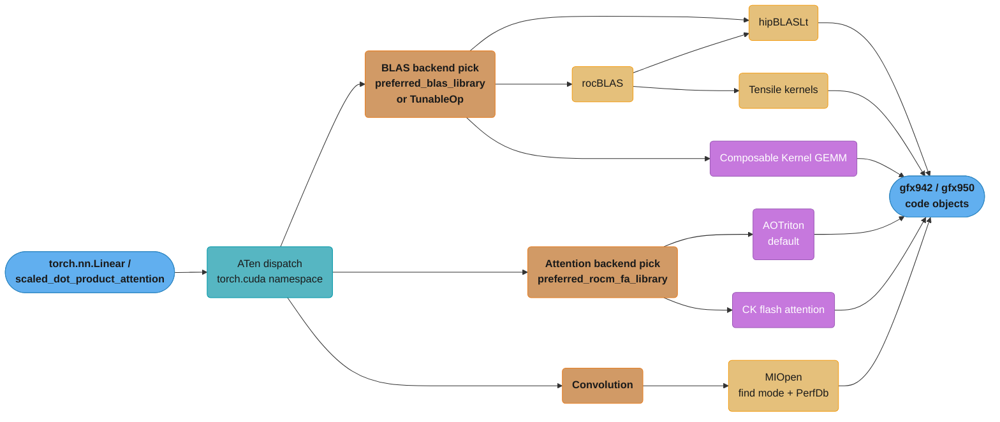
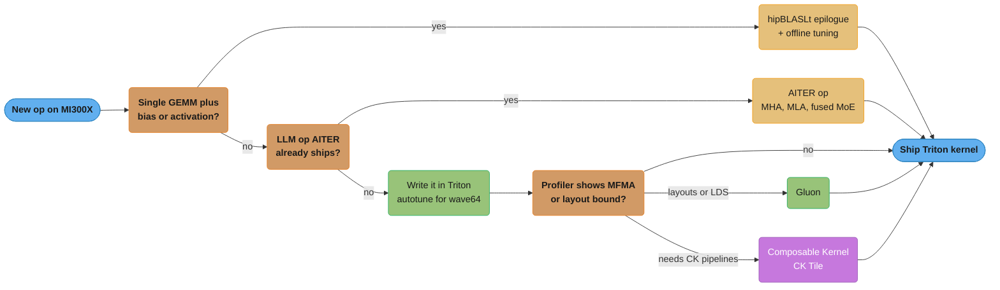

# ROCm Libraries and Kernel DSLs

> **Version anchor (fetched 2026-11-25):** ROCm Core SDK 10.2.0 (release notes dated 2026-11-18) ships hipBLASLt 1.5.0, rocBLAS 5.8.0, hipBLAS 3.8.0, MIOpen 3.6.2, Composable Kernel 1.3.0, rocWMMA 2.2.2, rocPRIM 4.8.0, hipCUB 4.7.0, rocThrust 4.7.0, rocFFT 1.0.41, rocSPARSE 5.1.0, hipSPARSELt 0.2.9 and HIP 7.17.0. ROCm 10.2.0 validates PyTorch 2.15.0, and the PyTorch quick-start page installs stable 2.15.0 wheels from the `rocm10.0` index. Upstream Triton is at v3.9.0 (2026-10-27) with its AMD backend in `third_party/amd`. AITER is at v0.1.30 (2026-11-22). Sources: rocm.docs.amd.com release notes and `components-current.yaml`, pytorch.org, GitHub releases for triton-lang/triton and ROCm/aiter.

## 1. Concept Overview

On NVIDIA hardware you rarely write a GEMM. You call cuBLAS or cuBLASLt, cuDNN covers convolutions, CUTLASS gives you templates for custom fused GEMMs, and CUB and Thrust give you reductions and sorts. ROCm has a library for each of those slots, and the job of this module is to make the mapping exact: which ROCm library replaces which CUDA library, which ROCm library you call on purpose, and when you leave the libraries for a kernel DSL.

The ROCm math stack has two naming families, and the prefix tells you what the library is:

- **`roc*` libraries** are AMD's native implementations: rocBLAS, rocPRIM, rocFFT, rocSPARSE, rocSOLVER, rocRAND, rocThrust, rocWMMA.
- **`hip*` libraries** are marshalling or portability layers with a CUDA-shaped API. hipBLAS forwards to rocBLAS on AMD and to cuBLAS on NVIDIA. hipCUB is a thin wrapper over rocPRIM on AMD and over CUB on NVIDIA. hipBLASLt is the exception: it is AMD's own fused-GEMM engine, not a wrapper.

Three more names sit outside both families. **MIOpen** is the cuDNN counterpart (convolution, pooling, normalization, RNN). **Composable Kernel (CK)** is the CUTLASS counterpart: a tile-based C++ template library for writing fused, performance-critical ML kernels. **AITER** (AI Tensor Engine for ROCm) is AMD's operator library for LLM inference and training, with kernels written in Triton, CK, hand-tuned assembly and FlyDSL behind one C++ and Python API.

Above the libraries sit the DSLs. **Triton** runs on AMD GPUs through an upstream AMD backend. PyTorch on ROCm reuses the `torch.cuda` namespace and dispatches matmuls to rocBLAS, hipBLASLt or CK, and attention to AOTriton or CK.

This module covers the library map, the GEMM path (hipBLASLt and rocBLAS), the DNN path (MIOpen), the primitive path (rocPRIM and hipCUB), matrix cores from your own kernel (rocWMMA), and the three ways to write a custom fused kernel on AMD (Triton, CK, AITER). Hardware details (CDNA 3 and CDNA 4, wave64, LDS, MFMA) are in [amd_gpu_architecture_cdna_and_rdna](../amd_gpu_architecture_cdna_and_rdna/amd_gpu_architecture_cdna_and_rdna.md). The HIP language and hipify are in [hip_programming_and_porting](../hip_programming_and_porting/hip_programming_and_porting.md). The CUDA library side of every comparison is in [cuda_math_and_dnn_libraries](../cuda_math_and_dnn_libraries/cuda_math_and_dnn_libraries.md).

---

## 2. Intuition

> **One-line analogy**: The ROCm library stack is a second kitchen built to the same floor plan as CUDA's. Every station is in the same place (BLAS, DNN, primitives, templates), but the knives are a different length (wave64), the oven is a different size (LDS), and the recipes that were timed for the first kitchen need to be re-timed in this one.

**Mental model.** Think of three layers. The bottom layer is **fixed-API libraries** (rocBLAS, hipBLASLt, MIOpen, rocFFT): you describe a problem and the library picks a precompiled kernel from a catalog built per GPU target (gfx942 for MI300X and MI325X, gfx950 for MI350X and MI355X). The middle layer is **kernel-construction toolkits** (Composable Kernel, rocWMMA, rocPRIM and hipCUB block primitives): you assemble your own kernel from tuned parts. The top layer is **DSLs and operator collections** (Triton, AITER): you write or import a fused kernel in Python and the compiler emits AMDGPU code.

**Why it matters.** A model that runs well on H100 can lose a large share of its throughput on MI300X for reasons that have nothing to do with hardware peak: the GEMM went to the wrong backend, a TunableOp results file was rejected because the ROCm version changed, a Triton autotune config assumed 32-wide warps, or a hipCUB `WarpReduce` silently grew to 64 lanes. None of these produce an error. All of them show up only in a profiler (see [rocm_profiling_and_debugging](../rocm_profiling_and_debugging/rocm_profiling_and_debugging.md)).

**Key insight.** On ROCm the default library choice is less settled than on CUDA. PyTorch can route one GEMM to rocBLAS, hipBLASLt or CK, and one attention call to AOTriton or CK; rocBLAS itself calls Tensile or hipBLASLt for Level-3 GEMMs. So "use the library" is not one decision. It is a sequence of choices you can observe and pin: which backend, which solution index, which tuning file. Engineers who treat those choices as configuration get the performance; engineers who treat them as defaults get whatever the heuristic picked on the day.

---

## 3. Core Principles

- **Map by role, not by name.** cuBLAS maps to rocBLAS (native) or hipBLAS (portable). cuBLASLt maps to hipBLASLt. cuDNN maps to MIOpen. CUTLASS maps to Composable Kernel. CUB maps to rocPRIM, with hipCUB as the source-compatible wrapper. Thrust maps to rocThrust. `nvcuda::wmma` maps to rocWMMA. The HIPIFY "Supported CUDA APIs" table translates CUDNN calls to MIOpen and CUB calls to hipCUB.
- **rocBLAS is column-major and one-based, like cuBLAS.** The rocBLAS docs state that array storage is column-major to stay compatible with legacy Fortran BLAS. Row-major PyTorch tensors need the same transpose trick they need on cuBLAS.
- **hipBLASLt is plan-then-run.** You build a matmul descriptor, four matrix layouts and a preference, ask `hipblasLtMatmulAlgoGetHeuristic` once per shape, then call `hipblasLtMatmul` many times. The docs say the heuristic call runs on the CPU and can take tens of microseconds, comparable to a small GEMM.
- **Fusion happens in the epilogue.** hipBLASLt epilogues fuse bias, ReLU, GELU, Swish (SiLU), Sigmoid and Clamp into the GEMM kernel, plus `_AUX` outputs and `DRELU`/`DGELU`/`BGRAD` variants for training. A separate activation kernel re-reads the whole output from HBM.
- **A solution index belongs to one build and one GPU.** hipBLASLt kernels are generated at library build time and shipped as a device library; the docs warn not to carry solution indices across releases or GPUs. TunableOp files carry "Validator" lines for the same reason.
- **Wave width is a library parameter, not a constant.** hipCUB's `WarpReduce` defaults `LOGICAL_WARP_THREADS` to `HIPCUB_DEVICE_WARP_THREADS`, which is the rocPRIM maximum wavefront size: 64 on CDNA. Triton's AMD backend sets `warp_size = 32 if gfx_major >= 10 else 64`, so `num_warps=4` means 256 threads on MI300X.
- **Drop down only as far as the profiler forces you.** The ROCm Triton guide's rule of thumb is to start in Triton, autotune, profile, and drop to Gluon only when the profiler shows a bottleneck Triton cannot express. The same ladder applies one level lower: CK when Triton cannot reach the MFMA rate, rocWMMA or inline intrinsics when CK's templates do not fit.

---

## 4. Types / Architectures / Strategies

### 4.1 The CUDA-to-ROCm library map

| CUDA library | ROCm native | Portable `hip*` layer | Notes |
|---|---|---|---|
| cuBLAS | rocBLAS 5.8.0 | hipBLAS 3.8.0 (forwards to rocBLAS or cuBLAS) | rocBLAS calls Tensile and hipBLASLt for Level-3 GEMMs |
| cuBLASLt | hipBLASLt 1.5.0 | (hipBLASLt itself) | Fused epilogues, FP8, FP4, MX block scaling, grouped GEMM |
| cuDNN | MIOpen 3.6.2 | none | HIPIFY maps CUDNN calls to MIOpen |
| CUTLASS / CuTe | Composable Kernel 1.3.0 (CK Tile) | none | Tile-based templates; FlashAttention's default ROCm backend |
| CUB | rocPRIM 4.8.0 | hipCUB 4.7.0 (wraps rocPRIM or CUB) | Block, warp and device primitives |
| Thrust | rocThrust 4.7.0 | none | STL-like algorithms |
| `nvcuda::wmma` | rocWMMA 2.2.2 | none | Header-only, wavefront-centric fragments |
| cuFFT | rocFFT 1.0.41 | hipFFT 1.0.27 | |
| cuRAND | rocRAND 5.2.0 | hipRAND 3.4.0 | |
| cuSPARSE | rocSPARSE 5.1.0 | hipSPARSE 4.8.0 | |
| cuSOLVER | rocSOLVER 3.38.0 | hipSOLVER 3.8.0 | |
| cuSPARSELt | none | hipSPARSELt 0.2.9 (gfx942, gfx950 only) | Structured sparsity |
| cuTENSOR | none | hipTensor 2.6.0 (HPC SDK) | |
| NCCL | RCCL 2.32.3 | none | See [multi_gpu_on_amd_rccl_and_xgmi](../multi_gpu_on_amd_rccl_and_xgmi/multi_gpu_on_amd_rccl_and_xgmi.md) |
| cuFile (GDS) | hipFile 0.6.0 | none | Backs `torch.cuda.gds` on ROCm |

All versions are the ROCm 10.2.0 component table, fetched 2026-11-25.

### 4.2 The kernel-authoring ladder on AMD

| Rung | Tool | You control | You give up | Typical use |
|---|---|---|---|---|
| 1 | Framework op (PyTorch on ROCm) | Backend choice, tuning file | Kernel internals | Everything that already exists |
| 2 | hipBLASLt / MIOpen / rocBLAS | Descriptor, epilogue, solution index | Fusion beyond the epilogue list | GEMM + bias + activation, convolutions |
| 3 | AITER | Which AITER op, its tuned config | Writing the kernel | LLM attention, MLA, fused MoE, block-scale GEMM |
| 4 | Triton (AMD backend) | Tiles, `num_warps`, `num_stages`, `waves_per_eu`, `matrix_instr_nonkdim` | Explicit layouts and barriers | Custom fusions, first draft of any new kernel |
| 5 | Gluon | Layouts, async copies, LDS swizzle | Compiler scheduling | Hot kernels where Triton plateaus |
| 6 | Composable Kernel (CK Tile) | Tile distribution, pipelines, intrawave vs interwave scheduling | Python ergonomics, compile time | Production fused GEMM, attention, MoE |
| 7 | rocWMMA / HIP intrinsics | Every fragment and every instruction | Portability, development time | Research kernels, unusual shapes |

### 4.3 Library-level backends that PyTorch can pick

| Operation | Backends on ROCm | How to steer |
|---|---|---|
| GEMM (`torch.mm`, `nn.Linear`) | rocBLAS (hipBLAS API), hipBLASLt, CK | `torch.backends.cuda.preferred_blas_library("cublas" \| "cublaslt" \| "ck")`; TunableOp benchmarks rocBLAS and hipBLASLt candidates |
| SDPA / Flash attention | AOTriton (default), CK | `torch.backends.cuda.preferred_rocm_fa_library("aotriton" \| "ck")`, or `TORCH_ROCM_FA_PREFER_CK=1` |
| Convolution | MIOpen | MIOpen find mode and PerfDb |
| FP32 GEMM as TF32 | hipBLASLt on gfx942 | `torch.backends.cuda.matmul.fp32_precision` |

The `"cublas"` and `"cublaslt"` strings keep their CUDA names on ROCm because PyTorch reuses the `torch.cuda` interfaces. CK for GEMMs and SDPA also needs a PyTorch build with `USE_ROCM_CK_GEMM=1` and `USE_ROCM_CK_SDPA=1`; without that build flag, PyTorch warns and routes GEMMs to hipBLAS and SDPA to AOTriton.

### 4.4 Precision coverage by library

| Precision | Where it lives on ROCm | Scaling |
|---|---|---|
| FP16, BF16 | rocBLAS, hipBLASLt, MIOpen, CK, rocWMMA, Triton | none, FP32 accumulate |
| TF32 compute on FP32 data | hipBLASLt (`HIPBLAS_COMPUTE_32F_FAST_TF32`), gfx942 via PyTorch | none |
| FP8 / BF8 | hipBLASLt: FNUZ encodings on gfx942, OCP encodings on gfx950 and gfx12 | scalar (default), outer vector, or block |
| FP4 (input), FP6 | hipBLASLt MX types (`HIP_R_4F_E2M1`, `HIP_R_6F_E2M3`, `HIP_R_6F_E3M2`) | `VEC32_UE8M0` block scaling: one 8-bit exponent per 32 elements |
| Complex (CGEMM, ZGEMM) | hipBLASLt 1.5.0 on gfx942 and gfx950, also through rocBLAS | none |

The FP8 encoding split is the trap. gfx942 (MI300X, MI325X) uses the FNUZ variants; gfx950 (MI350X, MI355X) uses the OCP variants that NVIDIA also uses. A checkpoint quantized for one encoding family is not bit-compatible with the other.

---

## 5. Architecture Diagrams

### PyTorch-on-ROCm dispatch: one call, several possible libraries



The point of the diagram is the number of forks. On CUDA a dense GEMM goes to cuBLAS or cuBLASLt. On ROCm the same call can end in Tensile kernels, hipBLASLt kernels or CK kernels, and rocBLAS itself can hand the call to hipBLASLt (the rocBLAS docs say `ROCBLAS_USE_HIPBLASLT=1` forces the hipBLASLt backend). When two runs of the same model differ in speed, the first question is which leaf each GEMM reached.

### Which rung of the ladder: a decision flow



### The hipBLASLt plan-then-run object model

```
  ONE TIME PER SHAPE (host, tens of microseconds)        EVERY CALL (GPU)
  +---------------------------------------------+        +-----------------------------+
  | hipblasLtCreate(&handle)        keep forever|        |                             |
  | hipblasLtMatrixLayoutCreate x4  A, B, C, D  |        | hipblasLtMatmul(            |
  | hipblasLtMatmulDescCreate       compute type|  algo  |   handle, desc,             |
  |   + TRANSA / TRANSB             transpose   | -----> |   alpha, A, B, beta, C, D,  |
  |   + EPILOGUE  (BIAS, GELU ...)  fusion      |        |   &algo, workspace, stream) |
  |   + scale pointers              FP8 / FP4   |        |                             |
  | hipblasLtMatmulPreferenceCreate workspace   |        +-----------------------------+
  | hipblasLtMatmulAlgoGetHeuristic -> algo[]   |
  +---------------------------------------------+
```

Caption: the left box is CPU work that hipBLASLt's docs say can cost as much as a small GEMM, so it belongs in a per-shape cache. The right box is the only thing that should run inside the training or serving loop.

### Why hipCUB warp primitives change shape on CDNA

```
CUB on NVIDIA:  WarpReduce<float>  -> 32 logical lanes per reduction
  block of 256 threads = 8 warps -> TempStorage temp[256 / 32] = temp[8]

hipCUB on MI300X: WarpReduce<float> -> LOGICAL_WARP_THREADS = HIPCUB_DEVICE_WARP_THREADS = 64
  block of 256 threads = 4 wavefronts -> 4 reductions, each over 64 lanes

  lane:   0 ......... 31 | 32 ......... 63
  CUB:    [ warp 0      ] [ warp 1        ]   two partial sums
  hipCUB: [ wavefront 0                   ]   one partial sum
```

Caption: code that indexes `temp[threadIdx.x / 32]` or writes one partial sum per 32 threads still compiles after hipify, but on CDNA lanes 32-63 belong to the same reduction as lanes 0-31. Either pass the logical width explicitly or derive the count from `HIPCUB_DEVICE_WARP_THREADS`.

---

## 6. How It Works — Detailed Mechanics

### 6.1 A fused GEMM + bias + GELU with hipBLASLt

This mirrors the hipBLASLt client sample `04_hipblaslt_gemm_bias` and swaps the epilogue to `HIPBLASLT_EPILOGUE_GELU_BIAS` (bias first, then GELU). Matrices are column-major (`HIPBLASLT_ORDER_COL` is the default).

```cpp
#include <hip/hip_runtime.h>
#include <hipblaslt/hipblaslt.h>
#include <cstdio>
#include <cstdlib>
#include <map>
#include <tuple>

#define HIP_CHECK(x) do { hipError_t e = (x); if (e != hipSuccess) { \
    std::fprintf(stderr, "HIP %s at %s:%d\n", hipGetErrorString(e), __FILE__, __LINE__); \
    std::exit(1); } } while (0)
#define LT_CHECK(x) do { hipblasStatus_t s = (x); if (s != HIPBLAS_STATUS_SUCCESS) { \
    std::fprintf(stderr, "hipBLASLt status %d at %s:%d\n", int(s), __FILE__, __LINE__); \
    std::exit(1); } } while (0)

struct GemmPlan {
    hipblasLtMatmulDesc_t desc;
    hipblasLtMatrixLayout_t a, b, c, d;
    hipblasLtMatmulAlgo_t algo;
    size_t workspace_bytes;
};

// One plan per (m, n, k). The heuristic call runs on the CPU, so it must not
// sit inside the per-step loop.
static std::map<std::tuple<int64_t, int64_t, int64_t>, GemmPlan> g_plans;

GemmPlan& get_plan(hipblasLtHandle_t h, int64_t m, int64_t n, int64_t k,
                   void* d_bias, size_t max_ws) {
    auto key = std::make_tuple(m, n, k);
    auto it = g_plans.find(key);
    if (it != g_plans.end()) return it->second;

    GemmPlan p{};
    LT_CHECK(hipblasLtMatrixLayoutCreate(&p.a, HIP_R_16BF, m, k, m));
    LT_CHECK(hipblasLtMatrixLayoutCreate(&p.b, HIP_R_16BF, k, n, k));
    LT_CHECK(hipblasLtMatrixLayoutCreate(&p.c, HIP_R_16BF, m, n, m));
    LT_CHECK(hipblasLtMatrixLayoutCreate(&p.d, HIP_R_16BF, m, n, m));

    LT_CHECK(hipblasLtMatmulDescCreate(&p.desc, HIPBLAS_COMPUTE_32F, HIP_R_32F));
    hipblasOperation_t op = HIPBLAS_OP_N;
    LT_CHECK(hipblasLtMatmulDescSetAttribute(p.desc, HIPBLASLT_MATMUL_DESC_TRANSA, &op, sizeof(op)));
    LT_CHECK(hipblasLtMatmulDescSetAttribute(p.desc, HIPBLASLT_MATMUL_DESC_TRANSB, &op, sizeof(op)));

    hipblasLtEpilogue_t epi = HIPBLASLT_EPILOGUE_GELU_BIAS;   // bias first, then GELU
    LT_CHECK(hipblasLtMatmulDescSetAttribute(p.desc, HIPBLASLT_MATMUL_DESC_EPILOGUE, &epi, sizeof(epi)));
    hipDataType bias_t = HIP_R_16BF;
    LT_CHECK(hipblasLtMatmulDescSetAttribute(p.desc, HIPBLASLT_MATMUL_DESC_BIAS_DATA_TYPE, &bias_t, sizeof(bias_t)));
    LT_CHECK(hipblasLtMatmulDescSetAttribute(p.desc, HIPBLASLT_MATMUL_DESC_BIAS_POINTER, &d_bias, sizeof(void*)));

    hipblasLtMatmulPreference_t pref;
    LT_CHECK(hipblasLtMatmulPreferenceCreate(&pref));
    LT_CHECK(hipblasLtMatmulPreferenceSetAttribute(pref, HIPBLASLT_MATMUL_PREF_MAX_WORKSPACE_BYTES,
                                                   &max_ws, sizeof(max_ws)));
    hipblasLtMatmulHeuristicResult_t res[1];
    int returned = 0;
    LT_CHECK(hipblasLtMatmulAlgoGetHeuristic(h, p.desc, p.a, p.b, p.c, p.d, pref, 1, res, &returned));
    LT_CHECK(hipblasLtMatmulPreferenceDestroy(pref));
    if (returned == 0) { std::fprintf(stderr, "no hipBLASLt solution\n"); std::exit(1); }

    p.algo = res[0].algo;
    p.workspace_bytes = res[0].workspaceSize;
    return g_plans.emplace(key, p).first->second;
}

void linear_gelu(hipblasLtHandle_t h, hipStream_t s, int64_t m, int64_t n, int64_t k,
                 const void* A, const void* B, void* D, void* bias,
                 void* workspace, size_t max_ws) {
    GemmPlan& p = get_plan(h, m, n, k, bias, max_ws);
    float alpha = 1.0f, beta = 0.0f;
    LT_CHECK(hipblasLtMatmul(h, p.desc, &alpha, A, p.a, B, p.b, &beta, D, p.c, D, p.d,
                             &p.algo, workspace, p.workspace_bytes, s));
}
```

Three details in this code matter more than the API names:

1. **The bias pointer is baked into the descriptor.** The cache key above assumes one bias buffer per shape. If two layers share a shape but not a bias, either key on the bias pointer too or update `HIPBLASLT_MATMUL_DESC_BIAS_POINTER` before each call.
2. **`beta = 0` and `C == D`.** The docs allow C and D to be the same memory. With `beta = 0` the library ignores C entirely.
3. **The algorithm is valid for this library build and this GPU only.** Do not persist `p.algo` or its solution index to a file that outlives a ROCm upgrade.

### 6.2 rocBLAS and the row-major trap

rocBLAS, like cuBLAS, stores matrices column-major. A row-major `C = A x B` with `A` of shape `M x K` and `B` of shape `K x N` is computed by asking rocBLAS for `C^T = B^T x A^T`: swap the operands and swap `M` and `N`.

```cpp
#include <rocblas/rocblas.h>

// Row-major C[M x N] = A[M x K] * B[K x N], all FP32, dense, no padding.
void sgemm_row_major(rocblas_handle h, int M, int N, int K,
                     const float* A, const float* B, float* C) {
    const float alpha = 1.0f, beta = 0.0f;
    // Column-major view: C^T (N x M) = B^T (N x K) * A^T (K x M)
    rocblas_sgemm(h, rocblas_operation_none, rocblas_operation_none,
                  N, M, K, &alpha,
                  B, N,      // B^T as column-major N x K, leading dim N
                  A, K,      // A^T as column-major K x M, leading dim K
                  &beta,
                  C, N);     // C^T as column-major N x M, leading dim N
}
```

Two rocBLAS behaviours to know before you time it. First, the rocBLAS programmer's guide says the first GEMM call pays a startup cost unless you call `rocblas_initialize()`, and one call covers every handle on that device. Second, rocBLAS GEMMs go through either Tensile or hipBLASLt depending on the architecture; on architectures where hipBLASLt is the default backend, a Tensile override file is bypassed.

### 6.3 PyTorch on ROCm: detect, steer, tune

```python
import torch

# PyTorch reuses torch.cuda on ROCm. Detect the build, not the namespace.
if torch.cuda.is_available() and torch.version.hip:
    backend = "rocm"
elif torch.cuda.is_available() and torch.version.cuda:
    backend = "cuda"
else:
    backend = "cpu"
print(backend, torch.version.hip, torch.cuda.get_device_name(0))

# Pick the BLAS library for GEMMs. On ROCm "cublaslt" means hipBLASLt.
torch.backends.cuda.preferred_blas_library("cublaslt")

# Flash attention backend on ROCm: AOTriton is the default, CK is opt-in
# (CK also needs a PyTorch build with USE_ROCM_CK_SDPA=1).
torch.backends.cuda.preferred_rocm_fa_library("aotriton")

x = torch.randn(4096, 8192, device="cuda", dtype=torch.bfloat16)
w = torch.randn(8192, 8192, device="cuda", dtype=torch.bfloat16)
y = x @ w
torch.cuda.synchronize()
```

TunableOp is the PyTorch-level tuner, and on ROCm it is the main GEMM tuning tool because it benchmarks both rocBLAS and hipBLASLt candidates for every `(transa, transb, m, n, k)` it sees:

```bash
# Online tuning: benchmark every new GEMM shape, write tunableop_results<N>.csv
export PYTORCH_TUNABLEOP_ENABLED=1     # default 0
export PYTORCH_TUNABLEOP_TUNING=1      # default 1 once enabled
export PYTORCH_TUNABLEOP_VERBOSE=1     # only while checking it is active
python train_step.py

# Offline tuning, step 1: record shapes without tuning (memory-heavy workloads)
export PYTORCH_TUNABLEOP_ENABLED=1
export PYTORCH_TUNABLEOP_TUNING=0
export PYTORCH_TUNABLEOP_RECORD_UNTUNED=1
python serve_warmup.py                 # writes tunableop_untuned0.csv
```

```python
# Offline tuning, step 2: tune the recorded shapes across 8 GPUs
import torch.cuda.tunable as tunable

if __name__ == "__main__":
    tunable.mgpu_tune_gemm_in_file("tunableop_untuned?.csv", 8)
```

By default each candidate runs 100 iterations or as many as fit in 30 ms, whichever is smaller. The result file starts with Validator lines (PyTorch version, ROCm version, hipBLASLt version, rocBLAS version); change any of them and TunableOp rejects the whole file. Each solution line has four fields, and the third is the winner, for example `Gemm_Hipblaslt_1219` or `Gemm_Rocblas_1216`.

### 6.4 hipBLASLt offline tuning without code changes

When the application calls hipBLASLt directly (or through rocBLAS), tune below PyTorch:

```bash
# 1. Log every GEMM as a ready-made hipblaslt-bench command line (mask bit 32 = Bench)
export HIPBLASLT_LOG_MASK=32
export HIPBLASLT_LOG_FILE=gemms_%i.log      # %i expands to the process id
./my_app

# 2. Benchmark the candidates for one logged shape and record the fastest index
hipblaslt-bench --precision f16_r -m 8192 -n 4096 -k 8192 --cold_iters 100 --iters 1000

# 3. Save winners with HIPBLASLT_TUNING_FILE, replay them in production
export HIPBLASLT_TUNING_OVERRIDE_FILE=tuning.txt
./my_app
```

hipBLASLt also offers an opt-in runtime cache (`HIPBLASLT_TUNING_MODE=cache` with `HIPBLASLT_TUNING_CACHE_PATH`), and Origami with Stream-K through `TENSILE_SOLUTION_SELECTION_METHOD=2`. Stream-K divides the total inner-loop iterations evenly across compute units instead of assigning one output tile per workgroup, which helps when one dimension is much larger than the others. On the MI350 series Stream-K is the only strategy and the variable has no effect.

### 6.5 MIOpen: find, PerfDb and the kernel cache

MIOpen's convolution path has two ways to choose a kernel:

- **Find API** (`miopenFindConvolutionForwardAlgorithm`): compiles and benchmarks candidate solvers and returns `miopenConvAlgoPerf_t` results sorted fastest first. It is expensive; run it once per shape per handle lifetime.
- **Immediate mode** (`miopenConvolutionForwardGetSolution` then `miopenConvolutionForwardImmediate`): queries a ranked solution list without benchmarking. The first call can still compile the kernel if it is not in the kernel cache.

Three storage locations explain most "the first iteration is slow" reports:

| Store | Where | What it holds |
|---|---|---|
| System PerfDb | MIOpen install directory | Pre-tuned kernel parameters for common configurations |
| User PerfDb | Your home directory | Auto-tuned parameters; always takes precedence over System PerfDb |
| Kernel cache | `$HOME/.cache/miopen` by default | Compiled kernel binaries, versioned per MIOpen release |

```bash
# Full benchmark-everything find for every convolution in this run
export MIOPEN_FIND_MODE=NORMAL        # or 1; FAST=2, HYBRID=3, DYNAMIC_HYBRID=5
# Force auto-tune even when not requested by the API, and keep PerfDb entries
export MIOPEN_FIND_ENFORCE=SEARCH     # or 3
./bin/MIOpenDriver convbfp16 -n 1 -c 1024 -H 14 -W 14 -k 256 -y 1 -x 1 \
    -p 0 -q 0 -u 1 -v 1 -l 1 -j 1 -m conv -g 1 -F 1
```

`MIOPEN_FIND_ENFORCE=DB_CLEAN` (5) removes the user PerfDb values for a configuration and blocks auto-tune. If the precompiled kernel package for your architecture is not installed, MIOpen warns about a missing system database file (for example `gfx906_60.kdb`); the docs say the degradation affects only start-up time.

### 6.6 rocPRIM and hipCUB: block and warp primitives

hipCUB keeps CUB's API, so CUB code ports with a namespace change. The difference is the default logical warp width.

```cpp
#include <hip/hip_runtime.h>
#include <hipcub/hipcub.hpp>

template <int BLOCK>
__global__ void block_sum(const float* __restrict__ in, float* __restrict__ out, int n) {
    using BlockReduce = hipcub::BlockReduce<float, BLOCK>;
    __shared__ typename BlockReduce::TempStorage temp;

    int i = blockIdx.x * BLOCK + threadIdx.x;
    float v = (i < n) ? in[i] : 0.0f;
    float block_total = BlockReduce(temp).Sum(v);   // valid in thread 0 only
    if (threadIdx.x == 0) atomicAdd(out, block_total);
}

// Launch: block_sum<256><<<(n + 255) / 256, 256>>>(d_in, d_out, n);
```

`BlockReduce` hides the wave width; `WarpReduce` exposes it. On MI300X, `hipcub::WarpReduce<float>` reduces across 64 lanes because its default `LOGICAL_WARP_THREADS` is `HIPCUB_DEVICE_WARP_THREADS` (rocPRIM's maximum wavefront size). Anything sized as `blockDim.x / 32` is off by a factor of two. See the BROKEN to FIX pair in §10.

rocThrust gives you `thrust::sort`, `thrust::reduce` and `thrust::transform` over `thrust::device_vector`, built on rocPRIM. For a single sort or scan, the device-level rocPRIM or hipCUB call is the lower-overhead path because it lets you own the temporary storage.

### 6.7 rocWMMA: matrix cores from your own kernel

rocWMMA is a header-only C++17 library whose API is intentionally close to CUDA's WMMA. Fragments are wavefront-wide: every lane of the wavefront must be active, and the rocWMMA docs call partial participation undefined behaviour. This kernel follows the `simple_hgemm` sample: one wavefront computes one 16 x 16 output block; A is row-major, B is column-major.

```cpp
#include <hip/hip_runtime.h>
#include <rocwmma/rocwmma.hpp>

using rocwmma::float16_t;
using rocwmma::float32_t;

constexpr int TM = 16, TN = 16, TK = 16;   // 16x16 on all targets, 32x32 on Instinct only

__global__ void hgemm_wmma(uint32_t m, uint32_t n, uint32_t k,
                           const float16_t* a, const float16_t* b, float32_t* d,
                           uint32_t lda, uint32_t ldb, uint32_t ldd) {
    auto fa  = rocwmma::fragment<rocwmma::matrix_a, TM, TN, TK, float16_t, rocwmma::row_major>();
    auto fb  = rocwmma::fragment<rocwmma::matrix_b, TM, TN, TK, float16_t, rocwmma::col_major>();
    auto acc = rocwmma::fragment<rocwmma::accumulator, TM, TN, TK, float32_t>();
    rocwmma::fill_fragment(acc, 0.0f);

    // One wavefront per output tile. AMDGCN_WAVE_SIZE is 64 on CDNA, 32 on RDNA.
    uint32_t wave_x = (blockIdx.x * blockDim.x + threadIdx.x) / rocwmma::Constants::AMDGCN_WAVE_SIZE;
    uint32_t wave_y = blockIdx.y * blockDim.y + threadIdx.y;
    uint32_t row = wave_x * TM, col = wave_y * TN;
    if (row >= m || col >= n) return;   // whole wavefront exits together

    for (uint32_t i = 0; i < k; i += TK) {
        rocwmma::load_matrix_sync(fa, a + row * lda + i, lda);
        rocwmma::load_matrix_sync(fb, b + i + col * ldb, ldb);
        rocwmma::mma_sync(acc, fa, fb, acc);         // lowers to MFMA on CDNA
    }
    rocwmma::store_matrix_sync(d + row * ldd + col, acc, ldd, rocwmma::mem_row_major);
}
```

The early `return` is safe only because `row` and `col` are uniform across the wavefront: every lane of one wavefront computes the same `wave_x`. If the grid mapping ever lets half a wavefront exit, the MFMA runs with inactive lanes. The sample's block shape is `T_BLOCK_X = 4 * WAVE_SIZE`, so on MI300X a block has 256 threads in x and covers four output tiles.

The rocWMMA test names encode the tuning ladder: `PGR1` is one stage of global-read prefetch, `LB2` is two LDS buffers swapped, `CP_BLK` is a block-cooperative load. Those are the same three techniques CK and hipBLASLt kernels use; rocWMMA just makes you write them.

### 6.8 Triton on AMD: the knobs that change meaning

Triton's AMD backend (`third_party/amd/backend/compiler.py`) defines its compile options with these defaults: `num_warps=4`, `num_stages=2`, `waves_per_eu=0`, `matrix_instr_nonkdim=0`, `kpack=1`. The same file sets the warp size from the target: 64 for gfx9 (CDNA), 32 for gfx10 and later (RDNA). So `num_warps=4` is 256 threads on MI300X and 128 threads on an RDNA 4 Radeon.

```python
import torch
import triton
import triton.language as tl

# Configs tuned for CDNA. waves_per_eu and matrix_instr_nonkdim are AMD-only
# keys; the NVIDIA backend does not use them.
configs = [
    triton.Config({"BLOCK_M": 256, "BLOCK_N": 256, "BLOCK_K": 64, "GROUP_M": 8,
                   "waves_per_eu": 2, "matrix_instr_nonkdim": 16}, num_warps=8, num_stages=2),
    triton.Config({"BLOCK_M": 128, "BLOCK_N": 128, "BLOCK_K": 64, "GROUP_M": 8,
                   "waves_per_eu": 2, "matrix_instr_nonkdim": 16}, num_warps=4, num_stages=2),
    triton.Config({"BLOCK_M": 128, "BLOCK_N": 256, "BLOCK_K": 32, "GROUP_M": 8,
                   "waves_per_eu": 0, "matrix_instr_nonkdim": 32}, num_warps=8, num_stages=2),
]

@triton.autotune(configs=configs, key=["M", "N", "K"])
@triton.jit
def matmul_bias_gelu(a_ptr, b_ptr, bias_ptr, c_ptr, M, N, K,
                     sam, sak, sbk, sbn, scm, scn,
                     BLOCK_M: tl.constexpr, BLOCK_N: tl.constexpr,
                     BLOCK_K: tl.constexpr, GROUP_M: tl.constexpr):
    pid = tl.program_id(0)
    num_m = tl.cdiv(M, BLOCK_M)
    num_n = tl.cdiv(N, BLOCK_N)
    group = GROUP_M * num_n
    gid = pid // group
    first_m = gid * GROUP_M
    size_m = min(num_m - first_m, GROUP_M)
    pid_m = first_m + (pid % size_m)
    pid_n = (pid % group) // size_m

    rm = pid_m * BLOCK_M + tl.arange(0, BLOCK_M)
    rn = pid_n * BLOCK_N + tl.arange(0, BLOCK_N)
    rk = tl.arange(0, BLOCK_K)
    a = a_ptr + rm[:, None] * sam + rk[None, :] * sak
    b = b_ptr + rk[:, None] * sbk + rn[None, :] * sbn
    acc = tl.zeros((BLOCK_M, BLOCK_N), dtype=tl.float32)
    for k in range(0, tl.cdiv(K, BLOCK_K)):
        k_left = K - k * BLOCK_K
        a_t = tl.load(a, mask=(rm[:, None] < M) & (rk[None, :] < k_left), other=0.0)
        b_t = tl.load(b, mask=(rk[:, None] < k_left) & (rn[None, :] < N), other=0.0)
        acc = tl.dot(a_t, b_t, acc)           # MFMA on CDNA
        a += BLOCK_K * sak
        b += BLOCK_K * sbk
    acc += tl.load(bias_ptr + rn, mask=rn < N, other=0.0)[None, :].to(tl.float32)
    # tanh-approximation GELU, written with exp: 0.5 * x * (1 + tanh(u))
    inner = 0.7978845608 * (acc + 0.044715 * acc * acc * acc)
    acc = 0.5 * acc * (2.0 - 2.0 / (1.0 + tl.exp(2.0 * inner)))
    c = c_ptr + rm[:, None] * scm + rn[None, :] * scn
    tl.store(c, acc.to(tl.bfloat16), mask=(rm[:, None] < M) & (rn[None, :] < N))

def linear_gelu(a: torch.Tensor, b: torch.Tensor, bias: torch.Tensor) -> torch.Tensor:
    M, K = a.shape
    _, N = b.shape
    c = torch.empty((M, N), device=a.device, dtype=torch.bfloat16)
    grid = lambda meta: (triton.cdiv(M, meta["BLOCK_M"]) * triton.cdiv(N, meta["BLOCK_N"]),)
    matmul_bias_gelu[grid](a, b, bias, c, M, N, K,
                           a.stride(0), a.stride(1), b.stride(0), b.stride(1),
                           c.stride(0), c.stride(1))
    return c
```

The ROCm workload-optimization guide gives the rules behind those configs:

| Knob | AMD guidance (MI300X / MI350X) |
|---|---|
| `num_stages` | 2 for a single GEMM; 1 for two fused GEMMs (flash attention); 2 for GEMM plus an elementwise op; 1 for kernels with no GEMM. MI350X's 160 KB LDS may allow 3 or 4 for single-GEMM kernels |
| `waves_per_eu` | Hint to the compiler to cut VGPRs so `n` waves fit per SIMD. Each SIMD has 512 VGPRs allocated in blocks of 16; a kernel at 170 VGPRs rounds to 176 and fits only 2 waves because 176 x 3 > 512. Setting `waves_per_eu=3` asks LLVM to squeeze it to 3 |
| `matrix_instr_nonkdim` | 16 selects `mfma_16x16`, 32 selects `mfma_32x32`. For GEMM on MI300X the guide says 16x16 typically wins even for large tiles |
| `BLOCK_M/N/K` | MI300X has 64 KB of LDS per CU, MI350X has 160 KB, so MI350X can try larger tiles |
| Grid | MI300X has 8 XCDs with 38 active CUs each (304 total); MI350X has 32 active per XCD (256 total) |

Occupancy on MI300X, per the same guide: `occ_lds = floor(65536 / L)` for a kernel that allocates `L` bytes of LDS, and `occ = min(floor(occ_vgpr * 4 / nW), occ_lds) * nW / 4` waves per SIMD for `nW` waves per workgroup. To read the numbers, `MLIR_ENABLE_DUMP=1` prints `triton_gpu.shared` and `triton_gpu.num-warps`, and `AMDGCN_ENABLE_DUMP=1` prints the AMDGPU ISA, where you check `.vgpr_count` and look for `global_load_dwordx4` and `_b128` LDS instructions.

When Triton plateaus, **Gluon** ships alongside it and compiles through the same IR, but makes you choose layouts (`AMDMFMALayout`, `PaddedSharedLayout`), async copies and barriers. The ROCm guide's advice is to drop to Gluon only for kernels where the profiler shows a bottleneck that Triton's autotune knobs cannot reach.

### 6.9 Composable Kernel: CUTLASS's role on AMD

CK describes itself as a tile-based programming model with tensor coordinate transformation. It has four layers: a templated tile-operator layer, a templated kernel and invoker layer, an instantiated kernel and invoker layer, and a client API. **CK Tile** is the newer tile programming layer; its conceptual docs cover tile distribution, tile windows, LDS index swapping and swizzling, the same topics CuTe covers for CUTLASS.

The `example/ck_tile` directory in `ROCm/rocm-libraries` shows what CK is used for: `01_fmha` (fused multi-head attention), `03_gemm`, `13_moe_sorting`, `15_fused_moe`, `17_grouped_gemm`, `38_block_scale_gemm`, `40_streamk_gemm`, `42_mx_gemm` and `49_sageattention`, among others. Built examples land in `/opt/rocm/bin/` with the prefix `example`, and tests with the prefix `test`:

```bash
ctest -R test_gemm_fp16          # one test
./bin/example_gemm_xdl_fp16 1 1 1
```

One CK Tile design choice is worth knowing because it changes performance by workload class. CK Tile GEMM has two scheduling pipelines for the K loop. **Interwave** scheduling loads the same K chunk into every wave, synchronizes, and computes, which coordinates memory accesses and suits memory-bound shapes. **Intrawave** scheduling loads the whole K range into each wave and lets each wave run independently, which leaves the CU free to interleave work and suits compute-bound shapes.

CK reaches users mostly indirectly: FlashAttention's ROCm build uses CK as its default backend (its Triton backend comes from AITER), and PyTorch can use CK for GEMM and SDPA when built with `USE_ROCM_CK_GEMM=1` or `USE_ROCM_CK_SDPA=1`.

### 6.10 AITER: the LLM operator layer

AITER is an MIT-licensed operator library (`ROCm/aiter`) with C++ and Python APIs over kernels written in Triton, CK, hand-tuned assembly and FlyDSL. Its README lists MHA, MLA, paged attention, fused MoE, block-scale GEMM, RMSNorm, RoPE with KV-cache writes, quantization and all-reduce. It lists MI300X and MI325X (gfx942) as fully supported, MI350 and MI355X (gfx950) as supported, and RDNA parts (gfx1100, gfx1151, gfx1201) as experimental because most CK and assembly kernels are CDNA-only.

```bash
git clone --recursive https://github.com/ROCm/aiter.git
cd aiter
AITER_MAX_JOBS=8 python3 -m pip install -e .        # caps parallel kernel compiles
python3 op_tests/test_mha.py                        # one operator's unit test

# vLLM gates AITER kernels behind a flag (default False in vllm/envs.py)
VLLM_ROCM_USE_AITER=1 vllm serve <model>
```

AITER compiles some kernels ahead of time and others on first use through a runtime JIT, so the first request after a deploy can pay a compile cost. Warm the server with representative shapes before it takes traffic.

### 6.11 Numbers to keep in your head

| Fact | Value | Source |
|---|---|---|
| Wavefront size, CDNA 3 / CDNA 4 | 64 | ROCm GPU specs table |
| LDS per CU, MI300X / MI355X | 64 KiB / 160 KiB | ROCm GPU specs table |
| Active CUs, MI300X / MI355X | 304 (38 per XCD) / 256 (32 per XCD) | ROCm GPU specs table |
| VGPRs per SIMD, allocation granularity | 512, blocks of 16 | ROCm workload-optimization guide |
| MI300X peak HBM bandwidth | 5.3 TB/s | AMD MI300X product page |
| MI300X peak FP16 / FP8 (dense) | 1.3 PFLOPs / 2.61 PFLOPs | AMD MI300X product page |
| TunableOp per-candidate budget | 100 iterations or 30 ms, whichever is smaller | PyTorch TunableOp docs |
| hipBLASLt default tuning workspace cap | 128 MiB | hipBLASLt env-variable reference |
| hipBLASLt gfx942 catalogs on disk | about 194 MB compressed, instead of about 3.8 GB | ROCm 10.2.0 release notes |
| hipBLAS workspace default in PyTorch | 32 MiB; 128 MiB on MI300 and newer | PyTorch HIP semantics notes |

---

## 7. Real-World Examples

- **PyTorch on ROCm.** PyTorch keeps one Python API for both vendors: `torch.device("cuda")` selects a HIP device, and `torch.version.hip` distinguishes the builds. Its HIP notes document that TF32 on MI300 goes through hipBLASLt, that SDPA defaults to AOTriton, and that the AOTriton tuning database assumes contiguous BHSD inputs, so a permuted view can select a slower kernel.
- **FlashAttention.** The Dao-AILab README states that the ROCm build has two FlashAttention-2 backends: Composable Kernel (the default) and a Triton backend whose kernels come from the AITER package. The CK backend lists MI200x, MI250x, MI300x, MI355x and RDNA 3/4 GPUs.
- **vLLM and SGLang.** AITER's README lists vLLM and SGLang integrations for attention, fused MoE, GEMM and normalization kernels, and reports a DeepSeek-R1 end-to-end SGLang result of 6,484 to 13,704 tokens per second (2.1x). In vLLM's own `envs.py`, `VLLM_ROCM_USE_AITER` defaults to False, so you turn it on explicitly.
- **AITER on MLA decode.** The AITER README reports up to 17x for its MLA decode kernel and up to 14x for MHA prefill against the baselines it measured. Treat vendor speed-ups as starting points for your own measurement, not as your expected gain.
- **hipBLASLt in the 10.2 release.** ROCm 10.2.0 added complex GEMM (CGEMM and ZGEMM) on gfx942 and gfx950, 64-bit element offsets for pointer-array batched GEMM, and compressed solution catalogs that are decompressed on first use.

---

## 8. Tradeoffs

| Choice | Pick it when | Cost |
|---|---|---|
| hipBLASLt over rocBLAS | You need epilogues, FP8/FP4 scaling, grouped GEMM, or explicit solution control | More setup (descriptors, layouts, preference) |
| rocBLAS over hipBLASLt | You need full BLAS Levels 1-3 with a classic API | Fewer fusion options; GEMM may still route to hipBLASLt |
| hipBLAS over rocBLAS | One code base must also build against cuBLAS | One marshalling layer; only the common subset |
| TunableOp over static heuristics | Your shapes are fixed and repeated (serving, fixed-batch training) | Tuning time; results invalidated by any library upgrade |
| MIOpen NORMAL find over immediate mode | Long-running training with fixed convolution shapes | Slow first iteration while every solver is compiled and timed |
| Triton over CK | Fast iteration, readable kernels, one source for NVIDIA and AMD | May not reach CK's MFMA utilisation on the hottest kernels |
| CK over Triton | Production attention, MoE, block-scale GEMM at peak | C++ templates, long compile times, AMD-only |
| AITER over writing your own | The op is an LLM building block AITER already ships | Fast-moving API (weekly releases), CDNA-first coverage |
| rocWMMA over CK | Small, unusual kernel where you want every line visible | You re-implement prefetch, LDS double-buffering and cooperation by hand |

---

## 9. When to Use / When NOT to Use

**Use the ROCm libraries directly when:**
- A GEMM, convolution, FFT or sort is the whole operation. hipBLASLt, MIOpen, rocFFT and rocPRIM already carry per-target tuned kernels.
- You need bias and activation fused into a GEMM and the activation is in the epilogue list (ReLU, GELU, Swish, Sigmoid, Clamp).
- You are porting CUDA code with HIPIFY and the CUDA side called cuBLAS, cuDNN or CUB: the mapped library is the shortest path to correct results.

**Use Triton, CK or AITER when:**
- The win comes from fusing two or more ops so an intermediate never reaches HBM (attention, MoE routing plus GEMM, RMSNorm plus quantization).
- AITER already has the op: take it, benchmark it against PyTorch's default, keep the faster one.
- You need a kernel that also runs on NVIDIA from the same source: write it in Triton.

**Do NOT:**
- Write your own dense GEMM in HIP to "get MFMA". hipBLASLt and CK already use MFMA with LDS pipelining you would have to rebuild.
- Port CUDA Triton autotune configs unchanged. `num_warps` doubles in thread count on CDNA, and `waves_per_eu` and `matrix_instr_nonkdim` are unset.
- Ship a TunableOp or hipBLASLt tuning file built on a different ROCm, PyTorch or hipBLASLt version.
- Use rocWMMA in a kernel where some lanes of a wavefront can be inactive at the MMA call.

---

## 10. Common Pitfalls

**1. hipCUB WarpReduce grows to 64 lanes after hipify.** A CUDA kernel that reduces per 32-lane warp and stores one partial per warp silently produces half as many valid partials on MI300X, and the code that reads `partial[BLOCK / 32]` reads garbage in every second slot.

```cpp
// BROKEN: CUB idiom after hipify, run on MI300X (wave64)
template <int BLOCK>
__global__ void row_max(const float* x, float* out) {
    using WR = hipcub::WarpReduce<float>;                 // 64 logical lanes on CDNA
    __shared__ typename WR::TempStorage tmp[BLOCK / 32];  // sized for 32-lane warps
    __shared__ float partial[BLOCK / 32];
    int warp = threadIdx.x / 32, lane = threadIdx.x % 32;
    float v = x[blockIdx.x * BLOCK + threadIdx.x];
    float m = WR(tmp[warp]).Reduce(v, hipcub::Max());     // valid in lane 0 of each wavefront only
    if (lane == 0) partial[warp] = m;                     // odd "warps" write garbage
    __syncthreads();
    if (threadIdx.x == 0) {
        float r = partial[0];
        for (int w = 1; w < BLOCK / 32; ++w) r = fmaxf(r, partial[w]);
        out[blockIdx.x] = r;
    }
}
```

```cpp
// FIX: derive the logical warp width from the library, not from the number 32
template <int BLOCK>
__global__ void row_max(const float* x, float* out) {
    constexpr int W = HIPCUB_DEVICE_WARP_THREADS;          // 64 on CDNA, 32 on RDNA
    using WR = hipcub::WarpReduce<float, W>;
    __shared__ typename WR::TempStorage tmp[BLOCK / W];
    __shared__ float partial[BLOCK / W];
    int warp = threadIdx.x / W, lane = threadIdx.x % W;
    float v = x[blockIdx.x * BLOCK + threadIdx.x];
    float m = WR(tmp[warp]).Reduce(v, hipcub::Max());
    if (lane == 0) partial[warp] = m;
    __syncthreads();
    if (threadIdx.x == 0) {
        float r = partial[0];
        for (int w = 1; w < BLOCK / W; ++w) r = fmaxf(r, partial[w]);
        out[blockIdx.x] = r;
    }
}
```

The simplest fix of all is `hipcub::BlockReduce`, which hides the width entirely. Keep `WarpReduce` for code that genuinely needs per-wavefront results.

**2. Calling the hipBLASLt heuristic every step.** A serving loop that builds descriptors and calls `hipblasLtMatmulAlgoGetHeuristic` per request adds tens of microseconds of CPU time per GEMM, which on small decode GEMMs is about the same as the GPU time. The profiler shows gaps between kernels, not slow kernels. Cache the plan per shape (§6.1).

**3. A tuning file that silently stops applying.** A team tunes with TunableOp on one ROCm version, upgrades ROCm, and loses its GEMM speed-up. TunableOp rejected the file because a Validator line (ROCm, hipBLASLt or rocBLAS version) no longer matched, and it is silent unless `PYTORCH_TUNABLEOP_VERBOSE=1`. The same applies to hipBLASLt solution indices and `HIPBLASLT_TUNING_OVERRIDE_FILE`. Re-tune as part of every ROCm upgrade.

**4. Triton configs that assume 32-wide warps.** A CUDA-tuned config with `num_warps=8` launches 512 threads per program on MI300X. Combined with a large `BLOCK_K` and `num_stages=3`, it can exceed the 64 KB LDS budget or drop occupancy to one wave per SIMD. Re-autotune on the target with AMD-specific keys.

**5. Row-major data into rocBLAS without the transpose trick.** No error, transposed output. Same fix as cuBLAS (§6.2).

**6. Measuring the first iteration.** MIOpen compiles kernels into `$HOME/.cache/miopen` on first use, AITER JIT-compiles some kernels on first use, rocBLAS pays a startup cost on the first GEMM, and hipBLASLt 1.5.0 decompresses its solution catalog on first use. A benchmark that includes iteration 0 measures compilers and file I/O.

**7. FP8 checkpoints across encoding families.** gfx942 hipBLASLt uses FNUZ FP8 encodings; gfx950 uses OCP encodings. Quantized weights and scales produced for one family need conversion for the other.

**8. A stale CK build flag.** `preferred_blas_library("ck")` on a PyTorch built without `USE_ROCM_CK_GEMM=1` prints a warning and falls back to hipBLAS. If you only read throughput numbers, you conclude CK is no faster.

---

## 11. Technologies & Tools

| Tool | Purpose | Notes |
|---|---|---|
| hipBLASLt | Fused, mixed-precision GEMM | 1.5.0 in ROCm 10.2.0; `hipblaslt-bench` and `hipblaslt-test` clients |
| rocBLAS | Full BLAS Levels 1-3 | 5.8.0; column-major; calls Tensile and hipBLASLt for Level-3 GEMMs |
| hipBLAS | Portable BLAS marshalling layer | 3.8.0; rocBLAS or cuBLAS backend |
| MIOpen | DNN primitives (cuDNN role) | 3.6.2; find modes, PerfDb, kernel cache; `MIOpenDriver` |
| Composable Kernel | Tile-based kernel templates (CUTLASS role) | 1.3.0; CK Tile examples under `example/ck_tile` |
| rocPRIM | Block, warp and device primitives | 4.8.0; header-only |
| hipCUB | CUB-compatible wrapper | 4.7.0; rocPRIM backend on AMD, CUB on NVIDIA |
| rocThrust | Thrust-compatible algorithms | 4.7.0 |
| rocWMMA | Wavefront matrix multiply-accumulate | 2.2.2; header-only, C++17 |
| AITER | LLM operator library | v0.1.30; Triton, CK, ASM and FlyDSL backends |
| Triton (AMD backend) | Python kernel DSL | v3.9.0; `waves_per_eu`, `matrix_instr_nonkdim`, `kpack` |
| Gluon | Lower-level DSL beside Triton | Explicit layouts, async copy, LDS control |
| PyTorch TunableOp | GEMM backend and solution tuning | `PYTORCH_TUNABLEOP_*`; offline multi-GPU tuning |
| AOTriton | Ahead-of-time Triton attention for PyTorch | Default SDPA flash backend on ROCm |
| HIPIFY | CUDA-to-HIP source translation | Maps CUBLAS, CUDNN, CUB, CUFFT and others |

---

## 12. Interview Questions with Answers

**Q: Which ROCm library replaces cuBLASLt, and why is that not the same answer as "which replaces cuBLAS"?**
**Short:** hipBLASLt replaces cuBLASLt for fused, scaled and grouped GEMMs, while rocBLAS (or the portable hipBLAS layer) replaces cuBLAS for the full classic BLAS API.

hipBLASLt is the cuBLASLt counterpart: descriptor-based, with epilogues (bias, ReLU, GELU, Swish, Sigmoid, Clamp), FP8 and FP4 scaling modes, grouped GEMM and solution indices. rocBLAS is the cuBLAS counterpart with BLAS Levels 1-3 and the column-major Fortran convention, and hipBLAS is a marshalling layer that forwards to rocBLAS on AMD or cuBLAS on NVIDIA. The lines blur at runtime because rocBLAS itself calls Tensile and hipBLASLt for Level-3 GEMMs, and `ROCBLAS_USE_HIPBLASLT=1` forces the hipBLASLt path. In a port, map cuBLASLt calls to hipBLASLt by hand; HIPIFY's BLAS tables cover the classic cuBLAS API.

**Q: A CUDA kernel used `cub::WarpReduce<float>` and now gives wrong results on MI300X after hipify. What happened?**
**Short:** hipCUB's WarpReduce defaults to the device wavefront size, 64 on CDNA, so code that sized storage or indexed partials by 32 lanes now mixes two warps into one reduction.

hipCUB declares `WarpReduce<T, LOGICAL_WARP_THREADS = HIPCUB_DEVICE_WARP_THREADS>`, and on the rocPRIM backend that constant is the maximum wavefront size. A block of 256 threads therefore has 4 logical warps, not 8, and only lane 0 of each 64-lane wavefront holds a valid result. Any `temp[blockDim.x / 32]` array or `threadIdx.x % 32 == 0` writer is now wrong for half the warps. Pass the width explicitly, or switch to `BlockReduce`, which hides the width completely.

**Q: Why does calling `hipblasLtMatmulAlgoGetHeuristic` inside a serving loop hurt latency even though every kernel looks fast in the profiler?**
**Short:** The heuristic query runs on the CPU and can take tens of microseconds, about as long as a small GEMM, so it opens gaps between kernels instead of slowing them.

hipBLASLt separates describing a problem from running it. The heuristic ranks precompiled kernels for the shape on the host, and the docs compare its cost to a small GEMM on the GPU. In decode-time serving, where GEMMs are small, that roughly doubles the time per layer while every individual kernel duration looks unchanged. The timeline shows idle GPU between dispatches. Cache the descriptor, layouts and algorithm per shape and call only `hipblasLtMatmul` in the loop.

**Q: Your TunableOp speed-up disappeared after a ROCm upgrade. Where do you look?**
**Short:** TunableOp rejects a results file whose Validator lines (PyTorch, ROCm, hipBLASLt, rocBLAS versions) no longer match, silently, unless verbose mode is on.

The results CSV starts with Validator lines recording the software versions it was tuned with. Any mismatch invalidates the whole file, because a solution index from one hipBLASLt build is meaningless in another. TunableOp prints nothing about it unless `PYTORCH_TUNABLEOP_VERBOSE=1`. Re-run tuning, offline if memory is tight (`PYTORCH_TUNABLEOP_RECORD_UNTUNED=1`, then `tune_gemm_in_file` or `mgpu_tune_gemm_in_file`), and make re-tuning a step in every ROCm upgrade.

**Q: What does `num_warps=4` mean in a Triton kernel on MI300X versus an H100?**
**Short:** On CDNA the AMD backend uses 64-lane waves, so num_warps=4 launches 256 threads per program, twice the 128 threads the same setting means on NVIDIA.

Triton's AMD backend sets `warp_size = 32 if gfx_major >= 10 else 64`, so gfx942 and gfx950 use 64, while RDNA (gfx10 and later) uses 32. The same autotune config therefore doubles register and LDS pressure per program on CDNA. A CUDA-tuned `num_warps=8, num_stages=3` config can drop to one wave per SIMD or exceed the 64 KB LDS on MI300X. Re-autotune on the target and include the AMD-only keys `waves_per_eu` and `matrix_instr_nonkdim`.

**Q: When should you prefer hipBLASLt over writing a Triton kernel for GEMM plus activation?**
**Short:** When the activation is in hipBLASLt's epilogue list (ReLU, GELU, Swish, Sigmoid, Clamp, with or without bias), because the fusion is free and the GEMM is already tuned per target.

hipBLASLt applies the epilogue in the same kernel, while results are still in registers, so you get the fusion without writing a kernel. Triton earns its place when the post-GEMM work is not in that list (a custom gate, a dequantize-then-GEMM, a second GEMM). For plain GEMM plus activation, start from hipBLASLt with offline tuning and only write a kernel if the profiler shows hipBLASLt well below the roofline for your shape.

**Q: What does `waves_per_eu` do, and when does setting it help?**
**Short:** It tells the AMDGPU compiler to cut VGPR usage until n waves fit per SIMD, which helps when a kernel sits just above a VGPR occupancy boundary.

Each SIMD on MI300X has 512 VGPRs allocated in blocks of 16. A kernel using 170 VGPRs rounds up to 176, and 176 x 3 exceeds 512, so only 2 waves fit. Setting `waves_per_eu=3` asks LLVM to bring usage down to fit 3 waves, which helps if the kernel is latency-bound and the compiler can do it without spilling. It hurts when the kernel needs the registers: spills go to scratch memory and cost far more than the occupancy gained. Read `.vgpr_count` from the ISA (`AMDGCN_ENABLE_DUMP=1`) before and after.

**Q: Which `matrix_instr_nonkdim` should a GEMM use on MI300X?**
**Short:** AMD's MI300X guidance says 16, selecting mfma_16x16, typically beats 32 (mfma_32x32) for GEMM even at large tile sizes, so start at 16 and let autotune confirm.

The option chooses the MFMA instruction shape: 16 selects `mfma_16x16`, 32 selects `mfma_32x32`. The ROCm workload-optimization guide calls it an experimental feature aimed at flash-attention-like kernels and states the 16x16 result for GEMMs on MI300X. Put both values in the autotune space when the kernel is attention-shaped, and keep 16 as the default for plain GEMMs.

**Q: How do you choose the flash-attention backend PyTorch uses on ROCm?**
**Short:** AOTriton is the default SDPA flash backend on ROCm; call preferred_rocm_fa_library with ck, or set TORCH_ROCM_FA_PREFER_CK=1, on a PyTorch built with USE_ROCM_CK_SDPA=1.

The function is ROCm-only and experimental. Without the CK build flag, PyTorch warns and stays on AOTriton. AOTriton picks kernels from a tuning database that assumes contiguous BHSD inputs, so a non-contiguous permuted view can land on a worse kernel; PyTorch's notes recommend timing both the permuted and the `.contiguous()` forms end to end. Measure both backends on your head dimension and sequence length before choosing.

**Q: What role does Composable Kernel play, and how does it compare to CUTLASS?**
**Short:** CK is AMD's tile-based C++ template library for fused ML kernels, playing CUTLASS's role: you compose tile distributions, pipelines and epilogues instead of calling a fixed API.

CK is built in four layers (tile operators, templated kernels and invokers, instantiated kernels, client API), and CK Tile adds tile windows, distributions and LDS swizzling, the topics CuTe covers on NVIDIA. Its examples include fused multi-head attention, fused MoE, grouped GEMM, block-scale GEMM and MX GEMM, and it is FlashAttention's default ROCm backend. Reach for it when a production kernel needs MFMA utilisation Triton cannot reach and you accept C++ templates and long compiles.

**Q: What is AITER, and how does an inference engine pick it up?**
**Short:** AITER is AMD's LLM operator library with Triton, CK, assembly and FlyDSL kernels for attention, MLA, fused MoE and GEMM; vLLM enables it with VLLM_ROCM_USE_AITER=1.

It exposes C++ and Python APIs so frameworks import ops instead of writing them. Its README lists vLLM, SGLang and JAX integrations and full support on gfx942 with experimental RDNA support, since most CK and assembly kernels are CDNA-only. It releases roughly weekly (v0.1.27 on 2026-10-26 to v0.1.30 on 2026-11-22), so pin a version and re-benchmark on each bump. Some kernels JIT-compile on first use, so warm the server before taking traffic.

**Q: Why might a PyTorch matmul on ROCm be slower with `preferred_blas_library("ck")` than with the default?**
**Short:** If PyTorch was not built with USE_ROCM_CK_GEMM=1 it warns and falls back to hipBLAS, and even when built, CK may not have a better kernel for that shape.

The preference is a request: PyTorch uses the preferred library wherever it implements the operation and falls back otherwise. Without the build flag the request is ignored apart from a warning. With it, CK competes against rocBLAS and hipBLASLt kernels that may have been tuned for that exact shape. TunableOp is the systematic answer: it benchmarks the registered implementations per shape and records the winner.

**Q: How do MIOpen's find modes trade start-up time against convolution speed?**
**Short:** NORMAL benchmarks every applicable solver for the best kernel, FAST uses FindDb or an immediate-mode fallback, and the hybrid modes sit between, so slower start buys faster steady state.

`MIOPEN_FIND_MODE` accepts NORMAL (1), FAST (2), HYBRID (3) and DYNAMIC_HYBRID (5). NORMAL compiles and times every solver for each new shape, which can make the first training iteration very long but picks the fastest kernel. FAST checks FindDb and falls back to immediate mode on a miss, giving fast start-up with possibly slower kernels. Results persist in User PerfDb (which beats System PerfDb) and compiled binaries in `$HOME/.cache/miopen`, so the cost is paid once per machine image if you keep those directories.

**Q: When is rocWMMA the right tool instead of CK or hipBLASLt?**
**Short:** When you need matrix cores inside a small custom kernel and want every load and MMA visible, accepting that you must hand-build prefetching, LDS double-buffering and wave cooperation.

rocWMMA is header-only and close to CUDA's WMMA API: fragments of `matrix_a`, `matrix_b` and `accumulator`, with `load_matrix_sync`, `mma_sync` and `store_matrix_sync`. It is wavefront-centric, so every lane must be active at an MMA call. Its own test names (`PGR1_LB2_MP0_MB_CP_BLK`) show the optimizations you add by hand. For a standard GEMM it will not beat hipBLASLt; it is for research kernels and odd shapes.

**Q: Why are FP8 weights quantized for MI300X not directly usable on MI355X?**
**Short:** hipBLASLt uses the FNUZ FP8 encodings on gfx942 (MI300X) and the OCP encodings on gfx950 (MI355X), so the same bytes are read under a different encoding.

The hipBLASLt docs state the split per architecture: FNUZ on gfx942, OCP on gfx950 and gfx12. The two are different 8-bit encodings, so a byte pattern written for one is not guaranteed to decode to the same value under the other. A checkpoint and its scale factors must be converted when you move between the two families. A dequantize-and-compare check on a few layers catches the mistake before a model silently degrades.

**Q: How does hipBLASLt choose a kernel, and why can't a tuned solution index travel between machines?**
**Short:** Kernels are precompiled into a device library at build time, filtered by device predicates and ranked by heuristic, so an index identifies a kernel only within one library build and GPU.

At run time hipBLASLt loads selection data for the GPU's architecture, uses predicates on device properties (processor name, CU count, PCI chip ID) to choose eligible kernel libraries, then ranks candidates for the shape. A solution index points into that specific build. The docs say not to carry indices across releases or GPUs. Store tuning results with the ROCm version and GPU model, and regenerate them when either changes.

**Q: What is the minimal PyTorch check that you are on ROCm and not CUDA?**
**Short:** Check torch.version.hip, because torch.cuda.is_available() returns True on both builds and the device string is cuda in both.

PyTorch for HIP reuses the `torch.cuda` namespace deliberately, so `torch.device("cuda")` selects a HIP device and `"rocm"` or `"hip"` are not valid device strings. `torch.version.hip` is set on ROCm builds and `torch.version.cuda` on CUDA builds. Use that check to choose vendor-specific code paths such as AMD-only Triton autotune keys or the attention backend preference.

**Q: What makes Stream-K different from a data-parallel GEMM tiling, and where does hipBLASLt use it?**
**Short:** Stream-K splits the total K-loop iterations evenly across CUs instead of one output tile per workgroup, avoiding idle CUs on uneven shapes; it is the only strategy on MI350.

In data-parallel tiling, a shape whose tile count does not divide the CU count leaves some CUs idle in the last wave of tiles. Stream-K gives each CU an equal share of inner-loop iterations and fixes up partial tiles, so utilisation stays high, especially when one dimension is much larger than the others. On gfx942 you select it with `TENSILE_SOLUTION_SELECTION_METHOD=2` (Origami with Stream-K); on MI350 series hipBLASLt always uses it and the variable has no effect.

---

## 13. Best Practices

1. **Write the mapping table first.** Before porting, list every CUDA library call and its ROCm target (§4.1). Anything with no target (a niche cuDNN fusion, a CUTLASS epilogue) is the real porting work.
2. **Cache hipBLASLt plans per shape** and keep the heuristic out of the hot loop.
3. **Tune once per software stack.** Re-run TunableOp or hipBLASLt offline tuning on every ROCm, PyTorch or hipBLASLt version change, and store results with those versions.
4. **Warm up before you measure.** Exclude iterations that compile MIOpen kernels, JIT-compile AITER kernels, decompress hipBLASLt catalogs or pay the rocBLAS startup cost.
5. **Never hard-code 32.** Use `HIPCUB_DEVICE_WARP_THREADS`, `rocwmma::Constants::AMDGCN_WAVE_SIZE` or `warpSize`, and prefer block-level primitives that hide the width.
6. **Autotune Triton on the target with AMD keys.** Include `waves_per_eu` and `matrix_instr_nonkdim`, and follow AMD's `num_stages` rules (2 for one GEMM, 1 for two fused GEMMs).
7. **Pin the backend you benchmarked.** Set `preferred_blas_library` and `preferred_rocm_fa_library` explicitly in production so a PyTorch upgrade cannot change the default under you.
8. **Prefer AITER for LLM ops, but pin the version.** It moves weekly; re-benchmark on each bump.
9. **Profile every choice.** The libraries make silent decisions; [rocm_profiling_and_debugging](../rocm_profiling_and_debugging/rocm_profiling_and_debugging.md) shows how to see which kernel actually ran.

---

## 14. Case Study

**Scenario.** A team serves a 70B-parameter decoder model on H100s with a CUDA stack: cuBLASLt GEMMs with a bias-plus-GELU epilogue in the MLP, FlashAttention-2 for prefill, and a custom CUB-based top-k sampler. They move to an 8 x MI300X node with PyTorch 2.15.0 on ROCm. The first ROCm run is correct but slow. All timings below are illustrative of the method, not measurements.

**Step 1: map the libraries.**

| CUDA piece | ROCm choice | Why |
|---|---|---|
| cuBLASLt GEMM + bias + GELU | hipBLASLt `HIPBLASLT_EPILOGUE_GELU_BIAS` | Same fusion, same descriptor model |
| FlashAttention-2 (CUDA) | FlashAttention CK backend, or PyTorch SDPA with AOTriton | CK is FlashAttention's default ROCm backend |
| CUB top-k sampler | hipCUB with explicit wave width | Same API; width differs |
| Decode attention | AITER paged attention via the serving engine | Already tuned for gfx942 |

**Step 2: find the regressions.** The profile showed three problems: a gap of roughly the same length as each decode GEMM between consecutive dispatches, a separate elementwise GELU kernel after each MLP GEMM, and a sampler that returned the wrong token on some rows.

**Step 3: fix the GEMM path.** The ported code rebuilt hipBLASLt descriptors and called the heuristic per call, and the GELU had been split out because the port first targeted rocBLAS:

```cpp
// BROKEN: per-call planning and an unfused activation
void mlp_up(hipblasLtHandle_t h, hipStream_t s, int64_t m, int64_t n, int64_t k,
            const void* x, const void* w, void* y, void* bias, void* ws, size_t ws_bytes) {
    hipblasLtMatmulDesc_t desc;
    hipblasLtMatrixLayout_t la, lb, lc;
    hipblasLtMatrixLayoutCreate(&la, HIP_R_16BF, m, k, m);
    hipblasLtMatrixLayoutCreate(&lb, HIP_R_16BF, k, n, k);
    hipblasLtMatrixLayoutCreate(&lc, HIP_R_16BF, m, n, m);
    hipblasLtMatmulDescCreate(&desc, HIPBLAS_COMPUTE_32F, HIP_R_32F);
    hipblasLtMatmulPreference_t pref;
    hipblasLtMatmulPreferenceCreate(&pref);
    hipblasLtMatmulHeuristicResult_t r[1]; int got = 0;
    hipblasLtMatmulAlgoGetHeuristic(h, desc, la, lb, lc, lc, pref, 1, r, &got);  // every call
    float alpha = 1.f, beta = 0.f;
    hipblasLtMatmul(h, desc, &alpha, x, la, w, lb, &beta, y, lc, y, lc, &r[0].algo, ws, ws_bytes, s);
    add_bias_gelu<<<(m * n + 255) / 256, 256, 0, s>>>(y, bias, m, n);   // re-reads y from HBM
    hipblasLtMatmulPreferenceDestroy(pref);
    hipblasLtMatmulDescDestroy(desc);
    hipblasLtMatrixLayoutDestroy(la); hipblasLtMatrixLayoutDestroy(lb); hipblasLtMatrixLayoutDestroy(lc);
}
```

```cpp
// FIX: plan once per shape, fuse bias + GELU into the epilogue (see get_plan in 6.1)
void mlp_up(hipblasLtHandle_t h, hipStream_t s, int64_t m, int64_t n, int64_t k,
            const void* x, const void* w, void* y, void* bias, void* ws, size_t ws_bytes) {
    GemmPlan& p = get_plan(h, m, n, k, bias, ws_bytes);   // cached; EPILOGUE_GELU_BIAS
    float alpha = 1.f, beta = 0.f;
    LT_CHECK(hipblasLtMatmul(h, p.desc, &alpha, x, p.a, w, p.b, &beta, y, p.c, y, p.d,
                             &p.algo, ws, p.workspace_bytes, s));
}
```

The arithmetic for why the fusion matters: an up-projection output of 32 tokens x 28,672 features in BF16 is 32 x 28,672 x 2 = 1.84 MB. The unfused GELU reads and writes it once more, 3.67 MB, which at MI300X's 5.3 TB/s peak is about 0.7 microseconds of pure transfer. At decode batch sizes the extra kernel launch and the planning gap cost more than that transfer. Fusing removed one kernel per MLP layer; caching the plan removed the CPU gap.

**Step 4: fix the sampler.** The hipified top-k sampler sized its per-warp scratch as `blockDim.x / 32` and used `hipcub::WarpReduce<float>`, which reduces over 64 lanes on MI300X. The fix from §10 (width from `HIPCUB_DEVICE_WARP_THREADS`) restored correct tokens. The lesson: the wave-width bug was a correctness bug, not a speed bug, and only a token-level comparison against the CUDA reference caught it.

**Step 5: tune and pin.** With the code fixed, the team ran PyTorch TunableOp offline across all 8 GPUs (`mgpu_tune_gemm_in_file`), pinned `preferred_rocm_fa_library` to the backend that measured faster for their head dimension, enabled AITER in the serving engine with `VLLM_ROCM_USE_AITER=1`, and stored the tuning files with the ROCm 10.2.0, PyTorch 2.15.0 and hipBLASLt 1.5.0 versions they were built on.

**Takeaways.**
- Most of the regression came from library usage (planning in the loop, a lost fusion), not from hardware.
- The only correctness bug came from a hard-coded warp width in a library template parameter.
- Every tuning artifact is tied to a software version and a GPU, so it is part of the release, not a one-off.

See also: [triton_and_kernel_dsls](../triton_and_kernel_dsls/triton_and_kernel_dsls.md) for Triton fundamentals, [tensor_cores_and_mixed_precision](../tensor_cores_and_mixed_precision/tensor_cores_and_mixed_precision.md) for the FP8 and MX precision model, [cross_vendor_gpu_concept_map](../cross_vendor_gpu_concept_map/cross_vendor_gpu_concept_map.md) for the vocabulary table, [gpu_portability_hip_sycl_and_beyond](../gpu_portability_hip_sycl_and_beyond/gpu_portability_hip_sycl_and_beyond.md) for the portability survey, and [port_an_llm_kernel_to_amd_mi300](../case_studies/port_an_llm_kernel_to_amd_mi300.md) for the end-to-end port case study.
