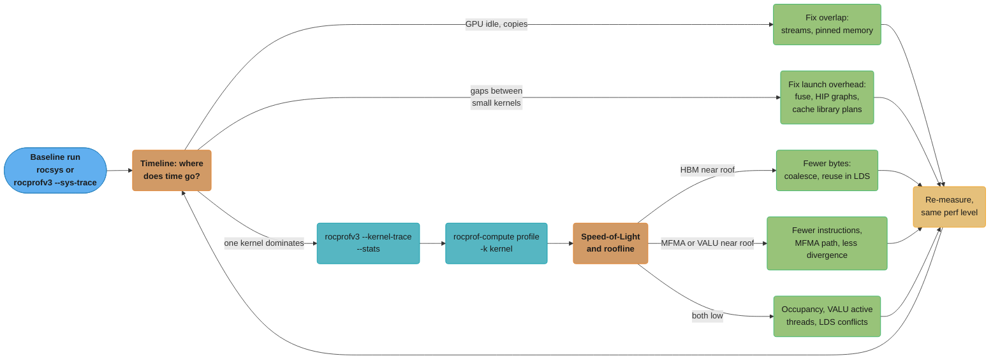
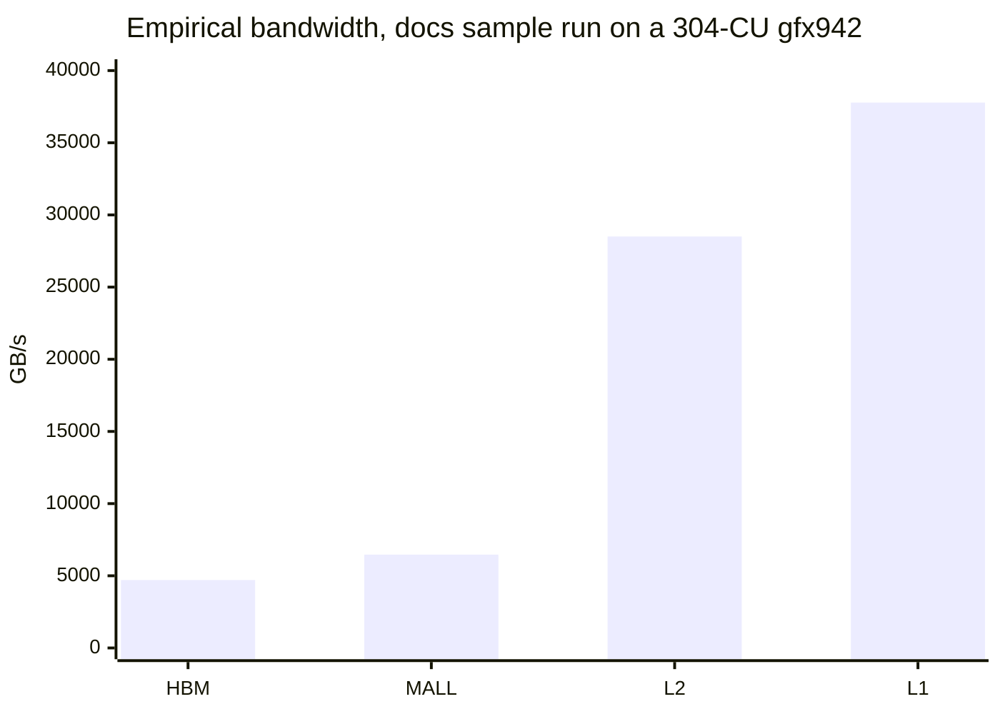

# ROCm Profiling and Debugging

> **Version anchor (fetched 2026-11-25):** ROCm Core SDK 10.2.0 (release notes dated 2026-11-18) ships ROCprofiler-SDK 1.4.2 (`rocprofv3`, `rocpd`), ROCm Compute Profiler 3.10.0 (`rocprof-compute`), ROCm Systems Profiler 1.10.0 (`rocprof-sys-*` and the new experimental `rocsys` command), ROCgdb 16.3, ROCdbgapi 0.82.1, ROCr Debug Agent 2.2.0, AMD SMI 27.2.0 (`amd-smi`, plus the `amdsmi` Python package on PyPI) and ROCm Data Center Tool 1.4.0. Hardware figures come from the ROCm GPU specifications table and AMD's MI300X and MI355X product pages. Sources: rocm.docs.amd.com release notes, `components-current.yaml` and the per-tool documentation.

## 1. Concept Overview

Profiling on AMD follows the same two-level method as on NVIDIA: first find where time goes across the whole application, then explain why one kernel is slow. The tool names differ, and several tools were renamed in the last few releases, so the first skill is knowing which tool answers which question.

| Question | NVIDIA tool | ROCm tool |
|---|---|---|
| Where does the time go across CPU, GPU, copies and communication? | Nsight Systems (`nsys`) | ROCm Systems Profiler (`rocprof-sys-*`, `rocsys`), or `rocprofv3 --sys-trace` |
| Which kernels ran, how long, in what order? | `nsys`, CUPTI activity | `rocprofv3 --kernel-trace --stats` |
| Why is this one kernel slow? | Nsight Compute (`ncu`) | ROCm Compute Profiler (`rocprof-compute`) |
| Raw hardware counters for a kernel | `ncu --metrics` | `rocprofv3 --pmc` |
| Instruction-level hotspots | `ncu` source view, PC sampling | `rocprofv3` PC sampling, thread trace (`--att`) |
| Annotate code ranges | NVTX | ROCTx |
| Step through a kernel | `cuda-gdb` | `rocgdb` |
| Find which kernel faulted | `compute-sanitizer`, `CUDA_LAUNCH_BLOCKING=1` | ROCr Debug Agent, `AMD_SERIALIZE_KERNEL=3` |
| Device state, clocks, power, topology | `nvidia-smi` | `amd-smi` |

**ROCprofiler-SDK** is the tooling library underneath (the CUPTI role), and `rocprofv3` is its command-line tool. The docs describe the older `rocprof`, `rocprofv2` and ROCTracer as legacy. ROCm Compute Profiler and ROCm Systems Profiler were previously named Omniperf and Omnitrace, and both old names still appear in blog posts and scripts.

This module covers the profiling loop on MI300X-class GPUs, the counters that matter, the empirical roofline in `rocprof-compute`, PC sampling and thread trace, system-level tracing, and the debugging tools (ROCgdb, the ROCr Debug Agent, serialization variables, `amd-smi`). The CUDA counterpart is [profiling_and_performance_analysis](../profiling_and_performance_analysis/profiling_and_performance_analysis.md); the library choices you are often profiling are in [rocm_libraries_and_kernel_dsls](../rocm_libraries_and_kernel_dsls/rocm_libraries_and_kernel_dsls.md); the hardware the counters describe is in [amd_gpu_architecture_cdna_and_rdna](../amd_gpu_architecture_cdna_and_rdna/amd_gpu_architecture_cdna_and_rdna.md).

---

## 2. Intuition

> **One-line analogy**: `rocprofv3` is the flight data recorder, `rocprof-sys` is air traffic control's radar of every plane at once, and `rocprof-compute` is the engine teardown of one plane. You never start with the teardown.

**Mental model.** A GPU kernel's speed is set by whichever hardware path saturates first: HBM, L2, LDS, vector ALUs, matrix cores (MFMA), or plain latency because too few wavefronts are resident to hide it. A profiler's job is to tell you which one. On AMD the answer arrives in AMD vocabulary: wavefronts instead of warps, LDS instead of shared memory, VGPRs and AGPRs instead of registers, MFMA instead of Tensor Cores, XCDs and Infinity Cache (MALL) instead of a single monolithic L2.

**Why it matters.** Code ported from CUDA usually compiles and runs correctly on the first day, which hides the fact that its launch geometry, tile sizes and library choices were tuned for a 32-lane warp and a different memory hierarchy. The gap between "runs" and "runs well" on MI300X is found only by measurement, and the measurements have AMD-specific traps: `rocprof-compute` serializes kernels across streams while profiling, CSV output from `rocprofv3` is deprecated, and consumer RDNA GPUs gate counter clocks unless you set a profiling performance level.

**Key insight.** The single most useful number on CDNA that has no direct NVIDIA equivalent in daily use is **VALU Active Threads** (out of 64). It tells you how many lanes of each 64-wide wavefront do useful work. A kernel ported with a 32-thread block or a 32-lane reduction sits near 32 out of 64 and wastes half of every vector instruction, and no CUDA-trained instinct flags it.

---

## 3. Core Principles

- **Top-down, always.** System trace first (`rocprof-sys` or `rocprofv3 --sys-trace`), then a kernel list with timings (`rocprofv3 --kernel-trace --stats`), then one kernel in `rocprof-compute`. This mirrors the `nsys`-then-`ncu` order in [nsight_profiling_workflow](../case_studies/cross_cutting/nsight_profiling_workflow.md).
- **Counters need replays.** Hardware counter blocks are limited, so `rocprofv3 --pmc` with several groups and `rocprof-compute profile` both replay the application (or, with the beta kernel-replay mode, each dispatch) once per counter group. A non-deterministic application gives counters from different runs.
- **Profiling changes concurrency.** ROCm Compute Profiler serializes kernel dispatches across HIP streams on the same GPU so it can attribute counters to one dispatch. Duration and throughput numbers reflect that serialized run, not your overlapped production run.
- **The roofline is empirical.** `rocprof-compute` runs micro-benchmarks to measure achievable HBM, MALL, L2, L1 and LDS bandwidth and peak MFMA and VALU rates on your machine, then plots kernels against those measured peaks. Datasheet peaks are upper bounds you will not reach.
- **Use the default output format.** `rocprofv3` writes a `rocpd` SQLite database by default; direct CSV, Perfetto and OTF2 output are deprecated and may omit data. Convert with `rocpd convert` when you need CSV or a Perfetto trace.
- **Debug with serialization first.** `AMD_SERIALIZE_KERNEL=3` and `AMD_SERIALIZE_COPY=3` make every kernel and copy complete before the call returns, so a fault appears at the launch that caused it. Then reach for the ROCr Debug Agent or ROCgdb.
- **Change one thing per measurement.** Same as on CUDA: one hypothesis, one change, one re-measure, recorded with the ROCm version and GPU model.

---

## 4. Types / Architectures / Strategies

### 4.1 The tool map in detail

| Tool (ROCm 10.2.0 version) | Level | Mechanism | Output | Nearest NVIDIA tool |
|---|---|---|---|---|
| `rocprofv3` (ROCprofiler-SDK 1.4.2) | API, kernel, counter | Runtime interception, counter collection, PC sampling, thread trace | `rocpd` SQLite database (default); convert to CSV, Perfetto, OTF2 | `nsys` CLI + `ncu --metrics` + CUPTI |
| `rocpd` | Post-processing | Reads the `rocpd` database | CSV, `.pftrace`, OTF2 | `nsys stats`, `nsys export` |
| `rocprof-compute` 3.10.0 | One kernel | Multi-pass counter collection + roofline micro-benchmarks | Workload directory, CLI analysis, CSV, SQLite analysis database, HTML roofline | `ncu` |
| `rocprof-sys-*` / `rocsys` 1.10.0 | Whole application | Binary instrumentation, call-stack sampling, ROCm API tracing, `amd-smi` telemetry | Timeline trace, flat and hierarchical profiles | `nsys` |
| ROCTx | Annotation | Range push/pop and marks in your code | Marker ranges in traces | NVTX |
| `rocgdb` 16.3 | Debugger | GDB with AMDGPU support via ROCdbgapi | Interactive | `cuda-gdb` |
| ROCr Debug Agent 2.2.0 | Fault triage | `HSA_TOOLS_LIB` plug-in that traps memory faults | Wavefront register and memory dump, kernel name | `compute-sanitizer` (closest role) |
| `amd-smi` 27.2.0 | Device management | Driver queries | Text, JSON, CSV | `nvidia-smi` |
| ROCm Data Center Tool 1.4.0 | Fleet telemetry | Daemon and API | Metrics | DCGM |

### 4.2 Trace domains in `rocprofv3`

| Option | Collects | Notes |
|---|---|---|
| `--hip-trace` | HIP runtime and compiler APIs | Does not include kernel dispatches; ask for them separately |
| `--kernel-trace` | Kernel dispatches with timestamps | The basis for per-kernel timing |
| `--memory-copy-trace` | Async copies | |
| `--memory-allocation-trace` | Allocations | |
| `--scratch-memory-trace` | Scratch allocations | Scratch is the AMD equivalent of CUDA local memory, used for spills |
| `--marker-trace` | ROCTx ranges and marks | |
| `--rccl-trace` | RCCL collectives | |
| `-r` / `--runtime-trace` | HIP runtime, ROCTx, RCCL, memory operations, kernels | The usual "what ran" set |
| `-s` / `--sys-trace` | Everything in runtime trace plus HSA APIs | All-inclusive |
| `--pmc` | Named hardware counters | Several `--pmc` flags mean several passes |
| `--pc-sampling-*` | Sampled program counters | Beta; flag `--pc-sampling-beta-enabled` |
| `--att` | Thread trace (near cycle-accurate instruction timing) | Per-CU detail tokens |

### 4.3 Analysis views in `rocprof-compute`

| Block | Shows | First thing to read |
|---|---|---|
| 0 Top Stats | Kernels by total time | Which kernel to study |
| 1 System Info | GPU, clocks, partition modes | That you profiled the hardware you think you did |
| 2 System Speed-of-Light | Achieved vs peak for VALU, MFMA, caches, LDS, fabric | The bottleneck class |
| Hardware block views | CU pipelines, vL1D, L2, command processor, workgroup manager | Which unit inside the bottleneck class |
| Memory chart | Read, write, atomic traffic and hit rates per memory level | Where the bytes went |
| 4 Roofline | Per-kernel arithmetic intensity against empirical peaks | Distance to the roof |
| Wavefront and instruction mix | Grid, workgroup, VGPR/AGPR/SGPR, occupancy, VALU/VMEM/SALU/LDS/MFMA counts | Why occupancy or issue is low |

Selected System Speed-of-Light metric IDs, as numbered in the analyze CLI: `2.1.1` MFMA FLOPs (BF16), `2.1.7` VALU Utilization, `2.1.8` MFMA Utilization, `2.1.11` VALU Active Threads, `2.1.12` IPC, `2.1.13` Wavefront Occupancy, `2.1.15` LDS Bank Conflicts/Access, `2.1.16` vL1D Cache Hit Rate, `2.1.18` L2 Cache Hit Rate, `2.1.20` L2-Fabric Read BW.

---

## 5. Architecture Diagrams

### The ROCm profiling loop



Each loop is one hypothesis and one change. The structure is identical to the Nsight loop in [profiling_and_performance_analysis](../profiling_and_performance_analysis/profiling_and_performance_analysis.md); only the tools and the counter names differ. The "both low" branch is where AMD-specific causes live: half-empty wavefronts, VGPR-limited occupancy and LDS bank conflicts.

### Empirical peaks that `rocprof-compute` measures



These are the means printed by the roofline micro-benchmarks in the ROCm Compute Profiler documentation's sample profile (workload directory `MI325X`, device `gfx942 with 304 CUs`). The ratio is the lesson: L2 delivers about 6x and L1 about 8x the HBM rate in that run, so a kernel that keeps its working set in L2 or LDS can run several times faster than its HBM roofline suggests.

### Which tool sees what

```
                    host code    HIP API    dispatch    counters    instructions    device state
                    ---------    -------    --------    --------    ------------    ------------
rocprof-sys / rocsys    X           X           X        (some)                          X (amd-smi)
rocprofv3 --sys-trace               X           X
rocprofv3 --pmc                                 X           X
rocprofv3 PC sampling                           X                         X (sampled)
rocprofv3 --att                                 X                         X (per CU)
rocprof-compute                                 X           X             X (PC samp.)
rocgdb                  X                       X                         X (stepping)
amd-smi                                                                                  X
```

Caption: no single tool covers every column. A slow step usually needs at least two rows: a timeline tool to find the kernel and a counter tool to explain it.

### Reading VALU Active Threads on a wave64 GPU

```
wavefront = 64 lanes, one VALU instruction issues for all 64

kernel launched with 256-thread blocks, full wavefronts:
  lanes  0 ................................................................ 63
         [################################################################]   64 / 64 active

kernel ported with 32-thread blocks (warp-sized in CUDA):
  lanes  0 ............................... 31 32 ............................ 63
         [################################][................................]   32 / 64 active

metric 2.1.11 VALU Active Threads:  first kernel ~64.0, second kernel ~32.0
```

Caption: a 32-thread block occupies a whole 64-lane wavefront on CDNA with half its lanes masked off. The kernel is correct and half as efficient on every vector instruction; the metric exposes it directly.

---

## 6. How It Works — Detailed Mechanics

### 6.1 Timing a kernel correctly with HIP events

Kernel launches are asynchronous on AMD too. A host clock around a launch measures the enqueue, not the execution.

```cpp
#include <hip/hip_runtime.h>
#include <cstdio>
#include <cstdlib>

#define HIP_CHECK(x) do { hipError_t e = (x); if (e != hipSuccess) { \
    std::fprintf(stderr, "HIP %s at %s:%d\n", hipGetErrorString(e), __FILE__, __LINE__); \
    std::exit(1); } } while (0)

__global__ void saxpy(int n, float a, const float* x, float* y) {
    int i = blockIdx.x * blockDim.x + threadIdx.x;
    if (i < n) y[i] = a * x[i] + y[i];
}

int main() {
    const int n = 1 << 26;                       // 64 Mi elements, 256 MiB per array
    float *x, *y;
    HIP_CHECK(hipMalloc(&x, n * sizeof(float)));
    HIP_CHECK(hipMalloc(&y, n * sizeof(float)));
    HIP_CHECK(hipMemset(x, 0, n * sizeof(float)));
    HIP_CHECK(hipMemset(y, 0, n * sizeof(float)));

    hipEvent_t start, stop;
    HIP_CHECK(hipEventCreate(&start));
    HIP_CHECK(hipEventCreate(&stop));

    const int block = 256;                       // 4 wavefronts of 64 on CDNA
    const int grid = (n + block - 1) / block;
    for (int w = 0; w < 3; ++w) saxpy<<<grid, block>>>(n, 2.0f, x, y);   // warm-up

    HIP_CHECK(hipEventRecord(start, 0));
    for (int r = 0; r < 20; ++r) saxpy<<<grid, block>>>(n, 2.0f, x, y);
    HIP_CHECK(hipEventRecord(stop, 0));
    HIP_CHECK(hipEventSynchronize(stop));
    HIP_CHECK(hipGetLastError());

    float ms = 0.0f;
    HIP_CHECK(hipEventElapsedTime(&ms, start, stop));
    double bytes = 3.0 * n * sizeof(float) * 20;          // read x, read y, write y
    std::printf("avg %.3f ms, %.1f GB/s\n", ms / 20, bytes / (ms * 1e-3) / 1e9);

    HIP_CHECK(hipFree(x));
    HIP_CHECK(hipFree(y));
    return 0;
}
```

SAXPY moves 12 bytes per element and does 2 FLOPs, an arithmetic intensity of about 0.17 FLOP/byte, far left of MI300X's ridge point. Its achieved GB/s divided by the empirical HBM number (§5) is the only efficiency figure that matters for it.

### 6.2 Annotating code with ROCTx

```cpp
#include <rocprofiler-sdk-roctx/roctx.h>   // link with -lrocprofiler-sdk-roctx

void train_step() {
    roctxRangePush("forward");
    // ... launch forward kernels ...
    roctxRangePop();

    roctxRangePush("backward");
    // ... launch backward kernels ...
    roctxRangePop();

    roctxMark("step done");
}
```

Collect the ranges with `rocprofv3 --marker-trace` (or any aggregate trace that includes markers). `--kernel-rename` replaces mangled kernel names with the enclosing ROCTx range name, which helps with heavily templated libraries. Older code that includes the legacy ROCTx header still works, but the docs recommend the ROCprofiler-SDK header above.

### 6.3 `rocprofv3` workflows

```bash
# 1. What ran and for how long, with summary tables
rocprofv3 --kernel-trace --stats -d ./prof -- ./app

# 2. Everything at the runtime level: HIP API, ROCTx, RCCL, copies, kernels
rocprofv3 --runtime-trace -d ./prof -- ./app

# 3. Convert the default rocpd database for viewing
rocpd convert -i <pid>_results.db --output-format pftrace   # the .db under ./prof; open in ui.perfetto.dev
rocpd convert -i <pid>_results.db --output-format csv

# 4. Hardware counters for one kernel, two passes
rocprofv3 --kernel-include-regex 'gemm_kernel' \
          --pmc SQ_WAVES GRBM_GUI_ACTIVE FETCH_SIZE \
          --pmc SQ_LDS_BANK_CONFLICT SQ_INSTS_LDS \
          -d ./ctr -- ./app

# 5. Counters for only the 3rd to 5th call of each matching kernel (skips warm-up calls)
rocprofv3 --kernel-include-regex 'attn' --kernel-iteration-range '[3-5]' \
          --pmc SQ_WAVES GRBM_GUI_ACTIVE -- ./app

# 6. Attach to an already-running process (-p, --pid and --attach are equivalent)
rocprofv3 --kernel-trace --attach <pid>
rocprofv3 --list-avail        # counters and PC-sampling configs this GPU supports
```

Useful details from the CLI reference:

| Option | Meaning |
|---|---|
| `-d`, `--output-directory` | Where output goes; `-o` sets the file name |
| `-f`, `--output-format` | `rocpd` (default), `csv`, `json`, `pftrace`, `otf2`; direct non-`rocpd` formats are deprecated |
| `--stats`, `-S`, `-D` | Per-API and per-domain statistics, summary to stdout, summary per domain |
| `-T`, `--truncate-kernels` | Short demangled kernel names |
| `--kernel-include-regex`, `--kernel-exclude-regex` | Filter counter collection and thread trace to matching kernels |
| `--kernel-iteration-range` | Iteration range `[start-stop]` for each kernel matching the filter |
| `-P`, `--collection-period` | Delay, duration and repeat for time-windowed collection |
| `--replay-mode kernel --kernel-replay-beta-enabled` | Collect every `--pmc` group in one application run by replaying each dispatch with a memory snapshot (beta, counters only) |

**RDNA note.** On RDNA 3 and RDNA 4 GPUs the `AUTO` performance level gates the performance-monitor clock in some hardware blocks, so counters read zero or nonsense. Set `sudo amd-smi set --perf-level STABLE_STD` before collecting and restore `AUTO` afterwards.

### 6.4 The counters that answer the common questions

Derived counters are defined per architecture in ROCprofiler-SDK's counter definitions. On gfx942 and gfx950:

| Question | Counter or expression | Notes |
|---|---|---|
| How many wavefronts ran? | `SQ_WAVES` | Divide by the grid size in wavefronts to sanity-check the launch |
| How long was the GPU busy? | `GRBM_GUI_ACTIVE` | GPU busy cycles; the denominator of most percentages |
| How many bytes came from HBM? | `FETCH_SIZE` (KiB) | Built from `TCC_EA0_RDREQ*` and `TCC_BUBBLE` on gfx942 |
| How many bytes went to HBM? | `WRITE_SIZE` (KiB) | Built from `TCC_EA0_WRREQ*` |
| Were the vector ALUs busy? | `VALUBusy` = `100 * SQ_ACTIVE_INST_VALU / CU_NUM / GRBM_GUI_ACTIVE` | Percent of GPU time |
| Is LDS stalled on bank conflicts? | `LDSBankConflict` = `100 * SQ_LDS_BANK_CONFLICT / GRBM_GUI_ACTIVE / CU_NUM` | Percent of GPU time |
| How much L2 hit? | `TCC_HIT`, `TCC_MISS` | Aggregated across L2 channels when no instance is named |
| Is MFMA doing BF16 or FP16 work? | `SQ_INSTS_VALU_MFMA_MOPS_BF16`, `SQ_INSTS_VALU_MFMA_MOPS_F16` | Matrix-op counts per data type |

Effective HBM bandwidth from those counters is `(FETCH_SIZE + WRITE_SIZE) * 1024 / kernel_duration_seconds`. Compare it with the empirical HBM peak, not with the 5.3 TB/s datasheet number.

### 6.5 ROCm Compute Profiler: profile, then analyze

```bash
# Profile one kernel (substring match), all analysis blocks, plus roofline micro-benchmarks
rocprof-compute profile -n attn_v1 -k flash_attn_fwd -- python bench_attn.py

# Faster: only the counters for blocks 2 (System SOL) and 7, no roofline
rocprof-compute profile -n attn_v1 -k flash_attn_fwd -b 2 7 --no-roof -- python bench_attn.py

# Only the roofline (reuses roofline.csv if it already exists)
rocprof-compute profile -n attn_v1 --roof-only -- python bench_attn.py

# Analyze in the terminal; workloads/<name>/<SoC>/
rocprof-compute analyze -p workloads/attn_v1/MI300X/
rocprof-compute analyze -p workloads/attn_v1/MI300X/ -k 0 -b 4        # per-kernel roofline
rocprof-compute analyze -p workloads/attn_v1/MI300X/ workloads/attn_v2/MI300X/   # before vs after
rocprof-compute analyze -p workloads/attn_v1/MI300X/ --output-format db           # SQLite
```

What happens under the hood, per the docs:

1. **Counter stage.** The tool replays the application as many times as needed to collect every requested counter per dispatch, injecting a native counter-collection library and the ROCprofiler-SDK tool library into the process.
2. **Roofline stage** (skip with `--no-roof`). Accelerator-specific micro-benchmarks measure HBM, MALL, L2, L1 and LDS bandwidth and peak MFMA and VALU rates; results land in `roofline.csv`. The docs state the roofline model is not available before MI200.
3. **Derivation.** Raw counters become metrics (utilizations, hit rates, bandwidths) and populate the analysis blocks.

Three 10.2-era changes catch scripts written for older versions. `-d` in profile mode now sets the output directory (it used to select dispatches); dispatch selection is `--kernel-iteration-range`, and dispatch IDs now start at 1. The analyze `--gui` and `--tui` options are deprecated. Roofline analysis gained MXFP8 on MI350 series GPUs. Analyze-mode Python dependencies install with `pip install "rocm-profiler[compute-analyze]"` and are checked by `rocprof-compute analyze --verify-deps`.

### 6.6 Roofline arithmetic for MI300X

| Quantity | Value | Source |
|---|---|---|
| Peak HBM bandwidth | 5.3 TB/s | AMD MI300X product page |
| Peak FP16 matrix (dense) | 1.3 PFLOPs | AMD MI300X product page |
| Peak FP32 matrix | 163.4 TFLOPs | AMD MI300X product page |
| Peak FP8 (dense) | 2.61 PFLOPs | AMD MI300X product page |
| Datasheet FP16 ridge point | 1.3e15 / 5.3e12 = about 245 FLOP/byte | derived |
| Datasheet FP32-matrix ridge point | 163.4e12 / 5.3e12 = about 31 FLOP/byte | derived |

A BF16 GEMM of 8192 x 8192 x 8192 performs 2 x 8192^3 = 1.10e12 FLOPs and, with perfect reuse, moves three 8192 x 8192 BF16 matrices = 3 x 134 MB = 403 MB. Its intensity is about 2,730 FLOP/byte, far right of the ridge: compute-bound, judged by MFMA utilization. A decode-time GEMV against the same weight matrix does 2 x 8192^2 = 134 MFLOPs over 134 MB of weights, 1 FLOP/byte: memory-bound, judged only by bytes per second against the empirical HBM roof.

The empirical roof is lower than the datasheet. The ROCm Compute Profiler documentation's sample run measured 4,705 GB/s HBM on a 304-CU gfx942 device; a kernel at 4.2 TB/s on that machine is at about 89% of what the hardware actually delivers, which is a very different statement from "79% of 5.3 TB/s". Always plot against the measured roof for the machine you are on. See [roofline_and_arithmetic_intensity](../case_studies/cross_cutting/roofline_and_arithmetic_intensity.md).

### 6.7 PC sampling and thread trace

**PC sampling** periodically records which instruction each sampled wavefront is executing, so you get instruction-level hotspots without instrumenting the kernel:

```bash
rocprofv3 --pc-sampling-beta-enabled \
          --pc-sampling-method host_trap --pc-sampling-unit time --pc-sampling-interval 1 \
          -- ./app                      # 1 microsecond interval
rocprofv3 --pc-sampling-beta-enabled \
          --pc-sampling-method stochastic --pc-sampling-unit cycles --pc-sampling-interval 1048576 \
          -- ./app
```

| GPU | Architecture | Stochastic | Host-trap |
|---|---|---|---|
| MI355X, MI350X, MI350P | CDNA 4 | yes | yes |
| MI325X, MI300X, MI300A | CDNA 3 | yes | yes |
| MI250X, MI250, MI210 | CDNA 2 | no | yes |
| MI100 | CDNA 1 | no | no (lacks the hardware support) |

Stochastic sampling carries stall reasons with each sample; host-trap sampling is coarser but works further back. On MI300X the docs list minimum firmware versions for both methods. ROCm Compute Profiler 3.10.0 adds two per-instruction PC-sampling metrics: active thread percent (branch divergence) and wave occupancy (needs stochastic sampling).

**Thread trace** (`rocprofv3 --att`) records near cycle-accurate instruction timing for wavefronts on selected CUs. Defaults per the docs: detail tokens from CU 1 (`att-target-cu`, range 0-15), shader engine mask `0x1`, a 96 MB trace buffer shared across shader engines (1 MB to 2 GB). The output includes per-instruction hit count, latency, stall and idle cycles mapped back to source. Use it after `rocprof-compute` has named the bottleneck and you need to know which instruction stalls.

### 6.8 System-level tracing with ROCm Systems Profiler

ROCm Systems Profiler puts host call stacks, HIP and HSA APIs, kernels, copies, RCCL, MPI, OpenMP, Python frames and GPU telemetry (temperature, power, utilization, xGMI and PCIe bandwidth via `amd-smi`) on one timeline.

```bash
rocsys -- ./app                                   # full trace profile (experimental command)
rocprof-sys-sample -f 1000 -- ./app               # call-stack sampling at 1000 Hz, low overhead
rocprof-sys-instrument -o ./app.inst -- ./app     # binary rewrite
rocprof-sys-run -- ./app.inst                     # run the instrumented binary
mpirun -n 8 rocprof-sys-run -- ./app.inst         # MPI: rewrite first, never runtime-instrument
rocprof-sys-avail -H -c GPU                       # GPU hardware counters available here
rocprof-sys-avail -G ${HOME}/.rocprof-sys.cfg     # write a default config to edit
```

The docs' guidance on modes: binary instrumentation gives complete per-call data at higher overhead; call-stack sampling gives whole-application context at low overhead; enabling sampling after instrumentation fills the gaps. Build with optimization and `-g1` debug info (`RelWithDebInfo`) so samples map to lines without slowing the code. With MPI, runtime instrumentation needs a fork and `ptrace` that most MPI launchers break, so rewrite the binary first.

### 6.9 Debugging: serialize, trap, then step

**Step 1: make the failure point at its launch.**

```bash
AMD_SERIALIZE_KERNEL=3 AMD_SERIALIZE_COPY=3 ./app
# 1 = wait before enqueue, 2 = wait after enqueue, 3 = both
```

**Step 2: trap the faulting wavefront with the ROCr Debug Agent.**

```bash
PYTORCH_NO_HIP_MEMORY_CACHING=1 HSA_DISABLE_FRAGMENT_ALLOCATOR=1 \
HSA_TOOLS_LIB=/opt/rocm/lib/librocm-debug-agent.so.2 HSA_ENABLE_DEBUG=1 \
ROCM_DEBUG_AGENT_OPTIONS="--all --save-code-objects" \
python train.py
```

On a memory access fault the agent prints the registers and memory of the active wavefronts and the faulting kernel's name and code object. Turning off the caching allocators gives it the best chance of catching the fault where it originates instead of inside a larger pooled allocation. Saved in-memory code objects can be disassembled with `llvm-objdump --disassemble-all`.

**Step 3: step through the kernel with ROCgdb.**

```bash
hipcc -ggdb -O0 --offload-arch=gfx942 saxpy.cpp -o saxpy
rocgdb ./saxpy
```

```bash
(gdb) set env AMD_SERIALIZE_KERNEL 3
(gdb) break saxpy if $_lane == 63
(gdb) run
(gdb) info agents          # GPUs: id, gfx target, device name, cores, threads, PCI location
(gdb) info dispatches      # grid and workgroup sizes of running dispatches
(gdb) info threads         # host threads and AMDGPU waves; a GPU "thread" is a wavefront
(gdb) info lanes           # lanes of the current wave
(gdb) lane 5               # focus one work-item
(gdb) print y[i]
(gdb) info registers       # VGPRs show 64 values on CDNA; exec is a 64-bit mask
(gdb) x/4xw private_lane#0x0
```

Two AMD-specific points. A device "thread" in ROCgdb is a wavefront, and per-work-item state is reached with `lane`. The `exec` register is a 64-bit mask on CDNA, so a value like `0x00000000ffffffff` means lanes 32-63 are inactive, the same half-empty wavefront the VALU Active Threads metric reports.

### 6.10 `amd-smi`: device state before you trust any number

```bash
amd-smi list                              # GPUs and their BDFs
amd-smi static --gpu 0                    # ASIC, VBIOS, VRAM, partition modes
amd-smi metric --gpu 0 --perf-level       # current performance level
sudo amd-smi set --perf-level STABLE_STD  # fixed clocks for repeatable profiling
amd-smi monitor --gfx --mem               # live utilization
amd-smi monitor --power-usage --temperature
amd-smi topology                          # link types and weights between GPUs
amd-smi xgmi -m                           # xGMI link metrics
amd-smi process                           # compute processes per GPU
amd-smi ras --cper                        # RAS error records, including fabric link events (10.2)
```

ROCm 10.2.0 changed `amd-smi` exit codes, error output (`--csv` rows gained a third column) and dropped fields the metrics table cannot report from human-readable `metric` output; scripts that parse it need updating. The Python library is now on PyPI as `amdsmi` 27.2.0 and bundles the library, so it no longer needs a ROCm install.

### 6.11 Profiling a PyTorch model on ROCm

PyTorch on ROCm reuses the `torch.cuda` API, so timing code written for NVIDIA runs unchanged. What changes is how you see which library kernel each op became.

```python
import torch

def time_op(fn, iters: int = 50, warmup: int = 10) -> float:
    """Average milliseconds per call, measured with GPU events."""
    for _ in range(warmup):            # excludes JIT, kernel-cache misses, tuning
        fn()
    start = torch.cuda.Event(enable_timing=True)
    stop = torch.cuda.Event(enable_timing=True)
    start.record()
    for _ in range(iters):
        fn()
    stop.record()
    torch.cuda.synchronize()           # same rule as on CUDA
    return start.elapsed_time(stop) / iters

assert torch.version.hip is not None, "expected a ROCm build of PyTorch"
x = torch.randn(32, 8192, device="cuda", dtype=torch.bfloat16)
w = torch.randn(8192, 28672, device="cuda", dtype=torch.bfloat16)
ms = time_op(lambda: x @ w)
bytes_moved = w.numel() * w.element_size()          # weights dominate at batch 32
print(f"{ms:.3f} ms, {bytes_moved / (ms * 1e-3) / 1e9:.0f} GB/s effective")
```

```bash
# Which GEMM kernels ran, with hipBLASLt annotating the timeline for ROCProfiler
HIPBLASLT_ENABLE_MARKER=1 rocprofv3 --runtime-trace --stats -d ./prof -- python bench.py

# Have hipBLASLt log the kernel it selected for every call (mask 64 = Profile lines)
HIPBLASLT_LOG_MASK=64 HIPBLASLT_LOG_FILE=hipblaslt_%i.log python bench.py

# Confirm TunableOp is active and which solution it picked per shape
PYTORCH_TUNABLEOP_ENABLED=1 PYTORCH_TUNABLEOP_VERBOSE=1 python bench.py
```

The weight matrix in the example is 8,192 x 28,672 BF16 = 470 MB, read once per call, so the effective-GB/s line is the number to compare with the empirical HBM roof. If the hipBLASLt log or the kernel trace shows a different backend or kernel than the one you tuned, or the TunableOp file was rejected, the fix is in the library configuration (see [rocm_libraries_and_kernel_dsls](../rocm_libraries_and_kernel_dsls/rocm_libraries_and_kernel_dsls.md)), not in the kernel.

---

## 7. Real-World Examples

- **ROCm's own sample.** The ROCm Compute Profiler documentation profiles a `vcopy` kernel (`./vcopy -n 1048576 -b 256`) on a gfx942 GPU, then shows the empirical roofline stage measuring HBM at 4,705 GB/s, MALL at 6,466 GB/s, L2 at 28,505 GB/s and L1 at 37,783 GB/s. It is the reference for what "good" bandwidth looks like on that machine.
- **Distributed training timelines.** The ROCm Systems Profiler docs use the example of a training job where the GPU looks idle not because kernels are slow but because a data loader is starved, an MPI collective blocks, or Python's GIL stalls dispatch. That diagnosis needs host and device on one timeline, which is what `rocprof-sys` adds over `rocprofv3`.
- **Inference engines on MI300X.** The ROCm workload-optimization guide recommends checking that NUMA auto-balancing is off (`cat /proc/sys/kernel/numa_balancing` prints 0) and tuning GEMMs with TunableOp or `hipblaslt-bench` before profiling kernels; both appear as large, easy wins in system traces.
- **Memory faults in PyTorch.** The same guide's fault-triage recipe (Debug Agent plus `PYTORCH_NO_HIP_MEMORY_CACHING=1` and `HSA_DISABLE_FRAGMENT_ALLOCATOR=1`) is the standard first step when a ROCm PyTorch job dies with a memory access fault.
- **Release-to-release tooling changes.** ROCm 10.2.0 alone added device-wide SPM counter sampling for gfx1200, gfx1201 and gfx1250, the `rocsys` command, MXFP8 roofline on MI350, and breaking CLI changes in both `rocprof-compute` and `amd-smi`. Profiling scripts are code and need the same version pinning as the application.

---

## 8. Tradeoffs

| Choice | Gain | Cost |
|---|---|---|
| `rocprofv3 --kernel-trace` vs `rocprof-compute` | Low overhead, true concurrency preserved | No explanation of why a kernel is slow |
| `rocprof-compute` full profile vs `-b` blocks | Every metric, every view | Many application replays; minutes instead of seconds |
| Application replay vs kernel replay (beta) | Works with any app | Non-deterministic apps mix counters from different runs; kernel replay fixes that but is counters-only |
| `rocprof-sys` instrumentation vs sampling | Exact per-call data | Higher overhead, distorted short functions |
| Host-trap vs stochastic PC sampling | Works back to MI200 | No stall reasons; coarser |
| Thread trace vs PC sampling | Cycle-level per-instruction timing | One CU, large buffers, narrow time window |
| Datasheet vs empirical roofline | Zero setup | Overstates the reachable peak, so every kernel looks worse than it is |
| `STABLE_STD` vs `AUTO` perf level | Repeatable clocks, working counters on RDNA | Not the clocks production runs at |

---

## 9. When to Use / When NOT to Use

**Use `rocprofv3` when** you need to know which kernels ran and how long they took, need a few specific counters, or need PC sampling or thread trace. It is the lowest-overhead correct tool and its `rocpd` database feeds everything else.

**Use `rocprof-compute` when** one kernel dominates and you need to know which hardware unit limits it, how far it is from an empirical roof, or whether a change helped (`analyze` with two `-p` paths).

**Use `rocprof-sys` / `rocsys` when** the GPU looks underused and the cause may be on the host: data loading, Python, MPI, RCCL, or launch gaps.

**Use ROCgdb when** results are wrong and you need to inspect values in specific lanes. **Use the ROCr Debug Agent when** a job dies with a memory access fault and you need the kernel name and wavefront state.

**Do NOT:**
- Read kernel durations from `rocprof-compute` as production timings; dispatches were serialized across streams.
- Profile a `-O0 -ggdb` debug build for performance; use the release build with `-g1` line info.
- Compare runs taken at different performance levels, ROCm versions or partition modes.
- Rely on direct CSV output from `rocprofv3`; it is deprecated and may drop data. Use `rocpd convert`.
- Run `rocprof-compute` over a whole multi-hour job; filter by kernel and iteration.

---

## 10. Common Pitfalls

**1. Timing an asynchronous launch with the host clock.** The same trap as CUDA, with HIP names.

```cpp
// BROKEN: measures how long the enqueue took, not the kernel
auto t0 = std::chrono::steady_clock::now();
saxpy<<<grid, 256>>>(n, 2.0f, x, y);
auto t1 = std::chrono::steady_clock::now();
double ms = std::chrono::duration<double, std::milli>(t1 - t0).count();   // microseconds of launch cost
```

```cpp
// FIX: events recorded on the stream, synchronize on the stop event, check for launch errors
hipEvent_t a, b;
HIP_CHECK(hipEventCreate(&a));
HIP_CHECK(hipEventCreate(&b));
HIP_CHECK(hipEventRecord(a, 0));
saxpy<<<grid, 256>>>(n, 2.0f, x, y);
HIP_CHECK(hipEventRecord(b, 0));
HIP_CHECK(hipEventSynchronize(b));
HIP_CHECK(hipGetLastError());
float ms = 0.0f;
HIP_CHECK(hipEventElapsedTime(&ms, a, b));
```

In PyTorch the equivalent rule is `torch.cuda.synchronize()` before reading a timer; the `torch.cuda` names are the same on ROCm.

**2. Trusting `rocprof-compute` durations for overlapped code.** A pipeline that overlaps a GEMM on one stream with an all-reduce on another shows both kernels back to back under `rocprof-compute`, because the tool serializes dispatches to attribute counters. Use its counters for "why", and `rocprofv3 --kernel-trace` or `rocprof-sys` for "how long in production".

**3. Scripts broken by a tool upgrade.** After ROCm 10.2.0, a CI job that ran `rocprof-compute profile -d 1 2 3` to select dispatches started writing output into a directory named `1` because `-d` became the output directory. A monitoring script that parsed two-field `amd-smi --csv` error rows broke when a third field appeared. Pin tool versions in CI and read release notes before upgrading.

**4. Zero counters on a Radeon card.** On RDNA 3 and RDNA 4 the `AUTO` performance level gates the perfmon clock in some blocks. Counters come back empty or meaningless until `amd-smi set --perf-level STABLE_STD`.

**5. Counters from different runs.** Several `--pmc` groups mean several application runs. If the run order of kernels changes (dynamic batching, autotuning on first call, random data loading), each group saw a different workload, and ratios between counters from different groups are meaningless. Fix the inputs, warm up autotuners first, or use kernel replay (beta).

**6. Measuring compilation.** The first call to an AITER op, a MIOpen convolution, a Triton kernel or a hipBLASLt shape can include JIT compilation, kernel-cache misses or catalog decompression. Use `--kernel-iteration-range` or a warm-up loop to skip them.

**7. Datasheet-roof despair.** A memory-bound kernel at 4.2 TB/s on MI300X looks like 79% of 5.3 TB/s and invites weeks of tuning. Against an empirical roof near 4.7 TB/s it is at about 89%, close to done. Run the roofline micro-benchmarks on the machine.

**8. Debugging with the caching allocator on.** An out-of-bounds write inside PyTorch's pooled allocation often corrupts a neighbouring tensor without faulting, so the crash appears later in an unrelated kernel. Disable the HIP caching allocator and the HSA fragment allocator while hunting it.

---

## 11. Technologies & Tools

| Tool | Purpose | Notes |
|---|---|---|
| rocprofv3 | Tracing, counters, PC sampling, thread trace | ROCprofiler-SDK 1.4.2; `rocpd` default output |
| rocpd | Convert profiling databases | CSV, Perfetto `.pftrace`, OTF2 |
| ROCm Compute Profiler | Per-kernel analysis and empirical roofline | `rocprof-compute` 3.10.0; formerly Omniperf |
| ROCm Systems Profiler | Whole-application timeline and profiles | 1.10.0; `rocprof-sys-*`, experimental `rocsys`; formerly Omnitrace |
| ROCm Compute Viewer | Thread-trace and ISA viewer | `rocprof-compute-viewer`, versioned separately |
| ROCTx | Code annotation | `rocprofiler-sdk-roctx/roctx.h` |
| ROCgdb | Heterogeneous debugger | 16.3, built on ROCdbgapi 0.82.1 |
| ROCr Debug Agent | Memory-fault triage | 2.2.0; loaded via `HSA_TOOLS_LIB` |
| AMD SMI | Device query and control | `amd-smi` CLI; `amdsmi` 27.2.0 on PyPI |
| ROCm Data Center Tool | Fleet telemetry | 1.4.0 |
| Perfetto UI | Timeline viewer | Opens `.pftrace` from `rocpd convert` |
| ltrace | Library call tracing | The HIP docs use `ltrace -C -e "hip*"` to trace HIP API calls |

---

## 12. Interview Questions with Answers

**Q: Why can a kernel's duration in ROCm Compute Profiler be longer than in production?**
**Short:** rocprof-compute serializes kernel dispatches across HIP streams on the same GPU to attribute counters per dispatch, so overlapped production work runs back to back under the profiler.

The docs warn that kernels on separate streams do not execute concurrently while profiling, and that duration and utilization metrics reflect the serialized run. A kernel that shares the GPU with a communication kernel in production gets the whole device under the profiler, and a pipeline's total time stretches. Use `rocprof-compute` to explain a kernel's bottleneck, and `rocprofv3 --kernel-trace` or `rocprof-sys` to measure real overlapped timing.

**Q: Which ROCm tools correspond to Nsight Systems and Nsight Compute?**
**Short:** ROCm Systems Profiler (rocprof-sys, rocsys) plays the Nsight Systems role and ROCm Compute Profiler (rocprof-compute) plays the Nsight Compute role, with rocprofv3 as the shared tracing and counter CLI.

ROCm Systems Profiler puts host stacks, ROCm APIs, kernels, RCCL, MPI and `amd-smi` telemetry on one timeline. ROCm Compute Profiler replays the application to collect counters per dispatch, measures an empirical roofline and reports Speed-of-Light, memory charts and instruction mix for one kernel. Both sit on ROCprofiler-SDK, whose `rocprofv3` CLI covers raw traces and counters. The old names Omnitrace and Omniperf refer to the same tools.

**Q: What does VALU Active Threads tell you on a CDNA GPU, and why does it matter for ported CUDA code?**
**Short:** It is the average number of active lanes per vector instruction out of 64; ported code with 32-thread blocks or 32-lane logic sits near 32, wasting half of every VALU issue.

On CDNA every vector instruction issues across a 64-lane wavefront. A CUDA kernel launched with 32-thread blocks, or with a reduction that only uses lanes 0-31, fills half of each wavefront, and the masked lanes still cost issue slots. The kernel stays correct, so tests pass. Metric `2.1.11` in the System Speed-of-Light block reports it directly; a value near 32 is the signature. Fix the launch geometry (multiples of 64 threads) and derive lane counts from `warpSize`.

**Q: Why is the empirical roofline in rocprof-compute more useful than the datasheet numbers?**
**Short:** It measures the bandwidth and compute rates your machine actually reaches, so efficiency is judged against an attainable roof instead of a theoretical peak no kernel hits.

The tool runs micro-benchmarks for HBM, MALL, L2, L1 and LDS bandwidth and peak MFMA and VALU rates, then plots kernels against those values. The docs' sample run on a 304-CU gfx942 measured 4,705 GB/s HBM, while the MI300X datasheet peak is 5.3 TB/s. A kernel at 4.2 TB/s is about 89% of the measured roof but 79% of the datasheet, and that difference decides whether more tuning is worth it.

**Q: Your rocprofv3 counter ratios look inconsistent across runs. What is a likely cause?**
**Short:** Each --pmc group is collected in a separate application replay, so a non-deterministic workload gives each counter group a different set of kernels and inputs.

Hardware counter blocks are limited, so multiple `--pmc` groups mean multiple passes. Dynamic batching, first-call autotuning, data-dependent control flow or random inputs change what each pass measured. Fix seeds and inputs, warm up autotuners before collection, filter to stable kernels with `--kernel-include-regex` and `--kernel-iteration-range`, or use `--replay-mode kernel --kernel-replay-beta-enabled`, which replays each dispatch per group from a memory snapshot within one run.

**Q: How do you find which kernel caused a GPU memory access fault on ROCm?**
**Short:** Serialize launches with AMD_SERIALIZE_KERNEL=3, then load the ROCr Debug Agent through HSA_TOOLS_LIB to dump the faulting wavefronts and kernel name, with caching allocators disabled.

Without serialization the fault surfaces at a later synchronization point, far from the launch that caused it. The Debug Agent traps the fault and prints the kernel name, code object and the registers and memory of active wavefronts; `ROCM_DEBUG_AGENT_OPTIONS="--all --save-code-objects"` also saves in-memory code objects for `llvm-objdump`. Setting `PYTORCH_NO_HIP_MEMORY_CACHING=1` and `HSA_DISABLE_FRAGMENT_ALLOCATOR=1` stops a pooled allocation from hiding an out-of-bounds write. Then use ROCgdb with a conditional breakpoint to inspect the bad lane.

**Q: Why should you use the rocpd output format instead of CSV with rocprofv3?**
**Short:** rocpd is the default SQLite output and the only one guaranteed complete; direct CSV, Perfetto and OTF2 output are deprecated and can omit data such as hipFile and rocSHMEM traces.

The ROCprofiler-SDK docs warn that the direct generators are deprecated. OMPT records are written only to the `rocpd` database, and rocSHMEM records only to JSON and `rocpd`. Collect with the default format and convert with `rocpd convert -i <file>_results.db --output-format csv` or `pftrace` for the Perfetto UI. That also keeps one source file per run that every later analysis can read.

**Q: What does an LDS bank-conflict metric of high value mean, and where do you read it?**
**Short:** It means LDS accesses from a wavefront hit the same banks and were serialized; read LDS Bank Conflicts/Access in rocprof-compute or the LDSBankConflict derived counter in rocprofv3.

On gfx942 the derived `LDSBankConflict` counter is `100 * SQ_LDS_BANK_CONFLICT / GRBM_GUI_ACTIVE / CU_NUM`, the percentage of GPU time LDS is stalled by bank conflicts. ROCm Compute Profiler reports conflicts per access as metric `2.1.15`. The cure is the same idea as on CUDA (pad or swizzle the shared array), but the padding must be re-derived for AMD's LDS layout rather than copied from a 32-bank CUDA kernel. See [shared_memory_and_bank_conflicts](../shared_memory_and_bank_conflicts/shared_memory_and_bank_conflicts.md).

**Q: How do PC sampling and thread trace differ, and when do you use each?**
**Short:** PC sampling statistically records which instruction waves are on across the whole GPU at low cost; thread trace records near cycle-accurate timing of every instruction on a few CUs.

PC sampling (`--pc-sampling-method host_trap` or `stochastic`) answers "which instructions are hot" across all CUs; stochastic sampling, available on CDNA 3 and CDNA 4, adds stall reasons. Thread trace (`--att`) answers "exactly how long does each instruction wait" but only for detail tokens from the selected CU (`att-target-cu`) and into a buffer that defaults to 96 MB. Use PC sampling first to find the hot loop, and thread trace when you need to know which load or MFMA stalls inside it.

**Q: Why do hardware counters read zero on a Radeon RX 7900 XTX until you change a setting?**
**Short:** On RDNA 3 and RDNA 4 the AUTO performance level gates the perfmon clock in some hardware blocks; set the level to STABLE_STD (profile_standard) before collecting counters.

The ROCprofiler-SDK docs describe this as a hardware feature-enablement requirement. Use `sudo amd-smi set --perf-level STABLE_STD` for all GPUs or the `power_dpm_force_performance_level` sysfs entry, collect, then restore `AUTO`. Stable clocks also make timings more repeatable, which helps on any GPU when comparing two versions of a kernel.

**Q: When would you choose ROCm Systems Profiler over rocprofv3 --sys-trace?**
**Short:** When the bottleneck may be on the host: rocprof-sys adds call-stack sampling, binary instrumentation, MPI, OpenMP, Python frames and amd-smi telemetry to the GPU timeline.

`rocprofv3 --sys-trace` records HIP, HSA, marker, kernel and memory events, which is enough when the question is GPU-side. Distributed training stalls often come from data loaders, the Python GIL, or blocking collectives, and only a tool that correlates host stacks with device activity shows them. For MPI jobs, rewrite the binary with `rocprof-sys-instrument -o` and launch it with `rocprof-sys-run`, because runtime instrumentation needs `ptrace`, which MPI launchers usually break.

**Q: In ROCgdb, what is a "thread" on the GPU, and how do you look at one work-item?**
**Short:** A GPU thread in ROCgdb is a wavefront; you inspect individual work-items with info lanes and the lane command, and condition breakpoints on $_lane.

`info threads` lists host threads and AMDGPU waves together, `info dispatches` shows grid and workgroup sizes, and `info lanes` lists the lanes of the current wave. `lane 5` switches focus to one work-item, and `break func if $_lane == 63` stops on a specific lane. `info registers` shows VGPRs with 64 values on CDNA and a 64-bit `exec` mask, so a mask of `0x00000000ffffffff` reveals half-empty wavefronts. Compile with `-ggdb -O0` for reliable stepping.

**Q: What is the first thing to check with amd-smi before trusting a benchmark?**
**Short:** Check the performance level, clocks, partition mode and other processes on the GPU, because any of them changes the numbers without changing the code.

`amd-smi metric --perf-level` shows whether clocks float (`AUTO`) or are fixed (`STABLE_STD`). `amd-smi static` shows compute and memory partition modes on MI300-class GPUs, which change how many CUs and how much HBM one logical device has. `amd-smi process` shows other workloads sharing the GPU, and `amd-smi monitor --power-usage --temperature` shows throttling during long runs. Record all of these next to the result.

**Q: How do you compute effective HBM bandwidth for a kernel from raw rocprofv3 counters?**
**Short:** Sum FETCH_SIZE and WRITE_SIZE (both in KiB), multiply by 1024, and divide by the kernel duration from the kernel trace, then compare with the empirical HBM roof.

`FETCH_SIZE` and `WRITE_SIZE` are derived counters built from L2-to-fabric request counts (`TCC_EA0_RDREQ*` and `TCC_EA0_WRREQ*` on gfx942), so they count actual memory traffic, including over-fetch from uncoalesced access. A gap between that traffic and the bytes the algorithm needs is wasted bandwidth. Collect them in one pass with `--kernel-include-regex`, and take the duration from a separate `--kernel-trace` run so counter overhead does not distort it.

**Q: A rocprof-compute script that selected dispatches with -d stopped working after ROCm 10.2. Why?**
**Short:** ROCm Compute Profiler 3.10.0 aligned its options with rocprofv3: -d now sets the output directory, dispatch selection moved to --kernel-iteration-range, and dispatch IDs start at 1.

The release notes flag this as a breaking change. The old command still parses, so the script does not fail loudly; it writes results into a directory named after the first number and profiles every dispatch. Update scripts to `--kernel-iteration-range`, and treat profiler CLIs like any other dependency: pin the version in CI and read the release notes before upgrading.

**Q: Why should you not profile a debug build to find performance problems?**
**Short:** A -O0 -ggdb build disables the optimizations whose effects you are trying to measure, so hotspots, register use and occupancy all differ from the release kernel.

ROCgdb's quick start compiles with `-ggdb -O0` because stepping needs it, and that is the only reason to use it. For profiling, build the release configuration with minimal line information (the ROCm Systems Profiler docs recommend `-O2` or higher with `-g1`, which adds compile time and binary size but no runtime cost) so samples and thread-trace records map to source lines while the code runs at full speed.

**Q: Which arithmetic-intensity regime is a decode-time GEMV in on MI300X, and which profiler view should you read?**
**Short:** About 1 FLOP per byte, far below the roughly 245 FLOP/byte FP16 ridge point, so it is memory-bound and judged by achieved bytes per second against the empirical HBM roof.

A BF16 GEMV against an 8192 x 8192 weight matrix does 2 x 8192^2 FLOPs over 134 MB of weights. Its roofline point sits on the sloped memory roof, so MFMA utilization is irrelevant. Read the memory chart and HBM bandwidth (or `FETCH_SIZE` per second), and improve it by moving fewer bytes: quantized weights, batching more tokens per weight read, or fusing so activations stay in LDS.

---

## 13. Best Practices

1. **Pin the measurement environment.** Record ROCm version, GPU model, partition mode, performance level and driver with every result; set `STABLE_STD` for comparisons.
2. **Start wide, end narrow.** `rocsys` or `rocprofv3 --runtime-trace`, then `--kernel-trace --stats`, then `rocprof-compute -k <kernel>`.
3. **Annotate with ROCTx** around training phases and requests so timelines are readable and `--kernel-rename` can name templated kernels.
4. **Filter collection.** Use `--kernel-include-regex`, `--kernel-iteration-range`, `-k` and `-b` so counter passes touch only the kernels that matter.
5. **Keep the `rocpd` database** as the run artifact and convert as needed.
6. **Judge kernels against the empirical roofline** of the machine, generated once per machine with `--roof-only` or `--bench-only`.
7. **Check VALU Active Threads and Wavefront Occupancy first** on any ported kernel; they catch wave64 mistakes in one look.
8. **Debug in layers.** Serialize, then Debug Agent, then ROCgdb with conditional breakpoints on `$_lane`.
9. **Version your profiling scripts** and read each ROCm release's tool changelog; 10.2.0 changed both `rocprof-compute` and `amd-smi` CLIs.
10. **Cross-check with the CUDA workflow** in [nsight_profiling_workflow](../case_studies/cross_cutting/nsight_profiling_workflow.md) when porting; the same hypothesis should show the same signal on both vendors.

---

## 14. Case Study

**Scenario.** A team ports a layer-norm-plus-residual kernel from CUDA to MI300X with hipify. The kernel processes one row of 4,096 BF16 values per block and was written with one 32-thread warp per row, using shared memory for the final reduction. It is correct on MI300X. A system trace shows it takes 18% of the decode step on MI300X versus 7% on H100. The figures below are illustrative of the method, not measurements.

**Step 1: confirm it is the kernel, not the launch.** `rocprofv3 --kernel-trace --stats` shows the kernel's per-call time is the problem, not gaps around it.

**Step 2: ask rocprof-compute why.**

```bash
rocprof-compute profile -n ln_v1 -k layernorm_residual -b 2 -- python decode_bench.py
rocprof-compute analyze -p workloads/ln_v1/MI300X/
```

The System Speed-of-Light block shows: VALU Active Threads (`2.1.11`) about 32 of 64; Wavefront Occupancy (`2.1.13`) low; achieved HBM bandwidth well under the empirical roof. Half of every wavefront is masked, and too few wavefronts are resident to hide memory latency.

**Step 3: read the code with that number in mind.**

```cpp
// BROKEN: warp-sized blocks from CUDA. On CDNA each 32-thread block fills half a wavefront.
constexpr int THREADS = 32;          // "one warp per row"

__global__ void layernorm_residual(const __hip_bfloat16* x, const __hip_bfloat16* res,
                                   __hip_bfloat16* y, int cols, float eps) {
    __shared__ float s_sum[THREADS], s_sq[THREADS];
    const __hip_bfloat16* xr = x + blockIdx.x * cols;
    const __hip_bfloat16* rr = res + blockIdx.x * cols;
    float sum = 0.f, sq = 0.f;
    for (int c = threadIdx.x; c < cols; c += THREADS) {
        float v = __bfloat162float(xr[c]) + __bfloat162float(rr[c]);
        sum += v; sq += v * v;
    }
    s_sum[threadIdx.x] = sum; s_sq[threadIdx.x] = sq;
    __syncthreads();
    for (int s = THREADS / 2; s > 0; s >>= 1) {
        if (threadIdx.x < s) { s_sum[threadIdx.x] += s_sum[threadIdx.x + s];
                               s_sq[threadIdx.x]  += s_sq[threadIdx.x + s]; }
        __syncthreads();
    }
    float mean = s_sum[0] / cols;
    float rstd = rsqrtf(s_sq[0] / cols - mean * mean + eps);
    for (int c = threadIdx.x; c < cols; c += THREADS) {
        float v = __bfloat162float(xr[c]) + __bfloat162float(rr[c]);
        y[blockIdx.x * cols + c] = __float2bfloat16((v - mean) * rstd);
    }
}
// launch: layernorm_residual<<<rows, THREADS>>>(...)
```

```cpp
// FIX: 256 threads per row = 4 full wavefronts on CDNA; block-level reduction hides the width
#include <hipcub/hipcub.hpp>
constexpr int THREADS = 256;

__global__ void layernorm_residual(const __hip_bfloat16* x, const __hip_bfloat16* res,
                                   __hip_bfloat16* y, int cols, float eps) {
    using BlockReduce = hipcub::BlockReduce<float, THREADS>;
    __shared__ typename BlockReduce::TempStorage t_sum, t_sq;
    __shared__ float s_mean, s_rstd;
    const __hip_bfloat16* xr = x + blockIdx.x * cols;
    const __hip_bfloat16* rr = res + blockIdx.x * cols;
    float sum = 0.f, sq = 0.f;
    for (int c = threadIdx.x; c < cols; c += THREADS) {     // 4096 / 256 = 16 elements per thread
        float v = __bfloat162float(xr[c]) + __bfloat162float(rr[c]);
        sum += v; sq += v * v;
    }
    float tsum = BlockReduce(t_sum).Sum(sum);
    float tsq  = BlockReduce(t_sq).Sum(sq);
    if (threadIdx.x == 0) {
        float mean = tsum / cols;
        s_mean = mean;
        s_rstd = rsqrtf(tsq / cols - mean * mean + eps);
    }
    __syncthreads();
    for (int c = threadIdx.x; c < cols; c += THREADS) {
        float v = __bfloat162float(xr[c]) + __bfloat162float(rr[c]);
        y[blockIdx.x * cols + c] = __float2bfloat16((v - s_mean) * s_rstd);
    }
}
// launch: layernorm_residual<<<rows, THREADS>>>(...)
```

Why the fix works, in numbers: the broken kernel puts 32 active lanes into each 64-lane wavefront, so VALU Active Threads sits at 32. Each thread also loops 4,096 / 32 = 128 times per pass, a long serial chain. The fixed kernel launches 4 full wavefronts per row, VALU Active Threads returns to about 64, each thread loops 16 times, and four times as many wavefronts are in flight per row to hide HBM latency. `BlockReduce` also removes the 5-step shared-memory tree and its 5 barriers, and it does not care whether the wavefront is 64 or 32 lanes, so the same source runs correctly on RDNA.

**Step 4: re-measure the same way.**

```bash
rocprof-compute profile -n ln_v2 -k layernorm_residual -b 2 -- python decode_bench.py
rocprof-compute analyze -p workloads/ln_v1/MI300X/ workloads/ln_v2/MI300X/
```

The side-by-side analysis shows VALU Active Threads near 64, higher wavefront occupancy, and HBM bandwidth closer to the empirical roof. A final `rocprofv3 --kernel-trace` run, without `rocprof-compute`'s serialization, confirms the production-timing gain.

**Step 5: check correctness at the lane level when results diverge.** During the rewrite one intermediate version produced wrong output for the last row of a batch. Serializing with `AMD_SERIALIZE_KERNEL=3` and stopping in ROCgdb with `break layernorm_residual if $_lane == 63` showed an `exec` mask of `0x00000000ffffffff` on the last wavefront, from a bounds check that let half a wavefront skip a `__syncthreads`. Moving the bounds check inside the loop restored correct results.

**Takeaways.**
- The CUDA kernel was correct and well-tuned for a 32-lane warp; the port inherited its geometry.
- VALU Active Threads named the problem in one number; no CUDA profiler reflex would have pointed at it.
- The fix replaced a width-dependent hand reduction with a width-independent library primitive (see [rocm_libraries_and_kernel_dsls](../rocm_libraries_and_kernel_dsls/rocm_libraries_and_kernel_dsls.md)).
- Measure "why" with `rocprof-compute`, "how long" without it.

See also: [hip_programming_and_porting](../hip_programming_and_porting/hip_programming_and_porting.md) for the wave64 porting traps, [debugging_correctness_and_numerics](../debugging_correctness_and_numerics/debugging_correctness_and_numerics.md) for the CUDA debugging counterpart, [multi_gpu_on_amd_rccl_and_xgmi](../multi_gpu_on_amd_rccl_and_xgmi/multi_gpu_on_amd_rccl_and_xgmi.md) for tracing RCCL collectives, [cross_vendor_gpu_concept_map](../cross_vendor_gpu_concept_map/cross_vendor_gpu_concept_map.md) for the vocabulary, and [port_an_llm_kernel_to_amd_mi300](../case_studies/port_an_llm_kernel_to_amd_mi300.md) for a full port with this profiling loop.
