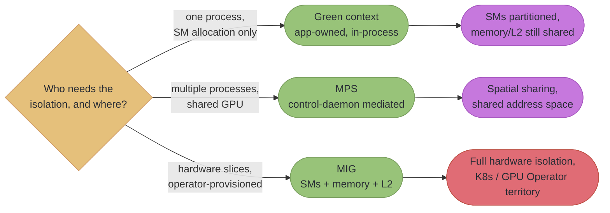
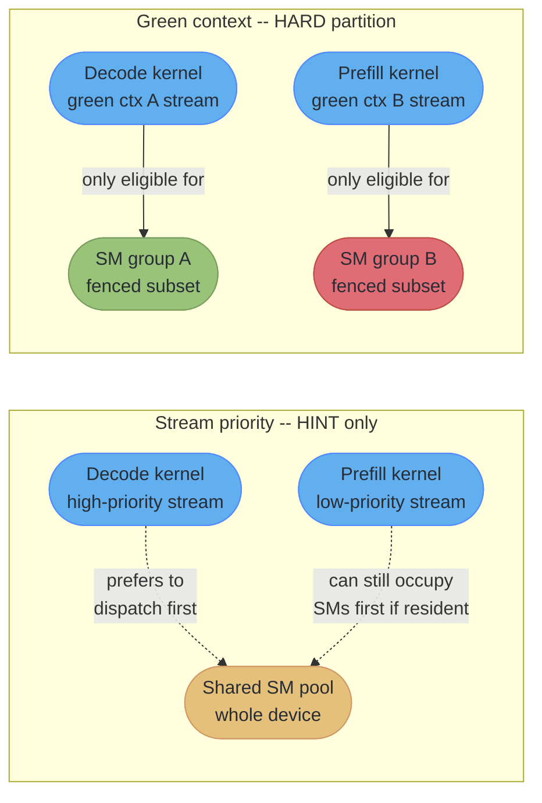
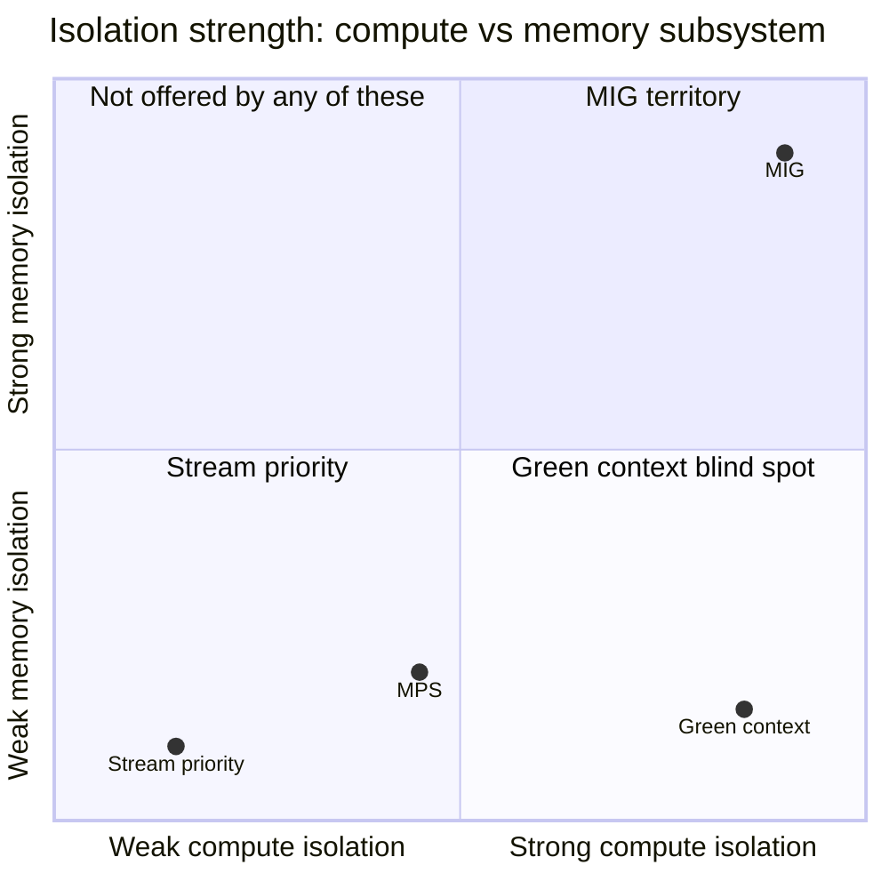
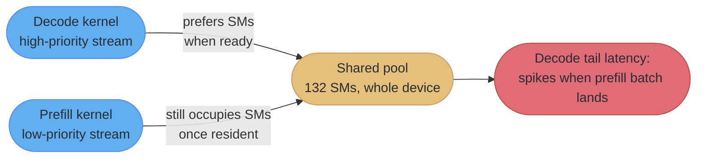

# Green Contexts and SM Partitioning

This is a deep dive off [streams_events_and_concurrency](streams_events_and_concurrency.md). The parent module teaches how streams and events schedule work across a GPU's existing execution engines — copy engines, the compute engine, and the priority hints that bias which *ready* block the scheduler dispatches next. This file starts exactly where the parent's §4.3 and stream-priority material stop: priority is "a scheduling hint, not a preemption guarantee... a low-priority kernel already running on an SM is not evicted mid-flight." A green context is the answer to the question that leaves open — how do you get a *hard* allocation of SMs to a kernel, inside one process, with no hint involved at all.

---

## 1. Concept Overview

A **green context** is an in-process partition of a CUDA device's streaming multiprocessors. Where an ordinary CUDA context sees the whole device — every SM eligible to run any kernel launched into it — a green context is built from a *resource descriptor* that names a specific subset of SMs, and every stream created against that green context only ever dispatches blocks onto that subset. Two kernels launched into two green contexts built from disjoint SM subsets cannot contend for the same SM, because neither one's blocks are ever eligible to land there. That is a stronger guarantee than anything streams, events, or priorities can offer on their own: those three coordinate *when* work runs on a shared pool of SMs, while a green context changes *which* SMs are even in the pool a given kernel can see.

Multiple green contexts can exist in the same process at once, and CUDA explicitly permits their SM sets to overlap — oversubscription is legal, not an error condition, which matters because it means "green context" alone does not imply "hard isolation"; it implies "hard isolation among green contexts whose descriptors were built from disjoint SM subsets." Support first shipped through the CUDA Driver API. **CUDA 13.1 exposed green contexts through the CUDA Runtime API** via the "execution context" (EC) abstraction, and NVIDIA's own guidance is now to prefer it: the Programming Guide states that "with the runtime exposure of green contexts, using the CUDA runtime API directly is strongly recommended." This file covers both surfaces, with the driver API shown first because its five-call shape is what the runtime API still mirrors step-for-step — though not name-for-name; see §6.3 for where the two surfaces' naming actually diverges.

---

## 2. Intuition

> **One-line analogy**: Streams are lanes painted on a shared highway — cars still merge for the same on-ramp under congestion. A green context is building a second, physically separate highway next to the first: nothing on it can ever be blocked by traffic on the other one, because the two roads share no pavement.

**Mental model**: Every SM on the device is, by default, fair game for any kernel launched into the process's primary context. A green context is created by drawing a fence around a fixed subset of those SMs and handing that fenced-off group its own context handle. A stream created *against* that green-context handle (`cuGreenCtxStreamCreate`) only ever dispatches its kernels' blocks onto SMs inside the fence — the CUDA work distributor simply does not consider the SMs outside it as candidates. Nothing about queue order, priority weighting, or "the scheduler prefers X" is involved; the SMs outside the fence are invisible to that stream's launches, full stop.

**Why it matters**: The parent module's stream-priority section closes with an explicit limit: priority only changes which *ready* block the scheduler picks next, and a low-priority kernel already resident on an SM is never evicted for a high-priority one. That is fine for throughput-oriented batch scheduling, but it is not a guarantee — and "a latency-critical decode kernel always has N SMs free, no matter what the batch job is doing" is a guarantee, not a preference. Multi-tenant single-process serving — one inference process running both a latency-critical decode path and a throughput-oriented prefill or compaction path — is exactly the shape of problem streams cannot solve and green contexts can.

**Key insight**: A green context partitions **SM count only**. It says nothing about memory bandwidth, L2 cache capacity, or HBM allocation — every green context in a process still shares the device's full memory subsystem, and a kernel with a partition of 16 SMs can still be throttled to a crawl by a neighbor saturating HBM bandwidth from a *different* partition. Confusing "SM isolation" with "performance isolation" is the single most common misreading of this feature, and it is exactly the gap MIG closes by additionally slicing memory and L2 — see §4.2.

---

## 3. Core Principles

- **A green context is a subset of one device's SMs, valid only within the process that created it.** It is not a separate device, not a separate driver context in the MPS sense, and it confers no protection across process boundaries — that is MPS's and MIG's job, not this one.
- **The partition is enforced by the work distributor, not by a scheduling preference.** Once a stream is bound to a green context, the hardware simply never assigns that stream's blocks to an SM outside the context's resource set. There is no "usually" here, unlike stream priority.
- **SM count only — memory bandwidth, L2, and HBM capacity are never partitioned.** Every green context in a process draws from the same shared memory subsystem. A green context gives compute isolation, not end-to-end performance isolation; a neighbor's memory-bound kernel can still degrade a green context's kernel through bandwidth contention even though the two never touch the same SM.
- **`minCount` is a documented floor, and the driver silently rounds UP.** Ask for an SM count that isn't a legal multiple of the architecture's granularity and every created group is guaranteed *at least* that many SMs — aligned up, never down. That inflation is not free: on a fixed device budget it means **fewer groups get created** than a naive `total / minCount` division would suggest, and the true group count (`nbGroups`, overwritten in place by the call) and true per-group size (`cuGreenCtxGetDevResource`) both have to be read back, never assumed.
- **Overlapping (oversubscribed) green contexts are legal, and the driver will not stop you from creating them.** Whether that is a deliberate soft-partition strategy or a correctness bug depends entirely on whether the programmer *intended* two contexts to share SMs — the API gives no signal either way.
- **Green contexts, MPS, and MIG solve related but distinct problems, and only one of the three is a programming construct.** A green context is application code partitioning SMs inside one process. MPS is multiple *processes* time- and space-sharing one GPU through a control daemon. MIG is a *hardware* partition — SMs, memory slices, and L2 — provisioned by an operator, typically outside the application entirely. Reaching for the wrong one of the three is a common design mistake; §4.2 lays out exactly when each applies.
- **Initialize the device's primary context before creating a green context.** NVIDIA recommends calling `cudaInitDevice` or `cudaSetDevice` first — a green context is built relative to a device that CUDA already has an established context on, not as a substitute for one.

---

## 4. Types / Architectures / Strategies

### 4.1 The API surface: driver vs. runtime

| Surface | Introduced | Status |
|---|---|---|
| **Driver API** (`cuGreenCtx*`, `cuDevSmResourceSplitByCount`, `cuDevResourceGenerateDesc`) | Original green-context support | Still fully functional; the lower-level surface the runtime API is built on |
| **Runtime API** (`cudaGreenCtxCreate`, `cudaDevSmResourceSplit`, `cudaExecutionCtxStreamCreate`) | **CUDA 13.1**, via the "execution context" (EC) abstraction | **Strongly recommended by NVIDIA going forward** |

The two surfaces mirror each other call-for-call — query a resource, split it, generate a descriptor, create the context, create a stream against it — so everything in §6 that is shown in the driver API has a direct runtime-API analog with the `cu` prefix swapped for `cuda` and camelCase.

### 4.2 Where green contexts sit relative to MPS and MIG



| Mechanism | Granted by | Isolates | Scope | Provisioned by |
|---|---|---|---|---|
| **Green context** | The CUDA driver/runtime | SM count only | One process | The application itself |
| **MPS** | The MPS control daemon | Nothing by default — shared address space | Multiple processes, one GPU | An operator starting the daemon |
| **MIG** | The GPU's hardware partitioning unit | SMs, memory slices, and L2 | Multiple processes/tenants | An operator, typically via Kubernetes + the GPU Operator |

MIG's Kubernetes provisioning — the device plugin, DRA partitionable devices, choosing `1g.10gb` vs `7g.80gb` profiles — is a cluster-operations concern, not a kernel-programming one, and is owned by [`devops/ml_platform_and_gpu_infrastructure`](../../devops/ml_platform_and_gpu_infrastructure/ml_platform_and_gpu_infrastructure.md); that page also carries the full MIG-vs-MPS-vs-time-slicing isolation comparison at the operator's altitude. Nothing about MIG's provisioning is re-taught here — a green context is what a kernel author reaches for when the unit of isolation is "which SMs run *my* kernel inside *my own process*," which is a strictly narrower and cheaper question than "which tenant gets which hardware slice."

### 4.3 SM resource types and flags

The driver models more than just SMs under the same descriptor mechanism, though SM splitting is the only one this file uses:

| `CUdevResourceType` | Value | Meaning |
|---|---|---|
| `CU_DEV_RESOURCE_TYPE_INVALID` | `0` | Unset/error sentinel |
| `CU_DEV_RESOURCE_TYPE_SM` | `1` | Streaming multiprocessors — what green contexts partition |
| `CU_DEV_RESOURCE_TYPE_WORKQUEUE_CONFIG` | `1000` | Work-queue configuration resource |
| `CU_DEV_RESOURCE_TYPE_WORKQUEUE` | `10000` | Work-queue resource |

| Flag | Value | Effect |
|---|---|---|
| `CU_GREEN_CTX_NONE` | `0x0` | No special behavior at creation |
| `CU_GREEN_CTX_DEFAULT_STREAM` | `0x1` | Green context gets its own default stream, analogous to a normal context's default stream |
| `CU_DEV_SM_RESOURCE_GROUP_DEFAULT` | `0` | Standard SM-group split behavior |
| `CU_DEV_SM_RESOURCE_GROUP_BACKFILL` | `0x1` | Split behavior for backfilling groups — see the coscheduled-count note in §6.2 |

---

## 5. Architecture Diagrams

### H100 SXM: 132 SMs Split Three Ways, One Peel at a Time

An H100 SXM device carries 132 SMs. Compute capability 9.0 requires `smCount` to be a **multiple of 8** per partition, and `cuDevSmResourceSplitByCount` produces groups that are all the *same* size for a single call — so three differently-sized partitions take three successive calls, each peeling a group off the remainder the previous call left behind. `minCount` is a floor: each call is guaranteed *at least* the requested SMs, aligned **up**.

```
H100 SXM -- 132 SMs total, CC 9.0 granularity = multiple of 8, three successive splits

  Split 1: minCount=48 (already a legal multiple) -> granted EXACTLY 48
  [========][========][========][========][========][========]  ctx A: 48 SMs  (6 groups of 8)
  remaining after split 1: 132 - 48 = 84 SMs

  Split 2: minCount=32 (already legal), taken from the 84 left -> granted EXACTLY 32
  [========][========][========][========]                       ctx B: 32 SMs  (4 groups of 8)
  remaining after split 2: 84 - 32 = 52 SMs

  Split 3: minCount=20 (NOT a legal multiple of 8) -> the FLOOR rounds UP to 24
  [========][========][========]                                 ctx C: 24 SMs  (3 groups of 8,
                                                                    4 MORE than the 20 requested)
  remaining after split 3: 52 - 24 = 28 SMs -- still held by the primary context

  Granted to green contexts: 48 + 32 + 24 = 104 of 132 SMs.
  The 20-SM request for ctx C did not shrink to fit -- it grew to the
  nearest legal multiple of 8 that is >= 20, consuming 4 SMs more than asked for.
```

**Reading it.** Requests that already land on a legal multiple (48, 32) are granted exactly — no surprise there. The request that doesn't (20) is not truncated down to 16; `minCount` is a documented floor, so the driver guarantees *at least* 20 and rounds up to the next multiple of 8, landing on 24. This is the concrete version of the abstract rule in §6.2: a capacity plan built on the requested number under-counts every non-aligned partition by the gap to the next multiple, and — on a call requesting several equal-sized groups at once instead of one — that same inflation is what silently produces *fewer groups* than `total / minCount` naively predicts, which is why `nbGroups` has to be read back exactly as `cuGreenCtxGetDevResource`'s `smCount` does.

### Two Kernels, Hard-Partitioned vs. Soft-Scheduled



The dashed arrows in the top half are deliberately drawn as *hints*: a low-priority prefill kernel already resident on an SM is never evicted, so the decode kernel's "high priority" is a preference the scheduler honors only at dispatch time, not a reservation. The solid arrows in the bottom half show why a green context removes the ambiguity entirely — group B's SMs are never candidates for ctx A's launches, so there is no dispatch-time decision to make.

### Querying What You Actually Got

```
cuDevSmResourceSplitByCount(minCount = 20, nbGroups = 1) on an H100 (CC 9.0, multiple-of-8 rule)
                                   |
                                   v
   minCount is a FLOOR: the driver guarantees AT LEAST 20 SMs, aligned
   UP to the nearest legal multiple of 8 -- never aligned down
                                   |
                                   v
              actual partition size = 24 SMs, NOT 20

  Programmer budgeted: 20 SMs for the decode kernel
  Driver actually reserved: 24 SMs
  Cost: 4 MORE SMs reserved than budgeted -- on a request for several
  equal-sized groups at once, that same inflation costs GROUPS, not just
  SMs: nbGroups is overwritten in place with however many actually fit.

  A dry run is free: call with result = NULL to have the driver report,
  via nbGroups, how many groups a given minCount would really produce --
  before committing to a real split. See Best Practice 2 in Section 13.

  The ONLY way to know the true per-group size: call
  cuGreenCtxGetDevResource(hCtx, &resource, CU_DEV_RESOURCE_TYPE_SM)
  and read resource.sm.smCount back after creation.
```

This is the load-bearing gotcha for the whole feature: the API does not error on a non-aligned request, it silently substitutes a legal one that is never smaller than requested, and a capacity-planning calculation built on the number you *asked for* rather than the number you *got* — or the number of groups you assumed rather than the number the driver actually created — is wrong from the moment the green context is created.

---

## 6. How It Works — Detailed Mechanics

### 6.1 The five-call shape (driver API)

Every green context follows the same sequence: query the device's SM resource, split it into groups, generate a descriptor from one group, create the green context from the descriptor, then create a stream bound to it.

```cpp
#include <cuda.h>
#include <cstdio>
#include <cstdlib>

#define DRV_CHECK(call)                                                       \
    do {                                                                     \
        CUresult res = (call);                                               \
        if (res != CUDA_SUCCESS) {                                           \
            const char* msg;                                                 \
            cuGetErrorString(res, &msg);                                     \
            fprintf(stderr, "CUDA driver error %s:%d: %s\n", __FILE__,       \
                    __LINE__, msg ? msg : "unknown");                        \
            std::exit(1);                                                    \
        }                                                                    \
    } while (0)

CUgreenCtx build_green_context(CUdevice device, unsigned int requested_sm_count,
                                CUdevResource* out_actual /* read back after create */) {
    // 1. Query the device's full SM resource.
    CUdevResource device_sm_resource;
    DRV_CHECK(cuDeviceGetDevResource(device, &device_sm_resource,
                                      CU_DEV_RESOURCE_TYPE_SM));

    // 2. Split it: ask for ONE group of at least requested_sm_count SMs.
    //    minCount is a FLOOR -- the driver rounds UP to the architecture's
    //    legal granularity, never down. See Section 5's "Querying What
    //    You Actually Got" diagram.
    CUdevResource result_group;
    CUdevResource remainder;
    unsigned int nb_groups = 1;
    DRV_CHECK(cuDevSmResourceSplitByCount(&result_group, &nb_groups,
                                           &device_sm_resource, &remainder,
                                           CU_DEV_SM_RESOURCE_GROUP_DEFAULT,
                                           requested_sm_count));

    // 3. Generate a resource descriptor from the split-off group.
    CUdevResourceDesc desc;
    DRV_CHECK(cuDevResourceGenerateDesc(&desc, &result_group, 1));

    // 4. Create the green context from the descriptor.
    CUgreenCtx green_ctx;
    DRV_CHECK(cuGreenCtxCreate(&green_ctx, desc, device, CU_GREEN_CTX_NONE));

    // 5. Read back what was ACTUALLY granted -- never trust requested_sm_count.
    DRV_CHECK(cuGreenCtxGetDevResource(green_ctx, out_actual, CU_DEV_RESOURCE_TYPE_SM));

    return green_ctx;
}

CUstream stream_on_green_context(CUgreenCtx green_ctx, int priority) {
    CUstream stream;
    DRV_CHECK(cuGreenCtxStreamCreate(&stream, green_ctx, CU_GREEN_CTX_NONE, priority));
    return stream;   // every launch on this stream is confined to green_ctx's SM set
}
```

### 6.2 The granularity rule, exact

`minCount` is documented as "Minimum number of SMs required" — a floor, not a target. `smCount` must land on a legal multiple for the target architecture, and the driver enforces that by rounding **up**, never down:

| Compute capability | Granularity | Notes |
|---|---|---|
| 7.x, 8.x, and Tegra SoC | Multiple of **2** | Ampere, Ada, older Hopper-adjacent parts |
| **9.0 and later** | Multiple of **8** (or of `coscheduledSmCount` if provided) | Hopper (9.0) and newer; max coscheduled count is **32** |

The Programming Guide's own GH200 walkthrough states it plainly: "The minimum number of SMs per partition is 8" for compute capability 9.0. On an H100 (132 SMs, CC 9.0), requesting a partition of 20 SMs does not produce 20 — the driver guarantees *at least* 20 and rounds up to 24, the nearest multiple of 8 that is `>= 20` — see §5's "Querying What You Actually Got." The driver-API reference is explicit about the downstream cost of that inflation: because each group ends up larger than the caller asked for, a single call requesting several equal-sized groups "may lead to fewer groups created than purely dividing the total SM count by the minCount," and `nbGroups` is overwritten in place with the true count. There is no API-level warning when this happens — `cuDevSmResourceSplitByCount` returns `CUDA_SUCCESS` either way — so a dry run (call with `result = NULL`, which reports the group count that *would* be created via `nbGroups` without allocating anything) or comparing the requested count against `cuGreenCtxGetDevResource`'s answer afterward are the only ways to detect it.

### 6.3 Runtime-API form (CUDA 13.1+, the recommended surface)

CUDA 13.1 unifies green contexts and the ordinary primary context behind one handle type, `cudaExecutionContext_t` — there is no `cudaGreenCtx_t`. `cudaDeviceGetExecutionCtx` hands back the *primary* context through that same handle type, and `cudaGreenCtxCreate` hands back a *green* context through it too; every call after creation (stream binding, resource queries, events, destruction) is spelled `cudaExecutionCtx*` regardless of which kind of context the handle holds. The naming asymmetry — creation is `cudaGreenCtxCreate`, everything else is `cudaExecutionCtx*` — is not an inconsistency to paper over; it is the whole point of the abstraction, and it is why grepping a CUDA 13.1+ codebase for `cudaGreenCtx` finds almost nothing past the one creation call:

```cpp
#include <cuda_runtime.h>

cudaExecutionContext_t build_green_context_runtime(int device, unsigned int requested_sm_count) {
    cudaSetDevice(device);              // establish the primary context FIRST

    cudaDevResource device_sm_resource;
    cudaDeviceGetDevResource(device, &device_sm_resource, cudaDevResourceTypeSm);

    cudaDevResource result_group, remainder;
    unsigned int nb_groups = 1;
    cudaDevSmResourceSplitByCount(&result_group, &nb_groups, &device_sm_resource,
                                   &remainder, 0 /* flags */, requested_sm_count);

    cudaDevResourceDesc_t desc;
    cudaDevResourceGenerateDesc(&desc, &result_group, 1);

    cudaExecutionContext_t green_ctx;   // NOTE: NOT cudaGreenCtx_t -- that type does not exist
    cudaGreenCtxCreate(&green_ctx, desc, device, 0 /* flags */);

    return green_ctx;
}

cudaStream_t stream_on_execution_context(cudaExecutionContext_t ctx, int priority) {
    cudaStream_t stream;
    // Every post-creation call is cudaExecutionCtx*, whether ctx holds a
    // green context or the primary context handed back by
    // cudaDeviceGetExecutionCtx -- the two are interchangeable past this point.
    cudaExecutionCtxStreamCreate(&stream, ctx, 0 /* flags */, priority);
    return stream;
}
```

The runtime-API call sequence is otherwise a direct mirror of §6.1: `cudaDeviceGetDevResource` for `cuDeviceGetDevResource`, `cudaDevSmResourceSplitByCount` (or the more general `cudaDevSmResourceSplit`) for `cuDevSmResourceSplitByCount`, `cudaDevResourceGenerateDesc` for `cuDevResourceGenerateDesc`, `cudaGreenCtxCreate` for `cuGreenCtxCreate`, `cudaExecutionCtxStreamCreate` for `cuGreenCtxStreamCreate`, and `cudaExecutionCtxGetDevResource` for `cuGreenCtxGetDevResource`. The granularity rule in §6.2 applies identically to both surfaces — it is a hardware constraint enforced by the driver underneath, not a property of which API name you called.

### 6.4 Cross-context synchronization

A green context is not an island with respect to events. `cuGreenCtxRecordEvent` and `cuGreenCtxWaitEvent` let one green context's work be ordered against another's, or against the primary context's, the same way `cudaStreamWaitEvent` orders two ordinary streams in the parent module:

```cpp
CUevent partition_ready;
DRV_CHECK(cuEventCreate(&partition_ready, CU_EVENT_DEFAULT));

// Record an event against green context A once its setup kernel finishes.
DRV_CHECK(cuGreenCtxRecordEvent(green_ctx_a, partition_ready));

// Green context B's stream waits on that specific event before starting --
// a fine-grained cross-partition dependency, not a device-wide sync.
DRV_CHECK(cuGreenCtxWaitEvent(green_ctx_b, partition_ready));
```

`cuCtxFromGreenCtx` converts a green context handle into an ordinary `CUcontext` when an API that only accepts the classic context type needs to operate against it, and `cuStreamGetGreenCtx` recovers the green context a given stream was created against — useful when a stream handle has been passed several layers deep and the caller needs to confirm which SM partition it is bound to before assuming anything about its concurrency behavior with another stream.

### 6.5 Reading back and detecting oversubscription

```cpp
void report_partition(CUgreenCtx ctx, const char* label) {
    CUdevResource actual;
    DRV_CHECK(cuGreenCtxGetDevResource(ctx, &actual, CU_DEV_RESOURCE_TYPE_SM));
    printf("%s: granted %u SMs\n", label, actual.sm.smCount);
    // Deliberately does NOT check for overlap against other green contexts --
    // CUDA does not expose an API that reports whether two descriptors'
    // underlying SM sets intersect. Overlap has to be tracked by the
    // application at the point the split groups were carved out, not
    // discovered afterward from the handles alone.
}
```

There is no driver call that answers "do green context A and green context B share any SMs" after the fact — the application is the only party that knows whether two `cuDevSmResourceSplitByCount` calls were carved from the same device resource with overlapping group indices or genuinely disjoint ones. Oversubscription is legal (§3), but it is the caller's bookkeeping, not the driver's, that determines whether it was intentional.

### 6.6 Green contexts inside CUDA Graphs (CUDA 13.4)

A serving loop that runs prefill and decode as captured graphs needs each graph node to keep its SM partition on replay. CUDA 13.4 lets a graph associate a green context with event-record, host, external-semaphore, and kernel nodes, and the release notes state that user-specified contexts on kernel nodes are now honored consistently. A decode graph's kernel nodes can therefore stay on the decode partition while a prefill graph's nodes run on another, with each replay a single `cudaGraphLaunch`.

The same release adds topology queries for multi-chip GPUs: CUDA APIs expose the GPU's internal topology so an application can pick compute and memory resources by locality instead of treating the device as one uniform pool of SMs.

---

## 7. Real-World Examples

- **Latency-critical decode reserved against a batch prefill/compaction job, in one inference process.** A serving process running both an autoregressive decode loop (must stay latency-bound, sensitive to any SM contention) and a throughput-oriented prefill or KV-cache-compaction kernel (happy to use whatever is left) creates two green contexts — a fixed-size reservation for decode, the remainder for prefill — so a burst of prefill work can never starve decode's SM allocation the way it could under stream priority alone.
- **Background maintenance kernels that must never starve the foreground.** A cache-eviction, defragmentation, or garbage-collection kernel running periodically inside the same process as the main serving path gets its own small green context, guaranteeing it always has *some* SMs to make forward progress without ever being able to grow into the foreground's allocation.
- **Co-locating two distinct models in one process without standing up MPS.** Two smaller models served from the same process (rather than two separate OS processes coordinated through the MPS daemon) can each get a fixed SM partition, achieving the spatial-sharing goal MPS exists for but without the multi-process control-plane overhead, at the cost of losing MPS's process-level fault isolation.
- **Deterministic-SM-count benchmarking inside a single process.** A performance-regression harness that wants to measure a kernel's behavior at a fixed SM count (16, 32, 64, …) without physically reconfiguring the device or rebooting into a different MIG profile can carve out exactly that many SMs via a green context and re-run the same kernel across several partition sizes in one process lifetime.
- **GH200-class superchip partitioning**, per the Programming Guide's own worked example — splitting a Hopper-generation device's SM pool into fixed 8-SM-minimum groups for multiple concurrent workloads sharing the same physical GPU within one application.

---

## 8. Tradeoffs

| Mechanism | Isolation strength | Granularity | Scope | Setup cost |
|---|---|---|---|---|
| Stream priority | Scheduling hint only — no eviction of running blocks | N/A — not a partition | One process | One flag on stream creation |
| **Green context** | Hard SM-count partition; memory/L2 still shared | Coarse — multiple of 2 (CC 7.x/8.x) or 8 (CC 9.0+) | One process | Five driver/runtime calls, done once at startup |
| MPS | Spatial sharing across processes; shared address space, weak isolation | Percentage-of-SMs via client limits | Multiple processes, one GPU | Control daemon + per-process env config |
| MIG | Full hardware isolation — SMs, memory, L2 | Fixed hardware profiles (e.g. `1g.10gb` … `7g.80gb` on A100) | Multiple tenants | Operator-provisioned, typically via Kubernetes |

### SM Isolation vs. Memory-Subsystem Isolation



The green context sits far right on compute isolation and far bottom on memory isolation — exactly the "blind spot" quadrant label calls out. That gap is not a defect in the feature; it is the feature's stated scope. A team that reads "green context = isolation" without reading the axis it does *not* cover ships a decode partition that is still starved by a neighbor's HBM-saturating prefill kernel, because nothing about the SM fence stops that neighbor from consuming all the memory bandwidth both partitions share.

---

## 9. When to Use / When NOT to Use

### Use a green context when

- A kernel needs a **guaranteed minimum SM count**, not merely scheduling preference — the exact case stream priority cannot deliver, per the parent module's own limit statement.
- The isolation only needs to hold **within one process** — a serving process, a benchmarking harness, a single application co-locating two workloads it fully controls.
- The workload is compute-bound enough that **SM contention, not memory-bandwidth contention, is the actual bottleneck being protected against** — see §8's blind spot.
- You are choosing between green contexts and MPS for co-locating trusted work in one address space, and prefer to avoid the operational overhead of standing up and configuring the MPS control daemon.

### Do NOT reach for a green context when

- **Cross-process isolation is the requirement.** A green context confers nothing across process boundaries; that is MPS's or MIG's job, not this one.
- **Memory or L2 isolation is what actually matters.** A noisy neighbor saturating HBM bandwidth degrades every green context on the device regardless of SM partitioning — reach for MIG if bandwidth/memory contention is the failure mode you are protecting against.
- **The SM count you need does not respect the architecture's granularity**, and the difference between "what I asked for" and "the nearest legal multiple" would silently break a tight capacity budget — either pad the request to a legal boundary explicitly, or verify via `cuGreenCtxGetDevResource` before trusting the partition size in any downstream calculation.
- **The workload changes shape dynamically and needs its SM allocation to flex.** Green contexts are created once with a fixed descriptor; resizing means destroying and recreating, which is not a cheap or lock-free operation to do on a hot path.
- **An operator-level, multi-tenant hardware guarantee is what the business actually needs** (e.g., a shared GPU cluster serving untrusted tenants). That is MIG's problem, provisioned by [`devops/ml_platform_and_gpu_infrastructure`](../../devops/ml_platform_and_gpu_infrastructure/ml_platform_and_gpu_infrastructure.md), not something an application-level green context can substitute for.

---

## 10. Common Pitfalls

1. **Trusting the requested SM count instead of the granted one.** The driver rounds silently — no error, no warning — **up** to the nearest legal granularity, since `minCount` is a documented floor. Any capacity math (how many decode requests can this partition sustain) built on the requested number rather than `cuGreenCtxGetDevResource`'s answer under-counts every non-aligned request, and is wrong from the moment the context is created.
2. **Assuming SM partitioning implies memory-bandwidth partitioning.** A green context's SM fence does nothing to protect against a neighbor saturating shared HBM bandwidth or thrashing L2 — see §8's isolation-strength table. Teams that reach for green contexts to solve a memory-contention problem discover the fence did not help, because it was never meant to.
3. **Creating overlapping green contexts by accident, not by design.** Two `cuDevSmResourceSplitByCount` calls issued independently against the same device resource, without shared bookkeeping of which SM groups were already claimed, can silently produce overlapping partitions — legal per the API, but a correctness bug if the intent was a hard separation.
4. **Forgetting the primary context prerequisite.** Skipping `cudaInitDevice`/`cudaSetDevice` before building a green context invites the exact class of "which context is even active" confusion CUDA's context-stack rules are notorious for outside this feature too.
5. **Reaching for a green context to solve a cross-process problem.** It has zero effect across an `fork()` or a separate OS process — see MPS (§4.2) for that.
6. **Assuming the granted partition could ever come back smaller than requested.** `minCount` is a documented floor: `cuDevSmResourceSplitByCount` guarantees each created group at least the requested SM count, aligned up. The real cost of a non-aligned request never lands on group *size* — it lands on group *count*. Requesting more equal-sized groups than a device can host once each is inflated to the aligned size silently creates fewer groups than expected, which is exactly what re-reading `nbGroups` (overwritten in place after the call) catches and a hard-coded loop bound does not.

**BROKEN → FIX: assuming `nbGroups` requested is `nbGroups` created**

```cpp
// BROKEN: requests 6 green-context tiers of >= 20 SMs each on an H100
// (CC 9.0, 132 SMs) -- one per latency tenant -- and assumes every
// requested group was actually created.
struct TierPool {
    CUgreenCtx ctx[6];
    unsigned int tier_sm_count;   // assumed 20 for every tier
};

TierPool broken_build_tier_pool(CUdevice device) {
    CUdevResource device_sm_resource;
    cuDeviceGetDevResource(device, &device_sm_resource, CU_DEV_RESOURCE_TYPE_SM);

    CUdevResource groups[6];
    CUdevResource remainder;
    unsigned int nb_groups = 6;   // BUG: treated as a fixed count, never re-read
    cuDevSmResourceSplitByCount(groups, &nb_groups, &device_sm_resource,
                                 &remainder, CU_DEV_SM_RESOURCE_GROUP_DEFAULT,
                                 /* minCount = */ 20);
    // minCount is a FLOOR: each group is guaranteed >= 20 SMs, rounded UP
    // to 24 (the nearest legal multiple of 8 on CC 9.0) -- not held at 20.
    // 6 groups x 24 SMs = 144 SMs, more than the H100's 132, so the driver
    // can only create 5, not 6, and overwrites nb_groups with 5. This code
    // never looks at that: it still loops to a hard-coded 6 and reads
    // groups[5], which the driver never touched.
    TierPool pool{};
    for (unsigned int i = 0; i < 6; ++i) {
        CUdevResourceDesc desc;
        cuDevResourceGenerateDesc(&desc, &groups[i], 1);   // groups[5]: garbage
        cuGreenCtxCreate(&pool.ctx[i], desc, device, CU_GREEN_CTX_NONE);
    }
    pool.tier_sm_count = 20;   // BUG: no real group is 20 -- every one is 24
    return pool;
    // Tenant 6 gets a green context built from uninitialized CUdevResource
    // data -- undefined behavior, not a clean failure -- and every tenant's
    // capacity math is silently short by 4 SMs per tier (24 real vs 20 assumed).
}
```

```cpp
// FIX: read back nb_groups (how many were ACTUALLY created) and each
// group's real smCount before building anything on top of the split.
struct TierPool {
    CUgreenCtx ctx[6];
    unsigned int created_count;      // ground truth group count, <= 6
    unsigned int sm_count[6];        // ground truth per-group size
};

TierPool fixed_build_tier_pool(CUdevice device) {
    CUdevResource device_sm_resource;
    cuDeviceGetDevResource(device, &device_sm_resource, CU_DEV_RESOURCE_TYPE_SM);

    CUdevResource groups[6];
    CUdevResource remainder;
    unsigned int nb_groups = 6;   // request: UP TO 6 groups
    cuDevSmResourceSplitByCount(groups, &nb_groups, &device_sm_resource,
                                 &remainder, CU_DEV_SM_RESOURCE_GROUP_DEFAULT,
                                 /* minCount = */ 20);

    // FIX: nb_groups was overwritten in place -- 5, not 6, on a 132-SM H100
    // requesting minCount=20 (each group rounds up to 24; 5 x 24 = 120 <= 132,
    // a 6th would need 144). Only iterate the groups that truly exist.
    TierPool pool{};
    pool.created_count = nb_groups;   // == 5, the ground truth
    for (unsigned int i = 0; i < nb_groups; ++i) {
        CUdevResourceDesc desc;
        cuDevResourceGenerateDesc(&desc, &groups[i], 1);
        cuGreenCtxCreate(&pool.ctx[i], desc, device, CU_GREEN_CTX_NONE);

        CUdevResource actual;
        cuGreenCtxGetDevResource(pool.ctx[i], &actual, CU_DEV_RESOURCE_TYPE_SM);
        pool.sm_count[i] = actual.sm.smCount;   // == 24 for every group, not 20
    }
    // Tenant 6 simply gets no green context here -- an explicit condition
    // the caller can route around (fall back to the primary context's
    // remaining SMs, or request a smaller minCount that actually fits),
    // instead of reading memory the driver never wrote.
    return pool;
}
```

---

## 11. Technologies & Tools

| Tool / API | Purpose | Notes |
|---|---|---|
| `cuDeviceGetDevResource` | Query a device-wide resource (SMs, work queues) | Driver API entry point; `CU_DEV_RESOURCE_TYPE_SM` for SMs |
| `cuDevSmResourceSplitByCount` | Split an SM resource into one or more groups | `minCount` is a floor — rounds silently UP to the architecture's granularity, which can yield fewer groups than requested; see §6.2 |
| `cuDevResourceGenerateDesc` | Build a `CUdevResourceDesc` from one or more resource groups | Input to `cuGreenCtxCreate` |
| `cuGreenCtxCreate` / `cuGreenCtxDestroy` | Create/destroy a green context from a descriptor | One-time setup cost; not for a hot resize loop |
| `cuGreenCtxStreamCreate` | Create a stream bound to a green context | Every launch on this stream is confined to that context's SM set |
| `cuGreenCtxGetDevResource` | Read back the SM count a green context actually holds | The only reliable way to detect the floor's up-rounding — call this, always |
| `cuCtxFromGreenCtx` / `cuStreamGetGreenCtx` | Interop with ordinary `CUcontext`-based APIs / recover a stream's green context | Needed when a green-context stream flows into code expecting a classic context |
| `cuGreenCtxRecordEvent` / `cuGreenCtxWaitEvent` | Cross-green-context event synchronization | Analog of `cudaStreamWaitEvent` from the parent module, scoped to green contexts |
| `cudaGreenCtxCreate` / `cudaExecutionCtxStreamCreate` (CUDA 13.1+) | Runtime-API equivalents of the driver-API calls above | **NVIDIA's recommended surface going forward** |
| CUDA Graphs (CUDA 13.4+) | Bind a green context to event-record, host, external-semaphore, and kernel nodes | Keeps per-node SM partitioning across graph replay; see §6.6 |
| cuBLAS (CUDA 13.3+) | GEMMs on a green-context stream | cuBLAS 13.3 added green-context support, so library GEMMs respect the partition |
| `cuda.core` 1.0 (CUDA 13.3) | Python surface for green contexts | Splits a GPU's SMs into disjoint partitions, each with its own context and streams, without writing driver-API bindings |
| Nsight Systems | Confirm a green context's kernels only ever land on its granted SM subset | The definitive way to verify partitioning is real, not assumed |
| MPS control daemon | Alternative multi-process spatial-sharing mechanism | Out of scope here — see §4.2 and [`devops/ml_platform_and_gpu_infrastructure`](../../devops/ml_platform_and_gpu_infrastructure/ml_platform_and_gpu_infrastructure.md) |
| MIG (via GPU Operator / Kubernetes device plugin) | Hardware-level multi-tenant partitioning (SMs + memory + L2) | Fully out of scope here — operator concern, not a kernel-author API |

---

## 12. Interview Questions with Answers

**Q: What can a green context guarantee that stream priority cannot?**
**Short:** A hard SM allocation — a low-priority kernel already resident is never evicted under priority, but it is never even eligible to run on a fenced-off SM group.
Stream priority is a scheduling hint: it only changes which *ready* block the scheduler dispatches next, and a low-priority kernel already running on an SM is never evicted for a higher-priority one. A green context removes the ambiguity entirely by fencing off a specific SM subset, so a kernel launched into a different green context is never even eligible to land there, regardless of priority or timing. That is the difference between "the scheduler prefers X" and "Y is not a candidate."

**Q: If I ask `cuDevSmResourceSplitByCount` for 20 SMs on an H100, how many do I actually get?**
**Short:** 24 — `minCount` is a documented floor, so CC 9.0's multiple-of-8 rule rounds UP, never down, with no error.
24, not 20. `minCount` is documented as "Minimum number of SMs required" — a floor — and compute capability 9.0 requires `smCount` to be a multiple of 8, so the driver guarantees at least 20 and rounds up to 24, the nearest legal multiple that is `>= 20`. `cuDevSmResourceSplitByCount` reports `CUDA_SUCCESS` either way, with no warning that the grant is larger than requested. The only way to learn the true per-group size is `cuGreenCtxGetDevResource` after creation, reading `resource.sm.smCount`.

**Q: Does a green context isolate memory bandwidth or L2 cache the way it isolates SMs?**
**Short:** No — only SMs are partitioned; every green context in a process still shares the full memory subsystem, HBM bandwidth included.
No. A green context's descriptor is built purely from `CU_DEV_RESOURCE_TYPE_SM`; memory bandwidth, L2 capacity, and HBM allocation are never split. A kernel with a dedicated 16-SM partition can still be throttled by a neighboring green context's kernel saturating shared HBM bandwidth, because nothing about the SM fence touches the memory subsystem. That gap is exactly what MIG additionally closes by partitioning memory and L2 alongside SMs.

**Q: Two green contexts in the same process request overlapping SM subsets. What happens?**
**Short:** Nothing stops it — SM oversubscription across green contexts is explicitly legal, so the resulting soft partition is deliberate or a bug, and only the application can tell which.
Nothing prevents it — the CUDA driver explicitly permits multiple green contexts to encapsulate overlapping SM sets, and no API call reports whether two descriptors intersect. Whether that overlap is a deliberate soft-partitioning strategy (letting two low-priority contexts genuinely share spare capacity) or an unintended correctness bug (two supposedly-isolated contexts accidentally competing for the same SMs) depends entirely on whether the application tracked which SM groups it had already claimed when it issued the split calls.

**Q: When would you reach for MPS instead of a green context, or MIG instead of either?**
**Short:** MPS for trusted multi-process spatial sharing; MIG for hardware-enforced multi-tenant isolation including memory — green context is single-process only.
A green context only helps inside one process — it has no effect across process boundaries. MPS is the right tool when trusted processes need to spatially share one GPU through a control daemon, still with a shared address space and no memory isolation. MIG is the right tool when the requirement is hardware-enforced isolation — separate SMs, memory slices, and L2 — typically for genuinely untrusted multi-tenant workloads, provisioned by an operator rather than application code. Reaching for a green context to solve a cross-process or cross-tenant isolation problem is a category error; it was never designed to reach outside its own process.

**Q: Is a green context's SM partition fixed for its lifetime, or can it be resized?**
**Short:** Fixed — the descriptor is set at `cuGreenCtxCreate` time, and resizing means destroying and recreating the context, not a live adjustment.
Fixed. The resource descriptor is baked in at `cuGreenCtxCreate`, and there is no API to grow or shrink an existing green context's SM set in place. Changing the partition size means destroying the context (and any streams bound to it) and creating a new one from a fresh split — not something to do on a hot serving path, which is why green-context partitions are typically sized once at process startup based on a known workload mix rather than adjusted dynamically at request time.

**Q: Why does NVIDIA now recommend the runtime API over the driver API for green contexts?**
**Short:** CUDA 13.1 exposed green contexts as runtime "execution contexts," and NVIDIA's guidance is to use the runtime surface directly going forward.
Green context support originally shipped only through the CUDA Driver API. CUDA 13.1 added runtime-API exposure via the "execution context" (EC) abstraction — `cudaGreenCtxCreate`, `cudaDevSmResourceSplit`, `cudaExecutionCtxStreamCreate`, and related calls — and the CUDA Programming Guide states plainly that with this runtime exposure now available, using the runtime API directly is strongly recommended. The driver API remains fully functional and the call sequence is identical either way; the recommendation is about which surface to write new code against, not a deprecation of the older one.

**Q: What does `cuGreenCtxGetDevResource` actually return, and why is calling it not optional?**
**Short:** The SM resource a green context truly holds, read directly from the driver — the only ground truth after a request that may have been silently rounded.
It returns the `CUdevResource` — including `smCount` — that the green context genuinely holds, queried straight from the driver rather than inferred from what was requested. Because `cuDevSmResourceSplitByCount` can silently round a request to the architecture's legal granularity with no error, this call is the only reliable ground truth for any downstream capacity or scheduling decision; treating the originally requested count as authoritative is the single most common bug in green-context code.

**Q: What is the minimum SM count a single green-context partition can have on an H100?**
**Short:** 8 SMs — compute capability 9.0's granularity floor, per the CUDA Programming Guide's own GH200 walkthrough.
8 SMs. Compute capability 9.0 (which includes H100 and GH200) requires `smCount` to be a multiple of 8, and the Programming Guide's own worked example states the minimum number of SMs per partition is 8 for that compute capability. A request for fewer than 8 SMs cannot be satisfied as a standalone CC-9.0 green context.

**Q: How is the CC 7.x/8.x granularity rule different from the CC 9.0+ rule?**
**Short:** 7.x, 8.x, and Tegra require multiples of 2; CC 9.0 and later require multiples of 8, a 4x coarser floor.
On compute architectures 7.x, 8.x, and Tegra SoC, `smCount` must be a multiple of 2 — a fine-grained floor. On compute architecture 9.0 and later, it must be a multiple of 8 (or of `coscheduledSmCount` when provided, with a maximum coscheduled count of 32) — four times coarser. A partitioning scheme tuned against an Ampere-class multiple-of-2 assumption and ported unchanged to a Hopper-or-later device will silently get much coarser partitions than intended, because the rounding granularity itself changed, not just the SM totals.

**Q: What is `CU_DEV_SM_RESOURCE_GROUP_BACKFILL` for?**
**Short:** A split flag governing how backfilling SM groups are formed, distinct from the default group-formation behavior used for a straightforward fixed split.
It is one of the two documented SM-group split flags (`CU_DEV_SM_RESOURCE_GROUP_DEFAULT` = `0` is the other), controlling how the split call forms backfilling groups as opposed to the standard default grouping behavior. Most straightforward "carve off N SMs into one group" splits use the default flag; the backfill flag matters when the split needs to account for coscheduled-group placement rather than a simple fixed-size cut.

**Q: Why does the Programming Guide recommend calling `cudaInitDevice` or `cudaSetDevice` before creating a green context?**
**Short:** A green context is built relative to a device CUDA already has an established primary context on, not as a substitute for initializing one.
Because a green context's resource queries and descriptor creation operate against a device that CUDA needs to already recognize as initialized — it is not itself a mechanism for bootstrapping a device context from nothing. Skipping this step invites the same class of "which context is active" ambiguity that CUDA's context-stack rules are already notorious for outside the green-context feature, just surfaced at green-context creation time instead.

**Q: Can a stream created against a green context be told which green context it belongs to later?**
**Short:** Yes, via `cuStreamGetGreenCtx`, which recovers the binding from a stream handle passed elsewhere in the code.
Yes — `cuStreamGetGreenCtx` takes a `CUstream` handle and returns the `CUgreenCtx` it was created against. This matters when a stream handle is passed several layers deep into library or framework code that needs to confirm which SM partition it is bound to before making an assumption about concurrency behavior relative to another stream, without threading the original green-context handle through every call site.

**Q: How do you express an ordering dependency between work in two different green contexts?**
**Short:** `cuGreenCtxRecordEvent` on the producer and `cuGreenCtxWaitEvent` on the consumer — the green-context analog of `cudaStreamWaitEvent`.
`cuGreenCtxRecordEvent` records an event against one green context's completed work, and `cuGreenCtxWaitEvent` makes a second green context wait on that specific event before proceeding — mirroring `cudaStreamWaitEvent`'s fine-grained cross-stream dependency from the parent module, just scoped to green contexts instead of ordinary streams. This avoids a full device-wide synchronization when only one specific handoff between two partitions needs to be ordered.

**Q: Is a green context a form of virtualization, like a virtual machine or a container?**
**Short:** No — it partitions SM eligibility inside one real process on one real device; it creates no new address space, device, or execution environment.
No. A green context does not virtualize anything — there is no new device, no new address space, and no new OS-level execution environment. It is a scoping mechanism inside one CUDA process that restricts which SMs a given stream's kernel launches are eligible to run on. The isolation it provides is narrower and cheaper than virtualization, which is exactly why it cannot substitute for MPS or MIG when the requirement crosses a process or tenant boundary.

**Q: A team observes that two green contexts with disjoint SM partitions still show performance interference in Nsight Systems. What is the most likely explanation?**
**Short:** Memory-subsystem contention — HBM bandwidth or L2 — since green contexts never partition anything but SM count.
The most likely explanation is contention on a resource the green-context partition never touched: HBM bandwidth or L2 cache, both fully shared across every green context in the process regardless of SM disjointness. Since SM sets do not overlap, the interference is not a compute-eligibility bug — it is the exact blind spot named in §8 and §9, and the fix is either to profile and reduce the memory pressure of the contending kernel or to escalate to MIG, which is the mechanism that actually partitions the memory subsystem.

---

## 13. Best Practices

1. **Always read back the actual SM grant with `cuGreenCtxGetDevResource` (or its runtime-API equivalent) before using that number in any capacity or scheduling decision.** Never trust the value passed into `cuDevSmResourceSplitByCount` — the driver rounds silently.
2. **Size split requests as legal multiples up front when possible, and dry-run when they can't be.** Requesting 16 or 24 SMs on a CC-9.0 device avoids the rounding ambiguity entirely; requesting 20 invites a silent 24-SM grant per group that is easy to miss in review — and when requesting several equal-sized groups at once, a free dry run (`cuDevSmResourceSplitByCount` called with `result = NULL`) reports via `nbGroups` how many would actually be created, before committing to a real split.
3. **Prefer the runtime API (`cudaGreenCtxCreate`, `cudaExecutionCtxStreamCreate`) for new code on CUDA 13.1+.** It is NVIDIA's stated recommendation, and the call *sequence* matches the driver API this file also documents for completeness and for pre-13.1 toolchains — but the *names* diverge past creation (`cudaExecutionCtx*`, not `cudaGreenCtx*`; see §6.3), so do not port driver-API call names over by pattern-matching.
4. **Create green contexts once at process startup, not on a hot request path.** They are a fixed partition for the process's lifetime; treat creation/destruction as a setup-time cost, the same discipline the parent module applies to stream creation.
5. **Track claimed SM groups explicitly in application code if oversubscription must be avoided.** CUDA has no API that reports whether two green contexts' SM sets intersect — the application is the only party that can enforce a disjoint-partition invariant.
6. **Never treat SM partitioning as a substitute for memory-bandwidth-aware kernel design.** A green context protects compute eligibility only; a memory-bound neighbor in a different partition can still degrade a protected kernel's latency through shared HBM and L2 contention.
7. **Reach for MPS or MIG, not a green context, the moment isolation needs to cross a process boundary.** A green context's scope stops at the process it was created in — see §4.2's decision table.
8. **Verify partitioning is real in Nsight Systems, not assumed from source code.** Confirm the profiled kernel's blocks actually land only within the granted SM subset before relying on the isolation in a latency-sensitive design.

---

## 14. Case Study

**Scenario**: An inference server for a chat application runs two kernel families inside one process on a single H100 (132 SMs): a **decode** kernel generating one token at a time per active session (latency-critical — user-facing tail latency directly depends on it) and a **prefill** kernel processing new sessions' initial prompts in larger batches (throughput-oriented, tolerant of queuing delay). The first shipped version relies entirely on CUDA stream priority to keep decode responsive.

**Naive architecture (stream priority only):**



**Measured baseline**: under light load, decode's p50 latency per token is 12 ms. When a large prefill batch (a burst of new sessions) lands, decode's p99 spikes to 340 ms, because prefill's already-resident blocks are never evicted for decode's higher-priority stream — exactly the limit the parent module's stream-priority section states. The spike is not rare: a burst of 8+ new sessions arriving inside a 2-second window happens tens of times per hour in production traffic, and every occurrence produces a latency-SLO violation for every active decode session at that moment.

**BROKEN → FIX, with measured numbers:**

```cpp
// BROKEN: relies entirely on stream priority. Correct code, but the
// isolation it provides is a hint, not a reservation.
struct BrokenServer {
    cudaStream_t decode_stream;
    cudaStream_t prefill_stream;

    void init() {
        int lo, hi;
        cudaDeviceGetStreamPriorityRange(&lo, &hi);
        cudaStreamCreateWithPriority(&decode_stream, cudaStreamNonBlocking, hi);
        cudaStreamCreateWithPriority(&prefill_stream, cudaStreamNonBlocking, lo);
        // BUG: both streams draw from the SAME 132-SM pool. A resident
        // prefill kernel is never evicted for decode's higher priority --
        // decode's p99 is entirely at the mercy of prefill's batch timing.
    }
};
// Measured: p50 decode latency 12 ms, p99 spikes to 340 ms during prefill bursts.
```

```cpp
// FIX: partition the device with green contexts. Decode gets a guaranteed
// SM floor that prefill can never encroach on, regardless of batch size.
struct FixedServer {
    CUgreenCtx decode_ctx;
    CUgreenCtx prefill_ctx;
    CUstream decode_stream;
    CUstream prefill_stream;
    unsigned int decode_sm_count;
    unsigned int prefill_sm_count;

    void init(CUdevice device) {
        CUdevResource device_sm_resource;
        cuDeviceGetDevResource(device, &device_sm_resource, CU_DEV_RESOURCE_TYPE_SM);

        // Reserve 48 SMs for decode (legal: multiple of 8 on CC 9.0).
        CUdevResource decode_group, after_decode;
        unsigned int one_group = 1;
        cuDevSmResourceSplitByCount(&decode_group, &one_group, &device_sm_resource,
                                     &after_decode, CU_DEV_SM_RESOURCE_GROUP_DEFAULT, 48);

        CUdevResourceDesc decode_desc;
        cuDevResourceGenerateDesc(&decode_desc, &decode_group, 1);
        cuGreenCtxCreate(&decode_ctx, decode_desc, device, CU_GREEN_CTX_NONE);
        cuGreenCtxStreamCreate(&decode_stream, decode_ctx, CU_GREEN_CTX_NONE, 0);

        // Prefill gets the remainder (84 SMs -- everything decode didn't take).
        CUdevResourceDesc prefill_desc;
        cuDevResourceGenerateDesc(&prefill_desc, &after_decode, 1);
        cuGreenCtxCreate(&prefill_ctx, prefill_desc, device, CU_GREEN_CTX_NONE);
        cuGreenCtxStreamCreate(&prefill_stream, prefill_ctx, CU_GREEN_CTX_NONE, 0);

        // FIX: verify the actual grants -- never trust the requested numbers.
        CUdevResource actual_decode, actual_prefill;
        cuGreenCtxGetDevResource(decode_ctx, &actual_decode, CU_DEV_RESOURCE_TYPE_SM);
        cuGreenCtxGetDevResource(prefill_ctx, &actual_prefill, CU_DEV_RESOURCE_TYPE_SM);
        decode_sm_count = actual_decode.sm.smCount;     // 48, confirmed
        prefill_sm_count = actual_prefill.sm.smCount;    // 84, confirmed
    }
};
// Measured: p50 decode latency 13 ms (marginally higher -- decode now has
// 48 of 132 SMs instead of the whole device when idle), p99 held at 19 ms
// even during prefill bursts -- prefill's kernels are simply never eligible
// to run on decode's 48-SM partition, no matter how large the batch.
```

**Metrics comparison:**

| Design | Decode p50 | Decode p99 (prefill burst) | Prefill throughput impact |
|---|---|---|---|
| Stream priority only (132 SMs shared) | 12 ms | 340 ms | None — prefill gets full device when decode idle |
| Green context (48 SMs decode / 84 SMs prefill) | 13 ms | 19 ms | Prefill capped at 84 SMs even when decode is fully idle |

**What the fix actually traded away.** The 84-SM prefill partition is a **static** ceiling — prefill cannot borrow decode's 48 SMs during the (common) periods when no decode session is active, unlike the priority-only design where prefill could freely use all 132 SMs whenever decode had nothing queued. Measured prefill batch throughput during decode-idle windows: 132-SM shared design processes a batch in 6.2 seconds; the 84-SM partitioned design takes 9.1 seconds for the same batch — a **47% throughput regression exactly when the isolation was not needed**. This is the real cost of a hard partition versus a hint: it protects the worst case unconditionally, at the price of giving up the best case entirely. The mitigation actually shipped was not a fixed 48/84 split but two pairs of green contexts sized for peak-hours (48/84) and off-peak (16/116) traffic, switched by recreating the contexts at a scheduled low-traffic boundary — accepting green contexts' fixed-for-lifetime limitation (§6, Best Practice 4) as a known constraint rather than fighting it.

**Resolution**: partitioning decode and prefill into separate green contexts converts decode's tail-latency protection from a scheduling preference into a hardware-enforced guarantee, at a measured 47% prefill throughput cost during decode-idle periods — an explicit, quantified tradeoff the team accepted because the SLO violation cost (340 ms p99 spikes reaching paying customers) was judged worse than the throughput cost (an internal batch-processing metric with slack in its own budget).

**Discussion questions:**
1. If decode session count varied dramatically over the day, how would you decide when it's worth recreating the green contexts with a different split, given that resizing means destroy-and-recreate rather than a live adjustment?
2. The case study's fix never checks for HBM-bandwidth contention between the two partitions. Design a way to detect it, and describe what mechanism (short of MIG) could reduce it without abandoning the single-process design.
3. Suppose the prefill kernel itself needed only 6 SMs to reach its own throughput ceiling (compute-underutilized, memory-bound). Would a green-context split still be the right tool, or does the "SM partitioning only" scope in Section 3 argue for something else entirely?

---

**See also**: [streams_events_and_concurrency](streams_events_and_concurrency.md) for the parent module's
stream/event/priority mechanics this file assumes as a prerequisite;
[`devops/ml_platform_and_gpu_infrastructure`](../../devops/ml_platform_and_gpu_infrastructure/ml_platform_and_gpu_infrastructure.md) for MPS and
MIG at the cluster-operator altitude, including Kubernetes provisioning this file
deliberately does not re-teach; and
[multi_gpu_programming_and_nccl](../multi_gpu_programming_and_nccl/multi_gpu_programming_and_nccl.md) for the
cross-device analog of the same "which compute resource is my kernel allowed to touch"
question, answered at the multi-GPU rather than intra-device scope.
