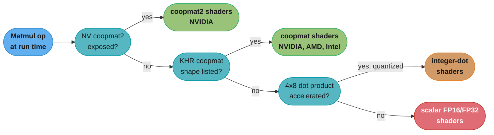
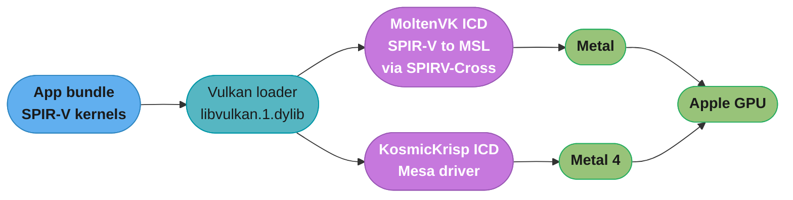
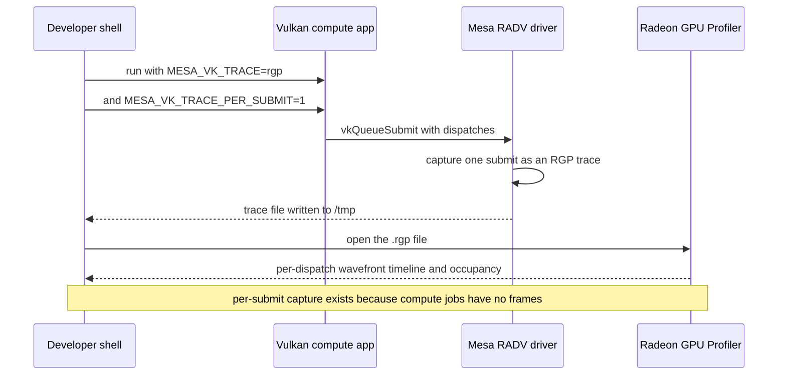
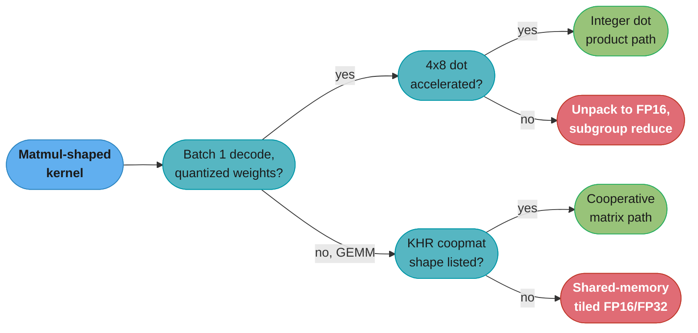

# Vulkan Compute Advanced and Ecosystem

> **Version anchor (fetched 2026-11-25):** Vulkan spec tag `v1.4.369` (2026-11-20). `VK_KHR_cooperative_matrix` revision 2 (2023-05-03) is required by the Vulkan Roadmap 2026 milestone; `VK_NV_cooperative_matrix2` last modified 2024-08-01. Integer dot product, subgroup size control and synchronization2 are core since Vulkan 1.3; buffer device address, timeline semaphores and the Vulkan memory model since 1.2. Ecosystem: llama.cpp rolling build b12722 (2026-11-25), IREE v3.14.0 (2026-11-16), ncnn 20261020, MoltenVK v1.4.2 (2026-07-24), KosmicKrisp Vulkan 1.4 conformant on Apple Silicon (announced 2026-09-25), RenderDoc v1.47 (2026-10-31), Radeon GPU Profiler v2.7.1 (2026-10-06), Slang v2026.22.1. Per-device capabilities come from vulkan.gpuinfo.org reports read on 2026-11-25.

## 1. Concept Overview

[Vulkan Compute Fundamentals](../vulkan_compute_fundamentals/vulkan_compute_fundamentals.md) gets a portable kernel running: buffers, descriptors, pipelines, barriers. This module covers what makes that kernel fast and what surrounds it in production.

The fast path in Vulkan compute is a set of extensions and core features that expose the same hardware CUDA exposes through intrinsics:

- **Subgroup operations** (core since Vulkan 1.1, required set widened in 1.4) are the Vulkan counterpart of warp shuffles, votes and reductions, but the subgroup width is 4 to 128 depending on the device.
- **Subgroup size control** (core since 1.3) lets a pipeline request one width, for example wave32 on an AMD GPU that defaults to 64.
- **Cooperative matrix** (`VK_KHR_cooperative_matrix`) is the portable Tensor Core / MFMA / matrix-engine interface; `VK_NV_cooperative_matrix2` adds NVIDIA-only conversions, reductions and tensor addressing on top.
- **Integer dot product** (core since 1.3) exposes packed 4 x 8-bit dot instructions, the workhorse of quantized LLM inference.
- **Buffer device address** (core since 1.2) gives CUDA-style 64-bit pointers in shaders.
- **The Vulkan memory model** (core since 1.2) defines scopes and acquire/release semantics for atomics, which inter-workgroup algorithms need.
- **bfloat16 and float8 types** (`VK_KHR_shader_bfloat16`, `VK_EXT_shader_float8`) bring the formats [Tensor Cores and Mixed Precision](../tensor_cores_and_mixed_precision/tensor_cores_and_mixed_precision.md) teaches into SPIR-V.

The ecosystem half covers who uses those features and how you see what they do: llama.cpp's `ggml-vulkan` backend, the IREE compiler, Tencent's ncnn, the two Vulkan-on-Metal drivers (MoltenVK and KosmicKrisp), and the profiling and debugging tools (RenderDoc, Radeon GPU Profiler through Mesa RADV, Nsight Graphics, validation layers, pipeline statistics).

For the warp-level CUDA counterparts, read [Warp-Level Primitives and Cooperative Groups](../warp_level_primitives_and_cooperative_groups/warp_level_primitives_and_cooperative_groups.md); for the hardware these map onto, see [AMD GPU Architecture: CDNA and RDNA](../amd_gpu_architecture_cdna_and_rdna/amd_gpu_architecture_cdna_and_rdna.md) and [Apple Silicon GPU Architecture](../apple_silicon_gpu_architecture/apple_silicon_gpu_architecture.md); for the side-by-side vocabulary, see the [Cross-Vendor GPU Concept Map](../cross_vendor_gpu_concept_map/cross_vendor_gpu_concept_map.md).

---

## 2. Intuition

> **One-line analogy**: core Vulkan compute is a universal power socket; the advanced extensions are the vendor-specific fast-charge protocols. Every device charges from the socket, but you only get fast charging after the device and the cable agree on a protocol, and you must ask first.

**Mental model**: every advanced feature follows the same four-step handshake, and skipping any step is a bug.

1. **Query** the device: an extension in `vkEnumerateDeviceExtensionProperties`, a feature bit in `vkGetPhysicalDeviceFeatures2`, a property such as `minSubgroupSize` or the list of cooperative-matrix shapes.
2. **Enable** it at `vkCreateDevice`.
3. **Compile** a shader variant that declares the matching SPIR-V capability (`GL_KHR_cooperative_matrix`, `GL_EXT_integer_dot_product`).
4. **Select** that variant at run time, with a fallback for devices that answered "no".

llama.cpp does exactly this: it checks at build time whether `glslc` can compile `GL_KHR_cooperative_matrix`, `GL_NV_cooperative_matrix2`, `GL_EXT_integer_dot_product` and `GL_EXT_bfloat16` shaders, and at run time whether the device exposes the extensions, then picks a shader per operation.

**Why it matters**: on a phone or laptop, the gap between the scalar fallback and the matrix or dot-product path is the gap between "runs" and "usable". On the gpuinfo.org reports used here, the RTX 4090, both AMD GPUs and Intel Arc 140V expose `VK_KHR_cooperative_matrix` in the compute stage; the Adreno phone and Apple M3 Pro under KosmicKrisp do not, and on Apple the 4 x 8-bit packed dot product is reported as not accelerated. A backend that assumes the fast path everywhere is slow or broken on a third of its fleet.

**Key insight**: portability in Vulkan is not one kernel; it is one *selection policy* over several kernels. The skill is writing the capability ladder (best path, next best, scalar fallback) and testing every rung, not writing one perfect shader.

---

## 3. Core Principles

- **Subgroup width is a range, not a constant.** A device reports `subgroupSize` plus `minSubgroupSize` and `maxSubgroupSize`. NVIDIA reports 32 to 32, AMD (both reports) 32 to 64 with 64 by default, Intel Arc 140V 16 to 32, Apple M3 Pro under KosmicKrisp 32 to 32, the Adreno phone 64 to 128.
- **Request a width only when the algorithm needs one.** `VkPipelineShaderStageRequiredSubgroupSizeCreateInfo` pins it (power of two, within the range); `REQUIRE_FULL_SUBGROUPS` guarantees no partial subgroups if the workgroup's x size is a multiple of the width.
- **Cooperative-matrix shapes are enumerated, never assumed.** `vkGetPhysicalDeviceCooperativeMatrixPropertiesKHR` returns a list of (M, N, K, A type, B type, C type, result type, scope) entries. A shader may only use a listed combination.
- **The KHR extension is the portable floor; NV2 is a vendor ceiling.** `VK_KHR_cooperative_matrix` is in Roadmap 2026; `VK_NV_cooperative_matrix2` appears only on the NVIDIA report. Keep a KHR path for everyone else.
- **Packed integer dot products are the quantized-inference primitive.** `dotPacked4x8EXT(a, b)` multiplies four signed 8-bit pairs and sums them in one call; the device says whether it is hardware-accelerated.
- **Pointers are opt-in and change the safety model.** Buffer device address removes the `maxStorageBufferRange` ceiling and descriptor overhead, and removes bounds checking with them.
- **Cross-workgroup communication needs explicit scopes.** `coherent` and `volatile` are not a memory model; device-scope acquire/release atomics under the Vulkan memory model are.
- **Every capability needs a measured fallback.** The fallback is a feature, tested in CI on a device that lacks the fast path.

---

## 4. Types / Architectures / Strategies

### 4.1 The advanced feature map

| Feature | Status | CUDA counterpart | GLSL extension | Device support in the reports used here |
|---|---|---|---|---|
| Subgroup basic, vote, ballot, arithmetic, shuffle, clustered | Core 1.1; 1.4 requires the set when the subgroup size is meaningful | `__shfl_*_sync`, `__ballot_sync`, `__reduce_add_sync` | `GL_KHR_shader_subgroup_*` | All six |
| Subgroup rotate | Core 1.4 | Rotate via `__shfl_sync` arithmetic | `GL_KHR_shader_subgroup_rotate` | All but the Adreno phone (reports Vulkan 1.3) |
| Subgroup size control | Core 1.3 | None (warp is always 32) | Host-side only | AMD 32 to 64, Intel 16 to 32, Adreno 64 to 128 |
| Cooperative matrix (KHR) | Extension; required by Roadmap 2026 | WMMA / `mma.sync` | `GL_KHR_cooperative_matrix` | NVIDIA, both AMD, Intel |
| Cooperative matrix 2 (NV) | NVIDIA extension | CUTLASS-level tile ops | `GL_NV_cooperative_matrix2` | NVIDIA only |
| Integer dot product | Core 1.3 | `__dp4a` | `GL_EXT_integer_dot_product` | 4 x 8-bit packed accelerated on NVIDIA, AMD, Intel, Adreno; not on Apple M3 Pro (KosmicKrisp) |
| Buffer device address | Core 1.2 | Raw device pointers | `GL_EXT_buffer_reference` | All six |
| Vulkan memory model | Core 1.2 | `cuda::atomic_ref` scopes | `GL_KHR_memory_scope_semantics` | All six |
| bfloat16 types | `VK_KHR_shader_bfloat16` | `__nv_bfloat16` | `GL_EXT_bfloat16` | NVIDIA, both AMD |
| float8 types | `VK_EXT_shader_float8` | `__nv_fp8_e4m3` | `GL_EXT_float_e4m3` / `e5m2` | NVIDIA, AMD under RADV |
| Workgroup memory explicit layout | Extension; required by Roadmap 2026 | Reinterpreting `__shared__` with casts | `GL_EXT_shared_memory_block` | All six |
| Pipeline executable properties | `VK_KHR_pipeline_executable_properties` | `cuobjdump --dump-resource-usage` | Host-side only | Used by llama.cpp when present |

### 4.2 Roadmap 2026: what a compute author can count on

The Roadmap 2026 milestone is aimed at mid-to-high-end devices shipping in 2026 or shortly after. It requires Vulkan 1.4 and Roadmap 2024, and for compute it adds:

| Requirement | Value or extension | Why a kernel author cares |
|---|---|---|
| `maxComputeSharedMemorySize` | 32,768 bytes (was 16,384) | Tiles sized for 32 KB become safe on every Roadmap 2026 device |
| `VK_KHR_cooperative_matrix` | Required | A portable matrix path exists on every such device |
| `VK_KHR_workgroup_memory_explicit_layout` | Required | Alias shared memory between types (load as `uvec4`, read as `float16_t`) |
| `VK_KHR_shader_clock` | Required | In-shader cycle counters for micro-profiling |
| `VK_KHR_shader_untyped_pointers` | Required | Untyped pointer access in SPIR-V |
| `VK_KHR_compute_shader_derivatives` | Required | Derivatives in compute (image-processing kernels) |
| `VK_KHR_robustness2` with `robustBufferAccess2`, `nullDescriptor` | Required | Defined out-of-bounds behavior |
| `VK_KHR_pipeline_binary` | Required | Retrieve and reuse compiled pipeline binaries |
| `VK_KHR_maintenance7` to `maintenance9` | Required | Fixes and small features |

### 4.3 Running Vulkan on Apple Silicon

| Aspect | MoltenVK | KosmicKrisp |
|---|---|---|
| Who | Khronos-hosted, long-standing | LunarG, Mesa-based, sponsored by Google |
| Latest | v1.4.2 (2026-07-24) | Shipped in Vulkan SDK 1.4.363.x |
| Conformance | LunarG: "not a fully conformant Vulkan implementation" | Vulkan 1.4 conformant on Apple Silicon |
| Requires | macOS 12.0 / iOS 15.0 minimum (raised in v1.4.2) | Metal 4, Apple Silicon only |
| iOS | Yes | Built and tested internally by LunarG, not enabled in Mesa's iOS build |
| What the M3 Pro report shows (KosmicKrisp) | - | Vulkan 1.4.363, subgroup 32, 32 KB shared memory, no cooperative matrix, 4 x 8-bit dot not accelerated |

Both are ICDs found through the Vulkan loader, and an app bundle may ship both and pick one at run time. For Apple-native compute, [Metal Compute Programming](../metal_compute_programming/metal_compute_programming.md) exposes `simdgroup_matrix` and the Metal 4 tensor APIs that these layered drivers do not surface as cooperative matrices on the M3 Pro report.

### 4.4 Engines that emit Vulkan compute

| Engine | What it is | How it uses Vulkan | Fast-path features |
|---|---|---|---|
| llama.cpp `ggml-vulkan` | LLM inference runtime | Hand-written GLSL compute shaders compiled by `glslc` at build time | Cooperative matrix (KHR and NV2), integer dot product, bfloat16, float8, required subgroup size, pipeline statistics |
| IREE | MLIR-based ML compiler and runtime | Generates SPIR-V per target; runtime baseline Vulkan 1.3 with `timelineSemaphore`, `scalarBlockLayout`, `synchronization2` | Push descriptors, buffer device address ABI, per-architecture targets (`rdna3`, `valhall4`, `ampere`, `adreno`) |
| ncnn | Mobile-first NN inference | GLSL shaders, `net.opt.use_vulkan_compute = 1` | Ships `android-vulkan`, `ios-vulkan`, `harmonyos-vulkan` packages |
| Browser WebGPU | WGSL compute in the browser | Translated to Vulkan on Linux and Windows | Whatever WebGPU exposes, not the extensions above |

---

## 5. Architecture Diagrams

### 5.1 The capability ladder a portable backend implements



A simplified view of the checks in llama.cpp's `ggml-vulkan.cpp`: each rung is gated by a device extension, a build-time `GGML_VULKAN_*_GLSLC_SUPPORT` check that `glslc` can compile the shader, and an environment variable that disables it (`GGML_VK_DISABLE_COOPMAT2`, `GGML_VK_DISABLE_COOPMAT`, `GGML_VK_DISABLE_INTEGER_DOT_PRODUCT`). The real selection also depends on the quantization type and the matrix shape of each operation.

### 5.2 Vulkan on Apple Silicon



The loader finds both ICDs through the JSON manifests in the bundle's `Resources/vulkan/icd.d`. MoltenVK translates SPIR-V to Metal Shading Language with SPIRV-Cross (its v1.4.2 notes list SPIRV-Cross MSL fixes, including use of `threads_per_simdgroup`); KosmicKrisp is a Mesa Vulkan driver layered on Metal 4.

### 5.3 Profiling a compute-only job on an AMD GPU under Linux



Since AMD discontinued the AMDVLK open-source driver, Linux driver packages from 25.20 onward install RADV, and the Radeon Developer Panel no longer captures Vulkan apps there. RADV's built-in trace path is the replacement, and `MESA_VK_TRACE_PER_SUBMIT` is the switch that makes it usable for compute workloads.

### 5.4 Why a hardcoded warp width breaks a subgroup reduction

```
  256-invocation workgroup, code assumes 32 lanes:
     if ((lid & 31) == 0) partials[lid >> 5] = subgroupAdd(v);   then sums partials[0..7]

  Lane:          0        32        64        96       128   ...   224
                 |        |         |         |         |           |
  NVIDIA (32):  [ sg0    ][ sg1    ][ sg2    ][ sg3    ][ sg4 ] ... [ sg7 ]
                 writes p0  writes p1 ...                              p7
                 => 8 partials, each a 32-lane sum             result: 1.0x  CORRECT

  AMD (64):     [ sg0              ][ sg1              ][ sg2 ] ... [ sg3 ]
                 lane 0 and lane 32 are in the SAME subgroup:
                 p0 = p1 = sum of 64 lanes, p2 = p3, ...
                 => each 64-lane sum counted twice             result: 2.0x  WRONG

  Intel (16):   [sg0][sg1][sg2][sg3] ... [sg15]
                 only lanes 0, 32, 64 ... write: sg0, sg2, sg4 ... (16-lane sums)
                 sg1, sg3, ... never written
                 => half the input dropped                     result: 0.5x  WRONG
```

Caption: the same shader returns the correct sum, twice the sum, or half the sum, depending only on `gl_SubgroupSize` (32, 64 or 16 in the reports used here). §10.1 shows the fix.

### 5.5 A cooperative-matrix tile walk

```
  C (M x N) is cut into TM x TN tiles; one subgroup owns one tile.
  K is walked in TK steps.     Example: TM = TN = TK = 16 (must be a listed shape)

         k=0..15   k=16..31  k=32..47
        +---------+---------+---------+          +---------+
  A row |  A0     |  A1     |  A2     |  ...     |         |
  tile  | 16x16   | 16x16   | 16x16   |          |  C tile |
        +---------+---------+---------+          |  16x16  |
                                                 |  FP32   |
  B col  B0 (16x16)  B1 (16x16)  B2 (16x16) ...  +---------+
  tile
              acc = A0*B0 + acc
              acc = A1*B1 + acc           coopMatMulAdd per step
              acc = A2*B2 + acc

  Per subgroup per step: 16*16*16 = 4,096 multiply-adds in one coopMatMulAdd.
  The matrix elements are spread across the subgroup's lanes in a layout
  only the implementation knows; you load, multiply and store whole tiles.
```

Caption: the tile walk is the same as a WMMA kernel in CUDA. What differs is that 16 x 16 x 16 is only an example; the shader takes TM, TN and TK as specialization constants filled from the enumerated property list.

---

## 6. How It Works — Detailed Mechanics

### 6.1 Subgroup reductions done portably

```glsl
#version 450
#extension GL_KHR_shader_subgroup_basic : require
#extension GL_KHR_shader_subgroup_arithmetic : require
layout(local_size_x = 256) in;
layout(set = 0, binding = 0) readonly buffer In  { float v[]; };
layout(set = 0, binding = 1) writeonly buffer Out { float partial[]; };
layout(push_constant) uniform P { uint n; } pc;

shared float sgSums[64];             // 256 / 4: enough for any subgroup size >= 4

void main() {
    uint gid = gl_GlobalInvocationID.x;
    float x = gid < pc.n ? v[gid] : 0.0;      // keep all lanes active: no early return
    float s = subgroupAdd(x);                  // sum over this subgroup, any width
    if (subgroupElect()) sgSums[gl_SubgroupID] = s;
    barrier();
    if (gl_SubgroupID == 0) {
        // valid while gl_NumSubgroups <= gl_SubgroupSize, i.e. subgroup size >= 16 here
        float t = gl_SubgroupInvocationID < gl_NumSubgroups ? sgSums[gl_SubgroupInvocationID] : 0.0;
        t = subgroupAdd(t);
        if (subgroupElect()) partial[gl_WorkGroupID.x] = t;
    }
}
```

The kernel never names a width. `gl_SubgroupID`, `gl_NumSubgroups`, `gl_SubgroupInvocationID` and `subgroupElect()` adapt to 16, 32, 64 or 128. One assumption remains and is commented: the second stage reduces `gl_NumSubgroups` partials inside one subgroup, which needs `gl_NumSubgroups <= gl_SubgroupSize`. For a 256-invocation workgroup that holds for widths 16 and up. The gpuinfo.org distribution also contains devices reporting 8, 4 and 1; either loop in the second stage or check `subgroupSize` on the host and pick a different shader.

Compare the CUDA version in [Warp-Level Primitives and Cooperative Groups](../warp_level_primitives_and_cooperative_groups/warp_level_primitives_and_cooperative_groups.md): `__reduce_add_sync(0xffffffff, x)` hardcodes both the width (32) and the participation mask (32 bits). GLSL subgroup operations act on the currently active invocations, and a ballot returns a `uvec4` (128 bits) so that it fits the widest subgroup.

### 6.2 Pinning a subgroup width

```cpp
// Request wave32 on a device that reports minSubgroupSize = 32, maxSubgroupSize = 64 (AMD).
VkPhysicalDeviceVulkan13Properties p13{VK_STRUCTURE_TYPE_PHYSICAL_DEVICE_VULKAN_1_3_PROPERTIES};
VkPhysicalDeviceProperties2 p2{VK_STRUCTURE_TYPE_PHYSICAL_DEVICE_PROPERTIES_2, &p13};
vkGetPhysicalDeviceProperties2(pd, &p2);

uint32_t want = 32;
bool ok = (p13.requiredSubgroupSizeStages & VK_SHADER_STAGE_COMPUTE_BIT) &&
          want >= p13.minSubgroupSize && want <= p13.maxSubgroupSize;

VkPipelineShaderStageRequiredSubgroupSizeCreateInfo req{
    VK_STRUCTURE_TYPE_PIPELINE_SHADER_STAGE_REQUIRED_SUBGROUP_SIZE_CREATE_INFO};
req.requiredSubgroupSize = want;                       // power of two, within [min, max]

VkComputePipelineCreateInfo cpi{VK_STRUCTURE_TYPE_COMPUTE_PIPELINE_CREATE_INFO};
cpi.stage.sType = VK_STRUCTURE_TYPE_PIPELINE_SHADER_STAGE_CREATE_INFO;
cpi.stage.stage = VK_SHADER_STAGE_COMPUTE_BIT;
cpi.stage.flags = VK_PIPELINE_SHADER_STAGE_CREATE_REQUIRE_FULL_SUBGROUPS_BIT;
cpi.stage.pNext = ok ? &req : nullptr;                 // fall back to the default width
// ... module, pName, layout, then vkCreateComputePipelines
```

Use it when a kernel's data layout depends on the width (a 32-wide shuffle pattern ported from CUDA) or when one width measures faster on one architecture. llama.cpp passes a required subgroup size per pipeline and asserts it lies within the device's range. The flag documentation adds the rule that matters: if the size may vary and full subgroups are required with no required size given, the only way to guarantee full subgroups is a workgroup x size that is a multiple of `maxSubgroupSize`.

On RADV there is also a driver-level switch, `RADV_PERFTEST=cswave32`, which makes compute shaders default to wave32 on GFX10 and newer; it is a useful A/B experiment, not a shipping configuration.

### 6.3 Cooperative matrix: query, then compile

```cpp
// Instance-level extension function: load it through vkGetInstanceProcAddr.
auto getProps = reinterpret_cast<PFN_vkGetPhysicalDeviceCooperativeMatrixPropertiesKHR>(
    vkGetInstanceProcAddr(inst, "vkGetPhysicalDeviceCooperativeMatrixPropertiesKHR"));

uint32_t count = 0;
getProps(pd, &count, nullptr);
std::vector<VkCooperativeMatrixPropertiesKHR> shapes(
    count, {VK_STRUCTURE_TYPE_COOPERATIVE_MATRIX_PROPERTIES_KHR});
getProps(pd, &count, shapes.data());

struct Shape { uint32_t m, n, k; } best{0, 0, 0};
for (const auto& s : shapes) {
    bool fp16in_fp32acc = s.AType == VK_COMPONENT_TYPE_FLOAT16_KHR &&
                          s.BType == VK_COMPONENT_TYPE_FLOAT16_KHR &&
                          s.CType == VK_COMPONENT_TYPE_FLOAT32_KHR &&
                          s.ResultType == VK_COMPONENT_TYPE_FLOAT32_KHR &&
                          s.scope == VK_SCOPE_SUBGROUP_KHR;
    if (fp16in_fp32acc && s.MSize * s.NSize * s.KSize > best.m * best.n * best.k)
        best = {s.MSize, s.NSize, s.KSize};
}
// best.m/n/k feed specialization constants 0, 1, 2 of the shader below.
// Also check VkPhysicalDeviceCooperativeMatrixPropertiesKHR::cooperativeMatrixSupportedStages
// contains VK_SHADER_STAGE_COMPUTE_BIT (it does on the NVIDIA, AMD and Intel reports).
```

```glsl
#version 450
#extension GL_KHR_cooperative_matrix : require
#extension GL_KHR_memory_scope_semantics : require
#extension GL_EXT_shader_explicit_arithmetic_types_float16 : require

layout(local_size_x_id = 3) in;                       // one subgroup per workgroup
layout(constant_id = 0) const uint TM = 16;           // filled from the property list
layout(constant_id = 1) const uint TN = 16;
layout(constant_id = 2) const uint TK = 16;

layout(set = 0, binding = 0) readonly  buffer A { float16_t a[]; };   // M x K, row-major
layout(set = 0, binding = 1) readonly  buffer B { float16_t b[]; };   // K x N, row-major
layout(set = 0, binding = 2) writeonly buffer C { float c[]; };       // M x N, row-major
layout(push_constant) uniform P { uint M, N, K; } p;

void main() {
    uint row = gl_WorkGroupID.y * TM;
    uint col = gl_WorkGroupID.x * TN;
    coopmat<float, gl_ScopeSubgroup, TM, TN, gl_MatrixUseAccumulator> acc =
        coopmat<float, gl_ScopeSubgroup, TM, TN, gl_MatrixUseAccumulator>(0.0);
    for (uint k = 0; k < p.K; k += TK) {
        coopmat<float16_t, gl_ScopeSubgroup, TM, TK, gl_MatrixUseA> ma;
        coopmat<float16_t, gl_ScopeSubgroup, TK, TN, gl_MatrixUseB> mb;
        coopMatLoad(ma, a, row * p.K + k, p.K, gl_CooperativeMatrixLayoutRowMajor);
        coopMatLoad(mb, b, k * p.N + col, p.N, gl_CooperativeMatrixLayoutRowMajor);
        acc = coopMatMulAdd(ma, mb, acc);
    }
    coopMatStore(acc, c, row * p.N + col, p.N, gl_CooperativeMatrixLayoutRowMajor);
}
```

The `element` argument of `coopMatLoad` and `coopMatStore` counts elements of the buffer's declared type, and `stride` is the row (or column) stride in elements. The shader requires M, N and K to be multiples of the tile shape; production kernels add an edge path or pad. This naive version reloads A and B from global memory for every tile; a real kernel stages tiles through `shared` memory and keeps several accumulators per subgroup, exactly like the tiled GEMM in [Tensor Cores and Mixed Precision](../tensor_cores_and_mixed_precision/tensor_cores_and_mixed_precision.md).

`VK_NV_cooperative_matrix2` adds what the KHR version lacks for real kernels: type and use conversions, reductions, per-element operations and tensor addressing (load a tile from a tensor layout with clamping instead of hand-computed offsets). It exists only on the NVIDIA report here, so llama.cpp keeps both paths.

### 6.4 Integer dot product for quantized weights

```glsl
#version 450
#extension GL_EXT_integer_dot_product : require
layout(local_size_x = 128) in;
// Q8 block: 32 int8 weights packed as 8 uints, plus one float scale
layout(set = 0, binding = 0) readonly buffer W  { uint  wq[]; };
layout(set = 0, binding = 1) readonly buffer WS { float wscale[]; };
layout(set = 0, binding = 2) readonly buffer X  { uint  xq[]; };     // activations, also int8
layout(set = 0, binding = 3) readonly buffer XS { float xscale[]; };

float dotBlock(uint wBase, uint xBase, uint blk, uint xblk) {
    int acc = 0;
    for (uint j = 0; j < 8; ++j)                       // 8 x 4 = 32 multiply-adds
        acc += dotPacked4x8EXT(int(wq[wBase + j]), int(xq[xBase + j]));
    return float(acc) * wscale[blk] * xscale[xblk];
}
```

`dotPacked4x8EXT(int a, int b)` treats each 32-bit operand as four signed 8-bit lanes and returns their dot product. One call replaces four multiplies, four sign extensions and three adds, which is the same deal `__dp4a` gives CUDA. Check two things on the host before choosing this shader: the `shaderIntegerDotProduct` feature (core 1.3), and `integerDotProduct4x8BitPackedSignedAccelerated` in `VkPhysicalDeviceVulkan13Properties`. The feature only says the instruction compiles; the property says it is fast. On the reports used here the property is true for NVIDIA, both AMD GPUs, Intel Arc 140V and the Adreno phone, and false for Apple M3 Pro under KosmicKrisp, where the instruction is emulated.

### 6.5 Buffer device address

```glsl
#version 450
#extension GL_EXT_buffer_reference : require
#extension GL_EXT_shader_explicit_arithmetic_types_int64 : require
layout(local_size_x = 256) in;

layout(buffer_reference, std430, buffer_reference_align = 4) readonly buffer FloatsR { float v[]; };
layout(buffer_reference, std430, buffer_reference_align = 4) writeonly buffer FloatsW { float v[]; };

layout(push_constant) uniform P {
    FloatsR x;            // 8-byte device addresses, no descriptors at all
    FloatsR y;
    FloatsW z;
    uint    n;
    float   a;
} p;

void main() {
    uint i = gl_GlobalInvocationID.x;
    if (i >= p.n) return;
    p.z.v[i] = p.a * p.x.v[i] + p.y.v[i];
}
```

```cpp
// Host side: the buffer and its memory must opt in.
VkBufferCreateInfo bci{VK_STRUCTURE_TYPE_BUFFER_CREATE_INFO};
bci.usage = VK_BUFFER_USAGE_STORAGE_BUFFER_BIT | VK_BUFFER_USAGE_SHADER_DEVICE_ADDRESS_BIT;
// ...
VkMemoryAllocateFlagsInfo flags{VK_STRUCTURE_TYPE_MEMORY_ALLOCATE_FLAGS_INFO};
flags.flags = VK_MEMORY_ALLOCATE_DEVICE_ADDRESS_BIT;
VkMemoryAllocateInfo mai{VK_STRUCTURE_TYPE_MEMORY_ALLOCATE_INFO, &flags};
// ... allocate, bind, then:
VkBufferDeviceAddressInfo bdai{VK_STRUCTURE_TYPE_BUFFER_DEVICE_ADDRESS_INFO};
bdai.buffer = xBuf;
VkDeviceAddress xAddr = vkGetBufferDeviceAddress(dev, &bdai);   // goes into push constants
```

The push-constant block is 3 x 8 + 4 + 4 = 32 bytes, well within the 128-byte core minimum. Three things change compared with descriptors:

| Property | Descriptor binding | Buffer device address |
|---|---|---|
| Max addressable range | `maxStorageBufferRange` (128 MiB on the Adreno phone) | Whole allocation |
| Bounds checking | Robust buffer access can clamp out-of-bounds reads | None; an out-of-bounds read is a GPU page fault or silent garbage |
| Pointer arithmetic, linked structures | No | Yes |
| Validation layer visibility | Full | Partial (GPU-assisted validation helps) |

IREE models this as two executable ABIs. `--iree-vulkan-dispatch-abi=descriptors` emits the portable descriptor-set ABI, `bda` emits only the buffer-device-address ABI, and `all` emits both in runtime preference order; the runtime prefers BDA when the device has `bufferDeviceAddress` and falls back to descriptors otherwise.

### 6.6 The Vulkan memory model and inter-workgroup communication

`barrier()` and `memoryBarrierShared()` cover one workgroup. Algorithms that pass data *between* workgroups in one dispatch, such as a single-pass scan with decoupled look-back, need device-scope atomics with acquire and release semantics:

```glsl
#version 450
#extension GL_KHR_memory_scope_semantics : require
layout(set = 0, binding = 0) buffer Flags { uint flag[]; };
layout(set = 0, binding = 1) buffer Data  { float aggregate[]; };

void publish(uint tile, float value) {
    aggregate[tile] = value;
    // release: the aggregate write is visible before the flag is seen as 1
    atomicStore(flag[tile], 1u, gl_ScopeDevice, gl_StorageSemanticsBuffer, gl_SemanticsRelease);
}

float waitFor(uint tile) {
    // acquire: once the flag reads 1, the aggregate write is visible
    while (atomicLoad(flag[tile], gl_ScopeDevice, gl_StorageSemanticsBuffer, gl_SemanticsAcquire) == 0u) {}
    return aggregate[tile];
}
```

Two cautions. First, `coherent` and `volatile` qualifiers from older GLSL are not a substitute; with the memory model the scope and semantics are explicit operands, and drivers can optimize everything else. Second, spin-waiting on another workgroup assumes that workgroup gets scheduled; Vulkan gives no forward-progress promise between workgroups, so decoupled look-back must only wait on *earlier* tiles and must be tested on every target. The CUDA side of the same discussion is in [Synchronization and Atomics](../synchronization_and_atomics/synchronization_and_atomics.md).

### 6.7 Reading what the driver compiled

```cpp
// Create the pipeline with VK_PIPELINE_CREATE_CAPTURE_STATISTICS_BIT_KHR, then:
VkPipelineInfoKHR pi{VK_STRUCTURE_TYPE_PIPELINE_INFO_KHR};
pi.pipeline = pipe;
uint32_t execCount = 0;
vkGetPipelineExecutablePropertiesKHR(dev, &pi, &execCount, nullptr);
VkPipelineExecutableInfoKHR ei{VK_STRUCTURE_TYPE_PIPELINE_EXECUTABLE_INFO_KHR};
ei.pipeline = pipe;
ei.executableIndex = 0;
uint32_t statCount = 0;
vkGetPipelineExecutableStatisticsKHR(dev, &ei, &statCount, nullptr);
std::vector<VkPipelineExecutableStatisticKHR> stats(
    statCount, {VK_STRUCTURE_TYPE_PIPELINE_EXECUTABLE_STATISTIC_KHR});
vkGetPipelineExecutableStatisticsKHR(dev, &ei, &statCount, stats.data());
for (auto& s : stats) std::printf("%s\n", s.name);   // driver-defined: registers, spills, ...
```

`VK_KHR_pipeline_executable_properties` returns driver-defined statistics such as register counts and spills, which is how you see occupancy limits without a vendor profiler. llama.cpp creates its pipelines with the capture-statistics flag when the extension is present and prints statistics when `GGML_VK_PIPELINE_STATS` is set. The names differ per driver, so treat the output as a per-vendor dashboard, not a portable metric.

### 6.8 Debugging and profiling tools

| Tool | Version | Works on | Compute-specific notes |
|---|---|---|---|
| Vulkan validation layers | Vulkan SDK 1.4.363.1 | Any | Synchronization validation finds missing barriers; GPU-assisted validation checks out-of-bounds BDA and descriptor indexing |
| RenderDoc | v1.47 | Any Vulkan driver | Frame-oriented: wrap compute work in `StartFrameCapture` / `EndFrameCapture` from the in-application API. Debug a compute thread by group and thread ID. Source-level debugging needs `NonSemantic.Shader.DebugInfo.100`, emitted by `glslang -gVS` or `dxc -fspv-debug=vulkan-with-source` |
| Radeon GPU Profiler | v2.7.1 | AMD RDNA, DirectX 12 and Vulkan | On Linux with RADV, capture with `MESA_VK_TRACE=rgp` and `MESA_VK_TRACE_PER_SUBMIT` |
| Nsight Graphics | current | NVIDIA, Vulkan, D3D12, OpenGL | GPU Trace timeline and Vulkan shader debugger |
| GFXReconstruct | Vulkan SDK | Any | Capture and replay API streams; Samsung built its open-source Android GPU profiler Sokatoa on it |
| Timestamp queries | core | Any | Multiply by `timestampPeriod` (1 to 52 ns per tick on the reports used here) |
| `GGML_VK_PERF_LOGGER` | llama.cpp | Any | Per-operation timings inside llama.cpp |

---

## 7. Real-World Examples

**llama.cpp.** The `ggml-vulkan` backend is the widest-reaching use of the features in this module. Its device setup scans for `VK_KHR_cooperative_matrix`, `VK_NV_cooperative_matrix2`, `VK_KHR_shader_integer_dot_product`, `VK_KHR_shader_bfloat16`, `VK_EXT_shader_float8`, `VK_EXT_subgroup_size_control`, `VK_KHR_shader_clock`, `VK_KHR_workgroup_memory_explicit_layout` and `VK_KHR_pipeline_executable_properties`, among others. Each fast path is compiled only if the build-time `glslc` supports the matching GLSL extension (`GGML_VULKAN_COOPMAT_GLSLC_SUPPORT`, `GGML_VULKAN_COOPMAT2_GLSLC_SUPPORT`, `GGML_VULKAN_INTEGER_DOT_GLSLC_SUPPORT`, `GGML_VULKAN_BFLOAT16_GLSLC_SUPPORT`), and each can be switched off at run time for A/B testing: `GGML_VK_DISABLE_COOPMAT`, `GGML_VK_DISABLE_COOPMAT2`, `GGML_VK_DISABLE_INTEGER_DOT_PRODUCT`, `GGML_VK_DISABLE_BFLOAT16`, `GGML_VK_DISABLE_F16`. That build-time check is a lesson on its own: an old Vulkan SDK silently produces a binary without the fast paths. See [Inference Engines](../../llm/inference_engines/inference_engines.md) for where llama.cpp sits among serving engines.

**IREE.** IREE compiles models (for example ONNX imported with `iree-import-onnx`) to SPIR-V with `iree-compile --iree-hal-target-device=vulkan --iree-vulkan-target=<target>`. Targets can be LLVM-style (`gfx1100` for the RX 7900 XTX, `sm_86` for the RTX 3090), architecture code names (`rdna3`, `valhall4`, `ampere`, `adreno`) or product names (`rx7900xtx`). Its documented support matrix rates Arm Mali (Valhall and newer) and AMD (RDNA and newer) as "Good", and Qualcomm Adreno (640 and newer) and NVIDIA (Turing and newer) as "Reasonable". Without a target it uses "a safe but more limited default", which in practice means none of the advanced features above.

**ncnn.** ncnn's Vulkan path is the long-running example of Vulkan as the mobile ML API: one option (`net.opt.use_vulkan_compute = 1`), prebuilt Android, iOS and HarmonyOS Vulkan packages in every release (20261020 is the latest), and `pnnx` to convert PyTorch and ONNX models.

**Vulkan on Apple Silicon.** LunarG's October 2026 report describes MoltenVK as the original, widely adopted but not fully conformant layer, and KosmicKrisp as the conformant Vulkan 1.4 implementation on Metal 4 for Apple Silicon only; the Vulkan SDK ships both and an app can choose at run time. For compute, the M3 Pro report under KosmicKrisp shows the practical gap: no cooperative matrix and no accelerated packed 8-bit dot product, so a Vulkan LLM backend on a Mac runs its scalar or FP16 paths, while Metal-native code can use `simdgroup_matrix`. See [Metal Compute Programming](../metal_compute_programming/metal_compute_programming.md) and [MPS, MLX and PyTorch MPS](../metal_performance_shaders_mlx_and_pytorch_mps/metal_performance_shaders_mlx_and_pytorch_mps.md).

**Linux AMD profiling after AMDVLK.** The Radeon GPU Profiler README records that AMDVLK was discontinued, that 25.20-based driver packages install RADV by default, and that the Radeon Developer Panel cannot capture Vulkan apps on those drivers. The documented workaround is RADV's own trace capture, which is why `MESA_VK_TRACE=rgp` is now part of an AMD Vulkan compute workflow. The ROCm-side tools for the same GPUs are in [ROCm Profiling and Debugging](../rocm_profiling_and_debugging/rocm_profiling_and_debugging.md).

---

## 8. Tradeoffs

### 8.1 Matrix paths

| Path | Portability | Peak relative to the device | Code complexity | Fallback needed |
|---|---|---|---|---|
| Scalar FP32 shared-memory tiling | Every device | Lowest | Moderate | No |
| FP16 arithmetic (`shaderFloat16`) | Most devices | Higher on hardware with packed FP16 | Moderate | Yes, for devices without FP16 arithmetic |
| Integer dot product, 4 x 8-bit packed | Core 1.3; accelerated on 5 of the 6 reports | High for 8-bit and 4-bit quantized weights | Moderate (dequantize-in-register) | Yes (Apple under KosmicKrisp reports not accelerated) |
| `VK_KHR_cooperative_matrix` | NVIDIA, AMD, Intel here; required by Roadmap 2026 | Uses the matrix units | High (shape query, specialization) | Yes (Adreno phone and Apple report none) |
| `VK_NV_cooperative_matrix2` | NVIDIA only | Highest on NVIDIA in Vulkan | High, but less hand-written addressing | Yes (everything not NVIDIA) |

### 8.2 Binding model

| Concern | Descriptors | Buffer device address |
|---|---|---|
| Range per binding | Bounded by `maxStorageBufferRange` | Unbounded within the allocation |
| Robustness | Out-of-bounds reads clamp or return zero with robust buffer access | Undefined; faults or garbage |
| Host overhead | Descriptor writes or push descriptors | 8 bytes per pointer in push constants |
| Tooling | RenderDoc and validation show every binding | Debuggers see integers; GPU-assisted validation needed |
| Who uses it | Portable default (IREE `descriptors` ABI) | IREE `bda` ABI when the device supports it |

### 8.3 Vulkan on Apple versus Metal

| Concern | Vulkan via KosmicKrisp | Vulkan via MoltenVK | Metal directly |
|---|---|---|---|
| One codebase with Windows, Linux, Android | Yes | Yes | No |
| Conformance | Vulkan 1.4 conformant | Not fully conformant | Not applicable |
| Matrix units from compute shaders | No cooperative matrix on the M3 Pro report | Not shown in the reports used here | `simdgroup_matrix`, Metal 4 tensors |
| Hardware | Apple Silicon, Metal 4 | macOS 12 / iOS 15 and up | All Apple GPUs |
| Best for | Ports where Vulkan is the product's API | iOS, older macOS | Peak performance on Apple |

### 8.4 Profilers

| Tool | Strength | Weakness for compute |
|---|---|---|
| RenderDoc | Vendor-neutral capture, resource inspection, per-thread shader debugging | Frame-oriented; no hardware counters |
| Radeon GPU Profiler | Wavefront-level timeline, occupancy, barriers on AMD | AMD only; Linux capture now through RADV traces |
| Nsight Graphics | GPU Trace and shader debugging on NVIDIA | NVIDIA only |
| Timestamps and pipeline statistics | Portable, scriptable, cheap | No stall reasons |

---

## 9. When to Use / When NOT to Use

**Use subgroup operations** for every reduction, scan, broadcast and vote inside a workgroup. They replace shared-memory round trips and `barrier()` calls with register exchanges. Do not use them with a hardcoded width, and do not use them where a workgroup-wide `barrier()` is what the algorithm needs.

**Use required subgroup size** when a kernel's layout depends on the width, or when you have measured one width faster on one architecture. Do not set it by default; a device left at its preferred width is usually right, and pinning removes portability to devices whose range excludes your value.

**Use `VK_KHR_cooperative_matrix`** for GEMM-shaped work at FP16 or BF16 and above roughly 1 K x 1 K x 1 K, where matrix units dominate. Do not use it for matrix-vector decode (batch 1), where memory bandwidth, not math, is the limit and integer dot products on quantized weights win; see [Roofline and Arithmetic Intensity](../case_studies/cross_cutting/roofline_and_arithmetic_intensity.md).

**Use integer dot product** for 8-bit and 4-bit quantized weights when `integerDotProduct4x8BitPackedSignedAccelerated` is true. Do not use it when the property is false; the emulated instruction can be slower than unpacking to FP16.

**Use buffer device address** for tensors larger than `maxStorageBufferRange`, for indirection (pointer tables, linked structures) and to drop descriptor overhead. Do not use it as the only path if you need robust out-of-bounds behavior or you ship to devices without the feature.

**Use KosmicKrisp** when Vulkan is your product's API and you need a conformant implementation on Apple Silicon. **Use Metal** when Apple performance is the goal.



---

## 10. Common Pitfalls

### 10.1 A subgroup reduction that assumes 32 lanes

**BROKEN**: ported from a CUDA kernel that used `__shfl_down_sync` with 32 lanes.

```glsl
// BROKEN: correct on NVIDIA (32), 2x on AMD (64), 0.5x on Intel Arc 140V (16)
float s = subgroupAdd(x);
if ((gl_LocalInvocationID.x & 31u) == 0u) partials[gl_LocalInvocationID.x >> 5] = s;
barrier();
if (gl_LocalInvocationID.x == 0u) {
    float t = 0.0;
    for (uint i = 0u; i < 8u; ++i) t += partials[i];   // 256 / 32 = 8, hardcoded
    out_[gl_WorkGroupID.x] = t;
}
```

**FIX**: derive everything from the subgroup built-ins (full kernel in §6.1).

```glsl
// FIX: width-agnostic
float s = subgroupAdd(x);
if (subgroupElect()) partials[gl_SubgroupID] = s;
barrier();
if (gl_LocalInvocationID.x == 0u) {
    float t = 0.0;
    for (uint i = 0u; i < gl_NumSubgroups; ++i) t += partials[i];
    out_[gl_WorkGroupID.x] = t;
}
```

The production pattern: the CUDA-trained author tests on an NVIDIA card, the reduction is exact, and the first AMD user reports a model that produces fluent nonsense because every normalization is off by 2x. §5.4 shows the lane map.

### 10.2 A cooperative-matrix shape taken from a blog post

**BROKEN**: the shader hardcodes `coopmat<float16_t, gl_ScopeSubgroup, 16, 16, gl_MatrixUseA>` with an FP32 accumulator and the host never calls `vkGetPhysicalDeviceCooperativeMatrixPropertiesKHR`. On a device whose list does not contain (16, 16, 16, FP16, FP16, FP32, FP32, subgroup), the pipeline is invalid; depending on the driver, `vkCreateComputePipelines` fails or the result is undefined.

**FIX**: enumerate the list (§6.3), choose a listed shape, pass it through specialization constants, and keep a non-coopmat pipeline for devices with an empty list.

### 10.3 Subgroup and matrix operations after a divergent early return

```glsl
// BROKEN: lanes past the end return, the rest of the subgroup runs coopMatMulAdd
uint i = gl_GlobalInvocationID.x;
if (i >= p.n) return;
acc = coopMatMulAdd(ma, mb, acc);      // subgroup-scope op with a partial subgroup
```

```glsl
// FIX: keep every lane alive, mask the data instead
uint i = gl_GlobalInvocationID.x;
bool live = i < p.n;
// load zeros for dead lanes or pad the matrices to tile multiples on the host
acc = coopMatMulAdd(ma, mb, acc);
```

Subgroup arithmetic operates on the *active* invocations, so an early return silently changes what `subgroupAdd` sums; cooperative-matrix operations at subgroup scope expect the whole subgroup to execute them together. Pad tensors to tile multiples, and pair this with `REQUIRE_FULL_SUBGROUPS` so the subgroup is never partially launched either.

### 10.4 A buffer-device-address read past the end

**BROKEN**: a gather kernel indexes `p.table.v[idx]` with an index from user input. With descriptors and robust buffer access, an out-of-range `idx` returned zero; after moving to BDA it reads whatever lies past the allocation, or faults and loses the device (`VK_ERROR_DEVICE_LOST`).

**FIX**: pass the element count with the pointer and clamp (`idx = min(idx, p.count - 1u)`), and run CI with GPU-assisted validation, which instruments BDA accesses. Descriptors remain the right default for any buffer indexed by untrusted data.

### 10.5 Fast paths that were never compiled

A backend built against an old Vulkan SDK whose `glslc` cannot compile `GL_KHR_cooperative_matrix` produces a working binary with no cooperative-matrix shaders. llama.cpp guards this with `GGML_VULKAN_COOPMAT_GLSLC_SUPPORT` and related build checks; the failure mode is that the build succeeds and the device runs the scalar path. The production pattern: a CI image pinned to an old SDK, a large throughput gap against a developer's local build, and time spent profiling kernels that were never in the binary. **Fix**: log the selected path per device at startup (llama.cpp logs one debug line per device with its fp16, bf16, warp size, shared memory, int dot and matrix-core mode), and pin the SDK version in the build image.

### 10.6 A RenderDoc capture with nothing in it

RenderDoc captures frames. A compute-only process that never presents has no frame boundary, so pressing the capture key does nothing. **Fix**: load the in-application API (`RENDERDOC_GetAPI`) and bracket the work with `StartFrameCapture` and `EndFrameCapture`, or launch the app from RenderDoc with a capture triggered by the API. For AMD hardware timelines on Linux, use `MESA_VK_TRACE=rgp` with `MESA_VK_TRACE_PER_SUBMIT` instead, for the same reason.

### 10.7 Trusting the feature bit instead of the performance property

`shaderIntegerDotProduct` is core in Vulkan 1.3, so every 1.3 device accepts `dotPacked4x8EXT`. The Apple M3 Pro report under KosmicKrisp has the feature and reports `integerDotProduct4x8BitPackedSignedAccelerated = false`. A backend that selects the integer-dot path from the feature bit runs an emulated instruction sequence on that device. **Fix**: select on the `...Accelerated` property, and benchmark both paths once per device class.

---

## 11. Technologies & Tools

| Tool | Version (fetched 2026-11-25) | Role |
|---|---|---|
| llama.cpp `ggml-vulkan` | build b12722 | LLM inference over Vulkan with cooperative matrix, integer dot, BF16, FP8 paths |
| IREE | v3.14.0 | MLIR compiler and runtime; `vulkan` target device, SPIR-V codegen, descriptors and BDA ABIs |
| ncnn | 20261020 | Mobile inference; prebuilt Android, iOS and HarmonyOS Vulkan packages |
| MoltenVK | v1.4.2 | Vulkan over Metal via SPIRV-Cross; macOS 12 and iOS 15 minimum |
| KosmicKrisp | Vulkan SDK 1.4.363.x | Mesa Vulkan 1.4 driver over Metal 4 for Apple Silicon |
| Mesa RADV | distribution driver | Default AMD Vulkan driver on Linux; `MESA_VK_TRACE`, `RADV_PERFTEST` |
| RenderDoc | v1.47 | Capture, resource inspection, compute-thread shader debugging |
| Radeon GPU Profiler | v2.7.1 | AMD RDNA wavefront timeline for DirectX 12 and Vulkan |
| Nsight Graphics | current release | NVIDIA GPU Trace and Vulkan shader debugger |
| GFXReconstruct | Vulkan SDK | API capture and replay; base of Samsung's Sokatoa Android profiler |
| Vulkan validation layers | Vulkan SDK 1.4.363.1 | Synchronization validation, GPU-assisted validation |
| Slang | v2026.22.1 | Shading language with pointers on SPIR-V, generics, autodiff; emits SPIR-V, MSL, CUDA, HLSL |
| Vulkan Hardware Database | vulkan.gpuinfo.org | Per-device extension, feature and limit reports |

---

## 12. Interview Questions with Answers

**Q: Why does a `subgroupAdd` reduction ported from CUDA give twice the correct sum on an AMD GPU?**
**Short:** The kernel assumed 32-lane subgroups, but AMD reports 64 by default, so two lanes of one subgroup each store the same 64-lane sum and it is counted twice.

The CUDA code elected lanes 0, 32, 64 and so on as warp leaders and summed 8 partials for a 256-invocation block. With a 64-wide subgroup, lanes 0 and 32 belong to the same subgroup and both write its full sum, so the total doubles; on Intel Arc 140V's 16-wide subgroups only every other subgroup writes and the total halves. Use `subgroupElect()`, `gl_SubgroupID` and `gl_NumSubgroups` instead of constants. If the algorithm genuinely needs 32 lanes, request it with `requiredSubgroupSize` where the device's range allows.

**Q: Is `VK_KHR_cooperative_matrix` a fixed 16 x 16 x 16 matrix-multiply instruction like WMMA's common shape?**
**Short:** No: it defines cooperative matrix types whose supported M, N, K, component types and scope each device lists, and shaders may only use listed combinations.

`vkGetPhysicalDeviceCooperativeMatrixPropertiesKHR` returns entries of `VkCooperativeMatrixPropertiesKHR` with `MSize`, `NSize`, `KSize`, `AType`, `BType`, `CType`, `ResultType`, `saturatingAccumulation` and `scope`. The GLSL type `coopmat<T, scope, rows, cols, use>` can take its dimensions from specialization constants, so one SPIR-V module serves several shapes. Matrix elements are spread across the subgroup in an implementation-defined layout; you load, multiply-add and store whole tiles. Treat any shape in a tutorial as one example, not a guarantee.

**Q: What does `VK_NV_cooperative_matrix2` add, and why does llama.cpp keep a separate KHR path?**
**Short:** NV coopmat2 adds conversions, reductions, per-element operations and tensor addressing on top of KHR cooperative matrices, but only NVIDIA exposes it, so other vendors need the KHR path.

The KHR extension covers load, store and multiply-add of tiles; real kernels also need type and use conversions, row or column reductions, element-wise epilogues and addressing into tensors with clamping. NV2 provides those, which shortens dequantizing GEMM kernels considerably. In the reports used here only the RTX 4090 exposes it, while the KHR extension appears on NVIDIA, both AMD GPUs and Intel Arc 140V. llama.cpp detects both, can disable each with `GGML_VK_DISABLE_COOPMAT2` or `GGML_VK_DISABLE_COOPMAT`, and falls back to non-matrix shaders on devices with neither.

**Q: How does the integer dot product speed up quantized inference, and what must you check before using it?**
**Short:** dotPacked4x8EXT multiplies and sums four 8-bit pairs packed in two 32-bit values in one call; check that the device reports the packed 4x8 dot product as accelerated.

A Q8 block of 32 weights becomes 8 calls instead of 32 multiplies plus unpacking, the same trick as CUDA's `__dp4a`. The `shaderIntegerDotProduct` feature, core in Vulkan 1.3, only says the instruction compiles. `VkPhysicalDeviceVulkan13Properties::integerDotProduct4x8BitPackedSignedAccelerated` says it maps to hardware. On the reports used here it is true on NVIDIA, both AMD GPUs, Intel Arc 140V and the Adreno phone, and false on Apple M3 Pro under KosmicKrisp. Select the path on the property, not the feature.

**Q: What is buffer device address, and how is it different from a CUDA device pointer?**
**Short:** It is a 64-bit GPU address of a buffer used through GL_EXT_buffer_reference types, like a CUDA pointer, but only for buffers created and allocated with the device-address flags.

The buffer needs `VK_BUFFER_USAGE_SHADER_DEVICE_ADDRESS_BIT`, its memory needs `VK_MEMORY_ALLOCATE_DEVICE_ADDRESS_BIT`, and `vkGetBufferDeviceAddress` returns the address, typically placed in push constants. In GLSL a `layout(buffer_reference)` block type is the pointer type. Unlike a descriptor it is not limited by `maxStorageBufferRange` and has no robust bounds checking, so an out-of-range access is undefined. It has been core since Vulkan 1.2, and IREE emits it as an optional faster ABI with descriptors as the fallback.

**Q: When should a pipeline set `requiredSubgroupSize`?**
**Short:** Only when the kernel's data layout depends on a specific width, or when measurement shows one width is faster, and only if the value lies in the device's min to max range.

The value must be a power of two between `minSubgroupSize` and `maxSubgroupSize`, and the compute stage must be in `requiredSubgroupSizeStages`. Ranges in the reports used here: AMD 32 to 64, Intel Arc 140V 16 to 32, the Adreno phone 64 to 128, NVIDIA and Apple fixed at 32. Pair it with `REQUIRE_FULL_SUBGROUPS` and a workgroup x size that is a multiple of the width. Pinning a width the device cannot provide is a validation error, so keep the default-width pipeline as a fallback.

**Q: MoltenVK or KosmicKrisp: which should a Vulkan compute app use on Apple Silicon?**
**Short:** KosmicKrisp for a conformant Vulkan 1.4 implementation on Apple Silicon with Metal 4, and MoltenVK for iOS and older macOS, which KosmicKrisp does not cover.

LunarG describes MoltenVK (v1.4.2) as the original, widely adopted layer that is not a fully conformant Vulkan implementation, and KosmicKrisp as a Mesa driver over Metal 4 that passed Vulkan 1.4 conformance on Apple Silicon. KosmicKrisp needs Metal 4 and Apple Silicon; its iOS build is not enabled in Mesa. Both ship in the Vulkan SDK and an app may bundle both and choose at run time. For compute-heavy work, note that the M3 Pro report under KosmicKrisp lists no cooperative matrix, which is why peak Apple performance still goes through Metal.

**Q: How does llama.cpp's Vulkan backend decide which matmul shaders to run?**
**Short:** At build time it compiles each fast path only if glslc supports the GLSL extension, and at run time it enables a path only if the device exposes the extension and no disable variable is set.

The build checks `GL_KHR_cooperative_matrix`, `GL_NV_cooperative_matrix2`, `GL_EXT_integer_dot_product` and `GL_EXT_bfloat16` support in `glslc` and sets `GGML_VULKAN_*_GLSLC_SUPPORT` macros. At device setup it scans extensions such as `VK_KHR_cooperative_matrix`, `VK_NV_cooperative_matrix2` and `VK_KHR_shader_integer_dot_product`, honoring `GGML_VK_DISABLE_COOPMAT`, `GGML_VK_DISABLE_COOPMAT2` and `GGML_VK_DISABLE_INTEGER_DOT_PRODUCT`. Per operation it then picks shaders by quantization type and shape. The practical consequence is that the Vulkan SDK in the build image decides your ceiling as much as the GPU does.

**Q: Why does IREE emit both a descriptor ABI and a buffer-device-address ABI for Vulkan?**
**Short:** Descriptors run on every supported device, BDA is faster where supported, so `--iree-vulkan-dispatch-abi=all` ships both and the runtime prefers BDA with descriptors as fallback.

IREE's runtime baseline is Vulkan 1.3 with `timelineSemaphore`, `scalarBlockLayout` and `synchronization2`. Descriptor-set dispatch is the portable executable ABI; BDA dispatch is optional and used only when the device exposes `bufferDeviceAddress` and the program was compiled with BDA support. The documentation recommends `all` for programs meant to run across many devices and `bda` only when the fleet is known to support it. It is the capability-ladder pattern applied to the binding model.

**Q: How do you capture a compute-only Vulkan workload in RenderDoc?**
**Short:** Use RenderDoc's in-application API to call StartFrameCapture before the dispatches and EndFrameCapture after them, because compute-only apps have no presented frames to delimit a capture.

`RENDERDOC_GetAPI` is the module's only exported entry point and returns the API table with `StartFrameCapture` and `EndFrameCapture`. Inside the capture you can inspect buffers and debug a compute thread by entering its group and thread ID. For source-level debugging, compile shaders with `NonSemantic.Shader.DebugInfo.100` debug info, which `glslang -gVS` or `dxc -fspv-debug=vulkan-with-source` emit. RenderDoc shows what ran and with what data, not hardware counters.

**Q: How do you get an AMD hardware trace of a Vulkan compute job on Linux now that AMDVLK is discontinued?**
**Short:** Run under Mesa RADV with MESA_VK_TRACE=rgp and MESA_VK_TRACE_PER_SUBMIT set, then open the trace written to /tmp in Radeon GPU Profiler.

The RGP README notes that 25.20-based Linux driver packages no longer include AMDVLK, install RADV by default, and that the Radeon Developer Panel cannot capture Vulkan apps on those drivers. RADV's `MESA_VK_TRACE` accepts `rgp`, `rmv`, `rra` and others and dumps traces to `/tmp`. Captures are normally triggered by a key or a frame index, so `MESA_VK_TRACE_PER_SUBMIT`, documented as helpful for compute-only workloads, makes each queue submit a capture. RGP v2.7.1 then shows wavefront occupancy and barrier timing per dispatch.

**Q: What does the Vulkan memory model give you that `coherent` and `volatile` do not?**
**Short:** It defines scopes and acquire-release semantics for atomics and barriers, so producer-consumer patterns across workgroups or queues are specified instead of relying on driver behavior.

With `GL_KHR_memory_scope_semantics`, `atomicStore(flag, 1u, gl_ScopeDevice, gl_StorageSemanticsBuffer, gl_SemanticsRelease)` publishes data and a matching acquire `atomicLoad` observes it, with `controlBarrier` available for the general case. `coherent` only bypasses incoherent caches and `volatile` only forbids some compiler optimizations; neither orders other memory operations. Core since Vulkan 1.2, the memory model is what a decoupled look-back scan needs. It does not add forward-progress guarantees between workgroups, so wait only on earlier tiles.

**Q: What does the Vulkan Roadmap 2026 milestone change for compute kernel authors?**
**Short:** It requires Vulkan 1.4, raises the shared-memory minimum to 32 KB, and requires cooperative matrix, explicit workgroup memory layout, shader clock and untyped pointers.

The milestone targets mid-to-high-end devices shipping in 2026 or shortly after. Besides the compute items it requires `hostImageCopy`, `VK_KHR_robustness2` with `robustBufferAccess2` and `nullDescriptor`, `VK_KHR_pipeline_binary`, `VK_KHR_compute_shader_derivatives` and the maintenance7 to maintenance9 extensions. For a compute backend this means a portable matrix path and 32 KB tiles become baseline on new devices. Older devices and phones still need the fallbacks, so it raises the top of the ladder rather than removing rungs.

**Q: What does `VK_KHR_workgroup_memory_explicit_layout` let a kernel do?**
**Short:** It lets shared memory be declared as explicitly laid-out blocks that alias each other, so one buffer can be written as one type and read as another.

The extension supports `SPV_KHR_workgroup_memory_explicit_layout`; in GLSL it is used through `GL_EXT_shared_memory_block`. A kernel can load a tile from global memory as `uvec4` for wide transactions and then read the same shared bytes as `float16_t` or 8-bit values for compute, which CUDA code does with pointer casts on `__shared__`. All six reports used here expose it, llama.cpp checks for it, and Roadmap 2026 requires it.

**Q: How do you see register usage and spills of a Vulkan compute pipeline without a vendor profiler?**
**Short:** Create the pipeline with capture statistics enabled and call vkGetPipelineExecutableStatisticsKHR from VK_KHR_pipeline_executable_properties to read the driver's per-shader statistics.

`vkGetPipelineExecutablePropertiesKHR` lists the compiled executables and `vkGetPipelineExecutableStatisticsKHR` returns named statistics, typically register counts, spill counts and instruction counts, with names chosen by each driver. llama.cpp sets the capture flag when the extension is present and prints statistics when `GGML_VK_PIPELINE_STATS` is set. Use it to catch a kernel that spills after a change, then confirm occupancy with RGP or Nsight Graphics on the vendor that matters.

**Q: Why do bfloat16 and float8 support differ so much across Vulkan devices?**
**Short:** They come from optional extensions, VK_KHR_shader_bfloat16 and VK_EXT_shader_float8, that each driver exposes only when its hardware supports the format.

On the reports used here, bfloat16 types are reported by NVIDIA and both AMD GPUs; float8 by NVIDIA and by AMD under Mesa RADV, while Intel Arc 140V, Apple M3 Pro under KosmicKrisp and the Adreno phone report neither. In GLSL they are `GL_EXT_bfloat16`, and `GL_EXT_float_e4m3` and `GL_EXT_float_e5m2` for the two FP8 encodings. llama.cpp gates BF16 shaders on both the device and the build-time `glslc`. A model shipped in BF16 therefore needs a conversion or FP16 path on the devices that lack it.

---

## 13. Best Practices

- **Write the capability ladder first.** For every hot operation, list the paths (NV2, KHR coopmat, integer dot, FP16, FP32), the checks that gate each, and the fallback. Test every rung in CI on a device or a forced-disable flag.
- **Select on performance properties, not only feature bits.** `integerDotProduct4x8BitPackedSignedAccelerated`, the cooperative-matrix shape list and `cooperativeMatrixSupportedStages` are the inputs.
- **Never name a subgroup width in shader code.** Use the built-ins; pin a width on the host only with a measured reason.
- **Pass shapes as specialization constants.** One SPIR-V module, several pipelines, no recompilation for a new device class.
- **Log the chosen path per device at startup.** A silent scalar fallback is the most expensive bug in this area.
- **Pin the Vulkan SDK in build images.** Build-time shader-compiler support decides which fast paths exist at all.
- **Keep descriptors for untrusted indexing; use BDA for big tensors.** Validate BDA code with GPU-assisted validation.
- **Use device-scope acquire/release for cross-workgroup flags**, and wait only on earlier workgroups.
- **Profile with the vendor tool for the target that matters**, and keep portable timestamps and pipeline statistics in every build for the rest.
- **On Apple, decide Vulkan versus Metal by goal.** Vulkan for one codebase, Metal for peak, and measure the gap on your kernels.

---

## 14. Case Study

### Shipping a quantized LLM decode kernel to five device classes through Vulkan

**Context.** A desktop and mobile assistant runs a 3B-parameter model with 4-bit weights. The team owns one Vulkan backend and must ship to: NVIDIA RTX laptops, AMD Radeon laptops on Windows (AMD driver) and Linux (RADV), Intel Arc laptops, Android phones with Adreno GPUs, and Macs through KosmicKrisp. Decode at batch 1 is a chain of matrix-vector products, so the hot kernel is a quantized matvec, and prefill (prompt processing) is GEMM-shaped.

**Step 1: build the capability matrix from the reports.**

| Capability | RTX 4090 | RX 7800 XT (Windows) | RX 9070 XT (RADV) | Arc 140V | Adreno (SM-S928B) | M3 Pro (KosmicKrisp) |
|---|---|---|---|---|---|---|
| Vulkan API reported | 1.4.357 | 1.4.359 | 1.4.363 | 1.4.359 | 1.3.128 | 1.4.363 |
| Subgroup size (min to max) | 32 (32-32) | 64 (32-64) | 64 (32-64) | 32 (16-32) | 64 (64-128) | 32 (32-32) |
| Shared memory | 48 KB | 32 KB | 64 KB | 48 KB | 32 KB | 32 KB |
| KHR cooperative matrix | Yes | Yes | Yes | Yes | No | No |
| NV cooperative matrix 2 | Yes | No | No | No | No | No |
| 4x8 packed dot accelerated | Yes | Yes | Yes | Yes | Yes | No |
| bfloat16 types | Yes | Yes | Yes | No | No | No |
| `maxStorageBufferRange` | 4 GiB | 4 GiB | 4 GiB | 4 GiB | 128 MiB | 4 GiB |

**Step 2: the first version.** The matvec kernel came from a CUDA implementation: 256 invocations per output block, a `subgroupAdd` per 32 lanes with leaders chosen by `(lid & 31) == 0`, and the integer-dot path selected whenever `shaderIntegerDotProduct` was enabled.

```cpp
// BROKEN: selection on the feature bit, and the shader assumes 32-lane subgroups
bool useIntDot = features13.shaderIntegerDotProduct;          // true on every 1.3 device
VkPipeline matvec = useIntDot ? matvecIntDot32 : matvecFp16_32; // "_32" = hardcoded width
```

Results against the CUDA reference on the same prompts:

| Device | Symptom | Root cause |
|---|---|---|
| RTX 4090 | Matches reference | Subgroup is 32, as assumed |
| RX 7800 XT, RX 9070 XT, Adreno | Every matvec output 2x; generation is garbage | 64-wide subgroups, two leaders per subgroup |
| Arc 140V | Every matvec output 0.5x | 16-wide subgroups, half never written |
| M3 Pro (KosmicKrisp) | Correct values, decode slower than the FP16 path | Integer dot product emulated |

**Step 3: the fix.**

```cpp
// FIX: one selection policy, driven by properties, with width-agnostic shaders
struct Caps {
    bool coopmatKHR, coopmatNV2, intDotFast, bf16;
    uint32_t subgroup, sgMin, sgMax, smem;
    uint64_t ssboRange;
};

enum class MatvecPath { IntDot, Fp16 };
enum class GemmPath { CoopmatNV2, CoopmatKHR, TiledFp16 };

MatvecPath chooseMatvec(const Caps& c) {
    return c.intDotFast ? MatvecPath::IntDot : MatvecPath::Fp16;   // not the feature bit
}
GemmPath chooseGemm(const Caps& c) {
    if (c.coopmatNV2) return GemmPath::CoopmatNV2;
    if (c.coopmatKHR) return GemmPath::CoopmatKHR;                  // shape from the list
    return GemmPath::TiledFp16;                                     // TILE from c.smem
}
```

```glsl
// FIX (shader side): reduction from §6.1, no 32 anywhere
float s = subgroupAdd(partialDot);
if (subgroupElect()) sgSums[gl_SubgroupID] = s;
barrier();
```

Weights for the Adreno phone are bound in slices of at most 128 MiB (or through buffer device address where IREE-style dual ABIs are used), and every pipeline's tile size comes from the shared-memory limit through specialization constants.

**Step 4: what changed in the process, not just the code.**

| Practice added | Catches |
|---|---|
| Startup log line per device: chosen matvec and GEMM path, subgroup size, shared memory | Silent fallbacks, unexpected widths |
| CI job that forces each rung with disable flags (`DISABLE_COOPMAT`, `DISABLE_INTEGER_DOT`) on one NVIDIA machine | Broken fallback paths that no real device exercises yet |
| One AMD and one Adreno device in the nightly correctness run | Width bugs like Step 2 |
| RGP traces through `MESA_VK_TRACE=rgp` and `MESA_VK_TRACE_PER_SUBMIT` on the RADV machine; Nsight Graphics on NVIDIA | Occupancy and barrier stalls per vendor |
| Per-pipeline statistics through `VK_KHR_pipeline_executable_properties` diffed on every shader change | Register spills introduced by a refactor |

**Lessons.** The single largest defect was a CUDA constant (32) that is a device property in Vulkan; the second was choosing a path from "the instruction compiles" instead of "the instruction is fast". Both are policy bugs, not kernel bugs, and both were invisible on the developer's NVIDIA machine. The Apple result also set an expectation the product team had missed: through Vulkan on Apple Silicon, this backend runs without matrix units, so the Mac build later gained a Metal path (see [Metal Compute Programming](../metal_compute_programming/metal_compute_programming.md)) for prefill. The same multi-vendor decision, made for a single fused kernel across CUDA, HIP and Metal, is worked through in [Ship One Kernel Across NVIDIA, AMD and Apple](../case_studies/ship_one_kernel_across_nvidia_amd_and_apple.md), and the AMD-native alternative to this backend is [HIP Programming and Porting](../hip_programming_and_porting/hip_programming_and_porting.md).
