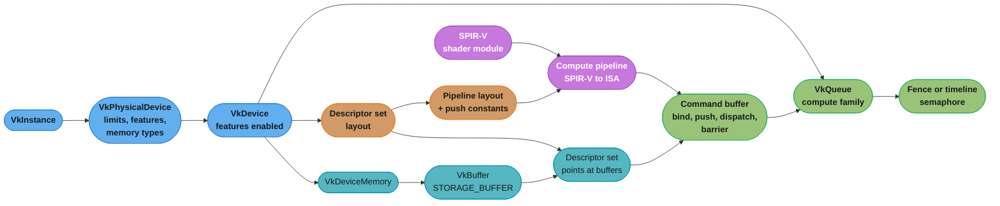
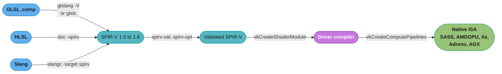
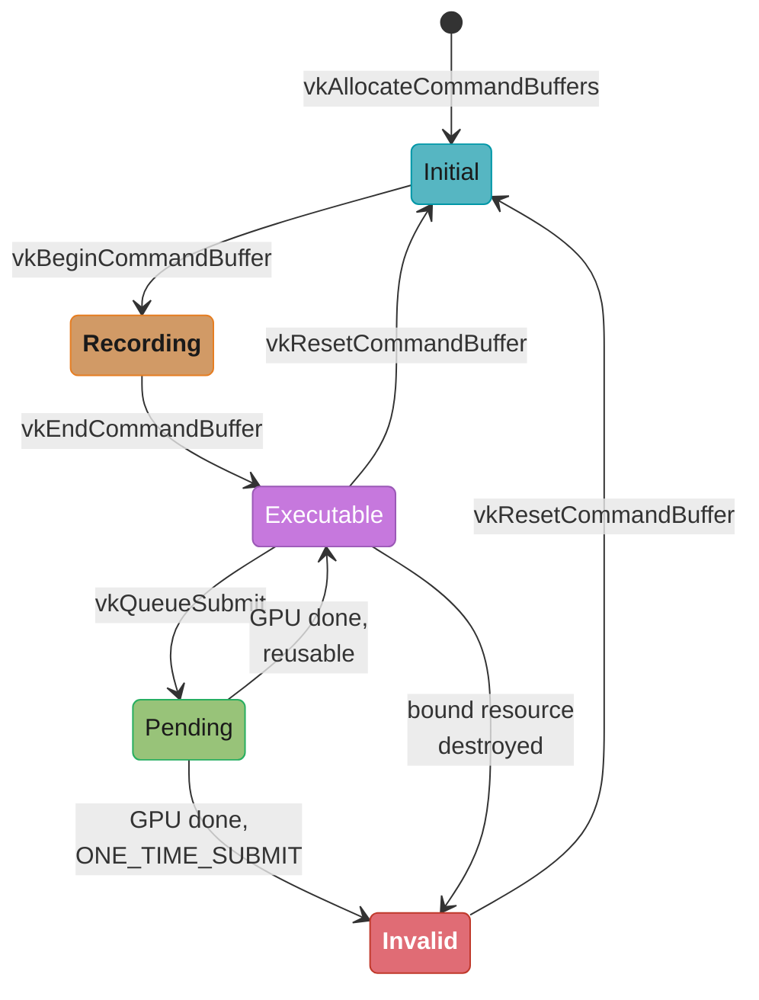
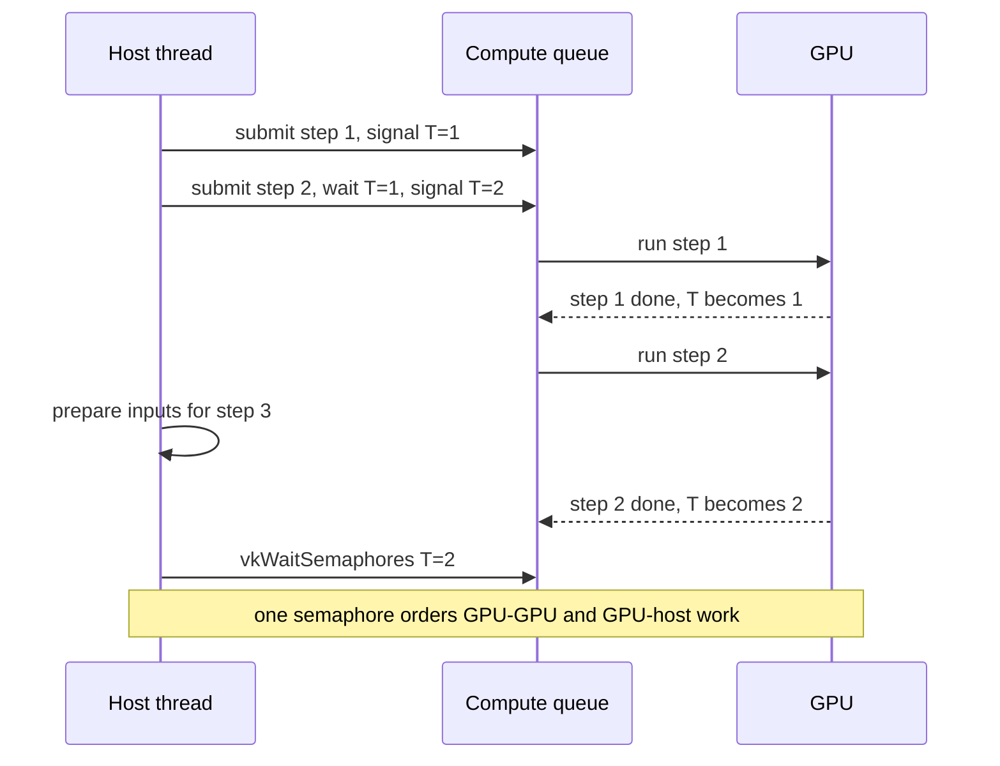
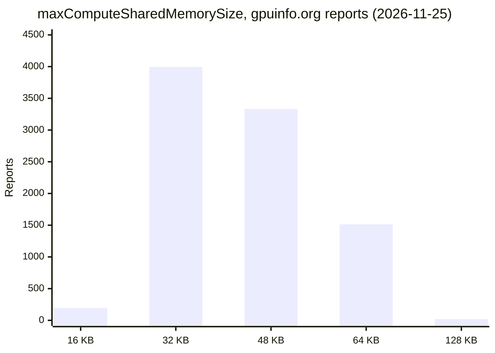
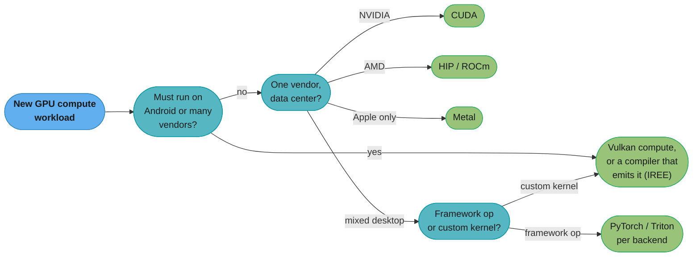

# Vulkan Compute Fundamentals

> **Version anchor (fetched 2026-11-25):** Vulkan 1.4 was released 2024-12-03; the latest spec tag in `KhronosGroup/Vulkan-Docs` is `v1.4.369` (2026-11-20). LunarG Vulkan SDK 1.4.363.1 is current on all four platforms. Shader compilers: glslang 16.6.0 (2026-09-11), DXC v1.9.2609 (2026-09-29), Slang v2026.22.1 (2026-11-19). The Vulkan Roadmap 2026 milestone raises the `maxComputeSharedMemorySize` minimum from 16384 to 32768 bytes and requires `VK_KHR_cooperative_matrix`. Device limits quoted below come from vulkan.gpuinfo.org reports read on 2026-11-25.

## 1. Concept Overview

Vulkan is the Khronos explicit graphics and compute API. For a kernel author, the compute half of Vulkan is a portable GPGPU stack: you write a kernel in GLSL, HLSL or Slang, compile it to **SPIR-V** (a binary intermediate representation, the Vulkan counterpart of PTX), and the driver compiles that SPIR-V to the GPU's native ISA when you create a pipeline. The same SPIR-V binary runs on NVIDIA, AMD, Intel, Qualcomm Adreno, Arm Mali, and Apple Silicon (through a layered driver over Metal). No other compute API reaches that set of devices with one binary.

The price is explicitness. CUDA hides almost everything behind `cudaMalloc`, a triple-chevron launch and a stream. Vulkan makes you create an instance, pick a physical device, create a logical device and a queue, allocate memory from a typed heap, bind it to a buffer, describe the buffer bindings in a descriptor set layout, build a pipeline layout and a compute pipeline, record a command buffer, insert pipeline barriers between dependent dispatches, submit, and wait on a fence or a timeline semaphore. A vector add that is 20 lines of CUDA is about 200 lines of Vulkan host code. That code is boilerplate, but every line of it is a decision the driver would otherwise make for you, and every line is a place a portable program can go wrong.

This module teaches the core object model and the rules that matter for compute: memory types and heaps, descriptors and push constants, command buffers and queues, the pipeline barrier and timeline semaphore synchronization model, workgroups and shared memory, and the three shader languages that compile to SPIR-V. It maps each concept to the CUDA idea you already know. Subgroup operations, cooperative matrices, integer dot products, buffer device address, MoltenVK and KosmicKrisp, the llama.cpp, IREE and ncnn backends, and the profilers are in [Vulkan Compute Advanced and Ecosystem](../vulkan_compute_advanced_and_ecosystem/vulkan_compute_advanced_and_ecosystem.md).

Prerequisites from this section: [CUDA Programming Model and Kernels](../cuda_programming_model_and_kernels/cuda_programming_model_and_kernels.md) (grids and blocks), [Shared Memory and Bank Conflicts](../shared_memory_and_bank_conflicts/shared_memory_and_bank_conflicts.md), [Synchronization and Atomics](../synchronization_and_atomics/synchronization_and_atomics.md) and [Streams, Events and Concurrency](../streams_events_and_concurrency/streams_events_and_concurrency.md). For the one-page vocabulary across all four vendors, see the [Cross-Vendor GPU Concept Map](../cross_vendor_gpu_concept_map/cross_vendor_gpu_concept_map.md); for where Vulkan sits next to HIP, SYCL, Metal and WebGPU, see [GPU Portability: HIP, SYCL and Beyond](../gpu_portability_hip_sycl_and_beyond/gpu_portability_hip_sycl_and_beyond.md).

---

## 2. Intuition

> **One-line analogy**: CUDA is an automatic car with a chauffeur; Vulkan is a manual car with no driver assist. Both reach the same top speed, but in the manual car you change every gear yourself, and if you forget the clutch (a pipeline barrier) the engine does not stall politely: it silently grinds.

**Mental model**: think of Vulkan compute as three separate ledgers that CUDA merges into one.

1. **What the kernel reads and writes** is a ledger of *bindings*: descriptor sets name which buffers sit at `set = 0, binding = 0, 1, 2`, and push constants carry a few scalars. CUDA passes raw pointers as kernel arguments; Vulkan passes a table of buffer views that the pipeline layout declared in advance.
2. **What runs when** is a ledger of *commands*: a command buffer is a recorded list of binds, dispatches and barriers. Nothing runs until you submit it to a queue. A queue starts commands in submission order but does not finish them in order, so a later dispatch can read data an earlier dispatch has not written yet unless a pipeline barrier says otherwise.
3. **What the host can see** is a ledger of *memory types*: each allocation comes from one memory type with flags such as `DEVICE_LOCAL`, `HOST_VISIBLE`, `HOST_COHERENT` and `HOST_CACHED`. CUDA's `cudaMalloc` versus `cudaMallocHost` is a two-way choice; Vulkan gives you a per-device table and makes you choose.

**Why it matters**: Vulkan is the only API that reaches Android phones, Linux and Windows desktops and Apple Silicon with one compute binary and no vendor SDK on the end user's machine. llama.cpp's `ggml-vulkan` backend, IREE's `vulkan-spirv` target and Tencent's ncnn all exist for that reason. If your inference must run on a Snapdragon phone, an AMD laptop and an NVIDIA workstation, Vulkan is often the only single-source answer.

**Key insight**: in Vulkan, correctness is a property of the *synchronization you wrote*, not of the order you wrote commands in. CUDA's default stream serializes kernels for you. Vulkan serializes nothing between dispatches on the same queue. Almost every "works on my GPU, fails on yours" Vulkan compute bug is a missing or too-narrow barrier, a device limit you assumed, or a subgroup width you hardcoded.

---

## 3. Core Principles

- **The application owns every decision the CUDA runtime makes implicitly.** Device selection, queue selection, memory-type selection, binding layout and synchronization are all explicit API calls. The driver validates little at runtime; the validation layer (`VK_LAYER_KHRONOS_validation`) checks usage during development.
- **SPIR-V is the contract between your compiler and the driver.** You ship SPIR-V, not GPU ISA. The driver compiles SPIR-V to ISA at `vkCreateComputePipelines`, which is the Vulkan equivalent of PTX JIT and is just as expensive the first time. A Vulkan 1.4 implementation must accept SPIR-V 1.0 through 1.6.
- **Limits are per device, not per API version.** The spec defines minimums (16 KB shared memory, 65535 workgroups per dimension, 128 MiB storage-buffer range). Real devices report more, and two drivers for the same GPU can report different values. Query `VkPhysicalDeviceLimits` and size your kernel from it.
- **Queues execute in submission order of start, not of completion.** Commands in one queue can overlap and complete out of order. A pipeline barrier, an event, a semaphore or a fence is the only thing that creates an ordering.
- **A workgroup is a CUDA thread block; an invocation is a CUDA thread.** `layout(local_size_x = 256) in;` fixes the block size at pipeline creation. `vkCmdDispatch(cmd, gx, gy, gz)` sets the grid in *workgroups*, not in threads.
- **Shared memory is static.** A `shared` array is sized at compile time (or by specialization constant at pipeline creation). There is no dynamic shared memory launch parameter as in CUDA's third chevron argument.
- **Subgroup width is a device property you must query.** NVIDIA reports 32, AMD reports 64 with a 32 to 64 range, Intel Arc 140V reports 16 to 32, Adreno reports 64 to 128. Never hardcode 32.
- **Portability is opt-in by feature query.** Every optional capability (float16 arithmetic, 8-bit storage, integer dot product, cooperative matrix) is a feature bit you query and enable at device creation, then a capability your SPIR-V declares. A shader that uses a feature you did not enable is invalid, even if it happens to run.

---

## 4. Types / Architectures / Strategies

### 4.1 The CUDA to Vulkan concept map

| CUDA concept | Vulkan compute equivalent | Key difference |
|---|---|---|
| Thread | Invocation | Same idea |
| Thread block | Workgroup | Size fixed in the shader (`local_size_x/y/z`) or by specialization constant |
| Grid | Dispatch dimensions (`vkCmdDispatch(gx, gy, gz)`) | Counts workgroups, not threads |
| Warp (32) | Subgroup (device-defined size) | 4 to 128 lanes across real devices; query `subgroupSize` |
| `__shared__` | `shared` (GLSL), `groupshared` (HLSL and Slang) | Static size only |
| `__syncthreads()` | `barrier()` (GLSL), `GroupMemoryBarrierWithGroupSync()` (HLSL) | GLSL `barrier()` orders only shared memory; see §6.8 |
| Global memory pointer | Storage buffer binding (SSBO), or buffer device address | Bound through descriptors by default |
| Kernel arguments | Push constants (scalars) plus descriptor sets (buffers) | Push constants: 128 bytes minimum, 256 in Vulkan 1.4 |
| `cudaMalloc` | `vkAllocateMemory` from a chosen memory type, then `vkBindBufferMemory` | You pick the heap; 4096 allocations minimum guaranteed |
| `cudaMallocHost` / pinned | `HOST_VISIBLE` memory type, mapped with `vkMapMemory` | Coherence is a separate flag |
| Stream | Queue plus command buffers | Queues come from fixed queue families |
| Kernel launch | `vkCmdDispatch` recorded into a command buffer, then `vkQueueSubmit` | Nothing runs until submit |
| `cudaEvent_t` (timing) | Timestamp query pool | Ticks times `timestampPeriod` ns |
| `cudaEvent_t` (ordering) | Pipeline barrier (in-queue), semaphore (cross-queue) | Different objects for different scopes |
| `cudaStreamSynchronize` | Fence or timeline semaphore wait on host | Timeline is a 64-bit counter |
| CUDA Graph | Pre-recorded command buffer replayed by resubmitting | A command buffer is already a recorded DAG of commands |
| PTX | SPIR-V | Driver JIT at pipeline creation |
| `nvcc` | glslang / glslc, DXC, slangc | Three front ends, one IR |
| Template parameter or `#define` | Specialization constant (`layout(constant_id = N)`) | Set at pipeline creation, no recompile to SPIR-V |

### 4.2 The object model

| Object | Created by | Compute role |
|---|---|---|
| `VkInstance` | `vkCreateInstance` | Loader connection; enables instance layers such as validation |
| `VkPhysicalDevice` | `vkEnumeratePhysicalDevices` | One GPU as the driver reports it; source of limits, features, memory types, queue families |
| `VkDevice` | `vkCreateDevice` | Logical device; you enable features and extensions here, once |
| `VkQueue` | `vkGetDeviceQueue` | Submission target from a queue family with `VK_QUEUE_COMPUTE_BIT` |
| `VkDeviceMemory` | `vkAllocateMemory` | Raw allocation from one memory type |
| `VkBuffer` | `vkCreateBuffer` + `vkBindBufferMemory` | A typed view of memory with usage flags (`STORAGE_BUFFER`, `TRANSFER_SRC`) |
| `VkShaderModule` | `vkCreateShaderModule` | Wraps SPIR-V words |
| `VkDescriptorSetLayout` | `vkCreateDescriptorSetLayout` | Declares binding slots (type, count, stage) |
| `VkPipelineLayout` | `vkCreatePipelineLayout` | Set layouts plus push-constant ranges: the kernel's signature |
| `VkPipeline` | `vkCreateComputePipelines` | Compiled kernel; SPIR-V to ISA happens here |
| `VkDescriptorPool` / `VkDescriptorSet` | `vkAllocateDescriptorSets` + `vkUpdateDescriptorSets` | The actual buffer bindings |
| `VkCommandPool` / `VkCommandBuffer` | `vkAllocateCommandBuffers` | Recorded work |
| `VkFence` | `vkCreateFence` | Binary GPU-to-host signal per submit |
| `VkSemaphore` (timeline) | `vkCreateSemaphore` with `VK_SEMAPHORE_TYPE_TIMELINE` | 64-bit counter for GPU-GPU and GPU-host ordering; core since 1.2 |
| `VkQueryPool` (timestamps) | `vkCreateQueryPool` | GPU timing |

### 4.3 Shader languages that compile to SPIR-V

| Language | Compiler | Compute entry syntax | Best fit |
|---|---|---|---|
| GLSL 4.50 + `GL_KHR_vulkan_glsl` | glslang (`glslang -V`) or glslc (shaderc) | `layout(local_size_x = 256) in; void main()` | Most Vulkan compute code today; llama.cpp and ncnn shaders |
| HLSL | DXC with `-spirv` | `[numthreads(256,1,1)] void main(uint3 id : SV_DispatchThreadID)` | Teams sharing kernels with Direct3D 12 |
| Slang | slangc (`-target spirv`) | `[shader("compute")] [numthreads(256,1,1)]` | New code that must also emit Metal, CUDA or HLSL; modules, generics, autodiff |
| OpenCL C | clspv (not in the SDK path above) | `__kernel void f(...)` | Reusing OpenCL kernels; niche |

Slang is now a Khronos-hosted open-source project, and the Vulkan SDK ships it next to glslang and DXC, so the language choice is no longer a vendor bet.

### 4.4 Memory property flags

| Flag | Meaning | Typical compute use |
|---|---|---|
| `DEVICE_LOCAL` | Fast for the GPU (VRAM on a discrete card) | Weights, activations, scratch |
| `HOST_VISIBLE` | Can be mapped with `vkMapMemory` | Staging, uploads, readback |
| `HOST_COHERENT` | Host writes are visible without `vkFlushMappedMemoryRanges` | Small per-step parameter buffers |
| `HOST_CACHED` | CPU reads are cached | Readback buffers (fast CPU reads) |
| `DEVICE_LOCAL` + `HOST_VISIBLE` | GPU memory the CPU can write directly (resizable BAR on discrete GPUs, all memory on unified-memory SoCs) | Upload without a copy; check the heap size first |

### 4.5 Synchronization primitives

| Primitive | Scope | CUDA analogue | Use for |
|---|---|---|---|
| Pipeline barrier (`vkCmdPipelineBarrier2`) | Within one queue | Implicit kernel ordering in a stream | Dispatch B reads what dispatch A wrote |
| Event (`vkCmdSetEvent2` / `vkCmdWaitEvents2`) | Within one queue, split barrier | None | Overlap independent work between signal and wait |
| Binary semaphore | Queue to queue | `cudaStreamWaitEvent` | Legacy cross-queue handoff |
| Timeline semaphore | Queue to queue and host | `cudaStreamWaitEvent` + `cudaEventSynchronize` | Pipelined submissions, host waits on a counter value |
| Fence | Queue to host | `cudaStreamSynchronize` | "This submit finished" |

---

## 5. Architecture Diagrams

### 5.1 The object graph a compute dispatch needs



Every box here is an explicit call. The two that cost real time are `vkCreateComputePipelines` (driver compiles SPIR-V to ISA) and `vkAllocateMemory` (kernel-mode allocation), so a production app creates both once at startup and reuses them; everything on the right edge is per-dispatch and cheap.

### 5.2 The shader toolchain



SPIR-V plays the role PTX plays for CUDA: a stable IR that the driver lowers at runtime. The difference is that three independent front ends feed it, and five or more vendor back ends consume it.

### 5.3 Command buffer lifecycle



A command buffer in the Pending state belongs to the GPU. Resetting it, re-recording it, or destroying a buffer it references while it is Pending is undefined behavior, which is why double-buffered command buffers with one fence or timeline value each are the standard pattern.

### 5.4 Execution hierarchy with real numbers

```
  vkCmdDispatch(cmd, 4096, 1, 1)        local_size_x = 256
  +---------------------------------------------------------------------+
  | dispatch: 4096 workgroups x 256 invocations = 1,048,576 invocations |
  +---------------------------------------------------------------------+
        |
        v  one workgroup (runs on one SM / CU / Xe-core / shader core)
  +--------------------------------------------------+
  | 256 invocations, one shared-memory allocation    |
  |                                                  |
  |  subgroup size 32  (NVIDIA)      -> 8 subgroups  |
  |  subgroup size 64  (AMD)         -> 4 subgroups  |
  |  subgroup size 16  (Intel)       -> 16 subgroups |
  |  subgroup size 128 (Adreno max)  -> 2 subgroups  |
  +--------------------------------------------------+
        |
        v  gl_GlobalInvocationID.x = gl_WorkGroupID.x * 256 + gl_LocalInvocationID.x
```

Caption: the same 256-invocation workgroup is 8, 4, 16 or 2 subgroups depending on the device, which is why any kernel that indexes shared memory by "warp id" has to compute it from `gl_SubgroupSize` instead of dividing by 32.

### 5.5 Memory types on three device shapes

```
  Discrete GPU (example: RTX-class card with resizable BAR)
  heap 0: VRAM 24 GiB  [DEVICE_LOCAL]
     type A: DEVICE_LOCAL                       <- weights, activations
     type B: DEVICE_LOCAL | HOST_VISIBLE | HOST_COHERENT   <- direct upload (BAR)
  heap 1: system RAM   [-]
     type C: HOST_VISIBLE | HOST_COHERENT       <- staging upload
     type D: HOST_VISIBLE | HOST_COHERENT | HOST_CACHED     <- readback

  Unified-memory SoC (phone, laptop iGPU, Apple Silicon)
  heap 0: shared RAM   [DEVICE_LOCAL]
     type A: DEVICE_LOCAL | HOST_VISIBLE | HOST_COHERENT    <- everything
     type B: DEVICE_LOCAL | HOST_VISIBLE | HOST_CACHED      <- readback

  What the code must do on BOTH: ask for flags, take the first match,
  fall back to a staging copy when no DEVICE_LOCAL type is HOST_VISIBLE.
```

Caption: the type layout is illustrative of the two families of devices, not a dump of one report. The selection rule in §6.2 is what makes one binary work on both: request the flags you need, iterate `memoryTypes` in order, and take the first type whose bit is set in the buffer's `memoryTypeBits`.

---

## 6. How It Works — Detailed Mechanics

### 6.1 Picking a device and a compute queue

```cpp
#include <vulkan/vulkan.h>
#include <cstdio>
#include <cstdlib>
#include <cstring>
#include <fstream>
#include <vector>

#define VK_CHECK(call)                                                      \
    do {                                                                    \
        VkResult r_ = (call);                                               \
        if (r_ != VK_SUCCESS) {                                             \
            std::fprintf(stderr, "%s:%d: %s returned VkResult %d\n",        \
                         __FILE__, __LINE__, #call, static_cast<int>(r_));  \
            std::exit(1);                                                   \
        }                                                                   \
    } while (0)

static VkInstance createInstance() {
    VkApplicationInfo app{VK_STRUCTURE_TYPE_APPLICATION_INFO};
    app.pApplicationName = "saxpy";
    app.apiVersion = VK_API_VERSION_1_3;     // ask for 1.3, run on 1.3 or 1.4 drivers
    const char* layers[] = {"VK_LAYER_KHRONOS_validation"};   // development builds only
    VkInstanceCreateInfo ci{VK_STRUCTURE_TYPE_INSTANCE_CREATE_INFO};
    ci.pApplicationInfo = &app;
    ci.enabledLayerCount = 1;
    ci.ppEnabledLayerNames = layers;
    VkInstance inst;
    VK_CHECK(vkCreateInstance(&ci, nullptr, &inst));
    return inst;
}

// Prefer a queue family that has COMPUTE but not GRAPHICS (a dedicated "async compute" family);
// fall back to any family with COMPUTE.
static uint32_t pickComputeFamily(VkPhysicalDevice pd) {
    uint32_t n = 0;
    vkGetPhysicalDeviceQueueFamilyProperties(pd, &n, nullptr);
    std::vector<VkQueueFamilyProperties> fams(n);
    vkGetPhysicalDeviceQueueFamilyProperties(pd, &n, fams.data());
    uint32_t any = UINT32_MAX;
    for (uint32_t i = 0; i < n; ++i) {
        VkQueueFlags f = fams[i].queueFlags;
        if (!(f & VK_QUEUE_COMPUTE_BIT)) continue;
        if (!(f & VK_QUEUE_GRAPHICS_BIT)) return i;      // dedicated compute
        if (any == UINT32_MAX) any = i;
    }
    return any;
}
```

The spec requires that an implementation exposing a graphics-capable queue family also exposes at least one family that supports both graphics and compute, so a desktop or mobile GPU always has a compute-capable family. A dedicated compute family (no graphics bit) is the hardware path that runs alongside graphics work on AMD and NVIDIA; for a compute-only process it matters less, but it is still the right default because it keeps your work off the queue a desktop compositor may share.

Device creation enables the features the kernels will use. Two core features almost every compute app wants are timeline semaphores (core in 1.2) and synchronization2 (core in 1.3):

```cpp
static VkDevice createDevice(VkPhysicalDevice pd, uint32_t family) {
    float prio = 1.0f;
    VkDeviceQueueCreateInfo qci{VK_STRUCTURE_TYPE_DEVICE_QUEUE_CREATE_INFO};
    qci.queueFamilyIndex = family;
    qci.queueCount = 1;
    qci.pQueuePriorities = &prio;

    VkPhysicalDeviceVulkan13Features f13{VK_STRUCTURE_TYPE_PHYSICAL_DEVICE_VULKAN_1_3_FEATURES};
    f13.synchronization2 = VK_TRUE;
    VkPhysicalDeviceVulkan12Features f12{VK_STRUCTURE_TYPE_PHYSICAL_DEVICE_VULKAN_1_2_FEATURES};
    f12.timelineSemaphore = VK_TRUE;
    f12.pNext = &f13;

    VkDeviceCreateInfo dci{VK_STRUCTURE_TYPE_DEVICE_CREATE_INFO};
    dci.pNext = &f12;
    dci.queueCreateInfoCount = 1;
    dci.pQueueCreateInfos = &qci;
    VkDevice dev;
    VK_CHECK(vkCreateDevice(pd, &dci, nullptr, &dev));
    return dev;
}
```

In real code you first call `vkGetPhysicalDeviceFeatures2` with the same chain and check each bit before setting it. Enabling a feature the device does not have makes `vkCreateDevice` fail with `VK_ERROR_FEATURE_NOT_PRESENT`; using a feature you did not enable is undefined behavior that the validation layer reports.

### 6.2 Buffers and memory-type selection

```cpp
static uint32_t findMemoryType(VkPhysicalDevice pd, uint32_t typeBits,
                               VkMemoryPropertyFlags want) {
    VkPhysicalDeviceMemoryProperties mp;
    vkGetPhysicalDeviceMemoryProperties(pd, &mp);
    for (uint32_t i = 0; i < mp.memoryTypeCount; ++i) {
        bool allowed = typeBits & (1u << i);
        bool hasFlags = (mp.memoryTypes[i].propertyFlags & want) == want;
        if (allowed && hasFlags) return i;   // drivers order types best-first
    }
    return UINT32_MAX;
}

struct Buffer { VkBuffer buf; VkDeviceMemory mem; void* mapped; };

static Buffer createHostBuffer(VkPhysicalDevice pd, VkDevice dev, VkDeviceSize bytes) {
    Buffer b{};
    VkBufferCreateInfo bci{VK_STRUCTURE_TYPE_BUFFER_CREATE_INFO};
    bci.size = bytes;
    bci.usage = VK_BUFFER_USAGE_STORAGE_BUFFER_BIT;
    bci.sharingMode = VK_SHARING_MODE_EXCLUSIVE;
    VK_CHECK(vkCreateBuffer(dev, &bci, nullptr, &b.buf));

    VkMemoryRequirements req;
    vkGetBufferMemoryRequirements(dev, b.buf, &req);
    uint32_t type = findMemoryType(pd, req.memoryTypeBits,
        VK_MEMORY_PROPERTY_HOST_VISIBLE_BIT | VK_MEMORY_PROPERTY_HOST_COHERENT_BIT);
    if (type == UINT32_MAX) { std::fprintf(stderr, "no host-visible type\n"); std::exit(1); }

    VkMemoryAllocateInfo mai{VK_STRUCTURE_TYPE_MEMORY_ALLOCATE_INFO};
    mai.allocationSize = req.size;           // may be larger than 'bytes' (alignment)
    mai.memoryTypeIndex = type;
    VK_CHECK(vkAllocateMemory(dev, &mai, nullptr, &b.mem));
    VK_CHECK(vkBindBufferMemory(dev, b.buf, b.mem, 0));
    VK_CHECK(vkMapMemory(dev, b.mem, 0, VK_WHOLE_SIZE, 0, &b.mapped));
    return b;
}
```

This teaching version uses one host-visible, coherent allocation per buffer so the readback is trivial. Production code differs in three ways, each driven by a spec limit:

| Limit | Spec minimum | What real devices report | Consequence |
|---|---|---|---|
| `maxMemoryAllocationCount` | 4096 | driver-defined | One `vkAllocateMemory` per tensor does not scale; suballocate from large blocks (the Vulkan Memory Allocator library does this) |
| `maxMemoryAllocationSize` | 2^30 (1 GiB) | RTX 4090 (NVIDIA 621.40): effectively unlimited; RX 7800 XT (AMD 26.11.2, Windows): 2 GiB; Adreno phone (SM-S928B): 1 GiB | A 4 GiB weight file cannot be one allocation on the AMD Windows driver or the phone |
| `maxStorageBufferRange` | 2^27 (128 MiB) | 4 GiB on NVIDIA, AMD, Intel, Apple; 128 MiB on the Adreno phone | A single SSBO binding cannot see more than 128 MiB on that phone; split tensors or use buffer device address |

And weights belong in a `DEVICE_LOCAL` type, uploaded once through a staging buffer with `vkCmdCopyBuffer`, unless the device exposes a `DEVICE_LOCAL | HOST_VISIBLE` type large enough to write directly.

### 6.3 The kernel in GLSL, HLSL and Slang

GLSL, the most common Vulkan compute language:

```glsl
#version 450
layout(local_size_x = 256) in;                       // workgroup = 256 invocations

layout(set = 0, binding = 0) readonly  buffer X { float x[]; };
layout(set = 0, binding = 1) readonly  buffer Y { float y[]; };
layout(set = 0, binding = 2) writeonly buffer Z { float z[]; };

layout(push_constant) uniform Params {
    uint  n;
    float a;
} p;

void main() {
    uint i = gl_GlobalInvocationID.x;
    if (i >= p.n) return;                            // tail guard, like CUDA
    z[i] = p.a * x[i] + y[i];
}
```

```bash
# glslc (shaderc): stage inferred from the .comp extension
glslc --target-env=vulkan1.3 saxpy.comp -o saxpy.spv
# glslang reference compiler
glslang -V --target-env vulkan1.3 saxpy.comp -o saxpy.spv
# check the module before shipping it
spirv-val --target-env vulkan1.3 saxpy.spv
```

The same kernel in HLSL, compiled by DXC's SPIR-V back end:

```hlsl
struct Params { uint n; float a; };
[[vk::push_constant]] Params p;

[[vk::binding(0, 0)]] StructuredBuffer<float>   x;
[[vk::binding(1, 0)]] StructuredBuffer<float>   y;
[[vk::binding(2, 0)]] RWStructuredBuffer<float> z;

[numthreads(256, 1, 1)]
void main(uint3 id : SV_DispatchThreadID) {
    uint i = id.x;
    if (i >= p.n) return;
    z[i] = p.a * x[i] + y[i];
}
```

```bash
dxc -spirv -T cs_6_0 -E main -fspv-target-env=vulkan1.3 saxpy.hlsl -Fo saxpy.spv
```

And in Slang, where the `[shader("compute")]` attribute lets `slangc` infer entry point and stage for a SPIR-V target:

```slang
struct Params { uint n; float a; };
[[vk::push_constant]] ConstantBuffer<Params> p;

StructuredBuffer<float>   x;
StructuredBuffer<float>   y;
RWStructuredBuffer<float> z;

[shader("compute")]
[numthreads(256, 1, 1)]
void computeMain(uint3 id : SV_DispatchThreadID) {
    uint i = id.x;
    if (i >= p.n) return;
    z[i] = p.a * x[i] + y[i];
}
```

```bash
slangc saxpy.slang -target spirv -o saxpy.spv
```

glslc's defaults are a trap worth knowing: without `--target-env` it targets Vulkan 1.0 and emits SPIR-V 1.0, and DXC's `-fspv-target-env` also defaults to `vulkan1.0`. Any subgroup operation needs at least Vulkan 1.1 semantics, so pin the target environment in every build script.

### 6.4 Descriptors, push constants and the pipeline

```cpp
static std::vector<uint32_t> readSpirv(const char* path) {
    std::ifstream f(path, std::ios::binary | std::ios::ate);
    size_t size = static_cast<size_t>(f.tellg());
    std::vector<uint32_t> words(size / 4);
    f.seekg(0);
    f.read(reinterpret_cast<char*>(words.data()), size);
    return words;
}

struct Kernel {
    VkDescriptorSetLayout dsl;
    VkPipelineLayout layout;
    VkPipeline pipe;
};

struct PushParams { uint32_t n; float a; };          // must match the shader block

static Kernel createSaxpy(VkDevice dev, const char* spvPath) {
    Kernel k{};
    VkDescriptorSetLayoutBinding b[3]{};
    for (uint32_t i = 0; i < 3; ++i) {
        b[i].binding = i;
        b[i].descriptorType = VK_DESCRIPTOR_TYPE_STORAGE_BUFFER;
        b[i].descriptorCount = 1;
        b[i].stageFlags = VK_SHADER_STAGE_COMPUTE_BIT;
    }
    VkDescriptorSetLayoutCreateInfo dci{VK_STRUCTURE_TYPE_DESCRIPTOR_SET_LAYOUT_CREATE_INFO};
    dci.bindingCount = 3;
    dci.pBindings = b;
    VK_CHECK(vkCreateDescriptorSetLayout(dev, &dci, nullptr, &k.dsl));

    VkPushConstantRange pcr{VK_SHADER_STAGE_COMPUTE_BIT, 0, sizeof(PushParams)};
    VkPipelineLayoutCreateInfo pli{VK_STRUCTURE_TYPE_PIPELINE_LAYOUT_CREATE_INFO};
    pli.setLayoutCount = 1;
    pli.pSetLayouts = &k.dsl;
    pli.pushConstantRangeCount = 1;
    pli.pPushConstantRanges = &pcr;
    VK_CHECK(vkCreatePipelineLayout(dev, &pli, nullptr, &k.layout));

    std::vector<uint32_t> code = readSpirv(spvPath);
    VkShaderModuleCreateInfo smi{VK_STRUCTURE_TYPE_SHADER_MODULE_CREATE_INFO};
    smi.codeSize = code.size() * sizeof(uint32_t);
    smi.pCode = code.data();
    VkShaderModule sm;
    VK_CHECK(vkCreateShaderModule(dev, &smi, nullptr, &sm));

    VkComputePipelineCreateInfo cpi{VK_STRUCTURE_TYPE_COMPUTE_PIPELINE_CREATE_INFO};
    cpi.stage.sType = VK_STRUCTURE_TYPE_PIPELINE_SHADER_STAGE_CREATE_INFO;
    cpi.stage.stage = VK_SHADER_STAGE_COMPUTE_BIT;
    cpi.stage.module = sm;
    cpi.stage.pName = "main";                        // "computeMain" for the Slang version
    cpi.layout = k.layout;
    VK_CHECK(vkCreateComputePipelines(dev, VK_NULL_HANDLE, 1, &cpi, nullptr, &k.pipe));
    vkDestroyShaderModule(dev, sm, nullptr);         // the pipeline keeps its own copy
    return k;
}
```

The pipeline layout is the kernel's signature: three storage buffers in set 0 and 8 bytes of push constants. Push constants are the fastest way to pass scalars because they are written straight into the command buffer; the spec guarantees 128 bytes on every device and 256 bytes on Vulkan 1.4 devices (all six reports used in this module say 256). Anything larger goes in a uniform or storage buffer.

Binding the buffers takes a descriptor pool and one write per binding:

```cpp
static VkDescriptorSet bindBuffers(VkDevice dev, const Kernel& k,
                                   VkBuffer x, VkBuffer y, VkBuffer z) {
    VkDescriptorPoolSize ps{VK_DESCRIPTOR_TYPE_STORAGE_BUFFER, 3};
    VkDescriptorPoolCreateInfo pci{VK_STRUCTURE_TYPE_DESCRIPTOR_POOL_CREATE_INFO};
    pci.maxSets = 1;
    pci.poolSizeCount = 1;
    pci.pPoolSizes = &ps;
    VkDescriptorPool pool;
    VK_CHECK(vkCreateDescriptorPool(dev, &pci, nullptr, &pool));

    VkDescriptorSetAllocateInfo ai{VK_STRUCTURE_TYPE_DESCRIPTOR_SET_ALLOCATE_INFO};
    ai.descriptorPool = pool;
    ai.descriptorSetCount = 1;
    ai.pSetLayouts = &k.dsl;
    VkDescriptorSet set;
    VK_CHECK(vkAllocateDescriptorSets(dev, &ai, &set));

    VkDescriptorBufferInfo info[3] = {{x, 0, VK_WHOLE_SIZE},
                                      {y, 0, VK_WHOLE_SIZE},
                                      {z, 0, VK_WHOLE_SIZE}};
    VkWriteDescriptorSet w[3]{};
    for (uint32_t i = 0; i < 3; ++i) {
        w[i].sType = VK_STRUCTURE_TYPE_WRITE_DESCRIPTOR_SET;
        w[i].dstSet = set;
        w[i].dstBinding = i;
        w[i].descriptorCount = 1;
        w[i].descriptorType = VK_DESCRIPTOR_TYPE_STORAGE_BUFFER;
        w[i].pBufferInfo = &info[i];
    }
    vkUpdateDescriptorSets(dev, 3, w, 0, nullptr);
    return set;
}
```

Vulkan 1.4 makes push descriptors core (`vkCmdPushDescriptorSet`), which records the three buffer writes directly into the command buffer and skips the pool and the set object. That is the simplest choice for a compute engine that rebinds buffers on every dispatch, and the reason IREE's runtime uses push descriptors when present.

### 6.5 Recording, dispatching and reading back

```cpp
int main() {
    VkInstance inst = createInstance();
    uint32_t n = 0;
    vkEnumeratePhysicalDevices(inst, &n, nullptr);
    std::vector<VkPhysicalDevice> pds(n);
    vkEnumeratePhysicalDevices(inst, &n, pds.data());
    VkPhysicalDevice pd = pds[0];                     // real code: score by type and limits
    uint32_t fam = pickComputeFamily(pd);
    VkDevice dev = createDevice(pd, fam);
    VkQueue q;
    vkGetDeviceQueue(dev, fam, 0, &q);

    const uint32_t N = 1u << 20;                     // 1,048,576 floats = 4 MiB per buffer
    Buffer x = createHostBuffer(pd, dev, N * 4), y = createHostBuffer(pd, dev, N * 4),
           z = createHostBuffer(pd, dev, N * 4);
    for (uint32_t i = 0; i < N; ++i) {
        static_cast<float*>(x.mapped)[i] = 1.0f;
        static_cast<float*>(y.mapped)[i] = 2.0f;
    }
    Kernel k = createSaxpy(dev, "saxpy.spv");
    VkDescriptorSet set = bindBuffers(dev, k, x.buf, y.buf, z.buf);

    VkCommandPoolCreateInfo cpci{VK_STRUCTURE_TYPE_COMMAND_POOL_CREATE_INFO};
    cpci.queueFamilyIndex = fam;
    VkCommandPool pool;
    VK_CHECK(vkCreateCommandPool(dev, &cpci, nullptr, &pool));
    VkCommandBufferAllocateInfo cbai{VK_STRUCTURE_TYPE_COMMAND_BUFFER_ALLOCATE_INFO};
    cbai.commandPool = pool;
    cbai.level = VK_COMMAND_BUFFER_LEVEL_PRIMARY;
    cbai.commandBufferCount = 1;
    VkCommandBuffer cmd;
    VK_CHECK(vkAllocateCommandBuffers(dev, &cbai, &cmd));

    VkCommandBufferBeginInfo bi{VK_STRUCTURE_TYPE_COMMAND_BUFFER_BEGIN_INFO};
    bi.flags = VK_COMMAND_BUFFER_USAGE_ONE_TIME_SUBMIT_BIT;
    VK_CHECK(vkBeginCommandBuffer(cmd, &bi));
    vkCmdBindPipeline(cmd, VK_PIPELINE_BIND_POINT_COMPUTE, k.pipe);
    vkCmdBindDescriptorSets(cmd, VK_PIPELINE_BIND_POINT_COMPUTE, k.layout, 0, 1, &set, 0, nullptr);
    PushParams pc{N, 3.0f};
    vkCmdPushConstants(cmd, k.layout, VK_SHADER_STAGE_COMPUTE_BIT, 0, sizeof(pc), &pc);
    vkCmdDispatch(cmd, (N + 255) / 256, 1, 1);       // 4096 workgroups of 256

    // Make the shader writes available to the host before the fence signals.
    VkMemoryBarrier2 mb{VK_STRUCTURE_TYPE_MEMORY_BARRIER_2};
    mb.srcStageMask  = VK_PIPELINE_STAGE_2_COMPUTE_SHADER_BIT;
    mb.srcAccessMask = VK_ACCESS_2_SHADER_STORAGE_WRITE_BIT;
    mb.dstStageMask  = VK_PIPELINE_STAGE_2_HOST_BIT;
    mb.dstAccessMask = VK_ACCESS_2_HOST_READ_BIT;
    VkDependencyInfo dep{VK_STRUCTURE_TYPE_DEPENDENCY_INFO};
    dep.memoryBarrierCount = 1;
    dep.pMemoryBarriers = &mb;
    vkCmdPipelineBarrier2(cmd, &dep);
    VK_CHECK(vkEndCommandBuffer(cmd));

    VkFenceCreateInfo fci{VK_STRUCTURE_TYPE_FENCE_CREATE_INFO};
    VkFence fence;
    VK_CHECK(vkCreateFence(dev, &fci, nullptr, &fence));
    VkSubmitInfo si{VK_STRUCTURE_TYPE_SUBMIT_INFO};
    si.commandBufferCount = 1;
    si.pCommandBuffers = &cmd;
    VK_CHECK(vkQueueSubmit(q, 1, &si, fence));
    VK_CHECK(vkWaitForFences(dev, 1, &fence, VK_TRUE, UINT64_MAX));

    float z0 = static_cast<float*>(z.mapped)[0];
    std::printf("z[0] = %.1f (expect 5.0)\n", z0);   // 3*1 + 2
    return 0;                                         // teardown omitted for brevity
}
```

The dispatch arithmetic is the same ceiling division as a CUDA grid: `(N + 255) / 256 = 4096` workgroups for N = 1,048,576. The limit that bites is not the thread count but the workgroup count per dimension: the spec minimum `maxComputeWorkGroupCount` is 65535, and the Adreno phone in §6.2 reports exactly 65535 for x, while NVIDIA reports 2,147,483,647 and Intel Arc 140V reports 65536. A 1-D dispatch over 2^24 elements at 256 per group needs 65536 groups, which is one too many on that phone (see §10.3).

### 6.6 Pipeline barriers between dependent dispatches

A queue may start dispatch B before dispatch A has finished, and B's reads may hit caches that do not yet hold A's writes. The pipeline barrier fixes both: the stage masks create an execution dependency, and the access masks make A's writes available and visible to B's reads.

```cpp
// After vkCmdDispatch(A) writes buffer 'tmp', before vkCmdDispatch(B) reads it:
static void computeToComputeBarrier(VkCommandBuffer cmd) {
    VkMemoryBarrier2 mb{VK_STRUCTURE_TYPE_MEMORY_BARRIER_2};
    mb.srcStageMask  = VK_PIPELINE_STAGE_2_COMPUTE_SHADER_BIT;
    mb.srcAccessMask = VK_ACCESS_2_SHADER_STORAGE_WRITE_BIT;
    mb.dstStageMask  = VK_PIPELINE_STAGE_2_COMPUTE_SHADER_BIT;
    mb.dstAccessMask = VK_ACCESS_2_SHADER_STORAGE_READ_BIT | VK_ACCESS_2_SHADER_STORAGE_WRITE_BIT;
    VkDependencyInfo dep{VK_STRUCTURE_TYPE_DEPENDENCY_INFO};
    dep.memoryBarrierCount = 1;
    dep.pMemoryBarriers = &mb;
    vkCmdPipelineBarrier2(cmd, &dep);
}
```

| Producer to consumer | `srcStageMask` / `srcAccessMask` | `dstStageMask` / `dstAccessMask` |
|---|---|---|
| Dispatch writes, next dispatch reads | `COMPUTE_SHADER` / `SHADER_STORAGE_WRITE` | `COMPUTE_SHADER` / `SHADER_STORAGE_READ` |
| Dispatch writes, next dispatch overwrites (WAW) | `COMPUTE_SHADER` / `SHADER_STORAGE_WRITE` | `COMPUTE_SHADER` / `SHADER_STORAGE_WRITE` |
| Dispatch reads, next dispatch overwrites (WAR) | `COMPUTE_SHADER` / none | `COMPUTE_SHADER` / none (execution dependency is enough) |
| Copy upload, then dispatch reads | `COPY` / `TRANSFER_WRITE` | `COMPUTE_SHADER` / `SHADER_STORAGE_READ` |
| Dispatch writes, host reads after fence | `COMPUTE_SHADER` / `SHADER_STORAGE_WRITE` | `HOST` / `HOST_READ` |

A global `VkMemoryBarrier2` covers every buffer and is what most compute engines use; a `VkBufferMemoryBarrier2` narrows the scope to one range and is needed only for queue-family ownership transfers. Over-broad masks (`ALL_COMMANDS`, `MEMORY_WRITE`) are correct but serialize more work than necessary.

### 6.7 Timeline semaphores and pipelined submits

A timeline semaphore is a 64-bit counter. Each submit waits for the counter to reach a value and signals a higher value when it finishes; the host can wait for or signal values too. The difference between any two pending values must stay within `maxTimelineSemaphoreValueDifference`, which is at least 2^31 - 1.



With a timeline semaphore the host never needs a fence per submit, and two queues (for example an upload queue and a compute queue) hand work to each other by value. This is the Vulkan counterpart of a CUDA event recorded on one stream and waited on another, with the extra property that the host can read the counter with `vkGetSemaphoreCounterValue` without blocking.

### 6.8 Shared memory and the `barrier()` rule

A shared-memory tree reduction in GLSL, matching the CUDA pattern in [Parallel Patterns: Reduction, Scan, Histogram](../parallel_patterns_reduction_scan_histogram/parallel_patterns_reduction_scan_histogram.md):

```glsl
#version 450
layout(local_size_x = 256) in;
layout(set = 0, binding = 0) readonly buffer In  { float v[]; };
layout(set = 0, binding = 1) writeonly buffer Out { float partial[]; };
layout(push_constant) uniform P { uint n; } pc;

shared float s[256];                                 // 1 KiB of the 16 KiB minimum

void main() {
    uint gid = gl_GlobalInvocationID.x;
    uint lid = gl_LocalInvocationID.x;
    s[lid] = gid < pc.n ? v[gid] : 0.0;
    barrier();                                       // every invocation reaches this
    for (uint stride = 128; stride > 0; stride >>= 1) {
        if (lid < stride) s[lid] += s[lid + stride];
        barrier();                                   // uniform: outside the if
    }
    if (lid == 0) partial[gl_WorkGroupID.x] = s[0];
}
```

Two rules from the GLSL specification govern that `barrier()`:

1. It must be in **uniform control flow** for compute shaders: every invocation in the workgroup must reach the same static `barrier()`. Placing it inside `if (lid < stride)` makes some invocations wait forever for others that never arrive.
2. It **only synchronizes memory accesses to shared variables**. For storage-buffer or image writes that other invocations in the same workgroup will read, you need a memory barrier as well (`memoryBarrierBuffer()` followed by `barrier()`), because `barrier()` alone does not make those writes visible.

The shared-memory budget comes from `maxComputeSharedMemorySize`. The spec minimum is 16,384 bytes, the Roadmap 2026 milestone raises it to 32,768, and the gpuinfo.org distribution for all platforms is:



The most common value is 32 KB. Per device: RTX 4090 reports 49,152 bytes; Intel Arc 140V reports 49,152; Apple M3 Pro under KosmicKrisp reports 32,768; the Adreno phone reports 32,768; and the same AMD RDNA family reports 32,768 under the AMD Windows driver (RX 7800 XT) but 65,536 under Mesa RADV (RX 9070 XT). The limit belongs to the driver, not the chip, so a kernel that hardcodes a 48 KB tile builds on NVIDIA and fails pipeline creation on Apple and on AMD's Windows driver. Size tiles with a specialization constant read from the limit (§6.9).

### 6.9 Specialization constants

```glsl
#version 450
layout(local_size_x_id = 0) in;                      // workgroup size set at pipeline creation
layout(constant_id = 1) const uint TILE = 64;        // default 64, overridable

shared float tile[TILE * TILE];                      // 64*64*4 = 16 KiB by default
```

```cpp
// Choose TILE so that TILE*TILE*4 bytes fits the device limit.
uint32_t values[2] = {256, 0};
VkPhysicalDeviceProperties props;
vkGetPhysicalDeviceProperties(pd, &props);
values[1] = props.limits.maxComputeSharedMemorySize >= 65536 ? 128 : 64;  // 64 KiB or 16 KiB
VkSpecializationMapEntry entries[2] = {{0, 0, 4}, {1, 4, 4}};
VkSpecializationInfo spec{2, entries, sizeof(values), values};
// cpi.stage.pSpecializationInfo = &spec;  before vkCreateComputePipelines
```

A specialization constant is baked into the pipeline at creation, so the driver compiles a version with `TILE = 128` and folds every loop bound, exactly as a CUDA template parameter would. A push constant is read at run time and cannot size an array. The usual split: tile sizes, workgroup size and unroll factors are specialization constants; tensor sizes and scale factors are push constants.

### 6.10 Timing a dispatch

```cpp
VkQueryPoolCreateInfo qpi{VK_STRUCTURE_TYPE_QUERY_POOL_CREATE_INFO};
qpi.queryType = VK_QUERY_TYPE_TIMESTAMP;
qpi.queryCount = 2;
VkQueryPool qp;
VK_CHECK(vkCreateQueryPool(dev, &qpi, nullptr, &qp));

// in the command buffer:
vkCmdResetQueryPool(cmd, qp, 0, 2);
vkCmdWriteTimestamp2(cmd, VK_PIPELINE_STAGE_2_TOP_OF_PIPE_BIT, qp, 0);
vkCmdDispatch(cmd, groups, 1, 1);
vkCmdWriteTimestamp2(cmd, VK_PIPELINE_STAGE_2_COMPUTE_SHADER_BIT, qp, 1);

// after the fence:
uint64_t ts[2];
VK_CHECK(vkGetQueryPoolResults(dev, qp, 0, 2, sizeof(ts), ts, sizeof(uint64_t),
                               VK_QUERY_RESULT_64_BIT | VK_QUERY_RESULT_WAIT_BIT));
double ns = double(ts[1] - ts[0]) * props.limits.timestampPeriod;
```

`timestampPeriod` is the length of one tick in nanoseconds and differs by an order of magnitude across devices: 1 on the RTX 4090 report, 10 on both AMD reports, 52.0833 on Intel Arc 140V and on the Adreno phone, 41.6667 on Apple M3 Pro under KosmicKrisp. Printing raw tick differences as nanoseconds is a 10x to 52x error on everything but NVIDIA.

---

## 7. Real-World Examples

**llama.cpp (`ggml-vulkan`).** The Vulkan backend of llama.cpp is built with `cmake -B build -DGGML_VULKAN=ON`; its kernels are GLSL compute shaders compiled to SPIR-V with `glslc` at build time, which is why the build instructions tell Windows users to copy `glslc.exe` out of the Vulkan SDK. It is the backend that lets the same llama.cpp build run on AMD, Intel and NVIDIA desktop GPUs and on Android phones without ROCm, oneAPI or CUDA installed. The runtime is tuned by environment variables read in `ggml-vulkan.cpp` (rolling build b12722, 2026-11-25): `GGML_VK_VISIBLE_DEVICES` selects devices, `GGML_VK_PREFER_HOST_MEMORY` changes allocation preference, and `GGML_VK_PERF_LOGGER` prints per-operation timings. The subgroup, cooperative-matrix and integer-dot-product paths it uses are in [the advanced module](../vulkan_compute_advanced_and_ecosystem/vulkan_compute_advanced_and_ecosystem.md).

**IREE.** The IREE ML compiler (stable v3.14.0, 2026-11-16) targets Vulkan with `iree-compile --iree-hal-target-device=vulkan`. Its runtime baseline is exactly the feature set this module teaches: Vulkan 1.3 with a compute queue and the `timelineSemaphore`, `scalarBlockLayout` and `synchronization2` features. Devices below that baseline are listed by `iree-run-module --dump_devices` but never selected. It uses `VK_KHR_push_descriptor` when present to cut descriptor allocation and update overhead.

**ncnn.** Tencent's ncnn inference framework (release 20261020) runs CPU and Vulkan GPU back ends with no third-party runtime dependency, and ships prebuilt `android-vulkan`, `ios-vulkan` and `harmonyos-vulkan` packages. Turning on the GPU path is one option, `net.opt.use_vulkan_compute = 1`. It is the reference example of Vulkan as the mobile ML compute API.

**Vulkan on Apple Silicon.** Apple ships no native Vulkan driver, so Vulkan runs layered on Metal. LunarG's October 2026 status report lists two implementations, both shipped in the Vulkan SDK: MoltenVK (v1.4.2, 2026-07-24), which LunarG describes as not fully conformant, and KosmicKrisp, a Mesa driver over Metal 4 that passed Vulkan 1.4 conformance on Apple Silicon (announced 2026-09-25). The gpuinfo.org reports for Apple M2 and M3 Pro used in this module are KosmicKrisp. See [Apple Silicon GPU Architecture](../apple_silicon_gpu_architecture/apple_silicon_gpu_architecture.md) for what is underneath.

**WebGPU.** Browser WebGPU implementations sit on top of Vulkan on Linux and Windows (and on Metal on macOS), as described in [GPU Portability](../gpu_portability_hip_sycl_and_beyond/gpu_portability_hip_sycl_and_beyond.md). Every WGSL compute shader a browser runs on those platforms reaches the GPU as a Vulkan compute pipeline.

---

## 8. Tradeoffs

### 8.1 Vulkan compute against the other GPGPU APIs

| Axis | Vulkan compute | CUDA | HIP / ROCm | Metal | OpenCL |
|---|---|---|---|---|---|
| Vendors | NVIDIA, AMD, Intel, Qualcomm, Arm, Imagination, Apple (layered) | NVIDIA | AMD (and NVIDIA via HIP's CUDA path) | Apple | Many, uneven quality |
| Mobile | Yes (Android standard) | No | No | iOS | Partial |
| Host-code size for vector add | ~200 lines | ~20 lines | ~20 lines | ~60 lines | ~120 lines |
| Kernel language | GLSL, HLSL, Slang to SPIR-V | CUDA C++ | HIP C++ | MSL | OpenCL C |
| Pointers in kernels | Descriptors by default, buffer device address optional | Native | Native | Native (argument buffers) | Native |
| Library ecosystem (BLAS, DNN) | Thin; you write kernels or use a compiler (IREE) | Deepest | Deep | MPS, MLX | Thin |
| Profilers | RenderDoc, RGP, Nsight Graphics, vendor tools | Nsight Systems / Compute | rocprof family | Xcode GPU tools | Vendor tools |

### 8.2 Ways to pass buffers to a kernel

| Mechanism | Setup cost | Per-dispatch cost | Limits | Use when |
|---|---|---|---|---|
| Descriptor set from a pool | Pool, layout, allocate, update | `vkCmdBindDescriptorSets` | `maxBoundDescriptorSets` (7 in Vulkan 1.4), per-stage storage-buffer counts | Static bindings reused across many dispatches |
| Push descriptors (core 1.4) | Layout only | One write per binding in the command buffer | Same per-stage limits | Bindings change on every dispatch |
| Buffer device address (core 1.2) | Query a 64-bit address | 8 bytes per pointer in push constants | No `maxStorageBufferRange` ceiling on the binding | Pointer-heavy kernels, indirection, very large tensors |
| Push constants (scalars) | Range in layout | `vkCmdPushConstants` | 128 bytes core, 256 bytes in 1.4 | Sizes, strides, scale factors |

### 8.3 Synchronization choices

| Need | Cheapest correct tool | Too-weak tool | Too-strong tool |
|---|---|---|---|
| Dispatch B reads dispatch A, same queue | Pipeline barrier, compute to compute | Nothing (race) | `vkQueueWaitIdle` between them |
| Host reads results | Fence or timeline value, plus a host-read barrier | Fence alone with non-coherent memory and no invalidate | `vkDeviceWaitIdle` |
| Upload queue feeds compute queue | Timeline semaphore | Binary semaphore re-signaled out of order | Fence wait on the host in between |
| Overlap two independent dispatches | No barrier between them | - | A barrier between them (serializes for nothing) |

---

## 9. When to Use / When NOT to Use



Use Vulkan compute when:

- The target list includes Android phones, Chromebooks or a mix of desktop vendors, and one binary must cover them.
- You ship an application, not a data-center service, and cannot ask users to install CUDA, ROCm or oneAPI. A Vulkan loader is part of every modern GPU driver on Windows, Linux and Android.
- The workload already lives next to Vulkan graphics (a game, a renderer, a video pipeline) and must share buffers with it.
- You use a compiler (IREE) or a runtime (llama.cpp, ncnn) that already emits Vulkan, and you need to understand what it does.

Do not use Vulkan compute when:

- The workload is training or large-scale inference on NVIDIA or AMD data-center GPUs. cuBLAS, cuDNN, NCCL, hipBLASLt and RCCL have no Vulkan counterparts, and the multi-GPU story is not comparable.
- You need the newest matrix hardware on day one. Vendor APIs expose it first; Vulkan extensions follow (see the cooperative-matrix discussion in [the advanced module](../vulkan_compute_advanced_and_ecosystem/vulkan_compute_advanced_and_ecosystem.md)).
- A team has two weeks and one vendor. The host-code cost is real; CUDA or HIP ships the same kernel in a tenth of the code.

---

## 10. Common Pitfalls

### 10.1 Two dispatches, no barrier

**BROKEN**: a normalization pass writes `tmp`, a scale pass reads it, recorded back to back.

```cpp
// BROKEN: the queue may overlap these dispatches and B may read stale 'tmp'
vkCmdBindPipeline(cmd, VK_PIPELINE_BIND_POINT_COMPUTE, normPipe);
vkCmdDispatch(cmd, rows, 1, 1);                       // writes tmp
vkCmdBindPipeline(cmd, VK_PIPELINE_BIND_POINT_COMPUTE, scalePipe);
vkCmdDispatch(cmd, rows, 1, 1);                       // reads tmp
```

**FIX**: insert the compute-to-compute barrier from §6.6.

```cpp
// FIX: execution + memory dependency between producer and consumer
vkCmdBindPipeline(cmd, VK_PIPELINE_BIND_POINT_COMPUTE, normPipe);
vkCmdDispatch(cmd, rows, 1, 1);
computeToComputeBarrier(cmd);                         // COMPUTE/WRITE -> COMPUTE/READ
vkCmdBindPipeline(cmd, VK_PIPELINE_BIND_POINT_COMPUTE, scalePipe);
vkCmdDispatch(cmd, rows, 1, 1);
```

The production pattern: the bug passes every test on a small input, where dispatch A finishes before B is scheduled, and corrupts a fraction of rows at full size, where the two dispatches overlap. The validation layer's synchronization validation (enable it in `vkconfig`) reports this hazard as a read-after-write on the buffer; run it in CI.

### 10.2 `barrier()` used for storage-buffer communication

**BROKEN**: invocation 0 writes a per-workgroup scale into an SSBO and the rest read it after `barrier()`.

```glsl
// BROKEN: barrier() orders shared variables only, not this buffer write
layout(set = 0, binding = 3) buffer Scratch { float scale[]; };
void main() {
    if (gl_LocalInvocationID.x == 0) scale[gl_WorkGroupID.x] = computeScale();
    barrier();
    float s = scale[gl_WorkGroupID.x];               // may read the old value
}
```

**FIX**: either communicate through `shared` (best), or add a buffer memory barrier before the control barrier.

```glsl
// FIX A: shared variable, which barrier() does synchronize
shared float sScale;
void main() {
    if (gl_LocalInvocationID.x == 0) sScale = computeScale();
    barrier();
    float s = sScale;
}

// FIX B: if it must be the buffer, make the write visible first
//   if (gl_LocalInvocationID.x == 0) scale[...] = computeScale();
//   memoryBarrierBuffer();
//   barrier();
```

### 10.3 A dispatch that exceeds 65535 workgroups

**BROKEN**: a 1-D dispatch over 2^24 = 16,777,216 elements at 256 per workgroup.

```cpp
// BROKEN: 65,536 groups in x; the Adreno phone's maxComputeWorkGroupCount[0] is 65,535
vkCmdDispatch(cmd, (16777216u + 255) / 256, 1, 1);
```

This dispatch is valid on the RTX 4090 report (x limit 2,147,483,647) and on Intel Arc 140V (65,536), and invalid on the phone, where the validation layer flags it and the driver behavior is undefined.

**FIX**: clamp the grid and loop inside the kernel (a grid-stride loop), or split into two dimensions.

```cpp
// FIX: cap the grid from the device limit, loop in the shader
uint32_t maxX = props.limits.maxComputeWorkGroupCount[0];
uint32_t groups = std::min<uint32_t>((n + 255) / 256, maxX);
vkCmdDispatch(cmd, groups, 1, 1);
```

```glsl
// shader side: grid-stride loop
for (uint i = gl_GlobalInvocationID.x; i < p.n; i += gl_NumWorkGroups.x * 256u) {
    z[i] = p.a * x[i] + y[i];
}
```

### 10.4 Host-visible memory that is not coherent

**BROKEN**: the code maps a `HOST_VISIBLE | HOST_CACHED` readback type (chosen for fast CPU reads) and reads it after the fence.

```cpp
// BROKEN: on a non-coherent type, CPU caches may still hold old data
VK_CHECK(vkWaitForFences(dev, 1, &fence, VK_TRUE, UINT64_MAX));
float v = static_cast<float*>(mapped)[0];
```

**FIX**: invalidate after the GPU writes (and flush before the GPU reads host writes). Offsets and sizes must be multiples of `nonCoherentAtomSize`, which the spec allows to be as large as 256 bytes, or use `VK_WHOLE_SIZE`.

```cpp
// FIX
VkMappedMemoryRange r{VK_STRUCTURE_TYPE_MAPPED_MEMORY_RANGE};
r.memory = mem;
r.offset = 0;
r.size = VK_WHOLE_SIZE;
VK_CHECK(vkInvalidateMappedMemoryRanges(dev, 1, &r));
float v = static_cast<float*>(mapped)[0];
```

### 10.5 Limits copied from the developer's GPU

A tile sized for the RTX 4090's 48 KB of shared memory fails `vkCreateComputePipelines` on the AMD Windows driver (32 KB) and on Apple Silicon under KosmicKrisp (32 KB). A 2 GiB weight allocation succeeds on the RTX 4090 and fails on the Adreno phone (1 GiB `maxMemoryAllocationSize`). A 200 MiB storage-buffer binding works everywhere except the phone (128 MiB `maxStorageBufferRange`). The production pattern: one developer machine, one vendor, a "Vulkan is portable" assumption, and the first bug report arrives from the device class nobody tested. Keep a CI matrix with at least one device at or near the spec minimums, or test against a Vulkan profile that encodes them.

### 10.6 Re-recording a command buffer that is still pending

Re-recording `cmd` for frame N+1 while frame N's submit is still running is undefined behavior; on some drivers it works, on others it corrupts the in-flight commands. The fix is two or three command buffers in a ring, each guarded by its own fence or timeline value, which is the same idea as double-buffering CUDA streams.

### 10.7 Raw timestamp ticks reported as nanoseconds

A benchmark that prints `ts[1] - ts[0]` as nanoseconds is correct only where `timestampPeriod` is 1 (the NVIDIA report). On the AMD reports it under-reports by 10x, and on Intel Arc 140V and the Adreno phone by 52x. Always multiply by `timestampPeriod`, and check `timestampValidBits` on the queue family before trusting wraparound behavior.

---

## 11. Technologies & Tools

| Tool | Version (fetched 2026-11-25) | Role |
|---|---|---|
| Vulkan SDK (LunarG) | 1.4.363.1 | Loader, headers, validation layers, glslang, DXC, Slang, SPIRV-Tools, vkconfig, MoltenVK and KosmicKrisp on macOS |
| glslang | 16.6.0 | Khronos reference GLSL and HLSL front end; `glslang -V` emits SPIR-V |
| glslc (shaderc) | ships in the SDK | GCC-style driver over glslang; `--target-env=vulkan1.0` to `vulkan1.4` |
| DirectXShaderCompiler | v1.9.2609 | HLSL to SPIR-V with `-spirv` and `-fspv-target-env` |
| Slang | v2026.22.1 | Khronos-hosted shading language; `slangc -target spirv` |
| SPIRV-Tools | ships in the SDK | `spirv-val`, `spirv-opt`, `spirv-dis` |
| Vulkan validation layers | ships in the SDK | `VK_LAYER_KHRONOS_validation`: API usage, synchronization validation, GPU-assisted validation |
| vulkaninfo | ships in the SDK | Dumps limits, features, memory types and queue families of every device |
| Vulkan Hardware Database | vulkan.gpuinfo.org | Community reports of limits per device and driver; used for every per-device number in this module |
| Vulkan Memory Allocator | GPUOpen library | Suballocation, memory-type selection, defragmentation |
| RenderDoc | v1.47 | Capture and shader debugging; see the advanced module |

---

## 12. Interview Questions with Answers

**Q: Why can two back-to-back `vkCmdDispatch` calls on the same queue race even though the queue processes commands in submission order?**
**Short:** A Vulkan queue starts commands in order but may overlap and finish them out of order, so only a pipeline barrier makes one dispatch wait for and see another's writes.

Submission order in Vulkan constrains when commands *start*, not when they *finish*, and it says nothing about memory visibility. The second dispatch can begin while the first is still writing, and even after the first finishes its writes may sit in caches the second dispatch's reads do not see. A `vkCmdPipelineBarrier2` with `srcStageMask = COMPUTE_SHADER`, `srcAccessMask = SHADER_STORAGE_WRITE`, `dstStageMask = COMPUTE_SHADER`, `dstAccessMask = SHADER_STORAGE_READ` creates both the execution dependency and the memory dependency. This is the opposite default from CUDA, where two kernels on one stream are serialized for you. Run synchronization validation in CI, because the race usually hides at small sizes.

**Q: Does GLSL `barrier()` make storage-buffer writes from other invocations in the workgroup visible?**
**Short:** No: GLSL barrier() synchronizes only shared variables, so storage-buffer writes need memoryBarrierBuffer() before barrier() to be visible to other invocations.

The GLSL specification says `barrier()` affects control flow but only synchronizes memory accesses to shared variables (and tessellation-control outputs). For buffer or image writes that other invocations will read, it requires both `barrier()` and a memory barrier such as `memoryBarrierBuffer()`. The cheaper fix is usually to pass the value through a `shared` variable instead. CUDA programmers trip on this because `__syncthreads()` also orders global and shared memory accesses for the block.

**Q: A kernel works on a desktop GPU but fails validation on a phone when it processes 2^24 elements with 256 invocations per workgroup. Why?**
**Short:** It dispatches 65,536 workgroups in x, one more than the 65,535 the spec guarantees and the Adreno phone reports, so the grid must be capped and looped.

`maxComputeWorkGroupCount` has a spec minimum of 65,535 per dimension. NVIDIA reports 2,147,483,647 for x and Intel Arc 140V reports 65,536, so the 65,536-group dispatch passes there; the Adreno report (Samsung SM-S928B) is exactly 65,535. Read the limit, cap the grid, and use a grid-stride loop in the shader, or split the work across y. The total invocation count is never the problem; the per-dimension workgroup count is.

**Q: What goes wrong if you read mapped memory after a fence without `vkInvalidateMappedMemoryRanges`?**
**Short:** On a memory type without HOST_COHERENT, the CPU may read stale cached data, so you must invalidate after GPU writes and flush before GPU reads.

`HOST_COHERENT` means host and device views stay consistent without explicit calls. Without it, the host must call `vkFlushMappedMemoryRanges` after writing and before the GPU reads, and `vkInvalidateMappedMemoryRanges` after the GPU writes and before the CPU reads, with ranges aligned to `nonCoherentAtomSize` (up to 256 bytes). `HOST_CACHED` readback types are often the non-coherent ones, chosen precisely because CPU reads from them are fast. The fence only says the GPU finished; it does not invalidate CPU caches for you.

**Q: Why can't a Vulkan compute shader assume a 32-lane subgroup?**
**Short:** Subgroup size is a device property: NVIDIA reports 32, AMD 64 with a 32 to 64 range, Intel Arc 140V 16 to 32, and Adreno 64 to 128.

On gpuinfo.org the reported `subgroupSize` values run from 1 to 128, with 32 the most common and 64 second. Code that computes a subgroup index as `gl_LocalInvocationID.x / 32`, or that allocates one shared slot per 32 invocations, gives wrong answers on AMD and Adreno. Use `gl_SubgroupSize`, `gl_SubgroupID` and `gl_NumSubgroups`, and when a kernel truly needs one width, request it with the subgroup size control feature covered in the advanced module.

**Q: How is the shared-memory budget different in Vulkan compared with CUDA?**
**Short:** Vulkan sizes shared memory statically per pipeline under maxComputeSharedMemorySize, which is 16 KB minimum, 32 KB in Roadmap 2026, and 32 to 64 KB on real devices.

There is no dynamic shared-memory launch argument: `shared` arrays are sized at compile time or by a specialization constant at pipeline creation. The limit is per driver; the RTX 4090 and Intel Arc 140V reports say 48 KB, Apple M3 Pro under KosmicKrisp and the Adreno phone say 32 KB, and the same AMD RDNA generation reports 32 KB under AMD's Windows driver and 64 KB under Mesa RADV. Choose tile sizes from the limit with specialization constants rather than hardcoding the developer GPU's value.

**Q: What does a timeline semaphore give you that a fence does not?**
**Short:** A timeline semaphore is a 64-bit counter that orders GPU-GPU and GPU-host work by value, while a fence is a one-shot binary signal from one submit to the host.

A fence answers "did this submit finish" and must be reset before reuse. A timeline semaphore lets submit N wait for value N-1 and signal N, lets two queues hand off work by value, and lets the host wait for or signal any value with `vkWaitSemaphores` and `vkSignalSemaphore`. It has been core since Vulkan 1.2, and IREE makes it part of its minimum runtime baseline. Use fences only when an API you call demands one.

**Q: Why are push constants preferred for kernel scalars, and how large can they be?**
**Short:** Push constants are written directly into the command buffer with no buffer or descriptor, and devices guarantee 128 bytes, or 256 bytes on Vulkan 1.4.

They are the closest Vulkan analogue to CUDA kernel arguments: `vkCmdPushConstants` copies the bytes into the command stream, so there is no allocation, no descriptor update and no extra memory read through a descriptor. `maxPushConstantsSize` is 128 bytes in core Vulkan and 256 bytes in Vulkan 1.4. Use them for sizes, strides and scale factors; with buffer device address, 256 bytes also holds 32 64-bit buffer pointers.

**Q: What is a descriptor set, and why does Vulkan need one when CUDA just passes pointers?**
**Short:** A descriptor set is a table of resource bindings that the pipeline layout declared ahead of time, letting drivers on hardware without raw pointers bind buffers safely.

Vulkan was designed for GPUs whose shader cores address buffers through descriptors (base, size, format), not raw pointers, and for robust out-of-bounds behavior. The descriptor set layout fixes the type and binding number of each slot, the pipeline layout combines set layouts and push-constant ranges, and the descriptor set holds the actual buffers. Vulkan 1.4 adds push descriptors as core, and buffer device address (core since 1.2) provides CUDA-style 64-bit pointers when the kernel needs them.

**Q: What is SPIR-V, and who turns it into GPU instructions?**
**Short:** SPIR-V is the binary intermediate language Vulkan consumes, and the driver compiles it to the GPU's native ISA when you call vkCreateComputePipelines.

It plays PTX's role: front ends (glslang, DXC, slangc) emit it, tools (`spirv-val`, `spirv-opt`) check and optimize it, and each vendor's driver lowers it. A Vulkan 1.4 implementation must accept SPIR-V 1.0 through 1.6. Because compilation happens at pipeline creation, the first-run cost can be large; production apps cache pipelines (`VkPipelineCache`) and create them at startup, not on the first inference request.

**Q: How do specialization constants differ from push constants?**
**Short:** Specialization constants are fixed at pipeline creation so the compiler can fold them into sizes and loops, while push constants are runtime values read on every dispatch.

A specialization constant (`layout(constant_id = N)`) can size a `shared` array, set the workgroup size through `local_size_x_id`, and let the driver unroll loops; changing it means a new pipeline. A push constant can change per dispatch at no compile cost but cannot size anything. Use specialization constants where CUDA code uses template parameters, and push constants where CUDA code uses ordinary kernel arguments.

**Q: Why might you choose a queue family without the graphics bit for compute work?**
**Short:** A compute-only family maps to the hardware's asynchronous compute path, so compute runs beside graphics instead of sharing the graphics queue's timeline.

Queue families are fixed by the driver; each has flags (`GRAPHICS`, `COMPUTE`, `TRANSFER`) and a queue count. A family with `COMPUTE` but no `GRAPHICS` lets a renderer overlap compute with rendering and lets a compute-only process stay off the queue a compositor uses. Vulkan 1.4 also requires every graphics or compute family to advertise transfer support, and requires either host image copy or an extra transfer-capable queue for streaming uploads. For a pure compute engine, one compute queue plus one transfer queue linked by a timeline semaphore is the standard layout.

**Q: How do you choose memory types for weights, per-step inputs and readback buffers?**
**Short:** Weights go in DEVICE_LOCAL memory via a staging copy, small per-step inputs in HOST_VISIBLE coherent memory, and readback in HOST_VISIBLE cached memory with invalidates.

Iterate `VkPhysicalDeviceMemoryProperties::memoryTypes` in order and take the first type whose index bit is set in the buffer's `memoryTypeBits` and whose flags include the ones you need; drivers order types so the first match is the best one. On a discrete GPU, weights are uploaded once through a host-visible staging buffer and `vkCmdCopyBuffer`; on unified-memory devices the device-local type is also host-visible and the copy disappears. Suballocate from large blocks, because `maxMemoryAllocationCount` can be as low as 4096 and `maxMemoryAllocationSize` as low as 1 GiB.

**Q: How do you time a single dispatch correctly?**
**Short:** Write timestamps before and after the dispatch into a query pool, then multiply the tick difference by timestampPeriod, which is 1 to 52 ns per tick across devices.

Use `vkCmdWriteTimestamp2` around the dispatch, read results with `vkGetQueryPoolResults` and `VK_QUERY_RESULT_64_BIT`, and multiply by `VkPhysicalDeviceLimits::timestampPeriod`. The reports used here give 1 ns on the RTX 4090, 10 ns on both AMD devices, 41.6667 ns on Apple M3 Pro under KosmicKrisp and 52.0833 ns on Intel Arc 140V and the Adreno phone. A single dispatch timing is noisy; time 100 iterations in one command buffer and report the median.

**Q: What does Vulkan 1.4 guarantee for compute that Vulkan 1.0 did not?**
**Short:** Vulkan 1.4 requires 256-invocation workgroups, 256-byte push constants, 8- and 16-bit storage and arithmetic, scalar block layout, subgroup operations, and push descriptors.

The 1.4 proposal raises `maxComputeWorkGroupInvocations` to 256 and `maxComputeWorkGroupSize` to (256, 256, 64), raises `maxPushConstantsSize` to 256 bytes, and makes `shaderInt8`, `shaderInt16`, `storageBuffer8BitAccess`, `storageBuffer16BitAccess` and `scalarBlockLayout` mandatory. Devices with a meaningful subgroup size must support basic, vote, arithmetic, ballot, shuffle, relative shuffle and clustered subgroup operations in compute. It also promotes `VK_KHR_push_descriptor`, `VK_KHR_shader_subgroup_rotate`, `VK_KHR_shader_float_controls2` and the maintenance extensions through `VK_KHR_maintenance6`. Notably, it does not raise the 16 KB shared-memory minimum; Roadmap 2026 does that.

**Q: GLSL, HLSL or Slang: which should a new Vulkan compute project choose?**
**Short:** GLSL has the most Vulkan compute code, HLSL fits teams sharing Direct3D kernels, and Slang fits new code that must also target Metal or CUDA.

All three compile to SPIR-V and all three ship in the Vulkan SDK. GLSL is what llama.cpp and ncnn use and has the most extension coverage through `GL_KHR_*` and `GL_EXT_*`. DXC's SPIR-V back end maps HLSL resources with `[[vk::binding]]` and `[[vk::push_constant]]`. Slang, now Khronos-hosted, adds modules, generics, a capability system and automatic differentiation, and emits Metal Shading Language and CUDA from the same source. Pick one per codebase; mixing front ends doubles the build matrix.

**Q: Why does `maxStorageBufferRange` matter for running language models through Vulkan?**
**Short:** It caps the bytes one storage-buffer descriptor can address, which is 128 MiB by spec and on some phones, so large weight tensors must be split or reached through buffer device address.

The spec minimum is 2^27 bytes (128 MiB). Desktop drivers report about 4 GiB, but the Adreno phone report is exactly 134,217,728 bytes. A Llama-shaped 7B model's 32,000 x 4,096 token-embedding table is 250 MiB in FP16, so a backend either binds such a tensor in several descriptors and offsets, or switches to buffer device address, which is not bounded by this limit. Pair it with `maxMemoryAllocationSize` (1 GiB on that phone, 2 GiB on AMD's Windows driver) when planning weight layout.

**Q: Why is it illegal to re-record a command buffer that was just submitted?**
**Short:** A submitted command buffer is in the Pending state and owned by the GPU until execution completes, so resetting or re-recording it then is undefined behavior.

The lifecycle is Initial, Recording, Executable, Pending, and Invalid. `vkQueueSubmit` moves it to Pending; it returns to Executable (or to Invalid with `ONE_TIME_SUBMIT`) only when the GPU finishes. Use a ring of two or three command buffers, each with a fence or a timeline value, and wait on that before reusing the slot. Destroying a buffer the recording references also invalidates it.

---

## 13. Best Practices

- **Pin the target environment** in every shader build (`--target-env=vulkan1.3`, `-fspv-target-env=vulkan1.3`) and run `spirv-val` in CI. The compiler defaults are Vulkan 1.0.
- **Query, then enable, then use.** Every feature the kernels need is checked with `vkGetPhysicalDeviceFeatures2`, enabled in `vkCreateDevice`, and declared in the shader. Fail fast with a clear message when a device lacks it.
- **Size kernels from limits.** Workgroup count, workgroup size, shared memory, storage-buffer range and allocation size all come from `VkPhysicalDeviceLimits`, fed into specialization constants and dispatch math.
- **Create pipelines at startup and cache them.** `vkCreateComputePipelines` is the JIT; a `VkPipelineCache` saved to disk removes it from the second run onward.
- **One barrier per real dependency.** Use a global `VkMemoryBarrier2` with the narrowest stage and access masks; do not use `vkQueueWaitIdle` as synchronization.
- **Timeline semaphores everywhere.** One timeline per queue, one value per submit, host waits by value.
- **Suballocate memory.** Large blocks per memory type, buffers bound at offsets, aligned to `minStorageBufferOffsetAlignment` (at most 256 bytes).
- **Develop with the validation layer and synchronization validation on**; ship with it off.
- **Test on a minimum-spec device.** One CI target near the spec minimums (a phone, or a profile in the SDK's profiles layer) catches the limits bugs in §10.5 before users do.
- **Write the vocabulary down.** Keep a table like §4.1 in the codebase so CUDA-trained reviewers read `workgroup`, `subgroup` and `invocation` correctly; the [Cross-Vendor GPU Concept Map](../cross_vendor_gpu_concept_map/cross_vendor_gpu_concept_map.md) is the long form.

---

## 14. Case Study

### Porting an RMSNorm plus scale pipeline from CUDA to Vulkan for desktop and Android

**Context.** A team ships an on-device assistant built on a 1B-parameter model. On NVIDIA laptops it runs CUDA kernels; the product now needs Windows AMD laptops and Android phones (the Adreno device above). They port the per-layer `RMSNorm -> scale -> matmul` chain to Vulkan compute in GLSL, keeping the CUDA kernel structure: one workgroup of 256 invocations per row, hidden size 2048, 16 layers, about 5 dispatches per layer, so about 80 dispatches per token recorded in one command buffer.

**Step 1: map the kernel.** `blockIdx.x` becomes `gl_WorkGroupID.x`, `threadIdx.x` becomes `gl_LocalInvocationID.x`, `__shared__ float red[256]` becomes `shared float red[256]` (1 KiB), and `__syncthreads()` becomes `barrier()`. The kernel arguments `n` and `eps` become an 8-byte push-constant block. Weights move into one `DEVICE_LOCAL` block per memory type, suballocated, because the phone allows 1 GiB per allocation.

**Step 2: the first port, which passed on NVIDIA.**

```cpp
// BROKEN: the CUDA code relied on stream order; this records no dependencies
for (uint32_t layer = 0; layer < 16; ++layer) {
    vkCmdBindPipeline(cmd, VK_PIPELINE_BIND_POINT_COMPUTE, rmsnormPipe);
    vkCmdDispatch(cmd, rows, 1, 1);                   // writes normed
    vkCmdBindPipeline(cmd, VK_PIPELINE_BIND_POINT_COMPUTE, matmulPipe);
    vkCmdDispatch(cmd, rows / 64, cols / 64, 1);      // reads normed, writes act
}
```

On the developer's NVIDIA laptop the output matched the CUDA reference. On the AMD laptop about 1 token in 40 diverged from the reference after the first few layers, and the validation layer with synchronization validation reported read-after-write hazards on `normed` and `act` for every layer. The CUDA version had been correct only because a CUDA stream serializes kernels.

```cpp
// FIX: one compute-to-compute barrier per producer/consumer edge
for (uint32_t layer = 0; layer < 16; ++layer) {
    vkCmdBindPipeline(cmd, VK_PIPELINE_BIND_POINT_COMPUTE, rmsnormPipe);
    vkCmdDispatch(cmd, rows, 1, 1);
    computeToComputeBarrier(cmd);                     // normed: WRITE -> READ
    vkCmdBindPipeline(cmd, VK_PIPELINE_BIND_POINT_COMPUTE, matmulPipe);
    vkCmdDispatch(cmd, rows / 64, cols / 64, 1);
    computeToComputeBarrier(cmd);                     // act: WRITE -> next layer READ
}
```

That is 32 barriers for 16 layers, recorded once and replayed every token, the Vulkan equivalent of capturing a [CUDA Graph](../cuda_graphs/cuda_graphs.md).

**Step 3: the limits that the phone exposed.**

| Assumption from the CUDA build | NVIDIA laptop | AMD laptop (Windows driver) | Adreno phone | Change made |
|---|---|---|---|---|
| Matmul tile with 48 KB of shared memory | 48 KB available | 32 KB, pipeline creation fails | 32 KB, fails | `TILE` specialization constant from `maxComputeSharedMemorySize` |
| One 1.5 GiB weight allocation | OK | OK (2 GiB max) | Fails (1 GiB max) | Suballocate 256 MiB blocks |
| Embedding table (64,000 x 2,048 in FP16 = 250 MiB) bound as one SSBO | OK (4 GiB range) | OK | Exceeds 128 MiB range | Bind as two descriptors with an offset |
| Reduction over 65,536 positions in one 1-D dispatch | OK | OK | Exceeds 65,535 groups | Grid-stride loop, grid capped from the limit |
| Timing printed in raw ticks | Correct (1 ns) | 10x low | 52x low | Multiply by `timestampPeriod` |

**Step 4: what the team kept.** A per-device "limits card" printed at startup from `vkGetPhysicalDeviceProperties`, a CI job that runs the token loop under the validation layer with synchronization validation, and one phone in the test lab. The CUDA kernels stayed as the reference implementation for numeric diffs.

**Lessons.** The kernel bodies ported almost line for line. Every defect came from what CUDA had decided implicitly: ordering between kernels, and limits the developer's GPU happened to exceed. The subgroup reduction, cooperative-matrix matmul and integer-dot-product paths that made the phone fast enough are the subject of [Vulkan Compute Advanced and Ecosystem](../vulkan_compute_advanced_and_ecosystem/vulkan_compute_advanced_and_ecosystem.md); the same port to AMD through HIP instead of Vulkan is in [HIP Programming and Porting](../hip_programming_and_porting/hip_programming_and_porting.md), and to Apple through Metal in [Metal Compute Programming](../metal_compute_programming/metal_compute_programming.md).
