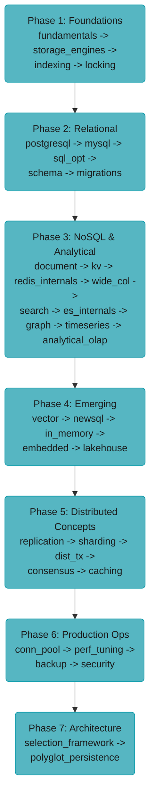

# Database Engineering — Principal Engineer & Interview Prep Guide

A laser-focused, principal-engineer-level reference for database internals, selection strategies, production operations, distributed systems, and real-world case studies. Covers relational, NoSQL, emerging, and distributed database concepts with concrete numbers, production war stories, and interview preparation.

---

## Learning Path — 7 Phases

```
Phase 1: Foundations
  database_fundamentals → storage_engines_internals → indexing_deep_dive → concurrency_control_and_locking

Phase 2: Relational Databases
  postgresql_internals → mysql_innodb_internals → sql_query_optimization → schema_design_and_normalization → database_migrations_zero_downtime

Phase 3: NoSQL Databases
  document_databases → key_value_stores → redis_internals → wide_column_databases → search_engines → elasticsearch_internals → graph_databases → time_series_databases → analytical_databases_and_olap

Phase 4: Emerging Databases
  vector_databases → newsql_and_distributed_sql → in_memory_databases →
  embedded_and_edge_databases → lakehouse_and_table_formats

Phase 5: Distributed Database Concepts
  replication_and_high_availability → sharding_and_partitioning → distributed_transactions → consistency_models_and_consensus → database_caching_patterns

Phase 6: Production Operations
  connection_pool_management → database_performance_tuning → backup_recovery_and_disaster_recovery → database_security_and_compliance

Phase 7: Architecture & Selection
  database_selection_framework → polyglot_persistence_patterns
```

---

## Module Table

### Phase 1 — Foundations

| Module | Level | Q&As | Key Concepts |
|--------|-------|------|--------------|
| [Database Fundamentals](database_fundamentals/database_fundamentals.md) | Intermediate | 18 | ACID, BASE, CAP, PACELC, isolation levels, MVCC |
| [Storage Engines Internals](storage_engines_internals/storage_engines_internals.md) | Expert | 20 | B+tree, LSM-tree, WAL, buffer pool, row vs columnar |
| [Indexing Deep Dive](indexing_deep_dive/indexing_deep_dive.md) | Advanced | 19 | B+tree, GIN, BRIN, covering, partial, composite, index bloat |
| [Concurrency Control & Locking](concurrency_control_and_locking/concurrency_control_and_locking.md) | Advanced | 18 | MVCC, deadlocks, gap locks, SELECT FOR UPDATE, advisory locks |

### Phase 2 — Relational Databases

| Module | Level | Q&As | Key Concepts |
|--------|-------|------|--------------|
| [PostgreSQL Internals](postgresql_internals/postgresql_internals.md) | Expert | 18 | VACUUM, autovacuum, EXPLAIN, TOAST, replication slots, partitioning; deep-dive sub-file: [planner and parallel execution](postgresql_internals/planner_and_parallel_execution.md) |
| [MySQL InnoDB Internals](mysql_innodb_internals/mysql_innodb_internals.md) | Advanced | 15 | Clustered index, redo/undo log, binary log, online DDL, GTID |
| [SQL Query Optimization](sql_query_optimization/sql_query_optimization.md) | Advanced | 16 | Join algorithms, CBO statistics, keyset pagination, N+1, window functions |
| [Schema Design & Normalization](schema_design_and_normalization/schema_design_and_normalization.md) | Intermediate | 16 | Normal forms, temporal data, audit trails, multi-tenancy, JSONB — with 1 deep-dive sub-file ([surrogate vs natural keys](schema_design_and_normalization/surrogate_vs_natural_keys.md)) |
| [Database Migrations (Zero Downtime)](database_migrations_zero_downtime/database_migrations_zero_downtime.md) | Intermediate | 19 | Flyway, Liquibase, expand-contract, gh-ost, ADD INDEX CONCURRENTLY |

### Phase 3 — NoSQL Databases

| Module | Level | Q&As | Key Concepts |
|--------|-------|------|--------------|
| [Document Databases](document_databases/document_databases.md) | Advanced | 20 | MongoDB WiredTiger, embedding vs referencing, aggregation, sharding, change streams |
| [Key-Value Stores](key_value_stores/key_value_stores.md) | Expert | 20 | Redis data structures, persistence (RDB/AOF), Cluster, Streams, Redlock — the category; product internals live in [Redis Internals](redis_internals/redis_internals.md) |
| [Redis Internals](redis_internals/redis_internals.md) | Expert | 28 | SDS/listpack/quicklist/dict encodings, event loop and io-threads, eviction (LRU/LFU), fork + CoW, multi-part AOF, PSYNC, live resharding, locks and fencing, Redis 8 vs Valkey 9 |
| [Wide-Column Databases](wide_column_databases/wide_column_databases.md) | Advanced | 22 | Cassandra ring, partition key, compaction, consistency levels, tombstones |
| [Search Engines](search_engines/search_engines.md) | Advanced | 16 | Inverted index, BM25, Elasticsearch ILM, aggregations, deep pagination |
| [Elasticsearch Internals](elasticsearch_internals/elasticsearch_internals.md) | Expert | 38 | Lucene segment files, refresh/flush/merge triangle, translog durability, block-tree term index, inlined skip data, doc values vs stored vs `_source`, BM25 one-byte norms, per-shard IDF and `dfs_query_then_fetch`, PIT + `search_after`, routing factor and `_split`, seq-no/primary-term checkpoints, voting configuration, `doc_count_error_upper_bound`, logsdb/TSDS, frozen tier, `dense_vector` BBQ |
| [Graph Databases](graph_databases/graph_databases.md) | Intermediate | 21 | Property graph, Neo4j index-free adjacency, Cypher, fraud detection; deep-dive sub-file: [graph query languages](graph_databases/graph_query_languages.md) |
| [Time-Series Databases](time_series_databases/time_series_databases.md) | Intermediate | 21 | TimescaleDB, InfluxDB, ClickHouse, Prometheus, Gorilla compression |
| [Analytical Databases & OLAP](analytical_databases_and_olap/analytical_databases_and_olap.md) | Advanced | 18 | Columnar storage, vectorized execution, late materialization, MergeTree parts and the part-count cliff, sparse index granules, ClickHouse/Druid/Pinot vs warehouses vs DuckDB, HTAP |

### Phase 4 — Emerging Databases

| Module | Level | Q&As | Key Concepts |
|--------|-------|------|--------------|
| [Vector Databases](vector_databases/vector_databases.md) | Advanced | 18 | HNSW, IVF, PQ, pgvector, hybrid search, multi-tenancy, RAG integration; deep-dive sub-file: [DiskANN and filtered search](vector_databases/disk_ann_and_filtered_search.md) |
| [NewSQL & Distributed SQL](newsql_and_distributed_sql/newsql_and_distributed_sql.md) | Expert | 15 | Spanner TrueTime, CockroachDB Raft, TiDB, YugabyteDB, global ACID |
| [In-Memory Databases](in_memory_databases/in_memory_databases.md) | Intermediate | 16 | Redis vs Memcached, Volt Active Data, Ignite, eviction, durability modes |
| [Embedded & Edge Databases](embedded_and_edge_databases/embedded_and_edge_databases.md) | Advanced | 20 | SQLite, DuckDB, RocksDB, LMDB, litestream, local-first sync, CRDT replication |
| [Lakehouse & Table Formats](lakehouse_and_table_formats/lakehouse_and_table_formats.md) | Expert | 16 | Iceberg v3, Delta Lake, Hudi, catalogs, snapshot isolation, compaction, time travel |

### Phase 5 — Distributed Database Concepts

| Module | Level | Q&As | Key Concepts |
|--------|-------|------|--------------|
| [Replication & High Availability](replication_and_high_availability/replication_and_high_availability.md) | Expert | 20 | Sync vs async, Patroni, split-brain, replication slots, multi-region |
| [Sharding & Partitioning](sharding_and_partitioning/sharding_and_partitioning.md) | Expert | 17 | Consistent hashing, shard key selection, Vitess, hotspot, resharding |
| [Distributed Transactions](distributed_transactions/distributed_transactions.md) | Expert | 20 | 2PC, Saga, outbox pattern, idempotency, XA, distributed locks |
| [Consistency Models & Consensus](consistency_models_and_consensus/consistency_models_and_consensus.md) | Expert | 19 | Linearizability, Raft, Paxos, CRDTs, vector clocks, fencing tokens |
| [Database Caching Patterns](database_caching_patterns/database_caching_patterns.md) | Advanced | 19 | Cache-aside, write-through, write-behind, stampede, hot key, invalidation |

### Phase 6 — Production Operations

| Module | Level | Q&As | Key Concepts |
|--------|-------|------|--------------|
| [Connection Pool Management](connection_pool_management/connection_pool_management.md) | Advanced | 19 | HikariCP internals, pool sizing, PgBouncer, ProxySQL, K8s connection storm |
| [Database Performance Tuning](database_performance_tuning/database_performance_tuning.md) | Expert | 16 | shared_buffers, work_mem, checkpoint tuning, lock monitoring, slow queries; deep-dive sub-file: [wait events and benchmarking](database_performance_tuning/wait_events_and_benchmarking.md) |
| [Backup, Recovery & Disaster Recovery](backup_recovery_and_disaster_recovery/backup_recovery_and_disaster_recovery.md) | Intermediate | 18 | PITR, WAL-G, pg_basebackup, RPO/RTO, restore drills |
| [Database Security & Compliance](database_security_and_compliance/database_security_and_compliance.md) | Intermediate | 17 | RLS, scram-sha-256, pgAudit, Vault, GDPR erasure, TDE |

### Phase 7 — Architecture & Selection

| Module | Level | Q&As | Key Concepts |
|--------|-------|------|--------------|
| [Database Selection Framework](database_selection_framework/database_selection_framework.md) | Expert | 20 | Selection matrix, benchmark traps, TCO, migration risk, vertical vs horizontal |
| [Polyglot Persistence Patterns](polyglot_persistence_patterns/polyglot_persistence_patterns.md) | Advanced | 16 | CQRS, CDC (Debezium), dual-write, event sourcing, data mesh |

---

## Phase Diagram (ASCII)



---

<!-- study-paths
     THE source of truth for this section's file inventory and study-tier membership.
     Every module, every file it owns (module page AND deep-dive sub-files), and every
     case study is listed here with the tiers it belongs to; `-` means Full path only.
     Content files carry NO structural metadata -- a deep dive holds its topic, nothing
     else. Order is never declared here: it comes from STUDY_ORDER in game/app.js.
     The tier TABLES lower in this file are generated from this block by
     `python3 game/extract.py --write-paths`. A file on disk that is missing from this
     block, or listed here and absent from disk, FAILS `extract.py --strict`.
database_fundamentals
  database_fundamentals.md  senior
storage_engines_internals
  storage_engines_internals.md  senior, principal
indexing_deep_dive
  indexing_deep_dive.md  senior
concurrency_control_and_locking
  concurrency_control_and_locking.md  senior
postgresql_internals
  postgresql_internals.md  senior
  planner_and_parallel_execution.md  senior
mysql_innodb_internals
  mysql_innodb_internals.md  -
sql_query_optimization
  sql_query_optimization.md  senior
schema_design_and_normalization
  schema_design_and_normalization.md  senior, principal
  surrogate_vs_natural_keys.md        senior, principal
database_migrations_zero_downtime
  database_migrations_zero_downtime.md  senior, principal
document_databases
  document_databases.md  senior
key_value_stores
  key_value_stores.md  senior
redis_internals
  redis_internals.md  senior
wide_column_databases
  wide_column_databases.md  senior, principal
search_engines
  search_engines.md  -
elasticsearch_internals
  elasticsearch_internals.md  senior, principal
graph_databases
  graph_databases.md  senior
  graph_query_languages.md  senior
time_series_databases
  time_series_databases.md  -
vector_databases
  vector_databases.md  senior
  disk_ann_and_filtered_search.md  senior
newsql_and_distributed_sql
  newsql_and_distributed_sql.md  principal
in_memory_databases
  in_memory_databases.md  -
replication_and_high_availability
  replication_and_high_availability.md  senior, principal
sharding_and_partitioning
  sharding_and_partitioning.md  senior, principal
distributed_transactions
  distributed_transactions.md  senior, principal
consistency_models_and_consensus
  consistency_models_and_consensus.md  senior, principal
database_caching_patterns
  database_caching_patterns.md  -
connection_pool_management
  connection_pool_management.md  senior
database_performance_tuning
  database_performance_tuning.md  senior
  wait_events_and_benchmarking.md  senior
backup_recovery_and_disaster_recovery
  backup_recovery_and_disaster_recovery.md  senior, principal
database_security_and_compliance
  database_security_and_compliance.md  principal
database_selection_framework
  database_selection_framework.md  principal
polyglot_persistence_patterns
  polyglot_persistence_patterns.md  principal
case_studies
  design_banking_ledger/design_banking_ledger.md                                  senior
  design_ecommerce_catalog/design_ecommerce_catalog.md                            senior
  design_social_media_feed_storage/design_social_media_feed_storage.md            senior
  design_realtime_analytics_platform/design_realtime_analytics_platform.md        principal
  design_multitenant_saas_database/design_multitenant_saas_database.md            principal
  design_monolith_to_polyglot_migration/design_monolith_to_polyglot_migration.md  principal
  design_global_multiregion_oltp/design_global_multiregion_oltp.md  principal
  design_vector_search_platform/design_vector_search_platform.md  senior, principal
  design_chat_message_store/design_chat_message_store.md  senior, principal
  design_job_queue_on_postgres/design_job_queue_on_postgres.md  senior, principal
  design_10tb_table_migration/design_10tb_table_migration.md  -
analytical_databases_and_olap
  analytical_databases_and_olap.md  senior, principal
lakehouse_and_table_formats
  lakehouse_and_table_formats.md  principal
embedded_and_edge_databases
  embedded_and_edge_databases.md  senior
-->
## Learning Paths

This section is exhaustive by design — 34 modules spanning storage internals, relational and NoSQL engines, distributed-systems theory, and production operations. That is the right depth for a reference and the wrong shape for someone two weeks from a database-heavy interview. So there are **two ways through it**; the browser learning game's **Study** view surfaces both as a **Full / Interview** toggle (Full is the default).

### Full Path (34 modules)

The complete curriculum in the order above — see [Phase Diagram (ASCII)](#phase-diagram-ascii). Use it for genuine mastery: every phase from storage internals through full NoSQL breadth (document, wide-column, search, graph, time-series), the analytical and emerging-database frontier (OLAP, NewSQL, in-memory, embedded/edge, lakehouse), and the complete production-operations depth (connection pooling, performance tuning, backup/DR, security/compliance, polyglot persistence). Nothing is dropped.

<!-- study-path-table senior -->
### Senior Path (24 modules)

| # | Module | Files |
|---|--------|-------|
| 1 | [database_fundamentals](database_fundamentals/database_fundamentals.md) | module page only |
| 2 | [storage_engines_internals](storage_engines_internals/storage_engines_internals.md) | module page only |
| 3 | [indexing_deep_dive](indexing_deep_dive/indexing_deep_dive.md) | module page only |
| 4 | [concurrency_control_and_locking](concurrency_control_and_locking/concurrency_control_and_locking.md) | module page only |
| 5 | [postgresql_internals](postgresql_internals/postgresql_internals.md) | 2 files |
| 7 | [sql_query_optimization](sql_query_optimization/sql_query_optimization.md) | module page only |
| 8 | [schema_design_and_normalization](schema_design_and_normalization/schema_design_and_normalization.md) | 2 files |
| 9 | [database_migrations_zero_downtime](database_migrations_zero_downtime/database_migrations_zero_downtime.md) | module page only |
| 10 | [document_databases](document_databases/document_databases.md) | module page only |
| 11 | [key_value_stores](key_value_stores/key_value_stores.md) | module page only |
| 12 | [redis_internals](redis_internals/redis_internals.md) | module page only |
| 13 | [wide_column_databases](wide_column_databases/wide_column_databases.md) | module page only |
| 15 | [elasticsearch_internals](elasticsearch_internals/elasticsearch_internals.md) | module page only |
| 16 | [graph_databases](graph_databases/graph_databases.md) | 2 files |
| 18 | [analytical_databases_and_olap](analytical_databases_and_olap/analytical_databases_and_olap.md) | module page only |
| 19 | [vector_databases](vector_databases/vector_databases.md) | 2 files |
| 22 | [embedded_and_edge_databases](embedded_and_edge_databases/embedded_and_edge_databases.md) | module page only |
| 24 | [replication_and_high_availability](replication_and_high_availability/replication_and_high_availability.md) | module page only |
| 25 | [sharding_and_partitioning](sharding_and_partitioning/sharding_and_partitioning.md) | module page only |
| 26 | [distributed_transactions](distributed_transactions/distributed_transactions.md) | module page only |
| 27 | [consistency_models_and_consensus](consistency_models_and_consensus/consistency_models_and_consensus.md) | module page only |
| 29 | [connection_pool_management](connection_pool_management/connection_pool_management.md) | module page only |
| 30 | [database_performance_tuning](database_performance_tuning/database_performance_tuning.md) | 2 files |
| 31 | [backup_recovery_and_disaster_recovery](backup_recovery_and_disaster_recovery/backup_recovery_and_disaster_recovery.md) | module page only |

**Not in this path** (10 of 34, Full Path only): `mysql_innodb_internals`, `search_engines`, `time_series_databases`, `newsql_and_distributed_sql`, `in_memory_databases`, `lakehouse_and_table_formats`, `database_caching_patterns`, `database_security_and_compliance`, `database_selection_framework`, `polyglot_persistence_patterns`
<!-- /study-path-table -->

A ruthless cut to what a **senior backend / database-heavy interview** actually probes: the storage-and-concurrency vocabulary everything else depends on, PostgreSQL as the default RDBMS, the two NoSQL stores and the vector-search topic that come up most, and the distributed-systems and selection-framework questions that close almost every round. Same learning order, a strict subset of the Full Path.

| Group | Why it's tested |
|-------|-----------------|
| Storage & Concurrency Foundations | ACID/BASE/CAP vocabulary, B+tree vs LSM-tree tradeoffs, how an index actually narrows a scan, and MVCC/deadlock/gap-lock mechanics — the foundation every later answer builds on |
| Relational Depth | PostgreSQL is the default RDBMS in almost every interview; EXPLAIN plan reading, join-algorithm choice, and normalize-vs-denormalize tradeoffs drive nearly every schema-design prompt |
| NoSQL & Vector Stores | Embedding-vs-referencing and Redis data-structure choice are the two most common non-relational deep dives; HNSW/pgvector now appears in any RAG-adjacent design round |
| Distributed Systems Core | Replication topology, shard-key selection, 2PC/Saga, and Raft/linearizability are the spine of every "design a globally available database" question |
| Caching & Selection | Cache-aside vs write-through, and the "which database, and why" decision framework, are what close almost every database interview |

<!-- study-path-table principal -->
### Principal Path (16 modules)

| # | Module | Files |
|---|--------|-------|
| 2 | [storage_engines_internals](storage_engines_internals/storage_engines_internals.md) | module page only |
| 8 | [schema_design_and_normalization](schema_design_and_normalization/schema_design_and_normalization.md) | 2 files |
| 9 | [database_migrations_zero_downtime](database_migrations_zero_downtime/database_migrations_zero_downtime.md) | module page only |
| 13 | [wide_column_databases](wide_column_databases/wide_column_databases.md) | module page only |
| 15 | [elasticsearch_internals](elasticsearch_internals/elasticsearch_internals.md) | module page only |
| 18 | [analytical_databases_and_olap](analytical_databases_and_olap/analytical_databases_and_olap.md) | module page only |
| 20 | [newsql_and_distributed_sql](newsql_and_distributed_sql/newsql_and_distributed_sql.md) | module page only |
| 23 | [lakehouse_and_table_formats](lakehouse_and_table_formats/lakehouse_and_table_formats.md) | module page only |
| 24 | [replication_and_high_availability](replication_and_high_availability/replication_and_high_availability.md) | module page only |
| 25 | [sharding_and_partitioning](sharding_and_partitioning/sharding_and_partitioning.md) | module page only |
| 26 | [distributed_transactions](distributed_transactions/distributed_transactions.md) | module page only |
| 27 | [consistency_models_and_consensus](consistency_models_and_consensus/consistency_models_and_consensus.md) | module page only |
| 31 | [backup_recovery_and_disaster_recovery](backup_recovery_and_disaster_recovery/backup_recovery_and_disaster_recovery.md) | module page only |
| 32 | [database_security_and_compliance](database_security_and_compliance/database_security_and_compliance.md) | module page only |
| 33 | [database_selection_framework](database_selection_framework/database_selection_framework.md) | module page only |
| 34 | [polyglot_persistence_patterns](polyglot_persistence_patterns/polyglot_persistence_patterns.md) | module page only |

**Not in this path** (18 of 34, Full Path only): `database_fundamentals`, `indexing_deep_dive`, `concurrency_control_and_locking`, `postgresql_internals`, `mysql_innodb_internals`, `sql_query_optimization`, `document_databases`, `key_value_stores`, `redis_internals`, `search_engines`, `graph_databases`, `time_series_databases`, `vector_databases`, `in_memory_databases`, `embedded_and_edge_databases`, `database_caching_patterns`, `connection_pool_management`, `database_performance_tuning`
<!-- /study-path-table -->

A different cut, not senior-plus-extras. The Principal Path probes the decisions that outlive a schema: engine and topology selection, the migration path off a wrong choice, and the failure modes that only appear at production scale. Five of its sixteen modules -- 31%, not half -- are material the Senior Path never covers (`newsql_and_distributed_sql`, `lakehouse_and_table_formats`, `database_security_and_compliance`, `database_selection_framework`, `polyglot_persistence_patterns`); the other eleven overlap. It is still the smaller list -- depth of judgment, not depth of syllabus. Whether 31% is the right shape is an open owner decision; see [Known Gaps & Planned Work](#known-gaps--planned-work).

---

## Knowledge-Question Map

The highest-frequency database *knowledge* questions mapped to the file that answers them. For *system design* ("design X") questions, use the interview-prep shortcuts in [case_studies/case_studies.md](case_studies/case_studies.md).

| Interview question | Where the answer lives |
|--------------------|------------------------|
| ACID vs BASE — what do you give up moving from one model to the other? | [Database Fundamentals](database_fundamentals/database_fundamentals.md) |
| State the CAP theorem, then explain what PACELC adds when there's no partition. | [Database Fundamentals](database_fundamentals/database_fundamentals.md) |
| B+tree vs LSM-tree — which write/read pattern favors each, and why do LSM-trees need compaction? | [Storage Engines Internals](storage_engines_internals/storage_engines_internals.md) |
| What does the write-ahead log (WAL) guarantee, and how does it drive crash recovery? | [Storage Engines Internals](storage_engines_internals/storage_engines_internals.md) |
| When does a covering index eliminate a heap lookup, and why does composite-index column order matter? | [Indexing Deep Dive](indexing_deep_dive/indexing_deep_dive.md) |
| What is MVCC, and why can a reader never block a writer under it? | [Concurrency Control & Locking](concurrency_control_and_locking/concurrency_control_and_locking.md) |
| Walk through how two transactions deadlock, and how the database detects and breaks the cycle. | [Concurrency Control & Locking](concurrency_control_and_locking/concurrency_control_and_locking.md) |
| What does PostgreSQL's VACUUM reclaim, and what happens when autovacuum falls behind on a hot table? | [PostgreSQL Internals](postgresql_internals/postgresql_internals.md) |
| How do you read an EXPLAIN ANALYZE plan to tell a planner misestimate from a missing index? | [SQL Query Optimization](sql_query_optimization/sql_query_optimization.md) |
| Why does keyset (seek) pagination outperform OFFSET pagination as a table grows, and what is the N+1 query problem? | [SQL Query Optimization](sql_query_optimization/sql_query_optimization.md) |
| When do you denormalize a schema, and what invariant do you give up by doing it? | [Schema Design & Normalization](schema_design_and_normalization/schema_design_and_normalization.md) |
| Embedding vs referencing in a document database — what decides which one to use? | [Document Databases](document_databases/document_databases.md) |
| Which Redis data structure fits a leaderboard, and which fits a dedup/membership check? | [Key-Value Stores](key_value_stores/key_value_stores.md) |
| Why does a Redis hash cost 5x more memory after briefly crossing 512 fields, and why does deleting fields not give it back? | [Redis Internals](redis_internals/redis_internals.md) |
| `SET key val NX EX 30` is atomic — why is it still not a safe distributed lock across a failover? | [Redis Internals](redis_internals/redis_internals.md) |
| How does HNSW trade memory for recall, and what does IVF+PQ trade instead? | [Vector Databases](vector_databases/vector_databases.md) |
| Synchronous vs asynchronous replication — what do you trade, and what causes split-brain? | [Replication & High Availability](replication_and_high_availability/replication_and_high_availability.md) |
| How do you choose a shard key, and what access pattern creates a write hotspot? | [Sharding & Partitioning](sharding_and_partitioning/sharding_and_partitioning.md) |
| Two-phase commit vs the Saga pattern — when does each fit, and what does each give up? | [Distributed Transactions](distributed_transactions/distributed_transactions.md) |
| What is linearizability, and how does Raft reach consensus when a node fails? | [Consistency Models & Consensus](consistency_models_and_consensus/consistency_models_and_consensus.md) |
| Cache-aside vs write-through vs write-behind — what does each guarantee (or not) on a crash, and what is cache stampede? | [Database Caching Patterns](database_caching_patterns/database_caching_patterns.md) |
| How do you build a database-selection decision matrix, and what's a classic benchmark trap? | [Database Selection Framework](database_selection_framework/database_selection_framework.md) |

---

## Study Plan

A 6-week plan over the Senior Path. Each week pairs modules with one case study to rehearse the "design X" format.

| Week | Focus | Modules | Case study |
|------|-------|---------|------------|
| 1 | Storage & Concurrency Foundations | Database Fundamentals, Storage Engines Internals, Indexing Deep Dive, Concurrency Control & Locking | [Banking Ledger](case_studies/design_banking_ledger/design_banking_ledger.md) (SERIALIZABLE isolation, locking, ACID under load) |
| 2 | Relational Depth | PostgreSQL Internals, SQL Query Optimization, Schema Design & Normalization | [Multi-Tenant SaaS Database](case_studies/design_multitenant_saas_database/design_multitenant_saas_database.md) (RLS, schema-per-tenant, connection pooling) |
| 3 | NoSQL & Vector Stores | Document Databases, Key-Value Stores, Vector Databases | [Social Media Feed Storage](case_studies/design_social_media_feed_storage/design_social_media_feed_storage.md) (Cassandra wide-rows, Redis leaderboards) |
| 4 | Distributed Systems I — Replication & Sharding | Replication & High Availability, Sharding & Partitioning | [Real-Time Analytics Platform](case_studies/design_realtime_analytics_platform/design_realtime_analytics_platform.md) (partitioned columnar storage, replica reads) |
| 5 | Distributed Systems II — Transactions & Consensus | Distributed Transactions, Consistency Models & Consensus | [Monolith to Polyglot Migration](case_studies/design_monolith_to_polyglot_migration/design_monolith_to_polyglot_migration.md) (CDC dual-write, idempotency, cutover consistency) |
| 6 | Caching & Selection | Database Caching Patterns, Database Selection Framework | [E-Commerce Catalog](case_studies/design_ecommerce_catalog/design_ecommerce_catalog.md) (Redis inventory counters, polyglot selection rationale) |

---

## Case Studies

| Case Study | Scenario | Key Databases | Level |
|------------|----------|---------------|-------|
| [Banking Ledger](case_studies/design_banking_ledger/design_banking_ledger.md) | Double-entry bookkeeping, 10K TPS, global ACID, immutable audit | PostgreSQL, Redis | Expert |
| [E-Commerce Catalog](case_studies/design_ecommerce_catalog/design_ecommerce_catalog.md) | 50M SKUs, full-text search, faceted filtering, inventory counters | PostgreSQL, Elasticsearch, Redis | Advanced |
| [Social Media Feed Storage](case_studies/design_social_media_feed_storage/design_social_media_feed_storage.md) | 500M users, fan-out on write/read, trending posts | Cassandra, Redis, PostgreSQL | Advanced |
| [Real-Time Analytics Platform](case_studies/design_realtime_analytics_platform/design_realtime_analytics_platform.md) | 1B events/day, sub-second dashboards, 90-day retention | ClickHouse, Kafka, Redis | Expert |
| [Multi-Tenant SaaS Database](case_studies/design_multitenant_saas_database/design_multitenant_saas_database.md) | 10K tenants, varying sizes, isolation, compliance | PostgreSQL (RLS), PgBouncer | Advanced |
| [Monolith to Polyglot Migration](case_studies/design_monolith_to_polyglot_migration/design_monolith_to_polyglot_migration.md) | Migrate 5TB MySQL monolith without downtime | Debezium, dual-write, CDC | Expert |
| [Global Multi-Region OLTP](case_studies/design_global_multiregion_oltp/design_global_multiregion_oltp.md) | Sub-10ms regional writes under global ACID, EU data residency | CockroachDB, Spanner | Expert |
| [Vector Search Platform](case_studies/design_vector_search_platform/design_vector_search_platform.md) | 500M embeddings, filtered ANN, hybrid BM25 + dense retrieval | pgvector, Qdrant, Elasticsearch | Expert |
| [Chat Message Store](case_studies/design_chat_message_store/design_chat_message_store.md) | Ordered, resumable message history at messenger scale | Cassandra, PostgreSQL, Redis | Advanced |
| [Job Queue on PostgreSQL](case_studies/design_job_queue_on_postgres/design_job_queue_on_postgres.md) | `SKIP LOCKED` work queue before reaching for a broker | PostgreSQL | Advanced |
| [10TB Table Migration](case_studies/design_10tb_table_migration/design_10tb_table_migration.md) | Change a 10TB table's type/schema with no downtime | PostgreSQL, gh-ost, pg_repack | Expert |

---

## Known Gaps & Planned Work

Recorded 2026-09-04 from a verified gap review. Everything here is measured, not estimated.
Nothing in this block is a defect that has been left in place — the defects were fixed; these
are shortfalls against the section's own quality bars, plus decisions that need an owner.

### Case studies below the bar

The section's own bar is 900-1100 lines and 4+ cross-cutting references.

| Case study | Lines | Cross-references | Gap |
|---|---|---|---|
| `design_10tb_table_migration` | 818 | 20 (1 module) | ~80 lines short of the 900 floor |
| `design_ecommerce_catalog` | 1098 | **0** | no cross-references at all |
| `design_realtime_analytics_platform` | 902 | **0** | no cross-references at all |
| `design_social_media_feed_storage` | 909 | **0** | no cross-references at all |
| `design_vector_search_platform` | 1100 | 1 | 3 short |
| `design_global_multiregion_oltp` | 1100 | 3 unique modules | 1 short |

Note this section has **no `cross_cutting/` directory** — the shared primitives are the
deep-dive modules themselves, so the bar is met by linking sibling modules
(`../<module>/<module>.md`). The Cross-Cutting table in
[case_studies/case_studies.md](case_studies/case_studies.md) maps which primitive belongs where;
the six files above should link the modules that table already names for them.

### Thin sections relative to the section's ~1,070-line bar

| Module | Lines | Thin sections | Why it matters |
|---|---|---|---|
| `storage_engines_internals` | 699 | §7 (10 lines), §8 (12), §9 (12) | on **both** tiers — the most-read thin file in the section |
| `mysql_innodb_internals` | 669 | §7 (8), §8 (10), §9 (10) | the only relational-engine peer to `postgresql_internals`, and on **neither** tier |
| `newsql_and_distributed_sql` | 688 | §3 (14), §4 (15) | both thinner than the module's own §14 (116 lines); principal-only |
| `in_memory_databases` | 617 | §4 (12) | Full-path only |

Separately, `embedded_and_edge_databases` is 975 lines carrying **one** Mermaid fence — the most
diagram-starved file per line in the section.

### Open owner decisions

**1. Principal-tier shape.** The Principal Path is 16 modules, 11 of which the Senior Path also
carries, so only **31%** of it is principal-exclusive. The section's stated intent is that
"roughly half" should be material Senior never sees. Either the sentence is wrong or the cut is;
this was fixed as a *sentence* and the cut left alone, because re-cutting tiers is an owner call,
not an editorial one. Candidates for dropping from Principal to restore the shape, all four
being product-internals craft that reads as Senior's register:
`elasticsearch_internals`, `wide_column_databases`, `analytical_databases_and_olap`,
`schema_design_and_normalization`.

### Cross-section overlap — proposals only, not scheduled work

These four touch sections this repo's database owner does not own alone. Recorded so the
duplication is visible; **do not execute any of them without a cross-section decision.**

**1. Distributed transactions are taught at full depth in three sections** — `backend/` 1,123
lines, `hld/` 1,098, `database/` 874. Only **56 of this section's 874 lines (6.4%)** are content
no other section has: the Percolator / Spanner / CockroachDB Parallel Commits / Calvin
commit-protocol comparison, plus roughly 35 lines of genuinely storage-tier SQL (idempotent
`INSERT ... ON CONFLICT`, an inbox CTE, an `idempotency_keys` table). The rest is
application-tier Spring/JPA — `@Transactional` XA, a saga orchestrator, a Spring outbox —
indistinguishable in register from the other two. *Proposal:* `hld/` owns the pattern layer (it
has the coordination/contention treatment the others lack and is the only file linking all three
siblings); this section shrinks to the ~90 storage-tier lines, renamed toward
`distributed_commit_protocols`. **Caution: the module is on both tiers and contributes 20 Q&As to
the bank, so tier membership must be revisited in the
same commit.**

**2. Caching is taught three times** — `backend/` 777, `hld/` 936, `database/` 956. The
`@Cacheable(value="products")` example is the same textbook example in two of them (not
byte-identical). *Proposal:* `hld/` owns strategy, `backend/` owns the Spring implementation,
`database/` keeps only DB-adjacent caching (materialized views, buffer pool / page cache
interaction, replicas-as-cache) and drops its `@Cacheable` block and Spring Cache Q&A.
`database_caching_patterns` is Full-path-only, making it the cheapest of the three to cut.

**3. `backend/database_types_deep_dive` (779 lines) re-teaches eight of this section's modules**
in its §6 — Postgres, MongoDB/WiredTiger, Redis, Cassandra, time-series, Elasticsearch, Neo4j,
NewSQL — and `grep '\.\./database/'` on it returns **zero** matches. Against 2,770 lines here on
Elasticsearch it has 36; against 2,247 on Redis it has 29. *Proposal:* `database/` owns product
internals unconditionally; that file becomes a pure decision module with eight short subsections
each linking here.

**4. Link asymmetry.** `hld/` -> `database/` is ~30 files / 120 matches. The reverse is
`database/` -> `hld/` **2 files / 10 matches**, -> `backend/` **2 / 10**, -> `spring/` **zero** —
despite this section carrying Spring-annotated Java in two modules.

### Template conformance

`database_fundamentals` §4 and §5 were retitled to the canonical template slots
("Types / Architectures / Strategies", "Architecture Diagrams") with their original subject kept
in the heading. §5 still carries **no architecture diagram** — it is the isolation-level anomaly
table — so the slot is named but not yet filled.

---

## Database Version Matrix

| Database | Version | Notable Changes |
|----------|---------|-----------------|
| PostgreSQL | 16 (2023) | Parallel workers for logical replication, pg_stat_io |
| PostgreSQL | 17 (2024) | Incremental backup, MAINTAIN privilege, JSON_TABLE |
| PostgreSQL | 18 (2025) | Asynchronous I/O (up to 3x faster reads), `uuidv7()`, virtual generated columns, B-tree skip scan, OAuth 2.0 auth |
| MySQL | 8.4 (2024-LTS) | Replication improvements, GTID enhancements |
| MySQL | 9.7 (2026-LTS) | Hypergraph optimizer, JSON duality, in-database JavaScript, OpenID auth, replication applier metrics in Community |
| MongoDB | 8.0 (2024) | ~25% better throughput, 54% faster bulk inserts, Queryable Encryption range queries, faster resharding |
| MongoDB | 9.0 (2026) | 9.0.0 on 28 Sept 2026; per-operation memory cap of 1 GB or 20% of server memory, server-side JavaScript on a WASM engine. 8.1/8.2/8.3 were Rapid Releases |
| Redis | 7.4 (2024) | Hash field expiration (HEXPIRE) |
| Redis | 8.x (2025+) | AGPLv3 option, JSON/time-series/vector-set and probabilistic types in core, Redis Query Engine, new I/O threading |
| Redis | 8.10 (2026) | Current stable; compact hashes, `HIMPORT`, `BACKUP`. 8.8 added the Array type, `INCREX`, `XNACK` |
| Valkey | 9.1 (2026) | BSD-3 fork at 9.1.1; lock-free I/O-thread queues, database-level ACLs, multi-DB cluster mode and atomic slot migration from 9.0 |
| Cassandra | 5.0 (2024) | Storage-Attached Indexes (SAI), vector type + ANN search, trie memtables/SSTables, dynamic data masking |
| Elasticsearch | 9.5 (2026) | Lucene 10.5, Better Binary Quantization GA, ES\|QL JOIN, search/IO parallelism; latest patch 9.5.5 — OpenSearch 3.9.0 (29 Sept 2026), forked at 7.10.2 |
| ClickHouse | 26.x (2026) | Calendar versioning (YY.M); latest stable 26.9.21.9 (17 Oct 2026), newest LTS 26.8.30.8 (17 Oct 2026) |
| Apache Druid | 38.0.0 (2026) | Released 1 Oct 2026; Java 17 no longer supported |
| DuckDB | 1.5.6 (2026) | Released 28 Sept 2026; 2.0 is feature-frozen and unreleased |
| Apache Arrow | 26.0.0 (2026) | Released 9 Oct 2026 |

---

## Cross-Reference Map

| Topic | Primary Module | See Also |
|-------|---------------|----------|
| ACID transactions | [database_fundamentals](database_fundamentals/database_fundamentals.md) | [distributed_transactions](distributed_transactions/distributed_transactions.md) |
| B+tree internals | [storage_engines_internals](storage_engines_internals/storage_engines_internals.md) | [indexing_deep_dive](indexing_deep_dive/indexing_deep_dive.md), [postgresql_internals](postgresql_internals/postgresql_internals.md) |
| LSM-tree | [storage_engines_internals](storage_engines_internals/storage_engines_internals.md) | [wide_column_databases](wide_column_databases/wide_column_databases.md), [key_value_stores](key_value_stores/key_value_stores.md) |
| Redis internals | [redis_internals](redis_internals/redis_internals.md) | [key_value_stores](key_value_stores/key_value_stores.md), [in_memory_databases](in_memory_databases/in_memory_databases.md), [database_caching_patterns](database_caching_patterns/database_caching_patterns.md) |
| MVCC | [concurrency_control_and_locking](concurrency_control_and_locking/concurrency_control_and_locking.md) | [postgresql_internals](postgresql_internals/postgresql_internals.md) |
| N+1 query problem | [sql_query_optimization](sql_query_optimization/sql_query_optimization.md) | Backend: spring_data_jpa |
| Consistent hashing | [sharding_and_partitioning](sharding_and_partitioning/sharding_and_partitioning.md) | [wide_column_databases](wide_column_databases/wide_column_databases.md) |
| Raft consensus | [consistency_models_and_consensus](consistency_models_and_consensus/consistency_models_and_consensus.md) | [newsql_and_distributed_sql](newsql_and_distributed_sql/newsql_and_distributed_sql.md), [replication_and_high_availability](replication_and_high_availability/replication_and_high_availability.md) |
| Outbox pattern | [distributed_transactions](distributed_transactions/distributed_transactions.md) | [polyglot_persistence_patterns](polyglot_persistence_patterns/polyglot_persistence_patterns.md) |
| CDC / Debezium | [polyglot_persistence_patterns](polyglot_persistence_patterns/polyglot_persistence_patterns.md) | [distributed_transactions](distributed_transactions/distributed_transactions.md) |
| Connection pool | [connection_pool_management](connection_pool_management/connection_pool_management.md) | Backend: connection_pooling_deep_dive |
| Sharding | [sharding_and_partitioning](sharding_and_partitioning/sharding_and_partitioning.md) | HLD: database_sharding |
| CAP theorem | [database_fundamentals](database_fundamentals/database_fundamentals.md) | HLD: cap_theorem, [consistency_models_and_consensus](consistency_models_and_consensus/consistency_models_and_consensus.md) |
| Replication | [replication_and_high_availability](replication_and_high_availability/replication_and_high_availability.md) | [postgresql_internals](postgresql_internals/postgresql_internals.md), [mysql_innodb_internals](mysql_innodb_internals/mysql_innodb_internals.md) |
| Vector search | [vector_databases](vector_databases/vector_databases.md) | LLM: embeddings_and_similarity_search |
| Cache patterns | [database_caching_patterns](database_caching_patterns/database_caching_patterns.md) | Backend: caching_strategies_deep_dive, [key_value_stores](key_value_stores/key_value_stores.md), [redis_internals](redis_internals/redis_internals.md) |
| HNSW / ANN | [vector_databases](vector_databases/vector_databases.md) | LLM: embeddings_and_similarity_search |
| Schema migration | [database_migrations_zero_downtime](database_migrations_zero_downtime/database_migrations_zero_downtime.md) | Backend: database_migrations |

---

## Quick Interview Reference

### "Which database for...?"

```
OLTP relational, ACID                → PostgreSQL
High-write, simple access patterns   → Cassandra / DynamoDB
Full-text search, faceted filter     → Elasticsearch / OpenSearch
Semantic / vector similarity         → pgvector / Pinecone / Qdrant
Graph traversal, relationship queries → Neo4j / Amazon Neptune
Time-series, IoT, metrics            → ClickHouse / TimescaleDB / InfluxDB
Session, cache, leaderboard          → Redis
Document, flexible schema            → MongoDB / Firestore
Global ACID at horizontal scale      → Spanner / CockroachDB / TiDB
HTAP (hybrid tx + analytics)         → TiDB / AlloyDB / BigQuery
```

### Latency Reference Numbers

Order-of-magnitude only, as of September 2026. Use them to reason about which tier a
design lives in, never as a target or an SLO — every one of these moves with hardware,
payload size, and how far the network hop actually goes.

```
L1 cache hit        ~1 ns
L2 cache hit        ~5 ns
RAM access          ~100 ns
Redis GET           ~0.1-0.3 ms (same-LAN round trip)
PostgreSQL query    ~1-50 ms
Cassandra read      ~1-5 ms (local DC)
Elasticsearch query ~10-100 ms
Cross-region DB     ~100-300 ms
```

### Common Production Mistakes

1. Missing `idle_in_transaction_session_timeout` — locks held indefinitely
2. Replication slot left behind — WAL accumulates, disk fills at 3 AM
3. ORM generating N+1 queries in production — fix with JOIN FETCH or batch loading
4. No VACUUM tuning on high-write tables — table bloat degrades performance
5. Sequential primary keys in distributed SQL — creates insert hotspot on single shard
6. Pool size set too large — contention on DB server exceeds gains
7. No partial index on soft-delete active rows — scans entire table including deleted
8. Missing index on foreign key — full scan on every DELETE to parent table (MySQL behavior)

---

## Related Sections

- [Backend Engineering](../backend/README.md) — Phase 4 has database modules; see this section for deeper coverage
- [HLD](../hld/README.md) — CAP theorem, consistent hashing, database sharding at system design level
- [LLM](../llm/README.md) — embeddings_and_similarity_search for vector database context
