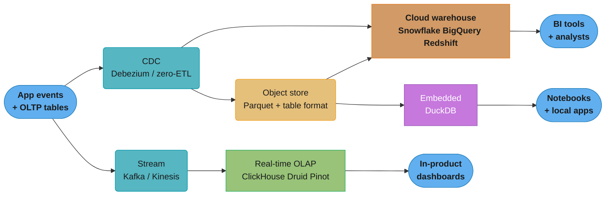
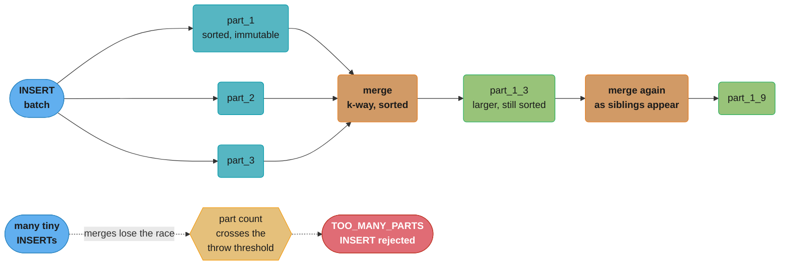

# Analytical Databases and OLAP

> **Version anchor — August 2026.** **ClickHouse 26.7.5.10-stable** (21 Aug 2026) is the current
> stable line and **26.3.22.7-lts** (25 Aug 2026) the current LTS; versions are `YY.M.patch.build`,
> stable cut monthly with ~3 months of patches, LTS cut in March and August with 12+ months.
> **Apache Druid 37.0.0** (8 May 2026), **Apache Pinot 1.5.1** (5 Jun 2026), **Apache Doris
> 4.1.3** (13 Jul 2026), **StarRocks 4.1.0** (29 May 2026), **DuckDB 1.5.5** (21 Jul 2026, with
> 2.0 announced for autumn 2026), **Apache Arrow 25.0.0** (10 Jul 2026). Version-dependent
> behaviour is tagged inline like `[26.3]`. Cross-links: the row-vs-column storage primitive lives in
> [Storage Engines Internals](../storage_engines_internals/storage_engines_internals.md);
> ClickHouse *as a time-series store* lives in
> [Time-Series Databases](../time_series_databases/time_series_databases.md); the table
> formats that make an object store behave like a database live in
> [Lakehouse and Table Formats](../lakehouse_and_table_formats/lakehouse_and_table_formats.md).
> This module owns the **category**: why analytical engines are built the way they are, and
> how to choose among the four families.

## 1. Concept Overview

An analytical database is one whose entire design is bent around a single access pattern:
**read a few columns from very many rows, and reduce them to a small answer.** That is the
opposite of the OLTP access pattern — read all columns of very few rows, then modify them —
and the two patterns pull every design decision in opposite directions.

The split is not "transactions versus reporting". That framing is a business-process
description and it predicts nothing. The useful split is **storage layout plus execution
model**:

| Dimension | OLTP engine | OLAP engine |
|---|---|---|
| Physical layout | row-major — one row's fields are contiguous | column-major — one column's values are contiguous |
| Unit of I/O | an 8 KB page holding whole rows | a compressed block holding one column's values |
| Execution model | tuple-at-a-time through an iterator tree | vector-at-a-time (thousands of values per call) or compiled |
| Index role | find *the* row; indexes are the access path | skip *blocks of* rows; the sort order is the access path |
| Update model | in-place, MVCC-versioned, immediate | append-only parts merged in the background; updates are rewrites |
| Concurrency target | tens of thousands of tiny transactions/s | tens to hundreds of large scans/s |
| Query shape it wins | `SELECT * WHERE id = ?` | `SELECT dim, sum(x) ... GROUP BY dim` over 10^9 rows |

Everything else in this module — merge trees, sparse indexes, sort keys, pushdown, late
materialization, the JOIN weakness, the mutation weakness — is downstream of the first two
rows of that table.

---

## 2. Intuition

**One-line analogy.** A row store is a filing cabinet of folders: to answer "what is the
average salary" you pull every folder and read one sheet from each. A column store is a
spreadsheet where each column is its own file: you open the salary file, read it end to end,
and never touch the other 40 columns.

**The mental model that does the most work: a column is an array.** Once `salary` is a
contiguous array of `int32`, three things become true simultaneously and they reinforce each
other:

1. **It compresses**, because adjacent values are the same type and often similar in
   magnitude — delta, run-length, dictionary, bit-packing all become available. A row-major
   page interleaves an `int64` timestamp, a UUID, and free text, and nothing general
   compresses that well.
2. **It vectorizes**, because `sum(array)` is a tight loop with no branches and no virtual
   calls, which the compiler emits as SIMD. A tuple-at-a-time iterator pays an interpreter
   dispatch per row per operator.
3. **It skips**, because you can store `min`/`max` per block and never decompress a block
   whose range cannot satisfy the predicate.

**Why it matters.** A dashboard query over a 400-byte-wide fact table touching 3 columns
reads roughly `3 × 8 bytes / 400 bytes ≈ 6%` of the logical bytes before compression, and
maybe 1% after. That is not a constant-factor optimization; it is the whole difference
between a 40-second scan and a 400-millisecond one, and it is why bolting a "reporting
replica" onto an OLTP engine stops working somewhere around the low billions of rows.

**Key insight.** *Analytical engines have no index in the OLTP sense.* They have a **sort
order** and per-block statistics. You do not add an index to make a query fast; you choose
the sort key so the query's predicate prefixes it, and if it does not, the engine scans. This
inverts every OLTP habit: in Postgres you add an index per query shape, in ClickHouse you
pick one physical order for the table and design every query around it.

---

## 3. Core Principles

### 3.1 Columnar storage — and the four encodings that carry it

Data is written column by column, in chunks. Each chunk is encoded then compressed. The
encoding is the part that matters; the general-purpose compressor on top (LZ4, ZSTD) is doing
much less work than people assume.

| Encoding | Applies to | Mechanism | Realistic ratio |
|---|---|---|---|
| Dictionary / low-cardinality | strings with few distinct values (`country`, `event_name`, `status`) | store distinct values once, replace each occurrence with a small integer id | 10-50x |
| Delta / double-delta | monotonic or near-monotonic numbers (timestamps, sequence ids) | store the difference from the previous value, then bit-pack | 10-30x |
| Run-length (RLE) | any column whose values run in long stretches — which the **sort key makes true** | store `(value, count)` pairs | 20-100x on the leading sort column |
| Bit-packing / `FOR` | small-range integers | store `value - min` in `ceil(log2(range))` bits | 2-8x |
| General-purpose (LZ4, ZSTD) | everything, applied last | byte-level redundancy the encoders left behind | 2-4x on already-encoded data |

**The consequence people miss:** compression ratio is a *function of the sort key*, not a
property of the data. Sorting by `(org_id, event_type, timestamp)` makes `org_id` run-length
compress to near nothing and makes `timestamp` delta-encode inside each `(org, type)` run.
Sort by an unrelated column and both collapse to LZ4's 2x. A "we get 10x compression"
statement without a stated sort key is not reproducible.

### 3.2 Vectorized execution

Three execution models exist, and analytical engines use the second or third:

```
Tuple-at-a-time (Volcano):     next() -> one row      | ~10-100 ns/row of interpreter overhead
Vector-at-a-time (MonetDB/X100): next() -> 1-64K rows | overhead amortized to ~0.1 ns/row
Compiled (JIT to machine code):  whole pipeline fused | no overhead, pays compile latency
```

The MonetDB/X100 paper (Boncz, Zukowski, Nes — CIDR 2005) is the canonical source for the
middle model and is worth reading once: its measured result was that vectorized execution beat
a tuple-at-a-time engine by roughly two orders of magnitude on TPC-H Query 1, entirely from
removing per-tuple overhead and enabling SIMD, with no change to the algorithm.

PostgreSQL is tuple-at-a-time with an optional JIT for expression evaluation; ClickHouse and
DuckDB are vector-at-a-time; Databricks Photon and Snowflake use vectorized engines with
compiled fragments. This is why "just add a read replica" does not turn Postgres into an
analytics engine: the layout is wrong *and* the executor is wrong.

### 3.3 Late materialization

Given `SELECT user_id, sum(amount) FROM t WHERE country = 'IN' GROUP BY user_id`:

- **Early materialization** reconstructs whole rows as soon as a predicate matches, then
  operates on rows. You pay to decode `user_id` and `amount` for every row the predicate
  *might* match.
- **Late materialization** evaluates `country = 'IN'` against the dictionary-encoded
  `country` column alone, producing a selection vector (a bitmap or list of row positions),
  and only then decodes `user_id` and `amount` at those positions.

When the predicate is selective, late materialization avoids decoding the vast majority of
the other columns. It is also what makes dictionary encoding *free at query time*: comparing
`country` to `'IN'` becomes comparing an `int16` to a constant, and the string is never
materialized at all.

### 3.4 Pushdown — predicate, projection, aggregate

Three things get pushed as close to the bytes as possible:

- **Projection pushdown** — only the referenced columns are opened. This is automatic in a
  column store and is the single biggest win; it is also why `SELECT *` is a genuine
  anti-pattern here rather than a style nit.
- **Predicate pushdown / block skipping** — per-block `min`/`max` (and sometimes a bloom
  filter or a set of distinct values) let the engine skip a block without decompressing it.
  Parquet calls these row-group statistics; ClickHouse calls them the primary index plus data
  skipping indexes; Druid uses bitmap indexes per dimension value.
- **Aggregate pushdown** — a `count(*)` or `min(x)` that can be answered from block metadata
  alone never reads data at all. `SELECT count(*) FROM t` on a Parquet dataset reads only
  footers.

### 3.5 Sort keys instead of indexes

An OLTP index is a separate structure mapping key to row location, and you can have many. An
analytical table has **one** physical order, and the "index" is a sparse map from that order
to block offsets.

```
ClickHouse MergeTree, index_granularity = 8192

primary.idx holds ONE entry per granule, not per row:
  granule 0 -> (org=A, ts=10:00)
  granule 1 -> (org=A, ts=10:04)
  granule 2 -> (org=B, ts=09:12)
  ...
1e9 rows / 8192 = 122,070 index entries -> a few MB -> always resident in RAM.
```

The trade is explicit: you cannot ask "does row X exist" cheaply — you can only narrow to the
granule that *would* contain it and then decompress and scan those 8192 rows. That is the
wrong trade for a point lookup and the right trade for an aggregate over a range.

**The rule that follows:** a predicate helps only if it is a **prefix** of the sort key. With
`ORDER BY (org_id, event_type, timestamp)`, a filter on `org_id` skips granules; a filter on
`timestamp` alone does not (every granule's timestamp range overlaps), and you need a
partition, a secondary skipping index, or a different table to make it fast.

### 3.6 Denormalization is the default, not a smell

Analytical engines are bad at joins relative to their scan speed (§8), so the standard shape
is a wide, denormalized fact table — the star schema flattened. Storage is cheap because it
compresses; a repeated `country` string in a dictionary-encoded column costs about 2 bytes
per row. Reaching for third normal form here is importing an OLTP instinct into an engine
that charges you for it at every query.

---

## 4. Types / Architectures / Strategies

Four families, split by *who operates the cluster* and *what the query concurrency looks
like*.

### 4.1 Real-time OLAP — ClickHouse, Apache Druid, Apache Pinot

Self-operated (or vendor-hosted) clusters that ingest continuously from a stream and answer
in sub-second. All three separate ingest from query and all three use immutable segments
merged in the background; they differ in what they optimize for.

**ClickHouse** — the MergeTree family. Sorted immutable parts, background merges, sparse
primary index, extremely wide SQL surface and the fastest single-table scan of the three. The
generalist: arbitrary ad-hoc SQL over customer-chosen dimensions.

```sql
CREATE TABLE events
(
    org_id      UUID,
    event_type  LowCardinality(String),
    event_name  LowCardinality(String),
    user_id     String,
    ts          DateTime64(3) CODEC(DoubleDelta, ZSTD(1)),
    amount      Decimal(18, 4),
    props       Map(String, String)
)
ENGINE = MergeTree
PARTITION BY toYYYYMM(ts)
ORDER BY (org_id, event_type, ts)
SETTINGS index_granularity = 8192;
```

Every clause is load-bearing: `ORDER BY` is the only access path, `PARTITION BY` controls what
`DROP PARTITION` can delete cheaply and what the merge scheduler will *never* merge across,
`LowCardinality` is dictionary encoding made explicit, and the `CODEC` on `ts` is the delta
encoder chosen by hand because the default general-purpose compressor cannot see that the
column is monotonic.

**Apache Druid** — segment-based, with a distinct process type per role (broker, historical,
middle-manager/indexer, coordinator, overlord). Every dimension gets a **bitmap index** per
distinct value at ingest time, and time is a mandatory first-class partition dimension.
Druid's shape is: high concurrency, many simultaneous users, predictable dashboard queries
over a time range, with filters that bitmap-intersect cheaply.

**Apache Pinot** — closest to Druid architecturally (segments, servers, brokers, a controller)
but built at LinkedIn explicitly for *user-facing* analytics: thousands of QPS with tight
tail-latency SLAs, star-tree indexes for pre-aggregated cubes, and upsert support on the
real-time table for mutable keys.

The dividing question is **concurrency versus generality**:

| If your query load is… | Pick |
|---|---|
| a few hundred analysts, arbitrary ad-hoc SQL, wide scans | ClickHouse |
| thousands of QPS from a known set of dashboard shapes with heavy filtering | Druid or Pinot |
| millions of end users hitting an in-product analytics widget | Pinot |

### 4.2 Cloud data warehouses — Snowflake, BigQuery, Amazon Redshift

Fully managed, storage separated from compute, billed by consumption. You never see a
segment, a merge, or a node.

- **Snowflake** — data lives in cloud object storage as immutable micro-partitions
  (~50-500 MB uncompressed each) with per-partition min/max metadata; compute is a "virtual
  warehouse" you resize (T-shirt sizes, each step doubling both credits/hour and cores). No
  indexes at all; pruning is metadata-driven, optionally helped by a clustering key.
  Multi-cluster warehouses scale out for concurrency. Time Travel and zero-copy cloning fall
  out of the immutable-micro-partition design.
- **BigQuery** — serverless. Storage is Capacitor (columnar) on Colossus; execution is
  Dryad-style with shuffle through memory/disk; you buy either on-demand bytes-scanned or
  reserved slots (Editions). There is no cluster to size, which is the feature; the
  corresponding hazard is that a careless `SELECT *` is a direct, metered cost.
- **Amazon Redshift** — MPP with local NVMe caching over S3-backed managed storage (RA3),
  or Redshift Serverless billed in RPU-hours. Sort keys and distribution keys are explicit and
  are the main tuning lever — closer in feel to a self-operated system than the other two.

### 4.3 Embedded / single-node analytics — DuckDB

An in-process analytical engine, the way SQLite is an in-process OLTP engine. No server, no
cluster, a library you link. Vectorized execution, columnar storage, and a query optimizer
good enough to run TPC-H; it reads Parquet, CSV, JSON, Arrow, and Iceberg/Delta tables
directly off local disk or object storage.

Why this is now an architectural choice rather than a toy: a single machine with 128 GB of
RAM and NVMe will run an interactive dashboard over hundreds of gigabytes of Parquet, which
covers a very large fraction of the workloads that get a five-node cluster provisioned for
them. The scaling limit is real and worth stating plainly: one process, one machine, and — for
the native `.duckdb` file — one read-write connection at a time, with additional connections
read-only. That last constraint is being actively worked on rather than treated as permanent:
the "Quack" client-server protocol shipped in beta on the 1.5.x line `[1.5.2]` to allow
concurrent writers across processes, and a server mode is announced for 2.0. Until it lands,
plan for a single writer or put a managed service (MotherDuck) in front.

### 4.4 HTAP and zero-ETL — one system, or two systems glued

The recurring dream is one engine serving both patterns. Three approaches exist, and the
industry's centre of gravity has moved from the first to the third:

- **True HTAP in one engine** — TiDB is the clearest example: row storage (TiKV) and a
  columnar replica (TiFlash) maintained by Raft learner replication, with the optimizer
  choosing per query. SingleStore keeps rowstore and columnstore segments in one table.
  Honest and elegant; the cost is that you operate a distributed system to get it.
- **Replicate the OLTP database into a warehouse yourself** — CDC (Debezium) into Kafka into
  the analytical store. Maximum control, and a pipeline to own forever. Covered in
  [Polyglot Persistence Patterns](../polyglot_persistence_patterns/polyglot_persistence_patterns.md).
- **Zero-ETL** — the vendor operates the replication. Aurora MySQL to Redshift reached GA in
  November 2023 and Aurora PostgreSQL to Redshift in October 2024, with regional expansion since;
  equivalents exist across the other clouds. The pipeline stops being your code and becomes a
  configuration; the tradeoff is that its latency, its failure modes, and its schema-evolution
  rules are the vendor's, not yours.

**"Zero-ETL" is not zero pipeline.** It is a managed pipeline. The failure modes — replication
lag, a DDL the target cannot express, a table that falls out of sync and needs a full
reseed — are the same ones a hand-built CDC pipeline has; you simply cannot fix them yourself.

---

## 5. Architecture Diagrams

### 5.1 Where the four families sit



*Ingest path decides the family more than query shape does: a stream lands in a real-time
OLAP store, a change feed lands in a warehouse or a lake, and the lake is the only one that
lets a second engine read the same bytes without a copy.*

### 5.2 Row layout versus column layout — what one query actually reads

This one stays ASCII: the alignment of the byte columns *is* the information.

```
Table: 12 columns, 400 bytes/row, 1,000,000,000 rows
Query: SELECT event_type, sum(amount) FROM t GROUP BY event_type

ROW-MAJOR page (8 KB holds ~20 rows)
  +--------------------------------------------------------------+
  | r1: id ts org user agent url amount type ... | r2: id ts ... |
  +--------------------------------------------------------------+
   ^^^^^^^^^^^^^^^^^^^^^^^^^^^^^^^^^^^^^^^^^^^^   every byte read
  Bytes touched = 400 x 1e9                     = 400 GB

COLUMN-MAJOR (each column its own compressed stream)
  event_type |==|                  LowCardinality, dict + RLE
  amount     |========|            Decimal(18,4), bit-packed
  id         |............................|   NOT READ
  ts         |....................|          NOT READ
  user       |..............................| NOT READ
  ...        (9 more columns)                NOT READ

  Logical bytes of the 2 needed columns = (2 + 8) x 1e9   = 10 GB
  After encoding + LZ4 (dict ~30x, bit-pack ~4x)          ~ 0.6 GB

  400 GB  ->  0.6 GB  =  ~660x less I/O for this query
```

*The 660x is not compression alone — 40x of it is simply not opening ten columns. That is why
projection pushdown, not the compressor, is the headline number.*

### 5.3 MergeTree: parts, merges, and the part-count cliff



*Every INSERT creates a part; merges combine them in the background. The engine is an
LSM-tree in columnar clothing, and it has the LSM failure mode: if the insert rate outruns the
merge rate, part count climbs until the engine first delays and then rejects writes.*

### 5.4 Granule skipping — the sparse index at work

```
ORDER BY (org_id, ts),  index_granularity = 8192,  query: WHERE org_id = 'B'

primary.idx (one mark per granule, resident in RAM)
  mark  0 : org_id = A   ts = 09:00
  mark  1 : org_id = A   ts = 09:07
  mark  2 : org_id = A   ts = 09:15
  mark  3 : org_id = B   ts = 08:40     <-- first granule that can contain B
  mark  4 : org_id = B   ts = 09:02
  mark  5 : org_id = C   ts = 07:55     <-- first granule past B
  mark  6 : org_id = C   ts = 08:30

  Binary search the marks -> read granules [3, 5) only.
  Rows decompressed = 2 x 8192 = 16,384   (not 7 x 8192 = 57,344)

Now the same table, query: WHERE ts BETWEEN '09:00' AND '09:10'
  mark 0 (09:00) mark 1 (09:07) mark 3 (08:40) mark 4 (09:02) ... all overlap.
  Rows decompressed = ALL of them.  The sort key's second column
  is only ordered WITHIN one org_id, so it prunes nothing globally.
```

*A predicate prunes only when it constrains a **prefix** of the sort key. This single diagram
explains most "why is my ClickHouse query slow" tickets.*

---

## 6. How It Works — Detailed Mechanics

### 6.1 What one INSERT actually costs

```
INSERT INTO events VALUES (...);   -- ONE row

Engine work per INSERT, regardless of row count:
  1. sort the block by ORDER BY key
  2. write one directory per part containing, PER COLUMN:
       <col>.bin   compressed data
       <col>.cmrk3 marks (offset of each granule)
     plus primary.idx, columns.txt, checksums.txt, count.txt, ...
  3. register the part in the transaction log / ZooKeeper (if Replicated*)
  4. schedule a background merge

For a 12-column table that is ~26 files and one coordination round trip
to write ONE row.  At 8,192 rows per granule, a 1-row part holds one
granule that is 8,191 rows empty.
```

The arithmetic that follows is the reason batching is mandatory:

```
Target ingest: 100,000 rows/s

Row-at-a-time:   100,000 parts/s
                 merges can sustain maybe tens of parts/s per partition
                 -> part count grows without bound -> writes rejected

Batched at 100,000 rows per INSERT (once per second):
                 1 part/s per partition, ~40 MB compressed
                 -> merges keep up comfortably

Same throughput. Five orders of magnitude difference in part churn.
```

**The guard rails, and what they mean.** ClickHouse defends itself with two thresholds per
partition: at `parts_to_delay_insert` (default 1,000) it starts artificially sleeping the
INSERT, and at `parts_to_throw_insert` (default 3,000) it fails the INSERT outright with
`TOO_MANY_PARTS`. The delay is the *warning*; by the time you see the exception the write
path has been degrading for a while. Alert on part count crossing ~1/3 of the throw
threshold, not on the exception.

**Broken → fixed.** The single most common ClickHouse production incident:

```python
# BROKEN — a straight port of an OLTP ingest loop.
# Works in dev at 10 rows/s. Falls over in production at 10,000/s.
for event in stream:
    client.execute(
        "INSERT INTO events (org_id, event_type, ts, amount) VALUES",
        [(event.org, event.type, event.ts, event.amount)],
    )
# 10,000 parts/s. Merges fall behind within minutes.
# Symptom: DB::Exception: Too many parts (3000). Merges are processing
# significantly slower than inserts.

# FIXED — batch by size AND by time, so a quiet period still flushes.
BATCH_ROWS = 100_000
BATCH_SECONDS = 1.0

buf, last_flush = [], time.monotonic()
for event in stream:
    buf.append((event.org, event.type, event.ts, event.amount))
    now = time.monotonic()
    if len(buf) >= BATCH_ROWS or (buf and now - last_flush >= BATCH_SECONDS):
        client.execute(
            "INSERT INTO events (org_id, event_type, ts, amount) VALUES", buf
        )
        buf, last_flush = [], now
```

Note the `or` — batching on size alone stalls forever when traffic drops, and batching on
time alone produces a part per interval no matter how tiny. Both conditions, always.

If you cannot batch in the application (many independent producers), the alternatives in
increasing order of operational weight are: server-side asynchronous inserts (`async_insert`,
which buffers on the server and flushes on a size/time threshold — the same policy, moved one
hop, and on by default from `[26.3]`), a `Buffer` table engine in front of the MergeTree, or a
Kafka topic with the engine consuming in batches. The last is the one that also gives you
replay, and it is the only one where a server restart cannot lose a buffered write.

### 6.2 Sort-key design, walked

Take the dashboard workload: every query filters by tenant, most also filter by a time range,
and some filter by event type.

```
Candidate A: ORDER BY (ts, org_id, event_type)
  WHERE org_id = 'B' AND ts > now() - 1 day
    -> ts is the prefix, so the time range prunes well
    -> org_id prunes NOTHING: every granule in the range holds all orgs
    -> a 10,000-tenant table scans 10,000x more rows than it returns

Candidate B: ORDER BY (org_id, event_type, ts)
  WHERE org_id = 'B' AND ts > now() - 1 day
    -> org_id prunes to that tenant's contiguous range
    -> within it, event_type then ts prune further
    -> PARTITION BY toYYYYMM(ts) prunes months at the partition level
    -> both predicates land. This is the one.

Candidate C: ORDER BY (user_id, ts)
  -> user_id is high-cardinality, so the leading column RLE-compresses
     to nothing and every query that is not a single-user lookup scans all.
```

**Rules of thumb that fall out.** Lead with the lowest-cardinality column that appears in
almost every `WHERE` (usually the tenant). Put the highest-cardinality column last. Keep the
key to 3-4 columns: each extra column costs merge CPU and buys pruning only for queries that
already constrain everything to its left. Time usually belongs in `PARTITION BY` *and* late in
`ORDER BY`, not leading it — partitions give you `DROP PARTITION` for retention, which is an
instant metadata operation rather than a rewrite.

**Partition granularity is a trap in both directions.** `PARTITION BY toYYYYMM(ts)` gives 12
partitions a year; `PARTITION BY toDate(ts)` gives 365, and merges never cross a partition
boundary, so per-partition part counts and open file handles multiply. `PARTITION BY
(toDate(ts), org_id)` with 10,000 tenants gives 3.65 million partitions and the cluster does
not start. Partition for *retention and coarse pruning*; sort for *query pruning*.

### 6.3 Specialized merge behaviour: the aggregating engines

The merge step is a hook, and the MergeTree family uses it to do work at merge time instead of
query time.

| Engine | What the merge does when rows share the `ORDER BY` key | Use for |
|---|---|---|
| `MergeTree` | nothing — keeps all rows | raw facts |
| `ReplacingMergeTree(ver)` | keeps the row with the highest `ver` | deduplication, latest-state |
| `SummingMergeTree` | sums the numeric columns | simple additive counters |
| `AggregatingMergeTree` | merges aggregate *states* (`sumState`, `uniqState`, `quantileState`) | any aggregate, including non-additive ones |
| `CollapsingMergeTree` | cancels `+1`/`-1` sign pairs | mutable rows fed by CDC |

`AggregatingMergeTree` is the one worth understanding, because it is how you pre-aggregate a
`uniq` — a count-distinct is not additive, so `SummingMergeTree` cannot help, but a
HyperLogLog *state* merges fine.

```sql
CREATE TABLE events_hourly
(
    org_id     UUID,
    event_name LowCardinality(String),
    hour       DateTime,
    events     AggregateFunction(sum, UInt64),
    users      AggregateFunction(uniq, String)
)
ENGINE = AggregatingMergeTree
ORDER BY (org_id, event_name, hour);

CREATE MATERIALIZED VIEW events_hourly_mv TO events_hourly AS
SELECT org_id,
       event_name,
       toStartOfHour(ts) AS hour,
       sumState(toUInt64(1)) AS events,
       uniqState(user_id)    AS users
FROM events
GROUP BY org_id, event_name, hour;

-- read side: -Merge, never -State
SELECT hour, sumMerge(events) AS events, uniqMerge(users) AS users
FROM events_hourly
WHERE org_id = {org:UUID} AND hour >= now() - INTERVAL 30 DAY
GROUP BY hour ORDER BY hour;
```

**The gotcha that bites everyone once:** a ClickHouse materialized view is an *insert
trigger*, not a view. It sees only the block being inserted into the source table. It does
**not** backfill existing rows, and it does **not** see rows that arrive by any path other
than an `INSERT` into that exact table — a `DROP PARTITION` or an `ALTER ... DELETE` on the
source leaves the view's aggregates permanently wrong. Backfill explicitly with an
`INSERT INTO events_hourly SELECT ... FROM events WHERE ts < <cutover>` and pick the cutover
so it neither double-counts nor gaps.

**Never rely on a merge having happened.** Merges are asynchronous and there is no promise one
ever runs. A `ReplacingMergeTree` can hold duplicates indefinitely. Either query with `FINAL`
(correct, but forces a merge-on-read and is expensive) or dedup at query time with
`argMax(col, ver)` grouped by the key (cheap, and the usual answer).

### 6.4 Mutations: why `UPDATE` is not an update

A classic `ALTER TABLE ... UPDATE`/`DELETE` in ClickHouse is a **mutation**: an asynchronous
background job that rewrites every affected *part* — all columns, all rows in that part, not
just the matching rows. Changing one row in a 150 GB partition rewrites the parts that hold
it. The statement returns immediately, before any of that work has happened; progress lives in
`system.mutations`.

```sql
-- Fire-and-forget. Returns instantly, does gigabytes of work later.
ALTER TABLE events UPDATE amount = 0 WHERE org_id = {org:UUID};

-- Watch it, because nothing else will tell you it is stuck.
SELECT mutation_id, command, parts_to_do, is_done, latest_fail_reason
FROM system.mutations
WHERE table = 'events' AND NOT is_done;

-- Abandon a runaway one.
KILL MUTATION WHERE mutation_id = 'mutation_42.txt';
```

Two cheaper paths exist and it is worth knowing exactly what each one is. **Lightweight
`DELETE FROM t WHERE ...`** has been on by default since `[23.3]`: it writes a `_row_exists`
mask rather than rewriting parts, and rows are filtered at read time until a later merge
physically drops them. Much cheaper to issue, but still not an OLTP delete — it costs read-time
work until that merge lands, and a delete-heavy workload accumulates masks. **SQL-standard
`UPDATE ... SET`** arrived in `[25.7]` built on *patch parts* — a small side part carrying only
the changed columns, applied at read time and folded in at the next merge — which is orders of
magnitude cheaper than a mutation. It is maturing rather than long-settled, so check whether
your version still gates it behind a setting before designing around it.

**The design consequence:** model mutable data so you never mutate. Append a new version and
read the latest (`ReplacingMergeTree` + `argMax`), or use `CollapsingMergeTree` with a sign
column fed from CDC. If your workload genuinely needs row-level updates at OLTP rates, you
have an OLTP workload and you are in the wrong engine.

### 6.5 The join weakness, quantified

A distributed columnar engine's default join is a **broadcast**: the right-hand table is
gathered into memory on every node, then the left side streams past it. That is excellent when
the right side is a 10,000-row dimension table and catastrophic when it is a billion-row fact
table, because "gathered into memory on every node" is literal.

```
Broadcast join: fact (1e9 rows) JOIN dim (1e4 rows)
  dim materialized in RAM on each of 8 nodes: 1e4 x ~200 B = 2 MB. Fine.

Broadcast join: fact (1e9) JOIN other_fact (5e8 rows x 200 B = 100 GB)
  100 GB hash table per node. OOM, or a spill that runs for an hour.

Shuffle/distributed hash join: repartition BOTH sides by the join key
  network cost ~ (100 GB + 400 GB) across the fabric before any work starts.
```

Warehouses (Snowflake, BigQuery, Redshift) do proper distributed shuffle joins and handle
this; ClickHouse historically defaulted to broadcast and its distributed join support is the
weakest part of its SQL surface. Druid and Pinot are weaker still — both are fundamentally
single-table-scan engines with limited join support bolted on later.

**The practical answers, in order of preference:** denormalize at ingest so the join never
happens; use a `Dictionary` (ClickHouse) or lookup/broadcast hint for small dimensions; put
the smaller table on the right (engines do *not* reliably reorder this for you the way a cost
based OLTP optimizer would); and only then reach for a shuffle join. If your workload is
genuinely join-heavy across large tables, that is an argument for a warehouse, not for tuning
a real-time OLAP store.

### 6.6 Compression math, walked on a real row

Take the 400-byte, 12-column row from §5.2, sorted by `(org_id, event_type, ts)`:

| Column | Bytes/row logical | Encoding that applies | Effective bytes/row |
|---|---|---|---|
| `org_id` (UUID, leading sort col) | 16 | RLE — long runs of one value | ~0.1 |
| `event_type` (12 distinct) | 12 | dictionary + RLE (second sort col) | ~0.2 |
| `event_name` (~50 distinct) | 20 | dictionary | ~0.7 |
| `ts` (DateTime64) | 8 | double-delta, near-monotonic per run | ~0.6 |
| `user_id` (high cardinality) | 24 | none useful; LZ4 only | ~8 |
| `amount` (Decimal) | 8 | bit-packing, narrow range | ~2 |
| `props` (free-text map) | 180 | LZ4 only | ~60 |
| 5 other mid-cardinality cols | 132 | mixed dict / LZ4 | ~30 |
| **Total** | **400** | | **~102** |

Blended ratio ≈ **3.9x**, not the 10x that gets quoted — because `props` is 45% of the row and
compresses barely at all. Two lessons: (1) the blended number is dominated by your *worst*
column, so a single free-text blob can halve your whole compression story; (2) the queries
that never touch `props` see the *per-column* ratio, which for the dashboard columns is 20-60x.
Size your disks with the blended number and your query latency with the per-column one.

---

## 7. Real-World Examples

**Cloudflare on ClickHouse — the largest publicly-numbered deployment.** Cloudflare has run
ClickHouse for roughly a decade behind its HTTP request analytics, and published figures in
February 2026 that are worth carrying as the ceiling of what this class of engine does: **1.61
quadrillion events per day** across 300+ data centres, and a single query **scanning 96
trillion events returning in under two seconds** (with a stated margin of error under 1%). The
growth trace in the same post — 19 PiB to 431 PiB, and 37 trillion to 1.59 quadrillion rows,
over two years — is the more useful number for planning, because it shows the storage curve is
what breaks first. Their ABR (adaptive bit rate) technique, keeping several pre-sampled
resolutions of the same data and choosing one per query's time range, is a directly reusable
idea for any dashboard that spans both "last 5 minutes" and "last year".

**LinkedIn and Pinot.** Pinot was written at LinkedIn for "Who viewed my profile" — a feature
where every member is a concurrent analytics user. That origin explains every Pinot design
choice: star-tree indexes, aggressive pre-aggregation, and a tail-latency focus that a
scan-speed benchmark will never show. **Uber** runs Pinot for the same shape of problem —
in-product, user-facing analytics for restaurant managers and drivers, where the query set is
bounded and the concurrency is enormous.

**Druid at Netflix and elsewhere** covers the time-sliced operational-dashboard case:
time-partitioned event data, high-cardinality dimensions, heavy filtering that bitmap indexes
intersect cheaply.

**The warehouse case is the quiet majority.** Most analyst-facing analytics in most companies
runs on Snowflake, BigQuery or Redshift, specifically to *avoid* operating any of the above.
The cost is metered and the benefit is that nobody on the team needs to know what a merge is —
which is a legitimate engineering decision, not a cop-out.

Read every one of these as a statement about **who the query concurrency comes from**, not
about which engine is faster. Pinot at Uber and ClickHouse at Cloudflare are not competing
answers to the same question.

---

## 8. Tradeoffs

### Engine family comparison

| | ClickHouse | Druid | Pinot | Snowflake / BigQuery | DuckDB |
|---|---|---|---|---|---|
| Deployment | self/managed cluster | self/managed cluster | self/managed cluster | fully managed | in-process library |
| Ingest | very high, batch-loving | high, stream-native | high, stream-native | batch + streaming | file load |
| Query concurrency | tens to low hundreds | high | very high | elastic (you pay) | one process |
| Ad-hoc SQL generality | best of the three | limited | limited | best overall | very good |
| Joins across large tables | weak | very weak | weak | strong | good (single node) |
| Sub-second p99 under load | with care | yes, by design | yes, by design | with a warm warehouse | yes, small data |
| Mutations / upserts | painful | limited | upsert on realtime tables | `MERGE` works | `UPDATE` works |
| Cost model | hardware you size | hardware you size | hardware you size | consumption, metered | ~free |
| Operational burden | medium-high | high (many process types) | high | near zero | none |

### The decision axes that actually matter

| Axis | Pulls you toward | Away from |
|---|---|---|
| Query load is spiky and unpredictable | warehouse (pay per query) | self-hosted cluster sized for peak |
| Query load is constant and heavy | self-hosted cluster (amortized hardware) | warehouse (metered forever) |
| Queries come from millions of end users | Pinot / Druid | ClickHouse, warehouse |
| Queries come from dozens of analysts, arbitrary SQL | ClickHouse or warehouse | Pinot / Druid |
| Data under ~1 TB, one team | DuckDB | any cluster |
| Multiple engines must read the same bytes | lakehouse table format | proprietary warehouse storage |
| You need joins across two fact tables | warehouse | real-time OLAP |
| Freshness measured in seconds | real-time OLAP | warehouse batch load |

### Cost shape, not cost number

The structural difference is worth stating because it survives price changes: a **warehouse
bills per unit of work** (bytes scanned, credits burned), so cost scales with query volume and
goes to zero when nobody queries. A **self-hosted cluster bills for capacity**, so cost scales
with peak sizing and does not fall when the dashboards are idle. The crossover is entirely
about duty cycle. A team running 200 dashboard refreshes a minute, 24/7, is on the wrong side
of a metered model; a team running a 40-minute analyst session each morning is on the wrong
side of a provisioned one.

---

## 9. When to Use / When NOT to Use

**Use an analytical database when:**

- Aggregate queries over 10^8+ rows are a first-class product feature, not an internal report.
- Queries touch a small subset of a wide table's columns.
- The data is append-mostly: events, logs, metrics, immutable facts, slowly-changing dimensions.
- Your OLTP database's read replicas are being taken down by reporting queries, or reporting
  queries are being killed by statement timeouts.
- Retention is measured in months or years and storage cost is a real line item.

**Do NOT use one when:**

- The workload needs point lookups, row updates, or foreign keys. It will work and it will be
  bad at all three.
- You need `SERIALIZABLE` or even reliable read-your-writes on individual rows.
- Data volume is small. This is the most common mistake by a wide margin — see below.
- Freshness must be transactional (the dashboard must reflect the write that just committed).
  Everything here is eventually-consistent by construction.

**A PostgreSQL materialized view is still the right answer when** the fact table is under
roughly 10^8 rows, the dashboard set is fixed, and a `REFRESH MATERIALIZED VIEW CONCURRENTLY`
finishes comfortably inside the freshness window. That covers a startling share of "we need a
data warehouse" requests. You get transactional consistency with the source, one system to
operate, and no pipeline. Add `CREATE INDEX` on the materialized view, refresh on a schedule,
and revisit when the refresh no longer fits its window — that is a measurable trigger, not a
guess.

**DuckDB is the right answer when** the working set fits one machine (call it under a few
hundred GB of Parquet), there is one writer, and the consumers are notebooks, a small internal
app, or a batch job. It removes an entire tier of infrastructure. Reach past it when you need
concurrent writers, HA, or multi-node scale — not when the data merely sounds big.

**A real-time OLAP cluster is the right answer when** freshness is measured in seconds *and*
the query concurrency is high enough that a warehouse's per-query billing or cold-warehouse
latency would hurt. Both conditions, not one.

---

## 10. Common Pitfalls

**Pitfall 1 — porting the OLTP ingest loop.** Row-at-a-time inserts. Covered in §6.1; it is
the number one production incident with these engines, it looks fine in staging, and it fails
as `TOO_MANY_PARTS` under real traffic. *War story shape:* a team migrated an ingest service
from Postgres to ClickHouse, kept the per-request `INSERT`, passed load tests at 500 rps
against a 3-node cluster, and lost writes at 6,000 rps in production within eleven minutes of
the traffic ramp. The fix was 20 lines of batching; the diagnosis took four hours because the
dashboards were green — reads were fine the whole time.

**Pitfall 2 — a sort key chosen for how the data "should" be organized.** `ORDER BY (id)` or
`ORDER BY (ts)` because that is what you would do in Postgres. The result is a table where no
production query prunes anything and every dashboard scans the partition. There is no index to
add afterwards; fixing it means rewriting the table (`INSERT INTO new SELECT * FROM old`, then
`EXCHANGE TABLES`), which at 50 TB is a multi-day operation. **Get this right before the first
production write.**

**Pitfall 3 — over-fine partitioning.** `PARTITION BY toDate(ts)` on a table with 5-year
retention is 1,825 partitions; add a tenant dimension and it is millions. Merges never cross
partitions, so part counts and file handles multiply per partition, and the server can fail to
start on directory scan. Symptom in `system.parts`: thousands of tiny active parts spread
across thousands of partitions, with merges that never fire because each partition individually
looks quiet.

**Pitfall 4 — treating `ALTER ... UPDATE` as an `UPDATE`.** It returns instantly and rewrites
gigabytes later (§6.4). Teams chain several, each rewriting the same parts, and the mutation
queue never drains while merges and mutations fight for the same background pool. *War story
shape:* a GDPR erasure job issued one `ALTER TABLE ... DELETE WHERE user_id = ?` per request.
At 400 requests a day against a 40 TB table, the mutation queue grew monotonically for three
weeks; the cluster spent 80% of its background pool rewriting parts and merge lag started
rejecting inserts. The fix was to batch erasures into one daily mutation with an `IN` list,
which turned 400 full-part rewrites into one.

**Pitfall 5 — `SELECT *` in a column store.** It is not a style issue; it defeats the
mechanism the engine is built on and turns a 1% scan into a 100% one. On BigQuery it is also
a directly metered cost. On any engine it is the reason a "simple" query is 100x slower than
the dashboard query beside it.

**Pitfall 6 — assuming a materialized view backfills.** It does not (§6.3). The view starts
empty and only ever sees future inserts into its exact source table. Teams create the view,
see the dashboard populate from live traffic, and discover months later that everything before
the view's creation is missing.

**Pitfall 7 — trusting a benchmark that is not your query.** ClickBench and TPC-H/TPC-DS
results are useful for eliminating engines, not for choosing one. ClickBench in particular is
a single-table, single-user, full-scan benchmark, so it says nothing about concurrency, joins
or optimizer quality; it does **not verify that the engines return the same answer**, which its
own repository admits; and it is authored and maintained by ClickHouse, which is a real
conflict of interest to name out loud rather than to discover later. Benchmark your own three
worst queries on your own data, at your own concurrency, or do not benchmark at all.

**Pitfall 8 — high-cardinality `GROUP BY` running the node out of memory.** `GROUP BY user_id`
over 200M distinct users builds a hash table proportional to the distinct count, per node,
before any merge. The guard rails are `max_memory_usage`,
`max_bytes_before_external_group_by` (spill to disk instead of throwing), and — better —
noticing that a 200M-row result set is not a query anyone wanted, and adding a `LIMIT` or a
`topK`/`uniq` approximation instead.

---

## 11. Technologies & Tools

| Tool | Purpose |
|------|---------|
| ClickHouse | Open-source columnar OLAP; MergeTree family, sparse index, widest SQL surface of the real-time engines |
| Apache Druid | Segment-based real-time OLAP with per-value bitmap indexes and a mandatory time dimension |
| Apache Pinot | Real-time OLAP built for user-facing analytics at high QPS; star-tree indexes, real-time upserts |
| Apache Doris | MPP analytical database with a MySQL-compatible protocol |
| StarRocks | MPP analytical engine with a strong cost-based optimizer and lakehouse (Iceberg/Hudi/Delta) external catalogs |
| DuckDB | In-process vectorized analytical engine; the SQLite of OLAP; reads Parquet, Arrow, Iceberg and Delta directly |
| Snowflake | Managed warehouse; micro-partitions, virtual warehouses, zero-copy clone, Time Travel |
| Google BigQuery | Serverless warehouse; Capacitor columnar storage, slot-based or on-demand execution |
| Amazon Redshift | MPP warehouse; RA3 managed storage or Serverless RPUs, explicit sort and distribution keys |
| Apache Parquet | The de-facto columnar file format for lake storage; row groups, column chunks, page statistics, bloom filters |
| Apache Arrow | In-memory columnar standard; the zero-copy interchange layer between engines and clients |
| Apache Arrow Flight SQL | Arrow-native wire protocol for result transfer, avoiding row-oriented ODBC/JDBC serialization |
| Apache Superset | Open-source BI layer commonly paired with ClickHouse/Druid/Pinot |
| dbt | SQL transformation and modelling framework; the standard way warehouse tables are built and tested |
| Trino | Federated MPP query engine; queries lake and warehouse sources in place |
| TiDB (TiFlash) | HTAP: row engine plus columnar Raft-learner replica, optimizer picks per query |
| SingleStore | HTAP: rowstore and columnstore segments in one table |
| ClickBench | Public single-table analytical benchmark, authored and maintained by ClickHouse; useful for elimination, not selection |

---

## 12. Interview Questions with Answers

**Q: Why is columnar storage faster for analytics — is it just the compression?**
**Short:** No — the bigger win is projection pushdown: a column store never opens the columns a query does not reference.

Compression is the second effect, not the first. The first is that a query referencing 3 of 40
columns reads only those 3 column files and never touches the other 37, so it moves roughly
`3/40 ≈ 7%` of the logical bytes before any compression is applied. Compression then multiplies
that because same-type adjacent values encode well — dictionary encoding for low-cardinality
strings, delta for near-monotonic timestamps, run-length for whatever the sort key makes
contiguous. The third effect is vectorized execution: a contiguous typed array is a tight loop
the compiler can emit as SIMD, whereas a row engine pays interpreter dispatch per row per
operator. Stack all three and a dashboard query moves two to three orders of magnitude less
data than the row-store equivalent. When someone attributes the whole win to compression, ask
them what a `SELECT *` costs on the same table — the answer shows the projection effect
disappearing.

**Q: Why does a single-row INSERT bring down a ClickHouse cluster?**
**Short:** Every INSERT creates a whole immutable part with per-column files; at thousands per second the background merges cannot keep up and writes are rejected.

Each INSERT writes a new part — a directory containing a compressed data file and a marks file
per column, plus the primary index and checksums — regardless of whether it holds one row or a
million. At 10,000 inserts a second that is 10,000 parts a second, while background merges
sustain perhaps tens of parts a second per partition. Part count climbs, ClickHouse first
delays inserts at `parts_to_delay_insert` (1,000 per partition) and then rejects them at
`parts_to_throw_insert` (3,000) with `TOO_MANY_PARTS`. The fix is batching on both a row count
and a time bound so a quiet period still flushes; if the application genuinely cannot batch,
`async_insert = 1` moves the same buffering to the server, and a Kafka topic with the engine
consuming in batches is the version that also gives you replay. This is the LSM write-stall
failure mode wearing a columnar hat — the same shape as Cassandra's pending-compaction cliff.

**Q: Your ClickHouse query filters on `timestamp` and still scans the whole table. Why?**
**Short:** A predicate only prunes granules when it constrains a prefix of the ORDER BY key; a trailing column is sorted only within each leading-column run.

With `ORDER BY (org_id, event_type, ts)`, rows are globally sorted by `org_id` first. Within
one org and event type they are sorted by `ts`, but across the table every granule's timestamp
range overlaps every other's, so the sparse primary index cannot eliminate any of them. The
sort key is the only access path — there is no secondary B-tree to add. The three real fixes
are: add `PARTITION BY toYYYYMM(ts)` so partition pruning does the coarse work (and gives you
instant retention drops), add a data-skipping index such as `minmax` on `ts` if the data
happens to be loosely time-ordered on disk anyway, or restructure the sort key if time-only
queries are actually the dominant workload. The general rule is the same as a composite B-tree
index in Postgres — leftmost prefix — except here you get exactly one of them for the whole
table, so the choice is architectural rather than per-query.

**Q: What is a mutation in ClickHouse and why is `ALTER TABLE ... UPDATE` dangerous?**
**Short:** It is an asynchronous background job that rewrites every affected part in full, so updating one row can rewrite gigabytes.

The statement returns immediately without having done the work; a background job then rewrites
each part containing a matching row — all columns, all rows in that part — into a new part.
Changing one row in a 150 GB partition rewrites the parts holding it. Progress is only visible
in `system.mutations`, mutations compete with merges for the same background pool, and a queue
of them can starve merges until inserts start being rejected. Lightweight `DELETE FROM` is
cheaper because it writes a deleted-rows mask and defers the physical rewrite to a later merge,
but it still costs read-time filtering until then. The design answer is to never mutate: append
a new version and read the latest with `ReplacingMergeTree` plus a query-time
`argMax(col, version)`, or use `CollapsingMergeTree` with a sign column when rows arrive from
CDC. A workload that truly needs row-level updates at OLTP rates is an OLTP workload in the
wrong engine.

**Q: Why are joins the weak spot of real-time OLAP engines?**
**Short:** Their default is a broadcast join that materializes the right-hand table in memory on every node, which only works when that side is small.

Columnar engines are built to scan one wide table extremely fast, and their distributed layers
were added later than their scan engines. The default distributed strategy is broadcast: the
right side is gathered into a hash table on every node, then the left side streams past it.
For a 10,000-row dimension table that is 2 MB per node and perfect; for a 500-million-row fact
table it is 100 GB per node and it OOMs or spills for an hour. Cloud warehouses do proper
shuffle joins — repartition both sides by the join key — and handle large-large joins fine;
Druid and Pinot are weaker than ClickHouse here, being fundamentally single-table scan engines.
The practical answers in order: denormalize at ingest so the join never happens, use a
dictionary or lookup for small dimensions, put the smaller table on the right because these
engines do not reliably reorder it for you, and treat "we need frequent large-to-large joins"
as an argument for a warehouse rather than as a tuning problem.

**Q: When is a Postgres materialized view still the right answer instead of an analytical database?**
**Short:** When the fact table is under roughly 10^8 rows, the dashboards are a fixed set, and a concurrent refresh finishes inside the freshness window.

That combination covers a large share of "we need a warehouse" requests, and it buys real
things a separate analytical system cannot: transactional consistency with the source data, one
system to operate, no pipeline, no dual schema, and no eventual-consistency window to explain to
users. `REFRESH MATERIALIZED VIEW CONCURRENTLY` plus indexes on the view handles a surprising
amount of load. The trigger to move is measurable rather than a feeling: the refresh stops
fitting its window, or ad-hoc queries the view does not cover start timing out, or retention
growth makes the OLTP database's storage and vacuum profile untenable. Reaching for ClickHouse
at 10 million rows adds an ingest pipeline, a second schema, and an eventual-consistency
boundary to buy speed the existing engine already had.

**Q: How do you choose between ClickHouse, Druid and Pinot?**
**Short:** By who generates the query load — ClickHouse for ad-hoc analyst SQL, Pinot and Druid for high-concurrency user-facing dashboards.

They are all columnar, all segment/part based, all stream-ingesting, so a scan-speed benchmark
will not separate them meaningfully. The separating axis is concurrency versus generality.
ClickHouse has by far the widest SQL surface and the fastest single-table scan, and it suits
tens to low hundreds of concurrent arbitrary queries — analysts, internal tools, ad-hoc
investigation. Pinot was written at LinkedIn for "Who viewed my profile", meaning every end user
is an analytics user, and its star-tree indexes and tail-latency focus target thousands of QPS
against a bounded set of query shapes; Uber uses it for the same reason. Druid sits close to
Pinot with per-value bitmap indexes and a mandatory time dimension, suiting time-sliced
operational dashboards with heavy filtering. Ask "will this be queried by 50 analysts or 5
million customers" and the answer falls out; ask which is faster and you get a benchmark
argument that predicts nothing.

**Q: What does "late materialization" mean and why does it matter?**
**Short:** It means evaluating predicates on encoded columns first and only decoding the other columns at the row positions that survived.

Early materialization reconstructs a row as soon as any predicate matches, so it decodes every
projected column for every candidate row. Late materialization instead evaluates
`country = 'IN'` against the dictionary-encoded `country` column alone — comparing small
integers, never materializing a string — producing a selection vector of surviving row
positions, and only then decodes the projected columns at those positions. With a selective
predicate that avoids decoding the overwhelming majority of the data, and it is what makes
dictionary encoding free at query time rather than something you pay to undo. It also composes
with block skipping: min/max statistics eliminate whole blocks before the selection vector is
even built. The reason it is a column-store technique specifically is that a row store has
already read all the columns by the time it evaluates anything.

**Q: What is the difference between `SummingMergeTree` and `AggregatingMergeTree`, and when do you need the latter?**
**Short:** SummingMergeTree only adds numbers; AggregatingMergeTree stores mergeable aggregate states, which is the only way to pre-aggregate a count-distinct.

`SummingMergeTree` collapses rows sharing the sort key by summing their numeric columns —
enough for counters and revenue totals, because addition is associative. It cannot pre-aggregate
a `uniq`, an `avg`, or a `quantile`, because those are not additive: you cannot combine two
distinct-counts by adding them. `AggregatingMergeTree` stores an aggregate *state* instead of a
value — `uniqState` holds a HyperLogLog sketch, `quantileState` holds a reservoir — and merges
combine states correctly, so `uniqMerge` at read time gives the right answer across any set of
pre-aggregated rows. The discipline is `-State` on the write side inside the materialized view
and `-Merge` on the read side; mixing them up yields either garbage binary output or a runtime
type error. This is the same trick as a mergeable sketch anywhere else — HyperLogLog and t-digest
exist precisely because they make non-additive aggregates additive.

**Q: A ClickHouse materialized view shows the last three months but nothing before that. What happened?**
**Short:** A ClickHouse materialized view is an insert trigger, not a view — it only ever sees rows inserted into its source table after it was created.

It does not scan the source table on creation and it does not backfill. It fires on each block
inserted into its exact source table, computes the transformation, and writes to the target. So
data that already existed when the view was created is permanently absent unless you backfill it
by hand with `INSERT INTO target SELECT ... FROM source WHERE ts < <cutover>`, choosing the
cutover carefully so you neither gap nor double-count against what the live trigger has already
written. Two related traps follow from the same mechanism: a `DROP PARTITION` or an
`ALTER ... DELETE` on the source leaves the view's aggregates silently wrong forever, because
no insert fired; and a view chained off another view sees only what the intermediate table was
inserted with. Treat the view as write-path code with its own correctness story, not as a
derived query.

**Q: How do you decide between a self-hosted cluster and a cloud warehouse — beyond "it depends"?**
**Short:** By duty cycle: metered warehouses win on spiky, low-duty-cycle load; provisioned clusters win when the load is constant enough to amortize the hardware.

A warehouse bills per unit of work, so cost tracks query volume and drops to near zero when
nobody queries; a self-hosted cluster bills for capacity sized to peak, so cost is flat whether
the dashboards are hammered or idle. That makes duty cycle the deciding variable, not data
volume. A team whose analysts run a 40-minute session each morning is paying for 23 idle hours
on a provisioned cluster. A product running 200 dashboard refreshes a minute around the clock is
paying a metered bill that never stops, on hardware it could have bought. Two secondary factors
usually break ties: the headcount to operate merges, rebalances and upgrades, which is a real
and often-omitted cost on the self-hosted side; and whether other engines need to read the same
bytes, which pushes toward open table formats over proprietary warehouse storage.

**Q: What is the small-file or part-count problem, and how is it the same problem in ClickHouse and a data lake?**
**Short:** Both write immutable files per ingest batch, so a high ingest rate with small batches produces metadata and per-file overhead that swamps the actual data.

In ClickHouse each INSERT produces a part with per-column files; in a lakehouse table each
write produces Parquet files listed in manifest metadata. In both cases the reader must open,
seek and read a footer or mark file per file, and the cost is per-file rather than per-byte, so
a million 4 KB files is far worse than one 4 GB file holding identical data. Both systems answer
it with background compaction — ClickHouse's merges, a lakehouse's `rewrite_data_files` — and
both fail the same way when ingest outruns compaction. The difference is what failure looks
like: ClickHouse defends itself by rejecting writes at a part-count threshold, while a lakehouse
has no such guard and simply gets slower and more expensive until someone notices the object
store request bill. Knowing they are the same problem means the same diagnosis works: look at
the file/part count per partition and the compaction backlog before looking at anything else.

**Q: Why is `SELECT *` specifically bad on a columnar engine?**
**Short:** It defeats projection pushdown, the mechanism the entire engine is built around, turning a few-percent scan into a full one.

A column store's advantage comes from opening only the column files a query names. `SELECT *`
names all of them, so it reads every column stream, decompresses every encoding, and reassembles
rows — which is precisely the work the layout exists to avoid, plus the extra cost of
reconstructing rows across separately-stored columns. On a warehouse billed by bytes scanned it
is also a direct, metered charge. And it is not only about wide tables: the worst columns are
usually the free-text or JSON blobs that dominate the row's physical size and compress worst, so
`SELECT *` disproportionately pulls in exactly the bytes the analytical queries were carefully
avoiding. In a row store `SELECT *` is close to free because the row was read anyway; carrying
that instinct across is one of the clearest OLTP habits to unlearn.

**Q: What does HTAP mean and has zero-ETL replaced it?**
**Short:** HTAP is one engine serving both patterns; zero-ETL is two engines with vendor-managed replication between them, and it has taken most of the demand.

HTAP means a single system answering transactional and analytical queries without an external
pipeline — TiDB with its TiKV row store and TiFlash columnar Raft-learner replica is the
clearest implementation, with the optimizer choosing per query, and SingleStore keeps rowstore
and columnstore segments in one table. It genuinely works, and the cost is that you now operate a
distributed database to get it. Zero-ETL attacks the same pain from the other side: keep the OLTP
engine and the analytical engine separate, and let the vendor operate the replication between
them. Most teams prefer that because it does not require replacing the OLTP database they already
trust. The honest caveat is that zero-ETL is not zero pipeline — replication lag, unsupported
DDL, and tables that fall out of sync and need a reseed are all still there; you simply cannot
fix them yourself, which is a real tradeoff and not purely a win.

**Q: How would you size storage for an analytical table, and why do quoted compression ratios mislead?**
**Short:** Derive it per column, because the blended ratio is dominated by your worst-compressing column, usually a free-text or JSON field.

Compression is a property of the encoding, which is a property of the column's type,
cardinality and its position in the sort key — not a property of "analytical data". The leading
sort column run-length compresses to nearly nothing, a low-cardinality string dictionary-encodes
20-50x, a near-monotonic timestamp double-delta encodes 10-30x, and a free-text blob gets
general-purpose compression only, at 2-3x. Weight each by its share of the logical row and you
get a blended figure that is frequently around 4x when a text or JSON column is 40% of the row,
not the 10x that gets quoted. Two numbers matter and they are different: size disks with the
blended ratio, and predict query latency with the per-column ratio for the columns the query
actually touches, which is where the 20-60x lives. A stated compression ratio with no stated sort
key and no per-column breakdown is not reproducible.

**Q: You need sub-second dashboards over 1 billion events a day. Walk me through the first three decisions.**
**Short:** Choose the engine family by query concurrency, choose the sort key before the first write, and decide up front what is pre-aggregated versus scanned live.

First, family: if the dashboards are internal and ad-hoc, a ClickHouse-style engine; if they are
in-product and hit by every customer, Pinot or Druid; if the load is spiky and the team is small,
a warehouse and accept the metered bill. Second, the sort key, because it is the only access path
and changing it later means rewriting the table — lead with the tenant or the near-universal
low-cardinality filter, partition by month for retention and coarse pruning, and put
high-cardinality columns last. Third, the aggregation boundary: at a billion events a day, exact
answers computed from raw rows are only viable for the most recent window, so decide explicitly
which query shapes get a pre-aggregated materialized view, which get an approximation such as
HyperLogLog for distinct counts, and which stay raw. Everything after that — replication factor,
retention tiers, cache layer — follows from those three, and none of the three can be
retrofitted cheaply.

**Q: What is the difference between a data-skipping index and a real index?**
**Short:** A skipping index only says "this block cannot match, do not read it" — it never locates a row, so it is useless when values are scattered across all blocks.

A B-tree maps a key to a location and can find one row among a billion in a handful of page
reads. A data-skipping index — ClickHouse's `minmax`, `set`, `bloom_filter`, or Parquet's
row-group statistics — stores a summary per block of N rows and can only answer "is it possible
that this block contains a match". If the answer is yes, the whole block is decompressed and
scanned. Its effectiveness therefore depends entirely on how the data is physically laid out: a
`minmax` index on a column correlated with the sort order prunes almost everything, while the
same index on a randomly-distributed column prunes nothing at all, because every block's range
spans the whole domain. That is why a skipping index that helps enormously on one table does
nothing on another with identical schema and different insert order — and why the honest first
question about a slow analytical query is always about physical order, not about which index to
add.

**Q: How do these engines handle deletes for GDPR erasure, given that everything is immutable?**
**Short:** Through masks and background rewrites, so erasure is a batched, scheduled operation rather than a per-request one.

There is no in-place delete: the storage is immutable parts or files, so removing a row means
either marking it deleted and filtering at read time, or rewriting every part that contains it. A
lightweight `DELETE FROM` does the first, which is fast to issue but accumulates read-time
filtering until a merge physically removes the rows; a mutation does the second, rewriting whole
parts. Both are far too expensive per individual request. The workable designs are: batch erasure
requests into a single periodic job with an `IN` list so one rewrite serves hundreds of subjects;
partition by something that makes whole-partition drops possible where the regulation allows it,
since `DROP PARTITION` is an instant metadata operation; or use crypto-shredding — store the
personal fields encrypted with a per-subject key and delete the key, which makes erasure O(1) and
leaves the immutable data untouched. Whichever you pick, the retention and erasure story has to
be designed alongside the sort and partition keys, not bolted on after the table is 40 TB.

---

## 13. Best Practices

1. **Choose the sort key before the first production write.** It is the only access path and
   changing it later means a full table rewrite. Lead with the low-cardinality column that
   appears in nearly every `WHERE` (usually the tenant), end with the high-cardinality one,
   keep it to 3-4 columns.
2. **Partition for retention and coarse pruning; sort for query pruning.** Monthly partitions
   for multi-year retention. Never partition by anything that yields more than a few thousand
   partitions.
3. **Batch every write, on both a row count and a time bound.** Tens of thousands of rows per
   insert. If the producers cannot batch, put the buffering on the server or behind a stream.
4. **Never write `SELECT *`.** Name your columns; the whole engine is built around not reading
   the rest.
5. **Denormalize at ingest.** Wide fact tables, dictionary lookups for dimensions. Do not port
   third normal form into an engine that charges you per join.
6. **Model mutable data as append-plus-latest-wins.** `ReplacingMergeTree` with query-time
   `argMax`, or a sign column from CDC. Reserve mutations for schema-level backfills.
7. **Pre-aggregate the fixed dashboard shapes, scan for the ad-hoc ones.** A materialized view
   per stable, high-frequency query shape; raw scan for the long tail. Do not attempt a view per
   possible filter combination.
8. **Use mergeable sketches for non-additive aggregates.** HyperLogLog for distinct counts,
   t-digest/quantile states for percentiles. Exact distinct counts over billions of rows are the
   most common cause of an OOM'd query.
9. **Monitor part/file count per partition and compaction backlog before anything else.** They
   are the leading indicators for every ingest-side failure in this class of system; query
   latency is a lagging one.
10. **Benchmark your own three worst queries at your own concurrency.** Published benchmarks
    (ClickBench, TPC-DS) eliminate candidates; they never select one.
11. **Design retention and erasure with the schema.** `DROP PARTITION` is instant and everything
    else is a rewrite; crypto-shredding turns per-subject erasure into a key deletion.
12. **Keep the smallest thing that works.** A Postgres materialized view, then DuckDB on
    Parquet, then a cluster — in that order, moving only when a measured threshold is crossed.

---

## 14. Case Study

**A customer-facing analytics dashboard that outgrew PostgreSQL.**

A B2B SaaS product shipped an in-app "Usage Analytics" tab backed by the same PostgreSQL
instance as the application. Eighteen months in: 3,400 customer organizations, an `events`
table at 4.1 billion rows and 1.9 TB, and a dashboard that took 40-90 seconds to load. The
team had already added six indexes, a read replica, and a nightly rollup table.

**What was actually wrong.** The dashboard query was
`SELECT event_name, count(*), count(DISTINCT user_id) FROM events WHERE org_id = ? AND ts > now() - interval '30 days' GROUP BY event_name`.
Even with a perfect `(org_id, ts)` index, PostgreSQL had to fetch every matching heap tuple —
around 1.2 million rows for a mid-sized tenant — read all 14 columns of each 380-byte row, and
build a hash aggregate. `EXPLAIN (ANALYZE, BUFFERS)` showed 1.1 million shared block reads for a
result of 40 rows. There was no index that fixed this, because the problem was not finding the
rows; it was that finding them meant reading 450 MB to produce 2 KB.

**Why the nightly rollup did not save it.** It answered exactly one query shape. Every time
product added a filter — by plan tier, by country, by feature flag — a new rollup was needed, and
the combinatorics ran away. The rollup was also a day stale, which the "last 24 hours" toggle
could not use at all.

**The migration.**

```sql
-- ClickHouse target. The ORDER BY is the entire design.
CREATE TABLE events
(
    org_id     UUID,
    event_name LowCardinality(String),
    user_id    String,
    ts         DateTime64(3) CODEC(DoubleDelta, ZSTD(1)),
    plan_tier  LowCardinality(String),
    country    LowCardinality(String),
    props      Map(String, String)
)
ENGINE = MergeTree
PARTITION BY toYYYYMM(ts)
ORDER BY (org_id, event_name, ts)
SETTINGS index_granularity = 8192;

-- Pre-aggregate the one stable shape; leave the ad-hoc filters to raw scan.
CREATE TABLE events_hourly
(
    org_id UUID, event_name LowCardinality(String), hour DateTime,
    n AggregateFunction(sum, UInt64), u AggregateFunction(uniq, String)
) ENGINE = AggregatingMergeTree ORDER BY (org_id, event_name, hour);

CREATE MATERIALIZED VIEW events_hourly_mv TO events_hourly AS
SELECT org_id, event_name, toStartOfHour(ts) AS hour,
       sumState(toUInt64(1)) AS n, uniqState(user_id) AS u
FROM events GROUP BY org_id, event_name, hour;
```

Ingest moved from per-request `INSERT` to Debezium CDC out of PostgreSQL into Kafka, with
ClickHouse consuming in ~200,000-row batches — roughly one part per partition per second at
peak. Historical data was backfilled with a keyset-paginated `INSERT INTO events SELECT` from
Postgres, followed by an explicit `INSERT INTO events_hourly SELECT ... WHERE ts < cutover` to
populate the view for the pre-cutover period, since the view backfills nothing on its own.

**Two things went wrong, both instructive.**

The first cutover attempt used `PARTITION BY (toDate(ts), org_id)` — "so we can drop a tenant's
data instantly". With 3,400 tenants and 540 days that is 1.8 million partitions. The server took
19 minutes to start and merges never fired, because each partition individually looked idle.
Reverted to `PARTITION BY toYYYYMM(ts)`; per-tenant deletion moved to a batched monthly mutation.

The second was the sort key. The first draft was `ORDER BY (ts, org_id)` — mirroring the
Postgres index that "worked". Dashboard queries still scanned the whole month, because `org_id`
was not a prefix. Rewriting the table at 1.9 TB took 3 hours; at 50 TB it would have been a
multi-day operation with a dual-write window. This is the argument for getting the sort key right
before the first production write, stated as a bill rather than as advice.

**Result.**

| Metric | PostgreSQL (before) | ClickHouse (after) |
|---|---|---|
| Dashboard p50 / p95 | 41 s / 92 s | 0.18 s / 0.6 s |
| Storage for 540 days | 1.9 TB | 0.31 TB (blended ~6x; `props` dominates the residue) |
| Ad-hoc filter combinations supported | 1 (the nightly rollup) | any, over raw events |
| Freshness | 24 h (rollup) / live but unusable | ~8 s end to end |
| Load on the OLTP primary from analytics | the whole problem | zero |

**What was deliberately not done.** The team did not move to a warehouse, because the dashboard
is queried continuously by customers and a metered per-query bill would never stop. They did not
adopt Pinot, because 3,400 tenants refreshing a tab is hundreds of QPS, not tens of thousands.
And they left the OLTP `events` table in place with a 14-day retention, because the application
still needs point lookups on individual events — which is the one thing the new system is bad at.

**Cross-links.** The CDC pipeline that feeds this is in
[Polyglot Persistence Patterns](../polyglot_persistence_patterns/polyglot_persistence_patterns.md);
the columnar-versus-row storage primitive is in
[Storage Engines Internals](../storage_engines_internals/storage_engines_internals.md); a full
end-to-end build of a platform in this shape, with capacity planning and an operational playbook,
is in
[Design a Real-Time Analytics Platform](../case_studies/design_realtime_analytics_platform/design_realtime_analytics_platform.md);
and the object-storage version of the same table — where the parts become Parquet files and the
merges become compaction jobs — is in
[Lakehouse and Table Formats](../lakehouse_and_table_formats/lakehouse_and_table_formats.md).
