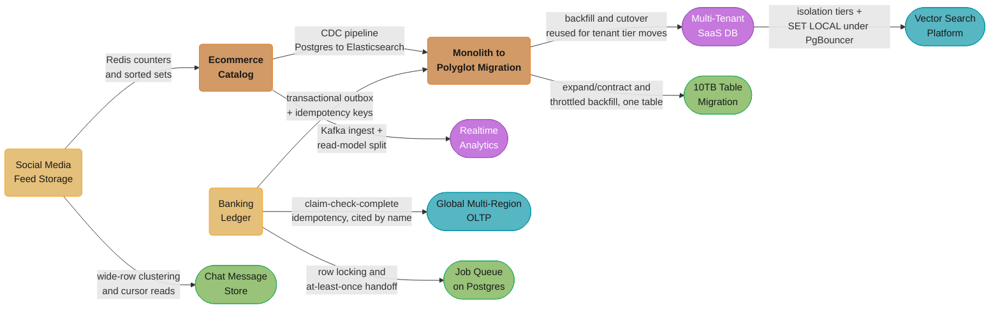

# Database Engineering — Case Studies

Eleven end-to-end database design case studies, all on the repo's 11-section principal template:
Intuition, requirements clarification, derived scale estimation, high-level architecture,
component deep dives (with executable schema/code and at least one broken-then-fixed pair),
design decisions and tradeoffs, real-world implementations at named companies, technologies and
tools, an operational playbook with alert thresholds and runbooks, quantified war stories,
capacity planning with cost arithmetic, and 10+ interview discussion points.

**Case-study Q&As never enter the MCQ bank** (`extract.py` skips every `case_studies/` path) —
they are discussion prompts tied to one scenario. They do power the game's separate Case Studies
tab, and every file here is readable in the reader.

---

## Quick Start

If you only have time for three case studies, read these first:

| File | Why |
|------|-----|
| [Banking Ledger](design_banking_ledger/design_banking_ledger.md) | The hardest database problem: SERIALIZABLE isolation, double-entry bookkeeping, RPO=0, and immutable audit trail. Patterns here apply to any financial system. |
| [Monolith to Polyglot Migration](design_monolith_to_polyglot_migration/design_monolith_to_polyglot_migration.md) | Teaches the transactional-outbox + Debezium CDC migration pattern every senior engineer needs for zero-downtime moves — and shows concretely why the obvious application-level dual-write is the wrong answer. |
| [Multi-Tenant SaaS Database](design_multitenant_saas_database/design_multitenant_saas_database.md) | Covers all three isolation tiers (row/schema/database), RLS, and connection pooling at SaaS scale — comes up in nearly every platform-engineering interview, and carries the `SET` vs `SET LOCAL` cross-tenant leak that is the single highest-consequence bug in this whole section. |

---

## Full Learning Path

Grouped by primary engineering concern:

### ACID, Consistency & Transactions

| Case Study | Primary Concern | What It Teaches |
|------------|----------------|----------------|
| [Banking Ledger](design_banking_ledger/design_banking_ledger.md) | SERIALIZABLE isolation, double-entry, idempotency | How to implement a correct double-entry ledger: SERIALIZABLE vs REPEATABLE READ tradeoffs at scale; advisory locks for account-level serialization; immutable event log as the source of truth; RPO=0 replication setup with Patroni. |

### Multi-Tenancy & Isolation

| Case Study | Primary Concern | What It Teaches |
|------------|----------------|----------------|
| [Multi-Tenant SaaS Database](design_multitenant_saas_database/design_multitenant_saas_database.md) | Row-level security, schema isolation, connection pooling | When to choose row-per-tenant vs schema-per-tenant vs database-per-tenant, with a cost model rather than a list; PostgreSQL RLS policy design including `FORCE ROW LEVEL SECURITY`; **why a plain `SET app.tenant_id` is a cross-tenant data leak under PgBouncer transaction pooling and `SET LOCAL` / `set_config(..., true)` is the fix**; tenant_id-first composite indexes; noisy-neighbour containment; per-tenant backup, restore and GDPR erasure per tier; migrating a tenant between tiers. |

### Polyglot Persistence & Read Scalability

| Case Study | Primary Concern | What It Teaches |
|------------|----------------|----------------|
| [E-Commerce Catalog](design_ecommerce_catalog/design_ecommerce_catalog.md) | Polyglot: OLTP + search + analytics + cache | How to serve 50M SKUs with OLTP writes, full-text search, faceted filtering, and sub-millisecond inventory reads: CDC sync from PostgreSQL to Elasticsearch; Redis counters for inventory; ClickHouse for analytics aggregations. |
| [Social Media Feed Storage](design_social_media_feed_storage/design_social_media_feed_storage.md) | Cassandra wide-rows, fan-out, Redis leaderboards | Fan-out-on-write vs fan-out-on-read at 500M users; Cassandra TWCS for time-ordered feeds; Redis ZADD for trending posts with HyperLogLog for unique count; celebrity problem mitigation. |

### Analytics & Real-Time Aggregations

| Case Study | Primary Concern | What It Teaches |
|------------|----------------|----------------|
| [Real-Time Analytics Platform](design_realtime_analytics_platform/design_realtime_analytics_platform.md) | ClickHouse columnar storage, Kafka ingestion, materialized views | Columnar storage vs row storage for 1B events/day; ReplacingMergeTree for deduplication; materialized views for pre-aggregated dashboards; tenant isolation in shared ClickHouse cluster; HyperLogLog for cardinality. |

### Migration & Schema Evolution

| Case Study | Primary Concern | What It Teaches |
|------------|----------------|----------------|
| [10TB Table Migration](design_10tb_table_migration/design_10tb_table_migration.md) | Dual-write triggers, shadow column, throttled backfill | How to restructure one 10 TB / 8.2B-row table *within* a single PostgreSQL instance with zero downtime, when the primary key is about to overflow `int4`: why the job splits into "keep new rows correct" (a microsecond trigger) plus "catch up old rows" (a backfill throttled by replication lag rather than a schedule), and how the two provably converge. The single-table structural counterpart to the polyglot migration below. |
| [Monolith to Polyglot Migration](design_monolith_to_polyglot_migration/design_monolith_to_polyglot_migration.md) | CDC, transactional outbox, zero-downtime migration | How to migrate a 5 TB MySQL monolith without downtime: **why the naive application-level dual-write silently diverges the two stores and the transactional outbox plus Debezium CDC is the fix**; keyset rather than `LIMIT/OFFSET` backfill; reconciling backfill with live CDC via idempotent version-keyed upserts; shadow reads for validation; strangler fig at the *data* layer; per-phase rollback cost and the point of no return. |

---

### Global Distribution & Multi-Region

| Case Study | Primary Concern | What It Teaches |
|------------|----------------|----------------|
| [Global Multi-Region OLTP](design_global_multiregion_oltp/design_global_multiregion_oltp.md) | Consensus latency, per-row locality, data residency | Why the write floor is one RTT to the *nearest quorum* and nothing beats it; `REGIONAL BY ROW` vs `GLOBAL` as the decision that turns a 70 ms commit into a 2 ms one; follower and stale reads as the read escape hatch; why a hot inventory row in a global quorum is a serialization point, not a throughput problem; reconciling `SURVIVE REGION FAILURE` with strict EU residency. |

### Vector Search & Retrieval

| Case Study | Primary Concern | What It Teaches |
|------------|----------------|----------------|
| [Vector Search Platform](design_vector_search_platform/design_vector_search_platform.md) | ANN indexing economics, filtered search, multi-tenancy | Why sizing starts with dimensions x bytes x count and everything else shrinks it; the overfiltering silent failure — a post-filtered ANN query returning 3 rows for `LIMIT 50` with no error — and the three fixes; hybrid BM25 + dense fused by reciprocal rank fusion and why scores cannot be added; the quantization ladder and why binary is never used without rescoring; HNSW graph degradation from deletes. |

### Ordered History & Cursor Correctness

| Case Study | Primary Concern | What It Teaches |
|------------|----------------|----------------|
| [Chat Message Store](design_chat_message_store/design_chat_message_store.md) | Clustering key, cursor pagination, read receipts | What the message *row* looks like once delivery is someone else's problem: the clustering key that makes exact-order retrieval a single seek; **why `OFFSET` pagination silently skips or duplicates messages the moment a concurrent insert shifts row positions, and why every cursor here — pagination, read receipt, multi-device sync — is the same fix applied four times: replace a position with an identity**; unread-count and receipt write amplification in a 500-member group. Pairs with [Design WhatsApp](../../hld/case_studies/design_whatsapp.md), which answers the transport question this one sits underneath. |

### Queueing Inside the Database

| Case Study | Primary Concern | What It Teaches |
|------------|----------------|----------------|
| [Job Queue on PostgreSQL](design_job_queue_on_postgres/design_job_queue_on_postgres.md) | `SELECT ... FOR UPDATE SKIP LOCKED`, lease recovery, dead-lettering | When the database of record can be the queue and a broker is the wrong trade; `SKIP LOCKED` as a five-word fix for claim contention, and **the four things a naive implementation still gets wrong afterwards** — crash-mid-job lease recovery, exponential backoff and a dead-letter terminal state, a claim index that does not match the claim query, and the table-health cost of claims/retries/completions all updating the same hot rows all day. Numbers measured against a live PostgreSQL 18.6 instance. |

---

## Cross-Cutting / Shared Primitives

No `cross_cutting/` directory here — the shared primitives live as deep-dive modules in the section itself. The same primitives recur across these case studies; read the deep dive once, then recognize it everywhere:

| Primitive | Used By | Deep Dive | Phase |
|---|---|---|---|
| SERIALIZABLE isolation + advisory locks | Banking Ledger (the only file that uses it) | `../concurrency_control_and_locking/concurrency_control_and_locking.md` | 1 — Foundations |
| Idempotency (request + consumer) | Banking Ledger (core), Feed Storage, Real-Time Analytics, Migration, Global Multi-Region OLTP | `../distributed_transactions/distributed_transactions.md` | 5 — Distributed |
| Transactional outbox | Banking Ledger, Migration, Feed Storage, Global Multi-Region OLTP | `../distributed_transactions/distributed_transactions.md` | 5 |
| Immutable event log / double-entry | Banking Ledger | `../schema_design_and_normalization/schema_design_and_normalization.md` | 2 — Relational |
| RLS + `SET app.tenant_id` | Multi-Tenant SaaS | `../database_security_and_compliance/database_security_and_compliance.md` | 6 — Production Ops |
| PgBouncer pooling at scale | Multi-Tenant SaaS | `../connection_pool_management/connection_pool_management.md` | 6 |
| CDC (Debezium) + dual-write validation | Migration, E-Commerce Catalog | `../polyglot_persistence_patterns/polyglot_persistence_patterns.md` | 7 — Architecture |
| Redis counters / leaderboards / HyperLogLog | E-Commerce, Feed Storage, Analytics | `../key_value_stores/key_value_stores.md` | 3 — NoSQL |
| Cassandra wide rows + TWCS | Feed Storage | `../wide_column_databases/wide_column_databases.md` | 3 |
| Columnar storage + materialized views | Real-Time Analytics | `../time_series_databases/time_series_databases.md`, `../storage_engines_internals/storage_engines_internals.md` | 3 / 1 |
| Keyset (cursor) pagination over a growing list | Chat Message Store (core), 10TB Table Migration (backfill cursor), Migration (backfill) | `../sql_query_optimization/sql_query_optimization.md` | 2 — Relational |
| `SKIP LOCKED` claim + row-level locking | Job Queue on PostgreSQL (core), Banking Ledger | `../concurrency_control_and_locking/concurrency_control_and_locking.md` | 1 — Foundations |
| Expand/contract + online DDL + throttled backfill | 10TB Table Migration (core), Migration | `../database_migrations_zero_downtime/database_migrations_zero_downtime.md` | 2 |
| Bloat, autovacuum and hot-row table health | Job Queue on PostgreSQL, 10TB Table Migration | `../postgresql_internals/postgresql_internals.md` | 2 |
| Replication + RPO=0 failover (Patroni) | Banking Ledger, Migration | `../replication_and_high_availability/replication_and_high_availability.md` | 5 |

---

## Dependency Map

*Read this as a concept-prerequisite order, not as a citation graph: **the original six case
studies do not link to one another**, so those arrows are claims about what you already understand
rather than references one file makes to another. The same is true of the three newest
(10TB Table Migration, Chat Message Store, Job Queue on Postgres), with one exception noted below:
10TB Table Migration names the polyglot migration explicitly as its cross-engine counterpart.
`design_global_multiregion_oltp` and `design_vector_search_platform` are drawn
as real citations — `design_global_multiregion_oltp` reuses the banking ledger's
claim-check-complete idempotency protocol by name, and `design_vector_search_platform` cites the
multi-tenant study's isolation tiers and its `SET LOCAL`-under-PgBouncer trap. Each edge was checked against both files' actual content
before being drawn — the banking ledger is where the transactional outbox and idempotency keys are
introduced, and the migration case study assumes both; the feed-storage Redis counter and
sorted-set patterns recur as ecommerce inventory counters; the ecommerce CDC pipeline
(Postgres → Debezium → Kafka → Elasticsearch) is the steady-state version of the migration's
one-off CDC cutover, and its Kafka ingest is the smaller sibling of the analytics platform's;
and the migration's backfill-and-cutover machinery is exactly what moving a tenant between
isolation tiers needs. Two edges that used to appear here have been removed as unsupported: the
analytics platform contains no Cassandra at all (it is Kafka + ClickHouse + Redis + S3), and
`SERIALIZABLE` appears in the banking ledger and nowhere else.*

---

## Interview Prep Shortcuts

| "Design X" Interview Question | Best Case Study |
|-------------------------------|----------------|
| Design a payment ledger / financial accounting system | [design_banking_ledger](design_banking_ledger/design_banking_ledger.md) |
| Design a multi-tenant SaaS database | [design_multitenant_saas_database](design_multitenant_saas_database/design_multitenant_saas_database.md) |
| Design a product catalog for e-commerce | [design_ecommerce_catalog](design_ecommerce_catalog/design_ecommerce_catalog.md) |
| Design a social media feed storage layer | [design_social_media_feed_storage](design_social_media_feed_storage/design_social_media_feed_storage.md) |
| Design a real-time analytics dashboard | [design_realtime_analytics_platform](design_realtime_analytics_platform/design_realtime_analytics_platform.md) |
| Design a zero-downtime database migration | [design_monolith_to_polyglot_migration](design_monolith_to_polyglot_migration/design_monolith_to_polyglot_migration.md) |
| Design a polyglot persistence architecture | [design_ecommerce_catalog](design_ecommerce_catalog/design_ecommerce_catalog.md) + [design_monolith_to_polyglot_migration](design_monolith_to_polyglot_migration/design_monolith_to_polyglot_migration.md) |
| Design a CDC pipeline | [design_monolith_to_polyglot_migration](design_monolith_to_polyglot_migration/design_monolith_to_polyglot_migration.md) |
| Design a leaderboard / trending system | [design_social_media_feed_storage](design_social_media_feed_storage/design_social_media_feed_storage.md) |
| Design a time-series / metrics storage system | [design_realtime_analytics_platform](design_realtime_analytics_platform/design_realtime_analytics_platform.md) |
| Design a globally distributed database / multi-region OLTP | [design_global_multiregion_oltp](design_global_multiregion_oltp/design_global_multiregion_oltp.md) |
| Design a system with data-residency (GDPR) constraints | [design_global_multiregion_oltp](design_global_multiregion_oltp/design_global_multiregion_oltp.md) |
| Design a vector search / semantic search platform | [design_vector_search_platform](design_vector_search_platform/design_vector_search_platform.md) |
| Design the retrieval layer of a RAG system | [design_vector_search_platform](design_vector_search_platform/design_vector_search_platform.md) |
| Design a chat / messaging history store | [design_chat_message_store](design_chat_message_store/design_chat_message_store.md) |
| Design paginated, resumable feeds or message history without skips | [design_chat_message_store](design_chat_message_store/design_chat_message_store.md) |
| Design a background job / task queue | [design_job_queue_on_postgres](design_job_queue_on_postgres/design_job_queue_on_postgres.md) |
| "Do we need Kafka/SQS or can Postgres do it?" | [design_job_queue_on_postgres](design_job_queue_on_postgres/design_job_queue_on_postgres.md) |
| Migrate a huge single table / change a PK type with no downtime | [design_10tb_table_migration](design_10tb_table_migration/design_10tb_table_migration.md) |
| "The primary key is about to overflow int4 — what now?" | [design_10tb_table_migration](design_10tb_table_migration/design_10tb_table_migration.md) |

---

## Back to Database Section

[Database Engineering Master Index](../README.md)
