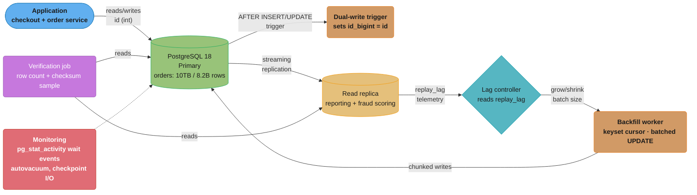
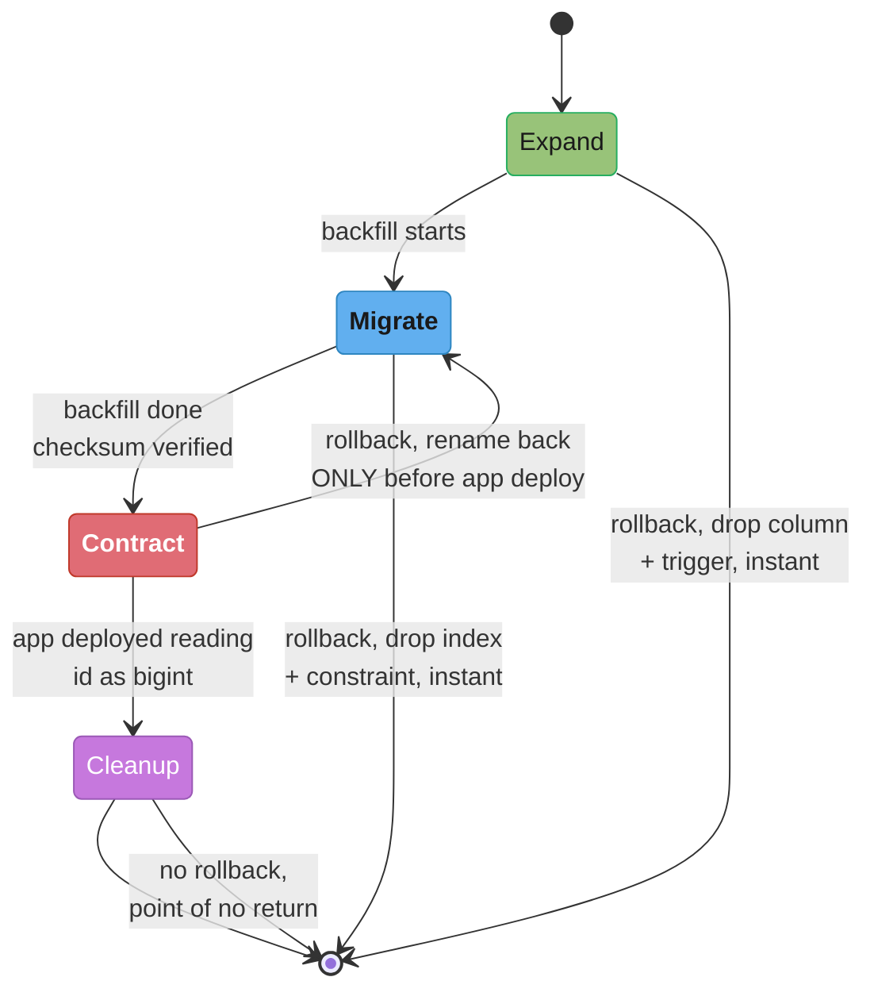

# Case Study: 10 TB Table Migration

## Intuition

Every other migration in this section gets to lean on at least one of three crutches: take
a lock, take a maintenance window, or fit the working set in memory so the fix is fast once
it starts. This one has none of them. The table is 10 TB and 8.2 billion rows — larger than
the server's RAM by a factor of 20, so there is no "just cache it and rewrite" shortcut. The
business will not accept downtime, so `ACCESS EXCLUSIVE` is off the table for anything that
takes longer than a few milliseconds. And the change itself — the primary key is about to
overflow a 32-bit integer — is not optional or schedulable; it is a hard ceiling the table is
approaching at a measurable, computable rate.

The mental model that resolves all three constraints at once: **stop treating this as one
big operation and start treating it as two independent, much smaller problems running
concurrently forever until they converge.** Problem one is *keeping new data correct* —
solved once with a trigger that costs microseconds per row. Problem two is *catching up
old data* — solved by a background process that runs for days or weeks, throttled by a
feedback signal (replication lag) rather than a fixed schedule, so it never has to be fast,
only patient. The two problems converge when the backfill's cursor passes the row that was
newest when the trigger went live; from that point on, every row is provably correct, and
the "migration" that looked like it needed a multi-hour outage instead needed zero.

This case study is the single-table structural counterpart to
[Monolith to Polyglot Migration](../design_monolith_to_polyglot_migration/design_monolith_to_polyglot_migration.md):
that case study moves data *between* database engines using CDC and a transactional outbox;
this one restructures a table *within* one PostgreSQL instance using dual-write triggers and
a shadow column. The techniques share a family resemblance — expand/contract, checksummed
verification, a governed backfill — but the mechanism, the tooling, and the failure modes
are different enough to earn their own design, which is exactly the gap this case study
fills: "have you migrated a giant production table" is one of the most common senior/staff
database interview questions, and until now it only showed up as a side effect of the
polyglot case study's `orders` table move.

---

## 1. Requirements Clarification

### Functional requirements

- Convert the primary key of a live, 10 TB, 8.2-billion-row `orders` table from `integer`
  (32-bit) to `bigint` (64-bit) on PostgreSQL 18, because the current sequence value is at
  roughly 90% of the `int4` ceiling (2,147,483,647) and will overflow in the observable
  future at the current insert rate.
- Every dependent object — the primary key constraint, six foreign-key columns in other
  tables, three non-unique indexes, and the `BIGSERIAL`-owned sequence — must migrate
  consistently; no orphaned foreign key and no row silently left on the old type.
- 100% of existing application read and write behavior must keep working, unchanged, for
  the entire duration of the migration.

### Non-functional requirements

- **Zero planned downtime.** No maintenance window; the interviewer's stated budget is
  "the same as any other Tuesday."
- **No query blocked for more than milliseconds** by a migration-owned lock, at any point
  in the process — this table serves the checkout path.
- **A bounded, monitored replication-lag budget** (target: replica `replay_lag` stays under
  5 seconds) throughout the backfill, because a reporting replica and a fraud-detection
  consumer both read from it continuously.
- **Reversible until a named point of no return**, and that point must be called out
  explicitly, not discovered during an incident.
- **Verifiable correctness beyond row counts** — a matching row count on both sides of a
  copy does not prove the copy is correct; some independent, sampled check must run before
  cutover is declared safe.

### Explicit non-goals

- Not a cross-database or cross-engine migration — that is
  [Monolith to Polyglot Migration](../design_monolith_to_polyglot_migration/design_monolith_to_polyglot_migration.md).
  Everything here stays on the same PostgreSQL 18 primary.
- Not sharding or repartitioning the table — that is
  [`sharding_and_partitioning`](../../sharding_and_partitioning/sharding_and_partitioning.md).
  The row count and boundaries are unchanged; only one column's physical type changes.
- Not a generic "how do I run migrations" question — the mechanics of Flyway/Liquibase
  version tracking and the *general* expand-contract vocabulary are covered in
  [`database_migrations_zero_downtime`](../../database_migrations_zero_downtime/database_migrations_zero_downtime.md)
  and are assumed as background, not re-derived here. This case study is about what changes
  when the table in question is 10 TB and does not fit in memory.

### Clarifying questions to ask the interviewer

- What is the actual write rate (inserts + updates per second), average and peak? It sets
  the floor on how fast a trigger-based dual-write has to be and how long the backfill
  will realistically take.
- Is there a read replica or a downstream consumer (analytics, fraud scoring, CDC) whose
  lag budget constrains how hard the backfill can push?
- Is "zero downtime" literal, or is a single-digit-second lock acceptable at 3 a.m. low
  traffic? (This changes whether the final cutover can be a plain rename or needs an
  online, lock-free swap.)
- What PostgreSQL major version, and is `NOT VALID` / `VALIDATE CONSTRAINT` available
  (PostgreSQL 12+)? The whole plan below assumes PostgreSQL 18; an older version changes
  which DDL forms in §4.2 are metadata-only.
- Single primary, or a multi-region write topology? This case study assumes single-primary
  streaming replication; a multi-region write path pushes into
  [`replication_and_high_availability`](../../replication_and_high_availability/replication_and_high_availability.md)
  territory.

---

## 2. Scale Estimation

All figures below marked *(illustrative)* are worked-example arithmetic from stated,
round assumptions — not measurements from a real system — used to establish the right
order of magnitude for a plan. Figures cited to Buildkite or GitLab (§6) are real,
published numbers from those companies' own migrations.

### Table and hardware

| Quantity | Value |
|---|---|
| Table size | 10 TB (heap + TOAST + indexes) |
| Row count | 8.2 billion |
| Average row width | 10 TB / 8.2B ≈ 1.22 KB |
| Primary server | 128 vCPU, 512 GB RAM, NVMe SSD |
| `shared_buffers` | 128 GB (25% of RAM, per the sizing rule in
  [`database_performance_tuning`](../../database_performance_tuning/database_performance_tuning.md)) |
| Working set that actually fits | Last ~90 days of orders, ≈ 600 GB — **already exceeds
  RAM on its own**, before counting the other 9+ years of history |

The working-set line is the whole reason this case study exists as a distinct problem:
even the *hot* slice of the table does not fit in memory, so any operation that touches
every row — a full scan, a full rewrite, a naive `UPDATE` — pays disk I/O for nearly all
of it, not the cheap in-memory cost a smaller table would get away with.

### Write rate *(illustrative)*

```
Average: 45,000,000 new rows/day  =  520 rows/sec sustained
Peak (checkout rush):             ≈ 4,000 rows/sec
```

### Backfill throughput and calendar time *(illustrative)*

The backfill has to touch all 8.2 billion existing rows without pushing replication lag
past the 5-second budget. Assume the lag-adaptive throttle in §4.4 settles at a sustained
average of 5,000 rows/sec (well below the primary's raw write capacity, deliberately
conservative to leave headroom for live traffic):

```
8,200,000,000 rows / 5,000 rows/sec = 1,640,000 sec ≈ 19.0 days
```

Nineteen days is the order-of-magnitude answer this case study is built around: not hours,
not "one weekend," but weeks — and that estimate is corroborated, not contradicted, by the
real companies in §6: GitLab's own batched-background-migration framework describes
individual large-table migrations running for **months**, and Buildkite's bigint migration
(8.5 TB, 2 billion+ rows — smaller than this table) was run as a background job over an
extended period rather than a single sitting. Any plan that promises to finish a genuine
10 TB structural migration in under a day should be treated as suspicious until proven
otherwise.

### WAL volume, broken vs. chunked *(illustrative)*

```
BROKEN — one unbatched UPDATE touching all 8.2B rows in a single transaction:
  each UPDATE writes a full new row version (~1.22 KB) plus WAL overhead, and repeated
  full-page-writes near every checkpoint roughly double the effective cost during the run
    8,200,000,000 rows x 1.22 KB x ~1.5x WAL overhead ≈ 15 TB of WAL in one unbroken burst

CHUNKED — same total row count, 5,000-row batches, each committed independently:
  same total bytes eventually written, but delivered as a steady ~5,000 rows/sec trickle
  instead of one burst, which is exactly what keeps replay_lag inside its 5-second budget
    same ~15 TB total, spread over 19 days ≈ 9 MB/sec average WAL rate — a rounding error
    against the primary's NVMe throughput
```

The byte total is nearly identical either way — chunking does not create less work. What it
changes is the *rate*, and the rate is what a WAL receiver, a checkpoint, and autovacuum can
actually survive. §4.6 makes this the entire argument for why the broken approach fails.

### New column and index storage *(illustrative)*

```
New id_bigint column: 8 bytes/row x 8.2B rows                  ≈  61 GB
New unique index on id_bigint (comparable density to the
  existing int4 primary key index, wider key)                  ≈  70-90 GB
Temporary total overhead during migration (before old
  int4 column is dropped in Phase 4)                            ≈ 130-150 GB
```

150 GB of temporary overhead against a 10 TB table and 512 GB of RAM is entirely
affordable — the constraint on this migration was never disk space, it was replication
lag and lock duration, which is why §4 spends almost no time on storage and almost all of
it on the backfill's pacing.

---

## 3. High-Level Architecture



The application never talks to the backfill worker or the lag controller directly — it
only ever reads and writes the table it always has. The dual-write trigger keeps every
*new* row correct the instant it lands; the backfill worker, paced by a controller that
watches the replica's own lag telemetry, is the only component doing extra work, and it is
designed so that killing it at any point leaves the table in a valid, if incomplete, state.
Verification runs against both the primary and the replica so that a bug specific to
replication (rather than to the primary's own trigger) cannot hide.

---

## 4. Component Deep Dives

### 4.1 Why `ALTER TABLE` Is the Wrong Instinct

The naive fix is one statement:

```sql
-- BROKEN: looks correct, is a multi-hour outage on this table
ALTER TABLE orders ALTER COLUMN id TYPE bigint;
```

Per the PostgreSQL documentation on `ALTER TABLE`
([postgresql.org/docs/current/sql-altertable.html](https://www.postgresql.org/docs/current/sql-altertable.html)),
changing a column's type "will normally cause the entire table and its indexes to be
rewritten," and the only exception is when the `USING` clause does not change the column's
contents and the old type is binary-coercible to the new one. `integer -> bigint` is not
binary-coercible (the on-disk widths differ), so this statement takes the strongest lock
PostgreSQL has, `ACCESS EXCLUSIVE`, for as long as the rewrite runs — on a 10 TB table, that
is hours to a day, during which every read and every write against `orders` blocks. This is
not a tuning problem to work around; it is disqualified by the zero-downtime requirement in
§1 before the migration even starts.

### 4.2 DDL Classification — Metadata-Only vs. Table-Rewriting, PostgreSQL 18

This is the table every plan in §4.5 is built to respect. Verified against the PostgreSQL
current-version documentation
([postgresql.org/docs/current/sql-altertable.html](https://www.postgresql.org/docs/current/sql-altertable.html)):

| Operation | Rewrite? | Full scan? | Lock |
|---|---|---|---|
| `ADD COLUMN` with no default, or a non-volatile constant default | No | No | `ACCESS EXCLUSIVE`, but instant |
| `ADD COLUMN` with a **volatile** default (`clock_timestamp()`), a stored generated column, or an identity column | **Yes** | Yes | `ACCESS EXCLUSIVE`, full duration |
| `ADD COLUMN ... GENERATED ALWAYS AS (...) VIRTUAL` | No (virtual generated columns never rewrite) | No | `ACCESS EXCLUSIVE`, but instant |
| `ALTER COLUMN TYPE`, binary-coercible (e.g., `text` -> `varchar`) with no content-changing `USING` | No | No | `ACCESS EXCLUSIVE`, but instant |
| `ALTER COLUMN TYPE`, incompatible (e.g., `integer` -> `bigint`) | **Yes** | Yes | `ACCESS EXCLUSIVE`, full duration |
| `SET NOT NULL`, with a pre-existing valid `CHECK` proving no NULLs | No | No | `ACCESS EXCLUSIVE`, but instant |
| `SET NOT NULL`, without a matching `CHECK` | No | Yes (verifies existing rows) | `ACCESS EXCLUSIVE` for the scan's duration |
| `ADD CONSTRAINT ... NOT VALID` | No | No | `ACCESS EXCLUSIVE`, but instant (skips the scan) |
| `VALIDATE CONSTRAINT` (separate statement) | No | Yes | `SHARE UPDATE EXCLUSIVE` — reads and writes continue |
| `CREATE INDEX CONCURRENTLY` | No (builds alongside) | Yes (background) | No blocking `ACCESS EXCLUSIVE` at any point |

The two load-bearing rows for this migration: `ADD COLUMN id_bigint bigint` with no
default is instant and metadata-only — this is what makes a *shadow column* cheap enough
to prefer over MySQL's shadow-*table* pattern (§4.3). And `ADD CONSTRAINT ... NOT VALID`
followed by a separate `VALIDATE CONSTRAINT` is what turns a full-table NOT NULL check
from one `ACCESS EXCLUSIVE`-held scan into a metadata-only step plus a background scan
that holds only `SHARE UPDATE EXCLUSIVE` — the same two-step split
[`database_migrations_zero_downtime`](../../database_migrations_zero_downtime/database_migrations_zero_downtime.md)
documents for foreign keys applies identically to this migration's final NOT NULL check
on `id_bigint`.

### 4.3 Shadow-Table Tools, Compared Precisely

Three tools are commonly named in the same breath for "online schema change." They are not
interchangeable, and getting this wrong is the second most common mistake after reaching
for `ALTER TABLE` directly.

| Tool | Engine | Mechanism | What it needs | Can it change schema? |
|---|---|---|---|---|
| **pt-online-schema-change** (Percona) | MySQL | Creates an empty copy of the table with the new schema, installs `INSERT`/`UPDATE`/`DELETE` triggers on the original to mirror changes into the copy, copies existing rows in small chunks sized to `--chunk-time` (default 0.5s), then does an atomic `RENAME TABLE` swap | MySQL 5.0.2+ (triggers), a `PRIMARY KEY` or `UNIQUE INDEX`, and `PROCESS`/`SUPER`/`REPLICATION SLAVE` plus full DML/DDL/`TRIGGER` privileges on the table | Yes — the copy is created with the target schema already applied |
| **gh-ost** (GitHub) | MySQL | Reads the **binary log** stream instead of installing triggers, and asynchronously applies captured row events onto a "ghost" table copied in the background; supports a "true pause" that halts row-copy and event processing with zero load on the primary | Row-based binary logging enabled, replication-client privileges to tail the binlog | Yes — same shadow-table-with-new-schema approach as pt-osc, different change-capture mechanism |
| **pg_repack** | PostgreSQL | Creates a log table plus a trigger to capture concurrent changes, copies all rows into a new table **with the same schema**, builds matching indexes, replays the captured log, then swaps the tables via the system catalogs under a brief `ACCESS EXCLUSIVE` | A `PRIMARY KEY` or unique `NOT NULL` index, and superuser or table/index ownership (`--no-superuser-check` relaxes this) | **No** — verified at [reorg.github.io/pg_repack](https://reorg.github.io/pg_repack/): it "only reorganizes existing schemas" to remove bloat and restore clustered order; it cannot add a column or change a type |

`pg_repack` looks like the PostgreSQL answer to gh-ost — same log-table-plus-trigger
mechanism, same atomic-swap finish — and for a pure bloat-reclaim job it is exactly that
(see
[`postgresql_internals`](../../postgresql_internals/postgresql_internals.md)
for that use case). But it will not do this migration: it copies a table into a table of
the *same* schema. Neither `pt-online-schema-change` nor `gh-ost` is usable either, for a
simpler reason — both are MySQL tools, tailing a binary log format PostgreSQL does not
have. PostgreSQL has no single, mature, off-the-shelf equivalent of gh-ost for a
same-instance structural change; production teams hand-roll the mechanism gh-ost
automates — dual-write plus backfill plus atomic swap — using PostgreSQL's own DDL, which
§4.5 does. This is precisely the path Buildkite and GitLab took (§6), and it is cheaper
than MySQL's version for exactly one reason: because `ADD COLUMN` is metadata-only per
§4.2, PostgreSQL never needs the *whole table* copied into a shadow table the way MySQL's
tools do — a single new column is enough.

### 4.4 Chunked Backfill With a Lag-Adaptive Cursor

The naive batching trap — chunking by an `id` numeric range rather than by actual live
rows, so a table with heavy deletion history runs mostly-empty batches — is already
documented in
[`database_migrations_zero_downtime`](../../database_migrations_zero_downtime/database_migrations_zero_downtime.md);
this migration avoids it the same way, with a keyset cursor over rows that actually exist.
What this migration adds on top is a control loop that adapts the batch size to
**observed replication lag**, rather than a fixed `pg_sleep` throttle:

```sql
-- One backfill batch: keyset cursor, not an id-range guess
UPDATE orders
SET id_bigint = id
WHERE id > :last_seen_id
  AND id_bigint IS NULL
ORDER BY id
LIMIT :batch_size
RETURNING id INTO :last_seen_id;  -- pseudocode: capture the max id seen this batch
```

```
Lag-adaptive controller (runs once per batch, pseudocode):

  lag = query_replica("SELECT extract(epoch FROM replay_lag)
                        FROM pg_stat_replication WHERE application_name = 'reporting_replica'")

  if lag > 5.0 seconds:
      batch_size = max(1_000, batch_size / 2)      # back off hard, mirrors TCP congestion control
      sleep(2.0 seconds)
  elif lag < 1.0 seconds and consecutive_good_batches > 5:
      batch_size = min(20_000, batch_size * 1.2)     # grow cautiously once lag has margin
      consecutive_good_batches = 0
  else:
      consecutive_good_batches += 1

  run_batch(batch_size)
```

This is a multiplicative-decrease/additive-growth loop, not a novel algorithm — the
insight worth taking into an interview is *what signal to throttle on*. A fixed
`pg_sleep(0.01)` between batches, the pattern
[`database_migrations_zero_downtime`](../../database_migrations_zero_downtime/database_migrations_zero_downtime.md)
documents, is a reasonable default when nothing downstream depends on tight lag bounds.
Here, a reporting replica and a fraud-detection consumer both have a hard 5-second lag
budget, so the throttle has to react to the thing it is actually protecting rather than a
guessed constant — the same reason GitLab's batched-background-migration framework (§6)
pauses on WAL-queue depth and Patroni's apdex signal rather than a fixed sleep.

### 4.5 Expand-Contract, Four Phases and Their Rollback Points



**Phase 1 — Expand.** Add the shadow column and start dual-writing. Both statements are
metadata-only per §4.2.

```sql
ALTER TABLE orders ADD COLUMN id_bigint bigint;  -- instant: no default, no rewrite

CREATE OR REPLACE FUNCTION orders_dual_write_id() RETURNS trigger AS $$
BEGIN
  NEW.id_bigint := NEW.id;
  RETURN NEW;
END;
$$ LANGUAGE plpgsql;

CREATE TRIGGER orders_dual_write_id_trigger
  BEFORE INSERT OR UPDATE ON orders
  FOR EACH ROW EXECUTE FUNCTION orders_dual_write_id();
```

*Rollback:* `DROP TRIGGER`, `DROP FUNCTION`, `ALTER TABLE orders DROP COLUMN id_bigint` —
all metadata-only, instant, and the application never referenced the new column, so there
is nothing to revert on the app side.

**Phase 2 — Migrate (backfill).** Run the lag-adaptive backfill from §4.4 until every
existing row has `id_bigint` populated, then build the supporting index and constraint
without ever holding a long-lived exclusive lock:

```sql
-- Built concurrently: no lock that blocks reads or writes
CREATE UNIQUE INDEX CONCURRENTLY idx_orders_id_bigint ON orders (id_bigint);

-- Metadata-only add, skips the scan
ALTER TABLE orders ADD CONSTRAINT orders_id_bigint_not_null
  CHECK (id_bigint IS NOT NULL) NOT VALID;

-- Separate statement: SHARE UPDATE EXCLUSIVE only, reads/writes continue
ALTER TABLE orders VALIDATE CONSTRAINT orders_id_bigint_not_null;
```

*Rollback:* drop the index, the constraint, and (if abandoning entirely) fall back to
Phase 1's rollback. The original `id` column and its primary key are untouched throughout
this entire phase — nothing the application reads has changed yet.

**Phase 3 — Contract (cutover).** The one genuinely risky phase, executed as a short,
explicit transaction:

```sql
BEGIN;
  ALTER TABLE orders RENAME COLUMN id TO id_int_old;
  ALTER TABLE orders RENAME COLUMN id_bigint TO id;
  ALTER SEQUENCE orders_id_seq OWNED BY orders.id;  -- reattach ownership -- see §9
  ALTER TABLE orders ALTER COLUMN id SET DEFAULT nextval('orders_id_seq');
  ALTER TABLE orders DROP CONSTRAINT orders_pkey;
  ALTER TABLE orders ADD CONSTRAINT orders_pkey PRIMARY KEY USING INDEX idx_orders_id_bigint;
  DROP TRIGGER orders_dual_write_id_trigger ON orders;
COMMIT;
```

Every statement inside this transaction is metadata-only per §4.2 — renames, sequence
reattachment, and swapping a primary key onto an already-built unique index all avoid a
rewrite — so the transaction itself holds `ACCESS EXCLUSIVE` for milliseconds, not hours.
*Rollback:* before the application is deployed to treat `id` as a `bigint`, this
transaction can be reversed by renaming the columns back — still cheap. **The moment new
application code that assumes a 64-bit `id` is deployed and serving traffic, this stops
being a database-only rollback**; reverting means a second coordinated migration and app
deploy, not a single `ROLLBACK`. That is the point of no return for Phase 3, and it should
be called out explicitly in the runbook (§8), not discovered mid-incident.

**Phase 4 — Cleanup.** After a bake period (this plan uses two weeks of clean production
traffic with no rollback triggered):

```sql
ALTER TABLE orders DROP COLUMN id_int_old;  -- metadata-only; does not shrink the file
```

Dropping a column never returns disk space — the file does not shrink, per the same
mechanic covered in
[`postgresql_internals`](../../postgresql_internals/postgresql_internals.md)'s VACUUM
material. If the freed space needs to be physically reclaimed, that is a `pg_repack` job
against the *now-consistent* schema — the legitimate use of the tool that §4.3 ruled out
for the structural change itself. *Rollback:* none. This is the actual point of no return
operationally — anything past this needs a restore from backup, not a migration reversal.

### 4.6 Broken -> Fixed: the Unbatched Backfill

**Broken.** A team under schedule pressure decides the trigger-based dual-write (Phase 1)
is enough, and races the backfill as a single statement to "just get it done":

```sql
-- BROKEN: one transaction, no batching, no throttle
UPDATE orders SET id_bigint = id WHERE id_bigint IS NULL;
```

What this actually does on an 8.2-billion-row table:

- **Holds one transaction open for hours.** Every row this transaction touches gets a new
  MVCC version; none of those old versions can be reclaimed until the transaction commits
  or aborts, because PostgreSQL cannot reclaim a dead tuple that a still-running
  transaction might need to see.
- **Bloats the table by roughly its own size.** 8.2 billion new row versions land inside a
  10 TB table before the old versions are eligible for cleanup — a worst case of nearly
  doubling the table's footprint mid-run.
- **Blocks autovacuum on this table for the transaction's entire duration**, per the same
  xmin-horizon mechanic
  [`database_performance_tuning`](../../database_performance_tuning/database_performance_tuning.md)
  documents for long-running transactions — worse here because the blocking transaction
  *is itself* the source of the dead tuples autovacuum would otherwise be cleaning.
- **Pins the WAL.** The §2 estimate for this exact statement is roughly 15 TB of WAL
  generated as a single unbroken burst *(illustrative)* — nowhere near steady-state, and
  enough to overrun `max_wal_size`, blow through the checkpoint interval repeatedly, and
  detach the replica, whose `replay_lag` climbs unbounded because there is no commit
  boundary to catch up to until the whole statement finishes or is killed.
- **All-or-nothing.** If it is killed at hour 6 of an estimated 10-hour run — because it
  finally trips `statement_timeout`, or because an on-call engineer sees the replica has
  fallen 40 minutes behind and panics — the entire transaction rolls back and every byte
  of that work is wasted. There is no partial credit.

**Fixed.** The chunked, lag-adaptive backfill from §4.4: 5,000-row keyset batches, each
committed independently, throttled by observed `replay_lag` rather than a fixed sleep.
Killing it at any point loses at most one in-flight batch, not the whole run; autovacuum
runs freely between batches because no single transaction stays open past a few
milliseconds; and the WAL is delivered as the ~9 MB/sec steady trickle from §2 instead of
a burst that outruns the replica.

---

## 5. Design Decisions & Tradeoffs

| Decision | Chosen | Alternative | Why |
|---|---|---|---|
| Direct `ALTER COLUMN TYPE` vs. expand-contract | Expand-contract | Direct `ALTER` | Direct is one statement and atomic, but requires `ACCESS EXCLUSIVE` for a full rewrite (§4.1) — hours to a day of total outage on a table this size, which the zero-downtime requirement in §1 rules out on its own |
| Shadow *column* vs. shadow *table* | Shadow column | Full shadow table (gh-ost/pt-osc pattern) | A single-column type change needs only one new column, and `ADD COLUMN` is metadata-only in PostgreSQL (§4.2); a whole shadow table buys nothing extra here and would cost a full second copy of a 10 TB table. A shadow table is still the right call for changes `ADD COLUMN` cannot express — repartitioning, or a cross-engine move (see the polyglot case study) |
| Trigger-based dual-write vs. logical-replication-based | `BEFORE INSERT OR UPDATE` trigger | Publication/subscription shadowing the column | Same-instance, same-transaction correctness is simpler and cheaper with a trigger — no extra replication slot, no second lag budget to manage. Logical replication is the right tool when the target is a *different* instance or engine, which is why the polyglot case study uses Debezium/CDC instead |
| Fixed-interval throttle vs. lag-adaptive throttle | Lag-adaptive (§4.4) | Static `pg_sleep` between batches | A downstream reporting replica and fraud consumer both have a hard 5-second lag budget; a fixed sleep either wastes time when lag has margin or lets lag spike unbounded during a traffic surge. Adaptive throttling reacts to the thing actually being protected |
| Row-count verification vs. checksum sampling | Both, checksum on a random sample (§4.6-adjacent, detailed in §9) | Row count only | Matching counts on both sides proves nothing about per-row correctness — a trigger bug that writes the wrong value into `id_bigint` for a subset of rows produces an identical count. `orders` is financially adjacent enough to warrant the extra verification cost |
| Two-week bake period before Phase 4 cleanup | Two weeks | Immediate cleanup after cutover | Keeping `id_int_old` around costs storage, not correctness, and is the cheapest possible insurance against a bug surfacing after cutover that only Phase 3's easy rollback (before this point, impossible after) could otherwise fix |

---

## 6. Real-World Implementations

**Buildkite** migrated a `jobs` table's primary key from `integer` to `bigint` across
three partitions totaling **8.5 TB and over 2 billion rows** — smaller than this case
study's table, but the same shape of problem and the same solution: add a shadow
`id_bigint` column, a trigger to dual-write it on every insert/update, a threaded,
load-aware backfill batching update, a `CREATE UNIQUE INDEX CONCURRENTLY`, an `ADD
CONSTRAINT ... NOT VALID` followed by `VALIDATE CONSTRAINT` to avoid a full-table scan
under lock, and finally a column rename plus sequence-ownership transfer as the atomic
cutover. Source:
["Avoiding integer overflows with zero downtime,"](https://buildkite.com/resources/blog/avoiding-integer-overflows-with-zero-downtime/)
Buildkite Engineering, originally published March 2021, updated May 2024.

**GitLab** built a first-class *batched background migration* framework into the product
itself specifically for this class of problem: migrations are broken into batches driven
by a cursor over the primary key, batch size adapts using an exponential moving average of
recent batch execution time, and the runner pauses automatically when database health
signals degrade — WAL queue depth exceeding a threshold, active autovacuum on the target
table, or the Patroni apdex SLI dropping below its target. GitLab's own documentation cites
a real example where parallelizing across views cut one large-table migration from roughly
**seven months to roughly two months**. Source:
["Batched background migrations,"](https://docs.gitlab.com/development/database/batched_background_migrations/)
GitLab Documentation.

**GitHub** built gh-ost specifically because Percona's `pt-online-schema-change` — which
installs synchronous triggers on the source table — caused production incidents on
GitHub's high-write MySQL tables; gh-ost's binlog-tailing design lets it truly pause under
load with zero synchronous overhead on the primary, the same design principle (throttle on
an observed signal, not a fixed rate) that §4.4's lag-adaptive backfill applies to a
PostgreSQL trigger-based migration. This fact and gh-ost's mechanism are documented in
detail in
[`database_migrations_zero_downtime`](../../database_migrations_zero_downtime/database_migrations_zero_downtime.md);
it is cited here, not re-derived, as the precedent for "throttle on the real signal."

---

## 7. Technologies & Tools

| Tool | Role in this migration |
|---|---|
| PostgreSQL 18 `ALTER TABLE` (metadata-only forms) | Every Phase 1/2/3 DDL statement in §4.5, verified against §4.2's classification |
| `CREATE INDEX CONCURRENTLY` | Builds the shadow column's unique index without blocking reads or writes |
| `pg_stat_replication.replay_lag` | The feedback signal the §4.4 backfill controller throttles on |
| `pg_stat_activity` / `pg_blocking_pids()` | Confirms no migration step is holding a lock that blocks production queries — see
  [`database_performance_tuning`](../../database_performance_tuning/database_performance_tuning.md)
  and the wait-event taxonomy in
  [`wait_events_and_benchmarking`](../../database_performance_tuning/wait_events_and_benchmarking.md) for how to read this during a live migration |
| `pg_repack` | Not used for the structural change itself (§4.3) — the correct tool for Phase 4's optional physical-space reclaim after cleanup |
| `pgcrypto` (`digest()`/`md5()`) | Checksum sampling in §9's verification step |
| Patroni | The HA layer whose apdex SLI is one of GitLab's cited throttle signals (§6); also governs failover safety during a multi-week migration |
| pgBadger / `pg_stat_statements` | Confirms the dual-write trigger has not measurably regressed `orders` write latency (§9) |

---

## 8. Operational Playbook

**Pre-migration checklist**

- Verified, tested backup and PITR chain (per
  [`backup_recovery_and_disaster_recovery`](../../backup_recovery_and_disaster_recovery/backup_recovery_and_disaster_recovery.md))
  no older than the last 24 hours before Phase 1 starts.
- A staging rehearsal against a production-sized clone (or the most recent restore-tested
  backup), timing the backfill's real throughput before committing to the §2 calendar-time
  estimate in production.
- Baseline `replay_lag`, checkpoint frequency, and autovacuum cadence on `orders` recorded
  for at least 48 hours pre-migration, so an alert threshold means something.

**Phase-by-phase go/no-go gates**

1. **Before Phase 1:** confirm `id_bigint` does not already exist under a different
   migration's name; confirm the trigger function compiles and a manual `INSERT`/`UPDATE`
   test row gets a correct `id_bigint` before enabling it on the live table.
2. **Before Phase 2 starts in earnest:** confirm the Phase 1 trigger has been live and
   error-free for at least one full day of production traffic.
3. **Before Phase 3 (cutover):** backfill 100% complete, `VALIDATE CONSTRAINT` succeeded,
   and the §9 checksum sample passes on a fresh 100,000-row sample taken *after* the
   backfill's last batch. Application code that will read `id` as a `bigint` is deployed
   but feature-flagged off until the cutover transaction commits.
4. **Before Phase 4:** two-week bake period elapsed with zero rollback triggers and zero
   `id`-related error-budget consumption.

**Alert thresholds during the backfill**

| Signal | Threshold | Action |
|---|---|---|
| `replay_lag` on any tracked replica | > 5s sustained for 30s | Backfill controller auto-throttles (§4.4); page on-call if it does not recover within 5 minutes |
| `autovacuum` on `orders` | Has not completed in > 2 hours while dead-tuple ratio climbs | Page — likely means a long-running transaction is holding back the xmin horizon, see §4.6 |
| `lock_timeout` hits on `orders` | > 10/minute | Page — a migration step is contending with production traffic more than expected |
| Backfill batch failure rate | > 1% of batches erroring | Auto-pause the backfill worker, page on-call, do not auto-retry blindly |

**Cutover runbook (Phase 3)** — scheduled during the lowest-traffic window available even
though it is not strictly required for correctness, purely to minimize the blast radius of
an unexpected problem: run the Phase 3 transaction, confirm via `pg_stat_activity` that it
committed in well under a second, flip the feature flag enabling the new application code
path, and hold the on-call engineer on standby for 30 minutes watching error rates before
declaring the cutover complete.

**Rollback runbook** — one procedure per phase, matching §4.5's stated rollback point
exactly; the runbook explicitly refuses to attempt a Phase 3 rollback once the feature flag
enabling 64-bit `id` reads has been on for more than a few minutes, routing instead to "roll
forward with a fix" as the only supported path past that line.

---

## 9. Common Pitfalls & War Stories

**The unbatched backfill (§4.6).** Already covered in full as the required broken-example
component of this case study — repeated here only as the entry point for on-call runbooks:
if `replay_lag` spikes without recovering and `pg_stat_activity` shows one long-running
`UPDATE` on `orders` rather than many short ones, someone bypassed the batching, and the
fix is `pg_cancel_backend()` on that session, not waiting it out.

**The `max_id` vs. live-row-count trap.** Batching a cursor by an `id` numeric range
rather than by rows that actually exist silently wastes enormous amounts of time on a
table with heavy deletion history — a table with 8.2 billion live rows but a `max_id` far
above that runs mostly-empty range batches. This exact trap, and the keyset-over-real-rows
fix §4.4 uses, is documented in full in
[`database_migrations_zero_downtime`](../../database_migrations_zero_downtime/database_migrations_zero_downtime.md) —
cited here rather than re-derived, because it applies to this migration unchanged.

**Forgetting sequence ownership during cutover.** Buildkite's own migration write-up
explicitly calls out transferring sequence ownership as a required step (§6) — and it is
easy to skip, because the table keeps working *for reads* if it is missed. What breaks is
new-row insertion: if `ALTER SEQUENCE orders_id_seq OWNED BY orders.id` and the `SET
DEFAULT` on the renamed column are dropped from the Phase 3 transaction, the sequence
either continues to be reported as owned by a column that no longer exists under that
name, or new inserts that rely on the column default get no value at all rather than a
generated one. This is why §4.5's Phase 3 SQL includes both statements explicitly rather
than assuming the rename carries ownership along with it — it does not.

**Dual-write trigger overhead going unmeasured.** A `BEFORE INSERT OR UPDATE` trigger that
does one assignment is cheap on any modern hardware, but "cheap" is a claim to verify, not
assume, on a table taking 4,000 writes/sec at peak. The correct discipline is comparing
`orders`' write-path P99 latency in `pg_stat_statements` for 48 hours before and after the
trigger goes live in Phase 1 — not guessing that a one-line trigger is free, and not
waiting until Phase 2's much higher write volume to find out it was not.

**Verification beyond row counts.** A row count matching on both `id` and `id_bigint`
proves completeness, not correctness — a trigger bug that, say, truncates or
off-by-one'd a subset of values during a brief deploy window produces an identical count
on both sides. The independent check, run before Phase 3's go/no-go gate:

```sql
-- Random 100K-row checksum sample, comparing the two columns directly
-- (same table, same transaction -- unlike the polyglot case study's cross-store
--  checksum in its own §4.5, this validates the trigger and backfill, not a
--  cross-engine copy)
SELECT count(*) AS mismatches
FROM (
  SELECT id, id_bigint
  FROM orders TABLESAMPLE SYSTEM (0.01)  -- ~100K rows on an 8.2B-row table
) sample
WHERE id_bigint IS DISTINCT FROM id::bigint;
-- Expect exactly 0. Anything else blocks Phase 3.
```

---

## 10. Capacity Planning

**Temporary overhead during the migration**, from §2's illustrative estimate: roughly
130-150 GB for the new column plus its index, against a 10 TB table and 512 GB of RAM —
never the binding constraint. The binding constraints are the two throttled resources:
replication lag (§4.4) and the write-path lock budget (§8's alert thresholds).

**I/O headroom reserved for the backfill.** The backfill is deliberately capped well below
the primary's raw NVMe throughput (§2: ~9 MB/sec average WAL rate against hardware capable
of far more) specifically so that live checkout traffic never has to compete with the
migration for disk bandwidth. Capacity planning here is about *leaving margin*, not about
maximizing backfill speed — the whole design accepts a multi-week timeline in exchange for
that margin.

**Calendar time**, carried forward from §2: roughly 19 days for the backfill alone at the
assumed steady-state throttle, plus the two-week Phase 4 bake period from §8, for a total
migration program on the order of five to six weeks end to end — consistent in
order-of-magnitude with GitLab's cited months-scale examples for tables of comparable
size (§6), and meaningfully longer than Buildkite's smaller 8.5 TB table would need at the
same conservative throttle.

**Post-cleanup physical reclaim.** Dropping `id_int_old` in Phase 4 does not shrink the
table file — the same VACUUM mechanic covered in
[`postgresql_internals`](../../postgresql_internals/postgresql_internals.md). If the
freed ~40 GB (the old `int4` column's share of the row width) needs to be physically
returned to the OS, that is a separate, optional `pg_repack` job scheduled independently
of this migration's own timeline, using the legitimate bloat-reclaim use case §4.3 draws
the line around.

---

## 11. Interview Discussion Points

**Q: Why is `ALTER TABLE ... ALTER COLUMN TYPE` the wrong first move on a 10 TB table, and
what determines whether a given DDL statement rewrites the table at all?**
Because `integer -> bigint` is not binary-coercible, PostgreSQL rewrites the entire table
and its indexes under `ACCESS EXCLUSIVE` — on 10 TB, hours to a day of total outage. What
determines rewrite-or-not is documented precisely in §4.2: it depends on whether the new
on-disk representation is a strict superset of the old one (binary coercibility), not on
whether the change "looks small." A `varchar` widening is instant; a 4-byte-to-8-byte
integer widening is not, even though both look like one-line `ALTER` statements.

**Q: Why doesn't `pg_repack` solve this migration, given that it does the exact
shadow-table-plus-trigger-plus-swap dance this case study needs?**
Because `pg_repack` copies a table into a table of the *same* schema — it exists to remove
bloat and restore clustered order, not to add a column or change a type. It is a real,
useful tool for this migration's optional Phase 4 physical-space reclaim, but the
structural change itself has to be hand-built from PostgreSQL's own metadata-only DDL
forms (§4.2, §4.5), because no mature PostgreSQL-native tool automates a genuine schema
change the way gh-ost does for MySQL.

**Q: Why is a shadow column enough here, when other online-schema-change tools build an
entire shadow table?**
Because `ADD COLUMN` with no default is metadata-only in PostgreSQL (§4.2) — the tools
that build a full shadow table (pt-online-schema-change, gh-ost) are working around MySQL
not having that same cheap path, so they pay for a full second copy of the table to get an
online change at all. A single-column type change on PostgreSQL never needs that; a
structural change `ADD COLUMN` cannot express — repartitioning, or moving to a different
storage engine entirely — still would.

**Q: What determines the backfill's batch size, and why is a fixed sleep between batches
not good enough here?**
A control loop reading the replica's `replay_lag` (§4.4): batch size shrinks
multiplicatively when lag exceeds the 5-second budget and grows cautiously once lag has
sustained margin. A fixed `pg_sleep` throttle, which is a perfectly fine default when
nothing downstream has a hard lag SLA, either wastes time when the system has headroom or
lets lag spike unbounded the moment write traffic surges — which is exactly the failure
mode a reporting replica and a fraud-detection consumer, both with real lag budgets in
this scenario, cannot tolerate.

**Q: Walk through what happens, mechanically, when a team runs the backfill as one giant
`UPDATE` instead of chunking it.**
One transaction stays open for hours, so none of the dead tuples it produces can be
reclaimed until it commits — autovacuum is blocked on this table for the same reason
(§4.6). The table can nearly double in size from 8.2 billion new row versions landing
before the old ones are eligible for cleanup. WAL is produced as one multi-terabyte burst
rather than a steady trickle, which overruns `max_wal_size` and detaches the replica. And
because it is one transaction, killing it at any point — including hour 9 of an estimated
10-hour run — loses all of the work, with no partial progress kept.

**Q: What is the actual point of no return in this migration, and why is it not the final
cleanup step?**
It is the moment the Phase 3 cutover transaction commits *and* application code reading
`id` as a 64-bit value is live in production — after that, reverting requires a second
coordinated migration and deploy, not a database rollback. Phase 4's cleanup, dropping the
old `int4` column, is often assumed to be the risky step because it is irreversible at the
schema level, but by the time it runs (after a two-week bake period with zero incidents)
the actual risk was already retired days earlier.

**Q: Why is matching row counts on both sides of the backfill not sufficient
verification?**
A row count proves completeness — every row got *a* value — not correctness. A trigger
bug affecting a narrow window (a bad deploy, a race during Phase 1's rollout) can write a
wrong value into a subset of rows without changing how many rows have a value at all. The
fix is an independent checksum sample (§9): comparing `id_bigint` against `id::bigint` on
a random sample large enough to catch a systemic bug, run as an explicit go/no-go gate
before Phase 3.

**Q: How is this migration different from the CDC-based approach in the polyglot
migration case study, and when would you reach for each?**
This one stays inside a single PostgreSQL instance and uses a same-transaction trigger for
dual-write, because the source of truth and the target are the same table in the same
database — there is no second engine's write path to keep in sync, and no CDC pipeline
lag to manage on top of replication lag. The
[polyglot case study](../design_monolith_to_polyglot_migration/design_monolith_to_polyglot_migration.md)
needs Debezium and a transactional outbox specifically because it is moving data between
two different database engines with two independent write paths that would otherwise
silently diverge — a problem a same-instance trigger never has.

**Q: What would you have to change about this design for a table that does not have a
single, uncontended primary key to batch on?**
The keyset cursor in §4.4 depends on an ordered, indexed column to seek through
efficiently; a table without one (or with a composite key with poor cardinality on its
leading column) needs either a synthetic ordering column added first (itself a smaller,
earlier version of this exact migration) or a batching strategy based on `ctid` ranges,
which is workable but loses the "resume exactly where I left off after a crash" property a
stable keyset cursor gives for free.

**Q: How would you estimate how long this migration will actually take before starting
it in production?**
Run the real backfill against a production-sized staging clone or a recent restore-tested
backup, and measure actual throughput under the same lag-adaptive throttle planned for
production, rather than trusting a back-of-envelope estimate like §2's — that estimate
exists to sanity-check the order of magnitude (weeks, not hours) against real precedent
like GitLab's and Buildkite's public numbers (§6), not to substitute for a rehearsal.

**Q: What is the single biggest signal that this migration is going wrong while it is in
progress, and where do you look for it first?**
Replica `replay_lag` climbing without recovering, checked first in `pg_stat_replication`
on the primary and cross-checked against `pg_stat_activity` for any single long-running
transaction on `orders` — nearly every failure mode in this case study, from the unbatched
`UPDATE` in §4.6 to a stuck autovacuum, shows up as lag first, because lag is the one
signal that aggregates "something is generating WAL faster than the replica can apply it,"
regardless of the specific cause.

---

## Back to Database Case Studies

[Database Engineering Case Studies](../case_studies.md)
