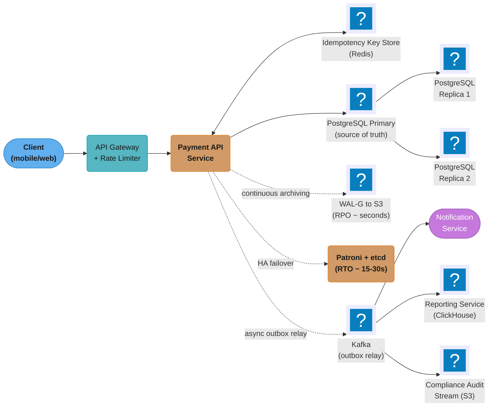
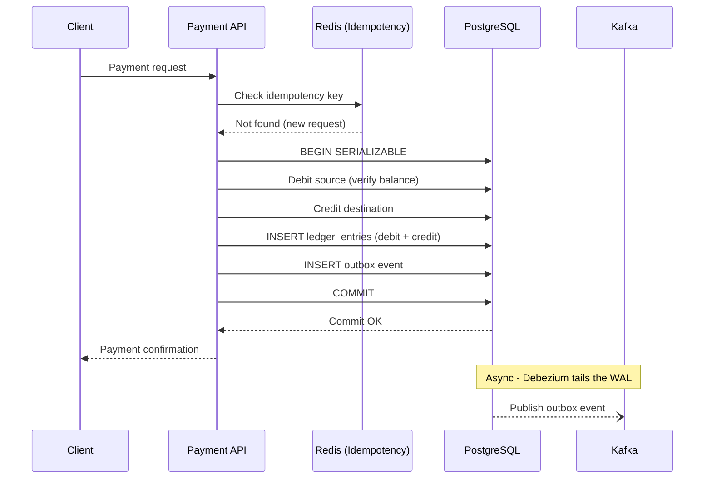
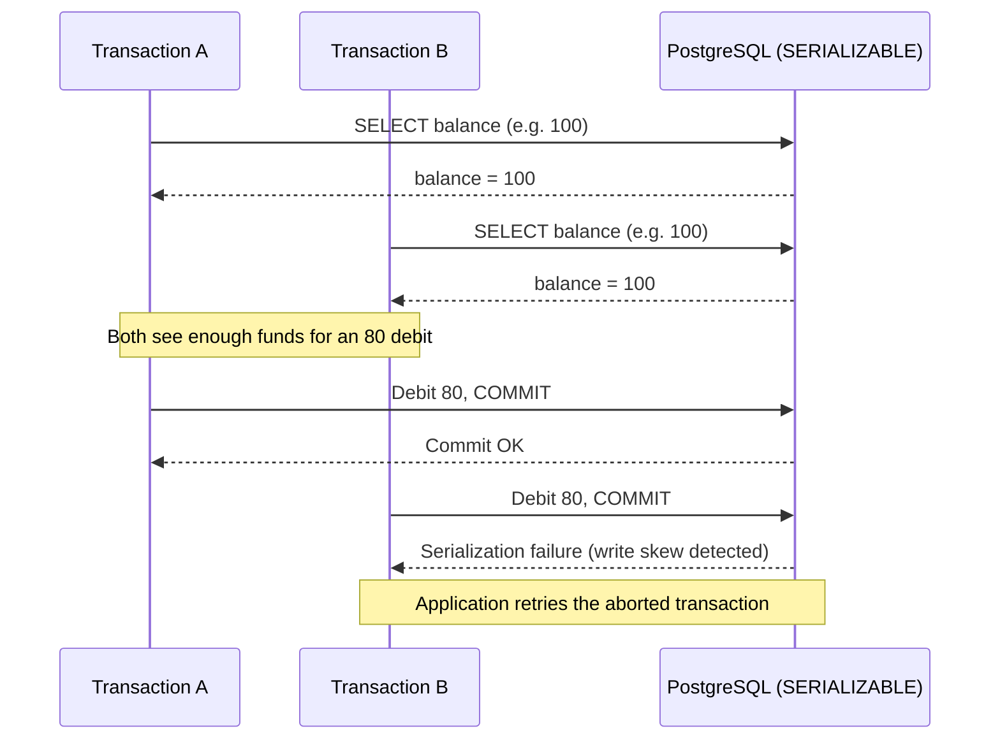
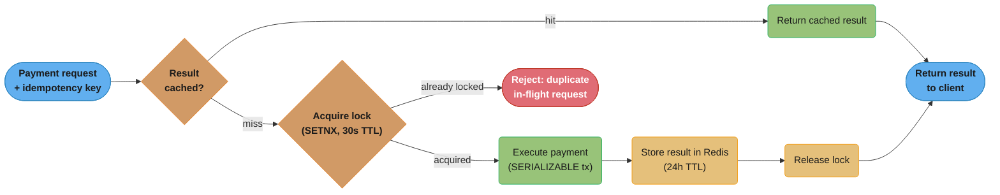
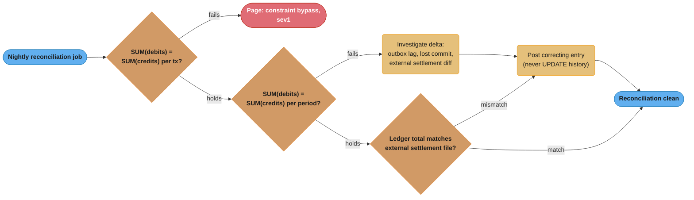

# Case Study: Design a Banking Ledger

## Intuition

A ledger is not a balance — it is a history that a balance falls out of. The single biggest mental
shift for this problem is refusing to store "how much money is in this account" anywhere. Instead
you store every movement that ever happened, each one touching at least two accounts by equal and
opposite amounts, and the balance is just the arithmetic sum of that history at a point in time.
If the number you show a customer is a column you can `UPDATE`, it can drift from the truth; if it
is a `SUM()` over immutable rows, it cannot — the truth and the displayed number are mechanically
the same computation.

The second insight is that "double-entry" is not accounting folklore, it is a built-in integrity
check. Every transaction produces at least one debit row and one credit row whose amounts sum to
zero. That single invariant — enforceable with a `CHECK` constraint and a post-write assertion —
is what lets you prove, mechanically, that money was never created or destroyed by a bug.
Everything else in this design (SERIALIZABLE isolation, append-only storage, idempotency keys,
synchronous replication) exists to protect that one invariant under concurrency, retries, and
failure.

The third insight is that correctness here is not a performance feature you can trade away under
load — it is the product. A social feed that shows a stale like-count for five seconds is a UX
blemish; a ledger that shows a wrong balance for five seconds is a regulatory incident. That
asymmetry is why this design accepts costs — SERIALIZABLE retries, synchronous-replication
latency, an idempotency round trip on every write — that a throughput-first system would never
accept, and why "we'll fix it in the next release" is not an option: a wrong ledger entry is fixed
by posting another entry, never by editing the first one.

The accounting model that this schema stores (normal balances, zero-sum postings, holds and
reversals) is in [Double-Entry Ledger Design](../../../fintech/double_entry_ledger_design/double_entry_ledger_design.md), and
hot-account contention is in [Hot Accounts and Ledger Scaling](../../../fintech/double_entry_ledger_design/hot_accounts_and_ledger_scaling.md).
Both are in `fintech/`.

---

## 1. Requirements Clarification

### Functional requirements

- Immutable, append-only journal of every financial movement (regulatory requirement —
auditors must be able to replay history exactly as it happened, including mistakes and their
corrections).
- Double-entry invariant: every transaction is a set of ledger entries whose amounts
sum to zero per currency; no entry exists without at least one offsetting entry.
- Idempotent payment API: a client retry (network timeout, load-balancer failover)
must never cause a second, distinct movement of money.
- Current balance query, and point-in-time balance query ("what was this account's
balance at `T`?") for statements and dispute resolution.
- Multi-currency accounts and multi-currency transfers (with FX conversion recorded as
its own auditable leg, not folded silently into the transfer amount).
- Correction workflow: a wrong entry is reversed by a new, equal-and-opposite entry
referencing the original — never edited or deleted.

### Non-functional requirements

- Sub-100ms P99 latency for the synchronous payment-processing path.
- RPO = 0 for the primary region: no transaction that returned "committed" to the
client may ever be lost.
- RTO = 30 seconds for a same-region HA failover (not a full DR restore).
- Regulatory retention: 7 years of transaction history must be reconstructable
(varies by jurisdiction and instrument — 7 years is the conservative superset used here, covering
SOX-adjacent and AML retention regimes).
- Auditable: every write is attributable (who/what/when), and every correction is
traceable to the entry it corrects.

### Explicit non-goals

- This is not a general-purpose OLTP database design — it is scoped to the ledger
core. Card authorization, fraud scoring, and statement rendering are adjacent services that read
from or write into this ledger, not part of it.
- Not designing the payment network integration (card rails, ACH, SWIFT) — the ledger
records the outcome of those integrations, it does not implement them.
- Not designing a general reporting/analytics warehouse — §6 and §7 note where one
plugs in downstream, but its schema is out of scope here.

### Assumptions clarified with the interviewer

- **"10,000 transactions per second" is the sustained peak design target, not the
average.** This is the first clarifying question worth asking out loud — sizing a system for
peak-as-average wildly overprovisions it. Assumed average load is ~3,000 tx/s (peak factor ≈
3.3x), with a rare stretch case of 15,000 tx/s on extreme days (month-end settlement, a
promotional spike). All of §2's arithmetic is walked from these three numbers.
- Online (hot, queryable in Postgres) retention is 2 years; years 3–7 are cold,
archived, and queryable only through a slower batch/analytical path — this distinction drives the
partitioning strategy in §4 and the capacity plan in §10.
- "Global payments company" implies multi-currency and multi-region, but a single
ledger-of-record region with synchronous local replication and asynchronous cross-region DR — see
§5 for why full multi-region synchronous writes were rejected.

---

## 2. Scale Estimation

**Transaction rate.** Average 3,000 tx/s, peak (design target) 10,000 tx/s, stretch peak 15,000
tx/s.

**Entries per transaction.** Double-entry means every simple transfer produces at least 2 rows in
`ledger_entries` (one debit, one credit). A transaction with a fee or an FX conversion leg
produces 3–4 rows. Using 2 as the conservative baseline for sizing:

- Entry writes/s average = 3,000 tx/s × 2 = **6,000 entries/s**
- Entry writes/s peak = 10,000 tx/s × 2 = **20,000 entries/s**
- Entry writes/s stretch = 15,000 tx/s × 2 = **30,000 entries/s**

**Bytes per `ledger_entries` row.** Field by field, Postgres heap storage:

| Field | Type | Bytes |
|---|---|---|
| Tuple header | — | ~24 |
| `id` | UUID | 16 |
| `transaction_id` | UUID | 16 |
| `account_id` | UUID | 16 |
| `amount` | `DECIMAL(19,4)` | ~10 (variable-length numeric, header + up to ~5 base-10000 digit groups for this precision) |
| `currency` | `CHAR(3)` | 4 (aligned) |
| `entry_type` | `VARCHAR(10)` | ~11 (1-byte length + up to 10 chars) |
| `description` | `TEXT` | ~30 (short descriptions; longer ones TOAST out-of-line) |
| `created_at` | `TIMESTAMPTZ` | 8 |
| **Heap row total** | | **≈ 150 bytes** (after alignment padding) |

Two indexes touch every row: the partitioned primary key `(id, created_at)` and
`idx_ledger_account_date (account_id, created_at DESC)`. A B-tree index entry runs roughly 30–40
bytes once you include the key columns, item pointer, and page overhead; call it **≈ 100 bytes/row
across both indexes**. All-in, budget **≈ 250 bytes per ledger-entry row** (heap + indexes).

**Storage accumulation, walked to 1/3/5/7 years** (using average sustained load, since total
accumulated storage is driven by average, not burst peaks):

```
Entries/day  = 6,000/s × 86,400 s/day    = 518,400,000 entries/day
Bytes/day    = 518,400,000 × 250 bytes   ≈ 129.6 GB/day  (heap + index)
```

| Horizon | Cumulative logical storage | Hot (Postgres, ≤2y online) | Cold (S3 Parquet, ~4x compressed) |
|---|---|---|---|
| 1 year | 129.6 GB × 365 ≈ 47.3 TB | 47.3 TB (still within the 2y window) | 0 |
| 2 years | ≈ 94.6 TB | 94.6 TB (plateau point) | 0 |
| 3 years | ≈ 141.9 TB | 95 TB (oldest year detached) | (141.9 − 95) / 4 ≈ 11.7 TB |
| 5 years | ≈ 236.5 TB | 95 TB | (236.5 − 95) / 4 ≈ 35.4 TB |
| 7 years | ≈ 331.2 TB | 95 TB | (331.2 − 95) / 4 ≈ 59.1 TB |

```mermaid
xychart-beta
    title "Ledger Storage Growth, Hot vs Cold (TB)"
    x-axis [Year 1, Year 2, Year 3, Year 5, Year 7]
    y-axis "Storage (TB)" 0 --> 350
    bar "Hot (Postgres, online)" [47.3, 94.6, 95, 95, 95]
    bar "Cold (S3 Parquet, compressed)" [0, 0, 11.7, 35.4, 59.1]
```



*Hot storage plateaus once the 2-year online window starts shedding the oldest partition; cold
storage keeps growing linearly at the archive rate, but compressed ~4x by columnar storage — the
two curves diverging is exactly the point of tiering.*

**WAL volume.** WAL carries the logical change plus periodic full-page images after each
checkpoint (`full_page_writes`); a rule-of-thumb multiplier of ~3x the heap row size is a
reasonable planning number for an insert-heavy, index-light workload like this one:

```
WAL bytes/entry  ≈ 250 bytes × 3        = 750 bytes
WAL/day (avg)    = 518.4M entries × 750B ≈ 389 GB/day
WAL/day (peak)   = 20,000/s × 750B × 86,400s ≈ 1.3 TB/day (if sustained all day, which it never is)
Sustained upload bandwidth for WAL-G (avg) ≈ 389GB / 86,400s ≈ 4.5 MB/s
Sustained upload bandwidth during peak windows ≈ 15 MB/s
```

Both are trivial for S3 upload bandwidth — WAL archiving is never the bottleneck here.

**Write IOPS.** Each entry insert plus its two index updates is roughly 3 physical write
operations at the storage layer; at peak, 20,000 entries/s × 3 ≈ **60,000 write IOPS**, which is
the number that actually drives instance/volume selection in §10 — this workload is IOPS-bound,
not CPU-bound, because it is almost entirely narrow appends.

**What falls out.** A single well-tuned primary can plausibly absorb 60,000 write IOPS of narrow,
index-light, append-only inserts (no random updates, no read-modify- write hot rows outside the
row-lock path in §4) on provisioned-IOPS storage — this is why §10 sizes one primary rather than
jumping straight to sharding, and why §11 answers "how do you shard a ledger" with "usually you
don't, until this number stops holding."

---

## 3. High-Level Architecture



*System topology: the synchronous request path (solid arrows) runs Client to Payment API to the
PostgreSQL primary and the Redis idempotency store; WAL archiving, Patroni/etcd failover, and the
Kafka outbox relay all sit off the hot path (dotted arrows) so they never add latency to a
payment.*

**Request flow (payment):**



*The double-entry write and the idempotency check both happen inside one SERIALIZABLE transaction
before the client gets a response; the outbox event reaches Kafka afterward and asynchronously, so
a slow or down Kafka never blocks a payment. See [Distributed
Transactions](../../distributed_transactions/distributed_transactions.md) for why the outbox
pattern, not a direct dual-write, is what makes this safe.*

The synchronous standby that backs RPO=0 and the failover orchestration that backs RTO=30s are
both instances of the general replication problem covered in [Replication and High
Availability](../../replication_and_high_availability/replication_and_high_availability.md); this
case study applies that module's synchronous-replication tradeoff to the one domain where the
"accept the latency" answer is non-negotiable.

---

## 4. Component Deep Dives

### 4.1 Double-Entry Bookkeeping Schema

```sql
-- Accounts table
CREATE TABLE accounts (
    id             UUID PRIMARY KEY DEFAULT gen_random_uuid(),
    account_number VARCHAR(20) UNIQUE NOT NULL,
    currency       CHAR(3) NOT NULL,
    created_at     TIMESTAMPTZ DEFAULT now(),
    status         VARCHAR(20) DEFAULT 'ACTIVE'
    -- NOTE: No balance column — balance is derived from ledger_entries.
    -- This prevents balance/ledger divergence (see the BROKEN/FIXED pair below
    -- for what happens when you try to make the derived path fast instead).
);

-- Ledger entries: the immutable heart of the system
CREATE TABLE ledger_entries (
    id              UUID DEFAULT gen_random_uuid(),
    transaction_id  UUID NOT NULL,             -- groups debit + credit entries
    account_id      UUID NOT NULL REFERENCES accounts(id),
    amount          DECIMAL(19, 4) NOT NULL,   -- positive = credit, negative = debit
    currency        CHAR(3) NOT NULL,
    entry_type      VARCHAR(10) NOT NULL CHECK (entry_type IN ('DEBIT', 'CREDIT')),
    description     TEXT,
    created_at      TIMESTAMPTZ DEFAULT now() NOT NULL,
    -- Every unique constraint on a partitioned table must contain the partition key,
    -- so the primary key is (id, created_at), not id alone.
    PRIMARY KEY (id, created_at),
    -- Immutable: no UPDATE or DELETE allowed on this table (enforced below, not just
    -- by convention).
    CONSTRAINT positive_credit CHECK (entry_type = 'DEBIT' OR amount > 0),
    CONSTRAINT negative_debit  CHECK (entry_type = 'CREDIT' OR amount < 0)
) PARTITION BY RANGE (created_at);

-- Partitioned by month for efficient archiving; see the schema-design module for
-- when range partitioning is the right normal-form tradeoff:
-- ../../schema_design_and_normalization/schema_design_and_normalization.md
CREATE TABLE ledger_entries_2025_01 PARTITION OF ledger_entries
    FOR VALUES FROM ('2025-01-01') TO ('2025-02-01');
-- pg_partman manages monthly partition creation automatically.

-- Transactions: groups the debit and credit ledger_entries
CREATE TABLE transactions (
    id              UUID PRIMARY KEY DEFAULT gen_random_uuid(),
    idempotency_key UUID UNIQUE NOT NULL,      -- client-provided, prevents double processing
    source_account  UUID NOT NULL REFERENCES accounts(id),
    dest_account    UUID NOT NULL REFERENCES accounts(id),
    amount          DECIMAL(19, 4) NOT NULL CHECK (amount > 0),
    currency        CHAR(3) NOT NULL,
    status          VARCHAR(20) DEFAULT 'COMPLETED',
    created_at      TIMESTAMPTZ DEFAULT now() NOT NULL,
    metadata        JSONB
);

-- Outbox for reliable event publishing
CREATE TABLE outbox (
    id              UUID PRIMARY KEY DEFAULT gen_random_uuid(),
    aggregate_type  VARCHAR(50) NOT NULL,      -- 'Transaction'
    aggregate_id    UUID NOT NULL,
    event_type      VARCHAR(50) NOT NULL,      -- 'TransactionCompleted'
    payload         JSONB NOT NULL,
    status          VARCHAR(20) DEFAULT 'PENDING',
    created_at      TIMESTAMPTZ DEFAULT now()
);

-- Indexes
CREATE INDEX idx_ledger_account_date ON ledger_entries (account_id, created_at DESC);
CREATE INDEX idx_transactions_idempotency ON transactions (idempotency_key);
CREATE INDEX idx_transactions_source ON transactions (source_account, created_at DESC);
CREATE UNIQUE INDEX idx_outbox_pending ON outbox (id) WHERE status = 'PENDING';
```

**Enforcing the immutability the regulator asked for.** A `-- no UPDATE or DELETE allowed` comment
is documentation, not a control, and an auditor will treat it as one. Immutability has to be
enforced by the database, in two layers, because either one alone has a hole:

```sql
-- Layer 1: privileges. The application role can only ever append.
REVOKE UPDATE, DELETE, TRUNCATE ON ledger_entries FROM app_writer;
GRANT  SELECT, INSERT                ON ledger_entries TO   app_writer;

-- Layer 2: a trigger, because privileges do not bind the table OWNER, and the
-- owner is who runs migrations at 2am.
CREATE OR REPLACE FUNCTION reject_ledger_mutation() RETURNS TRIGGER AS $$
BEGIN
    RAISE EXCEPTION 'ledger_entries is append-only (attempted %)', TG_OP
        USING ERRCODE = 'restrict_violation';
END;
$$ LANGUAGE plpgsql;

CREATE TRIGGER ledger_entries_immutable
    BEFORE UPDATE OR DELETE ON ledger_entries
    FOR EACH ROW EXECUTE FUNCTION reject_ledger_mutation();
-- Triggers on a partitioned parent propagate to every partition, existing and future.
```

Corrections never edit history: post a reversing entry with the same `transaction_id` and the
opposite sign, so the audit trail shows both the error and its remedy. `TRUNCATE` is revoked
separately because it is not a `DELETE` and the row trigger never sees it — a `BEFORE TRUNCATE ...
FOR EACH STATEMENT` trigger is the belt-and-braces version.

### 4.2 SERIALIZABLE Isolation for Payment Transactions

```java
@Service
public class PaymentService {

    @Transactional(isolation = Isolation.SERIALIZABLE)
    public Transaction processPayment(PaymentRequest req) {
        // Step 1: Idempotency check (within same SERIALIZABLE transaction)
        Optional<Transaction> existing = txRepo.findByIdempotencyKey(req.idempotencyKey());
        if (existing.isPresent()) {
            return existing.get();  // Return previous result, do not process again
        }

        // Step 2: Lock accounts in a DETERMINISTIC order, not request order.
        // See "Deadlocks from inconsistent lock order" below for why.
        UUID first  = req.sourceAccountId().compareTo(req.destAccountId()) < 0
            ? req.sourceAccountId() : req.destAccountId();
        UUID second = first.equals(req.sourceAccountId())
            ? req.destAccountId() : req.sourceAccountId();
        accountRepo.findByIdForUpdate(first);
        accountRepo.findByIdForUpdate(second);

        BigDecimal balance = ledgerRepo.calculateBalance(req.sourceAccountId(), req.currency());
        if (balance.compareTo(req.amount()) < 0) {
            throw new InsufficientFundsException("Balance: " + balance + " < " + req.amount());
        }

        // Step 3: Create transaction record
        Transaction tx = Transaction.builder()
            .idempotencyKey(req.idempotencyKey())
            .sourceAccount(req.sourceAccountId())
            .destAccount(req.destAccountId())
            .amount(req.amount())
            .currency(req.currency())
            .build();
        tx = txRepo.save(tx);

        // Step 4: Double-entry ledger entries
        ledgerRepo.save(LedgerEntry.debit(tx.getId(), req.sourceAccountId(),
            req.amount().negate(), req.currency()));
        ledgerRepo.save(LedgerEntry.credit(tx.getId(), req.destAccountId(),
            req.amount(), req.currency()));

        // Step 5: Verify double-entry integrity — sum of entries for this tx must be zero
        BigDecimal sum = ledgerRepo.sumByTransactionId(tx.getId());
        if (sum.compareTo(BigDecimal.ZERO) != 0) {
            throw new LedgerIntegrityException("Double-entry sum != 0: " + sum);
        }

        // Step 6: Outbox event for downstream consumers
        outboxRepo.save(OutboxEvent.transactionCompleted(tx));

        return tx;
    }
}
```

**Why SERIALIZABLE — the write-skew race it blocks:**



*Without the row locks of step 2, READ COMMITTED lets both transactions read the same starting
balance and commit both debits, driving the account negative. SERIALIZABLE catches it even with no
explicit lock: A and B each read the set of `ledger_entries` rows the other then inserted into, so
SSI flags the read-write dependency cycle and aborts B with a serialization failure. See
[Concurrency Control and
Locking](../../concurrency_control_and_locking/concurrency_control_and_locking.md) for the general
mechanics behind serializable snapshot isolation this diagram relies on.*

### 4.3 BROKEN → FIXED: Balance Calculation at Scale

The naive version of "derive, don't store" looks correct and gets slower every day the account
stays active — the bug is not in the SQL, it is in the complexity class.

```sql
-- BROKEN: sums the account's ENTIRE history on every balance check.
CREATE OR REPLACE FUNCTION get_balance_broken(p_account_id UUID, p_currency CHAR(3))
RETURNS DECIMAL(19, 4) AS $$
    SELECT COALESCE(SUM(amount), 0)
    FROM ledger_entries
    WHERE account_id = p_account_id
      AND currency = p_currency;
$$ LANGUAGE SQL STABLE;
```

**What this costs, concretely.** The `idx_ledger_account_date` index makes this an index scan, not
a sequential scan — but it is still `O(n)` in the number of entries for that account, because
every row has to be read to be summed. A high-volume internal clearing account (a large merchant's
settlement account posting, say, 50,000 entries/day) accumulates 50,000 × 365 × 3 ≈ 54.75 million
entries over 3 years. Summing 54.75 million rows, even via an efficient index-only scan at a
generous ~2 million rows/sec, takes **≈ 27 seconds** — and it gets slower every day the account
stays active, with no ceiling. That is not survivable against a <100ms P99 balance-check SLA on
the payment hot path; it is the kind of bug that ships clean in staging (where test accounts have
a few hundred entries) and pages someone in production a year later once real accounts have
millions.

```sql
-- FIXED: a daily balance checkpoint bounds the scan to "since the last checkpoint."
CREATE TABLE balance_checkpoints (
    account_id  UUID NOT NULL,
    currency    CHAR(3) NOT NULL,
    balance     DECIMAL(19, 4) NOT NULL,
    as_of_date  DATE NOT NULL,
    created_at  TIMESTAMPTZ DEFAULT now(),
    PRIMARY KEY (account_id, currency, as_of_date)
);

CREATE OR REPLACE FUNCTION get_balance_optimized(p_account_id UUID, p_currency CHAR(3))
RETURNS DECIMAL(19, 4) AS $$
DECLARE
    v_checkpoint_balance DECIMAL(19,4);
    v_checkpoint_date    DATE;
    v_delta              DECIMAL(19,4);
BEGIN
    SELECT balance, as_of_date
    INTO v_checkpoint_balance, v_checkpoint_date
    FROM balance_checkpoints
    WHERE account_id = p_account_id AND currency = p_currency
    ORDER BY as_of_date DESC LIMIT 1;

    -- SELECT ... INTO sets both variables to NULL when no checkpoint row exists,
    -- so an unguarded NULL + delta would return NULL for every new account.
    IF NOT FOUND THEN
        v_checkpoint_balance := 0;
        v_checkpoint_date    := DATE '1970-01-01';
    END IF;

    SELECT COALESCE(SUM(amount), 0)
    INTO v_delta
    FROM ledger_entries
    WHERE account_id = p_account_id
      AND currency = p_currency
      AND created_at > v_checkpoint_date::TIMESTAMPTZ;

    RETURN v_checkpoint_balance + v_delta;
END;
$$ LANGUAGE plpgsql STABLE;
```

With a checkpoint written once per account per day, "since checkpoint" is bounded by that
account's worst single-day volume — for the same 50,000-entries/day merchant, that is at most
50,000 rows, an index scan on the order of tens of milliseconds regardless of whether the account
is 1 day or 10 years old. **27 seconds, unbounded, becomes ~25ms, bounded — and the bound is flat,
not merely smaller.** The checkpoint table itself is one row per account per currency per day:
cheap to write nightly and small enough to keep fully cached in memory even for millions of
accounts.

### 4.4 BROKEN → FIXED: Deadlocks from Inconsistent Lock Order

**What goes wrong.** `SELECT ... FOR UPDATE` acquired in request-arrival order looks harmless
until two transfers cross the same pair of accounts in opposite directions: Transaction A
transfers X→Y (locks X, then Y); concurrently, Transaction B transfers Y→X (locks Y, then X). Each
holds the lock the other is waiting for — a classic deadlock. Postgres detects it after
`deadlock_timeout` (default 1s) and aborts one transaction with `40P01`. Against a hot pair of
accounts (a central clearing account touched by thousands of transfers/minute), this is not a rare
edge case, it is a recurring, throughput-limiting failure mode.

```sql
-- BROKEN: locks acquired in the order the transfer direction dictates.
-- A→B locks (A, B); B→A locks (B, A); guaranteed deadlock under concurrency.
SELECT * FROM accounts WHERE id = :source_account_id FOR UPDATE;
SELECT * FROM accounts WHERE id = :dest_account_id   FOR UPDATE;
```

The fix already lives in the Java snippet in §4.2 (`first`/`second` computed by UUID comparison):
**always acquire locks in a deterministic order, independent of which account is the debit side
and which is the credit side.** Every transaction touching accounts X and Y — no matter the
direction of money movement — locks the lower-UUID account first. That collapses the wait-for
cycle entirely; there is no ordering under which two transactions can deadlock on the same pair,
because both always request the same account first. SERIALIZABLE can still abort a transaction for
genuine write-skew (§4.2), but that is a cheaper, expected failure mode with a well-understood
retry story — a deadlock storm is neither.

### 4.5 Row-Level Security for Account Isolation

```sql
-- Multi-tenant banking: each user/org can only see their own accounts
ALTER TABLE accounts ENABLE ROW LEVEL SECURITY;
ALTER TABLE ledger_entries ENABLE ROW LEVEL SECURITY;

-- FORCE is required, not optional: ENABLE alone still lets the TABLE OWNER read
-- every row, and the application role is usually the owner. (Superusers and
-- BYPASSRLS roles bypass regardless, so the app must never connect as one.)
ALTER TABLE accounts FORCE ROW LEVEL SECURITY;
ALTER TABLE ledger_entries FORCE ROW LEVEL SECURITY;

CREATE POLICY account_owner ON accounts
    USING (id = ANY(current_setting('app.authorized_accounts')::UUID[]));

CREATE POLICY ledger_owner ON ledger_entries
    USING (account_id = ANY(current_setting('app.authorized_accounts')::UUID[]));

-- Application sets the user's authorized accounts before any query:
-- SET LOCAL app.authorized_accounts = '{uuid1, uuid2}';
```

### 4.6 CQRS: Separate Balance Read Model

```java
// Write model: SERIALIZABLE transaction in PostgreSQL
@Transactional(isolation = Isolation.SERIALIZABLE)
public Transaction processPayment(PaymentRequest req) { /* ... */ }

// Read model: balance queries use read replica + Redis cache
@Service
public class BalanceQueryService {

    public AccountBalance getBalance(UUID accountId, String currency) {
        String cacheKey = "balance:" + accountId + ":" + currency;

        // L1: Redis cache (5-second TTL — balance changes frequently)
        BigDecimal cached = redis.opsForValue().get(cacheKey);
        if (cached != null) {
            return AccountBalance.of(accountId, currency, cached);
        }

        // L2: Read replica (slightly stale — eventually consistent)
        BigDecimal balance = readReplicaLedgerRepo.calculateBalance(accountId, currency);
        redis.opsForValue().set(cacheKey, balance, Duration.ofSeconds(5));

        return AccountBalance.of(accountId, currency, balance);
    }

    public void invalidateBalance(UUID accountId, String currency) {
        redis.delete("balance:" + accountId + ":" + currency);
    }
}
```

### 4.7 Idempotency Key Lifecycle

```java
@Component
public class IdempotencyService {

    // Check before processing; store result after processing
    public <T> T executeIdempotent(UUID idempotencyKey, Supplier<T> operation) {
        String lockKey = "idempotency:lock:" + idempotencyKey;
        String resultKey = "idempotency:result:" + idempotencyKey;

        // Check if already processed (Redis fast path)
        String cachedResult = redis.opsForValue().get(resultKey);
        if (cachedResult != null) {
            return deserialize(cachedResult);
        }

        // Acquire distributed lock to prevent concurrent duplicate processing
        boolean locked = redis.opsForValue()
            .setIfAbsent(lockKey, "1", Duration.ofSeconds(30));
        if (!locked) {
            throw new ConcurrentRequestException("Duplicate in-flight request");
        }

        try {
            T result = operation.get();  // Execute the actual payment
            // Store result in Redis (24-hour TTL — matches client retry window)
            redis.opsForValue().set(resultKey, serialize(result), Duration.ofHours(24));
            return result;
        } finally {
            redis.delete(lockKey);
        }
    }
}
```

**Idempotent execution — the decision tree behind `executeIdempotent`:**



*The Redis result cache is the fast path (top); the distributed lock only guards the narrow window
where two retries race before either has written a cached result — losing that race gets rejected
outright rather than double-processing the payment. The 24-hour TTL is a design choice, not an
accident — see §11 for the reasoning.*

---

## 5. Design Decisions & Tradeoffs

| Decision | Choice | Alternative | Reason |
|----------|--------|-------------|--------|
| Isolation | SERIALIZABLE | READ COMMITTED | Prevents write skew (phantom double-spend); §4.2 shows the exact race READ COMMITTED misses |
| Balance storage | Derived (sum entries) + daily checkpoint | Stored column | A stored column can diverge from the entries that are supposed to justify it; derived is always correct, and the checkpoint (§4.3) removes the naive approach's only real cost |
| Lock acquisition | Deterministic order (lower UUID first) | Request/direction order | Eliminates a whole deadlock class instead of retrying around it (§4.4) |
| Partitioning | Monthly by `created_at` | Annual, or unpartitioned | Matches the 2-year hot window in §2 almost exactly (24 partitions live at steady state); monthly detachment is a fast metadata operation, annual would hold a year of "already cold" data online |
| Idempotency | DB `idempotency_key` UNIQUE + Redis fast path | DB uniqueness alone | Redis avoids a DB round trip for the common case (duplicate retry within the TTL window); the DB constraint is still the correctness backstop if Redis is unavailable or evicts early |
| Event delivery | Outbox table + Debezium CDC | Direct Kafka write inside the transaction | Outbox guarantees the event is durable the moment the transaction commits, with no dependency on Kafka being reachable at commit time — see [Distributed Transactions](../../distributed_transactions/distributed_transactions.md) |
| Replication | Synchronous, 1 local standby (RPO=0) | Fully asynchronous | Financial data cannot tolerate silent loss on failover; the 1–2ms LAN latency this adds is cheap against a <100ms P99 budget — see [Replication and High Availability](../../replication_and_high_availability/replication_and_high_availability.md) |
| Cross-region DR | Asynchronous | Synchronous multi-region | Synchronous cross-region writes add 50–200ms round trips, incompatible with the latency SLA; DR accepts a small, bounded RPO (WAL-archiving lag) in exchange for keeping the hot path fast — this tradeoff is exactly what produced the war story in §9 |
| Sharding | Not sharded (single primary) | Shard by account range | §2's IOPS math shows one primary has headroom at target scale; sharding a ledger multiplies the surface area for cross-shard transactions (§11) for a problem this design doesn't have yet |

---

## 6. Real-World Implementations

**Stripe** builds its public API around an explicit `Idempotency-Key` request header: any API call
can be retried safely within a rolling window (Stripe documents this as roughly 24 hours), and a
key reused with a different request body is treated as a conflict rather than silently reprocessed
— the same fingerprint-plus-TTL pattern this case study implements with Redis plus a DB uniqueness
constraint. Internally, Stripe has described moving core money-movement state onto a ledger
service where every state change to a customer-facing object (a Charge, a Transfer) is represented
as a balanced double-entry transaction rather than a mutated field — the same "no stored balance,
only derived from entries" discipline as §4.1.

**Square (Block)** operates money movement across multiple consumer- and merchant-facing products
(point-of-sale settlement, Cash App transfers) on a shared internal ledger platform, so every
product's movement of money is recorded through one common, auditable double-entry system rather
than each product team inventing its own accounting logic — the same argument for centralizing the
ledger as a distinct service rather than letting each feature team own its own balance column.

**Marqeta**, a card-issuing platform, is the clearest real-world example of the auth/clear split
this design elides. Card authorization happens in milliseconds against a fast, often pre-computed
"available to spend" figure — a provisional hold, not yet an immutable ledger posting. The
definitive ledger entry is written later at clearing/settlement, sometimes days afterward and for
a different final amount (a tip adjustment, an FX conversion, a partial capture). Any production
card-ledger design has to reconcile these explicitly — "authorized but not cleared" and "settled"
are different numbers by design, not by bug.

**Uber** built **LedgerStore** on top of Docstore, Uber's own sharded-MySQL key-value storage
layer, specifically to hold immutable, versioned financial ledger records at very large scale.
Uber's own description of the system emphasizes exactly the properties this case study builds by
hand in Postgres: journal entries are never updated in place, writes are idempotent, and the store
supports point-in-time ("time travel") queries over ledger history — the same requirement from §1,
solved as a storage feature rather than a derived query.

**Modern Treasury** publishes a "Ledgers" API whose entire data model is the double-entry
primitive from §4.1 exposed directly as a public interface: a `ledger_transaction` contains two or
more `ledger_entries`, and the platform rejects any transaction whose entries do not balance
within a currency — an independent company productized the exact invariant §4.1 enforces with a
`CHECK` constraint and a post-write assertion, as the entire value proposition of their API.

**TigerBeetle** is worth naming for what a purpose-built approach looks like, as opposed to this
case study's general-purpose-database approach. It is an OLTP database designed specifically for
financial accounting rather than a relational database retrofitted for ledgers. Its core primitive
is the *transfer* — a single first-class object that debits one account and credits another
atomically, rather than two separate row inserts the application must keep in sync (the pattern
§4.2 hand-rolls across two inserts plus an application-level sum-to-zero assertion). Transfers
also support a two-phase pending/post-or-void mode that maps directly onto Marqeta's auth/clear
split, as a database primitive rather than application code — achieved by running as a
single-threaded deterministic state machine replicated via a Viewstamped-Replication-derived
consensus protocol, the opposite of a general-purpose database's flexibility, and worth raising
when asked "would you ever build this on something other than Postgres?"

---

## 7. Technologies & Tools

| Tool | Role in this design | Why over the alternative | Operational cost it adds |
|---|---|---|---|
| PostgreSQL | Source of truth: `ledger_entries`, `transactions`, `accounts`, `outbox` | ACID + SERIALIZABLE gives write-skew protection without hand-rolled locking everywhere; mature partitioning and RLS | `autovacuum` and partition-maintenance tuning; lock-order discipline is a code-review rule, not something the DB enforces for you |
| Redis | Idempotency fast-path cache, balance read cache | Sub-millisecond lookups avoid a DB round trip for the common duplicate-retry case | Must never become a second source of truth — the DB unique constraint is still the backstop; eviction/TTL tuning matters |
| Patroni + etcd | HA failover orchestration for Postgres | Automates promotion faster and more reliably than a human running a runbook at 3am | The etcd cluster itself needs its own HA (3–5 nodes); `synchronous_standby_names` misconfiguration during a failover is exactly what caused the war story in §9 |
| WAL-G | Continuous WAL archiving to S3 | Streaming incremental backup with fast point-in-time restore, cheaper than periodic logical dumps | Ongoing S3 storage cost; restore drills are mandatory — an untested backup is a hypothesis, not a backup |
| Kafka + Debezium | Outbox event relay via CDC | Decouples downstream consumers from the ledger transaction; Debezium tails the WAL instead of the app dual-writing to two systems | Operating a Kafka cluster plus a Debezium connector, and monitoring connector/replication lag as a first-class metric (§8) |
| pg_partman | Automated monthly partition management | Removes hand-rolled DDL for partition creation and detachment | Must itself be monitored — a silently failed maintenance job produces the missing-partition outage in §9 |
| ClickHouse | Downstream reporting/analytics store, fed via Kafka | Column-store fits aggregate reporting far better than row-store OLTP Postgres | A separate cluster with its own operational burden, and it is eventually consistent with the ledger by construction — never the system of record |

---

## 8. Operational Playbook

### Metrics to dashboard

| Metric | Source | Unit |
|---|---|---|
| Serialization failure rate (`40001`) | `pg_stat_database.xact_rollback`, filtered | failures/s and % of attempted transactions |
| Deadlocks | `pg_stat_database.deadlocks` | deadlocks/s |
| Synchronous replication lag | `pg_stat_replication` (`flush_lag`) | ms |
| WAL archiving lag (WAL-G) | WAL-G status | seconds behind |
| Outbox backlog | `SELECT count(*) FROM outbox WHERE status='PENDING'` | row count, and age of oldest pending row |
| Idempotency cache hit rate | Redis-side counters | % |
| Payment latency | Application tracing | P50/P95/P99, ms |
| Reconciliation delta | Nightly job output | currency amount, should be exactly 0 |

### Alert thresholds

- Serialization failure rate > 5% of attempted transactions, sustained 5 minutes → page.
- Synchronous standby flush lag > 2 seconds → page (this is a direct RPO risk).
- Outbox backlog > 10,000 pending rows, or oldest pending row > 60 seconds old → page.
- Reconciliation delta ≠ 0 for any transaction or period → page immediately, treat as
Sev1 regardless of amount — a $0.01 delta is a bug signal, not a rounding shrug.

### Runbooks

**1. Synchronous standby degraded or unreachable.**
1. Confirm via `pg_stat_replication` whether the standby is lagging or fully down.
2. If briefly lagging, wait out `synchronous_standby_names` timeout behavior — Postgres
will not commit past an unreachable synchronous standby, which is the RPO guarantee working as
designed, at the cost of write availability.
3. If down longer than the incident tolerates, relaxing to async is a deliberate,
ticketed decision — never a silent default — because it briefly reopens the exact loss window in
§9's DR war story.
4. Once the standby recovers, confirm it has caught up before reverting to sync mode.

**2. Deadlock or serialization-failure storm.**
1. Query `pg_locks` joined to `pg_stat_activity` to identify the contended account(s).
2. Check for a recent deploy that introduced a non-canonical lock order (§4.4) — the
single most common root cause in practice.
3. If it is hot-account contention rather than a bug, apply temporary
application-level rate limiting on that account rather than letting retries pile up on the DB.

**3. Outbox backlog growing.**
1. Check Debezium connector and Kafka broker health first — a stalled connector is
the most common cause and does not indicate a ledger-correctness problem, only a
downstream-notification delay.
2. Restart the connector; verify the backlog drains and does not reaccumulate.
3. If Kafka itself is down, the outbox table is the durable buffer by design — no
payment data is at risk, only notification timeliness.

### Rollout / rollback

Schema changes follow expand-contract (see [Database Migrations, Zero
Downtime](../../database_migrations_zero_downtime/database_migrations_zero_downtime.md)): add
columns/tables additively, backfill, cut over, and only drop the old shape after a bake period.
Because changes are additive-first, "rollback" for a bad app deploy is simply redeploying the
previous version against the same schema — there is deliberately no step that requires reverting a
schema change under incident pressure.

### Backup / restore posture

- **RPO ≈ 0** for same-region HA failover (synchronous replication to the local standby).
- **RPO ≈ seconds** for full-region loss (bounded by WAL-G archiving lag, §2).
- **RTO ≈ 30 seconds** for HA failover (Patroni-orchestrated promotion).
- **RTO on the order of tens of minutes** for a full DR restore from an S3 base
backup plus WAL replay — a materially different number from HA failover that must be stated
separately in any SLA discussion; conflating them is how the DR war story in §9 happened.
- Restore drills are scheduled, not optional — an unpracticed restore procedure is
the most common reason a stated RTO turns out to be fiction during a real incident.

### Reconciliation — a first-class operation, not an afterthought

A nightly job checks three progressively broader invariants (visualized below): per-transaction
balance (`SUM(debits) = SUM(credits)` for every `transaction_id` — guaranteed by the `CHECK`
constraints and the app-level assertion in §4.2, so a failure here means a control was bypassed,
which is a Sev1 on its own), per-period balance (the same sum across an entire day/currency —
catches cross-transaction drift that per-transaction checks cannot see, such as a partially
applied migration), and external reconciliation against ground truth outside the ledger (a
card-network settlement file, a correspondent bank statement) — the check that actually matters
most in practice, because internal invariants can hold perfectly while the ledger still disagrees
with the outside world.



*Three widening checks, one rule that never bends: a failure at any stage is resolved by posting a
correcting entry, never by an `UPDATE` — the immutability trigger in §4.1 makes the wrong move
impossible even under incident pressure.*

---

## 9. Common Pitfalls & War Stories

**SERIALIZABLE retry storm from a batch job.** A month-end fee-assessment batch walked all 40,000
merchant accounts in `account_id` order, each hitting the same SERIALIZABLE path as interactive
payments, retrying up to 3x on `40001`. It drove the serialization-failure rate from a baseline
under 0.5% to **38% for 20 minutes**, and because the batch shared the primary with live traffic,
interactive payment P99 latency went from **60ms to 4.1 seconds** until the batch was paused. Fix:
batch jobs touching many accounts get per-account jitter and an explicit rate limit, and never run
inside the same isolation level and connection pool as the interactive path without a separate
concurrency budget.

**Double-posted transfer from a missing idempotency key.** A client-side bug regenerated the
idempotency key per HTTP attempt instead of per logical payment operation (the key was generated
inline in the retry wrapper, not passed through from the original call). A single $50,000 wire
transfer was posted **3 times** before detection roughly two hours later by the nightly
reconciliation job's per-period delta. Correcting it required two reversing entries and manual
customer communication, and briefly misstated balances by close to $100,000 until fixed. Fix: the
idempotency key must be generated once, by the original caller, before the first attempt — never
inside a retry helper.

**`NUMERIC` vs floating-point rounding drift.** An early version of the FX conversion service
computed converted amounts using application-level `double` instead of `BigDecimal`/`DECIMAL`.
After roughly 2 million small conversions, this accumulated a systematic drift of **$312.47**
between the ledger's internal total and the actually settled amount — small per-transaction
(sub-cent) but consistently biased in one direction, because binary floating-point
round-half-to-even collided with the settlement bank's round-half-up convention. Fix: every money
value, at every layer (DB column, application type, wire format), is a fixed-point decimal — never
a binary float, anywhere in the path, no exceptions.

**Async failover losing committed transactions.** During a primary outage, the on-call promoted
the nearest available replica — which turned out to be the asynchronous cross-region DR replica,
because the synchronous local standby happened to be down for maintenance at the same time. **47
seconds** of committed transactions, roughly **141,000 ledger entries** at peak load, had never
replicated to the promoted node and were lost outright. It surfaced the next day as a permanent,
unexplainable reconciliation delta and required manual reconstruction from the Kafka outbox event
log. Fix: the failover runbook must distinguish "promote the synchronous standby" from "promote
any available replica" as two entirely different operations with different RPO guarantees, and
must refuse the async path without an explicit, logged override.

**Deadlock storm from inconsistent lock order.** A new microservice added an internal fee-transfer
code path that acquired `FOR UPDATE` locks in `(fee_account, source_account)` order instead of the
canonical lower-UUID-first order the rest of the codebase used (§4.4). Against the busiest
settlement account, this produced a deadlock every few seconds, peaking at **240
deadlocks/minute** and roughly doubling P99 latency for any transaction touching that account,
until traced via `pg_locks` and fixed by routing the new code path through the shared
lock-ordering helper instead of reimplementing it.

**Silent partition-maintenance failure.** `pg_partman`'s scheduled maintenance job failed silently
for **6 days** after an unrelated permissions change revoked a grant it needed. On day 7, inserts
past midnight UTC hit `no partition found for row` errors, producing a **6-minute** outage of the
payments API before an emergency partition was created by hand. Fix: partition-maintenance job
success/failure is now its own dashboarded metric with an explicit alert, not something inferred
from the absence of insert errors.

---

## 10. Capacity Planning

### Sizing table

| Tier | Instance class (illustrative) | Count | RAM | Storage | Provisioned IOPS | Role |
|---|---|---|---|---|---|---|
| Primary | 96 vCPU, high-memory | 1 | 768 GB | 120 TB (io2 Block Express or equivalent) | 64,000 | Source of truth, all writes |
| Synchronous standby | Same spec as primary | 1 | 768 GB | 120 TB | 64,000 | RPO=0 partner, failover target |
| Async read replicas | 32 vCPU | 2 | 256 GB | 100 TB (gp3-class) | 16,000 each | Balance-query offload from §4.6 |
| Cross-region DR replica | Same spec as primary | 1 | 768 GB | 120 TB | 64,000 | Async DR target, different region |

### Monthly cost estimate (illustrative order-of-magnitude, not a vendor quote)

```
Primary compute (96 vCPU, high-mem, on-demand equivalent)  ≈ $18,000/mo
Primary storage: 120 TB x $0.125/GB-mo (io2)                = $15,000/mo
Primary provisioned IOPS: 64,000 x $0.065/IOPS-mo            ≈  $4,160/mo
                                                    Primary total ≈ $37,160/mo
Synchronous standby (same spec)                              ≈ $37,160/mo
2x async read replicas (32 vCPU, gp3, smaller)                ≈ $9,000/mo combined
Cross-region DR replica (same spec as primary)                ≈ $37,160/mo
                                                     Grand total ≈ $120,480/mo
```

These figures are illustrative list-price ranges for sizing conversations, not a procurement
estimate — the arithmetic (compute + storage + provisioned IOPS, summed per tier) is the part
worth defending in an interview, not the specific dollar figure.

### Growth headroom

From §2: hot storage plateaus at ~95 TB once the 2-year online window starts shedding partitions,
against a 120 TB provisioned volume — **≈ 25 TB of headroom**. At the average accumulation rate of
~130 GB/day, that is roughly **192 days (~6 months)** before the volume needs to grow or the
online retention window needs to shrink. The write-IOPS budget is tighter: peak sustained write
IOPS of ~60,000 (§2) against 64,000 provisioned leaves only **≈ 7% headroom** — this is the number
that actually determines when a single-primary design stops working.

### Scaling triggers

| Signal | Threshold | Action |
|---|---|---|
| Hot volume utilization | > 80% (96 TB) | Resize the volume, or shorten the online retention window |
| Sustained peak write IOPS | > 80% of provisioned (51,000) for read-offload-adjusted load | Begin the sharding design conversation (§11) — replicas cannot help with write IOPS |
| Serialization failure baseline | Sustained > 2% outside of known batch windows | Investigate hot-account contention before it becomes a §9-style storm |
| Reconciliation job runtime | Approaching the maintenance-window ceiling | Move to incremental/streaming reconciliation instead of a full nightly batch |

---

## 11. Interview Discussion Points

**Q: Why double-entry bookkeeping instead of just tracking one balance per account?** Double-entry
turns "no money was created or destroyed" from a hope into a mechanical invariant: every
transaction produces entries whose amounts sum to zero, so any bug that violates conservation of
money shows up immediately as a nonzero sum rather than silently corrupting a single balance
column. It also gives you a full audit trail for free — the ledger entries are the transaction
history, not a side effect of it — and it composes cleanly with fees, FX, and multi-leg
transactions, which a single-balance model handles only with ad hoc special cases.

**Q: Why SERIALIZABLE isolation instead of READ COMMITTED for payment processing?** SERIALIZABLE
prevents write skew — the scenario where two concurrent transactions each read a balance, both see
sufficient funds, and both debit, resulting in a negative balance. READ COMMITTED allows write
skew because both transactions can read the same committed value before either commits their
debit. SERIALIZABLE detects the conflicting pattern (both transactions read the entry set the
other writes into) and aborts one with a serialization failure error; the application retries the
aborted transaction. The overhead is not a fixed percentage — it is predicate-lock bookkeeping
plus a retry rate that grows with the conflict rate, so the cost is near zero when accounts are
rarely contended and severe when many transactions hit the same account (§9's batch-job war
story). Budget for it by measuring `serialization_failure` retries per second in your own workload
rather than assuming a number; for financial correctness the cost is accepted whatever it
measures.

**Q: What does write skew actually look like at the row level, and why doesn't a row lock alone
fix it?** Write skew happens when two transactions read overlapping data, make decisions based on
it, and write to *disjoint* rows in a way that violates a constraint spanning both — exactly what
"check balance, then insert two new ledger rows" is. A row lock (`SELECT ... FOR UPDATE`) does
help, but only if every code path remembers to take it; SERIALIZABLE catches the same bug class
even for a path that forgot, by tracking read-write dependencies between transactions at the
predicate level (SSI) instead of relying on locking discipline everywhere — the practical argument
for SERIALIZABLE over "REPEATABLE READ plus discipline" in a codebase with more than one team
writing to the ledger.

**Q: Why is balance derived from ledger entries instead of stored as a column?** A stored balance
column creates a risk of ledger/balance divergence — if a bug or a direct DB manipulation changes
the balance column without corresponding ledger entries, the account shows an incorrect number
that nothing catches. Deriving balance by summing ledger entries keeps it mathematically
consistent with the transaction history by construction. The naive form of this (§4.3) is `O(n)`
in account age and becomes unusable at scale — 27 seconds for a 3-year, 55-million-entry account
against a summed-full-history query — which is why the real design pairs it with daily balance
checkpoints, bounding the query to "since the last checkpoint" regardless of how old the account
is.

**Q: How does the idempotency key prevent double-charging on network retries, and why a 24-hour
TTL specifically?** The client generates a key once, before the first attempt (not inside a retry
wrapper — §9 has a war story about exactly that mistake), and sends it with every retry of the
same logical operation. The server checks the `idempotency_key` UNIQUE constraint; if a row
already exists, it returns the stored result without processing again. Redis holds a fast-path
copy with a 24-hour TTL, chosen to cover realistic client retry behavior (a mobile client retrying
after being offline overnight is a real case; replaying a six-month-old request is a new decision,
not a retry). The TTL is a Redis-layer optimization only: the DB's UNIQUE constraint has no expiry
and is the actual correctness backstop if Redis evicts early or is briefly unavailable.

**Q: Why must the ledger be append-only, and how do you actually enforce that rather than just
documenting it?** Regulators need to replay history exactly as it happened, mistakes included — an
editable ledger lets someone quietly rewrite the past, defeating the point of an audit trail.
Enforcement needs two layers because either alone has a hole: revoke `UPDATE`/`DELETE`/`TRUNCATE`
from the application role (privileges), and add a `BEFORE UPDATE OR DELETE` trigger that raises on
any attempt (privileges don't bind the table owner, and the owner is whoever runs migrations).
Corrections happen by posting a new, reversing entry referencing the original — the audit trail
then shows both the mistake and its remedy, a strictly more useful record than one showing no
mistake ever happened.

**Q: How do you achieve RPO=0 without degrading write throughput significantly?** Use synchronous
replication to exactly one standby within the same datacenter: `synchronous_standby_names = 'FIRST
1 (replica1)'`. The primary waits for that standby to flush the WAL before returning commit
success. On a LAN this adds 1–2ms per transaction — cheap against a <100ms P99 target.
Cross-datacenter DR stays asynchronous — synchronous cross-region writes add 50–200ms round trips,
which the latency budget cannot absorb — so DR accepts a small, bounded RPO (WAL-archiving lag, on
the order of seconds) instead. Conflating "the synchronous standby is down" with "promote whatever
replica is available" is precisely how a real transaction-loss incident happens (§9); the failover
runbook has to keep those as two distinct, clearly labeled operations.

**Q: How do you handle multi-currency accounts and FX conversion without breaking the double-entry
invariant?** Every ledger entry carries its own `currency`, and the sum-to-zero invariant is
checked per currency, not globally — a USD debit and a EUR credit are not expected to net to zero
against each other. An FX transfer is modeled as its own explicit leg: a debit in the source
currency, a credit in the destination currency, and a third "FX conversion" entry pair (or a
dedicated FX-spread account) that absorbs the rate applied, so the conversion itself is auditable
rather than silently baked into the transfer amount. All FX math is done in fixed-point decimal,
never floating point — §9's rounding-drift war story is exactly what floating-point FX math costs
at volume.

**Q: How would you shard a ledger, and why might you choose not to?** The natural shard key is
`account_id`, since almost every query and lock is scoped to one or two accounts. The problem is
any transfer between accounts on different shards, which turns a local SERIALIZABLE transaction
into a distributed one — two-phase commit or a saga, with all the complexity that entails (see
[Distributed Transactions](../../distributed_transactions/distributed_transactions.md) and
[Sharding and Partitioning](../../sharding_and_partitioning/sharding_and_partitioning.md)). §2's
IOPS math shows a single well-tuned primary can absorb this design's target load with headroom, so
the honest answer is: shard when the write-IOPS trigger in §10 actually fires, not preemptively —
a sharded ledger is strictly harder to reason about and reconcile, and that cost is only worth
paying once a single primary genuinely cannot keep up.

**Q: What does daily reconciliation actually check, and what do you do when it fails?** Three
widening checks: per-transaction balance (should always hold given the constraints — a failure
here means a control was bypassed, a Sev1 on its own), per-period balance across a day/currency
(catches drift a per-transaction check can't see), and external reconciliation against ground
truth outside the ledger — a settlement file or bank statement, the check that matters most
because internal invariants can pass perfectly while the ledger still disagrees with the outside
world. Whatever fails, the fix is the same shape: never an `UPDATE` (the immutability trigger
blocks it anyway), always a correcting entry referencing the discrepancy — the ledger's own audit
trail ends up recording the investigation too.

**Q: How does a saga or 2PC boundary work when the ledger is only one of several services in a
larger transaction (e.g., "reserve inventory and charge the customer")?** The ledger's
SERIALIZABLE transaction is a strong local guarantee, but it cannot span a service it doesn't own
— inventory reservation lives in a different database entirely. The practical pattern is a saga:
reserve inventory first (with a compensating "release" action), then call the payment API, and if
payment fails, run the compensating action rather than rolling back two independently committed
systems atomically. The ledger's role is to guarantee its own step is idempotent (§4.7) and
durable the instant it commits, so the orchestrator can safely retry the payment step without
risking a double charge — it doesn't need to know about the saga, only to keep its own local
guarantee airtight. See [Distributed
Transactions](../../distributed_transactions/distributed_transactions.md) for the general
saga/2PC/outbox tradeoff this is built from.

