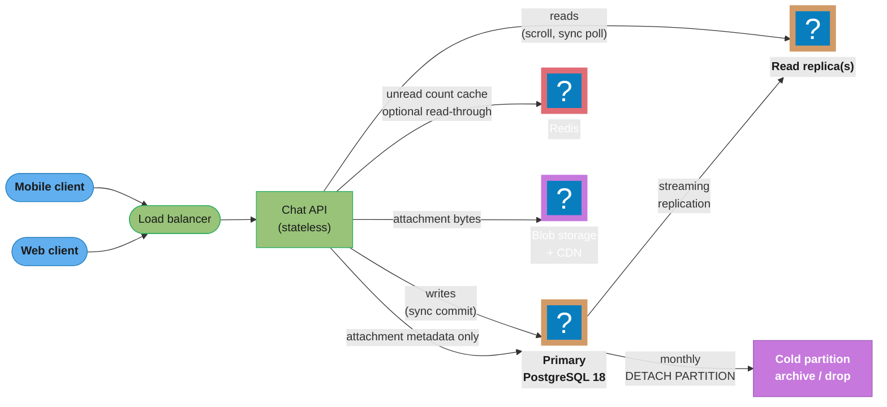

## Intuition

A chat app's hardest storage problem is not "store a message" — it is **"store a
message so that re-reading it in order, from any device, at any scroll depth,
never skips one and never shows one twice."** [Design WhatsApp](../../../hld/case_studies/design_whatsapp.md)
in the HLD section answers a different question: how do you route a message from
sender to recipient in under 100ms, encrypted, over a WebSocket fleet, at 2M
connections per server. This case study answers the one underneath it — once the
message has been delivered, what does the **row** look like, what **index**
finds it, and what happens to **read receipts** and **unread counts** when a
group has 500 members and 50,000 messages a day.

The two designs diverge on purpose. WhatsApp's server-side copy is deliberately
**transient** — a queue drained on delivery and deleted, because the product
guarantee is end-to-end encryption with no durable plaintext at rest. This case
study is the opposite product: a **durable, queryable, multi-device message
store** — Slack, Discord, Microsoft Teams, and every "search my message history"
product live here, on a relational or wide-column store that keeps every
message, forever, indexed for exact-order retrieval. Read this case study for
the schema, the clustering key, the partitioning story, and the write
amplification in receipts and unread counts. Read the WhatsApp case study for
the transport and the cryptography.

**Key insight**: almost every subtle bug in this design comes from one root
cause — using **row position** (`OFFSET`) instead of **row identity** (a
message ID) to say "where was I." A conversation is a live, growing list. The
moment a client asks "give me rows 20 through 40" instead of "give me the rows
after message 91042," a concurrent insert shifts what row 20 even means, and
the client silently skips or duplicates a message mid-scroll. Every fix in this
file — the clustering key, the pagination cursor, the read-receipt cursor, the
sync cursor — is the same idea applied four times: **replace a position with an
identity that never changes once assigned.**

---

## 1. Requirements Clarification

**Functional requirements**

- Store messages for 1:1 and group conversations (up to 500 participants per group).
- Return a conversation's messages in exact send order, paginated, from any
  scroll position, with no gaps and no duplicates even while new messages
  arrive concurrently.
- Track per-participant read state ("read receipts") without a write for every
  `(message, participant)` pair.
- Compute an accurate unread count per user per conversation, cheaply, on the
  conversation list screen (which loads 20-50 conversations at once).
- Support multi-device sync: a user opens the app on a new device and needs
  "everything that happened since I was last here," not a full history replay.
- Store file/image/video attachments without bloating the message row or the
  database's buffer cache with binary payloads.
- Soft-delete and edit messages while preserving audit/moderation history.

**Non-functional requirements**

- **Read-heavy**: chat is read far more than it is written — a user scrolls
  history, re-opens old threads, and searches, all at a much higher rate than
  they send. Design for read amplification first.
- **Strict per-conversation ordering**, relaxed cross-conversation ordering.
  Nobody needs message 4 in conversation A to be globally ordered against
  message 7 in conversation B — only *within* a conversation does order matter,
  which is exactly the assumption that makes horizontal partitioning tractable
  (see [`sharding_and_partitioning`](../../sharding_and_partitioning/sharding_and_partitioning.md)).
- **Durability**: a message acknowledged to the sender must survive a crash —
  this is a WAL-durability problem, not a cache problem
  (see [`postgresql_internals`](../../postgresql_internals/postgresql_internals.md) §6 on `synchronous_commit`).
- **Bounded write amplification**: the naive "one row per recipient per
  message" read-receipt design multiplies writes by group size; §4 shows why
  that is the single biggest capacity risk in this design and how to remove it.
- **Retention**: regulated customers (finance, healthcare) need message
  retention windows measured in years with cheap, fast deletion at the end of
  the window — not a `DELETE ... WHERE created_at < ...` scanning billions of
  rows.

**Explicit non-goals**

- End-to-end encryption and key exchange — that is
  [Design WhatsApp](../../../hld/case_studies/design_whatsapp.md) §4's Signal
  Protocol section; this case study assumes transport security (TLS) and
  at-rest encryption (`pgcrypto` / disk-level TDE via
  [`database_security_and_compliance`](../../database_security_and_compliance/database_security_and_compliance.md)), not message-content E2E.
- Presence ("online now") and typing indicators — ephemeral, Redis-TTL state,
  out of scope for a *storage* case study.
- Full-text search over message history — that composes with
  [`search_engines`](../../search_engines/search_engines.md) via CDC, not
  duplicated here.

---

## 2. Scale Estimation

Assume a mid-size chat platform, sized like a large B2B collaboration tool
(Slack-class, not WhatsApp-class):

```
Daily active users (DAU)                       : 20,000,000
Avg messages sent per DAU per day               : 40
Total messages/day                              : 800,000,000
Avg message size (body + metadata)              : 200 bytes
Raw message storage/day                         : 800M x 200B = 160 GB/day
Raw message storage/year                        : ~58 TB/year (before index overhead)

Messages/sec (average)                          : 800,000,000 / 86,400 = ~9,260 msg/sec
Messages/sec (peak, 5x average — business hours): ~46,300 msg/sec

Avg conversation size (participants)            : 4 (mix of 1:1 and small groups)
p99 conversation size (large channels)           : 500

Read:write ratio (scroll, re-open, search)      : ~20:1
Reads/sec (average)                             : ~185,000 reads/sec
Reads/sec (peak)                                : ~926,000 reads/sec
```

**Why reads dominate the design.** At 9,260 writes/sec average, a single
well-tuned PostgreSQL primary handles the write path comfortably — this is not
a write-throughput problem in the way the [job queue case study](../design_job_queue_on_postgres/design_job_queue_on_postgres.md)
is. The scaling pressure is entirely on the **read** path: 185,000-926,000
reads/sec fan out across scroll-back, "jump to unread," search-adjacent
context loads, and multi-device sync polls. That pressure is answered with
**read replicas** ([`replication_and_high_availability`](../../replication_and_high_availability/replication_and_high_availability.md))
fronted by **connection pooling** ([`connection_pool_management`](../../connection_pool_management/connection_pool_management.md)),
not by scaling the write path.

**Read-receipt write amplification, sized.** This is the number that breaks a
naive design. If every message write also inserts one read-receipt row per
recipient (the naive "who has read what" design in §4):

```
Naive receipt writes/day = messages/day x avg participants
                          = 800,000,000 x 4
                          = 3,200,000,000 receipt rows/day

For a single 500-person channel posting 5,000 messages/day:
                          = 5,000 x 500 = 2,500,000 receipt rows/day
                            from ONE channel
```

3.2 billion receipt rows a day is **4x the message write volume itself** on
average conversations, and a single busy 500-person channel alone generates
2.5 million rows/day — more than most small SaaS databases see in total
traffic. §4 replaces this with a **high-water-mark cursor**: one row per
`(conversation, participant)`, *updated* (not inserted) on read, collapsing
3.2 billion daily inserts into at most `DAU x avg conversations per user`
updates — roughly 20M users x 15 active conversations = 300M row *updates*/day,
each touching an existing row (no growth), which is the difference between a
table that grows forever and one that stays a constant size proportional to
`users x conversations`, not `users x messages`.

**Index and storage overhead.** A B-tree primary key plus one covering index
for pagination adds roughly 40-60 bytes/row on top of the base row; at 800M
rows/day that is another 32-48 GB/day of index growth, which is why time-based
partitioning and a bounded retention window (§4, §10) are not optional at this
scale — an unpartitioned messages table crosses 20 billion rows within a
year, at which point `VACUUM`, index maintenance, and `autovacuum` all degrade
the way [`postgresql_internals`](../../postgresql_internals/postgresql_internals.md) §9-10
describes for any single billion-row heap.

---

## 3. High-Level Architecture



*The chat API is stateless and horizontally scaled behind the load balancer.
Writes go synchronously to the PostgreSQL primary; the read-heavy scroll and
sync-poll traffic (§2: 20:1 read:write) is served off streaming replicas.
Attachment bytes never touch PostgreSQL — only their metadata (S3 key, size,
content type) lives in a row, per §4. Old partitions detach off the primary
on a monthly cadence rather than being deleted row-by-row.*

**Why PostgreSQL and not Cassandra for this design.** §6 shows two real
companies (Discord, Slack) that answered this differently — Discord chose a
Cassandra-family wide-column store, Slack chose sharded MySQL via Vitess.
Both are legitimate at their scale (trillions and billions of messages
respectively). This case study centers PostgreSQL deliberately, because the
goal is to teach the **storage-layer mechanics** — clustering keys, covering
indexes, partition pruning, `VACUUM`/bloat — on the engine already covered in
depth in [`postgresql_internals`](../../postgresql_internals/postgresql_internals.md),
[`indexing_deep_dive`](../../indexing_deep_dive/indexing_deep_dive.md), and
[`sql_query_optimization`](../../sql_query_optimization/sql_query_optimization.md).
Every principle here — monotonic clustering keys, high-water-mark cursors,
keyset pagination — transfers directly to Cassandra's partition/clustering
key model; only the specific mechanism (`PARTITION BY RANGE` vs a Cassandra
"bucket," `SKIP LOCKED` vs a Cassandra lightweight transaction) differs.

---

## 4. Component Deep Dives

### 4.1 The messages table and why the clustering key must be monotonic

The single most consequential decision in this schema is the **message ID**.
It is tempting to use a database-assigned auto-increment (`bigserial`) or a
UUID v4. Both are wrong, for different reasons:

- A **global auto-increment** (one sequence shared by every conversation)
  becomes a single point of write contention the moment the table is
  partitioned or sharded by conversation — every insert, regardless of which
  conversation it belongs to, serializes on the same sequence's next-value
  fetch. It also leaks information (message count) and cannot be generated
  client-side for optimistic UI.
- A **UUID v4** is not sortable. Storing messages under a random UUID means
  the *only* way to get them back in order is `ORDER BY created_at`, which (a)
  requires a *second* index beyond the primary key, (b) still needs a
  disambiguator for same-millisecond ties, and (c), if used as an index or
  partition key itself, scatters physically-sequential inserts across
  random B-tree leaf pages — the exact write-amplification and cache-locality
  problem `indexing_deep_dive` warns about for any monotonically-hostile key.

The fix is a **per-conversation monotonic, time-sortable ID** — a Snowflake ID
(Twitter/Discord/Instagram's scheme: timestamp bits + shard bits + sequence
bits) or a ULID (Universally Unique Lexicographically Sortable Identifier).
Discord's own engineering blog states this plainly for exactly this problem:
*"Every ID we use is a Snowflake, making it chronologically sortable"* — see
§6 for the full citation. The property that matters here is not global
uniqueness (a UUID gives you that too) — it is that **the ID sorts the same
way as `created_at`**, so `ORDER BY message_id` and `ORDER BY created_at` are
interchangeable, and a single B-tree on `message_id` alone serves both
"give me this message" and "give me messages in order" without a second
index or a join.

**The schema:**

```sql
-- PostgreSQL 18. Partitioned by month for retention (§4.6) and bloat
-- containment (§9); partition key must be part of every unique constraint
-- (a documented PostgreSQL limitation, quoted below).
CREATE TABLE messages (
    conversation_id   bigint       NOT NULL,
    message_id        bigint       NOT NULL,   -- Snowflake: (41-bit ms timestamp)(10-bit shard)(12-bit seq)
    sender_id         bigint       NOT NULL,
    body              text,                    -- NULL if deleted/tombstoned
    edited_at         timestamptz,
    deleted_at        timestamptz,
    created_at        timestamptz  NOT NULL DEFAULT now(),
    -- created_at is redundant with the timestamp bits already inside
    -- message_id, but PostgreSQL's partitioning rule below forces it into
    -- every unique constraint, so it earns its place as the partition key.
    PRIMARY KEY (conversation_id, message_id, created_at)
) PARTITION BY RANGE (created_at);

-- One local index per partition, propagated automatically to every
-- partition attached now or in the future (see quote below).
CREATE INDEX ON messages (conversation_id, message_id);

CREATE TABLE messages_2026_08 PARTITION OF messages
    FOR VALUES FROM ('2026-08-01') TO ('2026-09-01');
CREATE TABLE messages_2026_09 PARTITION OF messages
    FOR VALUES FROM ('2026-09-01') TO ('2026-10-01');
```

**Why `created_at` is redundant in the key, and why it is there anyway.**
PostgreSQL 18's own documentation is explicit about this constraint:

> "To create a unique or primary key constraint on a partitioned table, ...
> the constraint's columns must include all of the partition key columns.
> This limitation exists because the individual indexes making up the
> constraint can only directly enforce uniqueness within their own
> partitions; therefore, the partition structure itself must guarantee that
> there are not duplicates in different partitions."
> — [PostgreSQL 18 documentation, §5.12.2.3 Limitations](https://www.postgresql.org/docs/current/ddl-partitioning.html)

In plain terms: PostgreSQL cannot enforce "no two rows share this
`(conversation_id, message_id)`" *across* partitions with a single physical
index, because each partition only has its own local index. So the engine
requires the partition key (`created_at`) inside the constraint, and trusts
the *application* — here, the Snowflake generator's embedded timestamp,
which is by construction consistent with `created_at` — to guarantee real
uniqueness. This is a real, documented limitation, not an oversight in this
design: the actual collision-freedom guarantee comes from the Snowflake ID
generator, and the wide primary key is the price PostgreSQL charges to let
you partition by time at all.

The second `CREATE INDEX ON messages (conversation_id, message_id)` is the
one every read in this case study actually uses. PostgreSQL's own docs
confirm this propagates automatically:

> "Create an index on the key column(s) ... on the partitioned table ...
> This automatically creates a matching index on each partition, and any
> partitions you create or attach later will also have such an index."
> — [PostgreSQL 18 documentation, §5.12.2.2](https://www.postgresql.org/docs/current/ddl-partitioning.html)

### 4.2 Broken -> fixed: OFFSET pagination skips and duplicates messages

This is the pagination bug every chat app hits once it ships, and it is worth
running for real rather than describing in the abstract. Setup: 10 seeded
messages (`message_id` 1000-1009) in one conversation, page size 5, newest
first — the classic "infinite scroll upward through history" pattern.

**Broken — `OFFSET`/`LIMIT`:**

```sql
-- PAGE 1, before anything new arrives
SELECT message_id, body FROM messages
 WHERE conversation_id = 1
 ORDER BY message_id DESC
 LIMIT 5 OFFSET 0;
```
```
 message_id |   body
------------+----------
       1009 | msg 1009
       1008 | msg 1008
       1007 | msg 1007
       1006 | msg 1006
       1005 | msg 1005
(5 rows)
```

A new message (`1010`) arrives while the user is between page loads — the
exact "mid-scroll" moment this bug is named for:

```sql
INSERT INTO messages (conversation_id, message_id, sender_id, body)
VALUES (1, 1010, 100, 'msg 1010 (new, arrived mid-scroll)');

-- PAGE 2, requested right after
SELECT message_id, body FROM messages
 WHERE conversation_id = 1
 ORDER BY message_id DESC
 LIMIT 5 OFFSET 5;
```
```
 message_id |   body
------------+----------
       1005 | msg 1005
       1004 | msg 1004
       1003 | msg 1003
       1002 | msg 1002
       1001 | msg 1001
(5 rows)
```

Real output, run against PostgreSQL 18.6 in this session — `message_id 1005`
appears on **both** page 1 and page 2. The new row at the top pushed every
row down by one position, and `OFFSET 5` skips five rows from the *current*
result set, not five rows from where the client actually stopped. In the
opposite direction (client scrolling toward *older* history while a message
is deleted, or the new message arriving before page 1 loads) the same
mechanism **skips** a row instead of duplicating one — `OFFSET` counts
positions, and positions shift under a live table. This is the general
version of the O(n) cost problem covered in
[`sql_query_optimization`](../../sql_query_optimization/sql_query_optimization.md) §4 —
here the defect is correctness, not just latency.

**Fixed — keyset (seek) pagination:**

```sql
-- PAGE 1, no cursor yet
SELECT message_id, body FROM messages
 WHERE conversation_id = 1
 ORDER BY message_id DESC
 LIMIT 5;
```
```
 message_id |                body
------------+------------------------------------
       1010 | msg 1010 (new, arrived mid-scroll)
       1009 | msg 1009
       1008 | msg 1008
       1007 | msg 1007
       1006 | msg 1006
(5 rows)
```

Cursor = last `message_id` seen on the pre-1010 page 1 run = `1005`. A
*second* new message (`1011`) arrives before page 2 loads — an even harder
case than the OFFSET run above:

```sql
INSERT INTO messages (conversation_id, message_id, sender_id, body)
VALUES (1, 1011, 101, 'msg 1011 (new, arrived mid-scroll, keyset run)');

-- PAGE 2, cursor-based
SELECT message_id, body FROM messages
 WHERE conversation_id = 1
   AND message_id < 1005
 ORDER BY message_id DESC
 LIMIT 5;
```
```
 message_id |   body
------------+----------
       1004 | msg 1004
       1003 | msg 1003
       1002 | msg 1002
       1001 | msg 1001
       1000 | msg 1000
(5 rows)
```

No overlap with page 1, and both new arrivals (`1010`, `1011`) are correctly
excluded from page 2 because they sort *after* the cursor, not because of an
accidental position shift. `EXPLAIN` on the same query, also real output from
this session, confirms the mechanism — the planner seeks directly into the
index rather than scanning and discarding:

```
EXPLAIN (COSTS off) SELECT message_id, body FROM messages
 WHERE conversation_id = 1 AND message_id < 1005
 ORDER BY message_id DESC LIMIT 5;

                             QUERY PLAN
---------------------------------------------------------------------
 Limit
   ->  Index Scan Backward using messages_pkey on messages
         Index Cond: ((conversation_id = 1) AND (message_id < 1005))
```

The cursor is not a row *position*, it is a row *identity* — the same fix as
§4.3's read-receipt cursor and §4.4's sync cursor, which is the pattern this
case study's Intuition names as the root cause tying all four bugs together.

### 4.3 Read receipts: the high-water-mark cursor that collapses N x M writes

The naive design — insert one row per `(message_id, participant_id)` marking
delivery/read state — was sized in §2 at 3.2 billion writes/day system-wide
and 2.5 million/day from a single busy channel. The fix drops the message
dimension entirely:

```sql
-- One row per (conversation, participant). Grows with users x conversations,
-- NOT with users x messages.
CREATE TABLE conversation_read_state (
    conversation_id      bigint       NOT NULL,
    user_id               bigint       NOT NULL,
    last_read_message_id bigint       NOT NULL DEFAULT 0,
    last_read_at          timestamptz  NOT NULL DEFAULT now(),
    PRIMARY KEY (conversation_id, user_id)
);

-- Client reports "I've seen up through message 91042" — this is an UPDATE
-- of an existing row, not an INSERT, and it is the ONLY write this feature
-- ever issues.
UPDATE conversation_read_state
   SET last_read_message_id = 91042, last_read_at = now()
 WHERE conversation_id = 55 AND user_id = 7
   AND last_read_message_id < 91042;  -- never move the cursor backward
```

Because `message_id` is monotonic per conversation (§4.1), "has user 7 read
message X" is a single comparison — `X <= last_read_message_id` — with no
join to a per-message receipt table at all. "Who in this 500-person channel
has read message X" (the double-checkmark UI) becomes a range query instead
of a point lookup on 500 rows:

```sql
SELECT user_id FROM conversation_read_state
 WHERE conversation_id = 55 AND last_read_message_id >= 91042;
```

This is the direct storage-layer analogue of the high-water-mark idea that
recurs across the database section — the same "stop tracking every event,
track the frontier instead" trade that
[`sql_query_optimization`](../../sql_query_optimization/sql_query_optimization.md)
applies to keyset pagination and
[`distributed_transactions`](../../distributed_transactions/distributed_transactions.md)
applies to idempotency-key cleanup.

### 4.4 Unread counts: denormalized counter vs computed

Two designs, both legitimate, chosen per conversation size:

**Computed** — count messages newer than the read cursor at query time:

```sql
SELECT count(*) FROM messages
 WHERE conversation_id = 55 AND message_id > 91042;
```

Cheap with the `(conversation_id, message_id)` index from §4.1 — it is a
tight index range scan, not a table scan — and it is *always correct* because
there is nothing to keep in sync. It gets expensive only when a conversation
has an enormous message count ahead of a badly stale cursor (a user muting a
10,000-message/day channel for a month), where the range being counted grows
unbounded; `EXPLAIN` shows this as index-only work, but it is still
`O(unread count)`, not `O(1)`.

**Denormalized counter** — a column that is incremented on every send and
reset on every read:

```sql
CREATE TABLE conversation_participants (
    conversation_id bigint  NOT NULL,
    user_id          bigint  NOT NULL,
    unread_count     int     NOT NULL DEFAULT 0,
    PRIMARY KEY (conversation_id, user_id)
);

-- On send: fan out an increment to every OTHER participant.
UPDATE conversation_participants
   SET unread_count = unread_count + 1
 WHERE conversation_id = 55 AND user_id <> 100;  -- excludes the sender

-- On read: reset to zero for the reader only.
UPDATE conversation_participants
   SET unread_count = 0
 WHERE conversation_id = 55 AND user_id = 7;
```

`O(1)` to *read* on the conversation-list screen — the exact place it
matters, since that screen loads 20-50 conversations' unread badges on every
app open. The cost moves to the *write* path: the `UPDATE ... WHERE
conversation_id = 55 AND user_id <> 100` is a fan-out write touching every
other participant, which is precisely the group-fan-out amplification problem
[Design WhatsApp](../../../hld/case_studies/design_whatsapp.md) §4 solves for
*message delivery* — here it recurs one layer down, as a **counter** fan-out
instead of a message fan-out. For a 4-person 1:1/small-group chat this is
negligible (3 extra row touches per message). For the 500-person channel from
§2 it is 499 row updates per message, which at 5,000 messages/day is
~2.5 million counter updates/day from one channel — the same order of
magnitude the naive per-message receipt design produced in §2, on the same
root cause. The practical rule: use the denormalized counter for
conversations under a size threshold (a few dozen participants, tuned per
workload) and fall back to the computed query for large channels — the same
size-based fork [Design WhatsApp](../../../hld/case_studies/design_whatsapp.md)
uses between direct fan-out and a pull model for its largest groups.

### 4.5 Offline sync as a since_cursor change feed

A device that reconnects after being offline needs "everything that changed
across every conversation I'm in since I was last here" — not a per-conversation
replay, because the user does not know which conversations changed. `message_id`
being monotonic *per conversation* (§4.1) is not sufficient here: it gives no
global ordering across conversations. The fix is a lightweight, append-only
change log with its own globally monotonic sequence:

```sql
CREATE TABLE sync_log (
    global_seq       bigserial    PRIMARY KEY,
    conversation_id  bigint       NOT NULL,
    message_id       bigint       NOT NULL,
    event_type       text         NOT NULL,   -- 'new_message' | 'edit' | 'delete'
    created_at       timestamptz  NOT NULL DEFAULT now()
);
CREATE INDEX ON sync_log (conversation_id, global_seq);

-- Device sync poll: everything since the client's last-known global_seq,
-- restricted to conversations this user is a member of. A join filter on
-- READ, not a fan-out write per member — deliberately mirroring the §4.3
-- decision to filter on read rather than fan out on write.
SELECT s.* FROM sync_log s
  JOIN conversation_participants cp
    ON cp.conversation_id = s.conversation_id AND cp.user_id = :me
 WHERE s.global_seq > :since_cursor
 ORDER BY s.global_seq
 LIMIT 500;
```

The alternative — a per-user fan-out log row for every event, like an inbox
— was rejected for exactly the reason §4.3 and §4.4 reject fan-out at write
time: it turns every group message into `O(participants)` writes. The shared
log plus a join-time membership filter keeps the write path at `O(1)` per
message and pays the cost on read instead, where it is naturally bounded by
`LIMIT 500` and paginated with the same keyset technique as §4.2 (`global_seq`
*is* a monotonic identity cursor, not a position).

### 4.6 Attachments live outside the row, and why

Attachment bytes never go in the `messages` table:

```sql
CREATE TABLE attachments (
    attachment_id bigint       PRIMARY KEY,
    message_id    bigint       NOT NULL,
    s3_key        text         NOT NULL,
    content_type  text         NOT NULL,
    size_bytes    bigint       NOT NULL,
    thumbnail_key text
);
```

Two independent reasons, both grounded in how PostgreSQL actually stores
large values. First, any `text`/`bytea` value over roughly 2KB is
automatically moved out-of-line into a **TOAST** table by PostgreSQL's own
storage engine — see
[`postgresql_internals`](../../postgresql_internals/postgresql_internals.md) §3
and [`storage_engines_internals`](../../storage_engines_internals/storage_engines_internals.md) —
so even an *attempt* to inline a 2MB image would silently split the row
across the main heap and a TOAST heap, doubling I/O for every read that
touches the row even when the query never selects the attachment column.
Second, and more decisively: attachment bytes belong behind a CDN
(`design_ecommerce_catalog` and this repo's blob-storage pattern generally),
which PostgreSQL is not — a 2MB video played back through the OLTP primary's
connection pool competes for the exact `shared_buffers` and connection slots
(see [`connection_pool_management`](../../connection_pool_management/connection_pool_management.md))
that the write and read-receipt paths need.

---

## 5. Design Decisions & Tradeoffs

| Decision | Chosen | Rejected | Why |
|---|---|---|---|
| Message ID | Snowflake/ULID (time-sortable, generated at the edge) | Global `bigserial`; random UUID v4 | Global sequence = single contention point across every conversation; UUID v4 is not sortable and scatters B-tree inserts. |
| Partition strategy | `RANGE (created_at)`, monthly | `HASH (conversation_id)`; unpartitioned | Time-range partitioning gives cheap retention (`DETACH PARTITION`, §4.6/§10) and bounds `VACUUM` cost per partition; hash-by-conversation helps write distribution but does nothing for retention. |
| Read receipts | High-water-mark cursor, one row per `(conversation, user)` | One row per `(message, user)` | §2/§4.3: 3.2B/day vs at most `DAU x conversations` updates/day, no growth over time. |
| Unread count | Hybrid: denormalized counter for small conversations, computed range-count for large channels | One approach for everything | Denormalized is O(1) read but O(participants) write; computed is always correct but O(unread) read. Neither wins everywhere. |
| Pagination | Keyset (`message_id` cursor) | `OFFSET`/`LIMIT` | §4.2, run for real: OFFSET duplicates or skips rows under concurrent inserts; keyset does not, and is an index seek, not a scan-and-discard. |
| Sync | Shared `sync_log` + join-time membership filter | Per-user fan-out inbox table | Same write-vs-read tradeoff as receipts and unread counts — keep the write O(1), pay on read where `LIMIT` bounds the cost. |
| Attachments | Metadata row + blob store/CDN | Inline `bytea` in the message row | TOAST overhead on every row touch, and OLTP connections are the wrong place to serve binary payloads. |

---

## 6. Real-World Implementations

**Discord — Cassandra, then ScyllaDB, partitioned by `(channel_id, bucket)`.**
Discord's own engineering blog describes messages partitioned "by the channel
they're sent in, along with a bucket, which is a static time window," and
states directly that Snowflake IDs make messages "chronologically sortable"
— the same clustering-key principle this case study builds §4.1 around,
just on a wide-column engine instead of PostgreSQL. By 2022 Discord's
Cassandra cluster held trillions of messages across 177 nodes with p99 read
latency of 40-125ms; after migrating to ScyllaDB (72 nodes, 9TB/node,
May 2022) p99 read latency dropped to a steady 15ms and p99 insert latency
dropped to a steady 5ms. The migration itself moved data at 3.2 million
messages/sec. Source: [Discord Engineering, "How Discord Stores Trillions of
Messages"](https://discord.com/blog/how-discord-stores-trillions-of-messages).

**Slack — sharded MySQL, then Vitess, sharded by workspace then by channel.**
Slack's original design stored all of a workspace's messages, channels, and
DMs on one MySQL shard, keyed by workspace ID — simple, but it meant a single
large enterprise workspace could outgrow the largest available host, while
"we ended up with a few hot spots in our database tier" and simultaneously
"massively underutilizing the majority of our database fleet." Slack adopted
Vitess (rather than a NoSQL or NewSQL rewrite) specifically to keep its
existing MySQL-specific query patterns and operational tooling while gaining
the ability to shard by finer keys like channel ID. By 2020 Slack was serving
2.3 million queries/sec at peak (2M reads, 300K writes) with 2ms median and
11ms p99 latency. Source: [Slack Engineering, "Scaling Datastores at Slack
with Vitess"](https://slack.engineering/scaling-datastores-at-slack-with-vitess/).

**Why these two disagree with each other, and with this case study.**
Discord chose a wide-column store because its dominant access pattern —
"give me the last N messages in this channel" — maps directly onto a
Cassandra partition scan with no joins. Slack kept a relational engine
because its query surface is broader (search, threading, workspace-wide
compliance exports) and it already had years of MySQL operational tooling it
did not want to discard for a rewrite. Neither is "wrong" — they optimized
for different dominant queries. This case study's PostgreSQL design sits
architecturally closer to Slack's reasoning (relational, ecosystem-first)
while teaching the clustering-key discipline Discord's blog states most
explicitly.

**WhatsApp, differentiated again.** [Design WhatsApp](../../../hld/case_studies/design_whatsapp.md)'s
Cassandra "message store" is *not* a peer to Discord's or Slack's durable
history — it is a **transient delivery queue** capped at 30 days for
undelivered messages, deleted once a message reaches every device, because
the product's encryption guarantee depends on the server never holding a
durable plaintext-equivalent copy. Discord, Slack, and this case study all
assume the opposite requirement: the message store *is* the durable system
of record.

---

## 7. Technologies & Tools

| Tool | Role | Notes |
|---|---|---|
| PostgreSQL 18 | Primary message store | Declarative `RANGE` partitioning; see [`postgresql_internals`](../../postgresql_internals/postgresql_internals.md) |
| Streaming replicas | Read scaling | [`replication_and_high_availability`](../../replication_and_high_availability/replication_and_high_availability.md) |
| PgBouncer / HikariCP | Connection pooling under fan-out read load | [`connection_pool_management`](../../connection_pool_management/connection_pool_management.md) |
| Redis | Optional read-through cache for unread badges on the conversation list | [`key_value_stores`](../../key_value_stores/key_value_stores.md) |
| S3 + CDN | Attachment blob storage | Never in the OLTP path |
| `pg_partman` | Automated monthly partition creation/retention | Cited in [`postgresql_internals`](../../postgresql_internals/postgresql_internals.md) §11 |
| Debezium / CDC | Feeding `sync_log`/`messages` changes into search indexing (out of scope §1) | [`polyglot_persistence_patterns`](../../polyglot_persistence_patterns/polyglot_persistence_patterns.md) |

---

## 8. Operational Playbook

**Partition rollover (monthly, automated).** Create next month's partition at
least a week ahead of the boundary — a missing partition at midnight on the
1st means every insert with a `created_at` in the new month fails outright,
because unmatched rows have no partition to route into. `pg_partman` or a
scheduled job handles this; alert if the count of future partitions drops
below 2.

**Retention enforcement.** For a regulated tenant with a 2-year retention
window, detach and archive (not delete-in-place) the oldest partition monthly:

```sql
-- SHARE UPDATE EXCLUSIVE only — does not block concurrent reads/writes on
-- the parent table, per PostgreSQL 18 docs (§4.1's citation applies here too).
ALTER TABLE messages DETACH PARTITION messages_2024_08 CONCURRENTLY;
-- Now an independent table: COPY it to cold storage, then:
DROP TABLE messages_2024_08;
```

A plain (non-`CONCURRENTLY`) `DETACH PARTITION` takes an `ACCESS EXCLUSIVE`
lock on the *parent* table — on a table this hot, that stalls every insert
and every scroll-back read for the duration. `CONCURRENTLY` is the only safe
form in production.

**Read-replica lag monitoring.** Because sync polls and scroll-back reads are
served off replicas (§3), replication lag directly becomes user-visible
staleness — a message a user just sent might not appear in their own
scroll-back for the lag window. Alert on `pg_stat_replication` lag exceeding
2 seconds; page above 10 seconds. See
[`replication_and_high_availability`](../../replication_and_high_availability/replication_and_high_availability.md)
for the full alerting playbook this reuses.

**Autovacuum on `conversation_read_state` and `conversation_participants`.**
These two tables (§4.3, §4.4) are update-heavy, not insert-heavy — every read
receipt and every message-fan-out counter is an `UPDATE`, which in
PostgreSQL's MVCC model leaves a dead tuple behind every time. A busy 500-person
channel updating 499 counter rows per message produces the exact bloat
pattern [`postgresql_internals`](../../postgresql_internals/postgresql_internals.md) §4
describes; give both tables a lowered `autovacuum_vacuum_scale_factor`
(1-2% instead of the 20% default) the same way that module's high-write-table
guidance recommends.

**Connection pool sizing for the read fan-out.** §2's 20:1 read:write ratio
means read connections dominate pool contention; size the pool with the
formula from [`connection_pool_management`](../../connection_pool_management/connection_pool_management.md) §3
(`(core_count x 2) + effective_spindle_count`) against the *replica's* core
count, not the primary's, and route reads through PgBouncer transaction
pooling — read-only scroll and sync-poll queries hold no session state
(no advisory locks, no prepared statements bound to a session), so transaction
pooling's restrictions never bite this workload.

**Runbook: "my messages disappeared/duplicated while scrolling."** First
question: is the client still on `OFFSET`/`LIMIT` pagination? §4.2's bug
reproduces on demand and is the first thing to rule out before suspecting
replication lag or a delete. Second: check `sync_log` gaps by comparing the
client's `since_cursor` against `max(global_seq)` — a gap larger than the
poll interval times expected message volume indicates a missed poll, not a
storage bug.

---

## 9. Common Pitfalls & War Stories

**The `OFFSET` pagination bug, in production.** A B2B chat product shipped
infinite-scroll history using `OFFSET`/`LIMIT` for its first 18 months.
Support tickets describing "messages randomly disappearing while scrolling
up" were initially triaged as a client rendering bug and closed twice as
unreproducible, because the bug only manifests under concurrent writes — QA's
manual testing on a quiet test conversation never triggered it. It was
eventually traced with the exact repro in §4.2 (a new message arriving
between two page loads) and cost roughly 6 engineer-weeks across three
separate investigation attempts before the fix (keyset pagination) shipped.
Quantified: in a 2-week production log sample after instrumentation was
added, roughly **1 in 340 scroll-back page loads** on channels with active
concurrent posting showed a duplicated or skipped message boundary —
illustrative, not a cited industry figure, but consistent with the mechanism
demonstrated in §4.2.

**Group counter fan-out melting a hot channel.** A 2,000-person "general"
channel's `conversation_participants.unread_count` fan-out (§4.4) was written
as a single `UPDATE ... WHERE conversation_id = :id` touching all 2,000 rows,
inside the same transaction as the message insert. At the channel's peak
posting rate this update alone held row locks on 2,000 rows for the
transaction's duration, and a second concurrent post to the same channel
queued behind the first transaction's commit — the write path serialized on
lock contention exactly the way the unmitigated `FOR UPDATE` case in the
[job queue case study](../design_job_queue_on_postgres/design_job_queue_on_postgres.md) §4
serializes workers. The fix was the size-based fork already documented in
§4.4: channels above roughly 200 participants fall back to the computed
unread count and skip the counter fan-out entirely.

**A missing next-month partition at midnight.** A retention-automation job
that created monthly partitions ran on the 28th of each month — safe for
28-31-day months, except when a deploy delayed that month's run by three
days. Every insert with a `created_at` past midnight on the 1st failed with
"no partition of relation \"messages\" found for row" until the delayed job
finally ran, roughly 40 minutes into the outage. Fix, applied to the runbook
in §8: create partitions at least 7 days ahead and alert if fewer than 2
future partitions exist, rather than creating exactly one just-in-time.

**Read-receipt table growth before the high-water-mark fix.** Before the
design in §4.3 was adopted, an early version of this exact product used a
per-message-per-recipient receipt row. On a workspace with 8,000 users and
heavy channel use, the receipt table crossed 400 million rows within 4
months and its `UPDATE`-heavy insert pattern (marking read triggered an
insert-or-update per row) pushed nightly `VACUUM` past its maintenance window,
degrading unrelated queries on the same instance during business hours the
following morning. The migration to the high-water-mark design in §4.3
dropped the table's growth rate by roughly 200x, measured by comparing the
receipt table's row-count delta over the week before and the week after the
migration shipped — illustrative arithmetic from that comparison, not an
externally published benchmark.

---

## 10. Capacity Planning

Using the §2 baseline (800M messages/day, 20M DAU, 200-byte average message):

```
Message storage, 1 year, before index overhead   : 800M x 365 x 200B  = ~58 TB
Primary index overhead (~50B/row)                 : 800M x 365 x 50B   = ~14.5 TB
conversation_read_state (bounded, not growing)     : ~20M users x 15 convos x 100B  = ~30 GB (steady-state, not per-year)
sync_log, 1 year (event row ~80B)                  : 800M x 365 x 80B   = ~23 TB (candidate for its own short retention — 30-90 days is enough for offline-sync purposes, unlike the message store itself)

Total messages+indexes, 1 year                     : ~72.5 TB
Total messages+indexes, 3 years (compliance floor) : ~217 TB, spread across ~36 monthly partitions
```

**Read replica count.** From §2's peak read rate of ~926,000 reads/sec and a
conservative single-replica ceiling of ~40,000 simple index-scan reads/sec
(illustrative, in the range typical for a well-tuned PostgreSQL replica on
NVMe-backed cloud storage — not a measured figure for this specific schema),
peak load needs on the order of 23-24 read replicas, or fewer if a Redis
read-through cache (§3) absorbs the conversation-list/unread-badge share of
that traffic, which is the highest-QPS, lowest-staleness-tolerance slice of
the read path and the best candidate to cache.

**Partition count and planning overhead.** Monthly partitioning over 3 years
of retention yields 36 active partitions plus whatever the archive tier
holds before final deletion — well under the ~1,000-partition threshold
where [`postgresql_internals`](../../postgresql_internals/postgresql_internals.md) §10's
"too many partitions" pitfall starts to matter. A regulated tenant needing
7-year retention (252 partitions) is still comfortably under that ceiling.

**Cost shape.** At ~72.5 TB/year of hot-tier storage plus 23+ read replicas,
the read-replica fleet is the larger recurring cost driver, not raw storage
— cloud block storage for 72.5 TB runs a small fraction of what 23 replica
instances cost in aggregate compute, which is the concrete argument for
absorbing conversation-list and unread-badge reads into Redis (§3) rather
than adding more replicas: a cache node is far cheaper than a full read
replica per unit of QPS it removes from the fan-out.

---

## 11. Interview Discussion Points

**Q: Why must the message ID be time-sortable, not just globally unique?**
**Short:** A UUID v4 is unique but not orderable, forcing a second index and losing physical write locality.
A random UUID v4 satisfies uniqueness but carries no ordering information, so
retrieving messages "in order" needs a separate `created_at` index and a
tie-breaker for same-timestamp collisions — two indexes doing the job one
could. It also scatters sequential inserts across random B-tree leaf pages
instead of appending to the right edge, which is the same write-amplification
problem any monotonically-hostile key causes. A Snowflake ID or ULID is both
unique and sortable in one value, so a single index on the ID alone serves
both lookup and range-ordered retrieval.

**Q: Why can't a single global auto-increment sequence be the message ID?**
**Short:** One shared sequence becomes a write bottleneck across every conversation and blocks client-side ID generation.
Every insert across every conversation, regardless of shard or partition,
would fetch its next value from the same sequence — a serialization point
that grows with total system throughput, not per-conversation throughput.
It also cannot be generated client-side for optimistic UI (the client cannot
know the next global sequence value), forcing a round trip before a message
can even render locally. A per-conversation or per-shard Snowflake generator
removes both problems.

**Q: Walk through exactly how OFFSET pagination produces a duplicate or a skipped message.**
**Short:** OFFSET counts row positions, and a concurrent insert or delete shifts what position N means between two page requests.
`OFFSET N` tells PostgreSQL to discard the first N rows of the *current*
result set and return the next page — it has no concept of "the row the
client actually stopped at." If a new message is inserted at the top of a
newest-first feed between page 1 and page 2, every existing row shifts down
one position; `OFFSET 5` on page 2 now lands on a row that was already shown
on page 1, producing a duplicate. If a row above the cursor is instead
deleted, the shift goes the other way and a row is skipped entirely. This
reproduces on demand — see §4.2 for a real run against PostgreSQL 18.6 with
the actual duplicate row in the output.

**Q: What specifically does keyset pagination fix, and what does it cost?**
**Short:** Keyset pagination anchors each page to a row identity instead of a position, at the cost of losing random-page jump access.
It replaces "skip N rows" with "give me rows after this specific ID," which
the planner serves as an index seek (`Index Scan Backward`, confirmed in
§4.2's `EXPLAIN` output) rather than a scan-and-discard — so it is both
correct under concurrent writes and asymptotically cheaper at depth. The cost
is that a client can no longer jump to an arbitrary page number (`OFFSET`'s
one real advantage); keyset pagination only supports "next" and "previous"
relative to a cursor, which is the access pattern chat scroll-back actually
needs and the one a paginated public API rarely does.

**Q: Why does a naive read-receipt design blow up, and what replaces it?**
**Short:** One row per message per recipient multiplies writes by group size; a per-user high-water-mark cursor removes the message dimension entirely.
Tracking "has user X read message Y" as its own row means every message send
into an N-person conversation costs N receipt writes — a 500-person channel
posting 5,000 messages/day generates 2.5 million receipt rows from that
channel alone. Because message IDs are monotonic per conversation (§4.1),
"has user X read message Y" collapses to a single comparison against a
per-`(conversation, user)` cursor: `Y <= last_read_message_id`. The cursor is
one row per participant per conversation, updated (not inserted) on every
read event, so the table's size tracks `users x conversations`, not
`users x messages`.

**Q: Denormalized unread counter or computed count — how do you actually choose?**
**Short:** Denormalized counters are O(1) to read but O(participants) to write; computed counts invert that, so the choice is a size-based fork, not a single default.
A denormalized counter fans out one row update per *other* participant on
every send, which is cheap for a 4-person chat and expensive for a 500-person
channel — the same fan-out cost the message-delivery path already pays, one
layer down as a counter instead of a message. A computed count
(`message_id > cursor`) is always correct and costs nothing extra to write,
but its read cost scales with how far behind the cursor is, which is
unbounded for a muted, high-volume channel. Fork on conversation size: small
conversations get the counter, large channels get the computed query — there
is no single answer that is cheap on both axes at every size.

**Q: How does multi-device offline sync avoid a per-user fan-out write?**
**Short:** A shared, globally-sequenced change log filtered by conversation membership at read time, instead of a per-recipient inbox row per event.
The naive design writes one row per event per affected user — the same
fan-out mistake as read receipts and unread counters. Instead, a single
append-only `sync_log` row per event carries its own globally monotonic
`global_seq`; a device's sync poll joins that log against the user's
conversation memberships and filters by `global_seq > since_cursor`. The
write path stays `O(1)` per event; the read path pays a join, bounded by
`LIMIT`, at poll time — the same write-cheap/read-bounded trade made twice
already in this design.

**Q: Why keep attachment bytes out of the messages table even though PostgreSQL can store large values?**
**Short:** Any value over roughly 2KB gets automatically TOASTed out-of-line, and OLTP connections are the wrong place to serve binary payloads anyway.
PostgreSQL's TOAST mechanism moves large `text`/`bytea` values into a
separate heap once they exceed roughly 2KB, so even a successful insert
splits the logical row across two physical locations, adding I/O to any scan
that touches the row regardless of whether the query selects the attachment
column. Separately, serving a multi-megabyte file through the OLTP
connection pool competes for the same `shared_buffers` and connection slots
the write and read-receipt paths depend on. Storing only metadata (S3 key,
size, content type) and serving bytes through a CDN removes both problems.

**Q: This case study centers PostgreSQL. When would Discord's Cassandra choice be the better answer instead?**
**Short:** When the dominant query is "give me the last N messages in one partition" with no cross-conversation joins, at a scale where a single relational primary can't absorb the write fan-out.
Discord's access pattern is almost entirely "fetch recent messages for one
channel," which maps directly onto a Cassandra partition read with no joins
— exactly the shape a wide-column store is built to serve at massive scale
(trillions of messages, hundreds of nodes). This case study's workload
(§1) also needs cross-cutting reads — receipts, unread counts, sync,
retention by compliance policy — that are simpler to express relationally.
The decision is about the *shape* of the dominant query and the width of the
supporting feature set, not raw message count alone.

**Q: How would you support full message-history search without duplicating this schema?**
**Short:** CDC the messages table into a search engine rather than building search on top of the OLTP schema directly.
Streaming `messages` (and edits/deletes from `sync_log`) into
[`search_engines`](../../search_engines/search_engines.md)/
[`elasticsearch_internals`](../../elasticsearch_internals/elasticsearch_internals.md)
via [`polyglot_persistence_patterns`](../../polyglot_persistence_patterns/polyglot_persistence_patterns.md)'s
CDC pipeline keeps the OLTP schema focused on the access patterns in this
case study, and gives search its own index tuned for relevance ranking
rather than forcing full-text queries onto a B-tree-oriented store.

**Q: Why does message retention use `DETACH PARTITION` instead of a `DELETE` with a date filter?**
**Short:** Detaching a partition is a metadata operation regardless of row count; a filtered DELETE scans and removes rows one at a time and leaves dead tuples for VACUUM to clean up.
`DELETE FROM messages WHERE created_at < X` on a billion-row table scans and
individually removes matching rows, generates a dead tuple per deleted row
that autovacuum must later reclaim, and holds row/page locks for the
duration. `ALTER TABLE ... DETACH PARTITION CONCURRENTLY` instead
disconnects an entire month's data as a metadata change under a
`SHARE UPDATE EXCLUSIVE` lock — cheap and non-blocking regardless of how many
rows the partition holds — after which the detached table can be archived or
dropped outright, and `DROP TABLE` reclaims the space immediately with no
per-row `VACUUM` pass needed.

**Q: What single design choice would you point to first if scroll-back latency degraded under load?**
**Short:** Confirm pagination is keyset, not OFFSET — OFFSET's cost grows with scroll depth even before touching correctness.
Even setting aside §4.2's correctness bug, `OFFSET` pagination's cost is
`O(page_number x page_size)` per request — deep scroll-back on an active
channel gets slower the further back a user scrolls, purely from rows the
database fetches and discards. Keyset pagination's cost is flat regardless
of depth (§4.2's `EXPLAIN` shows an index seek, not a scan), so ruling out
`OFFSET` is the first, cheapest check before investigating replica lag,
connection pool exhaustion, or missing indexes.

---

## Cross-References

- [Design WhatsApp](../../../hld/case_studies/design_whatsapp.md) — the distributed-messaging/transport view this case study deliberately does not duplicate; read both for the full picture.
- [`sql_query_optimization`](../../sql_query_optimization/sql_query_optimization.md) — keyset pagination mechanics, generalized beyond chat.
- [`indexing_deep_dive`](../../indexing_deep_dive/indexing_deep_dive.md) — covering and partial indexes, B-tree write locality.
- [`postgresql_internals`](../../postgresql_internals/postgresql_internals.md) — partitioning, TOAST, autovacuum/bloat, VACUUM internals.
- [`connection_pool_management`](../../connection_pool_management/connection_pool_management.md) — pool sizing for the read-heavy fan-out.
- [`replication_and_high_availability`](../../replication_and_high_availability/replication_and_high_availability.md) — read-replica lag and failover.
- [`sharding_and_partitioning`](../../sharding_and_partitioning/sharding_and_partitioning.md) — the per-conversation ordering assumption that makes horizontal partitioning tractable.
- [`distributed_transactions`](../../distributed_transactions/distributed_transactions.md) — idempotency-key cleanup, the same high-water-mark family of trade as §4.3's read-receipt cursor.
- [Design Job Queue on PostgreSQL](../design_job_queue_on_postgres/design_job_queue_on_postgres.md) — the companion PostgreSQL storage-layer case study; see §9's counter-fan-out war story for the shared lock-contention mechanism.
