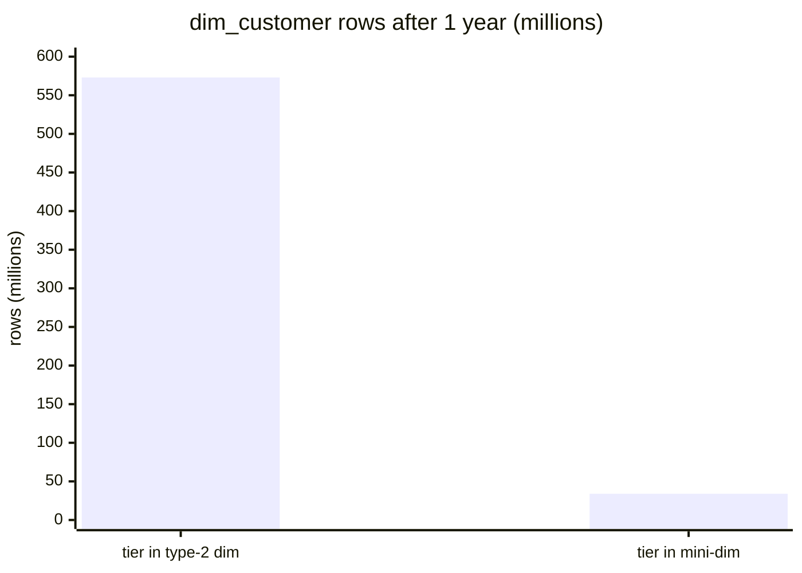
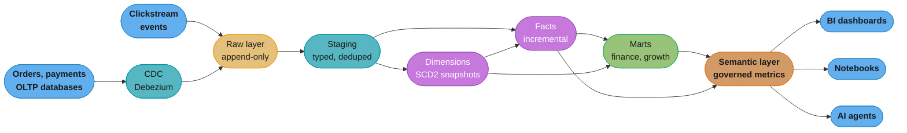

# Case Study: Design a Data Warehouse and Semantic Layer

## Intuition

A data warehouse is two things kept honest by two rules. The first thing is a set of **fact
tables**, each a ledger of business events at one declared grain ("one row per order line"),
holding the numbers the business adds up. The second is a set of **dimension tables** that
describe the who, what, where and when of each event and, crucially, **remember what was true at
the time**. The first rule is that every number has exactly one grain, so it is never added up
twice. The second rule is that every fact row is tied to the dimension version that was current
when the event happened, so a report about February does not silently change when a customer is
re-segmented in March. Almost every warehouse bug that reaches a finance review is a grain bug or
a time bug.

The **semantic layer** sits on top and answers a different question: not "where is the data" but
"what does *revenue* mean". It compiles one governed definition of each metric into SQL for every
tool that asks, so the BI dashboard, the analyst's notebook and the AI agent that writes its own
queries all get the same net revenue for the same week. Without it, the definition lives in 40
dashboards and drifts in 40 directions.

This page designs both layers for an online marketplace. The modelling methodology itself
(Kimball's process, the full SCD catalogue, Data Vault, medallion layering, data contracts as a
discipline) is owned by the module
[Data Warehouse Modeling](../../data_warehouse_modeling/data_warehouse_modeling.md); this case
study applies it to one system end to end and does not re-teach it. The engines underneath
(columnar storage, vectorized execution, MPP) are in
[Analytical Databases and OLAP](../../analytical_databases_and_olap/analytical_databases_and_olap.md),
and the open table formats a warehouse can sit on are in
[Lakehouse and Table Formats](../../lakehouse_and_table_formats/lakehouse_and_table_formats.md).

---

## 1. Requirements Clarification

### Functional requirements

- Model the marketplace's core business processes: **orders and order lines**, **payments**,
  **refunds**, **shipments** and **daily inventory**.
- Keep **history** for customer and product attributes that reports group by (segment, country,
  category, seller tier), so any report can be run "as the business looked at the time" and "as
  the business looks today".
- Define **about 60 governed metrics** once (gross merchandise value, net revenue, average order
  value, active customers, 30-day retention, refund rate) and serve them to BI dashboards,
  notebooks and AI agents through one semantic layer.
- Support **backfills**: when a metric or transformation changes, restate history without
  breaking dashboards that are reading it.
- Handle **late-arriving data**: payments and refunds that arrive days after the order, and
  orders that reference a customer the warehouse has not seen yet.
- Reconcile to the payments ledger: daily net revenue in the warehouse must match the ledger
  within **0.1%**, with every break explained.

### Non-functional requirements

- **Freshness:** core facts updated **hourly**; finance marts final by **06:00 UTC** for the
  previous day.
- **Reproducibility:** a metric for a closed month returns the same value tomorrow unless a
  documented restatement changed it.
- **Cost:** compute spend scales with transformation and query work, not with stored history.
- **Governance:** PII (email, address, phone) never appears in marts; erasure requests propagate
  to every historical version of a customer.

### Explicit non-goals

- **Sub-minute operational dashboards.** Those belong on a streaming store such as the design in
  [Design a Real-Time Analytics Platform](../design_realtime_analytics_platform/design_realtime_analytics_platform.md).
  The warehouse is hourly by design.
- **Feature serving for ML.** Point-in-time feature retrieval has its own store and its own
  correctness rules, covered in
  [Feature Store and Point-in-Time Correctness](../../../ml/case_studies/cross_cutting/feature_store_and_point_in_time_correctness.md).
  The same as-of thinking appears here in §4.3.
- **Reverse ETL into operational systems.** Out of scope; the warehouse is a read model.

### Assumptions

| Input | Value | Note |
|---|---|---|
| Orders | 40 million / month | 1.33 million / day |
| Lines per order | 2.4 | Average |
| Customers | 25 million | 0.1% / day change a type-2 attribute |
| Loyalty tier | Recomputed nightly | Changes for 6% of customers / day |
| Products (SKUs) | 3 million | 5% change price / day |
| History kept | 5 years | Plus the current year |
| BI and notebook users | 300 analysts, 1,500 dashboards | 6,000 metric queries / hour at peak |

---

## 2. Scale Estimation

### Fact volume

```
order lines/day   = 1.33M orders x 2.4           = 3.2M lines/day
order lines/year  = 3.2M x 365                   = 1.17B lines/year
5 years           = 1.17B x 5                    = 5.84B lines

compressed columnar size (assume ~40 B/row for 14 narrow columns)
                  = 5.84B x 40 B                 = 234 GB
```

The fact table that the whole business reports on is a quarter of a terabyte. Storage is not the
cost of a warehouse; **compute** is, and compute is driven by how often that quarter terabyte is
rescanned by transformations, backfills and unpruned queries.

### Dimension growth under SCD type 2

A type-2 dimension adds a row every time a tracked attribute changes. Which attributes are
tracked decides whether the dimension stays small:

```
dim_customer with loyalty_tier as a type-2 attribute:
  new versions/day  = 25M x 6%            = 1.5M rows/day
  rows after 1 year = 25M + 1.5M x 365    = 573M rows

dim_customer with loyalty_tier moved to a mini-dimension (type 4):
  new versions/day  = 25M x 0.1%          = 25K rows/day
  rows after 1 year = 25M + 25K x 365     = 34M rows
  mini-dimension    = 5 tiers x 4 segments x 10 age bands = 200 profile rows
```


*One volatile attribute in the wrong place makes the customer dimension 17x larger, and every
join to it slower. Kimball's type 4 (mini-dimension) exists for exactly this: volatile attributes
split off into a small profile table whose key goes on the fact row.*

The same reasoning removes **price** from the product dimension. A price that changes for 5% of
3M SKUs a day would add 150K product versions daily. Price is a property of the sale, so
`unit_price` belongs on the fact row, and the product dimension tracks only slowly changing
attributes such as category and brand.

### Query load

```
metric queries/hour (peak)  = 6,000         ~ 1.7 queries/s
agent-generated queries      = assume 10x analyst exploration volume during business hours
```

Query volume is low by OLTP standards and high in **scan** volume per query. A dashboard tile that
groups a year of order lines by category scans 1.17B rows unless partition pruning and
pre-aggregation cut it down, so §4.7 is about avoiding scans, not about connections.

### Backfill cost

```
full rebuild of fct_order_line (5 years)
  rows                     = 5.84B
  throughput (assumption)  = 200M rows/min on the chosen warehouse size
  wall time                = 5.84B / 200M  = ~29 min of compute
partition-at-a-time backfill (1 day)
  rows                     = 3.2M          = ~1 s of compute, plus fixed per-statement overhead
```

A full rebuild is affordable; what makes it dangerous is not cost but **correctness**, because a
rebuild run against the wrong dimension versions rewrites five years of history in 29 minutes
(§4.4 and §9).

---

## 3. High-Level Architecture


*Sources land append-only in a raw layer through CDC and event ingestion. dbt builds staging,
then type-2 dimensions, then incremental facts that capture the dimension version current at event
time, then marts. The semantic layer compiles governed metrics into SQL against facts and marts
for every consumer. One of the order sources is the DynamoDB service in
[Design a DynamoDB-Backed Order Service](../design_dynamodb_single_table_order_service/design_dynamodb_single_table_order_service.md),
which feeds the raw layer through its change stream instead of a relational CDC connector.*

### The star at the centre

```
                          +------------------+
                          |  dim_date        |
                          |  date_key (PK)   |
                          +--------+---------+
                                   |
+------------------+     +---------+------------------+     +------------------+
| dim_customer     |     | fct_order_line             |     | dim_product      |
| customer_sk (PK) +-----+ order_id, line_no (PK)     +-----+ product_sk (PK)  |
| customer_id      |     | date_key, customer_sk,     |     | product_id       |
| segment, country |     | product_sk, seller_sk,     |     | category, brand  |
| valid_from/to    |     | profile_sk                 |     | valid_from/to    |
+------------------+     | quantity, unit_price,      |     +------------------+
                         | item_amount,               |
+------------------+     | shipping_alloc,            |     +------------------+
| dim_cust_profile |     | discount_alloc             +-----+ dim_seller       |
| profile_sk (PK)  +-----+                            |     | seller_sk (PK)   |
| tier, age_band   |     +----------------------------+     +------------------+
+------------------+
```
*One fact table at order-line grain, surrounded by conformed dimensions. Every foreign key is a
surrogate key pointing at one dimension version; `profile_sk` points at the mini-dimension that
holds the volatile loyalty tier.*

### Bus matrix

The bus matrix lists business processes (rows) against **conformed** dimensions (columns), the
dimensions every process shares with identical keys and attribute meanings. It is the plan for
the whole warehouse on one page.

| Business process (fact) | Grain | Date | Customer | Product | Seller | Profile | Payment method |
|---|---|---|---|---|---|---|---|
| Order lines (transaction) | one row per order line | x | x | x | x | x | |
| Payments (transaction) | one row per payment attempt | x | x | | | | x |
| Refunds (transaction) | one row per refunded line | x | x | x | x | | x |
| Fulfilment (accumulating snapshot) | one row per order, updated at each milestone | x | x | | x | | |
| Inventory (periodic snapshot) | one row per SKU per day | x | | x | x | | |

Three fact-table types appear, each with its own update rule. A **transaction** fact is insert-only.
A **periodic snapshot** writes one row per entity per period whether or not anything changed. An
**accumulating snapshot** has one row per process instance whose milestone date columns
(`ordered_at`, `packed_at`, `shipped_at`, `delivered_at`) are updated as the instance moves, so
"days from order to delivery" is a column subtraction rather than a self-join.

---

## 4. Component Deep Dives

### 4.1 Declare the grain first, and the fan trap it prevents

Kimball's four-step design process is: "Select the business process. Declare the grain. Identify
the dimensions. Identify the facts." The order matters because the grain decides which facts are
**additive** at that grain. An order has a shipping fee; an order line does not. If the fact table
is at line grain, a header-level amount must be **allocated** down to lines or kept in a separate
fact at order grain. Joining header facts to line rows without allocation repeats them once per
line, the "fan trap".

The script below is executable on PostgreSQL 15 or later and runs top to bottom; later sections
reuse its tables.

```sql
CREATE EXTENSION IF NOT EXISTS btree_gist;

CREATE TABLE src_orders (
    order_id      bigint        PRIMARY KEY,
    customer_id   bigint        NOT NULL,
    order_ts      timestamptz   NOT NULL,
    shipping_fee  numeric(12,2) NOT NULL
);

CREATE TABLE src_order_lines (
    order_id  bigint        NOT NULL REFERENCES src_orders,
    line_no   int           NOT NULL,
    amount    numeric(12,2) NOT NULL,
    PRIMARY KEY (order_id, line_no)
);

INSERT INTO src_orders VALUES
    (100, 1, '2026-02-10 14:00+00', 10.00),
    (101, 1, '2026-03-15 09:30+00',  5.00),
    (102, 2, '2026-02-20 18:45+00',  0.00);

INSERT INTO src_order_lines VALUES
    (100, 1,  30.00),
    (100, 2,  70.00),
    (101, 1,  50.00),
    (102, 1, 200.00);

-- BROKEN: the fan trap. The header's shipping fee is repeated once per line.
SELECT sum(l.amount + o.shipping_fee) AS revenue
FROM src_orders o
JOIN src_order_lines l USING (order_id);
-- revenue = 375.00   (true value is 365.00: order 100's 10.00 fee is counted twice)
```

The wrong number is plausible, which is what makes the fan trap dangerous: 375 against 365 is a
2.7% error that survives a glance. [Data Warehouse Modeling](../../data_warehouse_modeling/data_warehouse_modeling.md) §10.1 covers
fan-out between two facts;
the fix here is the line-grain version: make shipping additive at line grain by
allocating it in proportion to line value, with the rounding remainder assigned to one line so the
allocated cents always sum back to the header.

```sql
-- FIX: allocate the header amount down to line grain; the last line takes the remainder.
CREATE TABLE fct_order_line_alloc AS
WITH t AS (
    SELECT l.order_id, l.line_no, l.amount, o.shipping_fee,
           sum(l.amount) OVER (PARTITION BY l.order_id)                             AS order_total,
           row_number()  OVER (PARTITION BY l.order_id ORDER BY l.line_no DESC)     AS rn_desc
    FROM src_order_lines l
    JOIN src_orders o USING (order_id)
), a AS (
    SELECT *, COALESCE(round(shipping_fee * amount / NULLIF(order_total, 0), 2), 0) AS ship_share
    FROM t
)
SELECT order_id, line_no, amount AS item_amount,
       CASE WHEN rn_desc = 1
            THEN shipping_fee - (sum(ship_share) OVER (PARTITION BY order_id) - ship_share)
            ELSE ship_share
       END AS shipping_alloc
FROM a;

SELECT order_id, line_no, item_amount, shipping_alloc FROM fct_order_line_alloc ORDER BY 1, 2;
-- 100 | 1 |  30.00 | 3.00
-- 100 | 2 |  70.00 | 7.00
-- 101 | 1 |  50.00 | 5.00
-- 102 | 1 | 200.00 | 0.00

SELECT sum(item_amount + shipping_alloc) AS revenue FROM fct_order_line_alloc;
-- revenue = 365.00
```

The allocation is the warehouse's decision, so it is documented next to the metric that uses it.
Allocating by value is the common choice for shipping; allocating by quantity or weight is equally
valid if finance says so. What is not valid is leaving the choice to every query author.

### 4.2 Type-2 dimensions: surrogate keys, validity ranges and one invariant

A type-2 dimension keeps one row per **version** of an entity. Each row has a **surrogate key**
(a warehouse-generated id for that version), the **durable key** (the source's natural id, stable
across versions), the tracked attributes, and a half-open validity range `[valid_from, valid_to)`.
The current version has `valid_to = infinity`.

The full SCD catalogue (types 0 to 7) is taught in
[Data Warehouse Modeling](../../data_warehouse_modeling/data_warehouse_modeling.md) §4.3; this design
uses four of them:

| Type | Kimball name | Behaviour | Used here for |
|---|---|---|---|
| 0 | Retain original | Never changes | `first_order_date`, `signup_channel` |
| 1 | Overwrite | Latest value only, history lost | Typo fixes in display names |
| 2 | Add a row | New version per change | `segment`, `country` on customers; `category` on products |
| 4 | Add mini-dimension | Volatile attributes split into a profile table | Loyalty tier, age band |
| 7 | Dual type-1 and type-2 keys | Surrogate key for history, durable key for current | Current-segment reporting (FIX below) |

The load below closes the current version of every changed customer, then inserts a new current
version for changed and new customers. An **exclusion constraint** enforces the one invariant a
type-2 table must never break: no two versions of the same customer overlap in time.

```sql
CREATE TABLE stg_customer (
    customer_id  bigint      PRIMARY KEY,
    country      text        NOT NULL,
    segment      text        NOT NULL,
    updated_at   timestamptz NOT NULL
);

CREATE TABLE dim_customer (
    customer_sk  bigint      GENERATED ALWAYS AS IDENTITY PRIMARY KEY,
    customer_id  bigint      NOT NULL,                 -- durable key
    country      text        NOT NULL,
    segment      text        NOT NULL,
    row_hash     text        NOT NULL,
    valid_from   timestamptz NOT NULL,
    valid_to     timestamptz NOT NULL DEFAULT 'infinity',
    is_current   boolean     NOT NULL DEFAULT true,
    CONSTRAINT no_overlapping_versions
        EXCLUDE USING gist (customer_id WITH =, tstzrange(valid_from, valid_to) WITH &&)
);

CREATE FUNCTION load_dim_customer() RETURNS void LANGUAGE sql AS $$
    -- 1. close the current version of every customer whose tracked attributes changed
    UPDATE dim_customer d
       SET valid_to = s.updated_at, is_current = false
      FROM stg_customer s
     WHERE d.customer_id = s.customer_id
       AND d.is_current
       AND d.row_hash <> md5(row(s.country, s.segment)::text)
       AND s.updated_at > d.valid_from;

    -- 2. insert a current version for every customer that now has none (new or just closed)
    INSERT INTO dim_customer (customer_id, country, segment, row_hash, valid_from)
    SELECT s.customer_id, s.country, s.segment, md5(row(s.country, s.segment)::text), s.updated_at
      FROM stg_customer s
      LEFT JOIN dim_customer d ON d.customer_id = s.customer_id AND d.is_current
     WHERE d.customer_id IS NULL;
$$;

-- day 1: both customers appear
INSERT INTO stg_customer VALUES
    (1, 'US', 'SMB', '2026-01-01 00:00+00'),
    (2, 'DE', 'ENT', '2026-01-01 00:00+00');
SELECT load_dim_customer();

-- day 60: customer 1 moves from SMB to MID; customer 2 is unchanged
TRUNCATE stg_customer;
INSERT INTO stg_customer VALUES
    (1, 'US', 'MID', '2026-03-01 00:00+00'),
    (2, 'DE', 'ENT', '2026-01-01 00:00+00');
SELECT load_dim_customer();

SELECT customer_sk, customer_id, segment, valid_from::date, valid_to, is_current
  FROM dim_customer ORDER BY customer_sk;
-- 1 | 1 | SMB | 2026-01-01 | 2026-03-01 00:00:00+00 | f
-- 2 | 2 | ENT | 2026-01-01 | infinity               | t
-- 3 | 1 | MID | 2026-03-01 | infinity               | t
```

Hashing the tracked attributes with `row(...)::text` rather than string concatenation avoids the
separator collision where `('A|B', 'C')` and `('A', 'B|C')` hash the same. Running the load twice
with the same staging data changes nothing, because step 1 finds no differing hash and step 2 finds
a current row for everyone. That idempotence is what makes a retried orchestration run safe.

**Capturing the version at load time.** The fact load resolves each order to the dimension version
valid at the **order's** timestamp and stores that surrogate key on the fact row. After that, no
report has to reason about validity ranges.

```sql
CREATE TABLE fct_order_line (
    order_id        bigint        NOT NULL,
    line_no         int           NOT NULL,
    order_date      date          NOT NULL,
    customer_sk     bigint        NOT NULL REFERENCES dim_customer,
    item_amount     numeric(12,2) NOT NULL,
    shipping_alloc  numeric(12,2) NOT NULL,
    PRIMARY KEY (order_id, line_no)
);

INSERT INTO fct_order_line
SELECT a.order_id, a.line_no,
       (o.order_ts AT TIME ZONE 'UTC')::date,
       d.customer_sk, a.item_amount, a.shipping_alloc
  FROM fct_order_line_alloc a
  JOIN src_orders o   USING (order_id)
  JOIN dim_customer d ON d.customer_id = o.customer_id
                     AND o.order_ts >= d.valid_from
                     AND o.order_ts <  d.valid_to;
```

**BROKEN: two ways analysts join to a type-2 dimension by its natural key.**

```sql
-- BROKEN 2a: natural-key join with no time condition. Customer 1 has two versions,
-- so every one of customer 1's lines is counted under both.
SELECT d.segment, sum(l.amount) AS items
  FROM src_orders o
  JOIN src_order_lines l USING (order_id)
  JOIN dim_customer d ON d.customer_id = o.customer_id
 GROUP BY d.segment ORDER BY d.segment;
-- ENT | 200.00
-- MID | 150.00
-- SMB | 150.00     total 500.00 against 350.00 of real items

-- BROKEN 2b: the usual "fix", joining only to the current row, rewrites history.
-- Order 100 was placed in February while customer 1 was SMB; it is now reported as MID.
SELECT d.segment, sum(l.amount) AS items
  FROM src_orders o
  JOIN src_order_lines l USING (order_id)
  JOIN dim_customer d ON d.customer_id = o.customer_id AND d.is_current
 GROUP BY d.segment ORDER BY d.segment;
-- ENT | 200.00
-- MID | 150.00     SMB has vanished from February
```

**FIX: join on the surrogate key the fact captured; use the durable key only for "as of today".**

```sql
-- As the business looked at the time of each order:
SELECT d.segment, sum(f.item_amount) AS items
  FROM fct_order_line f
  JOIN dim_customer d USING (customer_sk)
 GROUP BY d.segment ORDER BY d.segment;
-- ENT | 200.00
-- MID |  50.00
-- SMB | 100.00

-- As the business looks today (Kimball type 7: surrogate key for history, durable key for current):
SELECT cur.segment AS current_segment, sum(f.item_amount) AS items
  FROM fct_order_line f
  JOIN dim_customer h   USING (customer_sk)
  JOIN dim_customer cur ON cur.customer_id = h.customer_id AND cur.is_current
 GROUP BY cur.segment ORDER BY cur.segment;
-- ENT | 200.00
-- MID | 150.00
```

Both fixed answers are correct; they answer different questions. The semantic layer exposes them
as two dimensions, `customer__segment` and `customer__current_segment`, so a dashboard author has to
choose one instead of inheriting whichever join the last author wrote.

**dbt snapshots do the same thing declaratively.** dbt's documentation states that "snapshots
implement type-2 Slowly Changing Dimensions over mutable source tables", writing `dbt_valid_from`
and `dbt_valid_to` columns. The `timestamp` strategy trusts an `updated_at` column; the `check`
strategy compares listed columns. `hard_deletes` decides what a source delete does: `ignore` (the
default), `invalidate`, or `new_record`. `dbt_valid_to_current` replaces `NULL` with a sentinel
such as `9999-12-31`, which makes range joins simpler for engines that do not handle `NULL` bounds
well.

```yaml
snapshots:
  - name: customers_snapshot
    relation: source('shop', 'customers')
    config:
      unique_key: customer_id
      strategy: timestamp
      updated_at: updated_at
      hard_deletes: new_record
      dbt_valid_to_current: "to_date('9999-12-31')"
```

`hard_deletes: new_record` is chosen deliberately: a closed account should appear as a new
"deleted" version, not keep an open validity range forever (the `ignore` default) and be counted
as an active customer (§9).

### 4.3 Late-arriving facts and late-arriving dimensions

Data does not arrive in event-time order, and the two directions need different handling.

**A late-arriving fact** is an event that lands after the dimension has moved on. Because the fact
load joins on the **event** timestamp, not on load time, the range join still finds the right
version:

```sql
-- An order placed on 2026-02-25 arrives in the warehouse on 2026-03-20,
-- after customer 1 has already moved to MID.
INSERT INTO src_orders VALUES (103, 1, '2026-02-25 11:00+00', 0.00);
INSERT INTO src_order_lines VALUES (103, 1, 40.00);

SELECT d.customer_sk, d.segment
  FROM src_orders o
  JOIN dim_customer d ON d.customer_id = o.customer_id
                     AND o.order_ts >= d.valid_from AND o.order_ts < d.valid_to
 WHERE o.order_id = 103;
-- 1 | SMB     correct: the version valid on 2026-02-25, not the current one
```

The cost of late facts lands in **incremental** fact models. A model that processes only "rows
loaded since the last run" by order date will miss order 103 if it filters on `order_date` instead
of on load time, and a model that filters on load time must still rewrite the partition for
2026-02-25, not today's. §4.4 handles that with a lookback window keyed on load time.

**A late-arriving dimension** is the reverse: an order references customer 9 before the customer
record has been replicated. Kimball describes the retroactive form directly: "Late arriving
dimension data also occurs when retroactive changes are made to type 2 dimension attributes. In
this case, a new row needs to be inserted in the dimension table, and then the associated fact
rows must be restated." The standard handling has three steps:

1. Insert a placeholder version for customer 9 with attributes set to `'Unknown'` and
   `valid_from` at the earliest fact timestamp, so the fact load never drops a row.
2. When the real record arrives, update the placeholder in place as a type-1 correction, because
   the placeholder never represented a real state of the customer.
3. Count placeholders as a data-quality metric; a placeholder older than 24 hours is a broken
   upstream feed, not a late one.

### 4.4 Incremental facts, lookback windows and safe backfills

Rebuilding five years of facts every hour would cost 29 minutes of compute per run (§2). The fact
model is **incremental**: each run processes recent data and merges it into the table. The
recurring question is "recent by which clock".

```sql
-- models/fct_order_line.sql  (dbt; Jinja resolved at compile time)
{{ config(
    materialized = 'incremental',
    unique_key   = ['order_id', 'line_no'],
    incremental_strategy = 'merge',
    on_schema_change = 'fail'
) }}

select ...
from {{ ref('stg_order_lines') }} l
join {{ ref('stg_orders') }} o using (order_id)
join {{ ref('dim_customer') }} d
  on d.customer_id = o.customer_id
 and o.order_ts >= d.valid_from and o.order_ts < d.valid_to

  -- lookback on LOAD time, not order time: late rows for old dates are still picked up,
  -- and a 3-day window re-merges anything a previous run saw half-loaded
where l._loaded_at >= (select max(_loaded_at) from {{ this }}) - interval '3 days'

```

Two choices in that block carry the design. The filter is on `_loaded_at`, so an order from
February that lands in March is processed in March. And the 3-day lookback means a run that
crashed after merging half its batch is repaired by the next run, because the merge on
`(order_id, line_no)` is idempotent. `on_schema_change = 'fail'` stops a source column rename from
silently producing nulls.

**Backfills restate history without breaking readers.** A backfill is required when the logic
changes: a new allocation rule, a corrected currency conversion, a new type-2 attribute. Three
rules keep it safe:

1. **Build beside, then swap.** Write the restated table as `fct_order_line__v2`, compare it with
   the live table, and switch the view or alias that readers query. Dashboards never read a
   half-rebuilt table.
2. **Partition at a time, idempotently.** Each unit of work replaces exactly one date partition
   in one transaction, so a crash resumes at the next partition and a retry repeats nothing:

```sql
BEGIN;
DELETE FROM fct_order_line WHERE order_date = DATE '2026-02-10';
INSERT INTO fct_order_line
SELECT a.order_id, a.line_no, (o.order_ts AT TIME ZONE 'UTC')::date, d.customer_sk,
       a.item_amount, a.shipping_alloc
  FROM fct_order_line_alloc a
  JOIN src_orders o   USING (order_id)
  JOIN dim_customer d ON d.customer_id = o.customer_id
                     AND o.order_ts >= d.valid_from AND o.order_ts < d.valid_to
 WHERE (o.order_ts AT TIME ZONE 'UTC')::date = DATE '2026-02-10';
COMMIT;
```

3. **Restate against the dimension versions, never against "current".** The range join above is
   what makes a 2026-02-10 rebuild produce the same `customer_sk` it produced in February. A backfill
   that joins `is_current` rewrites five years of segment history in one run (§9).

**Compare before swapping.** The comparison is a query, not a feeling:

```sql
-- Per-day totals that differ between live and restated tables, largest first.
SELECT coalesce(a.order_date, b.order_date) AS d,
       a.revenue AS live, b.revenue AS restated, b.revenue - a.revenue AS delta
  FROM (SELECT order_date, sum(item_amount + shipping_alloc) AS revenue
          FROM fct_order_line GROUP BY 1) a
  FULL JOIN (SELECT order_date, sum(item_amount + shipping_alloc) AS revenue
               FROM fct_order_line GROUP BY 1) b USING (order_date)
 WHERE a.revenue IS DISTINCT FROM b.revenue
 ORDER BY abs(coalesce(b.revenue, 0) - coalesce(a.revenue, 0)) DESC;
```

In production the second subquery reads `fct_order_line__v2`; here both sides read the same table,
so the query correctly returns no rows. Every non-empty result row is either the intended change or
a bug, and the backfill is approved only when each row is explained. On Snowflake, Time Travel keeps
the pre-swap state queryable for the retention period, which is 1 day by default and up to 90 days
for permanent tables on Enterprise edition; on an Iceberg table the previous snapshot plays the
same role (see [Apache Iceberg](../../../technologies/apache_iceberg/apache_iceberg.md)).

### 4.5 The semantic layer: one definition per metric

A semantic layer stores **entities** (join keys), **dimensions** (ways to group) and **measures**
and **metrics** (what to compute), and generates SQL from them. dbt's MetricFlow, which powers the
dbt Semantic Layer, describes the model directly: semantic models carry entities, "the join keys of
your semantic model (think of these as the traversal paths, or edges between semantic models)",
and dimensions; metrics are typed as simple, ratio, derived, cumulative or conversion. MetricFlow is
distributed under the Apache 2.0 license. Snowflake's semantic views store the same concepts as a
schema-level database object, with logical tables, relationships, facts, dimensions and metrics.

The definition below shows the shape all of them share; field names differ by product and release.

```yaml
semantic_model: order_lines
  table: analytics.fct_order_line
  entities:
    - { name: order_line, type: primary,  expr: "order_id || '-' || line_no" }
    - { name: order,      type: foreign,  expr: order_id }
    - { name: customer,   type: foreign,  expr: customer_sk }
  dimensions:
    - { name: order_date, type: time, granularity: day }
  measures:
    - { name: item_amount,    agg: sum }
    - { name: shipping_alloc, agg: sum }
    - { name: orders,         agg: count_distinct, expr: order_id }

metrics:
  - name: gross_merchandise_value
    type: simple
    measure: item_amount
  - name: net_revenue
    type: derived
    expr: gross_merchandise_value + shipping_revenue - refunds
  - name: average_order_value
    type: ratio
    numerator: gross_merchandise_value
    denominator: orders
```

**BROKEN: averaging a ratio.** A dashboard that stores daily average order value and then averages
it over a week produces a different number from the semantic layer's ratio metric.

```sql
-- Day 1: 1 order of 1,000. Day 2: 9 orders of 100.
CREATE TABLE daily_orders (d date, order_id int, gmv numeric(12,2));
INSERT INTO daily_orders VALUES (DATE '2026-03-01', 1, 1000.00);
INSERT INTO daily_orders SELECT DATE '2026-03-02', g, 100.00 FROM generate_series(2, 10) g;

-- BROKEN: average of daily ratios
SELECT round(avg(aov), 2) AS aov
  FROM (SELECT d, sum(gmv) / count(DISTINCT order_id) AS aov FROM daily_orders GROUP BY d) x;
-- 550.00

-- FIX: ratio of sums at the query's grain, which is what a ratio metric compiles to
SELECT round(sum(gmv) / count(DISTINCT order_id), 2) AS aov FROM daily_orders;
-- 190.00
```

The semantic layer prevents this by construction: a `ratio` metric is compiled as `sum(numerator) /
sum(denominator)` at whatever grain the query asks for, and a pre-aggregated daily ratio is never
exposed as an additive measure. Non-additive and semi-additive measures (distinct counts, account
balances) are flagged in the definition so the compiler refuses to sum them across the wrong
dimension.

**What the semantic layer is not.** It is not a cache and it does not make a bad model fast. It
compiles to SQL against the star; if the star has the fan trap, every metric inherits it.

### 4.6 Data quality, reconciliation and contracts

Tests run after every model build and gate the publish step:

| Test | Example | On failure |
|---|---|---|
| Unique grain | `(order_id, line_no)` unique in `fct_order_line` | Block publish |
| Not null keys | `customer_sk`, `product_sk`, `date_key` not null | Block publish |
| Referential | every `customer_sk` exists in `dim_customer` | Block publish |
| Validity ranges | no overlap per durable key (the exclusion constraint, or a test where the engine lacks one) | Block publish |
| Accepted values | `segment in ('SMB','MID','ENT','Unknown')` | Warn |
| Freshness | max `_loaded_at` within 2 hours | Page data on-call |
| Reconciliation | daily net revenue vs payments ledger within 0.1% | Block finance mart; open a break |
| Placeholder age | late-dimension placeholders older than 24 hours | Warn |

Reconciliation is the test that finance trusts, and it is defined in the ledger's terms: the
ledger's posted net revenue for a UTC day, against the warehouse's `net_revenue` for the same day
and currency. A break is classified (timing, FX, refund not yet posted, bug) before anyone adjusts
either side. The ledger itself is designed in
[Design a Banking Ledger](../design_banking_ledger/design_banking_ledger.md).

**Contracts on sources.** The warehouse depends on OLTP schemas it does not own. A data contract
makes that dependency explicit: the producing team publishes the schema, the semantics of each
field, and a compatibility rule (additive changes only), enforced in the producer's CI and in the
CDC pipeline's schema registry. CDC itself, including what happens to deletes and schema changes on
the wire, is covered in
[Debezium Change Data Capture](../../../technologies/debezium_change_data_capture/debezium_change_data_capture.md).

### 4.7 Physical design: pruning, clustering and pre-aggregation

Columnar engines skip data in two ways: partition or micro-partition pruning on a column the
filter uses, and column projection. The physical design makes both likely:

- **Partition or cluster by `order_date`.** Nearly every query filters on a date range, so a
  one-month tile reads about 1/60 of five years of data.
- **Keep facts narrow.** Text attributes live in dimensions; the fact row is keys and numbers, which
  is what keeps it near 40 bytes compressed.
- **Pre-aggregate only stable shapes.** A daily category-by-country rollup that 200 dashboards read
  is a table; a one-off analyst cut is a semantic-layer query against the fact.
- **Wide marts only at the edge.** A "one big table" mart for a specific team is fine as a
  materialized output of the star. It is a poor system of record, because every new dimension
  attribute means rewriting the whole table and type-2 history multiplies its width.

### 4.8 PII and erasure across type-2 history

Type 2 copies every tracked attribute into every version, so a customer with 12 versions has 12
copies of anything stored on the dimension. The design keeps direct identifiers off the dimension
altogether: email and address live in a restricted `customer_pii` table keyed by durable key,
readable only by a small role. An erasure request deletes or nulls that one row and tombstones the
durable key; the dimension keeps its anonymous analytical attributes. Time Travel and snapshot
retention must be counted in the erasure deadline, because a dropped value remains recoverable for
the retention period. The compliance mechanics are in
[Database Security and Compliance](../../database_security_and_compliance/database_security_and_compliance.md).

---

## 5. Design Decisions & Tradeoffs

| Decision | Choice | Alternative | Why this choice |
|---|---|---|---|
| Modelling style | Kimball star with conformed dimensions | Data Vault (hubs, links, satellites) | 40 sources is a small integration problem; the star is directly queryable and is what the semantic layer compiles against |
| History | Type-2 dimensions via snapshots, mini-dimension for volatile attributes | Type 2 on everything | Keeps `dim_customer` at 34M rows a year instead of 573M |
| Fact-to-dimension join | Surrogate key captured at load | Range join at query time | One equality join per query; validity logic lives in one load |
| Header amounts | Allocated to line grain | Separate header-grain fact | One additive fact for most metrics; header fact kept for order-level counts |
| Fact build | Incremental merge with 3-day load-time lookback | Full refresh hourly | 29 minutes of compute avoided per run, late data still captured |
| Backfill | Build beside, compare, swap | Rebuild in place | Readers never see a half-restated table; the diff is reviewed |
| Metric definitions | Semantic layer (MetricFlow or semantic views) | Metrics defined in each BI tool | One definition for BI, notebooks and agents |
| Storage | Warehouse-native tables, Iceberg for the raw layer | Everything in Iceberg | Raw data shared with Spark and Trino; marts tuned on the warehouse |

The modelling choice is the one interviewers push on.

- **Star versus Data Vault.** Data Vault separates keys (hubs), relationships (links) and history
  (satellites) so that new sources integrate without remodelling, at the cost of many joins per
  query and a presentation layer on top. It earns that cost when hundreds of sources with
  overlapping entities arrive and change constantly. For a marketplace with a handful of owned
  OLTP databases, the star is the presentation layer and the integration layer at once. If the
  source count grows by an order of magnitude through acquisitions, a vault in the integration
  layer with stars on top is the next step.
- **One big table versus a star.** A single wide denormalised table makes simple queries fast and
  needs no joins, which is why BI tools like it. It also freezes one grain and one version of every
  attribute into each row, so history and conformed reporting across processes become duplication
  problems. Build it as an output, never as the source of truth.
- **Semantic layer versus BI-tool metrics.** Defining metrics in the BI tool is faster on day one
  and locks the definition inside one tool. Notebooks and AI agents then reimplement it. A semantic
  layer costs a modelling step per metric and pays back the first time two teams would otherwise
  publish different revenue.

---

## 6. Real-World Implementations

- **The Kimball Group.** Ralph Kimball introduced slowly changing dimension attributes in 1996.
  Types 1, 2 and 3 are the core; the third edition of *The Data Warehouse Toolkit* (Wiley, 2013)
  assigned numbers to the hybrid techniques, types 0, 4, 5, 6 and 7. The type-6 name was suggested
  by an HP engineer in 2000 "because it's a type 2 row with a type 3 column that's overwritten as a
  type 1; both 2 + 3 + 1 and 2 x 3 x 1 equal 6". The four-step design process used in §4.1 and the
  bus matrix in §3 are Kimball techniques.
- **dbt Labs.** dbt snapshots implement type-2 SCDs over mutable sources with `dbt_valid_from` and
  `dbt_valid_to`, `timestamp` and `check` strategies, and configurable hard-delete handling.
  MetricFlow, the engine behind the dbt Semantic Layer, is Apache 2.0 licensed and, per dbt's
  documentation, works with the Apache Ossie format for semantic model definitions.
- **Snowflake.** Semantic views store metrics, dimensions, facts and relationships as a schema-level
  object queryable in `SELECT` and readable by Cortex Agents; Snowflake's own example is net revenue
  defined once as `SUM(gross_revenue * (1 - discount))`. Time Travel gives a standard 1-day
  retention and up to 90 days for permanent objects on Enterprise edition, which is the safety net
  for the build-beside-and-swap backfill.
- **GitLab.** GitLab's public handbook documents its data platform running dbt on Snowflake, with
  an Airflow DAG `dbt_snapshots` that "Runs all dbt snapshots" daily at 07:00 UTC, separate DAGs for
  snapshots plus incremental refresh of individual source databases, and guidance on choosing
  warehouse sizes because an inefficient model "increases cost every time the model runs in
  production". It is one of the few production warehouses whose operating manual is public.
- **DataJunction.** An open-source metrics platform that "allows users to define metrics and the
  data models behind them using SQL, serving as a semantic layer on top of a physical data
  warehouse"; a useful reference for a semantic layer that is not tied to one warehouse vendor.

---

## 7. Technologies & Tools

| Tool | Role in this design | Why over the alternative | Operational cost it adds |
|---|---|---|---|
| dbt | Transformations, snapshots, tests, lineage | SQL-first, versioned in Git, testable | Model sprawl; needs naming and ownership conventions |
| MetricFlow | Semantic layer engine | Open source, metric types cover ratio and cumulative | Another definition layer to review and version |
| Snowflake | Warehouse compute and storage for core and marts | Separation of storage and compute, Time Travel | Credit spend needs per-model attribution |
| Apache Iceberg | Raw and staging tables shared with other engines | Open format, snapshots, schema evolution | Catalog and compaction to operate |
| Trino | Ad hoc federation over Iceberg and the warehouse | Query raw data without loading it | Separate cluster sizing ([Trino](../../../technologies/trino/trino.md)) |
| Debezium | CDC from OLTP databases into the raw layer | Log-based, captures deletes and updates | Connector operations, slot management |
| Apache Airflow | Orchestration of loads, dbt runs, backfills | Mature scheduler with backfill semantics | Scheduler and worker operations ([Apache Airflow](../../../technologies/apache_airflow/apache_airflow.md)) |

---

## 8. Operational Playbook

### Metrics to dashboard

| Metric | Unit | Why it matters |
|---|---|---|
| Freshness per source and per fact | minutes | The hourly SLA and the 06:00 finance deadline |
| Test failures by severity | count | Publish gates and their trend |
| Reconciliation delta to ledger | % and currency | Finance trust; 0.1% threshold |
| Late-dimension placeholders open | count, oldest age | Broken upstream feeds |
| Type-2 versions created per day per dimension | rows | A sudden jump is a noisy attribute or a bad `check` column |
| Compute per model per day | credits or warehouse-hours | Finds the one model that dominates spend |
| Semantic-layer query p95 and cache hit rate | ms, % | Consumer experience |
| Metric definition changes | count per week | Every change is a potential restatement |

### Alert thresholds

| Condition | Level | Action |
|---|---|---|
| Core fact freshness > 2 h | page | Check CDC lag and the last dbt run |
| Reconciliation delta > 0.1% for a closed day | page finance-data on-call | Classify the break before 09:00 |
| Uniqueness test fails on a fact | block publish | Find the fan-out join or duplicate source rows |
| Versions/day for a dimension > 5x baseline | warn | Inspect the attribute that changed |
| A model's daily compute > 3x its 7-day baseline | warn | Look for lost partition pruning or a dropped incremental filter |

### Runbook: a metric definition change

1. Open a change with the old and new definitions and the business reason.
2. Build the new definition beside the old one (`net_revenue_v2`) and run both for the last 13 months.
3. Publish the per-month difference to the metric owners; a difference above 0.5% needs sign-off.
4. Switch the governed name to the new definition on a fixed date, and keep `_v1` queryable for
   90 days with a deprecation note in the semantic layer.

### Runbook: a backfill

1. Write the restated table beside the live one.
2. Run the per-day comparison query from §4.4 and explain every non-empty row.
3. Swap the alias in one transaction during a low-traffic window, and keep the old table (or the
   Time Travel window) until the next month-end close.
4. Invalidate the semantic layer's result cache for the restated date range.

### Runbook: reconciliation break

1. Split the delta by currency, payment method and posting date.
2. Check timing first: refunds and chargebacks posted to the ledger on day N for orders on day N-1
   explain most breaks.
3. Check FX next: the warehouse and the ledger must use the same rate source and the same rate time.
4. Only then look for a modelling bug, starting with the fan trap and duplicate CDC rows.

---

## 9. Common Pitfalls & War Stories

Figures below are illustrative, sized to the assumptions in §1.

**The fan trap in the board deck.** *Symptom:* quarterly GMV in the board deck was 2.6% higher than
the finance close. *Root cause:* a new mart joined order headers (with shipping and gift-wrap fees)
to lines and summed the header fees per line (§4.1). *Fix:* allocate header amounts in the core fact
and add a reconciliation test between mart totals and the core fact. *Impact:* the deck went to the
board with a $3.1M overstatement and had to be corrected in writing.

**The backfill that rewrote history.** *Symptom:* after a currency-conversion fix was backfilled,
revenue by customer segment for the last three years changed by up to 18% per segment while totals
stayed flat. *Root cause:* the backfill script joined `dim_customer` on `is_current` instead of the
validity range, so every historical order was re-attributed to its customer's current segment.
*Fix:* restate against validity ranges and add a test that compares per-segment totals for closed
months before any swap. *Impact:* two weeks of strategy work on segment profitability used the wrong
numbers before the diff was noticed.

**An incremental filter on the wrong clock.** *Symptom:* refunds in the warehouse were 1.4% lower
than in the ledger, every month. *Root cause:* the refunds model filtered `refund_date >= max(refund_date)`;
refunds created by a nightly batch with back-dated refund dates were never picked up. *Fix:* filter on
`_loaded_at` with a 3-day lookback. *Impact:* 11 months of under-reported refunds, $2.2M in total,
restated at year end.

**A `check` snapshot on a noisy column.** *Symptom:* `dim_product` grew by 9M rows in one week.
*Root cause:* a dbt snapshot with `strategy: check` and `check_cols: all` included a
`last_viewed_at` column that changed on every page view. *Fix:* list only the business attributes
in `check_cols`. *Impact:* every product join slowed by about 4x until the dimension was rebuilt.

**Ignored hard deletes.** *Symptom:* "active customers" exceeded the product team's count by
340,000. *Root cause:* the customer snapshot used the default `hard_deletes: ignore`, so closed
accounts deleted at the source kept an open validity range forever. *Fix:* `hard_deletes:
new_record` and an `is_deleted` attribute. *Impact:* six months of retention dashboards overstated
the active base by about 3%.

**The day boundary.** *Symptom:* daily revenue for the APAC region never matched the regional
finance team's numbers. *Root cause:* `order_date` was computed as `order_ts::date` in a session
whose time zone was UTC on one warehouse and `America/Los_Angeles` on another, while APAC finance
closed days in Singapore time. *Fix:* store `order_ts` in UTC, derive `order_date_utc` explicitly
with `AT TIME ZONE`, and add `order_date_local` per region as a separate dimension. *Impact:* up to
40% of a day's APAC orders landed on the wrong date.

---

## 10. Capacity Planning

### Storage

| Object | Rows (5 years) | Size (compressed, assumption) |
|---|---|---|
| `fct_order_line` | 5.84B | 234 GB |
| `fct_payment` | 3.0B | 110 GB |
| `fct_refund_line` | 0.3B | 12 GB |
| `fct_inventory_daily` (3M SKUs x 1,825 days) | 5.5B | 160 GB |
| `dim_customer` (with mini-dimension) | ~190M | 15 GB |
| `dim_product` | ~25M | 3 GB |
| Raw layer (Iceberg, 90 days of CDC) | n/a | 4 TB |
| **Total** | | **~4.5 TB** |

Even with five years of history, the modelled warehouse is under 1 TB. The raw layer dominates
storage, which is why it sits on object storage with a 90-day retention and the modelled layers are
reproducible from it plus the snapshots.

### Compute

```
hourly incremental runs   = 24 x (3-day lookback merge of ~10M rows) ~ 24 short runs/day
nightly snapshots + marts = 1 run, ~45 min on the chosen warehouse size
monthly backfill budget   = 2 full fact rebuilds x ~29 min
semantic layer queries    = 6,000/hour peak, ~70% served from the result cache
daily compute cost        = warehouse_hours x price_per_warehouse_hour   (price as a variable)
```

The lever that matters most is the incremental filter. A model that loses its filter (a refactor
drops the `is_incremental()` block) turns a 20-second hourly merge into a 29-minute full rebuild, a
roughly 90x jump that only per-model compute monitoring catches quickly.

### Scaling triggers

| Area | Trigger | Action |
|---|---|---|
| Fact build time | Hourly run > 20 minutes | Partition the merge, raise warehouse size for that model only |
| Dimension size | Versions/day > 1% of rows | Move the volatile attribute to a mini-dimension |
| Semantic queries | p95 > 5 s | Add a pre-aggregation for the top query shapes |
| Reconciliation | Breaks > 3 per week | Review source contracts with the producing team |

---

## 11. Interview Discussion Points

**Q: Why must the grain of a fact table be declared before choosing its facts?**
**Short:** The grain decides which numbers are additive; a header amount on a line-grain fact is counted once per line unless it is allocated.

Kimball's four steps are process, grain, dimensions, facts in that order. At order-line grain,
quantity and line amount add up correctly; shipping fee and order-level discounts do not, because
they belong to the order. Joining them to lines repeats them once per line, the fan trap. Either
allocate header amounts to lines with an explicit rule and a rounding remainder, or keep a separate
order-grain fact.

**Q: Why do type-2 dimensions use a surrogate key instead of the source's natural key?**
**Short:** Each version needs its own key so a fact row can point at the exact version that was true when the event happened.

The natural (durable) key is the same across versions, so a join on it alone returns every version
and multiplies the fact rows. A surrogate key per version, captured on the fact at load time, makes
the historical join a single equality join. The durable key stays on the dimension so "as of today"
reporting can still group by current attributes, which is Kimball's type 7.

**Q: What goes wrong if analysts join facts to a type-2 dimension on is_current?**
**Short:** History is rewritten: every past event is reported under the entity's current attributes, not the ones valid at the time.

It removes the duplicate rows that a bare natural-key join produces, so the totals look right, but
the distribution across attributes is wrong. A customer who moved from SMB to MID in March has all
of February's orders reported as MID. Totals reconcile and the segment report is silently wrong,
which is why the semantic layer should expose historical and current attributes as two separately
named dimensions.

**Q: How do you keep a customer dimension from growing by millions of rows a day?**
**Short:** Track history only for attributes that need it, and split volatile ones into a mini-dimension whose key sits on the fact row.

A loyalty tier recomputed nightly for 6% of 25M customers adds 1.5M versions a day as a type-2
attribute. Moving it to a mini-dimension of a few hundred profile combinations keeps the base
dimension at about 25K new versions a day. Prices and other per-event values go on the fact row,
not on the dimension.

**Q: How does the warehouse handle an order that arrives three weeks late?**
**Short:** The fact load joins on the event timestamp, so it picks the dimension version valid at the order time, and the incremental filter uses load time so the row is not missed.

Range-joining on `order_ts` between `valid_from` and `valid_to` attributes the order correctly even
though the customer has changed since. The incremental model filters on `_loaded_at` with a
lookback, so a February order loaded in March is processed in March and lands in the February
partition. Filtering on order date would skip it permanently.

**Q: What is a late-arriving dimension and how do you handle it?**
**Short:** A fact references an entity the dimension has not received yet; insert a placeholder version so no fact is dropped, then correct it in place when the record arrives.

The placeholder carries `Unknown` attributes and a validity range starting at the earliest fact
timestamp. When the real record arrives the placeholder is updated as a type-1 correction, because
it never represented a real state. Placeholders older than a day are counted and alerted on as a
broken feed. Retroactive type-2 changes need a new version and restatement of the affected facts.

**Q: How do you backfill five years of facts without breaking dashboards?**
**Short:** Build the restated table beside the live one, diff per day, explain every difference, then swap an alias in one transaction.

Rebuild partition by partition with idempotent delete-and-insert so a crash resumes cleanly. Join to
dimension versions by validity range, never to current rows. Compare per-day totals between old and
new and approve only when each difference is intended. Keep the old table or the Time Travel window
through the next month-end close, and invalidate cached semantic-layer results for the restated range.

**Q: Why should a ratio metric never be stored as a daily value and averaged later?**
**Short:** An average of daily ratios weights each day equally; the true ratio is the sum of the numerator over the sum of the denominator at the query grain.

One order of 1,000 on day one and nine orders of 100 on day two give daily AOVs of 1,000 and 100,
whose average is 550, while the real AOV is 1,900 / 10 = 190. A semantic layer defines AOV as a ratio
metric and compiles it as `sum / sum` at whatever grain is requested, so no tool can average it.

**Q: What does a semantic layer add that a well-designed star schema does not?**
**Short:** One governed, versioned definition of each metric that compiles to SQL for every consumer, instead of a definition copied into each dashboard and notebook.

The star makes correct queries possible; it does not stop 40 dashboards from defining net revenue 40
ways. The semantic layer stores entities, dimensions, measures and metric types, generates the joins
along declared entity paths, and blocks invalid aggregations such as summing a distinct count. It
matters more as AI agents write queries, because an agent querying governed metrics cannot invent
its own revenue formula.

**Q: When would you choose Data Vault over a Kimball star?**
**Short:** When many overlapping, frequently changing sources must be integrated and auditability of every source record matters more than direct query simplicity.

Data Vault separates hubs, links and satellites so a new source adds tables instead of remodelling
existing ones, and every row keeps its source and load time. It needs a presentation layer, often a
star, on top. For a company with a handful of owned sources, the star alone is both integration and
presentation layer and is cheaper to build and query.

**Q: How do dbt snapshots decide that a row changed, and what is the trap in each strategy?**
**Short:** The timestamp strategy trusts an updated_at column; the check strategy compares listed columns, and listing noisy columns creates a version on every run.

With `timestamp`, a source that updates rows without bumping `updated_at` loses history silently.
With `check`, `check_cols: all` captures operational columns such as last-viewed timestamps and
explodes the dimension. Choose `timestamp` when the source column is trustworthy, list business
attributes explicitly with `check`, and set `hard_deletes` so deleted source rows close their
validity range.

**Q: How does GDPR erasure interact with type-2 history?**
**Short:** Every version copies the tracked attributes, so identifiers on the dimension must be erased in every version; better to keep them off the dimension entirely.

The design stores direct identifiers in one restricted table keyed by durable key and keeps only
anonymous analytical attributes on the type-2 dimension. Erasure then touches one row. Time Travel,
table snapshots and raw CDC retention must also fall inside the erasure deadline, because dropped
values remain recoverable for their retention period.
