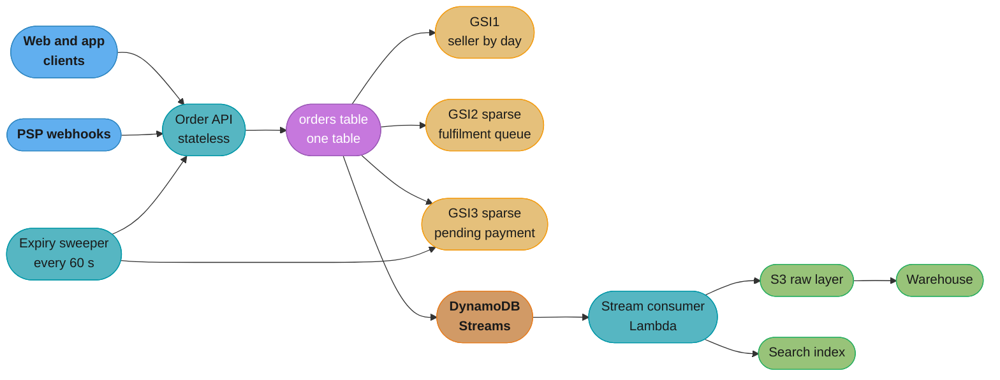
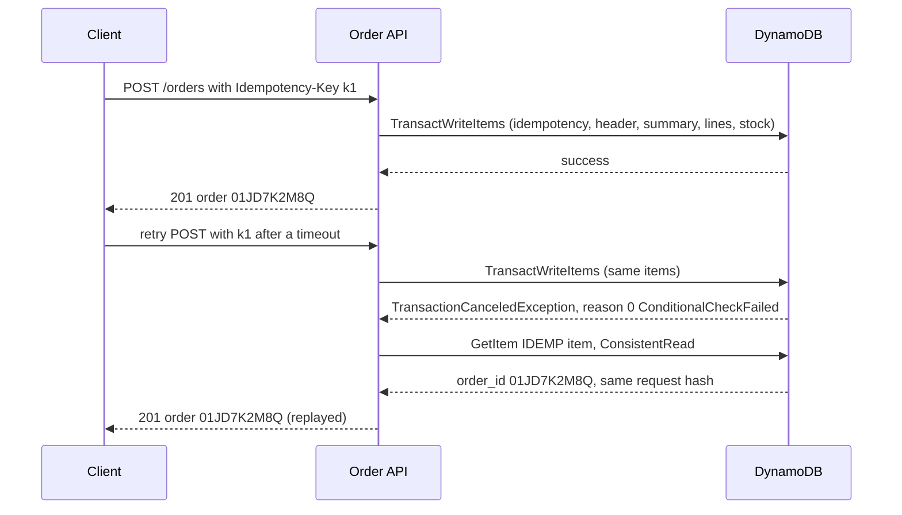
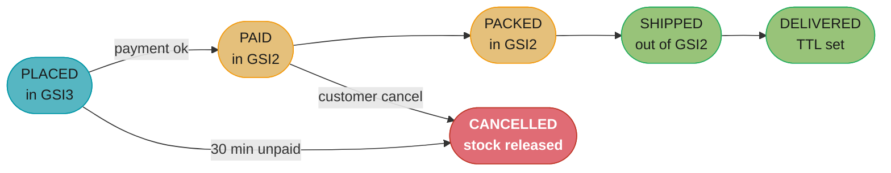

# Case Study: Design a DynamoDB-Backed Order Service (Single-Table Design)

## Intuition

A relational order service starts from entities and lets the query planner work out access
later. A DynamoDB order service starts from the **access patterns** and works backwards to keys,
because DynamoDB gives you exactly two efficient operations: fetch the items under one partition
key (optionally a range of sort keys), and fetch one item by its full key. Everything else, a
second lookup path, a filter, a "join", has to be built in advance as a secondary index, a
duplicated item, or an item collection that already holds the parent and its children side by
side. Single-table design is the discipline of laying out one table so that each page of the
product is one `Query` or one `GetItem`, at a predictable cost, at any scale.

The second insight is that the hard limits are per **partition key**, not per table. A table can
absorb hundreds of thousands of writes per second, while any single partition key tops out at
1,000 write units and 3,000 read units per second. An order service has natural hot keys: one
flash-sale SKU that every buyer decrements, one mega-seller whose dashboard index every order
line updates, one "open orders" queue that every new order joins. The design work is finding each
of those keys on paper before Black Friday finds them for you.

This case study applies DynamoDB to one system end to end. The engine itself (partitions and
their replication groups, capacity arithmetic, burst and adaptive capacity, the generic
single-table procedure, the cost model, Global Tables mechanics) is taught in
[DynamoDB Deep Dive](../../dynamodb_deep_dive/dynamodb_deep_dive.md), and this page links to it
instead of re-deriving it. The key-value family the product belongs to is in
[Key-Value Stores](../../key_value_stores/key_value_stores.md).

---

## 1. Requirements Clarification

### Functional requirements

- **Place an order** for 1 to 50 lines from one or more sellers: reserve inventory, create the
  order, return an order id. A client retry with the same idempotency key must return the same
  order and never create a second one.
- **Order detail:** the order, its lines and its status history in one call.
- **Order history:** a customer's orders, newest first, 20 per page, including an order placed a
  second ago (read-your-writes after checkout).
- **Status transitions:** `PLACED -> PAID -> PACKED -> SHIPPED -> DELIVERED`, plus `CANCELLED`
  from `PLACED` or `PAID`, with no lost or out-of-order transition.
- **Seller dashboard:** a seller's order lines for a given day.
- **Fulfilment queue:** paid, unshipped orders per warehouse, oldest first.
- **Payment webhooks:** find the order for a PSP payment id; reject a second order claiming the
  same payment id.
- **Unpaid order expiry:** cancel and release inventory for orders not paid within 30 minutes.
- **Analytics feed:** every order change delivered to the warehouse in
  [Design a Data Warehouse and Semantic Layer](../design_data_warehouse_and_semantic_layer/design_data_warehouse_and_semantic_layer.md).

### Non-functional requirements

- p99 under **25 ms** for order detail and order history; p99 under **80 ms** for placing an order.
- **No overselling:** inventory never goes negative, including during a flash sale.
- **No duplicate orders** from client or service retries.
- **99.99% write availability** in the home Region; a Region loss is survivable with a documented
  RPO.
- Cost predictable per order, in request units, so finance can model a sales event in advance.

### Explicit non-goals

- **Ad hoc analytics over orders.** "Revenue by category by week" is a warehouse query. DynamoDB
  has no secondary access path that was not designed in advance, and a `Scan` to answer it reads
  the whole table.
- **Search over order contents.** Free-text search ("orders containing red shoes") belongs in a
  search index fed from the change stream, as in
  [Design an E-Commerce Catalog](../design_ecommerce_catalog/design_ecommerce_catalog.md).
- **Payment processing.** The PSP integration, ledger and reconciliation are out of scope; see
  [Design a Banking Ledger](../design_banking_ledger/design_banking_ledger.md) and
  [Idempotency and Exactly-Once Money Movement](../../../fintech/idempotency_and_exactly_once_money_movement/idempotency_and_exactly_once_money_movement.md).

### Assumptions

| Input | Value | Note |
|---|---|---|
| Orders per day | 30 million | 347 orders/s average |
| Flash-sale peak | 6,000 orders/s | 17x average, for about 20 minutes |
| Lines per order | 2.4 average, 50 max | |
| Hottest SKU during a sale | 3,000 decrements/s | One SKU on the home page |
| Largest seller | 25% of lines during a sale | 3,600 lines/s at peak |
| Order history reads | 20,000/s | Top read path |
| Order detail reads | 8,000/s | |
| Tracking reads | 15,000/s | Status only |
| Seller dashboard reads | 2,000/s | |
| Retention in DynamoDB | 400 days after delivery | Then archived to S3 |

---

## 2. Scale Estimation

DynamoDB bills and throttles in request units, so every estimate here is in units. A write
request unit covers one write of up to 1 KB; a transactional write costs two units per KB, because
"DynamoDB performs two underlying reads or writes of every item in the transaction: one to prepare
the transaction and one to commit the transaction". A read unit covers one strongly consistent
read of up to 4 KB, or two eventually consistent ones. A `Query` treats all returned items as one
read: DynamoDB "computes the total size of all items" and rounds that total up to the next 4 KB.

### Item sizes (assumed, and kept under 1 KB on purpose)

| Item | Size | Why it stays small |
|---|---|---|
| Order header (`META`) | 0.9 KB | Addresses stored as ids, not text blobs |
| Order line (`LINE`) | 0.6 KB | Product title is not copied in |
| Customer order summary | 0.3 KB | Only what the history page shows |
| Status event | 0.2 KB | Timestamp, from, to, actor |
| Idempotency record | 0.2 KB | Key, request hash, order id, expiry |
| Payment lookup | 0.2 KB | Payment id to order id |
| Inventory bucket | 0.1 KB | One counter |

Every item fits in one write unit. An order header that grew to 1.1 KB would cost two units on
every write, and every status transition rewrites it, so the size budget is a cost budget.

### Writes

```
place order (one transaction, 2.4 lines on average):
  actions  = idempotency 1 + header 1 + lines 2.4 + summary 1 + inventory 2.4 = 7.8 items
  WRU      = 7.8 x 2 (transactional)                                         = 15.6 WRU
  GSI1     = 2.4 line items projected into the seller index                  =  2.4 WRU
  total                                                                      ~ 18 WRU/order

status transition (one transaction: header + summary + event):
  WRU      = 3 x 2 = 6 WRU, plus GSI2 add/remove on PAID and SHIPPED
  per order lifetime = 5 transitions x 6 + 2                                  = 32 WRU

average:  347 orders/s x (18 + 32)       = 17,350 WRU/s
peak:     6,000 orders/s x 18            = 108,000 WRU/s for placement alone
```

The peak is above DynamoDB's **default per-table quota of 40,000 write request units** for
on-demand tables (the same figure applies per GSI). The quota is adjustable, but only by a
request made weeks before the sale. That single line is the most common reason a launch-day table
throttles with plenty of money left in the budget.

### Reads

```
order history  20,000/s  Query 20 summaries x 0.3 KB = 6 KB -> 8 KB -> 2 RCU strong, 1 RCU eventual
               eventual by default, strong only on the post-checkout page (5%)
               = 20,000 x (0.95 x 1 + 0.05 x 2)                         = 21,000 RRU/s
order detail    8,000/s  Query header + 2.4 lines + 5 events = 3.3 KB -> 4 KB -> 1 RRU strong
                                                                         =  8,000 RRU/s
tracking       15,000/s  GetItem header 0.9 KB -> 4 KB -> 0.5 RRU eventual =  7,500 RRU/s
seller board    2,000/s  GSI1 Query 50 projected lines x 0.3 KB = 15 KB -> 16 KB -> 2 RRU eventual
                                                                         =  4,000 RRU/s (on GSI1)
base table reads                                                         ~ 36,500 RRU/s
```

### Storage

```
per order  = header 0.9 + lines 1.44 + summary 0.3 + events 1.0 + payment 0.2   = 3.84 KB
GSI1 copy  = 2.4 lines x ~0.3 KB (keys plus four projected attributes)          = 0.72 KB
           ~ 4.6 KB per order including index storage
per day    = 30M x 4.6 KB                                                       = 138 GB/day
400 days   = 138 GB x 400                                                       = 55 TB
```

At 10 GB per partition, storage alone spreads the table over more than 5,500 partitions, far more
than throughput needs (17,350 / 1,000 = 18 partitions' worth of average writes). That is good news
for even load and bad news for anyone tempted to `Scan`.

### Cost

The unit counts above are the input to the price model in
[DynamoDB Deep Dive](../../dynamodb_deep_dive/dynamodb_deep_dive.md) §6.10, which compares
on-demand and provisioned capacity for an order service. The design choice that follows from the
numbers is in §5: provisioned capacity with autoscaling for the steady 17,350 WRU/s, and a
planned switch to on-demand (or a scheduled capacity raise) around sales.

---

## 3. High-Level Architecture


*One table holds every entity. Three GSIs serve the patterns the base keys cannot: seller lines by
day, the warehouse fulfilment queue, and unpaid orders due for expiry. The change stream feeds the
warehouse and the search index, so neither ever reads the table directly.*

### The access-pattern table

Single-table design starts here, before any key is drawn. Each row is one product screen or one
system job, with the operation that serves it.

| # | Pattern | Key we have | Operation | Index | Consistency |
|---|---|---|---|---|---|
| AP1 | Place order | customer id, idempotency key | `TransactWriteItems` | Base | Strong |
| AP2 | Order detail | order id | `Query PK = ORDER#o` | Base | Strong |
| AP3 | Order history, newest first | customer id | `Query PK = CUST#c, SK begins_with ORDER#`, descending | Base | Eventual, strong after checkout |
| AP4 | Tracking status | order id | `GetItem PK = ORDER#o, SK = META` | Base | Eventual |
| AP5 | Change status | order id, expected status | `TransactWriteItems` with conditions | Base | Strong |
| AP6 | Seller lines for a day | seller id, date | `Query GSI1PK = SELLER#s#n` per shard | GSI1 | Eventual |
| AP7 | Fulfilment queue | warehouse id | `Query GSI2PK = FULFIL#w#n` per shard, oldest first | GSI2 | Eventual |
| AP8 | Order by payment id | PSP payment id | `GetItem PK = PAYMENT#p` | Base | Strong |
| AP9 | Unpaid orders past 30 minutes | current minute | `Query GSI3PK = PENDING#minute#n` | GSI3 | Eventual |
| AP10 | Inventory reserve and release | SKU | `UpdateItem` on a bucket, inside AP1 or AP5 | Base | Strong |
| AP11 | Change feed | none | DynamoDB Streams | Stream | Ordered per item |

Two patterns need strong consistency on a read: AP2 (a customer service agent must see the latest
status) and AP3 immediately after checkout. Both are served from the **base table**, because GSI
reads are eventually consistent: DynamoDB updates every GSI "asynchronously, using an eventually
consistent model". That one fact decides where the customer's order list lives (§4.2).

### The item collections

```
PK                    SK                                      attributes (abridged)
--------------------  --------------------------------------  ------------------------------------
ORDER#01JD7K2M8Q      META                                    status=PAID version=3 total=9850
                                                              GSI2PK=FULFIL#DUB1#5
                                                              GSI2SK=2026-11-25T10:02:11Z
ORDER#01JD7K2M8Q      LINE#001                                sku=SKU#88213 qty=1 price=4900
                                                              GSI1PK=SELLER#77#3
                                                              GSI1SK=2026-11-25#01JD7K2M8Q#001
ORDER#01JD7K2M8Q      LINE#002                                sku=SKU#10442 qty=2 price=2475
ORDER#01JD7K2M8Q      EVENT#2026-11-25T10:00:03Z#1            from=NEW to=PLACED actor=api
ORDER#01JD7K2M8Q      EVENT#2026-11-25T10:02:11Z#2            from=PLACED to=PAID actor=psp
CUST#c-4410           ORDER#2026-11-25T10:00:03Z#01JD7K2M8Q   status=PAID total=9850 lines=2
CUST#c-4410           ORDER#2026-11-19T18:41:55Z#01JC9X0F2A   status=DELIVERED total=1299
PAYMENT#pi_3Q8x2      META                                    order_id=01JD7K2M8Q
IDEMP#c-4410#9f1c     META                                    order_id=01JD7K2M8Q ttl=...
SKU#88213#B07         STOCK                                   available=412
```
*Two item collections per order flow: everything about one order under `ORDER#`, and a compact
summary per order under the customer's `CUST#` key. The summary is a deliberate duplicate written
in the same transaction as the order. Inventory lives in per-SKU buckets with their own partition
keys.*

Sort keys encode both type and order. `LINE#001` sorts lines by line number, `EVENT#<ISO time>#<seq>`
sorts the status history by time, and `ORDER#<ISO time>#<id>` under the customer key makes "newest
first" a descending `Query` with `Limit = 20`. Order ids are derived from the customer and the
idempotency key (§4.1) and shown shortened here; they carry no time order, which is why the
timestamp is explicit in the sort key.

---

## 4. Component Deep Dives

### 4.1 Placing an order: one transaction, five invariants

Placing an order must keep five invariants at once: no duplicate order for one idempotency key, no
second order with the same id, no inventory below zero, a customer summary that exists exactly when
the order exists, and no half-written order. `TransactWriteItems` makes them one atomic unit of up
to 100 items and 4 MB. The design caps orders at 50 lines, so the largest transaction is
`3 + 2 x 50 = 103` actions, over the limit; §4.4 explains how lines from the same SKU are
merged and why baskets above 48 distinct SKUs are split.

**BROKEN: read, check, write, and retry on timeout.**

```python
import uuid
import boto3

ddb = boto3.resource("dynamodb")
table = ddb.Table("orders")

def place_order_broken(customer_id: str, lines: list[dict]) -> str:
    # BROKEN 1: read-check-write. Two buyers can both read available=1 and both succeed.
    for ln in lines:
        stock = table.get_item(Key={"PK": f"SKU#{ln['sku']}", "SK": "STOCK"})["Item"]
        if stock["available"] < ln["qty"]:
            raise RuntimeError("out of stock")
    order_id = str(uuid.uuid4())             # BROKEN 2: a retry generates a new id
    table.put_item(Item={"PK": f"ORDER#{order_id}", "SK": "META", "status": "PLACED"})
    for i, ln in enumerate(lines, 1):
        table.put_item(Item={"PK": f"ORDER#{order_id}", "SK": f"LINE#{i:03d}", **ln})
        stock = table.get_item(Key={"PK": f"SKU#{ln['sku']}", "SK": "STOCK"})["Item"]
        table.put_item(Item={**stock, "available": stock["available"] - ln["qty"]})
    # BROKEN 3: a crash here leaves an order with lines but no customer summary
    table.put_item(Item={"PK": f"CUST#{customer_id}", "SK": f"ORDER#{order_id}"})
    return order_id
```

Three failures hide in that function. Two concurrent buyers of the last unit both pass the check,
and the second `put_item` of the stock item overwrites the first, so stock ends at 0 with two
orders sold: an oversell and a lost update in one. A client that times out and retries gets a
second order with a fresh id and a second inventory decrement. A process crash between any two
writes leaves a partial order that no code path ever cleans up.

**FIX: one conditional transaction keyed by the idempotency key.**

```python
import hashlib
import json
import time
import uuid

import boto3
from botocore.exceptions import ClientError

client = boto3.client("dynamodb")
TABLE = "orders"
BUCKETS = 16

def shard8(order_id: str, line_no: int) -> int:
    return int(hashlib.sha256(f"{order_id}:{line_no}".encode()).hexdigest(), 16) % 8

def bucket_for(order_id: str, sku: str, attempt: int) -> str:
    h = int(hashlib.sha256(f"{order_id}:{sku}".encode()).hexdigest(), 16)
    return f"SKU#{sku}#B{(h + attempt) % BUCKETS:02d}"

def place_order(customer_id: str, idem_key: str, lines: list[dict], now: float) -> str:
    req_hash = hashlib.sha256(json.dumps(lines, sort_keys=True).encode()).hexdigest()
    # Deterministic id: the same customer and key always produce the same order id.
    order_id = str(uuid.uuid5(uuid.NAMESPACE_URL, f"{customer_id}/{idem_key}"))
    created = time.strftime("%Y-%m-%dT%H:%M:%SZ", time.gmtime(now))
    total = sum(l["qty"] * l["price"] for l in lines)

    for attempt in range(3):
        items = [
            {"Put": {"TableName": TABLE, "Item": {
                "PK": {"S": f"IDEMP#{customer_id}#{idem_key}"}, "SK": {"S": "META"},
                "order_id": {"S": order_id}, "req_hash": {"S": req_hash},
                "ttl": {"N": str(int(now) + 86_400)}},
                "ConditionExpression": "attribute_not_exists(PK)"}},
            {"Put": {"TableName": TABLE, "Item": {
                "PK": {"S": f"ORDER#{order_id}"}, "SK": {"S": "META"},
                "status": {"S": "PLACED"}, "version": {"N": "1"},
                "customer_id": {"S": customer_id}, "total": {"N": str(total)},
                "created_at": {"S": created},
                "GSI3PK": {"S": f"PENDING#{created[:16]}#{int(order_id[:8], 16) % 8}"},
                "GSI3SK": {"S": order_id}},
                "ConditionExpression": "attribute_not_exists(PK)"}},
            {"Put": {"TableName": TABLE, "Item": {
                "PK": {"S": f"CUST#{customer_id}"}, "SK": {"S": f"ORDER#{created}#{order_id}"},
                "status": {"S": "PLACED"}, "total": {"N": str(total)},
                "lines": {"N": str(len(lines))}}}},
        ]
        for i, ln in enumerate(lines, 1):
            items.append({"Put": {"TableName": TABLE, "Item": {
                "PK": {"S": f"ORDER#{order_id}"}, "SK": {"S": f"LINE#{i:03d}"},
                "sku": {"S": ln["sku"]}, "qty": {"N": str(ln["qty"])},
                "price": {"N": str(ln["price"])}, "seller": {"S": ln["seller"]},
                "GSI1PK": {"S": f"SELLER#{ln['seller']}#{shard8(order_id, i)}"},
                "GSI1SK": {"S": f"{created[:10]}#{order_id}#{i:03d}"}}}})
            items.append({"Update": {"TableName": TABLE,
                "Key": {"PK": {"S": bucket_for(order_id, ln["sku"], attempt)}, "SK": {"S": "STOCK"}},
                "UpdateExpression": "SET available = available - :q",
                "ConditionExpression": "available >= :q",
                "ExpressionAttributeValues": {":q": {"N": str(ln["qty"])}}}})
        try:
            client.transact_write_items(
                TransactItems=items,
                ClientRequestToken=str(uuid.uuid5(uuid.NAMESPACE_URL, f"{order_id}/{attempt}")))
            return order_id
        except ClientError as e:
            if e.response["Error"]["Code"] != "TransactionCanceledException":
                raise
            reasons = e.response.get("CancellationReasons", [])
            if reasons and reasons[0].get("Code") == "ConditionalCheckFailed":
                return replay(customer_id, idem_key, req_hash)       # duplicate request
            if len(reasons) > 1 and reasons[1].get("Code") == "ConditionalCheckFailed":
                return order_id                  # idempotency record expired, order exists
            stock_failed = any(r.get("Code") == "ConditionalCheckFailed"
                               for r in reasons[4::2])                 # inventory updates
            if not stock_failed:
                raise                                                  # conflict: caller retries
            # one bucket ran dry: retry the whole transaction on the next bucket
    raise RuntimeError("out of stock")

def replay(customer_id: str, idem_key: str, req_hash: str) -> str:
    rec = client.get_item(TableName=TABLE, ConsistentRead=True,
                          Key={"PK": {"S": f"IDEMP#{customer_id}#{idem_key}"}, "SK": {"S": "META"}})
    item = rec["Item"]
    if item["req_hash"]["S"] != req_hash:
        raise ValueError("idempotency key reused with a different request")
    return item["order_id"]["S"]
```

Each invariant maps to one line of the transaction:

| Invariant | Enforced by |
|---|---|
| One order per idempotency key | `attribute_not_exists(PK)` on the `IDEMP#` item, and a deterministic `uuid5` order id |
| One order per order id | `attribute_not_exists(PK)` on the `META` item |
| Inventory never negative | `available >= :q` on each bucket update |
| Summary exists exactly when the order exists | Summary `Put` in the same transaction |
| No partial order | `TransactWriteItems` is all or nothing |

The `IDEMP#` item is the durable idempotency record and lasts 24 hours. `ClientRequestToken` is a
second, shorter layer: DynamoDB treats a repeated token as the same request, and "a client token is
valid for 10 minutes after the request that uses it finishes". The token covers an SDK retry of the
same call; the `IDEMP#` item covers a user who taps "Buy" again an hour later. The cancellation
reasons come back in the order of `TransactItems`, which is why the code checks index 0 for the
idempotency condition and every second item from index 4 for inventory. The mechanics of conditional
writes and transactions in general are in
[DynamoDB Deep Dive](../../dynamodb_deep_dive/dynamodb_deep_dive.md) §6.5 and §6.6.

A request that reuses a key with a different body is rejected rather than replayed, which is the
same rule the IETF `Idempotency-Key` draft and the payment world follow; see
[Idempotency and Exactly-Once Money Movement](../../../fintech/idempotency_and_exactly_once_money_movement/idempotency_and_exactly_once_money_movement.md).


*The retry hits the idempotency condition, the API reads the stored order id with a strongly
consistent read, and the client gets the original order. No second order and no second decrement
exist.*

### 4.2 Read-your-writes for order history: why the summary is a duplicate item

The obvious design puts the customer id on the order header and adds a GSI on `customer_id,
created_at`. It costs one write fewer per order. It also makes AP3 eventually consistent, because
GSIs are updated asynchronously: a customer who completes checkout and lands on "My orders" can see
the list without the order they just placed. Under normal load the lag is short; under a flash sale
it is longest exactly when the most customers are looking.

The design writes a 0.3 KB summary item under `CUST#c` in the same transaction as the order. The
history page is a base-table `Query`, eventually consistent by default (1 RRU per page) and strongly
consistent on the one page that follows checkout (2 RRU). The duplicate costs 2 WRU per order in the
placement transaction and 2 WRU per status transition to keep `status` current, about 12 WRU per
order lifetime. At 30M orders a day that is the price of never showing a customer an empty order list
right after they paid.

### 4.3 Status transitions: a state machine enforced by conditions

Every transition is a conditional transaction over the header, the summary and a new event item.
The condition checks both the expected current status and a version number, so two concurrent
transitions (a cancel and a payment webhook arriving together) cannot both win.


*The sparse indexes follow the state machine: an order is in GSI3 only while unpaid and in GSI2
only while it waits for the warehouse. Each arrow is one conditional transaction.*

```python
ALLOWED = {
    "PLACED": {"PAID", "CANCELLED"},
    "PAID": {"PACKED", "CANCELLED"},
    "PACKED": {"SHIPPED"},
    "SHIPPED": {"DELIVERED"},
}

def transition(order_id: str, customer_id: str, summary_sk: str, frm: str, to: str,
               version: int, warehouse: str, now_iso: str, seq: int) -> None:
    if to not in ALLOWED.get(frm, set()):
        raise ValueError(f"{frm} -> {to} is not a legal transition")
    set_expr = "SET #s = :to, version = version + :one, updated_at = :now"
    remove = []
    values = {":to": {"S": to}, ":from": {"S": frm}, ":v": {"N": str(version)},
              ":one": {"N": "1"}, ":now": {"S": now_iso}}
    if to == "PAID":
        remove.append("GSI3PK")                                 # leave the expiry index
        set_expr += ", GSI2PK = :q, GSI2SK = :now"              # join the fulfilment queue
        values[":q"] = {"S": f"FULFIL#{warehouse}#{int(order_id[:8], 16) % 8}"}
    if to in ("SHIPPED", "CANCELLED"):
        remove += ["GSI2PK", "GSI3PK"]                          # leave both queues
    update = set_expr + (" REMOVE " + ", ".join(remove) if remove else "")
    client.transact_write_items(TransactItems=[
        {"Update": {"TableName": TABLE,
            "Key": {"PK": {"S": f"ORDER#{order_id}"}, "SK": {"S": "META"}},
            "UpdateExpression": update,
            "ConditionExpression": "#s = :from AND version = :v",
            "ExpressionAttributeNames": {"#s": "status"},
            "ExpressionAttributeValues": values}},
        {"Update": {"TableName": TABLE,
            "Key": {"PK": {"S": f"CUST#{customer_id}"}, "SK": {"S": summary_sk}},
            "UpdateExpression": "SET #s = :to",
            "ExpressionAttributeNames": {"#s": "status"},
            "ExpressionAttributeValues": {":to": {"S": to}}}},
        {"Put": {"TableName": TABLE, "Item": {
            "PK": {"S": f"ORDER#{order_id}"}, "SK": {"S": f"EVENT#{now_iso}#{seq}"},
            "from": {"S": frm}, "to": {"S": to}},
            "ConditionExpression": "attribute_not_exists(PK)"}},
    ])
```

`status` is a DynamoDB reserved word, hence the `#s` placeholder. A payment webhook that arrives
twice fails the second time on `#s = :from`, and the handler treats that failure as success if the
current status is already `PAID`. Cancellation from `PLACED` or `PAID` releases inventory by adding
the quantity back to a bucket in the same transaction (omitted above for length), so a cancelled
order never holds stock.

### 4.4 Hot keys: the flash-sale SKU, the mega-seller and the queues

Each partition key is capped at 3,000 read units and 1,000 write units per second. AWS's adaptive
capacity can isolate a hot item onto its own partition, and then "DynamoDB can deliver throughput up
to the partition maximum of 3,000 RCUs and 1,000 WCUs to that single item's primary key". It cannot
go past that maximum for one key. Every hot key in the design is therefore split on paper.

**The flash-sale SKU.** A home-page SKU sees 3,000 decrements per second. Each decrement is a
transactional write of a sub-1 KB item, so it costs 2 WRU, and one item can absorb at most about 500
transactional decrements per second.

```
one stock item     : 1,000 WRU/s / 2 WRU per transactional decrement = 500 decrements/s
needed             : 3,000 decrements/s
buckets            : 16 (SKU#88213#B00 .. #B15), each its own partition key
capacity           : 16 x 500 = 8,000 decrements/s, 2.7x headroom
stock per bucket   : total stock / 16, refilled by a rebalancer every 5 s
```

The bucket is chosen by hashing the order id and SKU, so a retry of the same order targets the same
bucket first; on a failed condition the transaction moves to the next bucket (`attempt + 1`). When
total stock is low, a rebalancer moves units from full buckets to empty ones, and when total stock
falls below `16 x max order quantity`, the service collapses back to a single bucket so the last
units are not stranded in buckets nobody hashes to. Buckets are separate partition keys rather than
sort keys under one key, so they can never be co-located on one partition.

**Line merging and the 100-item limit.** Two lines for the same SKU become one line with the summed
quantity, and the transaction's inventory updates are per distinct SKU. The largest order therefore
has `3 + 2 x distinct SKUs` actions, which stays within 100 for up to 48 distinct SKUs; the API splits
larger baskets into linked orders. No two actions in one transaction may touch the same item, which
line merging also guarantees.

**The mega-seller on GSI1.** A seller with 25% of 6,000 orders/s at 2.4 lines per order writes about
3,600 lines/s into one GSI1 partition key, well past 1,000 WRU. The key is suffixed with `#0..#7`
(spread by a hash of order id and line number in `shard8`, about 450 WRU/s per shard), and the dashboard reads all
eight shards in parallel and merges them by sort key. The general write-sharding pattern and its
read-side merge are in [DynamoDB Deep Dive](../../dynamodb_deep_dive/dynamodb_deep_dive.md) §6.4.
GSI capacity matters more than it looks: "If you perform heavy write activity on the table, but a
global secondary index on that table has insufficient write capacity, the write activity on the table
will be throttled." A hot GSI partition key throttles **order placement**, not only the dashboard.

**The queues.** `FULFIL#<warehouse>` and `PENDING#<minute>` collect every order for one warehouse or
one minute. At a 6,000 orders/s peak, one minute bucket receives 6,000 writes per second. Both keys
carry an 8-way shard suffix, so readers query 8 keys and the busiest one takes about 750 WRU/s.

### 4.5 Unpaid-order expiry: TTL is not a timer

The tempting design sets a TTL attribute 30 minutes after placement and lets DynamoDB delete unpaid
orders. AWS's documentation rules it out: TTL "automatically deletes expired items within a few days
of their expiration time", and expired items "might be deleted by the system at any time, typically
within a few days after their expiration". An unpaid order would hold its inventory for days.

The design uses the sparse GSI3 instead. An unpaid order carries `GSI3PK = PENDING#<placed minute>#<shard>`.
A sweeper runs every 60 seconds, queries the 8 shards of the minute that is now 30 minutes old, and
runs a `PLACED -> CANCELLED` transition (which also releases stock) for each order still there.
Paying removes `GSI3PK`, so a paid order is never in the sweep. Because GSI3 is eventually consistent,
the sweep can see an order that was paid a second ago; the transition's `#s = :from` condition then
fails and the sweeper skips it. The index finds candidates; the conditional write decides.

TTL is still used where "within a few days" is fine: idempotency records (24 hours) and delivered
orders 400 days after delivery. TTL deletes "go into DynamoDB Streams as service deletions instead of
user deletes", which the stream consumer uses to tell retention from a real delete when it archives
the order to S3.

### 4.6 The change stream: analytics and search without reading the table

DynamoDB Streams records item-level changes "for up to 24 hours", with each record appearing "exactly
once in the stream" and, for each item, "in the same sequence as the actual modifications to the
item". The stream consumer (a Lambda function here) writes every new image to the S3 raw layer of the
warehouse and updates the search index.

Three properties of the stream shape the consumer:

- **Ordered per item, not globally.** Two lines of one order can arrive in either order relative to
  each other. The warehouse staging layer orders by item key and stream sequence number.
- **The stream is exactly once; the consumer is not.** A Lambda batch that fails is retried, so the
  sink must be idempotent. The S3 object key includes the shard id and the first sequence number of
  the batch, so a retry overwrites the same object instead of adding a duplicate.
- **24 hours is the recovery window.** A consumer outage longer than a day loses changes. The runbook
  (§8) falls back to an incremental export to S3 for the missing interval.

The warehouse side of this feed, including how late-arriving order events attach to the right
dimension versions, is in
[Design a Data Warehouse and Semantic Layer](../design_data_warehouse_and_semantic_layer/design_data_warehouse_and_semantic_layer.md)
§4.3. The generic CDC-to-read-model pattern is in
[Polyglot Persistence Patterns](../../polyglot_persistence_patterns/polyglot_persistence_patterns.md).

### 4.7 Multi-Region: why this service uses MREC with a home Region

DynamoDB Global Tables offer two modes, and the order service's own features choose between them.

- **Multi-Region strong consistency (MRSC)** makes strongly consistent reads return the latest version
  in any replica and evaluates conditions against the latest version, but it "must be deployed in
  exactly three Regions", does not support TTL, and does "not support transaction operations". The
  placement flow in §4.1 is a transaction, and idempotency records expire by TTL, so MRSC is out.
- **Multi-Region eventual consistency (MREC)** replicates asynchronously with "last writer wins"
  conflict resolution per item, an RPO "equal to the replication delay between replicas, usually a few
  seconds", and transactions that are "only atomic within the Region where the operation was invoked".

The design therefore pins every customer to a **home Region** (stored in the session and in the
customer profile) and routes all writes for that customer there. Reads may be served by any replica,
with a staleness of seconds. Because all writes for one order come from one Region, last-writer-wins
never has two writers to choose between in normal operation. On a Region failure, customers fail over
to a second Region with the documented RPO; orders whose last writes had not yet replicated are
reconciled from the PSP's records and the change stream archive. The consistency trade-off in general
terms is in [Global Multi-Region OLTP](../design_global_multiregion_oltp/design_global_multiregion_oltp.md).

### 4.8 What this table cannot do, and what to do instead

| Request | Why the table cannot | Where it goes |
|---|---|---|
| "All orders over $500 last week" | No key on amount or week; a `Scan` reads all 55 TB | Warehouse |
| "Orders containing red shoes" | No text index | Search index from the stream |
| "Top 10 sellers today" | Needs aggregation across all sellers | Warehouse, or a counter item per seller updated from the stream |
| A new lookup by shipping carrier | No GSI yet | Add GSI4; backfill happens automatically from existing items |
| A join to the product catalog | No joins | Denormalise needed fields at write time, or join in the API |

Adding a GSI to a live table backfills it from existing items, which makes a new access pattern cheap
to add if the attribute already exists on the items. Two limits apply at this size: DynamoDB's
default maximum base-table size for creating a GSI without allowlisting is 50 TB, below this table's
55 TB, so a new index needs an AWS Support request first; and a pattern whose key attribute does not
exist needs a backfill job that rewrites items, at 1 WRU or more per item, which at 55 TB is a
planned migration, not a config change.

---

## 5. Design Decisions & Tradeoffs

| Decision | Choice | Alternative | Why this choice |
|---|---|---|---|
| Table layout | Single table, all entities | Table per entity | Order detail is one `Query`; one stream feeds all consumers |
| Customer order list | Duplicate summary item in the base table | GSI on `customer_id` | Read-your-writes after checkout; GSIs are eventually consistent |
| Order placement | One `TransactWriteItems` | Saga of single-item writes | All five invariants hold atomically; cost is 2x WRU per item |
| Idempotency | `IDEMP#` item for 24 h plus `ClientRequestToken` | Token alone | The token is valid for 10 minutes; users retry for longer |
| Inventory | 16 buckets per hot SKU, rebalanced | One counter per SKU | One key caps at about 500 transactional decrements/s |
| Order expiry | Sparse GSI and a sweeper | TTL | TTL deletes "within a few days" |
| Capacity mode | Provisioned with autoscaling, on-demand around sales | On-demand always | Steady load is predictable; see the cost comparison in the deep dive §6.10 |
| Multi-Region | MREC with a home Region per customer | MRSC | MRSC supports neither transactions nor TTL |
| Analytics | Streams to S3 to warehouse | Query the table | No ad hoc access path exists, by design |

Two of these are the ones an interviewer pushes on.

- **Single table versus table per entity.** AWS documents both as foundations: single-table design
  "aims to optimize data access patterns, improve performance, and reduce costs by eliminating the
  need for maintaining multiple tables", while multi-table design gives each table its own stream and
  scaling but means "multiple reads from DynamoDB will be required and data might need to be
  processed/joined on the client code". The order detail page is the deciding pattern here: header,
  lines and history in one `Query` against one item collection. Inventory buckets live in the same
  table for transactional reasons (a transaction cannot span accounts or Regions, but it can span
  tables), so a separate inventory table would also have worked; keeping one table keeps one stream.
- **Transactions versus a saga.** A saga of single-item conditional writes with compensations costs
  half the write units and has no 100-item limit. It also exposes intermediate states: a reserved
  bucket with no order, an order with no summary. Every consumer of the stream and every read path
  must then understand those states. For a 2.4-line average order, the 2x write cost of a transaction
  is about 8 extra WRU per order, cheap compared with the code that compensations require. The saga
  trade-off in general is in [Distributed Transactions](../../distributed_transactions/distributed_transactions.md).

---

## 6. Real-World Implementations

- **Amazon.com on Prime Day.** The DynamoDB paper (USENIX ATC 2022) reports that during the 66-hour
  Prime Day in 2021, Amazon systems including Alexa, the Amazon.com sites and Amazon fulfillment
  centers "made trillions of API calls to DynamoDB, peaking at 89.2 million requests per second". AWS
  reported a peak of 146 million requests per second for Prime Day 2024 and 151 million for Prime Day
  2025, with "tens of trillions of calls to the DynamoDB API" each time, while delivering single-digit
  millisecond responses. Order and fulfilment systems are this case study's workload at the largest
  scale it runs anywhere.
- **The DynamoDB service itself.** The same paper describes partitions as replication groups using
  Multi-Paxos, with only the leader serving writes and strongly consistent reads, and recounts that
  per-partition throughput allocation led to throttling on non-uniform access, which DynamoDB
  addressed "shortly after launching" in 2012 with bursting and adaptive capacity. The per-key 1,000
  WCU and 3,000 RCU ceilings that drive §4.4 are the remaining edge of that design.
- **Uber LedgerStore.** Uber's engineering blog describes building a time-range index for LedgerStore
  on DynamoDB, where "DynamoDB has restrictions on throughput in case of hot partitions, leading to
  throttling of write requests, which is not acceptable in the online write path". Uber worked around
  it with a write-optimized buffer index table, then "re-architected our index storage backend from
  DynamoDB to Uber's Docstore database as part of cost efficiency". It is the cautionary version of
  §4.4: time-ordered keys concentrate writes, and at very large scale the per-request price is the
  design pressure that remains.
- **AWS's own modelling guidance.** The DynamoDB developer guide presents single-table and multiple-table
  design as the two foundation choices and recommends single-table design "when your access patterns
  benefit from data locality", which is the order-detail argument in §5.

---

## 7. Technologies & Tools

| Tool | Role in this design | Why over the alternative | Operational cost it adds |
|---|---|---|---|
| Amazon DynamoDB | The orders table and its three GSIs | Predictable single-digit ms at any scale for known access patterns | Access patterns must be designed in advance; per-key ceilings |
| DynamoDB Streams | Change feed to analytics and search | Ordered per item, built in, no dual writes | 24-hour retention; at most two readers per shard |
| AWS Lambda | Stream consumer and expiry sweeper | Scales with stream shards, no servers | Retries mean the sink must be idempotent |
| Amazon S3 | Raw layer of the warehouse and order archive | Cheap durable storage, lifecycle rules | Small-file management |
| DynamoDB export to S3 | Backfill and recovery for gaps in the stream | Incremental export covers a 15-minute to 24-hour window | Export jobs to schedule and verify |
| AWS SDK for Python (boto3) | Client for transactions and conditional writes | First-party, exposes `CancellationReasons` | Retry configuration must match idempotency design |
| CloudWatch Contributor Insights | Finding the hottest partition keys | Shows top keys by traffic, not only table totals | Additional CloudWatch charges |

---

## 8. Operational Playbook

### Metrics to dashboard

| Metric | Unit | Why it matters |
|---|---|---|
| Consumed WRU and RRU vs quota, table and each GSI | units/s | The 40,000 default per-table quota is the first wall at a sale |
| Throttled requests by operation, table and GSI | count/s | A GSI throttle shows up as a placement failure |
| `TransactionConflict` | count/s | Contention on the same items, usually a hot bucket |
| Transaction cancellations by reason | count/s | Stock-outs vs duplicates vs conflicts |
| Top partition keys (Contributor Insights) | requests | Finds the next hot key before it throttles |
| Stream iterator age | seconds | Consumer lag against the 24-hour retention |
| Pending orders older than 31 minutes | count | The sweeper is behind |
| Idempotent replays | count/s | A spike means a client retry storm |

### Alert thresholds

| Condition | Level | Action |
|---|---|---|
| Consumed WRU > 70% of the table or a GSI quota | warn | Raise capacity or request a quota increase |
| Any throttling on GSI1, GSI2 or GSI3 | page | Placement is at risk; check the hot key and its shard count |
| Stream iterator age > 1 hour | page | Fix the consumer; prepare an export for the gap |
| Stream iterator age > 12 hours | page, incident | Half the retention window is gone |
| Pending orders older than 35 minutes > 100 | warn | Sweeper failing or GSI3 lagging |
| Transaction cancellations for stock > 20% of attempts on one SKU | warn | Rebalance buckets or mark the SKU sold out |

### Runbook: before a flash sale

1. Estimate peak orders per second and run the §2 arithmetic for the table and each GSI.
2. If any figure exceeds 40,000 units/s, confirm the quota increase is approved, in every Region with a
   replica.
3. Pre-split hot SKUs into 16 buckets and seed stock per bucket an hour before the sale.
4. Confirm every hot GSI key (seller, warehouse, minute) has its shard suffix for the sellers in the sale.
5. Switch the table to on-demand or raise provisioned capacity for the window; note that a table can
   switch from provisioned to on-demand up to four times in a rolling 24 hours.

### Runbook: stream consumer down

1. Check the consumer's error and the oldest record's age.
2. Fix and redeploy; Lambda resumes from the last checkpoint.
3. If iterator age passed 24 hours, run an incremental export to S3 for the missing interval and load
   it into the raw layer; the warehouse dedupes by item key and update time.

### Runbook: a hot key throttling during an event

1. Identify the key in Contributor Insights.
2. If it is a stock bucket, raise the bucket count for that SKU on the next refill cycle.
3. If it is a GSI key without a shard suffix, add the suffix in the writer; new items spread
   immediately, and readers query both the old and new key shapes until old items age out of the view.

---

## 9. Common Pitfalls & War Stories

Figures below are illustrative, sized to the assumptions in §1.

**The default quota on launch day.** *Symptom:* at 18:00:04 on the first big sale, 40% of
`TransactWriteItems` calls failed with throttling while consumed capacity sat flat at 40,000 WRU/s.
*Root cause:* the table was on-demand and the team assumed on-demand meant unlimited; the per-table
default quota of 40,000 write request units capped it. *Fix:* the quota increase was requested and
approved for the next sale, with a pre-sale checklist item. *Impact:* 22 minutes of degraded checkout,
about 1.9 million failed placement attempts, and an estimated 9% of the event's revenue lost to
abandoned carts.

**A single stock counter.** *Symptom:* during a sneaker release, order placement p99 rose from 40 ms
to 2.4 s and 70% of transactions were cancelled with conflicts. *Root cause:* one `SKU#...#STOCK`
item absorbed every decrement; at 2 WRU per transactional decrement it could not exceed about 500 per
second, and concurrent transactions on the same item conflicted. *Fix:* 16 buckets per hot SKU and a
rebalancer. *Impact:* a 30-minute release sold its stock in 11 minutes instead of 90 seconds, and
support handled 14,000 "it said sold out but my friend got one" tickets.

**TTL as an expiry timer.** *Symptom:* inventory for popular items showed "sold out" while the
warehouse had stock. *Root cause:* unpaid orders were expired by TTL set 30 minutes after placement;
TTL deleted them hours to days later, and the stock stayed reserved until then. *Fix:* the sparse
GSI3 sweeper in §4.5. *Impact:* about 4% of sellable stock was unavailable at any moment during the
two weeks before the fix.

**The customer GSI that lagged at checkout.** *Symptom:* customers placed duplicate orders right after
checkout. *Root cause:* the order list read a GSI on `customer_id`; under sale load the index lagged,
customers did not see the new order, and they bought again with a fresh cart (a new idempotency key).
*Fix:* the duplicated summary item in the base table (§4.2) with a strongly consistent read after
checkout. *Impact:* 0.6% of orders during the event were duplicates that had to be cancelled and
refunded by hand.

**A mega-seller throttling everyone.** *Symptom:* order placement failed for all customers, not only
those buying from one seller. *Root cause:* GSI1 keyed only by `SELLER#<id>` received 3,600 line writes
per second for the largest seller; the GSI partition throttled, and because a GSI with insufficient
write capacity throttles writes to the base table, every placement touching that seller and many
that did not waited and failed. *Fix:* the 8-way seller shard suffix. *Impact:* 9 minutes of checkout
errors for 100% of traffic.

**A stream consumer down over a weekend.** *Symptom:* Monday's dashboards showed no orders after
Saturday 02:00. *Root cause:* a schema change in the consumer threw on a new attribute; retries blocked
the shard, and records older than 24 hours aged out of the stream. *Fix:* skip-and-park for poison
records, an alert on iterator age at 1 hour, and an incremental export to fill the gap. *Impact:*
26 hours of orders missing from the warehouse until the export was loaded, and a delayed weekly
finance close.

---

## 10. Capacity Planning

### Steady state and peak

| Component | Steady state | Flash-sale peak | Notes |
|---|---|---|---|
| Base table writes | 17,350 WRU/s | ~120,000 WRU/s | Placement 108,000 plus transitions |
| Base table reads | 36,500 RRU/s | ~90,000 RRU/s | History and tracking spike with the sale |
| GSI1 writes | 830 WRU/s | 14,400 WRU/s | 2.4 lines per order; seller-sharded |
| GSI1 reads | 4,000 RRU/s | 10,000 RRU/s | Sellers refresh dashboards during sales |
| GSI2 writes | ~700 WRU/s | ~700 WRU/s | Fulfilment pace is set by warehouses, not by the sale |
| GSI3 writes | 350 WRU/s | 6,000 WRU/s | One add per new order, removed on payment |
| Storage | 55 TB | 55 TB | 400 days after delivery |
| Stream shards | DynamoDB-managed | DynamoDB-managed | Consumer concurrency follows shard count |

### Quotas to request before the first sale

| Quota | Default | Needed | Source |
|---|---|---|---|
| Table write throughput (on-demand) | 40,000 WRU/s | 130,000 WRU/s | Service quotas |
| Table read throughput (on-demand) | 40,000 RRU/s | 100,000 RRU/s | Service quotas |
| Per-GSI throughput | 40,000 units/s | 20,000 units/s | Within default |
| GSIs per table | 20 | 3 | Within default |

### Cost per order in request units

```
placement               18 WRU
status transitions      32 WRU
reads per order         ~ 10 RRU (history views, detail, tracking, amortized)
storage                 4.6 KB x 400 days
cost per order          = 50 x price_per_WRU + 10 x price_per_RRU + storage_share
```

Multiplying those units by the current price sheet, as in the deep dive's §6.10 model, gives finance a
per-order cost they can scale to any sales forecast. The biggest lever in the formula is not capacity
mode but the transaction multiplier: placement costs 18 WRU with transactions and about 10 with a saga.

### Scaling triggers

| Area | Trigger | Action |
|---|---|---|
| Table or GSI throughput | Forecast peak > 70% of quota | Quota request, two weeks ahead |
| Hot SKU | Stock cancellations > 20% on one SKU | More buckets for that SKU |
| Hot seller | Any GSI1 shard > 700 WRU/s | Raise that seller's shard count |
| Storage | Growth > 150 GB/day | Revisit the 400-day retention and the Standard-IA table class |
| Stream lag | Iterator age p99 > 5 minutes | Raise consumer parallelism per shard |

---

## 11. Interview Discussion Points

**Q: Why does single-table design start from access patterns instead of entities?**
**Short:** DynamoDB serves only key lookups and key-range queries efficiently, so every screen must map to one key shape before the table is designed.

There is no query planner to find a path later. Each access pattern is written down with the key the
caller has, the rate, the result size and the consistency it needs, and then served by the base keys,
a GSI, or a duplicated item. Order detail becomes one `Query` on `ORDER#o` because the header, lines and
events share that partition key. A pattern discovered after launch needs a new GSI or a backfill.

**Q: Why is the customer's order list a duplicated item and not a GSI?**
**Short:** GSIs are updated asynchronously, so a customer could miss the order they just placed; a base-table item written in the same transaction supports a strongly consistent read.

A GSI on `customer_id` costs one fewer write per order, but its eventual consistency is worst under
the heaviest load, exactly when customers check their orders. The duplicate summary costs 2 WRU at
placement and 2 WRU per status change. The post-checkout page uses a strongly consistent `Query`;
other history views stay eventually consistent at half the read cost.

**Q: How does the design guarantee one order per idempotency key?**
**Short:** The placement transaction includes a conditional put on an idempotency item, and the order id is derived from the key, so a retry fails the condition and replays the stored order.

The transaction writes `IDEMP#customer#key` with `attribute_not_exists(PK)` and the order header with
the same condition, using a `uuid5` of customer and key as the order id. A retry is cancelled at index 0,
and the API reads the stored order id with a strongly consistent read. `ClientRequestToken` adds a
second layer for SDK retries, but it is valid for only 10 minutes, so it cannot replace the 24-hour record.

**Q: Why can a single stock item not absorb a flash sale, and how do buckets fix it?**
**Short:** One partition key tops out at 1,000 write units per second, about 500 transactional decrements, so stock is split across independent bucket keys.

A transactional write costs 2 WRU per item up to 1 KB, and adaptive capacity cannot take one key past
the partition maximum. Sixteen buckets with their own partition keys give about 8,000 decrements per
second. The writer hashes order and SKU to a bucket and moves to the next on a failed condition; a
rebalancer refills empty buckets and collapses to one bucket when stock runs low.

**Q: Why not use TTL to expire unpaid orders after 30 minutes?**
**Short:** TTL deletes expired items typically within a few days, not on time, so unpaid orders would hold inventory far too long.

TTL is a cost-free cleanup mechanism, not a scheduler. The design keeps unpaid orders in a sparse GSI
keyed by the minute they were placed and sweeps the minute that is 30 minutes old. The cancellation
transition is conditional on the order still being `PLACED`, so an order paid after the sweep read
the index is left alone.

**Q: How can a hot GSI key break order placement for everyone?**
**Short:** When a GSI lacks write capacity for a key, DynamoDB throttles the base-table writes that update it, so the index's hot partition blocks the table.

GSI updates consume the index's own write capacity. If the seller index key for one mega-seller takes
3,600 writes per second, its partition throttles and the placement transactions writing those lines
fail. Sharding the GSI key (`SELLER#id#0..7`) spreads the writes, and the dashboard reads all shards
in parallel. Monitor throttling per GSI, not only per table.

**Q: Why use TransactWriteItems for placement instead of a saga?**
**Short:** All five invariants hold atomically with no intermediate states; the cost is double write units per item and a 100-item cap.

A saga of single-item conditional writes is cheaper and unbounded in size, but readers and the change
stream see reserved stock without an order and orders without summaries, and every failure needs a
compensation. For orders averaging 2.4 lines, the transaction costs about 8 extra WRU and removes that
class of bugs. Line merging and a 48-distinct-SKU cap keep every order under the 100-item limit.

**Q: How do you make status transitions safe against concurrent updates?**
**Short:** Each transition is a conditional write on the expected current status and a version number, so only one of two concurrent transitions can succeed.

A cancel and a payment webhook can arrive together. The update condition `status = :from AND version =
:v` lets exactly one win; the loser receives a cancellation and re-reads. A duplicate webhook fails the
same condition and is treated as success if the order is already `PAID`. The same transaction updates
the customer summary and appends an event item.

**Q: Why does this service use MREC Global Tables rather than MRSC?**
**Short:** MRSC does not support transactions or TTL, both of which the order flow needs, so the design uses MREC with all writes for a customer routed to a home Region.

MREC replicates asynchronously with last-writer-wins per item and makes transactions atomic only in the
Region that ran them. Routing a customer's writes to one home Region means last-writer-wins never
arbitrates between two live writers. A Region loss fails customers over with an RPO of the replication
delay, usually a few seconds, and the gap is reconciled from PSP records.

**Q: How do the warehouse and search index get order data without reading the table?**
**Short:** A DynamoDB Streams consumer writes each change to S3 and the search index; the stream is ordered per item and retained for 24 hours.

Each stream record appears once and in order per item, but the Lambda consumer retries failed batches,
so the S3 object key is derived from the shard and sequence number to make retries idempotent. Ordering
across items is not guaranteed, so staging orders by key and sequence. A consumer outage longer than 24
hours is recovered with an incremental export to S3.

**Q: What questions should never be answered from this table?**
**Short:** Anything without a designed key path: ad hoc aggregation, free-text search and cross-entity reporting, which go to the warehouse and search index.

A query such as "orders over $500 last week" has no key and would `Scan` all 55 TB. New lookup paths
are added as GSIs, which backfill from existing items if the key attribute already exists. Patterns
needing new attributes require rewriting items, which at this size is a planned migration.

**Q: What is the first capacity number to check before a sales event?**
**Short:** The peak write units per second against the table's and each GSI's quota, because on-demand tables start with a default of 40,000 units per second each.

The arithmetic is per-order units times peak orders per second, including transaction doubling and GSI
writes. At 6,000 orders per second this design needs about 120,000 WRU per second on the base table.
The quota is adjustable but must be requested ahead of time and in every replica Region, and it is the
limit most teams discover during the event instead of before it.
