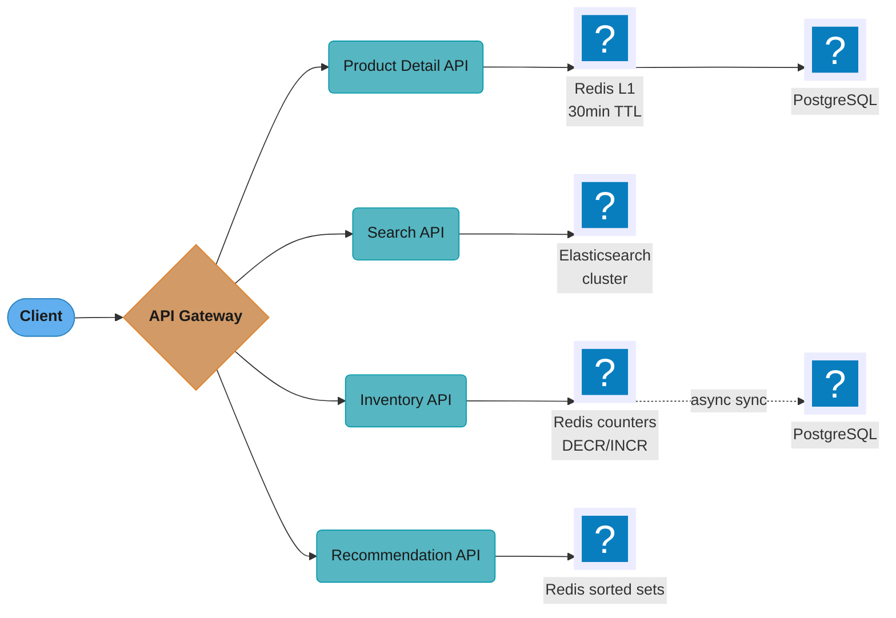
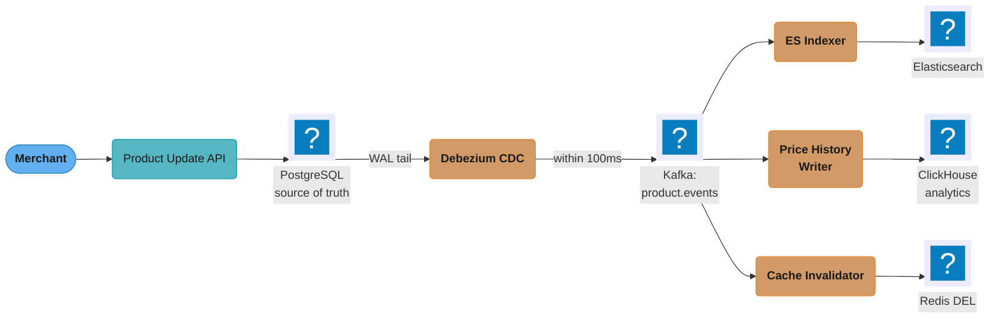
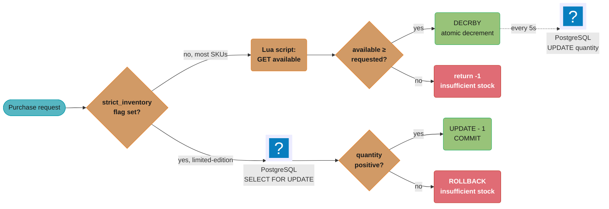
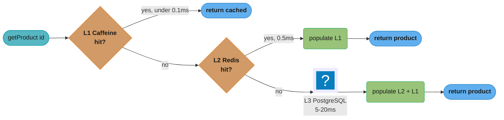

# Case Study: Design an E-Commerce Product Catalog

## Intuition

A product catalog is a "one write path, three read shapes" problem. Merchants write
normalized rows — a SKU, a price, a stock count. Shoppers read ranked, faceted lists —
"Dell laptops under $1500, in stock, sorted by rating." Analysts read time series — "what
did this SKU cost every week for the last three years." No single database is good at
all three, so the design picks one store per access pattern and glues them together with
change-data-capture.

The mental model: PostgreSQL is the source of truth — what is actually true right now.
Elasticsearch is a derived index tuned for relevance ranking and faceted aggregation.
Redis is a hot-counter cache for the one field (inventory) that mutates too fast for a
relational row to serialize cheaply under load. Everything downstream of PostgreSQL is
eventually consistent and disposable: delete the Elasticsearch index or flush the Redis
keys and both rebuild from PostgreSQL. You can never do that to PostgreSQL, which is why
every other store here is optional and PostgreSQL is not.

The one insight that makes the rest of this case study obvious: inventory correctness and
search freshness have fundamentally different consistency requirements, and conflating
them is the most common catalog design mistake. Treating every SKU's stock count as
needing a linearizable read costs throughput you do not need on 99% of the catalog;
treating search as needing synchronous consistency costs every merchant write API a
latency budget for a guarantee shoppers cannot perceive — nobody notices a product that
appeared in search 3 seconds late, but everybody notices an "in stock" item that fails at
checkout. The rest of the design applies that split consistently: synchronous and strict
where a wrong answer is expensive (limited-edition inventory), asynchronous and
eventually-consistent everywhere else (search, recommendations, price history).

---

## 1. Requirements Clarification

### Functional Requirements

- Browse and search 50M+ SKUs with full-text search and faceted filtering (brand, price
  range, rating, availability, category-specific attributes).
- View a single product's detail page (title, description, price, images, stock, rating).
- Track inventory near-real-time: every purchase decrements it, every restock/cancel
  increments it.
- Serve recommendations: "frequently bought together" and "similar products."
- Let merchants create, update, and bulk-update their own listings, with changes visible
  in search within a bounded window.
- Retain historical pricing for analytics and merchant-facing reporting.

### Non-Functional Requirements

- Scale: 50 million SKUs, 1,000+ categories, 50,000 merchants.
- Latency: sub-200ms p99 for search, sub-50ms p99 for product detail.
- Concurrency: 100,000 concurrent users; 500,000 search queries/minute at peak.
- Freshness: a merchant's product/price/inventory change is searchable within 5 seconds.
- Inventory accuracy: eventual consistency (brief oversell tolerable) for most SKUs;
  strict, zero-oversell consistency for a small set of high-demand/limited-inventory SKUs.
- Retention: 5 years of pricing history for elasticity and reporting analysis.

### Explicit Non-Goals

- Payment and checkout — this design owns the inventory *reservation/decrement hook*
  checkout calls, not the payment flow itself.
- The recommendation *model* (how "similar" is scored) beyond the precompute pipeline's
  shape — this is a data-platform case study, not an ML-ranking one.
- Merchant onboarding, KYC, and payout.
- Multi-currency/multi-locale catalogs — addressed only as an interview extension in §11;
  the core design assumes a single default currency and locale.
- Active-active multi-region writes — a single-region deployment with an async DR replica
  is assumed here; multi-region is `newsql_and_distributed_sql/` /
  `distributed_transactions/` territory.

### Assumptions Clarified with the Interviewer

- Read:write ratio ~200:1 — catalog browsing dwarfs merchant writes.
- Average product carries ~6 SKU variants (size x color combinations).
- Peak factors: ~4x average for search (flash sales), a gentler ~3x for detail (spread
  across millions of individual pages rather than one search box).
- "High-demand, limited-inventory" SKUs are a small, flagged subset (flash-sale items,
  pre-orders) — not the default for all 50M SKUs.

---

## 2. Scale Estimation

### Storage per Record — `products` Table

| Field | Type | Avg bytes | Notes |
|---|---|---|---|
| id | UUID | 16 | primary key |
| sku | VARCHAR(50) | 20 | avg used length |
| merchant_id | UUID | 16 | FK |
| title | TEXT | 80 | avg product title |
| description | TEXT | 500 | avg description (TOASTed if it grows much larger) |
| brand | VARCHAR(100) | 15 | avg used length |
| category_id | INT | 4 | |
| status | VARCHAR(20) | 10 | avg used length |
| created_at + updated_at | TIMESTAMPTZ x2 | 16 | 8 bytes each |
| tuple overhead | header + line pointer + alignment | 27 | fixed Postgres per-row cost |
| **Total** | | **~704 B/row** | |

`50,000,000 rows x 704 B = 35.2 GB` for the `products` table alone, before indexes.

### Variant Explosion

50M SKUs is the *variant*-level count, not the *listing*-level count — a shopper browses
"parent" products (a shirt) and picks a variant (size, color). At an assumed average of 6
variants per parent (size x color combinations for apparel/electronics-style catalogs):

```
50,000,000 SKUs ÷ 6 variants/parent ≈ 8.3M parent product listings
```

That 8.3M is what matters for category-page grouping and "select a variant" UI logic,
even though the database, search index, and inventory system all key on the 50M rows.

### `product_attributes` (JSONB) and `product_pricing`

`product_attributes`: average 5-8 key/value pairs (color, size, material, weight_kg, ...)
≈ 300 bytes of JSONB per row. `50M x 300 B = 15 GB` raw. A GIN index over JSONB typically
runs 1.5-2x the size of the data it indexes (it inverts every key/value pair into its own
posting list), so budget another 22.5-30 GB — **~40-45 GB total for the attributes table.**

`product_pricing`: average 2 rows per product (a standing price plus an occasional
overlapping promotion window) → 100M rows. Per row: 2 UUIDs (32 B) + currency (3 B) +
price + list_price (2 x numeric, ~16 B) + 2 timestamps (16 B) + overhead (~16 B) ≈ 83 B.

```
100,000,000 rows x 83 B ≈ 8.3 GB
```

`inventory`: 50M rows x ~60 B (product_id 16, quantity 4, reserved 4, warehouse_id 16,
updated_at 8, overhead ~12) ≈ **3 GB**.

**PostgreSQL catalog total:** `35.2 + 45 + 8.3 + 3 ≈ 91.5 GB` of table data, plus 30-40%
for B-tree indexes (primary keys, `merchant_id`, `category_id`, unique `sku`) →
**~125-130 GB total footprint** (5-year price history lives in ClickHouse instead, §4.9).

### Elasticsearch Document Size and Index Ratio

Each denormalized search document carries title, a description snippet (~200 B), brand,
a `category_path` array (~60 B), price, quantity, rating fields, the attributes object
(~300 B), a `suggest` completion field, plus IDs — roughly **1.8-2 KB of `_source` per
document.**

```
50,000,000 docs x 2 KB ≈ 100 GB of _source
```

Lucene's on-disk index (inverted index + doc values + norms + compressed stored fields)
typically runs **1.1-1.4x** the raw `_source` size with `best_compression`; using 1.3x:

```
100 GB x 1.3 ≈ 130 GB primary index size
```

With one replica (for HA and to serve reads off a second copy), total cluster storage is
**~260 GB.**

**Shard sizing.** Elasticsearch's guidance keeps shards in the 20-50 GB range. At
`130 GB ÷ 10 shards = 13 GB/shard` today (matching `number_of_shards: 10` in §4), the
cluster has headroom to roughly **triple** before a shard hits 30-40 GB and a reindex to
more shards is needed — see §8's reindex procedure.

### Redis Inventory Working Set

50M `inventory:{product_id}` keys, each a small integer counter: SDS key overhead
(~40 B for a UUID-based key string) plus dict/value overhead (~50-90 B) puts each key at
roughly 150 B all-in — `50,000,000 x 150 B ≈ 7.5 GB`. That fits a single well-provisioned
node; the 3-node cluster sized in §10 is for *availability*, not because it doesn't fit
on one box.

### Read QPS — Average and Peak

- **Search:** 500,000 queries/minute at peak → `500,000 ÷ 60 = 8,333 QPS peak`; at a
  stated 4x peak factor (flash sales, seasonal spikes), average is `8,333 ÷ 4 ≈ 2,083 QPS`.
- **Product detail:** 100K concurrent users viewing roughly one product every 12s gives
  `100,000 ÷ 12 ≈ 8,333 QPS average`; at the gentler 3x peak factor, `8,333 x 3 = 25,000
  QPS peak`. The two-tier cache (§4.7) absorbs most of this, leaving PostgreSQL's L3 tier
  a cache-miss remainder well inside a primary + 1-2 read replicas.

### Inventory Write Rate and CDC Event Rate

```
2,000,000 orders/day x 1.8 items/order = 3.6M decrements/day ÷ 86,400 s ≈ 41.7/s average
41.7 x 20 (flash-sale peak factor) ≈ 830 DECR/s peak

50,000 merchants x 100 updates/day = 5M updates/day ÷ 86,400 s ≈ 57.9/s average
57.9 x 10 (bulk-reprice peak factor) ≈ 580 events/s peak
```

830 DECR/s peak is well under a single Redis node's ceiling (single-threaded Redis
sustains well over 100,000 simple ops/second; a Lua script adds only microsecond
overhead). 580 events/s peak is trivial for Kafka — the real constraint on the CDC path
is the ES indexer's per-event cost, a full read-modify-write from PostgreSQL (§4.6).

### Node Count Summary

What falls out of the above: PostgreSQL needs 1 primary + 2 read replicas (~130 GB
dataset, cache-absorbed reads); Elasticsearch needs 6-8 data nodes + 3 master-eligible
(260 GB total, CPU-bound on 8,333 peak QPS of aggregations, not size); Redis needs a
3-node cluster for availability (7.5 GB working set); Kafka needs 3 brokers at
replication factor 3 for durability against a 580 events/s peak. Full breakdown in §10.

---

## 3. High-Level Architecture



*Read path: the gateway routes each request type to its own API, and each API leans on
the store that matches its latency budget — Redis L1 ahead of PostgreSQL for product
detail, Elasticsearch for faceted search, Redis counters ahead of PostgreSQL for
inventory, and precomputed Redis sorted sets for recommendations.*



*Write path (synchronization): Debezium tails the PostgreSQL WAL and publishes to Kafka
within ~100ms; three independent consumers then keep search, price-history analytics,
and the read cache eventually consistent, with 1-5 seconds typical end-to-end lag.*

Each API owns exactly one primary datastore and never reaches across to another API's
store — the Search API never queries PostgreSQL, the Detail API never queries
Elasticsearch — which is what keeps the write path simple: one PostgreSQL write fans out
through one CDC stream to however many consumers need to know. See
`../../polyglot_persistence_patterns/polyglot_persistence_patterns.md` and
`../../database_caching_patterns/database_caching_patterns.md` for the invalidation half.

---

## 4. Component Deep Dives

### 4.1 PostgreSQL Schema — Source of Truth

```sql
-- Core product schema
CREATE TABLE products (
    id            UUID PRIMARY KEY DEFAULT gen_random_uuid(),
    sku           VARCHAR(50) UNIQUE NOT NULL,
    merchant_id   UUID NOT NULL REFERENCES merchants(id),
    title         TEXT NOT NULL,
    description   TEXT,
    brand         VARCHAR(100),
    category_id   INT REFERENCES categories(id),
    status        VARCHAR(20) DEFAULT 'ACTIVE',
    created_at    TIMESTAMPTZ DEFAULT now(),
    updated_at    TIMESTAMPTZ DEFAULT now()
);

-- Pricing (supports multiple currencies, time-bounded promotions)
CREATE TABLE product_pricing (
    id          UUID PRIMARY KEY DEFAULT gen_random_uuid(),
    product_id  UUID NOT NULL REFERENCES products(id),
    currency    CHAR(3) NOT NULL,
    price       DECIMAL(12, 2) NOT NULL,
    list_price  DECIMAL(12, 2),             -- Strike-through price
    valid_from  TIMESTAMPTZ DEFAULT now(),
    valid_until TIMESTAMPTZ,                -- NULL = indefinite
    created_at  TIMESTAMPTZ DEFAULT now()
);
-- An index predicate must be IMMUTABLE, so `valid_until > now()` cannot appear in one.
-- Split the intent into two static predicates instead:
CREATE INDEX idx_pricing_open_ended ON product_pricing (product_id, valid_from DESC)
    WHERE valid_until IS NULL;                 -- the standing price
CREATE INDEX idx_pricing_scheduled  ON product_pricing (product_id, valid_until)
    WHERE valid_until IS NOT NULL;             -- time-bounded promotions; now() filters at query time

-- Inventory (source of truth, updated via atomic operations)
CREATE TABLE inventory (
    product_id      UUID PRIMARY KEY REFERENCES products(id),
    quantity        INT NOT NULL DEFAULT 0 CHECK (quantity >= 0),
    reserved        INT NOT NULL DEFAULT 0,  -- reserved but not yet purchased
    available       INT GENERATED ALWAYS AS (quantity - reserved) STORED,
    warehouse_id    UUID,
    updated_at      TIMESTAMPTZ DEFAULT now()
);

-- Category hierarchy (nested set or closure table)
CREATE TABLE categories (
    id          INT PRIMARY KEY,
    name        VARCHAR(100) NOT NULL,
    parent_id   INT REFERENCES categories(id),
    path        LTREE,  -- 'Electronics.Phones.Smartphones' (ltree extension)
    level       INT GENERATED ALWAYS AS (COALESCE(array_length(string_to_array(path::TEXT, '.'), 1), 0)) STORED
);
CREATE INDEX idx_category_path ON categories USING gist(path);
```

### 4.2 BROKEN -> FIXED: Attribute Storage (EAV vs. JSONB)

Product categories carry wildly different attribute sets — laptops have RAM/CPU/screen
size, shirts have color/size/material, furniture has dimensions/weight-capacity. The
naive relational answer is an EAV (entity-attribute-value) table.

```sql
-- BROKEN: normalized EAV table for product attributes
CREATE TABLE product_attribute_values (
    product_id   UUID REFERENCES products(id),
    attribute_id INT REFERENCES attribute_defs(id),
    value        TEXT,
    PRIMARY KEY (product_id, attribute_id)
);

-- "find red XL cotton shirts" needs one join per attribute
SELECT p.id FROM products p
JOIN product_attribute_values v1 ON v1.product_id = p.id AND v1.attribute_id = 1 AND v1.value = 'red'
JOIN product_attribute_values v2 ON v2.product_id = p.id AND v2.attribute_id = 2 AND v2.value = 'XL'
JOIN product_attribute_values v3 ON v3.product_id = p.id AND v3.attribute_id = 3 AND v3.value = 'cotton'
WHERE p.category_id = 42;
```

**What this costs.** At 50M products with ~8 attributes/product average, the EAV table
holds ~400M rows. A 3-attribute filter is a 3-way self-join against it — even indexed on
`(attribute_id, value)`, each join leg is a separate scan and the planner cannot combine
selectivity across predicates the way one composite index would. Comparable-shape queries
against 300-500M-row EAV tables commonly run 400-800ms instead of single digits, and it
worsens linearly: a 5-facet filter is a 5-way join.

```sql
-- FIXED: JSONB attribute bag with a GIN index
CREATE TABLE product_attributes (
    product_id  UUID PRIMARY KEY REFERENCES products(id),
    attributes  JSONB NOT NULL DEFAULT '{}'
    -- e.g., {"color": "red", "size": "XL", "material": "cotton", "weight_kg": 0.5}
);
CREATE INDEX idx_attrs_gin ON product_attributes USING gin(attributes);

SELECT p.id FROM products p
JOIN product_attributes a ON a.product_id = p.id
WHERE p.category_id = 42
  AND a.attributes @> '{"color": "red", "size": "XL", "material": "cotton"}';
```

One GIN bitmap index scan replaces N joins — the containment operator `@>` satisfies all
three attribute predicates from a single index structure instead of three. For a range
query on a specific attribute, add a targeted functional index:
`CREATE INDEX ON product_attributes ((attributes->>'weight_kg')::FLOAT)`. This is still
not how facet counts get served at search-serving QPS, though — see the next pair.

### 4.3 BROKEN -> FIXED: Faceted Filter Counts

```sql
-- BROKEN: one live COUNT(*) GROUP BY per facet — repeat for brand, price_range,
-- rating_bucket, availability, and any category-specific attribute facet
SELECT brand, COUNT(*) FROM products p
JOIN product_attributes a ON a.product_id = p.id
WHERE p.category_id = 42 AND p.status = 'ACTIVE'
GROUP BY brand;
```

**What this costs.** A popular category ("Electronics > Phones") can match 500K-2M rows
even with an index on `category_id`; counting a set that size runs tens to low hundreds
of milliseconds *per facet*, and a results page renders 4-6 facets at once — serially,
that is 200ms-1s+ on facet counts alone, before ranked results even run, blowing the
whole 200ms p99 budget. It gets worse under load: every one of the 8,333 peak QPS search
requests repeats the same aggregation independently, with nothing shared across requests.

**FIXED:** one Elasticsearch query, using the `aggs` block already shown in §4.4
(`terms`/`range`/`histogram` on `brand`/`price_usd`/`rating_average`), computes ranked
results and every facet bucket together in 10-40ms — Lucene's doc-values columns are
pre-sorted, per-field columnar storage an aggregation walks in one pass over segments the
query already touched. See `../../elasticsearch_internals/elasticsearch_internals.md`.

### 4.4 Elasticsearch Mapping and Query

```json
// Elasticsearch index mapping for products
{
  "mappings": { "properties": {
    "id": {"type": "keyword"}, "sku": {"type": "keyword"},
    "title": { "type": "text", "analyzer": "english",
      "fields": { "keyword": {"type": "keyword"}, "suggest": {"type": "completion"} } },
    "description": {"type": "text", "analyzer": "english"},
    "brand": {"type": "keyword"}, "category_path": {"type": "keyword"},
    "price_usd": {"type": "scaled_float", "scaling_factor": 100},
    "available_quantity": {"type": "integer"}, "rating_average": {"type": "float"},
    "rating_count": {"type": "integer"}, "status": {"type": "keyword"},
    "attributes": {"type": "object", "dynamic": false}, "updated_at": {"type": "date"}
  } },
  "settings": {"number_of_shards": 10, "number_of_replicas": 1, "refresh_interval": "1s"}
}
```

`attributes` is `"dynamic": false` deliberately — leaving it `true` against
merchant-supplied keys is the mapping-explosion war story in §9, not a convenience.

```json
// Search query: laptops under $1500, brand Dell, sorted by rating, cursor-paginated
{
  "query": { "bool": {
    "must": [{"match": {"title": "laptop"}}],
    "filter": [
      {"term": {"brand": "Dell"}}, {"range": {"price_usd": {"lte": 1500}}},
      {"range": {"available_quantity": {"gt": 0}}}, {"term": {"status": "ACTIVE"}}
    ]
  } },
  // search_after needs exactly one value per sort field, and the last field must be a
  // unique tiebreaker or pages will skip and duplicate hits
  "sort": [{"rating_average": "desc"}, {"_score": "desc"}, {"id": "asc"}],
  "size": 24,
  "search_after": [4.5, 0.92, "product-id-xyz"]
}
```

### 4.5 Redis Inventory Counters — Two-Tier Consistency

```
Inventory in Redis — atomic counters:
  Key pattern: inventory:{product_id}
  Value: integer (available quantity)

  Purchase flow (atomic via Lua script):
    local available = redis.call('GET', KEYS[1])
    if not available then
        return -2  -- Key absent: caller repopulates from PostgreSQL and retries
    end            -- (redis.call returns false, not nil, so tonumber() would error)
    if tonumber(available) >= tonumber(ARGV[1]) then
        return redis.call('DECRBY', KEYS[1], ARGV[1])  -- Success: decrement
    else
        return -1  -- Insufficient stock
    end

  Restock:
    INCRBY inventory:{product_id} {quantity}

  Sync to PostgreSQL (async, every 5 seconds):
    Background job reads the live counter and copies it down; it must NOT write
    the counter back, or concurrent DECRBYs between read and write are lost.
      GET inventory:{product_id}
      → UPDATE inventory SET quantity = {value} WHERE product_id = ...

  Fallback on cache miss: read from PostgreSQL, populate Redis
  TTL: none (inventory counters never expire — always valid)

High-demand product (limited edition):
  Use PostgreSQL SELECT FOR UPDATE (strict inventory):
  BEGIN;
  SELECT quantity FROM inventory WHERE product_id = ? FOR UPDATE;
  -- verify quantity > 0
  UPDATE inventory SET quantity = quantity - 1 WHERE product_id = ?;
  COMMIT;
  -- Only for SKUs marked as strict_inventory=true
```



*Two-tier inventory consistency: the Lua `DECRBY` fast path handles roughly 1M
ops/second with brief oversell risk if Redis restarts before the 5-second sync to
PostgreSQL; `strict_inventory=true` SKUs pay 5-10ms of `SELECT ... FOR UPDATE` latency
(versus 0.5ms) for a hard zero-oversell guarantee, capped around 1K TPS per product.*

### 4.6 CDC Pipeline for Search Index Sync

```yaml
# Debezium connector for products table → Kafka → Elasticsearch
connector.class: io.debezium.connector.postgresql.PostgresConnector
database.dbname: ecommerce
table.include.list: public.products,public.product_pricing,public.inventory,public.product_attributes

# Elasticsearch sink connector (Confluent)
connector.class: io.confluent.connect.elasticsearch.ElasticsearchSinkConnector
topics: ecommerce.public.products
connection.url: http://elasticsearch:9200
key.ignore: false
schema.ignore: true
behavior.on.null.values: delete  # Soft delete in ES when product is deactivated
```

```java
// Kafka consumer: joins events from multiple topics to build ES document
@Component
public class ProductIndexBuilder {

    // Triggered by any product, pricing, or inventory update
    @KafkaListener(topics = {"products.events", "pricing.events", "inventory.events"})
    public void onProductChange(ProductChangeEvent event) {
        // Fetch complete product state from PostgreSQL for full document
        // (denormalize into a single ES document with all fields)
        ProductDocument doc = productReadService.buildDocument(event.getProductId());

        if (doc == null || "DELETED".equals(doc.getStatus())) {
            elasticsearchOps.delete(String.valueOf(event.getProductId()), ProductDocument.class);
        } else {
            // withVersion(updatedAtEpochMillis) + EXTERNAL_GTE: see "out-of-order events" below
            elasticsearchOps.index(IndexQuery.builder()
                .id(String.valueOf(doc.getId()))
                .object(doc)
                .withVersion(doc.getUpdatedAtEpochMillis())
                .withVersionType(VersionType.EXTERNAL_GTE)
                .build());
        }
    }
}
```

**Out-of-order events and the reindex-vs-partial-update call.** A consumer retry can
still deliver an older event after a newer one landed even though Kafka orders one
product's updates within its partition. `EXTERNAL_GTE` tells Elasticsearch to accept a
write only if the supplied version (`updated_at` in epoch millis) is >= the version
already stored, so a stale retry is rejected rather than clobbering fresher data.
Separately, `ProductIndexBuilder` always rebuilds the whole document rather than a
partial `_update`: tracking which fields changed across three tables isn't worth it at
this document size (~2KB) — that stops being true only once documents run tens of KB.

### 4.7 Product Detail API — Two-Level Cache

```java
@Service
public class ProductDetailService {

    // L1: Caffeine (JVM-local, 60s TTL, 10K entries)
    private final Cache<UUID, Product> l1Cache = Caffeine.newBuilder()
        .maximumSize(10_000)
        .expireAfterWrite(60, TimeUnit.SECONDS)
        .build();

    public Product getProduct(UUID productId) {
        // L1 check (< 0.1ms)
        Product cached = l1Cache.getIfPresent(productId);
        if (cached != null) return cached;

        // L2: Redis (0.5ms)
        String redisKey = "product:" + productId;
        Product redisProduct = redis.opsForValue().get(redisKey);
        if (redisProduct != null) {
            l1Cache.put(productId, redisProduct);
            return redisProduct;
        }

        // L3: PostgreSQL (5-20ms)
        Product product = productRepository.findById(productId)
            .orElseThrow(() -> new NotFoundException("Product not found"));

        // Populate both caches
        redis.opsForValue().set(redisKey, product, Duration.ofMinutes(30));
        l1Cache.put(productId, product);
        return product;
    }

    // Invalidate on update (called by CDC consumer)
    public void invalidate(UUID productId) {
        redis.delete("product:" + productId);
        l1Cache.invalidate(productId);
    }
}
```



*Cache cascade: each miss climbs one tier (under 0.1ms L1, then 0.5ms L2, then 5-20ms L3)
and writes back to every faster tier it skipped, so a cold L3 read is the last time that
product pays the full round trip until eviction.* See
`../../database_caching_patterns/database_caching_patterns.md` for the cache-aside pattern
this implements and its stampede failure mode.

### 4.8 Recommendations — Precomputed, Not Computed at Request Time

"Frequently bought together" and "similar products" are the one read path with no online
query that meets the 50ms detail-page budget — a co-occurrence count over order history
is inherently an offline job. Both live as Redis Sorted Sets written by a nightly batch
and read with a single `ZRANGE`:

```
frequently bought together (co-occurrence, from order history):
  Nightly Spark/ClickHouse job over order_items, for every pair in the same order:
    support(a,b) = orders containing both
    lift(a,b)    = P(b|a) / P(b)      -- lift, not raw count, or batteries and
                                      -- phone cases top every list
  Write top 20 by lift:
    ZADD rec:fbt:{product_id} <lift> <other_product_id>   (per product, 20 members)
    EXPIRE rec:fbt:{product_id} 172800                    -- 48h: two job cycles
  Read (single round trip, ~0.5ms):
    ZRANGE rec:fbt:{product_id} 0 9 REV

similar products (content-based, no order history needed):
  Elasticsearch more_like_this over title + brand + category_path + attributes,
  run at index time rather than query time, results written to
    ZADD rec:similar:{product_id} <score> <other_product_id>
  This is the cold-start path: a SKU listed an hour ago has no co-occurrence data
  but does have text, so it always has *something* to show.
```

The read path never falls back to live computation. If both keys miss, the API returns
the category's best-sellers list (one shared key per category) rather than blocking the
page — a slightly worse recommendation ships, an empty module does not. Because the
source is order history, the job runs after the nightly inventory reconciliation (§8),
not before, or a day of purchases is missing from every pair count.

### 4.9 Price History in ClickHouse

```sql
-- ClickHouse: pricing history for analytics
CREATE TABLE price_history (
    product_id  UUID,
    merchant_id UUID,
    currency    FixedString(3),
    price       Decimal(12, 2),
    list_price  Nullable(Decimal(12, 2)),
    changed_at  DateTime64(3),
    event_type  String   -- 'PRICE_SET', 'PROMOTION_START', 'PROMOTION_END'
) ENGINE = MergeTree()
PARTITION BY toYYYYMM(changed_at)
ORDER BY (product_id, changed_at)
TTL changed_at + INTERVAL 5 YEAR;

-- Query: price elasticity analysis.
-- price_history stores only the instant a price changed, so the interval each
-- price was in force has to be derived first — leadInFrame() supplies the next
-- change timestamp, defaulting to the far future for the price still in effect.
WITH price_windows AS (
    SELECT
        product_id,
        price,
        changed_at,
        leadInFrame(changed_at, 1, toDateTime64('2999-01-01 00:00:00', 3))
            OVER (PARTITION BY product_id ORDER BY changed_at
                  ROWS BETWEEN CURRENT ROW AND UNBOUNDED FOLLOWING) AS next_changed_at
    FROM price_history
    WHERE product_id = 'uuid-here'
)
SELECT
    toStartOfWeek(pw.changed_at) AS week,
    avg(pw.price)      AS avg_price,
    sum(se.units_sold) AS units_sold
FROM price_windows AS pw
INNER JOIN sales_events AS se ON pw.product_id = se.product_id
WHERE se.sale_date >= pw.changed_at
  AND se.sale_date <  pw.next_changed_at
GROUP BY week
ORDER BY week;
-- Runs in 1-2 seconds on years of data (ClickHouse columnar scan)
```

---

## 5. Design Decisions & Tradeoffs

| Decision | Choice | Alternative | Reason |
|----------|--------|-------------|--------|
| Search | Elasticsearch | PostgreSQL FTS | ES provides faceted aggregations, relevance ranking, and horizontal scale for 50M SKUs — see §4.3 for the quantified cost of the Postgres alternative |
| Inventory | Redis DECR | PostgreSQL UPDATE | Redis atomic DECR is sub-millisecond; PostgreSQL UPDATE at 100K TPS would saturate row-lock contention on hot SKUs |
| Product data | PostgreSQL JSONB for attributes | Normalized EAV table | EAV forces an N-way join per N-attribute filter (§4.2); JSONB with a GIN index answers the same filter in one index scan |
| Price history | ClickHouse | PostgreSQL partitioned | Columnar storage plus per-column codecs compress a narrow, highly repetitive price feed by an order of magnitude, and aggregate scans read only the columns named — benchmark both on your own feed rather than assuming a ratio |
| CDC | Debezium | Application dual-write | Debezium provides an atomic, ordered change stream sourced from the WAL, without application-layer coordination or the risk of one write succeeding while the other silently fails |
| Search sync lag | ~1-5 seconds (CDC) | Synchronous (blocking) | Synchronous would add latency to every product-update API call; a 5s lag is imperceptible for catalog search but a blocking write would be felt on every merchant save |
| Cache topology | Two-tier (Caffeine + Redis) ahead of Postgres | Redis-only | The JVM-local L1 removes network round trips entirely for the hottest few thousand products, at the cost of a slightly longer invalidation fan-out (CDC must reach every app instance's L1, not just Redis) |

The recurring theme: the write path stays synchronous only where a wrong answer is
expensive (limited-edition inventory); everything else is asynchronous because staleness
is far cheaper than coupling every write to every reader's latency — the "consistency
window vs. write-path latency" tradeoff `../../database_caching_patterns/database_caching_patterns.md`
frames generally, decided *per field* here: `products.title` and `inventory.quantity`
sit on the same row but have opposite consistency needs.

---

## 6. Real-World Implementations

**Amazon** separates catalog *identity* from *offer*: a single catalog "item" can carry
many independent seller offers, each with its own price, condition, and stock, with the
"buy box" resolved at read time from the winning offer — the same split this design makes
between `products` (identity, one row per SKU) and `inventory` (a mutable counter); a
true multi-seller marketplace would extend `inventory` to per-(product, merchant).

**Shopify** shards merchant data into per-shop pods so one shop's catalog and orders live
together for tenant isolation, with storefront/admin search on a separate
Elasticsearch-based service synchronized via change feeds — the same shape as this
design's Debezium-to-Kafka-to-ES pipeline, Shopify's sharding being a tenant boundary
rather than a pure data-volume one.

**Etsy** has published on a search stack built on Elasticsearch/Lucene with custom
relevance tuning (including learning-to-rank) over a catalog that is unusually
attribute-heavy — handmade and vintage goods carry far more free-form, seller-defined
attributes than a typical catalog, exactly the case for leaning on Elasticsearch's
aggregation framework over relational `GROUP BY` (§4.3): the facet set varies by category
and cannot be hardcoded into a fixed schema.

**eBay** uses Cassandra for parts of its high-write-volume listing data alongside
Elasticsearch-backed search over active listings — an auction/classifieds feed is closer
to append-heavy, loosely-schema'd write traffic than OLTP, which is why a wide-column
store fits there, though the principle matches this design's PostgreSQL split: keep the
write-optimized system of record separate from the search tier, connected async rather
than by a synchronous dual write. See `../../wide_column_databases/wide_column_databases.md`.

**Zalando** has published on decomposing catalog, pricing, and availability into separate
microservices each owning its own datastore and integrating through events — mirroring
this design's API-per-concern gateway routing (§3).

**Walmart** has written about re-architecting catalog and search for scale, including
event-driven catalog synchronization shaped like a CDC pipeline, and aggregation-heavy
product discovery at very large SKU counts — comparable to §4.4's aggregation shape.

**Algolia** is the managed alternative to self-hosting any of the above: a hosted
search-as-a-service API handling indexing, ranking, and typo-tolerant relevance without
operating a Lucene cluster or shard rebalancing. The tradeoff is operational simplicity
against control — less low-level tuning surface, and per-record/per-operation pricing
that can get expensive at 50M records — see the managed-vs-self-hosted Q&A in §11.

---

## 7. Technologies & Tools

| Tool | Role in this design | Why over the alternative | Operational cost it adds |
|---|---|---|---|
| PostgreSQL | Source of truth for products, pricing, inventory, categories | ACID transactions, mature tooling, `LTREE`/`GIN` extensions cover category hierarchy and JSONB attributes without extra infrastructure | Vacuum/autovacuum tuning, replica lag monitoring, connection pooling at scale (`../../connection_pool_management/connection_pool_management.md`) |
| Elasticsearch | Full-text search, faceted aggregation, ranking | Purpose-built inverted index + doc values for the exact query shape in §4.3/§4.4; PostgreSQL FTS cannot match aggregation performance at this scale | JVM heap and shard-count tuning, mapping discipline (§9), reindex procedures (§8), a second cluster to operate and monitor |
| Redis | Inventory counters, L2 detail cache, recommendation sorted sets | Sub-millisecond atomic `DECR`/`INCR` via Lua, and sorted sets are a native fit for ranked, capped recommendation lists | Memory sizing and eviction policy, persistence/AOF tuning, a third stateful system to back up and fail over |
| Kafka | Event bus carrying CDC events to every downstream consumer | Durable, ordered-per-partition log lets search indexing, price history, and cache invalidation consume independently at their own pace | Broker capacity planning, partition/consumer-group management, retention tuning |
| Debezium | Captures PostgreSQL WAL changes and publishes to Kafka | Avoids application-level dual writes (§5) — one write, one atomic change stream, no risk of the two halves diverging | Replication slot monitoring (an unconsumed slot grows WAL indefinitely), connector restarts on schema changes |
| ClickHouse | Price history storage and elasticity analytics | Columnar compression and per-column codecs suit a narrow, highly repetitive time-series feed; analytical scans read only the needed columns | A second query engine and SQL dialect to operate; data only arrives via the CDC pipeline, so a lag there is a lag here too |
| Caffeine | JVM-local L1 cache ahead of Redis | Removes the network hop entirely for the hottest few thousand products — sub-0.1ms | Per-instance invalidation fan-out: the CDC-driven cache invalidator must reach every app instance, not just Redis |

---

## 8. Operational Playbook

### Dashboards and Metrics

| Metric | Unit | Why it matters |
|---|---|---|
| `search_p50/p95/p99_latency_ms` | milliseconds | Direct measure of the 200ms p99 SLO |
| `detail_p50/p95/p99_latency_ms` | milliseconds | Direct measure of the 50ms p99 SLO |
| `cache_hit_rate_l1` / `cache_hit_rate_l2` | percent | A drop signals cold cache after a deploy or an invalidation storm |
| `cdc_consumer_lag_seconds` (per topic) | seconds | Distance from "merchant saved" to "searchable"; the 5s freshness SLO in one number |
| `es_indexing_rate` / `es_indexing_errors` | events/s, count | Catches a broken document build before the backlog grows |
| `es_cluster_status` | green/yellow/red | Shard allocation health; yellow tolerable briefly, red is an incident |
| `es_disk_watermark_pct` (per node) | percent | Approaching flood-stage (95%) makes indices read-only — see §9 |
| `redis_inventory_drift_count` | count of SKUs | SKUs where Redis and Postgres disagree beyond tolerance, from the reconciliation job below |
| `inventory_decrement_rejected_rate` | percent | Spike indicates either a real sellout or a stale-cache bug |

### Alert Thresholds

- `search_p99_latency_ms > 200` for 5 consecutive minutes → page on-call (SLO breach).
- `cdc_consumer_lag_seconds > 30` → warn; `> 120` → page (a growing lag usually means a
  downstream consumer is stuck, not just slow).
- `es_cluster_status == red` → page immediately.
- `es_disk_watermark_pct > 85` → warn (no new shards allocated to that node); `> 90` →
  page (shards start relocating off); `> 95` is the flood-stage story below.
- `redis_inventory_drift_count > 500` → warn and trigger the reconciliation runbook.

### Runbook: CDC Lag Spike

1. Check `cdc_consumer_lag_seconds` per topic to isolate which consumer (ES indexer,
   price writer, cache invalidator) is behind — they consume independently.
2. Check that consumer's error rate and recent deploys; a bad deploy on a subset of
   documents is the most common cause.
3. If healthy but just behind (e.g. after a bulk reprice), scale out instances in the
   same group for partition parallelism, confirming the topic has partitions to absorb it.
4. If a connector crashed, restart and verify it resumes from its last committed offset,
   not from the start.
5. Close once lag is under 30s; a recurrence within 24h is a capacity problem, file it as such.

### Runbook: Oversell Incident

1. Confirm scope via `inventory_decrement_rejected_rate` and tickets — orders actually
   oversold vs. correctly rejected.
2. If flagged `strict_inventory=true`, this is a PostgreSQL correctness bug (`SELECT FOR
   UPDATE` should be immune) — escalate accordingly, not as capacity.
3. Otherwise, oversell within the SKU's tolerance is accepted (§1); beyond it, check
   whether Redis restarted recently — the 5s sync window is exactly that exposure.
4. Cancel/backorder oversold units per fulfillment policy and notify customers — this
   design's job stops at flagging the discrepancy.
5. A SKU that oversells repeatedly gets flipped to `strict_inventory=true`.

### Zero-Downtime Reindex Procedure

1. Create `products_v2` with the updated mapping; bulk-reindex `products_v1` into it in
   batches of 5,000 (hours, at 50M documents).
2. Dual-write to both `v1` and `v2` so new CDC events land in both while reindexing runs.
3. Diff document counts between `v1` and `v2` to confirm parity.
4. Atomically repoint the `products_current` alias from `v1` to `v2` — the Search API
   only ever queries the alias, so the repoint is atomic client-side.
5. Stop the dual write and drop `v1` once `v2` is proven stable.

### Backup, Restore, and DR

- **PostgreSQL:** continuous WAL archiving plus daily base backups (`pg_basebackup` or
  WAL-G) gives point-in-time recovery. **RPO ≤ 5 minutes**, **RTO ≤ 30 minutes**. Run a
  restore drill quarterly — see
  `../../backup_recovery_and_disaster_recovery/backup_recovery_and_disaster_recovery.md`.
- **Elasticsearch:** a *derived* store — its backup posture is "rebuild from PostgreSQL
  via full reindex," not snapshot/restore, since PostgreSQL is always more current.
  Snapshots are kept anyway for faster recovery (**RPO = hourly**, RTO minutes instead of
  the hours a full 50M-document reindex takes).
- **Redis inventory counters:** RPO is bounded by the 5-second PostgreSQL sync interval —
  a total loss recovers by repopulating every key from PostgreSQL on next access (the
  cache-miss fallback in §4.5), so no dedicated backup exists; it is disposable by design.

---

## 9. Common Pitfalls & War Stories

**Elasticsearch mapping explosion from merchant-supplied attributes.** *Symptom:* the
cluster goes red after merchants upload products with unusual attribute keys
(`"screen_size_inches"`, `"screen-size"`, `"Screen Size"` each a distinct dynamic field).
*Root cause:* `attributes` was left `"dynamic": true`, so every novel key any of 50,000
merchants coins becomes a new mapped field, exhausting Elasticsearch's default
`index.mapping.total_fields.limit` of 1,000 from a handful of sloppy CSV uploads. *Fix:*
map `attributes` as `"dynamic": false` (§4.4) — only fields the application explicitly
promotes get their own mapping. *Quantified impact:* one 40,000-product upload with
free-form keys pushed the index past 1,000 fields; writes were rejected ~90 minutes.

**Reindex hitting the flood-stage disk watermark.** *Symptom:* mid-reindex, several data
nodes flip their indices to read-only. *Root cause:* a reindex needs both the old and new
index resident (§8), roughly doubling disk usage; nodes already near capacity crossed
Elasticsearch's 95% flood-stage watermark, which sets `index.blocks.read_only_allow_delete`
automatically. *Fix:* never start a reindex when any node is above ~60% disk, staged
across low-traffic hours; once tripped, recovery needs manually clearing the block after
freeing space. *Quantified impact:* disk went from 68% to 94% over a 6-hour window, and
the cluster stayed partially read-only for 40 minutes after the trigger.

**Deep pagination blowing up heap.** *Symptom:* a scraper or an "export all my products"
feature paging with `from`/`size` times out and takes down a node with an
`OutOfMemoryError`. *Root cause:* `from`+`size` requires every shard to materialize and
sort `from + size` results and ship them to the coordinator, discarding everything before
`from` — at `from=100000` that is 100,000+ documents per shard held in memory to return
24. *Fix:* `search_after` with a stable sort (§4.4) never materializes skipped results;
each page only touches the next `size` documents. *Quantified impact:* a scraper paging to
`from=250000` spiked coordinator heap from 40% to 92% and triggered GC pauses that pushed
unrelated search p99 from 40ms to over 4 seconds.

**Stale-cache oversell during a flash sale.** *Symptom:* a limited 500-unit drop oversold
by 340 units in the first two minutes. *Root cause:* the SKU wasn't flagged
`strict_inventory=true` before the sale, so it ran the eventually-consistent Redis
`DECRBY` path with its 5-second sync window — under a concentrated spike, multiple app
instances independently repopulated Redis from a stale PostgreSQL read during a brief
Redis failover, resetting the counter upward mid-sale. *Fix:* the checklist for any known
flash-sale SKU now requires `strict_inventory=true` at least 30 minutes ahead, routing it
onto the `SELECT FOR UPDATE` path immune to this bug by construction. *Quantified
impact:* 340 oversold units required manual cancellation and compensation; the checklist
has prevented a repeat since.

**CDC lag during a bulk price update.** *Symptom:* during a 30,000-SKU merchant reprice,
search showed the *old* price for up to 6 minutes after it was live in PostgreSQL. *Root
cause:* the ES indexer does a full read-modify-write per event (§4.6), and 30,000 events
in a short window exceeded the consumer group's steady-state throughput, building a
backlog that drained at the consumer's max rate, not the arrival rate. *Fix:* added a
`bulk_update` event type batching the ES side via `_bulk` instead of one request per
event, and pre-scaled consumers ahead of known bulk operations. *Quantified impact:* lag
peaked at 6 minutes against the 5-second SLO before the fix; an equivalent reprice now
stays under 20 seconds end-to-end.

---

## 10. Capacity Planning

### Sizing Table

| Tier | Instance class | Count | RAM | Disk | IOPS |
|---|---|---|---|---|---|
| PostgreSQL primary | r6i.2xlarge (8 vCPU) | 1 | 64 GB | 500 GB gp3 | 12,000 provisioned |
| PostgreSQL read replicas | r6i.2xlarge | 2 | 64 GB | 500 GB gp3 | 12,000 provisioned |
| Elasticsearch data nodes | r6i.xlarge (4 vCPU) | 8 | 32 GB | 500 GB NVMe (local) | — (local NVMe) |
| Elasticsearch master-eligible | m6i.large | 3 | 8 GB | 100 GB gp3 | 3,000 |
| Redis inventory cluster | r6g.large | 3 | 13 GB | — (in-memory) | — |
| Redis detail-cache + rec cluster | r6g.large | 3 | 13 GB | — (in-memory) | — |
| Kafka brokers | m6i.xlarge | 3 | 16 GB | 1 TB gp3 | 6,000 |
| ClickHouse nodes | i4i.xlarge (storage-optimized) | 3 | 32 GB | 1.9 TB NVMe | — (local NVMe) |

### Monthly Cost Estimate (illustrative, on-demand list-price order of magnitude)

```
PostgreSQL:   3 x r6i.2xlarge  @ ~$0.50/hr x 730 hr ≈ $1,095/mo
Elasticsearch: 8 x r6i.xlarge  @ ~$0.25/hr x 730 hr ≈ $1,460/mo
             + 3 x m6i.large   @ ~$0.10/hr x 730 hr ≈   $219/mo
Redis:        6 x r6g.large    @ ~$0.13/hr x 730 hr ≈   $569/mo
Kafka:        3 x m6i.xlarge   @ ~$0.19/hr x 730 hr ≈   $416/mo
ClickHouse:   3 x i4i.xlarge   @ ~$0.34/hr x 730 hr ≈   $745/mo
                                                    -----------
                                        Total ≈ $4,504/mo compute
```

Storage beyond the included allotment and data transfer typically add another 15-25% —
budget **~$5,200-5,600/mo all-in**. This is a rough planning number, not a quote;
validate against current list pricing and provisioned IOPS/throughput before committing.

### Growth Headroom and Scaling Triggers

| Tier | Headroom today | Scaling trigger |
|---|---|---|
| Elasticsearch shards | ~3x (13 GB/shard vs. a 30-40 GB target ceiling, §2) | Reindex to more shards once average shard size exceeds 30 GB, or proactively at 2x current catalog size |
| PostgreSQL storage | ~4x on 500 GB disk vs. ~130 GB dataset | Vertical resize (bigger instance/disk) once dataset exceeds 60% of provisioned disk; consider table partitioning by `merchant_id` range before that |
| Redis inventory memory | ~1.7x (7.5 GB used of 13 GB/node, replicated) | Add cluster shards (Redis Cluster hash-slot split) once used memory exceeds 70% on any node |
| Kafka broker disk | Sized for durability, not near any throughput ceiling at 580 events/s peak | Add brokers/partitions if sustained CDC event rate approaches ~5,000 events/s (10x today's peak) |

At 20% YoY SKU growth, Elasticsearch shard count is the first tier needing a proactive
change — roughly 18-24 months out, well ahead of it becoming an incident, which is why
§8's reindex procedure is routine rather than an emergency.

---

## 11. Interview Discussion Points

**Q: How do you prevent inventory oversell at 100K concurrent purchases?**
Two tiers, chosen per SKU. Most SKUs run the Redis Lua `DECRBY` path: sub-millisecond,
roughly 1M ops/second, with a small oversell window if Redis restarts before the 5-second
async sync to PostgreSQL (bounded by AOF `fsync=everysec`, ~1s max data loss). High-demand,
limited-inventory SKUs — flash sale items, pre-orders — are flagged `strict_inventory=true`
and routed to PostgreSQL `SELECT ... FOR UPDATE`, serializing purchases with absolute
accuracy at higher latency (5-10ms vs. 0.5ms) and lower throughput (~1K TPS vs.
unlimited). The flag lets one hot SKU opt into strict consistency without a redesign —
§9's oversell story is what happens when a SKU needed it and didn't have it set in time.

**Q: How do you keep Elasticsearch consistent with PostgreSQL for 50M products, and what consistency do you actually promise?**
Bounded eventual consistency, not strong — a 1-5 second window where search can show a
stale price, stock status, or listing. Debezium tails the WAL and publishes to Kafka
within ~100ms; a consumer fetches the full current state from PostgreSQL and upserts into
Elasticsearch using `version_type=external_gte` against `updated_at`, so a stale
out-of-order retry can never overwrite a fresher write (§4.6). At 50K merchants averaging
100 updates/day, that's only ~58 events/second — comfortably inside a modest consumer
group; the failure mode worth defending against is a bulk-operation backlog spike (§9).

**Q: How do you handle a merchant updating 1,000 products simultaneously?**
As a bulk job, not 1,000 API calls. The merchant uploads a CSV; the API validates every
row before writing any, upserts in batches of 100 within transactions, and each batch's
outbox event flows through Debezium to a consumer using the batched `_bulk` Elasticsearch
path (§9) rather than one request per event. All 1,000 products appear in search within
10-20 seconds, with the merchant UI showing "updating" meanwhile — acceptable because a
merchant's own listings aren't shown to other shoppers until explicitly published.

**Q: Why is JSONB used for product attributes instead of a normalized schema?**
Attribute sets vary by category in a way a fixed relational schema can't express without
a sparse wide table or EAV, and EAV forces an N-way self-join per N-attribute filter —
§4.2 quantifies a 3-attribute filter against a 400M-row EAV table at 400-800ms versus
single digits for JSONB. A GIN index (`USING gin(attributes)`) answers a multi-attribute
containment query with one scan, and a functional index covers range queries on a
specific attribute. The tradeoff: JSONB keys aren't first-class columns — no `CHECK` or
foreign key on one — so attributes needing referential integrity (`category_id`,
`merchant_id`) stay real columns; only the genuinely variable set goes into JSONB.

**Q: Why not serve search directly from PostgreSQL full-text search?**
PostgreSQL FTS (`tsvector`/`tsquery` + GIN) handles ranked text search reasonably well,
but faceted aggregation is what it cannot do at this scale — §4.3 quantifies a
single-facet `COUNT(*) GROUP BY` at 200ms-1s+ against a category with 500K-2M matching
rows, and a page needs 4-6 facets within one 200ms budget. Elasticsearch's doc-values
columns are pre-sorted columnar storage computing ranked results and every facet bucket
in one segment scan (10-40ms). FTS stays right for a much smaller or less-faceted catalog
— see `../../search_engines/search_engines.md`.

**Q: How do you run a zero-downtime reindex when you change the Elasticsearch mapping?**
Via an index alias, never a hardcoded index name. Create `products_v2` with the updated
mapping, bulk-reindex the existing 50M documents in the background (multi-hour), and
dual-write every new CDC event into both indices so `v2` never falls behind. Once counts
match and validation confirms parity, atomically repoint the `products_current` alias
from `v1` to `v2` — atomic from the client's view, since Search only ever queries the
alias. Full sequence in §8; the disk-headroom trap it exposes (both indices resident at
once) is the flood-stage story in §9.

**Q: How do you model product variants — is a SKU its own product row?**
Yes: `products` is keyed at the SKU/variant level, not parent-listing, because every
downstream store (inventory, pricing, search) needs to key on the thing with its own
stock and price — a "red, size XL" shirt, not "the shirt." Parent grouping (§2's ~8.3M
parent listings from ~50M SKUs) is a view concern: pages group SKUs by a shared
`parent_id` client-side, but the database, Elasticsearch, and Redis never treat "parent"
as a first-class entity. Modeling the parent as primary instead would force every
inventory/pricing operation to resolve which variant it means — a lookup added to the
hottest write paths for no benefit they need.

**Q: How would you extend this design for multiple currencies and locales?**
`product_pricing` already supports multiple rows per product with a `currency` column
(§4.1), so multi-currency is closer to a query change than a schema change. Multi-locale
text is bigger: it needs a `product_translations` table keyed by `(product_id, locale)`,
or locale-specific ES fields (`title_en`, `title_de`, ...) so each gets its own language
analyzer — a single `english`-analyzed `title` field (§4.4) can't tokenize German or
Japanese correctly. The bigger cost isn't storage, it's re-evaluating every freshness
guarantee and relevance tuning pass per locale.

**Q: Where is the line between search ranking and a personalization/recommendation layer?**
Elasticsearch owns *query-relevance* ranking — how well a document matches this query,
using BM25 plus boosts (rating, recency, availability) equal for every shopper. It should
not own *personalization* — ranking that differs per shopper — because that couples a
stateless cluster to per-user state and makes every query cache-unfriendly. Personalization
belongs as a re-ranking pass over Elasticsearch's top-N, run by a service that looks up
shopper history separately; §4.8's recommendation module makes the same choice for a
related reason — precomputed, because order-history input is too expensive to join live.

**Q: When does a managed search service like Algolia beat self-hosting Elasticsearch?**
When the operational cost of running a cluster — JVM tuning, shard/replica management,
the reindex and mapping-explosion failure modes in §9, on-call for a stateful system —
outweighs the customization self-hosting buys. A catalog with simpler filtering, a
smaller team, or no dedicated search engineer is often better served by a managed API
configuring relevance rather than Lucene-level control. The tradeoff flips back toward
self-hosting as scale grows: at 50M SKUs with 8,333 peak QPS and heavy custom aggregation
logic (§4.3, §4.4), self-hosted ES's per-query cost beats a managed service's
per-operation pricing, and the customization here (custom analyzers, `search_after`,
bespoke aggregations) goes beyond most managed APIs — catalog complexity decides this,
not company size.
