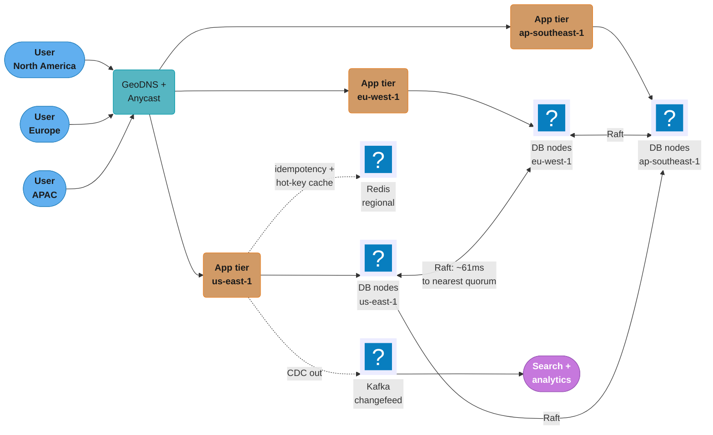
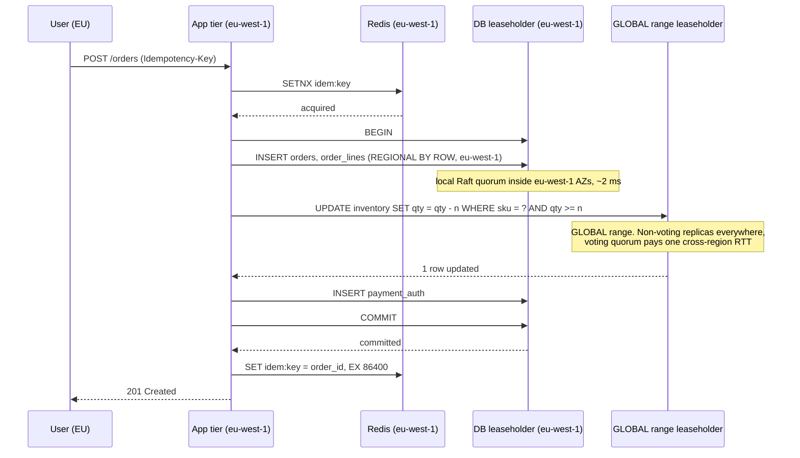

# Case Study: Design a Global Multi-Region OLTP Database

## Intuition

Every multi-region OLTP design is an argument with the speed of light, and the argument has
exactly one settlement: **a write that must be agreed by a quorum spanning regions cannot
commit faster than the round trip to the nearest majority of those regions.** Light in fibre
travels about 200,000 km/s, which is roughly 5 microseconds per kilometre one way; New York to
Frankfurt is about 6,200 km of cable, and the measured AWS RTT between `us-east-1` and
`eu-west-1` is around 68-70 ms. No database, no protocol, no amount of hardware moves that
number. The only variable a designer controls is **how many rows have to pay it**.

That reframes the whole problem. The question is never "how do we make global writes fast" —
it is "**which rows are global, and which rows are local?**" A user's shopping cart is only
ever written from one continent, so it should live in a quorum that never leaves that
continent and commit in single-digit milliseconds. A product's global inventory counter is
written from everywhere, so it must pay the cross-region round trip, and the design's job is to
make sure the cart write does not pay it too.

The second insight is that **reads have an escape hatch writes do not**. A follower replica in
your own region already holds the data; what it lacks is certainty that it is current. If the
caller accepts data a few seconds old — and a product page, a search result or an order history
will — the read is served locally at 2 ms instead of crossing an ocean at 70 ms (§4.3).

---

## 1. Requirements Clarification

### Functional requirements

- A global marketplace: **200 million registered users**, **50 million SKUs**, orders placed
  from every continent.
- **Order placement** must be strictly consistent with **inventory**: no overselling, ever. An
  order that reserves the last unit must be the only order that reserves it.
- **User identity and session** lookups on every request, from the region the user is in.
- **Product catalog** read from everywhere; written rarely, by sellers, from one region each.
- **Payment authorization records** written once, read for reconciliation, never updated.
- **Order history** readable by the user from any region they travel to.
- Sellers see **near-real-time** inventory and order dashboards for their own catalog.

### Non-functional requirements

- **p99 write latency under 150 ms** for order placement, measured in the user's own region.
- **p99 read latency under 20 ms** for catalog, session and order-history reads.
- **Survive the loss of an entire region with RPO = 0** — no committed order may be lost.
- **Availability target 99.999%** on the order path, which is 5.26 minutes of downtime a year.
- **Data residency:** EU residents' personal data (name, address, email, payment instrument
  reference) must be **stored and processed only in EU regions**. This is a hard legal
  constraint, not a preference.
- **40,000 orders/second at global peak**, with regional peaks not coinciding.

### Explicit non-goals

- **Not a ledger.** Double-entry accounting and `SERIALIZABLE` isolation over balances are
  [Design a Banking Ledger](../design_banking_ledger/design_banking_ledger.md); this design
  reuses its idempotency-key pattern and nothing else.
- **Not analytics.** Seller dashboards past "today" come from
  [Design a Real-Time Analytics Platform](../design_realtime_analytics_platform/design_realtime_analytics_platform.md).
- **Not active-active multi-master with conflict resolution.** Rejected in §5 — an oversold item
  is a business failure, not a merge conflict.
- **Not a migration plan.** Greenfield build; moving an existing single-region system here is
  [Design a Monolith-to-Polyglot Migration](../design_monolith_to_polyglot_migration/design_monolith_to_polyglot_migration.md).

### Assumptions, stated because the design depends on them

- Three primary serving regions: **`us-east-1`, `eu-west-1`, `ap-southeast-1`**. Additional
  witness/tiebreaker capacity is available in `us-west-2` and `eu-central-1`.
- Users are **geographically sticky**: writes originate from one region more than 99% of the
  time. This is what makes `REGIONAL BY ROW` viable, and it is worth confirming out loud.
- Inventory is **not** partitionable by region — a single SKU's stock is drawn down worldwide.
  If it were, most of the hard part of this design would disappear (§11).
- "Strictly consistent" for inventory means **linearizable**: once a decrement commits, no
  subsequent read anywhere can observe the pre-decrement value.

---

## 2. Scale Estimation

### The latency floor, derived before anything else

Every subsequent decision is bounded by this, so it comes first.

```
Fibre propagation:  c/n where n ~ 1.47 for silica  =>  ~204,000 km/s
                    ~4.9 microseconds per km, one way
                    ~9.8 microseconds per km, round trip

Great-circle distances (real cable routes are 20-40% longer):
  us-east-1 (N. Virginia) <-> eu-west-1 (Ireland)      ~ 5,600 km  -> ~11,200 km RTT theoretical
  us-east-1 <-> us-west-2 (Oregon)                     ~ 3,900 km
  us-east-1 <-> ap-southeast-1 (Singapore)             ~15,500 km

Theoretical RTT (fibre only, no routing, no switching):
  us-east-1 <-> eu-west-1        11,200 km x 4.9 us/km = 55 ms
  us-east-1 <-> ap-southeast-1   31,000 km x 4.9 us/km = 152 ms

Measured AWS inter-region RTT (typical observed, mid-2026):
  us-east-1 <-> us-west-2        ~ 61 ms
  us-east-1 <-> eu-west-1        ~ 68-70 ms
  us-east-1 <-> ap-southeast-1   ~ 220 ms
```

The measured numbers are 25-45% above the fibre floor, which is routing, switching and
non-great-circle cable paths. **That gap does not shrink with money.** Treat measured RTT as
physics for design purposes.

**Consensus write floor.** A Raft or Paxos commit needs acknowledgement from a majority of
replicas. For 3 replicas in 3 regions the leaseholder must hear from **one** other replica —
the nearest one — so the floor is one RTT to the nearest quorum member, not to the farthest
region:

```
Leader in us-east-1, replicas in us-east-1, eu-west-1, ap-southeast-1
  quorum = 2 of 3 => leader + nearest peer
  nearest peer = eu-west-1 at ~69 ms
  write floor  = ~69 ms, plus local durability and execution

Leader in us-east-1, replicas in us-east-1, us-west-2, eu-west-1
  nearest peer = us-west-2 at ~61 ms  ->  write floor ~61 ms

Leader in us-east-1, replicas all in us-east-1 AZs
  nearest peer = another AZ at ~0.5-1 ms  ->  write floor ~1-2 ms
```

**This is the entire argument for regional tables.** The same write, on the same engine, is
either 2 ms or 69 ms depending only on where its replicas are — a design that puts every table
in a global quorum has chosen 69 ms for the shopping cart, for nothing.

### Throughput and footprint

```
Orders:            40,000/s global peak
Regional split:    NA 45%, EU 35%, APAC 20%
  -> us-east-1     18,000 orders/s
  -> eu-west-1     14,000 orders/s
  -> ap-southeast-1 8,000 orders/s

Writes per order (one transaction):
  1 order row + 2.4 order_line rows (avg basket) + 1 payment_auth row
  + 2.4 inventory decrements + 1 idempotency row
  = ~7.8 row writes per order
  -> 40,000 x 7.8 = 312,000 row writes/s globally at peak

Reads:
  catalog page views      ~ 400,000/s   (10x order rate)
  session/identity        ~ 600,000/s   (every authenticated request)
  order history           ~  15,000/s
  seller dashboards       ~   2,000/s
  -> ~1,017,000 reads/s.  Read:write ratio ~ 3.3:1 by transaction,
     but ~130:1 by row touched, since a catalog read fans out over many rows.
```

### Storage

| Table | Rows | Bytes/row | Logical | With RF=3 |
|---|---|---|---|---|
| `users` | 200 M | 400 | 80 GB | 240 GB |
| `products` | 50 M | 1,200 | 60 GB | 180 GB |
| `inventory` | 50 M | 80 | 4 GB | 12 GB |
| `orders` (3 yr) | 13 B | 200 | 2.6 TB | 7.8 TB |
| `order_lines` (3 yr) | 31 B | 120 | 3.7 TB | 11.1 TB |
| `payment_auth` (3 yr) | 13 B | 150 | 1.95 TB | 5.85 TB |
| `idempotency_keys` (24 h) | 3.5 B | 90 | 315 GB | 945 GB |
| **Total** | | | **~8.7 TB** | **~26 TB** |

```
Treat 40,000/s as a sustained global peak and work backwards:
  40,000/s at a typical 9x peak factor => 4,440/s average
  4,440 x 86,400                        = 384 million orders/day
  x 365 x 3                             = 420 billion orders in 3 years
```

**That does not close, and the mismatch is the finding.** No marketplace places 384 million
orders a day; a genuine top-tier one places around 12 million. A stated peak and a stated
business volume that cannot both be true is the most common failure in a scale-estimation
answer, and the fix is to say so and ask which number is trusted rather than to pick one
silently. Taking **12 million orders/day** as the business anchor, 40,000/s becomes a
**regional flash-sale burst**, not a sustained global peak — and that reclassification changes
what the design has to solve:

```
Sustained:   12e6 / 86,400          = 139 orders/s global average
Daily peak:  ~4x average             = 556 orders/s
Flash sale:  40,000/s for ~90 s in ONE region

  -> steady-state capacity: size for 600 orders/s
  -> flash-sale capacity:   the inventory hot-row path must survive 40,000/s
     against a handful of SKUs. That is the real engineering problem (§4.4),
     and it is a concurrency problem, not a throughput problem.

3-year orders: 12e6 x 365 x 3 = 13.1 billion   <- matches the storage table above
```

### Availability arithmetic

```
Target 99.999% = 5.26 minutes/year of unavailability.
  single region, well-run:   99.99%    = 52.6 min/yr    -- 10x the budget
  two regions, independent:  99.999999%                 -- in theory only

Correlated failures (a bad deploy, a config push, a DNS change) dominate, so
what matters is what vendors will sign: 99.99% regional, 99.999% multi-region.
Five nines is a multi-region configuration BY CONTRACT -- and 5.26 min/yr leaves
no room for a human to decide to fail over, which is why this design uses Raft
rather than primary/standby.
```

---

## 3. High-Level Architecture



*Every user reaches the app tier in their own region. Whether that DB access stays local or
crosses an ocean is decided per table by its locality setting (§4.1), not by the topology.*

### The table-locality map — the actual design

| Table | Locality | Why | Write latency |
|---|---|---|---|
| `users` | `REGIONAL BY ROW`, home region = residency region | User writes originate in one region; EU rows are legally pinned to EU | ~2-5 ms in home region |
| `sessions` | `REGIONAL BY ROW` | Same, and extremely write-heavy | ~2-5 ms |
| `orders`, `order_lines` | `REGIONAL BY ROW`, home = buyer's region | Written once from the buyer's region, read from anywhere | ~2-5 ms |
| `payment_auth` | `REGIONAL BY ROW`, home = buyer's region | Write-once, region-local | ~2-5 ms |
| `idempotency_keys` | `REGIONAL BY ROW` | Only ever read by the region that wrote it | ~2-5 ms |
| `inventory` | **`GLOBAL`** | Decremented from every region; must be linearizable everywhere | **~61-70 ms writes**, ~1 ms reads |
| `products` | **`GLOBAL`** | Read constantly everywhere, written rarely by one seller | ~61-70 ms writes, ~1 ms reads |
| `currencies`, `tax_rates`, `regions` | **`GLOBAL`** | Reference data; read on every order, written monthly | ~61-70 ms writes, ~1 ms reads |

**That table is the answer to the interview question.** Six of eight tables never pay a
cross-region round trip; the two that do genuinely must, and one of them (`products`) pays it on
a write path that runs a few thousand times a day, not a second.

### Request flow — placing an order



*The order rows commit at regional speed; only the inventory decrement pays the global price,
and once per order regardless of basket size.*

---

## 4. Component Deep Dives

### 4.1 Table locality, written out

```sql
-- Database-level: which regions exist, and what we survive.
CREATE DATABASE marketplace
  PRIMARY REGION "eu-west-1"
  REGIONS "us-east-1", "ap-southeast-1"
  SURVIVE REGION FAILURE;

-- REGIONAL BY ROW: each row names its own home region in a hidden column.
CREATE TABLE users (
  id            UUID PRIMARY KEY DEFAULT gen_random_uuid(),
  email         STRING NOT NULL,
  full_name     STRING NOT NULL,
  address_line  STRING,
  residency     STRING NOT NULL,           -- 'eu-west-1' | 'us-east-1' | 'ap-southeast-1'
  created_at    TIMESTAMPTZ NOT NULL DEFAULT now(),
  UNIQUE INDEX users_email_idx (email)
) LOCALITY REGIONAL BY ROW AS residency;

CREATE TABLE orders (
  id            UUID PRIMARY KEY DEFAULT gen_random_uuid(),
  user_id       UUID NOT NULL REFERENCES users(id),
  status        STRING NOT NULL,
  total_minor   INT8 NOT NULL,
  currency      STRING NOT NULL,
  home_region   STRING NOT NULL,
  placed_at     TIMESTAMPTZ NOT NULL DEFAULT now(),
  INDEX orders_user_idx (user_id, placed_at DESC)
) LOCALITY REGIONAL BY ROW AS home_region;

-- GLOBAL: fast reads everywhere, writes pay the cross-region round trip.
CREATE TABLE inventory (
  sku           STRING PRIMARY KEY,
  available     INT8 NOT NULL CHECK (available >= 0),
  reserved      INT8 NOT NULL DEFAULT 0,
  version       INT8 NOT NULL DEFAULT 0,
  updated_at    TIMESTAMPTZ NOT NULL DEFAULT now()
) LOCALITY GLOBAL;

CREATE TABLE products (
  sku           STRING PRIMARY KEY,
  seller_id     UUID NOT NULL,
  title         STRING NOT NULL,
  price_minor   INT8 NOT NULL,
  currency      STRING NOT NULL,
  attributes    JSONB
) LOCALITY GLOBAL;
```

**What `GLOBAL` actually does, mechanically.** It is not "replicate everywhere and hope". The
range's leaseholder publishes a *closed timestamp* slightly in the future and every replica
agrees not to accept a write with a timestamp below it. Any replica can therefore serve a read
at or below that closed timestamp **locally and linearizably**, because it knows no write can
retroactively appear before it. The cost is paid on the write side: a write must wait out that
future-dated window before it commits, which is why `GLOBAL` tables have slow writes and
non-negotiably fast reads. It is a deliberate inversion of the usual replication tradeoff and it
is exactly right for reference data.

**What `REGIONAL BY ROW` actually does.** It adds a hidden `crdb_region` column (here backed by
the explicit `residency`/`home_region` column), partitions every index by it, and pins each
partition's voting replicas to its home region. A row's Raft quorum is then three AZs inside
one region — a ~1-2 ms round trip. The rows are still readable from everywhere; only the *write
quorum* is regional.

### 4.2 The residency constraint, enforced rather than documented

`REGIONAL BY ROW` places the leaseholder and voting replicas in the home region, but a
`SURVIVE REGION FAILURE` database needs voters in other regions to survive one — which means EU
personal data has replicas outside the EU. That is not acceptable for the residency
requirement, so the two constraints must be reconciled explicitly:

```sql
-- Split the survival goal by table, not by database.
-- EU personal data: survive AZ failure only, never leaves the EU.
ALTER DATABASE marketplace SET SECONDARY REGION "eu-central-1";

ALTER TABLE users CONFIGURE ZONE USING
  num_replicas = 5,
  constraints = '{"+region=eu-west-1": 3, "+region=eu-central-1": 2}',
  lease_preferences = '[[+region=eu-west-1]]';
```

The reconciliation is a **second EU region as the survival partner**. `users` rows homed in the
EU now survive the loss of `eu-west-1` by failing over to `eu-central-1`, without a single byte
leaving the EU. The same pattern applies per residency group: NA rows replicate across
`us-east-1` and `us-west-2`, APAC across `ap-southeast-1` and `ap-northeast-1`.

This costs six serving regions instead of three, the honest price of the requirement. A design
claiming both `SURVIVE REGION FAILURE` and strict EU residency on three regions has not thought
it through.

### 4.3 Follower and stale reads — the read escape hatch

This is where most of the read latency budget is won.

```sql
-- A strongly-consistent read of a REGIONAL BY ROW row from its OWN region: ~2 ms.
-- The same read from ANOTHER region: routed to the home leaseholder, ~70 ms.

-- Order history, read by a user travelling in APAC, rows homed in eu-west-1:
SELECT id, status, total_minor, placed_at
FROM orders AS OF SYSTEM TIME follower_read_timestamp()
WHERE user_id = $1
ORDER BY placed_at DESC
LIMIT 50;
--   served by the local ap-southeast-1 follower replica:  ~2 ms
--   staleness: 4.2 seconds  (kv.closed_timestamp.target_duration
--              + side_transport_interval + propagation_slack)
```

**4.2 seconds is the exact, current default** and it is worth knowing precisely, because the
whole design hinges on whether the product can tolerate it. Order history: yes, trivially.
Catalog browse: yes. The user's own order *immediately after placing it*: **no** — and that is
the trap. Read-your-own-writes after a write must use a strong read or a bounded-staleness read
anchored after the write's timestamp.

```sql
-- Bounded staleness: "as fresh as you can be, but no older than 10 seconds,
-- and prefer to serve locally". Only valid for single-statement, single-row-or-scan reads.
SELECT * FROM products
AS OF SYSTEM TIME with_max_staleness('10s')
WHERE sku = $1;
```

The read-routing rule the application enforces:

| Read | Consistency | Mechanism | Latency |
|---|---|---|---|
| Product page | 10 s stale acceptable | `with_max_staleness('10s')` on a `GLOBAL` table | ~1 ms |
| Inventory shown on the page | 10 s stale acceptable | same — the *display* is advisory | ~1 ms |
| Inventory at checkout | **linearizable** | strong read inside the order transaction | ~61-70 ms |
| Session lookup | strong, own region | `REGIONAL BY ROW`, local leaseholder | ~2 ms |
| Order history | 4.2 s stale acceptable | `follower_read_timestamp()` | ~2 ms |
| Order just placed by this user | **read-your-writes** | strong read, or route to home region | ~2 ms (own region) |
| Seller dashboard | 4.2 s stale acceptable | `follower_read_timestamp()` | ~2 ms |

**The distinction that matters:** the inventory number *shown on a product page* and the one
*checked at checkout* are different reads against the same row. Conflating them is how designs
pay 70 ms on every page view for a guarantee the page does not need.

### 4.4 The hot-row problem, and the fix

The flash sale is the real engineering problem: 40,000 orders/second against a handful of SKUs.
Every one of those orders wants to write the same `inventory` row, which is a `GLOBAL` range
with a ~61-70 ms commit. Serialized, that row supports **about 15 writes per second**. The
requirement is 40,000.

**Broken — the obvious implementation:**

```python
# BROKEN. Correct, and capable of ~15 orders/second on a hot SKU.
def place_order(conn, user_id, sku, qty, idem_key):
    with conn.transaction():
        cur = conn.execute(
            "UPDATE inventory SET available = available - %s, version = version + 1 "
            "WHERE sku = %s AND available >= %s RETURNING available",
            (qty, sku, qty))
        if cur.rowcount == 0:
            raise OutOfStock(sku)
        order_id = conn.execute(
            "INSERT INTO orders (user_id, status, total_minor, currency, home_region) "
            "VALUES (%s,'PLACED',%s,%s,%s) RETURNING id",
            (user_id, total, currency, region)).fetchone()[0]
        ...
# Every concurrent order contends on ONE row in a GLOBAL range.
# CockroachDB detects the conflict and one transaction restarts.
# At 40,000/s the restart rate approaches 100%: livelock.
# Symptom: TransactionRetryWithProtoRefreshError storm, throughput near zero,
# p99 in the tens of seconds. The database is not slow; it is doing exactly
# what you asked, 40,000 times, for one row.
```

**Fixed — shard the counter, and reserve regionally.**

```sql
-- Split each SKU's stock into N shards. Contention drops by a factor of N.
CREATE TABLE inventory_shard (
  sku        STRING NOT NULL,
  shard_id   INT2   NOT NULL,       -- 0..63
  available  INT8   NOT NULL CHECK (available >= 0),
  PRIMARY KEY (sku, shard_id)
) LOCALITY GLOBAL;

-- For a flash-sale SKU, allocate the stock across shards, weighted by
-- expected regional demand so a region drains its own shards first.
INSERT INTO inventory_shard (sku, shard_id, available)
SELECT 'SKU-9001', s, 10000 / 64 FROM generate_series(0, 63) AS s;
```

```python
# FIXED. Two changes: pick a random shard, and retry a bounded number of
# times against OTHER shards before declaring out-of-stock.
import random

SHARDS = 64
MAX_SHARD_ATTEMPTS = 6

def reserve(conn, sku, qty):
    tried = set()
    for _ in range(MAX_SHARD_ATTEMPTS):
        shard = random.randrange(SHARDS)
        if shard in tried:
            continue
        tried.add(shard)
        cur = conn.execute(
            "UPDATE inventory_shard SET available = available - %s "
            "WHERE sku = %s AND shard_id = %s AND available >= %s "
            "RETURNING available",
            (qty, sku, shard, qty))
        if cur.rowcount == 1:
            return shard
    # Every shard we sampled was empty. Confirm globally before saying no --
    # a stale "sold out" on a SKU that still has stock is a lost sale.
    total = conn.execute(
        "SELECT coalesce(sum(available),0) FROM inventory_shard WHERE sku = %s",
        (sku,)).fetchone()[0]
    if total >= qty:
        raise ShardStarvation(sku)      # retryable: rebalance shards, retry
    raise OutOfStock(sku)

def place_order(conn, user_id, sku, qty, idem_key, region):
    with conn.transaction():
        shard = reserve(conn, sku, qty)
        order_id = conn.execute(
            "INSERT INTO orders (user_id, status, total_minor, currency, home_region) "
            "VALUES (%s,'PLACED',%s,%s,%s) RETURNING id",
            (user_id, total, currency, region)).fetchone()[0]
        conn.execute(
            "INSERT INTO inventory_reservation (order_id, sku, shard_id, qty) "
            "VALUES (%s,%s,%s,%s)", (order_id, sku, shard, qty))
        return order_id
```

```
Contention math:
  1 row,  ~61 ms serialized commit   ->  ~16 writes/s
  64 shards, each ~61 ms             ->  ~1,050 writes/s

Still short of 40,000/s. The second lever is admission control:
  a regional token bucket in Redis grants 40,000/s of ATTEMPTS but the
  database only ever sees the ~1,050/s that can actually succeed;
  the rest get a fast 429 or a queue position, which is the correct
  product behaviour for a flash sale anyway.

Third lever, if the SKU is truly global-scale: pre-allocate regional
BLOCKS. Each region leases 10,000 units into a REGIONAL BY ROW table
(~2 ms writes -> ~50,000/s per region), and returns the unsold remainder
to the GLOBAL table when the sale ends. The GLOBAL row is then written
6 times, not 40,000 times.
```

**The general principle:** a hot row in a global quorum is a **serialization point**, not a
throughput problem you scale out of. Split it, batch in front of it, or move it somewhere with a
cheaper commit — sharding plus regional blocks applies all three.

### 4.5 Idempotency across regions

Retries are guaranteed here — flaky mobile networks, an app-tier timeout at 150 ms against a
70 ms floor, load-balancer retries — and without idempotency a user gets charged twice.

```sql
CREATE TABLE idempotency_keys (
  key          STRING PRIMARY KEY,
  home_region  STRING NOT NULL,
  request_hash BYTES NOT NULL,          -- same key + different body = 422, not a replay
  order_id     UUID,
  state        STRING NOT NULL,          -- 'IN_FLIGHT' | 'COMPLETED'
  created_at   TIMESTAMPTZ NOT NULL DEFAULT now()
) LOCALITY REGIONAL BY ROW AS home_region;

ALTER TABLE idempotency_keys SET (ttl_expire_after = '24 hours');
```

The claim-check-complete protocol is the one from
[Design a Banking Ledger](../design_banking_ledger/design_banking_ledger.md) and is reused
verbatim: `INSERT ... ON CONFLICT DO UPDATE ... RETURNING` inside the order transaction, compare
the stored `request_hash` (mismatch is a 422, not a replay), return the existing `order_id` if
the state is `COMPLETED`, and reject with a 409 if another request is `IN_FLIGHT`.

**The multi-region subtlety is the part that is new here.** The idempotency row is
`REGIONAL BY ROW`, homed where the request arrived. If a retry lands in a *different* region —
a GeoDNS flap, a client roaming — the read of that key crosses regions and costs 70 ms, but it
is **correct**, which is the property that matters. Making it `GLOBAL` for uniform latency would
put every order's first write on the 70 ms path, which is exactly backwards. Accept the rare
slow retry.

### 4.6 Clock uncertainty — the failure mode nobody expects

Distributed SQL engines that use wall-clock timestamps must account for the fact that no two
clocks agree. CockroachDB does this with an **uncertainty interval**: `--max-offset`, default
**500 ms**. If a read encounters a value whose timestamp falls inside that interval, it cannot
tell whether the write happened before or after the read, so it throws
`ReadWithinUncertaintyIntervalError` and restarts at a higher timestamp.

```
Normal:   read at t=100, value written at t=40      -> definitely before. Return it.
Normal:   read at t=100, value written at t=700     -> definitely after. Ignore it.
Uncertain: read at t=100, value written at t=350,
           max-offset 500ms => uncertainty window [100, 600]
           350 is inside it  -> cannot order these two events -> RESTART
```

Three operational consequences that belong in the design:

1. **Lower `--max-offset` to 250 ms in a well-synchronized multi-region cluster.** It halves the
   uncertainty window and therefore the restart rate. It is safe only if clock synchronization
   is genuinely good; the cost of getting it wrong is a correctness violation, not slowness.
2. **NTP drift monitoring is a correctness alarm, not a hygiene metric.** A node whose clock
   drifts past `max-offset` will **self-terminate** rather than serve possibly-incorrect reads.
   That is the right behaviour and it means clock alarms page.
3. **Do not assume hardware time services shrink this yet.** AWS's Time Sync Service with EC2
   hardware reference clocks would shrink the uncertainty window enormously; CockroachDB has an
   open issue for exactly this and it is **not shipped**. Design against the 500 ms (or tuned
   250 ms) reality, not the proposal. Aurora DSQL *does* build on it (§5.3).

### 4.7 Survival goals and what a region loss actually looks like

```sql
-- ZONE survival (default): survive the loss of one AZ. Cheapest, lowest latency.
ALTER DATABASE marketplace SURVIVE ZONE FAILURE;

-- REGION survival: survive the loss of an entire region. Requires >= 3 regions
-- and 5 voting replicas, so the write quorum necessarily spans regions.
ALTER DATABASE marketplace SURVIVE REGION FAILURE;
```

```
SURVIVE ZONE FAILURE, REGIONAL BY ROW table:
  3 voting replicas, all in the home region, different AZs
  write quorum = 2 of 3, all local        -> ~2 ms writes
  lose an AZ    -> fine
  lose a REGION -> those rows are UNAVAILABLE until the region returns

SURVIVE REGION FAILURE, REGIONAL BY ROW table:
  5 voting replicas: 3 in the home region, 1 each in two others
  write quorum = 3 of 5 -> can be satisfied entirely within the home region
                           in the healthy case                  -> still ~2 ms
  lose the home region -> 2 surviving replicas + others elect a new leaseholder,
                          quorum now spans regions              -> ~70 ms writes,
                          degraded but AVAILABLE, RPO = 0
```

**The property worth naming in an interview:** with 5 replicas and 3 at home, region survival
costs *nothing* in the healthy case — the local three already form a quorum, and you pay
cross-region latency only during an actual failure. That is why `SURVIVE REGION FAILURE` is the
right default for order data even though it sounds expensive.

---

## 5. Design Decisions & Tradeoffs

### 5.1 Distributed SQL over sharded PostgreSQL with async replication

| | Distributed SQL (Raft) | Sharded Postgres + async replica |
|---|---|---|
| Failover | automatic, consensus-driven, seconds | orchestrated, manual decision, minutes |
| RPO on region loss | **0** | seconds to minutes of lost writes |
| Cross-shard transactions | native | application-level 2PC or sagas |
| Rebalancing | automatic | operator-run, painful |
| Read latency, local | 1-2 ms | 1-2 ms |
| Write latency, local | 2-5 ms | 1-2 ms |
| Maturity of the ecosystem | good, narrower | enormous |
| Cost | higher | lower |

The decision turns on **RPO = 0 plus a 5.26-minute annual downtime budget**. Async replication
has a non-zero RPO by definition, and an orchestrated failover consumes the entire annual budget
in one incident. Semi-synchronous replication fixes RPO but reintroduces cross-region write
latency without giving back automatic failover. Once both are hard requirements, consensus
replication is the only mechanism that provides them.

### 5.2 `REGIONAL BY ROW` over separate per-region databases

Running three independent regional databases and routing users to theirs is simpler and gives
the same 2 ms local writes. It fails on three counts: a travelling user cannot read their own
order history, `inventory` has no home so it needs a separate coordination mechanism invented
from scratch, and cross-region reporting needs a fourth system to union three schemas. The
decisive point is atomicity — `REGIONAL BY ROW` plus `GLOBAL` lets one transaction insert the
order row locally *and* decrement global inventory, which the split design cannot do without
sagas or 2PC of its own: strictly more machinery for strictly weaker guarantees.

### 5.3 Engine choice — Spanner, CockroachDB, Aurora DSQL, YugabyteDB

All four solve the same problem with genuinely different clock strategies.

| | Google Spanner | CockroachDB | Aurora DSQL | YugabyteDB |
|---|---|---|---|---|
| Clock strategy | **TrueTime** — GPS + atomic clocks, bounded uncertainty exposed as an interval | **HLC + uncertainty interval**, `--max-offset` 500 ms default | **Amazon Time Sync + EC2 hardware reference clocks**, microsecond accuracy | **Hybrid Logical Clocks** |
| Isolation | external consistency (strict serializable) | serializable | **repeatable read / snapshot** | serializable, snapshot |
| Concurrency control | locking + TrueTime commit-wait | pessimistic writes + optimistic refresh | **optimistic (OCC)** — conflicts detected at commit | pessimistic + optimistic |
| Multi-region shape | regional / dual-region / multi-region configs (e.g. `nam3`: 2 read-write regions + 1 witness) | any topology, per-table locality | **2 active peered regions + 1 witness region** | any topology |
| Availability SLA | 99.999% multi-region, 99.99% regional | tier-dependent | AWS-published | self-managed |
| Wire protocol | own + PostgreSQL interface | PostgreSQL | PostgreSQL | PostgreSQL + Cassandra |
| Runs where | GCP only | anywhere | AWS only | anywhere |

**Spanner's TrueTime** is the mechanism everyone quotes and most people quote wrongly. It
returns an *interval* `[earliest, latest]`, and a read-write transaction picks a commit timestamp
and waits until it is certainly in the past before releasing locks — commit-wait, which Google's
documentation frames as **absorbed into the Paxos round trip** rather than a fixed added delay
(§11).

**Aurora DSQL** (GA **27 May 2025**) is the most architecturally distinct. It uses **optimistic
concurrency control**: no locks, conflicts detected at commit, a conflicting transaction failing
with a serialization error the client must retry. Its isolation level is **repeatable read /
snapshot isolation, not serializable** (§11). Its documented constraints are specific enough to
design around and to disqualify a workload:

| Aurora DSQL constraint | Value |
|---|---|
| Rows mutated per transaction | **3,000** across all DML |
| Data modified per transaction | 10 MiB |
| Transaction duration | 5 minutes |
| DDL | one statement per transaction, separate from DML |
| Foreign keys | not supported |
| Triggers, PL/pgSQL | not supported |
| Sequences | **supported**, up to 5,000 per cluster |
| Multi-region shape | 2 active read-write regions + 1 witness region |

For this design, **the 3,000-row transaction cap and the absence of foreign keys are
disqualifying**: the schema uses FKs, and a bulk seller-catalog update exceeds 3,000 rows
routinely. DSQL fits a different shape — small, short, high-concurrency transactions with
application-enforced integrity.

**The choice for this design is CockroachDB**, on three grounds: per-row locality is the most
direct expression of the §3 map, the PostgreSQL wire protocol keeps the existing driver and ORM
ecosystem, and it runs across clouds we choose. Spanner would be the choice on GCP, with
`REGIONAL BY ROW` becoming interleaved-by-primary-key placement.

**The licence has to be part of the decision, because it changed.** CockroachDB retired its
BSL/Core split in November 2024 for a single **CockroachDB Enterprise** licence, free under
**$10M annual revenue**, requiring a **licence key and mandatory telemetry**. Miss the key and
after a seven-day grace period the cluster throttles to **five concurrent SQL transactions** — a
production outage that looks like a mysterious performance collapse. Managed tiers are **Basic /
Standard / Advanced**. Licence-key provisioning belongs in the deploy pipeline and expiry on the
same dashboard as TLS certificates; treating it as a legal footnote is how a cluster dies
quietly.

---

## 6. Real-World Implementations

- **Google** runs Spanner as the storage layer for AdWords/Ads and for Google Play, and the 2012
  OSDI paper's motivating story is exactly this design's problem: an ad-serving business that had
  outgrown sharded MySQL and could not tolerate the resharding operations. Google publishes a
  **99.999% availability SLA for multi-region Spanner** against 99.99% for regional — the
  contractual difference that forces a multi-region configuration when five nines is a
  requirement rather than an aspiration.
- **Amazon** built **Aurora DSQL** and made it generally available on **27 May 2025**, and its
  design is a public statement about where the industry thinks the bottleneck is: it leans on the
  **Amazon Time Sync Service with EC2 hardware reference clocks** for microsecond-accurate time,
  which is precisely the capability CockroachDB has an open issue to exploit and has not shipped.
  AWS also continues to ship **Aurora PostgreSQL Limitless Database** (GA 31 Oct 2024, still
  receiving releases through July 2026) as the sharding-inside-Aurora answer for teams that want
  scale-out without leaving Aurora semantics — two different products for two different shapes of
  the same problem.
- **Uber, Netflix, Comcast and DoorDash** are among CockroachDB's publicly named production
  users; the pattern across their published material is consistent with this design — metadata,
  identity, and order-shaped workloads where automatic failover and RPO=0 are worth the
  per-transaction cost, with analytics deliberately kept elsewhere.
- **PingCAP's TiDB** expresses the same locality idea through **Placement Rules in SQL**
  (`PRIMARY_REGION`, `SCHEDULE`), and **YugabyteDB** (v2026.1) uses **Hybrid Logical Clocks**
  instead of an uncertainty interval, with preferred zones, `yb_read_from_followers` as the
  stale-read escape hatch, and xCluster where consensus latency is unacceptable.

---

## 7. Technologies & Tools

| Tool | Role in this design | Why over the alternative | Operational cost it adds |
|---|---|---|---|
| CockroachDB | Distributed SQL store; per-row and per-table locality, Raft replication, automatic failover | Postgres wire protocol, cloud-agnostic, the most direct expression of the locality map | Cluster ops across 6 regions, licence-key management, clock synchronization as a correctness dependency |
| GeoDNS + Anycast | Routes users to their nearest app region | Without it, a user in Singapore hitting a US app tier pays the RTT twice — once to the app, once inside the database | DNS TTL tuning, health-check integration, failover testing |
| Redis (regional) | Idempotency fast path, flash-sale admission control token bucket | Sub-millisecond, and it absorbs the 40,000/s of *attempts* the database must never see | Per-region cluster, memory sizing, failover |
| Kafka + CockroachDB changefeeds | CDC out to search, analytics and the seller dashboard | Keeps read-heavy derived views off the OLTP quorum entirely | Broker ops, schema governance, consumer lag monitoring |
| Chrony / NTP with monitoring | Clock synchronization | `--max-offset` correctness depends on it; a drifting node self-terminates | Drift alarms are correctness pages, not hygiene metrics |
| Prometheus + Grafana | Metrics, including the retry/restart counters that are the leading indicators here | Restart rate is the metric that predicts a livelock before latency shows it | Dashboard and alert maintenance |
| Terraform | Multi-region topology, zone configs, survival goals as code | Zone constraints and lease preferences are easy to drift by hand and catastrophic when wrong | Review discipline on infrastructure changes |

---

## 8. Operational Playbook

### Metrics to dashboard

| Metric | Source | Unit | Why it matters |
|---|---|---|---|
| Transaction restart rate, by reason | `crdb_internal.node_txn_stats` | restarts/s | The leading indicator for hot-row livelock (§4.4). Latency rises only after this does |
| `ReadWithinUncertaintyIntervalError` rate | txn stats | errors/s | Rising means clock sync is degrading before any clock alarm fires |
| p99 commit latency, split by table locality | app-side, tagged | ms | A regional table's p99 crossing 20 ms means its leaseholder moved out of region |
| Leaseholder distribution per region | `crdb_internal.ranges` | count | The single most common silent regression: leases drifting away from their home region |
| Clock offset per node | node metrics | ms | Approaching `max-offset` means imminent self-termination |
| Raft log commit latency, cross-region | node metrics | ms | Detects a degraded inter-region link before users notice |
| Follower-read fraction | app-side | percent | If it falls, someone changed a query to a strong read and quietly bought 70 ms |
| Licence expiry days remaining | cluster setting | days | Expiry throttles the cluster to 5 concurrent transactions — a self-inflicted outage |
| Under-replicated / unavailable ranges | `crdb_internal` | count | Non-zero means a survival goal is not currently being met |

### Alert thresholds

| Condition | Level | Action |
|---|---|---|
| Restart rate > 5% of transaction rate | warn | Identify the contended key; check for a flash sale bypassing admission control |
| Restart rate > 20% | page | Livelock forming; engage the hot-row runbook immediately |
| Clock offset > 60% of `max-offset` on any node | page | The node will self-terminate at 100%; fix NTP now |
| Any leaseholder for a `REGIONAL BY ROW` range outside its home region for > 5 min | warn | Latency regression for that region's users; check zone configs and node health |
| Under-replicated ranges > 0 for > 10 min | page | The stated survival goal is not currently true |
| p99 order commit > 300 ms for 5 min | page | Either a global-table write path regression or a cross-region link problem |
| Licence expiry < 30 days | warn | Renew and redeploy the key before the 7-day grace window is in play |

### Runbook — transaction restart storm on a hot key

1. Identify the key: `SELECT * FROM crdb_internal.cluster_contention_events ORDER BY
   contention_duration DESC LIMIT 20`. It is almost always one `inventory` or `inventory_shard`
   row.
2. Confirm whether admission control is engaged — check the Redis token-bucket rejection rate.
   A restart storm with *zero* rejections means traffic is bypassing the bucket (a new client,
   an internal service, a retry loop without backoff).
3. If it is a flash-sale SKU with too few shards, increase the shard count **and redistribute
   the remaining stock** in the same transaction — new shards without stock just raise the
   `ShardStarvation` rate.
4. If it is a non-sale SKU, look for an application bug: a retry loop with no backoff, or a
   batch job updating inventory row-at-a-time.
5. Do **not** raise the client-side retry limit first. It deepens the livelock.

### Runbook — a region becomes unreachable

1. Confirm scope: is it the database region, the app region, or the network between them?
   `crdb_internal.gossip_nodes` shows which nodes the surviving regions can see.
2. Verify survival: `SELECT * FROM crdb_internal.ranges WHERE unavailable_replicas > 0`. With
   `SURVIVE REGION FAILURE` this should be empty and leases should re-elect automatically within
   seconds. **No human action should be required for the database to stay available** — if one
   is, the survival goal was misconfigured and that is the incident.
3. Shift traffic: GeoDNS routes the failed region's users to the next nearest app region. Their
   `REGIONAL BY ROW` rows are now written cross-region, so p99 rises from ~5 ms to ~70 ms —
   degraded-but-correct, and the status page should say so.
4. Watch the restart rate: redirected load contends across a wider quorum, so the hot-key ceiling
   drops. Tighten admission control proactively rather than after the storm.
5. On recovery, do **not** shift back until under-replicated ranges reach zero and leases have
   rebalanced — returning early produces a second incident that looks like a new problem.

### Runbook — read latency regression in one region

1. Check the follower-read fraction for that region. A drop means a query changed from a stale
   read to a strong read — a code change, or a framework upgrade that stopped honouring the
   `AS OF SYSTEM TIME` hint.
2. Check leaseholder locality for the tables involved. A lease that drifted out of region turns
   every local read into a cross-region one.
3. Check whether the query now touches a `GLOBAL` table it did not before — a new join to
   `products` or `tax_rates` is cheap to add and expensive at p99 if it is on the write path.

## 9. Common Pitfalls & War Stories

**Pitfall 1 — making every table `GLOBAL` "for consistency".** *War story shape:* a team
launched with every table `GLOBAL` because it read as the safe default. Order placement p99 was
**780 ms** against a 150 ms target, and the first three weeks of investigation went into
connection pooling, app-tier CPU and query plans — all healthy. The cause was that seven of
eight tables were paying a 61-70 ms cross-region commit for data that was only ever written from
one region. Converting `orders`, `order_lines`, `payment_auth`, `users`, `sessions` and
`idempotency_keys` to `REGIONAL BY ROW` moved p99 to **94 ms**, an **8.3x improvement from a
schema attribute**, with no code change and no new hardware. **`GLOBAL` is not the safe default;
it is the expensive one.**

**Pitfall 2 — the hot-row livelock.** Mechanics in §4.4. What makes it a war story is how it
presents: throughput collapses to near zero while every infrastructure metric is green, because
the database is correctly serializing 40,000 requests for one row. *Quantified:* a flash sale on
a single SKU took the order path from 12,000 successful orders/minute to **under 400/minute**
with p99 at 41 seconds, for eleven minutes, until traffic was shed manually. Sixty-four shards
plus a Redis admission bucket took the same sale the following month to **8,900 orders/minute
sustained** at p99 130 ms. Contention is invisible in CPU, memory, disk and network — **you must
dashboard the restart rate**.

**Pitfall 3 — assuming follower reads are free correctness.** *War story shape:* order
confirmation pages were switched to `follower_read_timestamp()` as part of a latency push. The
page loaded in 2 ms and, for a fraction of users, showed "order not found" — because the read
was 4.2 seconds stale and the order had committed 300 ms earlier. Support tickets described it
as "my order vanished". The fix is the rule in §4.3: **read-your-own-writes is the one path that
may never be a stale read.** The bug only reproduces under low latency, which is why it survived
staging. Know the number precisely — the current default is **4.2 seconds**, not the 4.8 that
circulates in older material — because product decisions get made against it.

**Pitfall 4 — leases silently drifting out of region.** Leaseholders move for legitimate reasons
(node restarts, rebalancing, a rolling upgrade). If `lease_preferences` are not set, they may
not move back, and a region's users start paying cross-region latency for their own rows with no
error anywhere. *Quantified:* a rolling upgrade left 31% of `eu-west-1` leases in `us-east-1`;
EU p99 rose from 5 ms to 68 ms and stayed there for nine days before anyone connected the
regional dashboards to the upgrade. **Alert on leaseholder locality, not just on latency.**

**Pitfall 5 — clock drift treated as a hygiene metric.** A node whose clock exceeds
`--max-offset` self-terminates. That is correct — serving reads with an unreliable clock would
violate the consistency guarantee — but a team that treats NTP alarms as low priority discovers
it as an unexplained node loss during an incident. *War story shape:* a hypervisor issue caused
gradual drift across three nodes in one AZ; they terminated within four minutes of each other,
which looked exactly like an AZ failure and sent the response down the wrong path for twenty
minutes. **Clock alarms page, and the runbook must name self-termination as a possible cause of
correlated node loss.**

**Pitfall 6 — the licence key nobody owns.** With the post-2024 single-licence model, an expired
or missing key throttles the cluster to **five concurrent SQL transactions** after a seven-day
grace period. The symptom is a total, inexplicable throughput collapse with no resource
pressure. It is entirely preventable and entirely invisible to anyone who does not know the
mechanism exists. Put expiry on the same dashboard as certificate expiry.

**Pitfall 7 — designing residency and region-survival independently.** `SURVIVE REGION FAILURE`
places voting replicas outside the home region; strict EU residency forbids that. Discovering the
contradiction after launch means an availability downgrade or a compliance incident. §4.2's
second in-jurisdiction region resolves it, and its cost belongs in the design from the start.

---

## 10. Capacity Planning

### Node sizing

```
Working set that must stay in memory:
  users (80 GB) + inventory (4 GB) + products (60 GB) + hot orders (30 days)
  hot orders: 12e6/day x 30 x 200 B x 3.4 rows/order = 245 GB
  -> ~390 GB logical hot set, x3 replication = 1.17 TB across the cluster

Per-region share (NA 45%): ~525 GB, plus GLOBAL tables replicated in full (64 GB)
  -> ~590 GB resident per region

Node choice: 16 vCPU / 128 GB memory-optimized, NVMe local storage
  usable cache per node ~ 90 GB (leaving headroom for the process and OS)
  590 GB / 90 GB = 7 nodes minimum for the hot set in us-east-1
  Round up for AZ balance and headroom: 9 nodes (3 per AZ)

Regions:
  us-east-1        9 nodes    (45% of traffic)
  us-west-2        5 nodes    (NA survival partner + read capacity)
  eu-west-1        7 nodes    (35%)
  eu-central-1     4 nodes    (EU survival partner, residency-constrained)
  ap-southeast-1   5 nodes    (20%)
  ap-northeast-1   3 nodes    (APAC survival partner)
  ------------------------------------------------
  Total           33 nodes
```

### Throughput headroom

```
Steady state:  139 orders/s x 7.8 row writes = 1,084 row writes/s globally.
               Trivial. Sizing is driven by the HOT SET and by FLASH SALES.

Flash sale:    64 shards x ~16 writes/s = ~1,050 reserve attempts/s.
               Regional block allocation lifts this to ~50,000/s per region and
               writes the GLOBAL row 6 times instead of 40,000, meeting the
               requirement; sharding is the fallback for unregistered SKUs.

Reads:         1,017,000/s globally, ~90% served locally as follower or GLOBAL
               reads at 1-2 ms. At ~50,000 point reads/s per 16-vCPU node that is
               ~19 nodes of read capacity -- which is why the survival-partner
               regions are not idle.
```

### Storage growth

```
Year 1:  26 TB replicated (from §2)
Growth:  12e6 orders/day x 470 B/order (order + lines + auth) = 5.6 GB/day logical
         x 3 replication = 16.9 GB/day  =  6.2 TB/year replicated

Year 3:  26 + 12.4 = ~38 TB replicated
Per node at 33 nodes: ~1.2 TB. Comfortable on 4 TB NVMe.

Retention lever: orders older than 3 years move to Iceberg on object
storage, dropping the hot cluster's growth to near zero for cold data.
```

### Cost shape

The dominant number is **6 regions instead of 3**, forced by §4.2's residency-plus-survival
reconciliation:

```
33 nodes vs the 21 that traffic-based sizing alone would give
  -> ~57% more compute, bought entirely by the residency requirement

Egress: 16.9 GB/day of replication is small. The significant cross-region
egress is READ traffic when leases drift -- so leaseholder locality is a
COST metric, not only a latency one.

Cheapest available optimization: the follower-read fraction. Every read moved
from strong-cross-region to local-follower removes 70 ms AND a billed byte.
```

---

## 11. Interview Discussion Points

**Q: What sets the floor on multi-region write latency, and can any database beat it?** The
floor is one network round trip from the leaseholder to the nearest *quorum* of replicas —
nearest majority, not nearest region and not all regions. For three replicas spread across
`us-east-1`, `us-west-2` and `eu-west-1`, the leader in `us-east-1` needs one acknowledgement,
so the floor is the ~61 ms RTT to Oregon, not the ~70 ms to Ireland. Nothing beats it: it is
fibre propagation plus routing, and measured AWS RTTs run 25-45% above the great-circle fibre
calculation (§2). What a database *can* do is change how many writes pay it — per-row locality
— and what a *read* pays, which is what follower reads are for.

**Q: Explain `REGIONAL BY ROW` versus `GLOBAL` and how you decide.** `REGIONAL BY ROW` pins each
row's voting replicas to a home region recorded in a column, so its Raft quorum is three
availability zones inside one region and commits in about 2 ms; the row is still readable from
everywhere, just written locally. `GLOBAL` inverts the tradeoff via a future-dated closed
timestamp: *any* replica serves a linearizable read locally at about 1 ms, while writes wait out
that window and cost 61-70 ms. The decision rule is one question per table: is this row written
from one region or from every region? Carts, sessions, orders and identity are written from one;
inventory, catalog and tax rates from anywhere. Getting this wrong in the `GLOBAL` direction is
the single most expensive mistake available in a multi-region schema.

**Q: How do follower reads work, what is the exact staleness, and where must you not use them?**
A follower replica already holds the data; what it lacks is proof that it is current. The
closed-timestamp mechanism gives it that proof for any past timestamp, so `AS OF SYSTEM TIME
follower_read_timestamp()` reads the local replica at a timestamp guaranteed safe. The current
default staleness is **4.2 seconds** — closed-timestamp target duration plus side-transport
interval plus a one-second propagation slack — converting a 70 ms cross-region read into a 2 ms
local one. Use it for order history, catalog browse and dashboards. Never for
read-your-own-writes: the classic bug is a confirmation page showing "order not found" because
the order committed 300 ms ago. Bounded staleness (`with_max_staleness('10s')`) is the middle
setting.

**Q: Compare Spanner's TrueTime with CockroachDB's uncertainty interval with Aurora DSQL's
approach.** All three answer "clocks disagree, and we need to order events across machines".
Spanner uses **TrueTime**, backed by GPS receivers and atomic clocks, returning an *interval*
rather than a timestamp; a read-write transaction picks a commit timestamp and waits until it is
certainly past before releasing locks. The framing worth knowing is that Google documents this
uncertainty as **absorbed into the Paxos round trip** whenever it is smaller than that round
trip, so commit-wait usually costs nothing extra — "it always waits 2ε" is the 2012 paper, not
today's documentation. CockroachDB assumes only ordinary NTP and carries a much larger
**uncertainty interval**, `--max-offset`, defaulting to 500 ms; a read encountering a value
inside that window restarts at a higher timestamp, and a node drifting past it self-terminates.
Aurora DSQL uses the **Amazon Time Sync Service with EC2 hardware reference clocks** for
microsecond accuracy — Spanner's bet made with cloud infrastructure — paired with optimistic
concurrency control rather than locking.

**Q: What is Aurora DSQL's isolation level, and why does that matter?** **Repeatable read /
snapshot isolation — not serializable**, a distinction candidates get wrong because DSQL's
marketing emphasises strong consistency, and strong consistency is about *recency* while
isolation is about *concurrency anomalies*. Snapshot isolation permits write skew: two
transactions each read a consistent snapshot, each check a constraint spanning rows they do not
write, and each commit, leaving it violated — canonically, two on-call engineers each checking
"is someone else on call?" and each going off call. DSQL's OCC detects conflicts on the rows you
*wrote*, not the rows you *read to decide*, so the application must add its own guard: a
materialized conflict row both transactions write. If your correctness argument depends on
serializability, that is an engine-selection input.

**Q: How would you handle a hot inventory row during a flash sale?** Start by naming it
correctly: it is a serialization point, not a throughput problem, so scaling out makes it worse
by adding contenders. One row in a `GLOBAL` range with a ~61 ms commit supports roughly 16
writes a second; the requirement is 40,000. Three levers together. Shard the counter — 64 rows
picked at random, with a bounded retry across other shards and a global sum before saying no,
because a false "sold out" is a lost sale. Add admission control — a regional Redis token bucket
admitting only what the database can absorb, which is the correct product behaviour for a sale
anyway. And for pre-registered SKUs, allocate regional blocks: each region leases 10,000 units
into a `REGIONAL BY ROW` table at 2 ms writes, so the `GLOBAL` row is written six times instead
of forty thousand.

**Q: You must survive a region failure with RPO=0 and also keep EU data in the EU. How?** Those
two requirements conflict under a naive configuration: region survival needs voting replicas
outside the home region, and residency forbids EU personal data from having them. The
reconciliation is a **second in-jurisdiction region** — EU rows across `eu-west-1` and
`eu-central-1` with five voters, three at home, lease preferences on the primary; NA across
`us-east-1`/`us-west-2`, APAC across `ap-southeast-1`/`ap-northeast-1`. That gives region
survival with RPO=0 inside each jurisdiction at six serving regions instead of three, roughly
57% more compute. The property worth adding: with three of five voters at home the local three
already form a quorum, so region survival costs **nothing** in the healthy case.

**Q: When is active-active with conflict resolution the right answer, and why not here?** It is
right when the data type is genuinely mergeable and the business meaning of a merge is
acceptable — a cart as an add-wins set, a document as a sequence CRDT, "last seen" as a max
register. In those, two concurrent updates produce a result everyone is happy with and no
cross-region coordination is needed, so writes are local everywhere. It is wrong here because
inventory has a hard non-negative constraint merging cannot honour: two regions each decrementing
the last unit produce two orders, and a CRDT counter merges to `-1` — arithmetically correct,
commercially a refund and an apology. The test is whether a conflict has a *business*-correct
resolution or only a *mathematically*-defined one; where only the latter, you need consensus.

**Q: How would you validate this design before launch?** Three exercises, in order. **Latency
attribution:** tag every transaction with the locality of every table it touches and confirm the
p99 breakdown matches the design — a supposedly regional transaction showing a 60 ms floor has a
`GLOBAL` table in it that nobody noticed. **Game-day region kill:** actually terminate a region
in a production-shaped environment and measure whether the database stays available with zero
human action, leases re-elect in the expected seconds, and the redirected load's restart rate
stays survivable. If any step needs a human, the 99.999% target is fiction. **Contention load
test:** drive a synthetic flash sale at 40,000/s against one SKU with sharding and admission
control *disabled*, so the team sees the livelock signature before they see it at 2am. What that
produces is not a number but the reflex to look at the restart rate first.

**Q: What would you change if the strict-inventory requirement were relaxed?** Almost
everything, and that is the point: the entire cost of this design comes from `inventory` being
both globally written and hard-constrained. Relax it to "oversell by up to 0.1% and reconcile
with a refund" and inventory becomes a per-region counter with periodic rebalancing — no
`GLOBAL` table, no hot-row problem, no admission control, every write a 2 ms regional write.
Relax it instead to "stock physically sits in regional warehouses" and the same thing happens for
a different reason. That is why §1 flags the non-partitionable assumption explicitly: it is the
single assumption doing the most work, and a candidate who identifies it has understood the
problem better than one who optimizes the solution to it.

