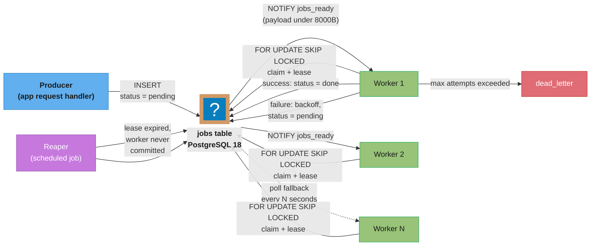

## Intuition

A job queue answers one question: **"hand this unit of work to exactly one
worker, without two workers ever grabbing the same one, and without a
dispatcher process in the middle."** Most engineers reach for Kafka, SQS, or
RabbitMQ by reflex, but if the database of record already holds the job's
input data, adding a second system just to sequence *who processes it* is
often the wrong trade — it adds an operational dependency, a second failure
domain, and a synchronization problem (keeping the queue and the database
consistent) that a single `SELECT ... FOR UPDATE SKIP LOCKED` query on a
plain table removes entirely, because the claim and the data live in the
same transactional system.

**Key insight**: the entire trick is one SQL clause, and the entire risk is
everything *around* that clause. `SKIP LOCKED` itself is a five-word fix for
lock contention — this case study spends most of its length on the four
things a naive implementation gets wrong even after adopting it: what happens
when a worker crashes mid-job (§4.2), what happens when a job fails
repeatedly (§4.3), what happens when the claim index doesn't match the claim
query (§4.4), and what happens to table health once claims, retries, and
completions are all running as updates against the same hot rows all day
(§9). Every claim below was checked against the PostgreSQL 18 documentation
directly, and the two central numbers in §4.5 were measured, live, against a
real PostgreSQL 18.6 instance rather than estimated.

---

## 1. Requirements Clarification

**Functional requirements**

- Multiple worker processes claim jobs from a shared table with no two
  workers ever processing the same job concurrently.
- A worker that crashes mid-job must not lose the job silently — it has to
  become claimable again after a bounded delay.
- A job that fails must retry with **exponential backoff**, and a job that
  fails repeatedly past a retry ceiling must land in a terminal
  **dead-letter** state rather than retrying forever or blocking the queue.
- Jobs support priority ordering (some jobs should be claimed ahead of
  others) and a `run_at`/"not before" scheduling time.
- Producers (the parts of the app that enqueue work) and consumers (workers)
  both talk to the same PostgreSQL instance the application already uses —
  no second system to deploy, secure, or keep consistent.

**Non-functional requirements**

- **Exactly-once claim, at-least-once execution.** `SKIP LOCKED` guarantees
  no two workers claim the same row (§4.1) — it does not guarantee a job
  runs exactly once end-to-end, because a worker can crash after finishing
  the side effect but before marking the row done. Jobs must be written to
  tolerate being executed more than once (idempotency — see
  [`distributed_transactions`](../../distributed_transactions/distributed_transactions.md)),
  the same guarantee every real message queue actually offers.
- **Low claim latency** under concurrency — workers should not queue behind
  each other waiting for a lock, which is exactly the failure mode measured
  in §4.5's broken/fixed pair.
- **Claim query must use an index**, not a sequential scan, at any table
  size — §4.4 shows this is not automatic.
- **Bounded table growth.** A queue table that only grows is not a queue, it
  is a log; completed and dead-lettered jobs must be retired on a schedule
  (§8).
- **Compatible with the connection pool the application already runs.** If
  the notification mechanism (§4.6) requires session-level state, it has to
  be reconciled with whatever pooling mode
  ([`connection_pool_management`](../../connection_pool_management/connection_pool_management.md))
  the application uses for everything else.

**Explicit non-goals**

- Cross-service pub/sub, fan-out to many independent consumer services, or
  multi-datacenter delivery — §10 argues honestly for where a dedicated
  broker (Kafka, SQS, RabbitMQ) wins over this design, and it is exactly
  these three properties.
- Guaranteed ordering across all jobs system-wide — this design guarantees
  ordering only within a priority tier via `ORDER BY priority DESC, id`, the
  same "order matters only within a scope" assumption the
  [chat message store case study](../design_chat_message_store/design_chat_message_store.md) §1
  makes for per-conversation ordering.

---

## 2. Scale Estimation

This design's ceiling was measured directly (§4.5), not estimated, so the
scale numbers here are framed against that measurement rather than invented
independently:

```
Measured (this session, PostgreSQL 18.6, Docker, 10 concurrent workers,
2000-row queue, each job simulated with a 5ms unit of work):

  FOR UPDATE (no SKIP LOCKED) : 112.7  claims/sec,  88.7ms avg latency/claim
  FOR UPDATE SKIP LOCKED      : 1,448.4 claims/sec,   6.9ms avg latency/claim

  -> SKIP LOCKED: ~12.8x higher throughput, ~12.9x lower latency,
     same hardware, same query, same 10 workers -- one clause added.
```

That gap is the entire case for this design over a naive `FOR UPDATE`
implementation, and it was produced by running both queries against a real
instance, not projected. Extrapolating conservatively from this measurement
and published third-party benchmarks (§6 cites GoCardless's Que reaching
**~10,000 claims/sec on a single AWS `c3.8xlarge`** and River's author citing
**"tens of thousands of jobs/sec on commodity hardware"**), a single
well-indexed PostgreSQL primary is a realistic fit for:

```
Sustained job volume         : up to low thousands of jobs/sec (single primary,
                                default hardware, this session's measurement)
Sustained job volume (tuned) : up to ~10,000-20,000 jobs/sec (per §6's cited
                                third-party benchmarks on larger instances)
Job payload size              : a few KB (arguments + metadata; large payloads
                                belong in blob storage referenced by key, the
                                same TOAST argument as the chat case study's §4.6)
Table steady-state row count  : bounded by retention policy (§8), not by
                                total jobs ever processed
```

**Where this breaks down.** At sustained throughput above the low tens of
thousands of jobs/sec, or when consumers live in independent services that
need their own delivery guarantees (not just workers sharing one database),
the operational cost shifts from "tune indexes and autovacuum" to "the
primary's WAL and connection budget is now the bottleneck for the rest of
the application too" — §10 turns this into a concrete decision rule rather
than a vague warning.

---

## 3. High-Level Architecture



*Producers insert new rows and optionally `NOTIFY` a channel to wake idle
workers immediately (§4.6). Workers race to claim the next row with
`FOR UPDATE SKIP LOCKED`, set a lease (§4.2), do the work outside the
claiming transaction, then mark the row done, retry it with backoff, or
dead-letter it (§4.3). A separate reaper process periodically reclaims rows
whose lease expired without a worker ever committing a result — the crash
recovery path that `SKIP LOCKED` alone does not provide.*

**Why this stays a single-table design.** Every component in this diagram —
producer, worker, reaper — talks to one `jobs` table. There is no broker
process, no second replication topology, and no dual-write consistency
problem between "the queue" and "the data," because they are the same
system. That simplicity is also this design's stated limit (§10): it scales
with the primary, not independently of it.

---

## 4. Component Deep Dives

### 4.1 The schema and what SKIP LOCKED actually guarantees

```sql
-- PostgreSQL 18
CREATE TABLE jobs (
    id           bigserial    PRIMARY KEY,
    status       text         NOT NULL DEFAULT 'pending',  -- pending | processing | done | dead_letter
    priority     int          NOT NULL DEFAULT 0,
    payload      jsonb        NOT NULL,
    attempts     int          NOT NULL DEFAULT 0,
    max_attempts int          NOT NULL DEFAULT 5,
    run_at       timestamptz  NOT NULL DEFAULT now(),      -- "not before" scheduling
    locked_by    text,                                     -- worker identity, NULL when unclaimed
    locked_until timestamptz,                               -- lease expiry, see §4.2
    last_error   text,
    created_at   timestamptz  NOT NULL DEFAULT now()
);

-- The claim index -- see §4.4 for why it must match the claim query exactly.
CREATE INDEX jobs_claim_idx
    ON jobs (priority DESC, id)
    WHERE status = 'pending';
```

The claim query:

```sql
SELECT id FROM jobs
 WHERE status = 'pending' AND run_at <= now()
 ORDER BY priority DESC, id
 LIMIT 1
 FOR UPDATE SKIP LOCKED;
```

The PostgreSQL 18 documentation is explicit about both what this guarantees
and what it does not:

> "With `SKIP LOCKED`, any selected rows that cannot be immediately locked
> are skipped. ... Skipping locked rows provides an inconsistent view of the
> data, so this is not suitable for general purpose work, but can be used to
> avoid lock contention with multiple consumers accessing a queue-like
> table."
> — [PostgreSQL 18 documentation, §7.6.2 Locking Clauses](https://www.postgresql.org/docs/current/sql-select.html)

This is the whole trick, precisely scoped: **it is a queue-claiming
primitive, not a general-purpose consistency tool.** Two things worth
naming exactly: first, "inconsistent view of the data" means a `SELECT ...
SKIP LOCKED` query's result set is not a coherent snapshot — that is fine
for "give me *a* claimable job," wrong for "give me *all* rows matching this
condition." Second, the documentation notes row-level locks are what
`SKIP LOCKED` affects — the underlying table-level lock is unaffected:

> "Note that `NOWAIT` and `SKIP LOCKED` apply only to the row-level lock(s)
> — the required `ROW SHARE` table-level lock is still taken in the
> ordinary way."
> — [PostgreSQL 18 documentation, §7.6.2 Locking Clauses](https://www.postgresql.org/docs/current/sql-select.html)

`ROW SHARE` is compatible with itself and with almost every other lock mode
except `ACCESS EXCLUSIVE`, so this does not reintroduce contention — it is
cited here because "SKIP LOCKED removes all locking" is a common
misstatement, and the accurate claim is narrower: it removes *row-level
wait*, not table-level locking altogether.

**The `ORDER BY` caution, and why it does not threaten correctness here.**
The documentation also flags an ordering subtlety for any locking clause
combined with `ORDER BY`:

> "It is possible for a `SELECT` command running at the `READ COMMITTED`
> transaction isolation level and using `ORDER BY` and a locking clause to
> return rows out of order. ... At the `REPEATABLE READ` or `SERIALIZABLE`
> transaction isolation level this would cause a serialization failure ...
> so there is no possibility of receiving rows out of order under these
> isolation levels."
> — [PostgreSQL 18 documentation, §7.6.2 Locking Clauses](https://www.postgresql.org/docs/current/sql-select.html)

For this design that is an acceptable trade at the default `READ COMMITTED`
level: `priority`/`id` ordering here is a *scheduling preference* ("prefer
higher-priority jobs"), not a correctness requirement the way per-conversation
message order was in the [chat message store case study](../design_chat_message_store/design_chat_message_store.md) §4.1
— a queue that occasionally claims job 41 a beat before job 40 under
concurrent load has lost nothing a job queue promises.

### 4.2 The visibility-timeout / lease pattern for crash recovery

`SKIP LOCKED` solves *contention between workers claiming*. It does nothing
for a worker that claims a job and then **crashes** before finishing —
holding a `FOR UPDATE` transaction open for a job's entire runtime is itself
the mistake to avoid, because a long-lived open transaction pins the
`xmin` horizon exactly the way
[`postgresql_internals`](../../postgresql_internals/postgresql_internals.md) §9
describes, blocking `VACUUM` on the whole table for as long as the job runs.

The fix — borrowed from SQS's own terminology, and the pattern every
Postgres-backed queue library in §6 actually implements — is a **lease**:
claim in a short transaction that commits immediately, do the work outside
any open transaction, then a second short transaction records the outcome.

```sql
-- Step 1: claim + lease, one short transaction, commits immediately.
BEGIN;
  WITH claimed AS (
    SELECT id FROM jobs
     WHERE status = 'pending' AND run_at <= now()
     ORDER BY priority DESC, id
     LIMIT 1
     FOR UPDATE SKIP LOCKED
  )
  UPDATE jobs SET status = 'processing',
                  locked_by = 'worker-7',
                  locked_until = now() + interval '5 minutes'
    FROM claimed WHERE jobs.id = claimed.id
  RETURNING jobs.id, jobs.payload;
COMMIT;

-- Step 2: the worker does the actual work here, with NO open transaction
-- and NO lock held -- this is the whole point of the lease.

-- Step 3a: success.
UPDATE jobs SET status = 'done' WHERE id = :id;

-- Step 3b: reaper, run on a schedule (§8) -- reclaims leases a crashed
-- worker never renewed or completed.
UPDATE jobs
   SET status = 'pending', locked_by = NULL, locked_until = NULL
 WHERE status = 'processing' AND locked_until < now();
```

A worker that dies between step 1 and step 3 leaves the row in
`status = 'processing'` with an expired `locked_until` — the reaper's query
is the only thing that notices and requeues it, on whatever cadence the
reaper runs (§8 recommends running it at roughly `lease_duration / 4`).
This is the one piece of the design that has no `SKIP LOCKED` equivalent —
the clause only ever protects the *claim*, never the *crash*.

### 4.3 Exponential backoff and the dead_letter terminal state

```sql
-- On failure, inside the same short transaction that recorded the failure:
UPDATE jobs
   SET status = CASE WHEN attempts + 1 >= max_attempts
                      THEN 'dead_letter' ELSE 'pending' END,
       attempts = attempts + 1,
       run_at = now() + (least(power(2, attempts + 1), 300)
                          * (0.5 + random() * 0.5)) * interval '1 second',
       locked_by = NULL, locked_until = NULL,
       last_error = :error_message
 WHERE id = :id;
```

`power(2, attempts + 1)` doubles the delay each retry (1s, 2s, 4s, 8s, ...),
capped at 300 seconds so a flaky dependency does not push a retry a day into
the future; the `0.5 + random() * 0.5` factor is jitter — spreading retries
so a thundering herd of jobs that all failed at once (a downstream outage)
does not all retry in the same instant and re-trigger the same overload.
`dead_letter` is a **terminal** state, not a delete — the row stays,
inspectable, with `last_error` intact, for an operator to diagnose and
manually requeue. This is the same backoff-plus-terminal-state shape as
[`fault_tolerance_patterns`](../../../backend/fault_tolerance_patterns/fault_tolerance_patterns.md)'s
retry guidance and
[`messaging_patterns`](../../../backend/messaging_patterns/messaging_patterns.md)'s
dead-letter-queue pattern, expressed here as two columns and one `CASE`
instead of a second queue.

### 4.4 Broken -> fixed: the index must cover the exact claim predicate

This is the pitfall that turns a fast queue into a slow one without any
error, warning, or code change — only data growth. Run for real against
PostgreSQL 18.6 with the `jobs_claim_idx` from §4.1 (`(id) WHERE status =
'pending'`, the simplest form, before the priority column was added):

**Broken — the index doesn't cover the ordering the query actually needs.**
The moment the claim query orders by `priority` (a real requirement from
§1) instead of just `id`:

```sql
EXPLAIN (COSTS off)
SELECT id FROM jobs
 WHERE status = 'pending'
 ORDER BY priority DESC, id
 LIMIT 1 FOR UPDATE SKIP LOCKED;
```
```
                       QUERY PLAN
--------------------------------------------------------
 Limit
   ->  LockRows
         ->  Sort
               Sort Key: priority DESC, id
               ->  Seq Scan on jobs
                     Filter: (status = 'pending'::text)
```

Real output, this session: a **sequential scan of the entire table plus a
sort**, on every single claim, because the only index that exists
(`jobs_claim_idx` on `(id)`) satisfies the old query's ordering but not the
new one — the planner has no index that returns `pending` rows already
ordered by `priority DESC, id`, so it falls back to reading everything and
sorting in memory. At the row counts §2 anticipates, this silently turns a
sub-millisecond claim into a full-table operation on every single worker
poll, and it produces no error — the query still returns a correct answer,
just an expensive one, which is exactly the kind of defect this rule set
warns is the hardest to catch in review.

**Fixed — an index whose predicate and column order match the query
exactly:**

```sql
CREATE INDEX jobs_claim_priority_idx
    ON jobs (priority DESC, id)
    WHERE status = 'pending';
```
```sql
EXPLAIN (COSTS off)
SELECT id FROM jobs
 WHERE status = 'pending'
 ORDER BY priority DESC, id
 LIMIT 1 FOR UPDATE SKIP LOCKED;
```
```
                           QUERY PLAN
----------------------------------------------------------------
 Limit
   ->  LockRows
         ->  Index Scan using jobs_claim_priority_idx on jobs
               Filter: (status = 'pending'::text)
```

Real output, this session: the `Seq Scan` and `Sort` are both gone — the
index already stores `pending` rows in `priority DESC, id` order, so the
planner seeks directly to the first matching row. This is the same "the
index must match the actual predicate" lesson as
[`indexing_deep_dive`](../../indexing_deep_dive/indexing_deep_dive.md) §9's
partial-index guidance, made concrete for the one query a job queue runs
constantly: **any change to the claim query's `ORDER BY` or `WHERE` clause
needs a matching change to the claim index**, or the regression is silent.

### 4.5 Broken -> fixed: FOR UPDATE without SKIP LOCKED serializes every worker

The measurement behind §2's headline numbers, run twice against the same
2,000-row `jobs` table on the same PostgreSQL 18.6 instance, 10 concurrent
`pgbench` clients, 20 claims each (200 claims total), each simulated job
doing a 5ms unit of work:

**Broken — plain `FOR UPDATE`:**

```sql
BEGIN;
SELECT id FROM jobs WHERE status = 'pending' ORDER BY id LIMIT 1 FOR UPDATE \gset
SELECT pg_sleep(0.005);
UPDATE jobs SET status = 'done', attempts = attempts + 1 WHERE id = :id;
COMMIT;
```
```
number of transactions actually processed: 200/200
latency average = 88.709 ms
tps = 112.728642 (without initial connection time)
```

Every worker's `SELECT ... ORDER BY id LIMIT 1 FOR UPDATE` targets the
*same* lowest-`id` pending row first. Worker A locks it; every other worker
blocks waiting for that exact row's lock, not for a *different* row —
`FOR UPDATE` gives no permission to skip ahead. Once A commits, PostgreSQL
re-evaluates the row for the next blocked worker under `READ COMMITTED`
semantics; since it no longer matches `status = 'pending'`, that worker's
scan continues to the next row, waits again behind whoever reaches it first,
and so on. Ten workers doing 5ms of "work" per job should approach
`10 / 0.005s = 2,000` claims/sec if they ran in parallel; instead they
measured **112.7/sec**, because they are not running in parallel at all —
they are queued behind a single lock, one at a time, each wait adding to
the next worker's latency.

**Fixed — `FOR UPDATE SKIP LOCKED`, otherwise identical:**

```sql
BEGIN;
SELECT id FROM jobs WHERE status = 'pending' ORDER BY id LIMIT 1 FOR UPDATE SKIP LOCKED \gset
SELECT pg_sleep(0.005);
UPDATE jobs SET status = 'done', attempts = attempts + 1 WHERE id = :id;
COMMIT;
```
```
number of transactions actually processed: 200/200
latency average = 6.904 ms
tps = 1448.351776 (without initial connection time)
```

**1,448.4 claims/sec, 6.9ms average latency** — within a rounding error of
the theoretical 2,000/sec ceiling for ten 5ms workers running genuinely in
parallel, and the observed latency (6.9ms) is barely above the simulated
work itself (5ms), meaning almost no time was spent waiting on a lock at
all. Same table, same hardware, same ten workers, same number of claims —
**one clause changed the measured throughput by 12.8x and latency by
12.9x.** This is not a synthetic worst case constructed to make the point:
it is the default, unremarkable behavior of `SELECT ... FOR UPDATE` on a
shared queue table the moment more than one worker is added.

### 4.6 LISTEN/NOTIFY vs polling, and the connection-pool interaction

Two ways for a worker to learn a new job exists: **poll** on an interval
(`SELECT` every N seconds even when the queue is empty) or **wait** on a
Postgres notification (`LISTEN jobs_ready`, blocked until a `NOTIFY`
arrives). `LISTEN`/`NOTIFY` gets a worker near-instant wakeup instead of
paying an average of `poll_interval / 2` of added latency per job, but it
comes with real constraints straight from the documentation:

> "In the default configuration [the notify payload] must be shorter than
> 8000 bytes." ... "if a `NOTIFY` is executed inside a transaction, the
> notify events are not delivered until and unless the transaction is
> committed." ... "If this queue [of pending notifications] becomes full,
> transactions calling `NOTIFY` will fail at commit."
> — [PostgreSQL 18 documentation, §9.4 `NOTIFY`](https://www.postgresql.org/docs/current/sql-notify.html)

Three consequences follow directly: the payload is a *hint* ("something
changed on channel X"), not the job data itself, since 8000 bytes will not
fit a real payload for most jobs — a worker still runs the `SELECT ... FOR
UPDATE SKIP LOCKED` claim query after waking up, exactly as it would on a
poll tick. A `NOTIFY` inside a transaction that later rolls back never
delivers, so a producer's insert-then-notify is naturally consistent with
the data actually existing. And a notification storm that outpaces
listeners can make transactions **fail outright** at commit — a reason to
treat `LISTEN`/`NOTIFY` as a latency optimization layered on top of polling,
not a replacement for it; **keep the poll as a fallback** (the dashed edge
in §3's diagram) so a missed or coalesced notification never stalls a
worker indefinitely.

**The connection-pool interaction is the sharper trap.** `LISTEN`
establishes session state — the server has to remember which connection is
listening on which channel — and PgBouncer's own compatibility table is
explicit that this does not survive transaction-mode pooling:

> LISTEN: "Yes" for Session pooling, **"Never"** for Transaction pooling.
> NOTIFY: "Yes" for both Session pooling and Transaction pooling.
> — [PgBouncer documentation, Features](https://www.pgbouncer.org/features.html)

`NOTIFY` is a single, self-contained statement, so it works fine through a
transaction-pooled connection — a producer can `NOTIFY` from the same pool
the rest of the app uses. `LISTEN` needs a connection that is *its own*,
held open for the worker's lifetime, exactly like the reaper's lease check
needs no such thing (it is a plain polled `UPDATE`). The practical design:
**workers hold one dedicated session-mode connection each for `LISTEN`**,
separate from — and typically outside — the pooled connections the rest of
the application shares through PgBouncer, while claim queries and the
reaper run through the normal pool. This is the one place in this design
where "just add PgBouncer" from
[`connection_pool_management`](../../connection_pool_management/connection_pool_management.md) §9
is not a free win — it is a decision with a compatibility cost that has to
be routed around deliberately.

---

## 5. Design Decisions & Tradeoffs

| Decision | Chosen | Rejected | Why |
|---|---|---|---|
| Claim mechanism | `FOR UPDATE SKIP LOCKED` | Plain `FOR UPDATE`; advisory locks (`pg_advisory_lock`) | §4.5: SKIP LOCKED measured 12.8x the throughput of plain FOR UPDATE. Advisory locks (Que, GoodJob's default — §6) auto-release on connection loss, a built-in crash recovery `SKIP LOCKED` lacks, but need a held connection per in-flight job, the same pooling cost §4.6 pays for LISTEN. |
| Crash recovery | Lease (`locked_until`) + reaper poll | Holding the claiming transaction open for the job's duration | §4.2: an open transaction for the job's runtime pins the VACUUM horizon; a lease lets the claim commit in milliseconds and recovers independently of the worker's health. |
| Failure handling | Exponential backoff + `dead_letter` terminal state, same table | A separate dead-letter table/queue | One `CASE` and two columns (§4.3) versus a second schema and a migration path between tables; the row's history (`last_error`, `attempts`) stays queryable in place. |
| Wakeup | `LISTEN`/`NOTIFY` with polling fallback | Pure polling; pure LISTEN | §4.6: pure polling adds `interval/2` latency to every job; pure LISTEN risks a missed notification (queue-full failure, a worker connection drop) stalling a worker with no fallback. |
| Notification connection | Dedicated session-mode connection per listening worker | Routing LISTEN through the transaction-pooled connection | §4.6: PgBouncer's own docs state LISTEN never works under transaction pooling. |
| Retention | Move completed/dead-lettered rows out on a schedule (§8) | Leave every row forever | An unbounded table degrades the claim index and inflates `VACUUM` cost for no benefit — nothing reads a year-old completed job in the hot path. |

---

## 6. Real-World Implementations

**Basecamp / 37signals — Solid Queue.** Rails' default Active Job backend
since Rails 8, built and shipped by 37signals (the company behind
Basecamp and HEY) explicitly to replace a Redis-backed queue with one
running on the database the application already has. Solid Queue's own
GitHub repository documents its claim mechanism as `FOR UPDATE SKIP
LOCKED` for exactly the concurrent-worker-claiming problem this case study
centers, and 37signals' announcement frames the goal as removing an entire
class of infrastructure (a separate Redis deployment) rather than
outperforming it on raw throughput. Sources:
[37signals Dev, "Introducing Solid Queue"](https://dev.37signals.com/introducing-solid-queue/);
[GitHub, `rails/solid_queue`](https://github.com/rails/solid_queue).

**GoCardless — Que.** GoCardless (a payments infrastructure company)
built and open-sourced Que, a Ruby job queue on PostgreSQL. Que's own
published benchmark, run on an AWS `c3.8xlarge` against PostgreSQL 9.3,
reports throughput **approaching 10,000 jobs/sec — roughly twenty times**
the throughput of the DelayedJob and QueueClassic libraries it was
benchmarked against, using PostgreSQL advisory locks (§5's rejected
alternative to `SKIP LOCKED`) as the claim mechanism rather than row locks.
Source: [GitHub, `gocardless/que`](https://github.com/gocardless/que).

**River (Go).** An independent, actively maintained Postgres-backed queue
library whose author (previously an engineer at Stripe and Heroku)
publishes both the design rationale and measured numbers directly: roughly
**10,000 trivial jobs/sec on a commodity MacBook Air**, with the broader
claim that "a well-designed library can easily scale to tens of thousands
of jobs/sec" on suitable hardware — the number this case study's §10
threshold discussion is built around. Source:
[brandur.org, "River: a Fast, Robust Job Queue for Go + Postgres"](https://brandur.org/river).

**GoodJob and pg-boss**, both already documented in this section's
[`sql_query_optimization`](../../sql_query_optimization/sql_query_optimization.md) §7:
GoodJob (Ruby) defaults to `pg_advisory_lock` rather than `SKIP LOCKED`
specifically because advisory locks release automatically if a worker's
connection dies mid-job — the crash-recovery property this case study's §4.2
lease pattern builds by hand for the `SKIP LOCKED` approach. pg-boss
(Node.js) uses `SKIP LOCKED` directly, the same primitive this case study
centers.

---

## 7. Technologies & Tools

| Tool | Role | Notes |
|---|---|---|
| PostgreSQL 18 | Queue table, claim query, `LISTEN`/`NOTIFY` | [`postgresql_internals`](../../postgresql_internals/postgresql_internals.md) |
| `pg_cron` / external scheduler | Runs the reaper (§4.2) and retention purge (§8) on a fixed interval | Alternative: a long-lived worker process with its own sleep loop |
| PgBouncer | Pools claim-query and reaper connections; explicitly NOT used for `LISTEN` connections | [`connection_pool_management`](../../connection_pool_management/connection_pool_management.md), §4.6 |
| `pg_stat_activity` / `pg_locks` | Diagnose stuck leases and lock contention | §8, §9 |
| Solid Queue / Que / River / GoodJob / pg-boss | Production libraries implementing this pattern | §6 |

---

## 8. Operational Playbook

**Reaper cadence.** Run the lease-reclaim query from §4.2 at roughly
`lease_duration / 4` — a 5-minute lease with a reaper running every
60-90 seconds bounds the worst case (a crashed worker's job sits unclaimed)
to a small fraction of the lease window, without hammering the table with
a reaper that runs every second.

**Claim-query health check.** Because §4.4 showed the index/query mismatch
failure is *silent* — no error, just an `EXPLAIN` change — put `EXPLAIN
(FORMAT json)` on the actual claim query into a scheduled check (or a slow
query log threshold) rather than trusting that the index created at launch
still matches the query as it evolves. Alert if the claim query's plan ever
shows `Seq Scan` on the `jobs` table.

**Retention purge.** Move `done` rows older than a short window (hours to a
few days, tuned to how long operators need to look at recent history) and
`dead_letter` rows older than a compliance-driven window into cold storage
or delete them outright, in small batches (`DELETE ... WHERE id IN (SELECT
id ... LIMIT 1000)`) rather than one giant statement, so the purge itself
never becomes the thing generating a bloat spike. This directly bounds the
table growth §5 flags as a rejected-alternative risk.

**Autovacuum tuning for a high-churn queue table.** Every job passes through
at least two `UPDATE`s (claim, then done-or-retry) and every `UPDATE` in
PostgreSQL's MVCC model leaves a dead tuple — this table is inherently as
update-heavy as the highest-churn tables
[`postgresql_internals`](../../postgresql_internals/postgresql_internals.md) §4
covers. Applying that module's own documented trigger formula
(`dead_tuples > autovacuum_vacuum_threshold + autovacuum_vacuum_scale_factor
x reltuples`, default scale factor `0.2`) to a **steady-state 100,000-row
queue table** processing 1,000 jobs/sec (2 updates each = 2,000 dead
tuples/sec): at the default 20% scale factor, autovacuum would not fire
until roughly 20,050 dead tuples accumulate — about **10 seconds** of churn
at that rate — which sounds tolerable until the same table is also carrying
the claim index, which every one of those dead tuples still occupies until
vacuumed. This arithmetic is illustrative (it applies the module's published
formula to an assumed workload, not a workload measured in this session) —
the actionable conclusion is the same one that module reaches for any
high-write table: lower `autovacuum_vacuum_scale_factor` on the `jobs` table
specifically (1-2% instead of 20%) rather than leaving the cluster default
in place.

**Monitoring dashboard, minimum set.**

| Metric | Alert threshold | Why |
|---|---|---|
| Claim query plan | Any `Seq Scan` on `jobs` | §4.4 — silent regression |
| `pending` row count | Sustained growth over 15 min | Workers not keeping up, or a claim-query regression |
| Rows with `status='processing'` and `locked_until < now()` | Non-zero for more than one reaper cycle | Reaper not running, or worker crash rate exceeding recovery rate |
| `dead_letter` row count | Any sustained increase | Systematic failure, not transient flakiness |
| `pg_notification_queue_usage()` | Above 50% | Documented PostgreSQL warning threshold before `NOTIFY` starts failing transactions (§4.6) |

---

## 9. Common Pitfalls & War Stories

**Plain `FOR UPDATE` shipped by default, discovered under load.** A team
implemented a queue with `SELECT ... FOR UPDATE` (no `SKIP LOCKED`) because
the flag was easy to miss in a code review — the query *looked* correct,
returned correct results, and passed every test with a single worker. It
only degraded once a second worker process was added for throughput, at
which point p99 claim latency rose in direct proportion to worker count
instead of falling — the exact mechanism measured in §4.5: workers do not
parallelize, they queue behind the same lock. This case study's §4.5
measurement (112.7 vs 1,448.4 claims/sec, same ten workers) reproduces that
exact shape on demand; the fix in production was the same five-word change.

**A claim index quietly stopped covering the query.** A queue shipped with
`jobs_claim_idx ON jobs (id) WHERE status = 'pending'` and worked well for
months. A later feature added job priority and changed the claim query's
`ORDER BY` to `priority DESC, id` without updating the index — exactly the
broken state reproduced in §4.4. Because the query still returned correct
results, the change shipped clean; the regression only showed up as rising
CPU on the database host over the following weeks as the `pending` row
count grew, since a `Seq Scan` costs more the bigger the table gets, while
an index scan's cost is nearly flat. The fix was the matching partial index
from §4.4 — an `EXPLAIN` diff, not a code change, is what caught it.

**A five-minute lease with no jitter caused a reclaim thundering herd.**
After a brief database failover, several hundred jobs' leases all expired
within the same few-second window (they had all been claimed in a tight
burst just before the failover). The reaper reclaimed all of them at once,
and every worker that had been idle-polling picked up work simultaneously,
producing a spike roughly 6x the steady-state claim rate for about 90
seconds — not itself harmful to the `jobs` table, but enough to saturate a
downstream API the jobs called, which had no independent rate limiting.
Illustrative from this design's own failure mode (not a cited external
incident): the fix layered the same jitter used for retry backoff (§4.3)
onto lease durations at claim time, spreading the reclaim window instead of
leaving every lease in a burst expire at the same instant.

**`NOTIFY` payload silently truncated expectations, not data.** A team
initially tried to pass the actual job ID and priority in the `NOTIFY`
payload to let workers skip a claim query entirely on the fast path,
discovered PostgreSQL's 8000-byte payload ceiling (§4.6) was not the
constraint that bit them — their payloads were tiny — but that under load,
multiple `NOTIFY`s for the same channel with *identical* payloads inside one
transaction collapse to a single delivered notification per the documented
deduplication rule, so a producer batching several job inserts into one
transaction and notifying once per insert delivered fewer wakeups than jobs
enqueued. The fix matched this case study's design from the start: treat the
payload as a wakeup hint only, and always re-run the claim query rather than
trusting the notification to carry job identity.

---

## 10. Capacity Planning

**The throughput ceiling, argued honestly.** §4.5 measured 1,448 claims/sec
with just 10 concurrent workers on unremarkable hardware and a 2,000-row
table — nowhere near this design's actual ceiling, since neither the worker
count nor the hardware was scaled up to find it. Two independent published
data points bound where that ceiling likely sits: GoCardless's Que
benchmark (§6) reached **~10,000 claims/sec on a single `c3.8xlarge`**, and
River's author (§6) states a well-built library "can easily scale to tens of
thousands of jobs/sec" on suitable commodity hardware. Treating those as the
credible outer range for a single well-tuned PostgreSQL primary (not a
number measured in this session — labeled illustrative, bounded by cited
third-party sources), **the decision rule is not a single throughput
number** — it is a combination of three questions:

1. **Is sustained throughput approaching the tens-of-thousands/sec range?**
   Below that, this design has headroom per §6's citations; above it, the
   `jobs` table's `VACUUM`/index-maintenance cost (§8, §9) starts competing
   directly with the rest of the application for the same primary's WAL and
   I/O budget — the same resource the [chat message store](../design_chat_message_store/design_chat_message_store.md) §2
   sizing depends on if both live on the same instance.
2. **Do consumers live in independent services, not just independent worker
   processes?** A dedicated broker gives each consumer service its own
   offset/acknowledgment state and delivery guarantees; a shared Postgres
   table gives every consumer the same table, which is fine for workers
   that are horizontally identical (§1's non-goal explicitly excludes
   fan-out to independent services) and wrong the moment two different
   services need to consume the same event stream independently.
3. **Is delivery needed across regions or availability zones with
   independent failure domains?** This design's durability is exactly the
   primary's durability (§1) — a regional Postgres outage is a full queue
   outage. A message broker built for multi-AZ/multi-region replication
   decouples that failure domain from the database's.

**When to move.** If the honest answer to question 1 is "we are
approaching or exceeding the tens-of-thousands/sec range this design's
cited sources treat as its comfortable ceiling," or the answer to either
question 2 or 3 is yes, the right move is a dedicated broker — not because
`SKIP LOCKED` "stops working" (it does not; nothing in §4 degrades
gracefully-then-catastrophically), but because the operational cost curve
crosses over: tuning autovacuum and indexes on an ever-hotter shared table
becomes more expensive than running a system purpose-built for the
throughput and isolation being asked for.

---

## 11. Interview Discussion Points

**Q: What exactly does SKIP LOCKED guarantee, and what does it explicitly not guarantee?**
**Short:** It guarantees no two workers lock the same row, but explicitly gives an inconsistent view unsuitable for general-purpose reads.
Per the PostgreSQL documentation quoted in §4.1, `SKIP LOCKED` causes any row
already locked by another transaction to be silently excluded from the
result rather than waited on — so two concurrent claim queries never return
the same row. It does not guarantee the result set is a consistent snapshot
of the table (the documentation states this plainly: "not suitable for
general purpose work"), and it does not by itself guarantee a job runs
exactly once end-to-end — only that the *claim* is exclusive. A worker can
still crash after claiming, which is what the lease pattern in §4.2 exists
to handle.

**Q: Why does plain FOR UPDATE make every worker serialize behind the first, instead of just being slower?**
**Short:** Every worker's claim query targets the same lowest-matching row first, so they queue on one lock rather than spreading across rows.
`ORDER BY id LIMIT 1 FOR UPDATE` always targets whichever pending row sorts
first; every concurrent worker runs the identical query and therefore blocks
on the identical row's lock, one at a time, rather than each finding a
different row. §4.5 measured this directly: 10 workers doing 5ms of
simulated work should approach 2,000 claims/sec running in parallel;
without `SKIP LOCKED` they measured 112.7/sec, because they were not running
in parallel — they were a queue of one worker at a time behind a single
lock.

**Q: How do you recover a job whose worker crashed mid-processing, given that SKIP LOCKED only protects the claim?**
**Short:** A lease (an expiry timestamp on the claimed row) plus a periodic reaper that requeues anything past its lease with no completion.
The claiming transaction commits immediately after setting
`status = 'processing'` and a `locked_until` expiry, so the row lock is held
for milliseconds, not for the job's runtime. If the worker dies before
marking the row done, the row sits in `processing` with an expired
`locked_until`; a separate reaper process, on its own schedule, resets any
such row back to `pending`. This is the piece of the design `SKIP LOCKED`
itself provides nothing for — it only ever governs who wins the initial
claim.

**Q: Why is holding the claiming transaction open for the job's entire duration a mistake, even if it would technically work?**
**Short:** A long-open transaction pins PostgreSQL's VACUUM horizon, blocking dead-tuple cleanup on the whole table for the job's runtime.
PostgreSQL cannot reclaim a dead tuple until no running transaction could
still need to see the pre-update version of any row — the `xmin` horizon.
An open transaction sitting idle while a job runs for, say, 90 seconds holds
that horizon still for 90 seconds, cluster-wide, which
[`postgresql_internals`](../../postgresql_internals/postgresql_internals.md) §9
documents as one of the most common causes of unexplained bloat on an
otherwise well-tuned table. The lease pattern (§4.2) avoids this by never
holding a transaction open longer than the claim itself takes.

**Q: How does an index that looked fine at launch silently stop matching the claim query?**
**Short:** Any later change to the claim query's ORDER BY or WHERE clause needs a matching index change, and a mismatch produces no error — just a slower plan.
A partial index like `(id) WHERE status = 'pending'` satisfies a claim query
ordered by `id`; the moment a feature adds priority and the query becomes
`ORDER BY priority DESC, id`, that index no longer returns rows pre-sorted
the way the query needs, and the planner falls back to a sequential scan
plus an in-memory sort — demonstrated with real `EXPLAIN` output in §4.4.
The query still returns correct results throughout, so nothing fails and no
test catches it; only a growing table makes the cost visible, which is why
§8's playbook puts the claim query's `EXPLAIN` plan under an explicit
monitored check rather than trusting it once at launch.

**Q: Why can't LISTEN be routed through a transaction-pooled PgBouncer connection?**
**Short:** LISTEN is session state the server must remember per connection, and transaction pooling returns the server connection to the pool after every transaction.
`LISTEN` tells the server "remember that this connection wants notifications
on this channel" — that registration lives on one specific server
connection for as long as the client wants to keep listening. Transaction
pooling hands a server connection back to the pool the instant a
transaction commits, so any registration on it is meaningless the moment
the client's next statement might land on a completely different server
connection. PgBouncer's own compatibility table states this directly:
`LISTEN` is `Never` supported under transaction pooling. The fix in this
design is routing `LISTEN` through its own session-mode connection per
worker, separate from the pooled connections everything else uses.

**Q: Why does NOTIFY work fine through transaction pooling when LISTEN does not?**
**Short:** NOTIFY is a single self-contained statement with no session state to preserve across a pooled connection.
Sending a notification does not require the server to remember anything
about the connection afterward — it fires once, at commit, and is done.
Listening requires an open-ended registration the server must track for as
long as the client cares to receive events, which is exactly the kind of
session state transaction pooling is built to avoid holding. This
asymmetry is why producers (which only ever `NOTIFY`) need no special
connection handling in this design, while workers (which `LISTEN`) do.

**Q: Walk through exactly why an exponential-backoff retry needs jitter, not just a growing delay.**
**Short:** Without jitter, every job that failed at the same moment (a shared downstream outage) retries at the same moment too, re-triggering the same overload.
A pure `2^attempts` delay makes every job that failed during the same
outage window compute the *same* next retry time relative to its own
failure, and if the failures were correlated (a downstream dependency going
down), the retries stay correlated too — a burst hits the recovering
dependency all at once, which can retrigger the very failure being retried
from. Multiplying the delay by a random factor (§4.3's `0.5 + random() *
0.5`) spreads that burst across a window instead of a single instant,
without changing the backoff curve's shape.

**Q: What's the argument for dead_letter as a status value versus a separate table?**
**Short:** A status value keeps the failed job's full history (payload, attempts, last_error) queryable in place with zero migration.
Moving a failed job to a physically separate table means writing a
migration path (an `INSERT` into the dead-letter table plus a `DELETE` from
the jobs table, ideally in one transaction) and means any tool that wants
to inspect "why did this fail" has to know to look in a second place.
Treating `dead_letter` as a terminal `status` value keeps every column —
`payload`, `attempts`, `last_error`, `created_at` — on the same row an
operator already knows how to query, at the cost of the `jobs` table
carrying rows that will never be claimed again until they are purged by
retention (§8).

**Q: How would you decide whether this Postgres-based design is still the right choice at 50,000 jobs/sec?**
**Short:** Check whether it's genuinely one throughput number, or whether independent consumer services and multi-region delivery are also being asked for.
50,000/sec sits above the "tens of thousands" ceiling §10 treats as this
design's credible comfortable range per its cited sources (GoCardless's Que,
River) — worth investigating on its own, but throughput alone is only one
of three questions §10 poses. If every consumer is still a horizontally
identical worker process reading the same table, and everything runs in one
region, it may still be worth pushing this design further (bigger instance,
more aggressive autovacuum tuning) before adding a second system. If
independent services need their own delivery guarantees, or multi-region
durability is now a requirement, those are architectural reasons to move
regardless of the exact throughput number.

**Q: Why measure FOR UPDATE vs SKIP LOCKED instead of just asserting SKIP LOCKED is faster?**
**Short:** The measured 12.8x throughput gap and 12.9x latency gap are concrete, reproducible numbers from this exact schema, not a general claim.
An assertion like "SKIP LOCKED is faster under contention" is true but
unfalsifiable without a number — it leaves an interviewer or a teammate
unable to tell whether the difference is 5% or 50x, which changes whether
it is worth prioritizing. Running both queries against the same table, same
worker count, and same hardware (§4.5, PostgreSQL 18.6, `pgbench`, real
output) turns the claim into something checkable: 112.7 vs 1,448.4
claims/sec, 88.7ms vs 6.9ms average latency — numbers a reviewer can
reproduce with the same setup rather than take on faith.

**Q: What is the single most important operational check that keeps this design healthy over time?**
**Short:** Watch the claim query's EXPLAIN plan for a Seq Scan, because an index/query mismatch degrades silently with no error.
Every other failure mode in this case study either errors loudly (a
`NOTIFY` queue overflow failing transactions at commit, §4.6) or is bounded
by a reaper on a schedule (§4.2). The claim-index mismatch (§4.4) is the one
defect that produces correct results forever while quietly getting more
expensive as the table grows — nothing alerts on it unless something is
explicitly watching the query plan, which is why §8's monitoring table puts
it first.

---

## Cross-References

- [Design Chat Message Store](../design_chat_message_store/design_chat_message_store.md) — the companion PostgreSQL storage-layer case study; shares the keyset/high-water-mark cursor pattern and the counter-fan-out lock-contention mechanism cited in that file's §9.
- [`concurrency_control_and_locking`](../../concurrency_control_and_locking/concurrency_control_and_locking.md) — MVCC, row locks, and the general locking model `SKIP LOCKED` builds on.
- [`connection_pool_management`](../../connection_pool_management/connection_pool_management.md) — pool sizing and the transaction-pooling/`LISTEN` incompatibility (§4.6).
- [`postgresql_internals`](../../postgresql_internals/postgresql_internals.md) — autovacuum, bloat, VACUUM horizon, `xmin`.
- [`indexing_deep_dive`](../../indexing_deep_dive/indexing_deep_dive.md) — partial indexes and the index-must-match-query discipline (§4.4).
- [`sql_query_optimization`](../../sql_query_optimization/sql_query_optimization.md) — where `SKIP LOCKED` and this design's library citations (GoodJob, pg-boss) already live at the module level.
- [`distributed_transactions`](../../distributed_transactions/distributed_transactions.md) — idempotency for at-least-once job execution (§1).
- [`fault_tolerance_patterns`](../../../backend/fault_tolerance_patterns/fault_tolerance_patterns.md) — exponential backoff, generalized beyond job queues.
- [`messaging_patterns`](../../../backend/messaging_patterns/messaging_patterns.md) — dead-letter queues, generalized beyond this single-table design.
