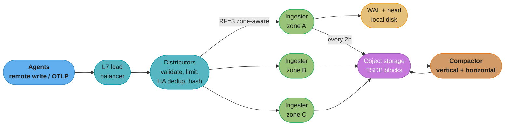
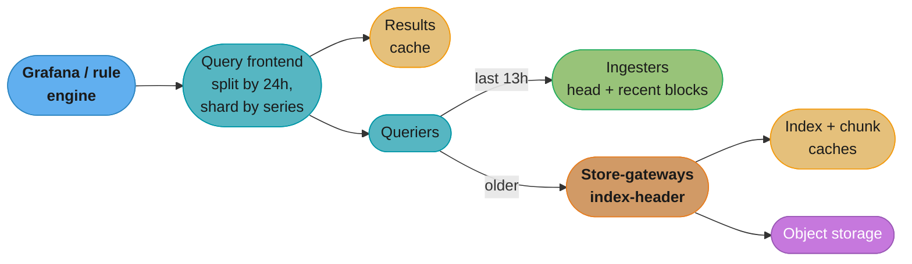
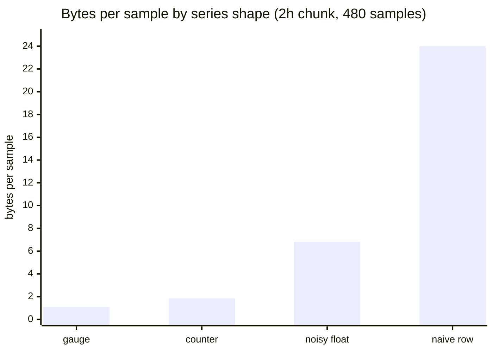
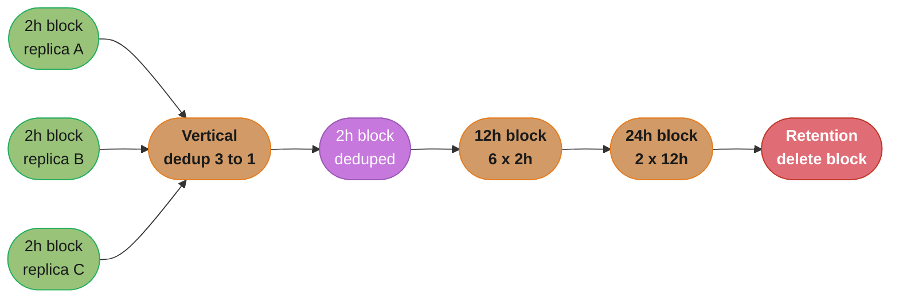

# Case Study: Design a Metrics Platform (the TSDB Layer)

## Intuition

A metrics platform looks like one database and is really two. The first is an in-memory,
append-only log per series: every 15 seconds each of 150 million series gets one more
`(timestamp, float64)` pair, and the only operation the hot path ever performs is "append to
the end of this series". The second is an immutable, columnar block store on object storage:
two-hour slices of those logs, compressed, indexed by an inverted index from label pairs to
series, and merged into larger blocks by a background compactor. Almost every hard problem in
the design lives at the seam between the two: how a sample survives a crash before it is in a
block, how three replicas of the same sample become one copy on disk, and how a query that spans
"the last 30 days" reads both halves without double counting.

The second insight is that the expensive resource is not samples, it is **series**. A sample
costs about 1.5 bytes once compressed. A series costs memory for its label set, its index
entries, its open chunk and its slot in every block index it ever appears in. A platform that
ingests 10 million samples per second comfortably can still fall over when a rolling deploy
replaces every pod label in ten minutes, because nothing about the sample rate changed and
everything about the series count did. Budget series, not samples.

This case study is the **storage-engine half** of a metrics system. The system-level design
(scrape versus push, alert rule evaluation and its `for` state machine, notification routing,
federation, the rollup tiers as a product decision) is already in
[Design a Metrics Monitoring and Alerting System](../../../hld/case_studies/design_metrics_monitoring.md),
and this page does not repeat it. Here the questions are the database ones: the head block and
its write-ahead log, the chunk codec, the postings index, block layout and compaction, the
replication and deduplication protocol, the object-storage read path, and how each of them is
sized. The engine family is covered conceptually in
[Time-Series Databases](../../time_series_databases/time_series_databases.md); the WAL and
immutable-file mechanics it borrows are in
[Storage Engines Internals](../../storage_engines_internals/storage_engines_internals.md). The
agent side (scrape configs, relabeling, recording rules) is in
[Prometheus Cardinality and Scale](../../../devops/case_studies/cross_cutting/prometheus_cardinality_and_scale.md).

---

## 1. Requirements Clarification

### Functional requirements

- Accept Prometheus remote-write and OTLP metrics from about **40,000 agents** (Prometheus
  servers in agent mode, Grafana Alloy, OpenTelemetry Collectors) across **120 internal tenants**.
- Store each sample as `(series, timestamp_ms, float64)`, where a series is a metric name plus
  a set of label pairs.
- Serve PromQL range and instant queries (label matchers `=`, `!=`, `=~`, `!~`, `rate()`,
  aggregation by label, `histogram_quantile()`) with 13 months of raw-resolution retention.
- Serve the alert-rule engine (owned by the HLD design) with data queryable within **10 seconds**.
- Deduplicate samples from **Prometheus HA pairs** (two scrapers of the same targets), so a
  `sum()` never counts a target twice.
- Enforce per-tenant limits: samples/s, active series, labels per series, label value length,
  series fetched per query.

### Non-functional requirements

- **Write availability first.** A write-path outage loses data for good, because agents buffer
  only a few hours in their own WAL. A read-path outage loses nothing. The design accepts a
  degraded read path to protect the write path.
- **No acknowledged sample is lost** on a single node crash or a single availability-zone loss.
- Query latency: p99 under **1 second** for a 6-hour dashboard panel, under **5 seconds** for a
  30-day panel over 10,000 series.
- Cost proportional to **active series and retention**, with long-term data on object storage,
  not on replicated block devices.

### Explicit non-goals

- **Not an event store.** Per-request data with unbounded identifiers (user id, trace id, order
  id) belongs in logs, traces or an analytical store such as the one in
  [Design a Real-Time Analytics Platform](../design_realtime_analytics_platform/design_realtime_analytics_platform.md).
  The platform rejects it at the distributor with label limits.
- **Not exact.** `rate()` over a window is an estimate by design, with no promise of bit-identical
  results between replicas before deduplication completes.
- **Not the alerting product.** Rule evaluation, silences and routing are consumers of this
  layer and live in the HLD design.

### Assumptions (labelled, and carried through every later section)

| Input | Value | Note |
|---|---|---|
| Active series | 150 million | Platform-wide, after HA dedup |
| Scrape interval | 15 s | Most tenants; some use 30 s or 60 s |
| Largest tenant | 64 million active series | Drives compactor and querier sizing |
| Daily series churn | 30% | Fraction of series that appear for the first time each day |
| Replication factor | 3 | Ingesters, zone-aware across 3 zones |
| Bytes per sample on disk | 1.5 | Within the 1-2 bytes Prometheus documents; §4.3 measures it |
| In-memory cost per series replica | 4 KB | Labels, postings entries, open chunk, map overhead |

---

## 2. Scale Estimation

### Sample rate and raw volume

```
active series                       = 150,000,000
samples/s   = 150,000,000 / 15 s    = 10,000,000 samples/s
samples/day = 10,000,000 x 86,400   = 864,000,000,000  (8.64e11)

chunk bytes/day (one copy) = 8.64e11 x 1.5 B   = 1.30 TB/day
13 months (395 days)       = 1.30 TB x 395     = 512 TB of chunk data on object storage
```

For comparison, the naive row `(series_id int64, ts int64, value float64)` is 24 bytes before
any row overhead, so the same day would be `8.64e11 x 24 B = 20.7 TB`. The codec in §4.3 is a
16x saving before any downsampling exists. Facebook's Gorilla paper reports the same order of
saving from the same technique: 16 bytes per point down to an average of 1.37 bytes, "a 12x
reduction".

### Write-path amplification

Every sample is written three times by the distributors (RF=3), so the ingester tier absorbs
three times the logical rate:

```
ingester samples/s  = 10M x 3             = 30M samples/s across the tier
WAL bytes/s (assume ~10 B/sample after WAL compression)
                    = 30M x 10 B          = 300 MB/s cluster-wide
per ingester (90 ingesters, §10)          = 3.3 MB/s of sequential WAL append
```

The WAL is the one sequential-write stream on the hot path, and 3.3 MB/s per node is nothing for
an NVMe or gp3 volume. Memory, not disk, is the constraint.

### Ingester memory

```
series replicas in memory = 150M x 3                 = 450M
memory at 4 KB/replica    = 450M x 4 KB              = 1.8 TB across the tier
per ingester at 5M series = 5M x 4 KB                = 20 GB working set
```

A 64 GB ingester holding 5M series leaves room for query buffers, the WAL replay peak and Go
garbage-collector headroom. The **series** count, not the sample rate, sets this number:
doubling the scrape frequency doubles the samples and changes memory by almost nothing, while
doubling the series doubles it.

### Block uploads and the index

Each ingester cuts a block every 2 hours and uploads it. Before the compactor runs, object
storage holds three copies of every chunk and three copies of every index:

```
chunk bytes uploaded/day  = 1.30 TB x 3 replicas            = 3.9 TB/day  (pre-dedup)
index per 2h block (assume ~120 B/series of symbols + postings)
                          = 150M x 120 B                    = 18 GB per 2h slice per copy
raw index uploaded/day    = 18 GB x 12 slices x 3 replicas  = 648 GB/day
after vertical compaction = 18 GB x 12 slices               = 216 GB/day
after horizontal to 24h (30% churn: 150M + 45M series in the day)
                          = 195M x 120 B                    = 23 GB/day
```

Vertical compaction (merging the three replica copies) is a 3x saving on everything. Horizontal
compaction (merging twelve 2-hour blocks into one 24-hour block) leaves chunk bytes the same and
shrinks the index by about 9x, because a series that lives all day appears once in a 24-hour
index instead of twelve times. That index saving keeps the read path cheap, and §4.5 explains
why the compactor is therefore on the critical path of query latency even though it is "only a
background job".

### Query load

```
dashboard queries   = 2,000 /s at peak       rule evaluations = 40,000 rules / 60 s = 667 /s
series per query    = p50 200, p99 50,000
```

The rule load is small in queries per second and large in freshness pressure: all 667 evaluations
per second read the newest data, which only the ingesters hold.

---

## 3. High-Level Architecture

The write path and the read path share only two things: the ingesters (which serve the last
few hours) and the object-storage bucket (which serves everything else). Everything else is
stateless and scales by replica count.


*Write path. The distributor hashes each series to three ingesters in three zones; a write is
acknowledged when two of the three succeed. Ingesters persist to a local WAL, cut 2-hour blocks
and upload them; the compactor merges the three replica copies and then merges adjacent time
ranges.*


*Read path. The frontend splits a 30-day query into 30 one-day subqueries (Mimir's default split
interval is 24 hours) and shards each by series hash, so queriers run them in parallel. Recent
data comes from ingesters, older data from store-gateways that read block indexes and chunks from
object storage through caches.*

### The life of one sample

| Step | Where | Durable? | Queryable? |
|---|---|---|---|
| 1. Agent sends a batch | Agent WAL | Yes, on the agent | No |
| 2. Distributor validates, hashes, fans out | Memory | No | No |
| 3. Two of three ingesters append and log | Ingester WAL + head | Yes (2 nodes, 2 zones) | Yes, within ms |
| 4. Head is cut to a 2h block | Ingester local disk | Yes | Yes |
| 5. Block uploaded | Object storage (3 copies) | Yes | Yes, after bucket-index refresh |
| 6. Vertical compaction | Object storage (1 copy) | Yes | Yes |
| 7. Horizontal compaction to 24h | Object storage | Yes | Yes, cheaper |
| 8. Retention expiry | Block deleted | No | No |

The ingester keeps uploaded blocks locally for a retention window (13 hours in this design) so
queriers can ask ingesters for anything not yet compacted and discovered by store-gateways.
Getting that handover window wrong is the classic gap bug of this architecture, covered in §9.

---

## 4. Component Deep Dives

### 4.1 Series identity and the hash ring

A series is identified by its full label set, `__name__` included. The distributor computes a
64-bit hash of the **canonical** form of that label set, maps the hash onto a token ring, and
walks clockwise to find three ingesters in three different zones. The same hash later decides
which query shard owns the series, so it must be stable across every component and every release.

The canonical form has two rules. Labels are sorted by name, because the wire format does not
promise an order. And name and value are joined with a separator byte that can never occur inside
a valid label, because a printable separator lets two different label sets serialize to the same
string. `0xFF` never appears in valid UTF-8, which is why it is a safe separator.

**BROKEN: hashing the label set in arrival order with a printable separator.**

```python
import hashlib

def series_id_broken(labels: dict[str, str]) -> int:
    # BROKEN 1: dict order is arrival order, so the same series hashes two ways.
    # BROKEN 2: "," and "=" may appear inside label values, so two series can collide.
    s = ",".join(f"{k}={v}" for k, v in labels.items())
    return int.from_bytes(hashlib.blake2b(s.encode(), digest_size=8).digest(), "big")

a = {"__name__": "http_requests_total", "job": "api", "instance": "10.0.0.7:9100"}
b = {"__name__": "http_requests_total", "instance": "10.0.0.7:9100", "job": "api"}
print(series_id_broken(a) == series_id_broken(b))     # False: one series, two ids

c = {"__name__": "x", "path": "/a,b=c"}
d = {"__name__": "x", "path": "/a", "b": "c"}
print(series_id_broken(c) == series_id_broken(d))     # True: two series, one id
```

The first bug is silent and expensive. Two senders (one Prometheus agent and one OTLP collector,
say) that emit the same target with labels in different orders create two series with identical
labels on two different ingesters. `sum(rate(http_requests_total[5m]))` now counts that target
twice, and the active-series count for the tenant doubles. The second bug merges two different
series into one id, which interleaves their samples into one chunk and produces counters that
`rate()` reads as constant resets.

**FIX: sort by name, separate with a byte that cannot occur in a label.**

```python
import hashlib

SEP = b"\xff"   # never valid in UTF-8, so it cannot appear inside a name or value

def canonical(labels: dict[str, str]) -> bytes:
    out = bytearray()
    for name in sorted(labels):
        out += name.encode("utf-8") + SEP + labels[name].encode("utf-8") + SEP
    return bytes(out)

def series_id(labels: dict[str, str]) -> int:
    return int.from_bytes(hashlib.blake2b(canonical(labels), digest_size=8).digest(), "big")

a = {"__name__": "http_requests_total", "job": "api", "instance": "10.0.0.7:9100"}
b = {"__name__": "http_requests_total", "instance": "10.0.0.7:9100", "job": "api"}
c = {"__name__": "x", "path": "/a,b=c"}
d = {"__name__": "x", "path": "/a", "b": "c"}
print(series_id(a) == series_id(b))   # True
print(series_id(c) == series_id(d))   # False
```

A 64-bit hash over 150 million series still has a birthday-collision probability of about
`n^2 / 2^65 = (1.5e8)^2 / 3.7e19 = 6e-4`, so the engine keys its in-memory map by hash and keeps
the full label set in the entry, comparing labels on a hash hit. The hash routes; the labels
identify.

**Ring placement.** This design gives each ingester 128 random tokens. With 90 ingesters that is
11,520 tokens, enough that no ingester owns much more than its 1/90 share of the hash space. Zone
awareness means the walk skips an ingester whose zone already holds a replica, so the three
copies always land in three zones. A write succeeds at quorum (2 of 3), which is why a single
ingester crash or a whole-zone loss costs no writes. The general theory of the ring and its
virtual nodes is in [Sharding and Partitioning](../../sharding_and_partitioning/sharding_and_partitioning.md);
the quorum arithmetic is the same `W + R > N` argument as in
[Replication and High Availability](../../replication_and_high_availability/replication_and_high_availability.md).

### 4.2 The head block and its write-ahead log

The head is the in-memory part of the TSDB. It holds a hash map from series hash to a series
entry, and each entry holds the label set, the currently open chunk, and references to older
chunks of the same series that are already full. Prometheus memory-maps full head chunks to disk
under `chunks_head/`, so a full chunk costs page cache rather than heap; only the open chunk and
the series metadata stay on the heap.

The WAL makes the head durable. Prometheus documents it plainly: the current block "is kept in
memory and is not fully persisted. It is secured against crashes by a write-ahead log (WAL) that
can be replayed when the Prometheus server restarts", stored in 128 MB segments, with at least
three segments retained. Two record types matter. **Series records** "encode the labels that
identifies a series and its unique ID", and **sample records** "encode samples as a list of
triples `(series_id, timestamp, value)`":

```
Series record  : id=0x1F3A2 labels={__name__="http_requests_total", job="api", ...}
Sample record  : [(0x1F3A2, 1764068400000, 10482.0),
                  (0x1F3A3, 1764068400000, 17.0), ...]
```

A series is logged once when it is created; every later sample record refers to it by its short
id. That is why the WAL is small per sample and why **series creation is the expensive event**: a
new series writes its whole label set to the WAL, allocates a map entry, inserts into every
postings list it belongs to, and opens a chunk.

**Checkpointing.** Each time the head is cut to a block, the WAL segments that only hold samples
now in the block can go. The series records in them cannot simply be dropped, because series
still active in the head were created in those segments. A checkpoint rewrites the surviving
series records (and any samples newer than the cut) into `checkpoint.NNNNNNNN/`, then deletes the
old segments. Replay on restart is "load the checkpoint, then replay the segments after it".

**Replay time is a capacity number.** An ingester that crashes must replay its WAL before it
rejoins the ring as `ACTIVE`; until then it serves nothing. Replay is dominated by series creation
and sample re-append, so it scales with what the head holds:

```
series in head              = 5M per ingester
series re-creation          = assume ~1.5M series/s on 16 cores   -> ~3.3 s
samples (2h at 15s)         = 5M x 480 = 2.4e9 samples
sample re-append            = assume ~25M samples/s               -> ~96 s
total                       ~ 100 s per ingester
```

The same ingester after a churn incident that tripled its series to 15M takes three times as long,
and if 15M series do not fit in memory it never finishes replaying. §9 has that incident.

**Out-of-order samples.** The head expects each series to be appended in time order. A sample
older than the newest sample already in its series is out of order. Mimir handles these with a
separate write-behind log that "records only out-of-order samples ... The WBL is used only when
out-of-order ingestion is enabled via the CLI flag `-ingester.out-of-order-time-window`". The
window is a cost dial: a 30-minute window lets late OTLP batches in, and every accepted
out-of-order sample lands in a separate chunk that the compactor merges later. A tenant that asks
for a 24-hour window is a tenant sending backfill, and backfill should arrive as uploaded blocks,
not through the write path.

### 4.3 The chunk codec: delta-of-delta timestamps and XOR floats

Inside a chunk, timestamps and values are encoded as two interleaved bit streams. The scheme is
the one in Facebook's Gorilla paper (VLDB 2015):

- **Timestamps:** store the first timestamp, then for each sample the *delta of the delta*. A
  target scraped every 15 seconds has delta 15 every time, so the delta-of-delta is 0 and costs
  one bit. Gorilla reports that "about 96% of all time stamps can be compressed to a single bit".
- **Values:** XOR each float64 with the previous one. Identical values XOR to zero and cost one
  bit; nearby values share their sign, exponent and high mantissa bits, so the XOR has long runs of
  leading and trailing zeros and only the middle "meaningful" bits are stored. Gorilla reports that
  "roughly 51% of all values are compressed to a single bit since the current and previous values
  are identical".

The codec below is executable as written. It uses a fixed linear-congruential generator instead
of `random`, so the printed output is reproducible.

```python
import struct

class BitWriter:
    def __init__(self) -> None:
        self.buf = bytearray()
        self.nbits = 0

    def write(self, value: int, bits: int) -> None:
        for i in range(bits - 1, -1, -1):
            if self.nbits % 8 == 0:
                self.buf.append(0)
            if (value >> i) & 1:
                self.buf[-1] |= 1 << (7 - self.nbits % 8)
            self.nbits += 1

def f2u(x: float) -> int:
    return struct.unpack(">Q", struct.pack(">d", x))[0]

def encode(samples: list[tuple[int, float]]) -> BitWriter:
    w = BitWriter()
    t0, v0 = samples[0]
    w.write(t0, 64)
    w.write(f2u(v0), 64)
    prev_t, prev_delta, prev_v = t0, 0, f2u(v0)
    prev_lead, prev_trail = -1, -1          # no reusable window yet
    for t, v in samples[1:]:
        delta = t - prev_t
        dod = delta - prev_delta
        if dod == 0:
            w.write(0b0, 1)
        elif -63 <= dod <= 64:
            w.write(0b10, 2);   w.write(dod & 0x7F, 7)
        elif -255 <= dod <= 256:
            w.write(0b110, 3);  w.write(dod & 0x1FF, 9)
        elif -2047 <= dod <= 2048:
            w.write(0b1110, 4); w.write(dod & 0xFFF, 12)
        else:
            w.write(0b1111, 4); w.write(dod & 0xFFFFFFFF, 32)
        prev_t, prev_delta = t, delta

        cur = f2u(v)
        x = cur ^ prev_v
        prev_v = cur
        if x == 0:
            w.write(0b0, 1)                  # value repeated: one bit
            continue
        lead = min(64 - x.bit_length(), 31)  # leading zeros fit a 5-bit field
        trail = (x & -x).bit_length() - 1
        if prev_lead >= 0 and lead >= prev_lead and trail >= prev_trail:
            w.write(0b10, 2)                 # reuse the previous window
            w.write(x >> prev_trail, 64 - prev_lead - prev_trail)
        else:
            sig = 64 - lead - trail
            w.write(0b11, 2)
            w.write(lead, 5)
            w.write(sig & 0x3F, 6)           # 64 is stored as 0
            w.write(x >> trail, sig)
            prev_lead, prev_trail = lead, trail
    return w

seed = 0
def rnd() -> float:
    global seed
    seed = (seed * 1103515245 + 12345) % 2147483648
    return seed / 2147483648

def timestamps(n: int, jitter: float) -> list[int]:
    out, t = [], 1700000000
    for _ in range(n):
        out.append(t)
        t += 15 + ((-1 if rnd() < 0.5 else 1) if rnd() < jitter else 0)
    return out

N = 480  # 2 hours at 15 s

seed = 42
c, counter = 0, []
for t in timestamps(N, 0.04):
    c += int(rnd() * 20)
    counter.append((t, float(c)))

seed = 7
g, gauge = 512 * 1024 * 1024, []
for t in timestamps(N, 0.04):
    if rnd() < 0.3:
        g += (int(rnd() * 64) - 32) * 4096
    gauge.append((t, float(g)))

seed = 9
noisy = [(t, 0.05 + rnd() * 0.01) for t in timestamps(N, 0.04)]

for name, s in [("counter", counter), ("gauge", gauge), ("noisy float", noisy)]:
    w = encode(s)
    print(f"{name:12s} {w.nbits / 8:6.0f} B  {w.nbits / 8 / N:.2f} B/sample")

# counter         886 B  1.85 B/sample
# gauge           528 B  1.10 B/sample
# noisy float    3274 B  6.82 B/sample
```

Three results, three lessons. A request counter that grows by small integers costs about 1.85
bytes per sample, because consecutive values differ in only a few mantissa bits. A memory gauge
that changes on 30% of scrapes costs 1.10 bytes. A latency gauge exported as a raw float with ten
significant digits of noise costs **6.82 bytes**, nearly 4x the counter, because the XOR of two
unrelated floats has almost no leading or trailing zeros. The documented "1-2 bytes per sample"
is a property of typical data, not of the codec, which is why the platform steers teams toward
histograms (a few counters per bucket) and away from raw latency gauges.


*The same codec spans a 6x range on realistic data; the 24-byte naive row is the
`(int64, int64, float64)` baseline from §2.*

### 4.4 The inverted index: postings lists and matcher cost

A block index maps every label pair to a **postings list**: the sorted list of series
references that carry that pair. A query selector is answered by intersecting and subtracting
postings lists, never by scanning series. This is the inverted-index idea a search engine uses,
applied to label pairs instead of words; the general structure is in
[Indexing Deep Dive](../../indexing_deep_dive/indexing_deep_dive.md).

```
postings("__name__", "http_requests_total") = [3, 7, 9, 12, 15, 21, ...]   2.1M refs
postings("job", "checkout")                 = [7, 12, 40, 41, ...]         60K refs
postings("status", "500")                   = [12, 15, 41, ...]            300K refs

{__name__="http_requests_total", job="checkout", status="500"}
  = intersect(all three)                    = [12, 41, ...]                 small
```

Intersection of sorted lists is a merge walk; the planner starts from the **shortest** list so
each pass is bounded by the running result.

```python
def intersect(*lists: list[int]) -> list[int]:
    lists = sorted(lists, key=len)          # start from the most selective list
    out = lists[0]
    for other in lists[1:]:
        i = j = 0
        merged = []
        while i < len(out) and j < len(other):
            if out[i] == other[j]:
                merged.append(out[i]); i += 1; j += 1
            elif out[i] < other[j]:
                i += 1
            else:
                j += 1
        out = merged
    return out

name   = list(range(0, 2_100_000))           # 2,100,000 refs: every series of the metric
job    = list(range(0, 2_100_000, 35))       # 60,000 refs
status = list(range(0, 2_100_000, 10))       # 210,000 refs
print(len(intersect(name, job, status)))     # 30000 (multiples of 70)
```

**Regex matchers are where the cost hides.** An equality matcher reads exactly one postings list.
A regex matcher must first scan the **label values** for that name, run the regex on each, and
union the postings of every match before any intersection starts.

**BROKEN: a dashboard variable that defaults to "match everything".**

```promql
# BROKEN: $pod expands to ".*" when the dropdown is set to "All".
sum by (pod) (rate(container_cpu_usage_seconds_total{namespace="payments", pod=~".*"}[5m]))
```

`pod=~".*"` matches every value of `pod` in every block of the range. With 30% daily churn that
is millions of pod values over 30 days, each of whose postings must be read and unioned before the
intersection with `namespace="payments"` starts. The query reads index pages for every pod in the
tenant to return the few hundred in one namespace.

**FIX: drop a matcher that does not filter, and anchor the ones that do.**

```promql
# FIX: "All" means no matcher at all, and the selective matcher drives the plan.
sum by (pod) (rate(container_cpu_usage_seconds_total{namespace="payments"}[5m]))

# When a real filter is needed, prefer a literal prefix the index can range-scan:
sum by (pod) (rate(container_cpu_usage_seconds_total{namespace="payments", pod=~"checkout-.+"}[5m]))
```

Label values are stored sorted, so a regex with a literal prefix (`checkout-.+`) can seek to the
prefix and stop when it ends; an unanchored regex (`.*checkout.*`) cannot. The platform backs this
with a per-tenant limit on series fetched per query, so a bad dashboard fails fast with a clear
error instead of taking a querier down.

### 4.5 Blocks, compaction and object storage

A block is a directory: `chunks/` (segment files, up to 512 MB each in Prometheus), `index`,
`meta.json` and `tombstones`. It is immutable once written. Deletes are tombstones applied at
compaction, and retention is enforced by deleting whole blocks, which makes retention a metadata
operation instead of a scan. The same immutable-files-plus-manifest idea underlies the table
formats in [Lakehouse and Table Formats](../../lakehouse_and_table_formats/lakehouse_and_table_formats.md).

On a single Prometheus server, compaction merges 2-hour blocks into "larger blocks containing data
spanning up to 10% of the retention time, or 31 days, whichever is smaller". The distributed
version adds a first step, because three ingesters uploaded three copies of every 2-hour slice.
Mimir's compactor documentation names the two steps:

- **Vertical compaction** "merges all the blocks of a tenant uploaded by ingesters for the same
  time range (2 hours ranges by default) into a single block. It also deduplicates samples that
  were originally written to N blocks as a result of replication."
- **Horizontal compaction** "compacts several blocks with adjacent range periods into a single
  larger block. The total size of the associated block chunks does not change after horizontal
  compaction. The horizontal compaction may significantly reduce the size of the index."


*Compaction ladder used here: 2h, 12h, 24h. Vertical compaction removes replica copies; each
horizontal step leaves chunk bytes unchanged and shrinks the index, because a long-lived series
appears once per block rather than once per 2-hour slice.*

**Very large tenants: split and merge.** A 64M-series tenant produces a 24-hour block whose index
alone is several gigabytes, and a single compaction job on it runs for hours. Mimir's
split-and-merge compactor first splits each 2-hour group into M shard blocks by series hash, then
merges each shard independently across time. Its guidance is one shard per 8 million active
series, using a power of two:

```
largest tenant: 64M active series / 8M per shard = 8 shards
typical tenant: 2M active series                  = 1 shard (split stage off)
```

Power-of-two shard counts matter for the read path: the query frontend shards queries by series
hash too, and Mimir's querier can skip compactor shards only when the query shard count evenly
divides, or is divisible by, the compactor shard count.

**Deletion is two-phase.** After a compaction, source blocks get a `deletion-mark.json` (a soft
delete) and are removed only after a deletion delay. Without the delay, a querier that had just
listed the old blocks would fetch a chunk that no longer exists and return a partial result.

**Downsampling is a separate product decision.** Thanos's compactor creates 5-minute aggregates
for blocks older than 40 hours and 1-hour aggregates for blocks older than 10 days, storing count,
sum, min, max and a counter aggregate per window. This platform keeps 13 months of raw data
instead, because the chunk bytes (512 TB) are the cheap part of object storage and the index, the
real query cost, is already shrunk by horizontal compaction. The tier argument as a product choice
lives in the HLD design.

### 4.6 The object-storage read path: index-header, bucket index and caches

A store-gateway cannot download a 23 GB index for every block a query might touch. It keeps an
**index-header** per block on local disk: the symbol table and the table of offsets where each
postings list starts. With that it can find the byte range of one postings list and issue one
ranged GET for it.

```
query: {__name__="http_requests_total", job="checkout"} over 30 days
blocks touched          = 30 (24h blocks) x 1 shard
per block:
  index-header lookup   -> 2 postings offsets            (local disk, no network)
  2 ranged GETs         -> postings lists                (index cache first)
  intersect             -> series refs
  series + chunk refs   -> ranged GETs for chunk ranges  (chunk cache first)
object GETs, cold      ~= 30 x (2 + ~40)                 = ~1,260 requests
object GETs, warm      ~= a small fraction, served from memcached
```

Three caches carry the read path: an **index cache** (postings and series entries), a **chunk
cache** (chunk byte ranges) and a **results cache** in the query frontend (whole subquery results
per day, which is why splitting by day matters: yesterday's result never changes). The caches turn
object storage from a per-query dependency into a cold-miss dependency.

The bucket index is a per-tenant file the compactor keeps current, listing live blocks and
deletion marks, so readers never `LIST` a bucket that holds tens of thousands of objects per tenant.

### 4.7 Replication, quorum reads and HA-pair deduplication

Three ingesters hold each recent series. A querier asks the replicas, merges per series, and
deduplicates identical timestamps. Mimir describes the classic read quorum: with RF=3, "a read
request succeeds if each series is successfully read from at least two ingesters". Mimir's newer
ingest-storage architecture puts Kafka partitions in front of the ingesters, so writes succeed
once committed to Kafka and each ingester catches up from its partition after a restart; that
allows a read quorum of one per partition. This design keeps the classic write path and discusses
the alternative in §5. Consistency vocabulary for these quorums is in
[Consistency Models and Consensus](../../consistency_models_and_consensus/consistency_models_and_consensus.md).

**HA pairs are a different duplicate.** Two Prometheus servers scrape the same targets for
availability, each with a `cluster` and a `__replica__` external label. Their samples differ by
the replica label, so the ring treats them as different series and every `sum()` would double.
Mimir's HA tracker "deduplicates incoming samples based on a cluster and replica label"; samples
"are considered duplicated (and thus dropped) if they are received from any replica that is not
the currently elected leader within a cluster". The leader state lives in a key-value store
(memberlist, Consul or etcd). With a 15-second scrape and default timeouts, a failover usually
loses about one scrape, which is why the documentation advises `rate()` windows of at least four
scrape intervals. This design also removes the replica label after the dedup decision, so the
stored series stays identical across a failover.

The trap is in the same documentation: if samples carry "only one or none of the cluster and
replica labels, these samples are accepted by default and never deduplicated". A replica deployed
without its external labels silently doubles a cluster's series (§9).

### 4.8 Per-tenant limits: the platform's admission control

Each limit protects a different resource, and each has a clear error surface:

| Limit | Protects | Enforced at | Error to the agent |
|---|---|---|---|
| Ingestion rate (samples/s) | Distributor and ingester CPU | Distributor, per tenant | HTTP 429 |
| Request rate | Distributor connection handling | Distributor | HTTP 429 |
| Max active series per tenant | Ingester memory | Ingester (per-ingester share) | HTTP 400, series dropped |
| Max label names per series | Index size per series | Distributor validation | HTTP 400 |
| Max label value length | Symbol table size | Distributor validation | HTTP 400 |
| Sample timestamp too far in the future | Head time range | Distributor (`create-grace-period`) | HTTP 400 |
| Max series fetched per query | Querier memory | Querier | Query error |
| Out-of-order window | Compactor merge cost | Ingester | Sample rejected |

The rate limits are local: Mimir configures each distributor with "a limit of `limit / N`, where
`N` is the number of healthy distributor replicas". That is why the write path needs an L7 load
balancer that spreads **requests**, not TCP connections. Prometheus remote write keeps connections
alive, and a Kubernetes `Service` that balances connections can pin one tenant's traffic to a few
distributors that then throttle it at a fraction of its real limit. Mimir's documentation also
notes that Prometheus remote write does not retry on HTTP 429 by default, so a throttled tenant
loses those samples unless `retry_on_http_429: true` is set on the agent.

---

## 5. Design Decisions & Tradeoffs

| Decision | Choice | Alternative | Why this choice |
|---|---|---|---|
| Storage engine | Prometheus TSDB blocks (head + WAL + immutable blocks) | Column store such as ClickHouse | Native PromQL, per-series chunk codec at about 1.5 B/sample, retention as block deletion |
| Long-term store | Object storage | Replicated block storage | One durable copy after vertical compaction instead of three replicated volumes |
| Write durability | RF=3 ingesters, quorum 2, local WAL | Kafka in front (ingest storage) | Fewer moving parts; Kafka is the upgrade path when ingester restarts keep costing read quorum |
| Series routing | Hash of canonical label set onto a token ring | Shard by metric name | Metric-name sharding puts a 2M-series metric on one node; series hashing spreads it |
| Compaction ladder | 2h, 12h, 24h | 2h up to 31 days (single-node default) | 24h blocks keep compaction jobs and index-headers bounded for a 64M-series tenant |
| Downsampling | None; 13 months raw | 5m after 40h, 1h after 10 days | Raw chunks are cheap; the index is the read cost and horizontal compaction already shrinks it |
| HA scraper dedup | Distributor HA tracker | Query-time dedup | Dedup at write halves stored series instead of paying at every query |
| Out-of-order | 30-minute window per tenant | Reject all | Late OTLP batches are normal; larger windows push cost into the compactor |

Three of these deserve the argument, not only the pick.

- **TSDB over a general column store.** A column store such as the ClickHouse design in
  [Design a Real-Time Analytics Platform](../design_realtime_analytics_platform/design_realtime_analytics_platform.md)
  wins on wide events with arbitrary `GROUP BY`. Metrics are narrow (one float per series per
  scrape) and the query is always "these series over this range". A per-series chunk compresses
  that access pattern better than a column sorted by a composite key, and the inverted index
  answers label matchers without a sort-key prefix constraint. The comparison of engine families
  is in [Analytical Databases and OLAP](../../analytical_databases_and_olap/analytical_databases_and_olap.md).
- **Classic quorum over ingest storage.** Putting a log in front of the ingesters decouples write
  availability from ingester health and lets a read touch one replica per partition. It also adds
  a Kafka cluster sized for 10M samples per second, with its own retention, partitioning and
  on-call. The classic path is the right first build; the log is the right second build once
  ingester rollouts (which cost read quorum while an ingester replays) become the main source of
  query errors.
- **No downsampling.** Downsampling cuts chunk bytes for old data by an order of magnitude, and
  chunk bytes are the cheap part. It also changes query semantics (a `rate()` over a downsampled
  counter reads the counter aggregate), and two resolutions of the same data must be kept
  consistent. When a year-over-year panel is the main long-range query, raw 24-hour blocks behind
  a results cache are simpler and exact.

---

## 6. Real-World Implementations

- **Facebook Gorilla (VLDB 2015).** The paper behind §4.3. In Spring 2015 Facebook's monitoring
  systems generated "more than 2 billion unique time series of counters, with about 12 million
  data points added per second", over 1 trillion points per day. Gorilla held the most recent
  **26 hours** in memory as a write-through cache in front of HBase, in two-hour blocks, compressed
  to an average of **1.37 bytes per point**, a 12x reduction from 16 bytes. At launch the 26-hour
  dataset "fit into 1.3TB of RAM evenly distributed across 20 machines"; the clusters later doubled
  twice to 80 machines each. Against the HBase-backed predecessor, Gorilla "provided between 73x and
  350x improvement, depending on the query size".
- **Google Monarch (VLDB 2020).** A "globally-distributed in-memory time series database" run as a
  multi-tenant service; "every second, the system ingests terabytes of time series data into memory
  and serves millions of queries". The paper credits its predecessor, Borgmon, with making
  collection of metric time series a first-class feature at Google. Monarch's regionalized
  architecture with global query and configuration planes is the same split this design makes
  between per-zone ingesters and a stateless query tier.
- **Prometheus.** The single-node engine this platform's blocks come from. Its own documentation
  says local storage "is not clustered or replicated", the gap every design in this family fills.
- **Grafana Mimir (Grafana Labs).** The reference for §4.5 to §4.8: zone-aware RF=3 ingesters with
  quorum writes, blocks uploaded every two hours, vertical then horizontal compaction,
  split-and-merge for large tenants at one shard per 8M active series, soft deletes with a
  deletion delay, a distributor HA tracker, per-distributor local rate limits, and a 24-hour
  default query split interval. Mimir also documents the ingest-storage architecture with Kafka
  partitions in front of the ingesters.
- **Thanos.** A sidecar-and-bucket design for Prometheus long-term storage, and the reference for
  the downsampling schedule in §4.5.

The platform-level view of the same systems is in
[Design an Observability Platform](../../../devops/case_studies/design_observability_platform.md).

---

## 7. Technologies & Tools

| Tool | Role in this design | Why over the alternative | Operational cost it adds |
|---|---|---|---|
| Grafana Mimir | Distributed TSDB: distributors, ingesters, compactor, store-gateways, query frontend | Prometheus-native blocks and PromQL with horizontal scale | Many components; ring health and compactor lag must be watched |
| Prometheus | Agent mode for scraping and remote write; source of the block format | The block format and PromQL are the ecosystem standard | HA pairs per cluster; WAL sizing on agents |
| Grafana Alloy | Agent for scraping plus OTLP receive | One agent for Prometheus and OTLP sources | Fleet rollout and config management |
| Amazon S3 | Block storage | Durable store with ranged GETs at low cost per TB | Request cost on cold reads; lifecycle rules for retention |
| Memcached | Index, chunk and results caches | Simple, memory-bound, sharded by the client | Cache sizing; cold-start storms after a restart |
| memberlist | Ring and HA-tracker state by gossip | No separate quorum system to run | Gossip convergence time during large rollouts |
| Kafka | Optional ingest-storage log | Decouples write availability from ingester health | A large cluster sized to the full sample rate |

---

## 8. Operational Playbook

### Metrics to dashboard (monitoring the monitoring)

| Metric | Unit | Why it matters |
|---|---|---|
| Active series per tenant and per ingester | count | The memory budget; leading indicator of OOM |
| Series created per second | series/s | Churn; a deploy storm shows here first |
| Ingester memory working set | bytes | Compare against limit; act before the OOM killer does |
| WAL replay duration on restart | seconds | Rollout speed and blast radius of a crash |
| Distributor 429 and 400 rates per tenant | req/s | Tenants hitting limits, and which limit |
| Compactor last successful run per tenant | timestamp | Compaction lag drives store-gateway cost and query latency |
| Blocks per tenant in the bucket index | count | Grows when compaction falls behind |
| Store-gateway index-header disk and memory | bytes | Grows with block count, not with data volume |
| Query frontend queue length and p99 | count, ms | Read-path saturation |
| Object storage GET rate and error rate | req/s | Cache misses and bucket throttling |

### Alert thresholds

| Condition | Level | Action |
|---|---|---|
| Ingester memory > 80% of limit for 10 min | warn | Check series created/s; find the tenant |
| Ingester memory > 90% | page | Lower that tenant's active-series limit; scale out ingesters |
| Series created/s > 5x the 7-day baseline | warn | Look for a deploy or a new high-cardinality label |
| Compactor last success > 6 h for any tenant | warn | Check compactor disk and job errors |
| Compactor last success > 24 h | page | Store-gateways will degrade within days |
| Ingesters `UNHEALTHY` in two zones at once | page | Write quorum at risk |
| Query p99 > 2x baseline for 15 min | warn | Check cache hit rate and the top tenants by series fetched |

### Runbook: series-churn storm

1. Identify the tenant with the steepest rise in series created per second.
2. List the label names with the most new values in the last hour for that tenant (Mimir's
   cardinality analysis API, or the head statistics endpoint).
3. If one label explains the rise (a pod hash, a build id, a request path), drop it at the agent
   with a relabel rule and roll out the agent config.
4. Lower the tenant's max active series to the pre-incident level plus 20%, so new series are
   rejected with 400 instead of growing memory.
5. Do not restart ingesters to "free memory". Each restart replays the bloated WAL and costs read
   quorum while it does. Wait for the next head cut, which moves the churned series out of memory.

### Runbook: compactor falling behind

1. Check compactor scratch disk: a 24-hour job for a 64M-series tenant needs the source blocks and
   the output on local disk at the same time.
2. Check job order: Mimir's default `smallest-range-oldest-blocks-first` clears the 2-hour backlog
   first, which is what store-gateways need most.
3. Raise split-and-merge shards for a tenant that has outgrown its count (one per 8M series).
4. Scale compactors; jobs are sharded by a hash ring, so new instances pick up tenants
   automatically.

### Rollout and backup

Roll ingesters one zone at a time, and wait for every ingester in the zone to report `ACTIVE`
before the next zone; one zone down keeps quorum, two do not. For backup, bucket versioning plus
the soft-delete delay protects against a compactor bug that writes a bad block. The local WAL is
not a backup: Mimir notes that the WAL and WBL "protect against data loss caused by process
restarts or failures but do not protect against disk failures", which is what RF=3 is for. The
restore-drill discipline is in
[Backup, Recovery and Disaster Recovery](../../backup_recovery_and_disaster_recovery/backup_recovery_and_disaster_recovery.md).

---

## 9. Common Pitfalls & War Stories

Figures in this section are illustrative, sized to the assumptions in §1.

**A rolling-deploy churn storm.** *Symptom:* ingester memory climbs 40% in 25 minutes with no
change in samples per second. *Root cause:* a platform team moved 3,000 services to 10-minute
canary rollouts, and every new pod brought new `pod` and `pod_template_hash` values for about 300
series each. *Fix:* drop `pod_template_hash` at the agent, aggregate per-pod series to
per-deployment with recording rules, and cap active series per tenant. *Impact:* 22 of 90
ingesters were OOM-killed; each took about 6 minutes to replay a WAL holding 3x its normal series;
read quorum was lost for 14 minutes and the rule engine missed two evaluation cycles for 40% of
rules.

**The handover gap.** *Symptom:* every 30-day dashboard showed a flat gap at roughly 12 to 14 hours
ago, only on some queries. *Root cause:* ingesters kept uploaded blocks locally for 6 hours, queriers
asked ingesters only for the last 12 hours, and store-gateways discovered new blocks only after the
next bucket-index refresh, so a 2-hour band was visible to neither side. *Fix:* keep blocks on
ingesters at least as long as the querier's ingester window plus the discovery delay. *Impact:* 2
hours of data invisible for about 45 minutes per day until the windows were aligned.

**A compactor out of disk for five days.** *Symptom:* query p99 rose from 1.2 s to 14 s over a week
with no traffic change. *Root cause:* the largest tenant's 24-hour job needed 1.4 TB of scratch disk
on a 1 TB volume and failed every run; the tenant accumulated 5 days of un-compacted 2-hour blocks
in triplicate. *Fix:* a larger scratch disk, split-and-merge with 8 shards, and an alert on compactor
last success. *Impact:* store-gateway index-header disk for that tenant grew 18x and two
store-gateways OOM-looped while loading headers.

**An "All" dashboard variable.** *Symptom:* a querier OOM every Monday at 09:00. *Root cause:* a
popular dashboard's `pod=~".*"` default (§4.4) fetched 2.3M series for a 30-day panel. *Fix:* the
"All" option now emits no matcher, and the per-query series limit is 500,000. *Impact:* each event
dropped 1 of 24 queriers and pushed the query-frontend queue past its timeout for about 3 minutes.

**A replica without its labels.** *Symptom:* one cluster's request-rate panels showed exactly twice
the load balancer's count. *Root cause:* the second Prometheus replica was deployed without the
`cluster` and `__replica__` external labels, so the HA tracker accepted its samples and never
deduplicated them (§4.7). *Fix:* validate external labels in the agent deploy pipeline. *Impact:*
2.4M extra active series for 9 days and a capacity-planning report that overstated traffic by 100%.

**A host clock two hours fast.** *Symptom:* one fleet's metrics disappeared from all dashboards.
*Root cause:* NTP had failed on those hosts, and their agents stamped samples 2 hours in the future;
the distributor rejected them as newer than the create grace period. *Fix:* alert on agent-side
timestamp skew and use scrape-time timestamps rather than client-supplied ones. *Impact:* 3 hours of
data lost for 400 hosts, because the agents' own WAL had already truncated the rejected range.

---

## 10. Capacity Planning

### Sizing table

| Tier | Shape | Count | Basis |
|---|---|---|---|
| Distributors | 4 vCPU, 8 GB | 30 | ~350K samples/s each with headroom at 10M samples/s |
| Ingesters | 16 vCPU, 64 GB, 500 GB SSD | 90 (30 per zone) | 450M series replicas / 5M per ingester |
| Queriers | 8 vCPU, 32 GB | 24 | 2,000 dashboard q/s plus 667 rule evals/s, mostly cache hits |
| Query frontends | 4 vCPU, 8 GB | 4 | Splitting, sharding, results cache |
| Store-gateways | 8 vCPU, 32 GB, 1 TB SSD | 18 (6 per zone) | Index-headers for 13 months of 24h blocks, replicated 3x |
| Compactors | 8 vCPU, 32 GB, 2 TB SSD | 12 | 3.9 TB/day in, 1.3 TB/day out, 64M-series tenant jobs |
| Memcached (chunks, index, results) | 64 GB each | 40 | Hold the hot 7 days of index and chunks |
| Object storage | S3 Standard | 1 bucket per environment | 512 TB chunks + ~9 TB index at 13 months |

### Storage arithmetic

```
chunks:  1.30 TB/day x 395 days                         = 512 TB
index:   23 GB/day x 395 days                           = 9.1 TB
pre-compaction copies (3 copies, kept ~1 day)           = +3.9 TB transient
total steady state                                      ~ 525 TB
```

### Cost model (prices left as variables)

```
monthly storage cost  = 525 TB x price_per_TB_month
monthly GET cost      = cold_GETs_per_month x price_per_1000_GETs / 1000
compute               = node_count x hours x price_per_node_hour
```

The GET line is the one teams forget. With a 90% cache hit rate, the cold 30-day query in §4.6
(about 1,260 GETs) becomes about 126 GETs. At 2,000 queries per second with 5% touching cold
ranges, the bucket sees `2,000 x 0.05 x 126 = 12,600` GETs per second, so object keys are laid out
by tenant and block to spread that load across prefixes.

### Scaling triggers

| Tier | Trigger |
|---|---|
| Ingesters | Series per ingester > 5M sustained, or memory > 75% |
| Distributors | CPU > 70% at peak, or 429s that are not tenant-limit 429s |
| Compactors | Any tenant's last success > 6 h on two consecutive days |
| Store-gateways | Index-header disk > 70%, or block-load latency rising |
| Queriers | Frontend queue time p99 > 200 ms |
| Caches | Hit rate < 85% on index or chunks |

---

## 11. Interview Discussion Points

**Q: Why is active-series count, not samples per second, the capacity number for a TSDB?**
**Short:** Memory, WAL replay time and index size all scale with series; a sample is a cheap append of about 1.5 bytes once compressed.

Each active series holds a label set, postings entries and an open chunk in memory, and series
creation is the event that writes labels to the WAL and inserts into every postings list. Adding a
sample to an existing series appends a few bits to an open chunk. Doubling the scrape rate doubles
samples and barely moves memory; doubling series doubles memory, replay time and index size.
Capacity models, tenant limits and alerts are therefore all stated in series.

**Q: How does delta-of-delta encoding make a timestamp cost one bit?**
**Short:** Scrapes arrive at a fixed interval, so the change between consecutive gaps is usually zero, which is stored as a single 0 bit.

The first timestamp is stored in full. After that the codec stores the change in the gap between
samples. A target scraped every 15 seconds has gap 15 every time, so the delta of the delta is 0
and costs one bit; a one-second jitter costs a 2-bit prefix plus 7 bits. Gorilla measured about
96% of timestamps at one bit. Client-supplied timestamps with millisecond jitter break this, which
is one reason to stamp samples at scrape time.

**Q: When does XOR float compression stop working?**
**Short:** When consecutive values are unrelated, as in a noisy float gauge, the XOR has few zero bits and each sample costs 6 to 8 bytes.

XOR compression stores only the meaningful middle bits of the XOR of two consecutive floats.
Repeated values cost 1 bit and slow counters a dozen or so bits; the codec in §4.3 measured 6.82
bytes per sample for a latency gauge with random noise in the low digits. The fix is in the data,
not the codec: export latency as a histogram of counters, and round gauges to the precision anyone
reads.

**Q: Why do label order and the separator byte matter for series identity?**
**Short:** The series id is a hash of the label set, so it must be computed over labels sorted by name with a separator that can never appear in a label.

An unsorted hash gives one series two ids when two senders order labels differently, which doubles
`sum()` and the series count. A printable separator lets `path="/a,b=c"` and `path="/a", b="c"`
serialize identically and collide. Sort by name and separate with `0xFF`, which never appears in
valid UTF-8. Keep the full label set in the map entry and compare it on a hash hit, because a
64-bit hash over 150M series has a small but real collision probability.

**Q: What do vertical and horizontal compaction each save?**
**Short:** Vertical merges the replica copies of one time range into one block; horizontal merges adjacent ranges into a longer block and mainly shrinks the index.

Three ingesters upload three copies of each 2-hour slice, so vertical compaction removes two thirds
of every byte and deduplicates samples. Horizontal compaction leaves chunk bytes unchanged but
writes each long-lived series once per block instead of once per 2-hour slice, so a 24-hour block's
index is several times smaller than the twelve 2-hour indexes it replaces. Because the read path is
dominated by index lookups, compaction lag shows up as query latency.

**Q: Why is a regex label matcher more expensive than an equality matcher?**
**Short:** Equality reads one postings list; a regex scans every value of that label, tests each, and unions all matching postings before intersecting.

The postings index is keyed by exact label pairs, so `job="api"` is one lookup. `pod=~".*api.*"`
enumerates every `pod` value in each block, which can be millions under pod churn, and unions their
lists. An anchored prefix (`checkout-.+`) can seek in the sorted value list and stop early. A
dashboard "All" option should emit no matcher, and a per-query series limit should catch the rest.

**Q: How does the platform avoid double counting Prometheus HA pairs?**
**Short:** The distributor's HA tracker elects one replica per cluster, keeps only the leader's samples, and fails over after a timeout.

Two scrapers of the same targets produce series that differ only by a replica label, so the ring
treats them as different series. The HA tracker keeps per-cluster leader state in a key-value store
and drops samples from any non-leader replica. With default timeouts a failover loses about one
scrape, so `rate()` windows should cover at least four scrape intervals. Samples missing the cluster
or replica label are accepted and never deduplicated, which is the common misconfiguration.

**Q: What happens to an acknowledged sample if an ingester crashes one second later?**
**Short:** It survives: the write was acknowledged only after two of three ingesters in two zones appended it to their WAL.

The distributor waits for quorum, so at least one other ingester holds the sample in its head and
WAL. The crashed ingester replays its WAL on restart. If its own copy is missing the last records,
the query-time merge and later vertical compaction fill them from the other replicas. A whole-zone
loss removes one replica of every series and still leaves quorum.

**Q: Why keep 13 months of raw data instead of downsampling?**
**Short:** Chunk bytes on object storage are cheap; the read cost is the index, which horizontal compaction already shrinks, and raw data keeps rate() exact.

At 1.5 bytes per sample, 13 months is about 512 TB of chunks on object storage. Downsampling would
cut that by an order of magnitude but adds a second resolution to keep consistent and changes how
`rate()` behaves on old data. If long-range queries were dominated by multi-year trends over
millions of series, 5-minute and 1-hour aggregates (as Thanos builds them) would pay for themselves.

**Q: When would you put Kafka in front of the ingesters?**
**Short:** When ingester restarts and rollouts cost read quorum often enough to matter, because a log lets writes succeed independently of ingester health.

With a log in front, distributors acknowledge after the log commit, each ingester consumes one
partition and catches up after a restart, and reads need only one healthy ingester per partition.
The cost is a Kafka cluster sized for the full sample rate, with its own retention and on-call.
Start without it; adopt it when ingester-driven read errors are the top incident class.

**Q: Why is WAL replay time an availability number and not just a startup detail?**
**Short:** A restarting ingester serves nothing until replay finishes, and replay time scales with the series and samples in its head.

During replay every series record is re-created in memory and reinserted into postings, and every
sample record is re-appended. With 5M series that is about 100 seconds; after a churn storm with
15M series it is three times longer, or it never finishes if memory runs out. During replay that
ingester is missing from every read quorum it belongs to, so rollouts go one zone at a time.

**Q: How do the TSDB layer and the HLD metrics design divide the work?**
**Short:** The HLD design owns collection, alerting and retention policy; the TSDB layer owns how samples become durable, compressed, indexed and queryable.

The HLD case study decides pull versus push, alert state machines, federation and rollup tiers as a
product choice. This layer decides the WAL and head, the chunk codec, the postings index, block
compaction, replication and dedup, the object-storage read path, and the per-tenant limits that keep
it inside its memory budget. An interview that starts at the HLD level usually descends into this
layer when it asks why the system fell over.
