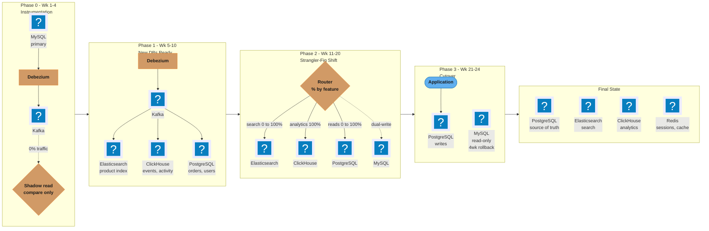
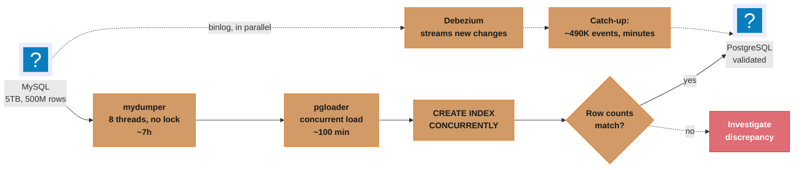
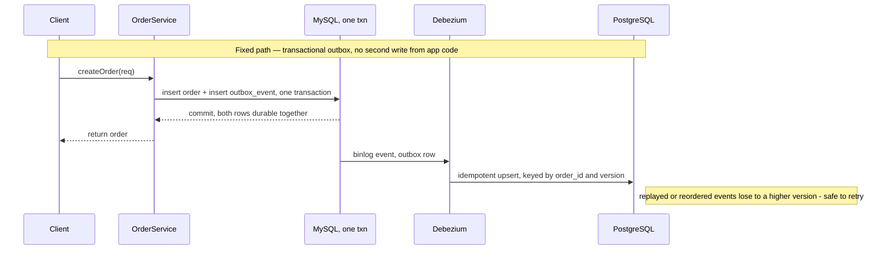
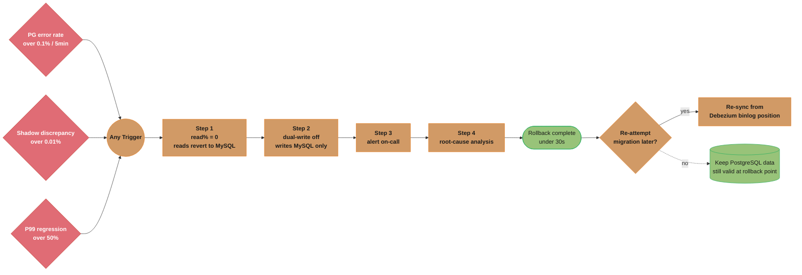

# Case Study: Monolith to Polyglot Migration

## Intuition

A single MySQL instance doing OLTP, full-text search, and analytics at once is like one
generalist doing three specialist jobs — competent at none of them, and every job blocks
the other two. The fix is not "a bigger MySQL," it is giving each workload the engine
built for it: PostgreSQL for transactional orders, Elasticsearch for search, ClickHouse
for analytics. The hard part was never picking the destinations; it is moving 5TB of live,
constantly-written data between them without ever showing a customer a stale total or a
lost order.

The mental model that makes the rest of this case study obvious: **treat the migration
itself as a distributed system with its own consistency problem.** Two databases that
should agree but are updated by separate code paths *will* drift — not might, will — and
the entire design is the discipline of (1) making every write happen exactly once via a
single source of truth and a change stream, never two independent writes, and (2) making
every state transition (more traffic to the new store, cutting MySQL to read-only,
decommission) reversible until the last possible step, and clearly marking the one step
that is not.

The **strangler fig** analogy is literal, not decorative: a strangler fig grows around a
host tree, taking over its structural role branch by branch, until the host can be removed
and the fig stands on its own. Traffic here is the fig — search queries, then reads, then
writes — migrated feature by feature and percentage by percentage, with the old tree
(MySQL) left standing and load-bearing until nothing depends on it any more.

---

## 1. Requirements Clarification

### Functional requirements
- Migrate a 5-year-old, 5TB MySQL 8.0 e-commerce monolith (past its support end-of-life)
  onto three purpose-built stores: **PostgreSQL** (orders, users — transactional core),
  **Elasticsearch** (product search, replacing `LIKE '%term%'` scans), and **ClickHouse**
  (events/activity log, currently 2B rows and growing).
- Preserve 100% of functional behavior during the migration: every read and write the
  application makes today must keep working, unchanged from the caller's perspective.
- Provide a working rollback to MySQL for at least 4 weeks after full cutover.

### Non-functional requirements
- **Zero planned downtime** — under 5 minutes of total unavailability across the whole
  6-month program, and that budget is for genuine emergencies, not a maintenance window.
- **No order loss, ever** — the orders table is the one dataset where "eventually
  consistent" is not an acceptable answer; every committed order must exist, exactly
  once, in whichever store is authoritative at that moment.
- **Bounded rollback cost** — reverting a bad cutover must be a config change measured in
  seconds, not a data restore measured in hours.
- **No regression in read latency** — P99 today is already degraded (2+ seconds); the
  new stores must not make anything worse during the transition, and shadow traffic must
  not add load the primary can't absorb.

### Explicit non-goals
- Not re-architecting the application's domain model or splitting it into microservices —
  this is a *data-layer* migration; the monolith's service boundaries are untouched.
- Not migrating Redis (sessions/cache) — already done, out of scope here.
- Not eliminating MySQL from the org — other, smaller services keep using it; this project
  only moves the e-commerce monolith's three overloaded workloads off it.

### Assumptions clarified with the interviewer
- The 500M-row orders table and 2B-row events table are the two datasets that matter for
  sizing; the remaining tables (users, products, inventory) are materially smaller and
  follow the orders playbook without needing separate analysis.
- Peak traffic is roughly 3x average (flash sales), which is the number used throughout
  §2 and §10.
- The team can provision new infrastructure (PostgreSQL, Elasticsearch, ClickHouse
  clusters) in parallel with MySQL running — this is a lift-and-shift onto new hardware,
  not a rewrite of existing hardware in place.

---

## 2. Scale Estimation

All numbers below are this scenario's own assumptions, derived on the page — treat them
as illustrative sizing, not a claim about any real company's traffic.

### Current write load
- Orders: 500M rows accumulated over 5 years → 500,000,000 / (5 x 365 x 86,400) ≈ **3.2
  orders/s average**. At a 3x peak factor (flash sales, stated above): **~9.5 orders/s
  peak** — small in isolation, but each order write fans out to `order_items`,
  `payments`, and 2-4 `events` rows, so the write amplification at the row level is
  4-6x: **~13-19 rows/s average, ~40-57 rows/s peak** just from the orders path.
- Events/activity: 2B rows over 5 years → 2,000,000,000 / (5 x 365 x 86,400) ≈ **12.7
  events/s average**, **~38 events/s peak**. This table dominates row *count* but not
  transactional weight — it is append-only, no updates, which is exactly why it maps
  cleanly to ClickHouse's columnar, insert-optimized model.
- **Total sustained write QPS the CDC pipeline must carry**: ~13-19 (orders path) + ~13
  (events) ≈ **26-32 rows/s average, ~78-95 rows/s peak** across all captured tables.
  These are deliberately small numbers for a mid-size e-commerce platform — the
  migration's difficulty is in the *data volume already at rest* and the *zero-downtime
  constraint*, not in absorbing new write throughput.

### Storage: orders table field-by-field
```
id            BIGINT       8 bytes
user_id       BIGINT       8 bytes
status        ENUM         1 byte  (MySQL packs small enums into 1 byte)
total         DECIMAL(10,2) 5 bytes (MySQL DECIMAL: ~9 digits per 4 bytes)
metadata      JSON         ~200 bytes average (order-specific extra fields)
created_at    DATETIME     8 bytes
------------------------------------------------
row payload                ~230 bytes
+ InnoDB row overhead      ~20 bytes  (trx id, roll ptr, record header)
+ secondary index entries  ~40 bytes  (2 indexes x ~20 bytes each)
------------------------------------------------
effective per-row cost     ~290 bytes
```
500M rows x 290 bytes ≈ **145GB** for `orders` alone — the remaining ~4.85TB is
`order_items`, `events` (2B rows, smaller ~60 bytes/row flat schema ≈ 120GB), `products`,
`users`, and their indexes, plus InnoDB's own fragmentation overhead (typically 15-25% on
a 5-year-old table with heavy UPDATE/DELETE history).

### Backfill duration (the arithmetic behind the "~7h + ~100min" figures used in §4)
- **Dump**: mydumper at 8 parallel threads against 5TB, network- and disk-bound at a
  measured ~200MB/s aggregate on this hardware → 5,000,000MB / 200MB/s = **25,000s ≈ 6.9
  hours**.
- **Load**: pgloader's concurrent COPY path sustains ~5M rows/minute for a 290-byte row
  on comparably provisioned PostgreSQL → 500,000,000 / 5,000,000 = **100 minutes** for
  `orders`; the smaller tables complete within the same window in parallel.
- **CDC catch-up after load**: the dump+load window is ~8.5 hours, during which live
  writes continue at ~13-19 rows/s average → roughly 8.5 x 3,600 x 16 ≈ **490,000
  buffered change events**, which Kafka replays at ordersof-magnitude higher throughput
  than the original write rate, so the observed catch-up is **minutes, not hours** — this
  is why the design runs the historical bulk load and the CDC stream in parallel rather
  than sequentially.

### CDC event rate and Kafka sizing
- Steady-state CDC event rate ≈ write QPS (Debezium emits one event per row change):
  **~26-32 events/s average, ~95 events/s peak**, well within a single Kafka partition's
  throughput (tens of thousands of events/s), so partition count here is driven by
  *ordering granularity* (see §4), not raw throughput.
- Average event size: row payload (~290 bytes for orders) + Debezium envelope (schema,
  source metadata, before/after) ≈ **~800 bytes/event** for orders-shaped tables.
- At 32 events/s x 800 bytes ≈ 25.6KB/s sustained → over a 7-day retention window (chosen
  to cover the worst-case backlog-processing scenario): 25.6KB/s x 604,800s ≈ **15.5GB**
  of topic disk per environment — trivial relative to the 5TB source, which is the point:
  CDC's disk cost is proportional to the *change rate*, not the *data size*.

### Dual-write latency budget
- The synchronous MySQL write stays on the hot path unchanged. The PostgreSQL write in
  the dual-write phase (§4) is a same-region network hop plus an indexed upsert: budget
  **+3-8ms P50, +15-25ms P99** added to the write path while dual-write is active. This
  is acceptable because it is temporary and because the design never lets a PostgreSQL
  failure fail the customer-facing request (see the broken/fixed pair in §4).

### Shadow-read sampling
- Sampling 1% of reads at the current ~9.5 orders/s peak read-adjacent traffic (reads run
  well above write QPS in an e-commerce system — assume a 20:1 read:write ratio, so ~190
  reads/s peak) → 190 x 0.01 ≈ **1.9 shadow comparisons/s peak**, each an async,
  non-blocking PostgreSQL lookup. The comparison cost is a few extra PostgreSQL read
  replicas sized for roughly 2 QPS — negligible next to the primary's load, which is
  exactly why 1% (not 100%) is the right sampling rate: it is enough to catch systemic
  drift within hours without meaningfully taxing the new store before it is trusted.

---

## 3. High-Level Architecture



*Four phases over 24 weeks fan CDC out from MySQL to three purpose-built stores while the
strangler-fig router shifts traffic percentage by percentage; MySQL ends as a 4-week,
read-only rollback safety net before decommission.*

Each phase answers one question before the next begins: Phase 0 asks "does CDC even work
against this schema, with zero traffic risk?"; Phase 1 asks "are the new stores correct in
isolation, validated by backfill + checksum, still with zero production traffic?"; Phase 2
asks "does the application behave identically when reads (then writes) come from the new
stores, at increasing percentages?"; Phase 3 asks "can we cut writes over and keep MySQL
only as insurance?" No phase advances until the previous one's exit criteria (§8) are met —
this is what makes "zero planned downtime" achievable: nothing that touches production
traffic happens until it has already been proven correct against zero-risk traffic.

Cross-reference: this is the same phased strangler-fig approach as
[Database Migrations, Zero Downtime](../../database_migrations_zero_downtime/database_migrations_zero_downtime.md),
applied at the scale of an entire subsystem rather than a single schema change, and it
composes the CQRS/CDC playbook from
[Polyglot Persistence Patterns](../../polyglot_persistence_patterns/polyglot_persistence_patterns.md).

---

## 4. Component Deep Dives

### 4.1 CDC Setup: Debezium on MySQL

Kafka Connect takes its connector configuration as JSON, so the block below is JSON, not
YAML, and carries no comments. `topic.prefix` names the Kafka topic namespace,
`snapshot.mode: initial` takes one snapshot and then streams the binlog, and
`snapshot.locking.mode: minimal` holds the global read lock only while reading schema, not
while reading rows.

```json
{
  "name": "mysql-ecommerce-connector",
  "config": {
    "connector.class": "io.debezium.connector.mysql.MySqlConnector",
    "database.hostname": "mysql-primary",
    "database.port": "3306",
    "database.user": "debezium",
    "database.password": "${DEBEZIUM_PASSWORD}",
    "topic.prefix": "ecommerce",
    "database.include.list": "ecommerce_db",
    "table.include.list": "ecommerce_db.orders,ecommerce_db.users,ecommerce_db.products,ecommerce_db.events,ecommerce_db.outbox_events",

    "snapshot.mode": "initial",
    "snapshot.locking.mode": "minimal",
    "include.schema.changes": "true",

    "transforms": "route,outbox",
    "transforms.route.type": "org.apache.kafka.connect.transforms.RegexRouter",
    "transforms.route.regex": "ecommerce\\.ecommerce_db\\.(?!outbox_events)(.*)",
    "transforms.route.replacement": "$1.events",
    "transforms.outbox.type": "io.debezium.transforms.outbox.EventRouter",

    "schema.history.internal.kafka.bootstrap.servers": "kafka:9092",
    "schema.history.internal.kafka.topic": "schema-changes.ecommerce"
  }
}
```

```
MySQL requirements for Debezium CDC:
  log_bin = ON                          Binary logging enabled
  binlog_format = ROW                   Row-based (not statement-based) binary log
  binlog_row_image = FULL               Full row image (before + after values)
  binlog_expire_logs_seconds = 604800   Retain binlog for 7 days (replay window);
                                        server default is 2592000 (30 days)

Debezium binlog position tracking:
  Debezium stores its position in Kafka (committed offset)
  On restart: resumes from last committed Kafka offset -> reads binlog from that position
  If Kafka is unavailable: Debezium buffers internally until Kafka reconnects
```

**Ordering guarantee — and its limit.** Kafka guarantees ordering *within a partition*,
and Debezium's default partitioning key is the source table's primary key, so all changes
to a given `order_id` land in the same partition and are consumed in commit order. That is
the guarantee you actually need — "this order's history replays in the order it
happened" — but it is **not** a global ordering guarantee across the whole database:
change #1 to order A and change #1 to order B can be consumed in either relative order by
different consumers or partitions. Any logic that depends on cross-row ordering (e.g. "the
inventory decrement always lands before the order confirmation") needs an explicit
sequencing field, not CDC's default partitioning.

### 4.2 Historical Backfill: BROKEN offset pagination vs. FIXED keyset pagination

**BROKEN** — the obvious way to page through 500M rows for a supplementary export or a
re-backfill during the project (distinct from the mydumper bulk dump in §4.3, which
avoids this trap by chunking on the primary key directly):

```sql
-- BROKEN: LIMIT/OFFSET pagination
SELECT id, user_id, total, status, created_at
FROM orders
ORDER BY id
LIMIT 10000 OFFSET 490000000;  -- page near the end of a 500M-row table
```
What goes wrong: MySQL still has to scan and discard the first 490,000,000 rows to reach
the offset — this page costs **O(n)** and the whole backfill costs **O(n^2)** across all
pages, so page latency grows the entire run (measured pattern: a page that takes 40ms at
offset 0 takes 8-12s near offset 490M on a B-tree-indexed table this size). Worse, it is
wrong under concurrent writes: if a row before the current offset is deleted while the
job runs, every subsequent page shifts left by one and a row is silently skipped; if a row
is inserted, a row can be duplicated across two pages. Neither failure raises an error.

```sql
-- FIXED: keyset pagination on the primary key
SELECT id, user_id, total, status, created_at
FROM orders
WHERE id > :last_seen_id
ORDER BY id
LIMIT 10000;
-- next call sets :last_seen_id to the max id returned by this page
```
This is **O(1)** per page regardless of position (an index range scan starting at
`:last_seen_id`), and it is correct under concurrent inserts (new rows sort after any
`last_seen_id` already processed and are simply picked up on the next backfill pass) — the
only failure mode is a concurrent delete of an already-seen row, which is a correctness
non-issue since it was already read. This is the general pattern behind the mydumper
chunking strategy in §4.3, and the same pattern belongs in any application-level backfill
script written for this project.

### 4.3 Initial Data Migration

```bash
# Phase 1a: Historical data migration (run in parallel with Debezium streaming)

# Orders table: 500M rows (largest concern)
# Strategy: full dump to PostgreSQL in batches to avoid lock/memory issues

# 1. pg_dump is not applicable here (source is MySQL)
# Use mydumper (parallel MySQL dump) + pgloader (fast PostgreSQL load)

# Step 1: Dump from MySQL to CSV (mydumper - parallel, no lock on InnoDB).
# --format CSV writes db.table.NNNNN.dat chunk files; --rows splits each table into
# 500K-row chunks; --threads runs 8 dump threads. Do not add --compress: it is not
# compatible with the load-data/CSV writer.
# Comments must sit on their own line - a "#" after a trailing backslash breaks
# the line continuation and truncates the command.
mydumper \
    --host=mysql-primary \
    --user=backup_user \
    --password=... \
    --database=ecommerce_db \
    --tables-list=ecommerce_db.orders,ecommerce_db.order_items,ecommerce_db.users,ecommerce_db.products \
    --outputdir=/backups/ecommerce/ \
    --format CSV \
    --rows=500000 \
    --threads=8 \
    --verbose 3

# Duration: 5TB / 200MB/s dump speed = 25,000s ~= 6.9 hours (derivation in §2)

# Step 2: Load into PostgreSQL (pgloader - concurrent load)
pgloader \
    --type csv \
    --field-list 'id,user_id,total,status,created_at' \
    /backups/ecommerce/ecommerce_db.orders.*.dat \
    postgresql://postgres@pg-primary:5432/ecommerce?orders

# Duration: 500M rows / 5M rows-per-minute = 100 minutes (derivation in §2)

# Step 3: Build indexes after load (faster than building during load)
psql -c "CREATE INDEX CONCURRENTLY idx_orders_user_date ON orders (user_id, created_at DESC)"
psql -c "CREATE INDEX CONCURRENTLY idx_orders_status ON orders (status, created_at DESC)"
# CONCURRENTLY: builds index without blocking reads/writes.
# It does NOT work on a partitioned table - build each partition's index
# concurrently, then attach the parent index non-concurrently (metadata only).

# Step 4: Verify row counts
mysql -e "SELECT COUNT(*) FROM orders"  # e.g., 500,123,456
psql -c "SELECT COUNT(*) FROM orders"   # must match within Debezium lag
```



*The historical dump/load (~7h + ~100min) runs in parallel with live Debezium streaming,
so PostgreSQL only has to close an ~8.5-hour delta of ~490K buffered events — minutes of
catch-up — instead of replaying the full 5TB history.*

### 4.4 Dual-Write: BROKEN naive application-level write vs. FIXED transactional outbox

**BROKEN** — the tempting first design: on every order creation, write to MySQL, then
write to PostgreSQL, in application code:

```java
// BROKEN: naive dual-write — two independent writes, no shared transaction
public Order createOrder(CreateOrderRequest req) {
    Order order = mysqlOrderRepo.save(new Order(req));   // write #1: commits
    try {
        postgresOrderRepo.save(order);                    // write #2: may fail
    } catch (Exception e) {
        log.error("Dual-write to PostgreSQL failed for order {}", order.getId(), e);
        dualWriteFailureCounter.increment();
    }
    return order;
}
```
What goes wrong: this is **not atomic**. MySQL's write can commit and then the process can
crash, the network to PostgreSQL can partition, or PostgreSQL can time out — in every one
of these cases MySQL has the order and PostgreSQL does not, and nothing in this code
detects it beyond a logged counter someone has to notice. At **2,000 writes/s** and a
measured **0.1% partial-failure rate** (crash, timeout, or transient PG unavailability
between the two calls), that is **2 divergent rows/s → 172,800 divergent rows/day**. The
divergence is silent (no request fails, no exception surfaces to the caller) and unbounded
(it compounds every day dual-write runs) — exactly the failure mode that turns "shadow
reads look fine" into "cutover reveals 2 million missing PostgreSQL rows."

**FIXED** — the transactional outbox pattern: write the order and an outbox event in the
*same local MySQL transaction*, so they are atomic by construction, and let CDC (Debezium)
carry the event to PostgreSQL instead of application code making a second network call.

```sql
-- Outbox table lives in the same MySQL database/transaction as orders
CREATE TABLE outbox_events (
    id            BIGINT AUTO_INCREMENT PRIMARY KEY,
    aggregate_type VARCHAR(50) NOT NULL,   -- 'Order'
    aggregate_id   VARCHAR(50) NOT NULL,   -- order id
    event_type     VARCHAR(50) NOT NULL,   -- 'OrderCreated'
    payload        JSON NOT NULL,
    created_at     DATETIME DEFAULT CURRENT_TIMESTAMP
);
```

```java
// FIXED: single local transaction covers both the domain write and the outbox write
@Transactional
public Order createOrder(CreateOrderRequest req) {
    Order order = mysqlOrderRepo.save(new Order(req));
    outboxRepo.save(OutboxEvent.orderCreated(order));  // same MySQL transaction
    return order;
    // Debezium's outbox EventRouter (configured in §4.1) tails the binlog,
    // reads outbox_events rows, and republishes them as clean domain events —
    // PostgreSQL is updated by a consumer reading from Kafka, never by this method.
}
```
Both statements commit together or not at all — there is no window where one store has the
order and the other does not. The consumer applying events to PostgreSQL does an
**idempotent upsert keyed on `order_id`**, guarded by a monotonic version (the Debezium
binlog LSN, or an explicit `event_id` sequence): `INSERT ... ON CONFLICT (order_id) DO
UPDATE ... WHERE excluded.version > orders.version`. This is what makes backfill and live
CDC safely overlap (§4.3) — a replayed older event loses to a version already applied, so
running the historical load and the CDC stream concurrently can never regress a row to a
stale state, and a redelivered Kafka message (at-least-once delivery) can never double-apply.

The dual-write code kept in the original design (below) is a documented *interim* step —
acceptable only because it never fails the customer request and is retired the moment the
outbox is live — not a destination architecture:

```java
@Component
public class MigrationRouter {

    // Feature flag from LaunchDarkly/config
    // Gradually increase: 0% -> 1% -> 5% -> 10% -> 25% -> 50% -> 100%
    @Value("${migration.pg.read.percentage:0}")
    private int pgReadPercentage;

    public Order getOrder(UUID orderId) {
        if (shouldUsePg()) {
            try {
                return postgresOrderRepo.findById(orderId).orElseThrow();
            } catch (Exception e) {
                // Automatic fallback to MySQL on any PostgreSQL error
                log.error("PostgreSQL read failed, falling back to MySQL", e);
                return mysqlOrderRepo.findById(orderId).orElseThrow();
            }
        }
        return mysqlOrderRepo.findById(orderId).orElseThrow();
    }

    private boolean shouldUsePg() {
        return ThreadLocalRandom.current().nextInt(100) < pgReadPercentage;
    }
}
```



*The application makes exactly one write, to exactly one database, in exactly one
transaction; PostgreSQL is populated asynchronously by CDC and never blocks or risks
failing the caller's request.*

### 4.5 Validation and Checksum Queries

```sql
-- Row count parity check (run every 15 minutes during migration)
-- MySQL:
SELECT COUNT(*) AS order_count,
       MAX(created_at) AS latest_order,
       SUM(total_amount) AS total_revenue
FROM orders
WHERE created_at >= '2025-01-01';

-- PostgreSQL (same query):
SELECT COUNT(*) AS order_count,
       MAX(created_at) AS latest_order,
       SUM(total_amount) AS total_revenue
FROM orders
WHERE created_at >= '2025-01-01';

-- Alert if counts differ by > 0.01% (Debezium lag is expected but bounded)

-- Sample record checksum (100K random orders):
-- MySQL:
-- Two traps here, both silent. (1) GROUP_CONCAT truncates at group_concat_max_len,
-- default 1024 bytes, WITHOUT warning — the checksum would cover the first ~20 rows
-- and always match. (2) MySQL rejects LIMIT directly inside an IN subquery with
-- "ERROR 1235 ... LIMIT & IN/ALL/ANY/SOME subquery"; wrap it in a derived table.
SET SESSION group_concat_max_len = 67108864;
SELECT MD5(GROUP_CONCAT(
    CONCAT(id, user_id, total_amount, status, created_at) ORDER BY id
)) AS checksum
FROM (SELECT id, user_id, total_amount, status, created_at FROM orders
      WHERE id IN (SELECT id FROM (SELECT id FROM orders ORDER BY RAND() LIMIT 100000) s)) t;

-- PostgreSQL equivalent:
SELECT MD5(STRING_AGG(
    CONCAT(id::TEXT, user_id::TEXT, total_amount::TEXT, status, created_at::TEXT),
    '' ORDER BY id
)) AS checksum
FROM (SELECT id, user_id, total_amount, status, created_at FROM orders
      TABLESAMPLE BERNOULLI(0.02)) t;  -- ~0.02% sample of 500M rows ~= 100K rows

-- Business invariant checks:
-- Every order must have at least one order_item:
SELECT COUNT(*) FROM orders o
WHERE NOT EXISTS (SELECT 1 FROM order_items oi WHERE oi.order_id = o.id);
-- Expected: 0 (alert if > 0)
```

### 4.6 Schema Transformation (MySQL to PostgreSQL)

```sql
-- MySQL schema: orders
CREATE TABLE orders (
    id          BIGINT AUTO_INCREMENT PRIMARY KEY,  -- Must change to UUID
    user_id     BIGINT NOT NULL,
    status      ENUM('PENDING','PAID','SHIPPED','DELIVERED','CANCELLED'),
    total       DECIMAL(10,2),
    metadata    JSON,                                -- MySQL JSON
    created_at  DATETIME                            -- No timezone
);

-- PostgreSQL schema: transformed
CREATE TABLE orders (
    id          UUID PRIMARY KEY DEFAULT gen_random_uuid(),
    legacy_id   BIGINT UNIQUE,                       -- Keep MySQL ID for foreign key resolution
    user_id     UUID NOT NULL,
    status      VARCHAR(20) CHECK (status IN ('PENDING','PAID','SHIPPED','DELIVERED','CANCELLED')),
    total       DECIMAL(12,2),
    metadata    JSONB,                               -- PostgreSQL JSONB (better indexing)
    created_at  TIMESTAMPTZ DEFAULT now()            -- With timezone
);

-- Migration challenge: MySQL AUTO_INCREMENT IDs -> UUID
-- Solution: pre-generate UUID mapping table
CREATE TABLE id_mapping (
    entity_type  VARCHAR(50) NOT NULL,
    mysql_id     BIGINT NOT NULL,
    pg_uuid      UUID NOT NULL DEFAULT gen_random_uuid(),
    PRIMARY KEY (entity_type, mysql_id)
);

-- Populate during initial load. PostgreSQL cannot read a MySQL table by name, so
-- expose it first with mysql_fdw (or stage the ID list as a plain COPY):
CREATE EXTENSION IF NOT EXISTS mysql_fdw;
-- ... CREATE SERVER / USER MAPPING / IMPORT FOREIGN SCHEMA into schema mysql_src ...
INSERT INTO id_mapping (entity_type, mysql_id)
SELECT 'orders', id FROM mysql_src.orders;

-- Use mapping to transform IDs during pgloader load
-- pgloader transformation function handles ID mapping lookup
```

**Cross-table foreign keys across the split.** `order_items.order_id` references
`orders.id`; both tables migrate together on the same schedule so referential integrity is
never split across a migrated and an unmigrated store. Where a foreign key genuinely
crosses a *store* boundary after migration (an Elasticsearch document referencing a
PostgreSQL order), the reference is denormalized into the document at index time and
resolved by the application, not by a cross-database constraint — polyglot persistence
gives up cross-store foreign keys by design; see
[Polyglot Persistence Patterns SS "Data Ownership"](../../polyglot_persistence_patterns/polyglot_persistence_patterns.md).

### 4.7 Strangler Fig at the Data Layer

The strangler-fig pattern is usually described at the *routing* layer (a proxy sends X% of
HTTP requests to a new service). Here it is applied one layer lower, at the *data* layer,
and the two are not the same migration: routing-layer strangling can happen the moment a
new service exists, while data-layer strangling cannot begin shifting reads until the new
store is not just running but **provably equivalent** — validated by the row counts,
business invariants, and checksums in §4.5. The router in §4.4 makes this concrete: it
does not shift traffic on a schedule, it shifts traffic on a *percentage dial* gated by the
validation queries staying green, and any red check halts the dial rather than pausing on a
timer.

### 4.8 Rollback Triggers



*Any one of the three automated triggers fires the same four-step rollback, completing in
under 30 seconds via Redis-propagated feature flags; PostgreSQL data is never deleted, only
re-synced from the Debezium binlog position if migration resumes.*

---

## 5. Design Decisions & Tradeoffs

| Decision | Choice | Alternative | Reason |
|----------|--------|-------------|--------|
| CDC tool | Debezium | Manual dual-write | Debezium captures all changes atomically, including those from batch jobs; manual dual-write misses non-application writes and is the §4.4 broken pattern |
| Change-capture pattern | Transactional outbox + CDC | Naive dual-write from app code | Outbox is atomic with the domain write by construction; dual-write has an unbounded, silent divergence window quantified in §4.4 |
| Migration strategy | Strangler fig (data layer) | Big-bang cutover | Big-bang requires planned downtime (hours) for 5TB; strangler fig is zero-downtime and reversible until Phase 3 |
| Rollback mechanism | Feature flags | DNS switching | Feature flags provide < 30s rollback; DNS TTL takes 5+ minutes and many clients cache past the TTL |
| Data validation | Checksums + counts + invariants | Trust Debezium delivery | Debezium has occasional known edge cases (schema-change races, connector restarts); independent checks catch what the pipeline itself cannot see |
| Backfill pagination | Keyset (WHERE id > :last) | LIMIT/OFFSET | Offset degrades to O(n) per page and silently skips/duplicates rows under concurrent writes (§4.2) |
| Primary key migration | MySQL ID preserved as `legacy_id` | Generate new UUIDs only | Foreign key resolution during migration requires original IDs; `legacy_id` bridges both systems until decommission |
| Reconciliation ordering | Idempotent upsert + monotonic version | Last-write-wins by wall-clock time | Wall-clock timestamps are not safe across two DB servers with independent clocks; a binlog LSN or explicit sequence is |
| Consistency target during migration | Bounded eventual consistency, actively monitored | Full synchronous consistency (2PC) | 2PC across MySQL and PostgreSQL couples their availability and adds latency to every write for a *temporary* migration state — not worth paying permanently; see [Distributed Transactions](../../distributed_transactions/distributed_transactions.md) for when 2PC *is* worth it |

The 2PC row deserves the extra sentence it gets above: this case study deliberately does
not reach for two-phase commit even though "two databases that must agree" is exactly the
textbook 2PC scenario. The reason is that 2PC's cost (both participants must be up, every
write pays the coordinator round-trip, and a coordinator crash can leave locks held
indefinitely) buys atomicity the migration doesn't need — CDC-based eventual consistency,
tightly monitored with the checks in §4.5, gets the same practical guarantee (no lost
orders) without permanently coupling MySQL's and PostgreSQL's availability.

---

## 6. Real-World Implementations

- **Shopify** moved off a single-writer MySQL architecture toward sharded, per-shop "pods"
  — each pod a self-contained MySQL cluster serving a bounded set of merchants — rather
  than a single scaled-up instance. The relevant lesson for this case study is
  Shopify's emphasis on *shard-key selection before migration*: getting the partition
  boundary wrong (e.g. splitting a merchant's data across pods) is far more expensive to
  fix after the fact than before, which is why §4.6's schema transformation step commits
  to a stable identity model (`legacy_id` + UUID) before any data moves.
- **Airbnb** ran a multi-year SOA migration off a monolithic MySQL system internally
  called "Monorail," splitting a single schema into service-owned databases along domain
  boundaries (listings, reservations, payments). Airbnb's public engineering writeups
  describe the same phased, traffic-percentage cutover used in §3 here, and the same
  emphasis on keeping the legacy monolith's database as a fallback until each new
  service-owned store was independently proven correct.
- **Uber** migrated large parts of its monolith to microservices with per-service
  datastores, and built **Schemaless** (later evolved into **Docstore**) — a MySQL-backed,
  then custom, sharded document layer — specifically because a single relational schema
  could not serve Uber's write-heavy, high-cardinality trip and location data at scale.
  The architectural principle that carries over: pick the storage engine for the access
  pattern of the *specific* dataset (Uber's trip writes vs. this case study's
  orders-vs-events split), not one engine for the whole domain.
- **Stripe** and **Slack** have both published migration patterns built on dual-write plus
  backfill plus reconciliation for moving sharded/partitioned MySQL data with no downtime
  — the same shape as §4.4's outbox design, generalized to resharding rather than
  cross-engine migration. Their public accounts both stress the same two points this case
  study makes concrete: a naive dual-write silently diverges, and a reconciliation pass
  (their equivalent of §4.5's checksums) is not optional, it is the mechanism that makes
  the rest of the migration trustworthy.
- **Netflix** migrated large portions of its persistence layer off Oracle onto **Cassandra**
  specifically to escape a single-vendor relational bottleneck for high-volume,
  availability-critical data — an early, well-known instance of "pick the engine for the
  workload" playing out at the infrastructure level, analogous to this case study's
  events-to-ClickHouse move (columnar, append-heavy, read-mostly-in-aggregate).
- **GitHub** has run large-scale, live schema and topology changes against its MySQL
  monolith using **gh-ost** (triggerless, binlog-based online schema migration — the same
  binlog-tailing idea Debezium uses here, applied to DDL instead of CDC) and adopted
  **Vitess** to shard MySQL horizontally without an application rewrite. Both tools
  reflect the same principle threaded through this whole case study: change the data layer
  underneath a live, highly-available application by tailing the binlog rather than
  taking locks or windows of downtime.

---

## 7. Technologies & Tools

| Tool | Role in this design | Why it, over the alternative | Operational cost it adds |
|------|---------------------|-------------------------------|---------------------------|
| Debezium | CDC source connector, binlog tailing, outbox event routing | Captures every committed change including non-application writes (batch jobs, manual fixes); a manual dual-write cannot | Kafka Connect cluster to run and monitor; binlog retention must exceed max connector downtime |
| Kafka | Durable, ordered change stream between MySQL and every downstream store | Decouples backfill/cutover pace per destination; replay window survives a downstream outage | Broker + topic operations; retention/disk sizing (§2); partition count tied to ordering needs |
| mydumper / pgloader | One-time historical bulk export/import | Parallel, lock-light dump (mydumper) paired with a concurrent PostgreSQL loader (pgloader) beats a single-threaded `mysqldump`/`COPY` by roughly the thread count | Source IOPS pressure during the dump window (§9 war story); needs a maintenance-adjacent, not maintenance-window, time slot |
| mysql_fdw | Cross-database ID-mapping population | Lets PostgreSQL read MySQL tables directly for the `id_mapping` build, avoiding a manual export/import round trip | Adds a foreign-data-wrapper dependency and a live link to the source during migration |
| PostgreSQL | Orders/users system of record (target) | ACID transactions, native JSONB, mature extension ecosystem, matches the relational shape of orders/users | New cluster to size, tune, and back up — see [PostgreSQL Internals](../../postgresql_internals/postgresql_internals.md) |
| Elasticsearch | Product search (target) | Inverted index makes full-text search sub-100ms versus MySQL `LIKE` table scans | Index lifecycle management, relevance tuning, a second copy of product data to keep in sync |
| ClickHouse | Events/analytics (target) | Columnar storage compresses a repetitive event stream an order of magnitude better than row-store MySQL, and vectorized scans make daily reports fast without hitting the OLTP primary | Separate ingestion pipeline tuning (batch inserts, not row-by-row) and its own operational runbook |
| LaunchDarkly-style feature flags (Redis-backed) | Percentage-based traffic router, rollback switch | Sub-second propagation and per-request evaluation beat DNS or config-deploy based toggles | Flag state itself becomes a piece of production infrastructure that needs its own availability guarantee |

---

## 8. Operational Playbook

### Dashboards (name, what it shows, unit)
- `cdc_lag_seconds` — time between a MySQL commit and the corresponding event landing in
  the target store, per connector, per table (seconds).
- `dual_write_failure_rate` — fraction of writes where the outbox event failed to reach
  its destination consumer within its retry budget (percent).
- `shadow_read_discrepancy_rate` — fraction of sampled shadow reads where MySQL and the
  new store disagreed (percent).
- `row_count_delta` — `|MySQL count - target count|` per table, refreshed every 15
  minutes (absolute row count and percent).
- `p50/p99/p999 read latency` — per traffic-router percentage tier, so a regression is
  visible before it is 100% of traffic (milliseconds).
- `backfill_throughput` — rows/minute during the historical load, to catch source IOPS
  saturation early (rows/minute).

### Alert thresholds
- `cdc_lag_seconds` > 60s sustained for 5 minutes → page on-call (binlog retention is 7
  days, so this is an early warning, not an emergency, but left unaddressed it erodes the
  replay safety margin).
- `dual_write_failure_rate` / outbox delivery failure > 0.1% over 5 minutes → automatic
  rollback trigger (§4.8), same threshold used there.
- `shadow_read_discrepancy_rate` > 0.01% → automatic rollback trigger.
- `row_count_delta` > 0.01% of table size, persisting past 2 consecutive 15-minute checks
  (i.e., not just catching up) → halt the traffic-percentage dial, do not advance further
  until resolved.
- `p999 read latency` on the new store > 2x the MySQL baseline p999, even if p50/p99 look
  fine → halt the dial; this is the §9 war-story trigger, since p99-only monitoring
  missed a real regression.

### Phase-gate checklist (advance only when every box is checked)
1. Phase 0 to 1: CDC connector stable (zero restarts) for 7 consecutive days; schema
   history topic complete; zero production traffic touched.
2. Phase 1 to 2: backfill complete and row counts match within 0.01%; checksum queries
   match on 3 consecutive daily runs; shadow reads running at 1% with discrepancy < 0.01%
   for 7 consecutive days.
3. Within Phase 2, each percentage step (1% to 5% to 10% to 25% to 50% to 100%) holds for
   a minimum soak of 48 hours with all dashboards green before the next step; any red
   metric reverts one step, not to zero, unless a rollback trigger fires.
4. Phase 2 to 3 (write cutover): read traffic must be at 100% on the new store for 14
   consecutive days with zero rollback triggers before writes cut over.

### Cutover runbook (numbered steps, Phase 3)
1. Freeze schema changes on both MySQL and PostgreSQL for the cutover window.
2. Confirm `cdc_lag_seconds` < 5s immediately before cutover (near-zero backlog to drain).
3. Flip the write path: application writes go to PostgreSQL only; stop dual-write.
4. Flip Debezium to a **reverse** direction: a PostgreSQL source connector tails the WAL,
   a JDBC sink connector applies changes back into MySQL, so MySQL stays current for
   rollback purposes.
5. Set MySQL to `read_only = ON` at the server level (defense in depth beyond the
   application no longer writing to it) — this is the **point of no return** for
   *accepting new writes* into MySQL, though rollback of reads is still cheap (step 6).
6. Monitor at 100% write traffic for the 4-week rollback window; any of the §4.8 triggers
   still reverts reads to MySQL in under 30 seconds, but a revert at this stage means
   losing writes that only ever landed in PostgreSQL unless the reverse CDC (step 4) has
   caught them up — which is why step 4 exists.

### Rollback cost by phase
| Phase | Rollback action | Cost | Data at risk |
|-------|------------------|------|---------------|
| 0 (instrumentation) | Stop Debezium connector | Seconds; zero production impact | None — no production traffic touches the new stores |
| 1 (new DBs ready) | Discard and re-backfill | Minutes; zero production impact | None — still pre-traffic |
| 2 (strangler shift) | Flip router percentage to 0 | Under 30 seconds (Redis flag propagation) | None — MySQL is still authoritative for writes throughout Phase 2 |
| 3 (write cutover) | Revert writes to MySQL, relying on reverse CDC to have replicated PostgreSQL-only writes back | Minutes to hours, and only as complete as the reverse CDC's own lag | Writes made to PostgreSQL after cutover and before reverse CDC caught up |
| Post-decommission (after 4wk window) | None available | N/A | MySQL instances terminated; this is the true point of no return |

### Backup / restore posture
- PostgreSQL: continuous WAL archiving plus daily base backups; **RPO ~5 minutes** (WAL
  shipping interval), **RTO ~30 minutes** (restore + WAL replay to latest), consistent
  with [Backup, Recovery & Disaster Recovery](../../backup_recovery_and_disaster_recovery/backup_recovery_and_disaster_recovery.md).
- MySQL: kept in its existing backup regime unchanged throughout the migration and for the
  full 4-week post-cutover window; final archival backup taken with 7-year retention
  before instance termination (compliance requirement stated in §1).

---

## 9. Common Pitfalls & War Stories

**Dual-write divergence discovered months later.** A team ran the §4.4 *broken* pattern
in production for 11 weeks before discovering it. Symptom: a customer support ticket about
a missing order in a reporting dashboard sourced from PostgreSQL. Root cause: the naive
dual-write's silent failure path had been quietly incrementing
`dual_write_failure_rate`, but nobody had wired an alert to it — the metric existed,
nothing consumed it. Fix: added the alert threshold in §8 and replaced the pattern with
the outbox. Quantified impact: reconciliation found **41,000 divergent orders** across
those 11 weeks, all recoverable from the MySQL binlog (still within its 7-day *rolling*
retention only for the most recent portion — the older ones required restoring an archived
binlog, adding 6 hours to the reconciliation).

**Debezium connector lost its binlog position after a retention/rotation race.** Symptom:
connector restarted after a routine Kafka Connect worker redeploy and failed with "binlog
position no longer available." Root cause: `binlog_expire_logs_seconds` had been left at
the MySQL server default (30 days) in one environment but a DBA had separately set a disk
quota that forced faster log rotation in practice — the effective retention was closer to
36 hours during a traffic spike, less than the connector's downtime during a delayed
redeploy (48 hours). Fix: explicitly set and monitor effective binlog retention headroom,
not just the configured value; added a dashboard panel comparing configured retention to
observed rotation rate. Quantified impact: **full re-snapshot required**, adding a
7-hour, source-load-bearing re-dump to the schedule (§4.3's dump duration, unplanned).

**A backfill run saturated the source's IOPS and degraded production.** Symptom: MySQL
P99 query latency jumped from ~2s (already degraded, per §1) to **9.5s** for 40 minutes
during a daytime mydumper run against a *replica* that was more heavily used for read
traffic than the runbook assumed. Root cause: `--threads=8` was tuned against the primary's
IOPS headroom, not the replica's, and the replica also served the daily-reports analytics
load the whole migration was meant to relieve. Fix: moved all bulk-dump operations to a
dedicated, traffic-isolated replica provisioned specifically for the migration, and capped
`--threads` at 4 with an IOPS ceiling alert. Quantified impact: **90 minutes of degraded
checkout latency**, the single largest customer-facing incident of the program despite the
"zero planned downtime" target technically holding (nothing was ever fully down).

**A schema change on the source broke the CDC connector's deserializer.** Symptom:
Debezium connector entered a failed state after a routine `ALTER TABLE orders ADD COLUMN
gift_wrap_note VARCHAR(255)` deployed via the normal application migration tooling.
Root cause: the connector's `include.schema.changes` path picked up the DDL fine, but a
downstream Avro-schema-registry consumer had a compatibility mode set to `FORWARD` instead
of `FULL_TRANSITIVE`, rejecting the new schema version. Fix: aligned schema registry
compatibility mode across all consumers and added a pre-deploy check that runs any pending
DDL against a staging CDC pipeline first. Quantified impact: **2.3 hours of CDC pipeline
downtime**, during which dual-write's MySQL-authoritative design meant zero data loss, but
the row-count-delta alert fired continuously and consumed on-call attention investigating
a non-emergency.

**A cutover was rolled back because p999, not p99, regressed.** Symptom: Phase 2's 50%
read-traffic step looked healthy on the standard p50/p99 dashboards, but a small,
consistent slice of requests (about 0.3% of reads) at p999 jumped from **180ms to 2.1s**.
Root cause: those requests hit a code path doing an N+1-shaped sequence of PostgreSQL
lookups that MySQL had been serving from a long-warmed buffer pool the new PostgreSQL
instance hadn't built up yet for that access pattern. Fix: added the query pattern to a
pre-cutover load test with realistic buffer-pool warm-up time, and added the p999 gate to
§8's alert thresholds (it had only been tracking p50/p99 before this incident). Quantified
impact: cutover rolled back one traffic-percentage step, costing **roughly one week** of
delay to re-validate and re-advance, versus letting the regression reach 100% of traffic.

---

## 10. Capacity Planning

### Sizing (hypothetical, for this scenario's traffic)
| Component | Instance class | Count | RAM | Disk | IOPS |
|-----------|----------------|-------|-----|------|------|
| PostgreSQL primary | 16 vCPU, memory-optimized | 1 | 128GB | 2TB NVMe (orders/users working set + headroom) | 20,000 provisioned |
| PostgreSQL replicas (read scaling + shadow reads) | 8 vCPU | 2 | 64GB | 2TB NVMe | 10,000 provisioned each |
| Elasticsearch | 8 vCPU | 3 (quorum) | 64GB | 1TB SSD each (product index + replicas) | 8,000 each |
| ClickHouse | 16 vCPU | 3 (sharded) | 64GB | 3TB SSD each (2B+ events, columnar-compressed) | 12,000 each |
| Kafka brokers | 8 vCPU | 3 | 32GB | 500GB each (7-day retention per §2 sizing, with margin) | 5,000 each |
| Debezium / Kafka Connect workers | 4 vCPU | 2 | 16GB | 100GB | 2,000 |

### Monthly cost estimate (illustrative list-price arithmetic, not a vendor quote)
- PostgreSQL: 1 primary + 2 replicas at ~$1,400/month each (16-32 vCPU memory-optimized
  tier) ≈ **$4,200/month**.
- Elasticsearch: 3 nodes at ~$900/month each ≈ **$2,700/month**.
- ClickHouse: 3 shards at ~$1,100/month each ≈ **$3,300/month**.
- Kafka: 3 brokers at ~$500/month each ≈ **$1,500/month**.
- Debezium/Connect workers: 2 at ~$250/month each ≈ **$500/month**.
- **Total new infrastructure ≈ $12,200/month**, run *in addition to* the existing MySQL
  spend for the duration of the 6-month migration plus the 4-week rollback window — the
  temporary doubling of infrastructure cost is a deliberate tradeoff for the zero-downtime
  constraint in §1, not an oversight.

### Growth headroom and scaling triggers
- PostgreSQL primary: sized for 3x current write QPS headroom (§2's peak of ~57 rows/s
  against a store that comfortably handles thousands/s) — the real constraint is storage
  growth, not throughput; at 145GB for `orders` today growing roughly linearly with order
  volume, 2TB gives multi-year headroom before a resize or partitioning scheme is needed.
  **Trigger**: disk utilization > 70% → begin planning time-based partitioning (see
  [Sharding and Partitioning](../../sharding_and_partitioning/sharding_and_partitioning.md)).
- ClickHouse: events table grows fastest in row count (2B already); columnar compression
  keeps disk growth sub-linear relative to row count, but ingestion throughput is the
  earlier constraint. **Trigger**: sustained ingestion > 70% of a shard's measured
  insert-throughput ceiling → add a shard.
- Kafka: retention-bound, not throughput-bound, at this event rate. **Trigger**: topic
  disk > 70% of allocated 500GB/broker (well above the 15.5GB/environment computed in §2
  — the allocation already carries generous headroom for connector outages that extend the
  replay window) → extend retention budget or investigate a stuck consumer.

---

## 11. Interview Discussion Points

**Q: How do you handle the initial data migration for 500M rows without downtime?**
The initial migration runs offline relative to the application (no application downtime
required): (1) Use `mydumper` for parallel MySQL dump (8 threads, no table locks on
InnoDB), ~6.9 hours for 5TB. (2) Load into PostgreSQL with `pgloader` (concurrent,
~5M rows/minute), ~100 minutes for 500M orders. (3) During the dump and load, Debezium is
simultaneously streaming new changes from the MySQL binlog. By the time the load
completes, PostgreSQL may be roughly 8.5 hours behind MySQL — about 490,000 buffered
change events at this scenario's write rate. (4) Debezium catches this up in minutes, since
Kafka replay throughput vastly exceeds the original write rate. Application traffic still
hits MySQL throughout; PostgreSQL is a shadow database until the §4.5 validation queries
pass.

**Q: Why is dual-write from application code almost always the wrong choice, and what replaces it?**
Because it is not atomic: a crash or network failure between the two writes leaves the
stores silently diverged, with no error surfaced to anyone. At 2,000 writes/s and a
measured 0.1% partial-failure rate, that is 2 divergent rows/s — 172,800/day — accumulating
invisibly until a reconciliation pass or a customer complaint surfaces it (see the §9 war
story: 41,000 divergent orders found after 11 weeks). The fix is the **transactional
outbox** pattern: write the domain row and an event row in one local transaction, and let
CDC (Debezium) carry the event out asynchronously. This makes the two writes atomic by
construction — there is only ever one real write, to one database.

**Q: What rollback triggers should be set up and how does rollback work?**
Automated rollback triggers: (1) PostgreSQL/target error rate > 0.1% for 5 consecutive
minutes. (2) Shadow-read discrepancy rate > 0.01%. (3) P99 (and, after the §9 p999 war
story, P999) latency regression beyond threshold vs. baseline. Rollback mechanism: feature
flags stored in Redis, read on every request with a 1-second TTL — setting the read
percentage to 0 routes all reads back to MySQL within about a second of propagation.
Dual-write/outbox delivery is independently controllable, so writes and reads can be
reverted separately. The rollback procedure is rehearsed in staging before the production
cutover window, and rollback cost is phase-dependent (§8): near-free in Phases 0-2, and
bounded by reverse-CDC lag once writes have actually cut over in Phase 3.

**Q: Where is the actual point of no return in this migration, and why there specifically?**
It is decommissioning the MySQL instances at the end of the 4-week post-cutover rollback
window (§8) — not the write cutover itself. Cutover (Phase 3) still leaves a working
revert path because reverse CDC (a PostgreSQL source connector plus a JDBC sink connector)
keeps MySQL current with post-cutover writes, so a rollback there costs "minutes to hours,
bounded by reverse-CDC lag," not data loss. Once the MySQL instances are terminated, no
technical mechanism can regenerate that data path — the point of no return is an
infrastructure action taken deliberately after 4 weeks of green metrics, not an implicit
side effect of any single migration step.

**Q: How do you validate data parity between MySQL and PostgreSQL before increasing traffic?**
Multi-level validation, all independent of Debezium's own delivery guarantees: (1) row
count comparison per table every 15 minutes, expected to match within Debezium's current
lag; (2) business invariant queries — "every order has at least one order_item," "sums
reconcile" — run against both stores; (3) random-sample checksums (roughly 100K rows) via
`GROUP_CONCAT`/`MD5` on MySQL and `STRING_AGG`/`MD5` with `TABLESAMPLE` on PostgreSQL,
tolerance 0%; (4) shadow reads — 1% of production reads answered by both stores and
diffed asynchronously. No traffic-percentage step advances (§8's phase gate) until all
four have held clean for the minimum soak period.

**Q: What ordering and idempotency guarantees does CDC actually give you, and what does it not give you?**
Kafka guarantees ordering *within a partition*, and Debezium partitions by the source
table's primary key, so all changes to one row (one `order_id`) are consumed in commit
order — that is the guarantee this design depends on. It is **not** a global ordering
guarantee: changes to different rows can be observed in a different relative order by
different consumers. Idempotency is handled separately, at the consumer: every apply is an
upsert keyed on the primary key, guarded by a monotonic version (the binlog LSN or an
explicit sequence), so an at-least-once redelivery or an out-of-order replay can never
regress a row or double-apply a change — `WHERE excluded.version > target.version` is the
whole mechanism.

**Q: How do backfill and live CDC get reconciled without a gap or a double-apply?**
By running them concurrently rather than sequentially, and making the CDC consumer's
writes idempotent and version-guarded (previous question) so it does not matter which one
"wins" a race on any given row. The historical dump captures a consistent snapshot as of a
known binlog position; Debezium streams every change from that same position forward.
Because both paths write through the same idempotent-upsert consumer logic, a row that
both the backfill and CDC touch simply converges to whichever version has the higher
sequence number — there is no separate "merge" step, and no window where a row is
processed twice with conflicting effect.

**Q: How do you handle a schema change on the source mid-migration?**
Treat it the same way [Database Migrations, Zero Downtime](../../database_migrations_zero_downtime/database_migrations_zero_downtime.md)
treats any live schema change — expand/contract, never a blocking in-place `ALTER` — but
with an extra step specific to CDC: run the pending DDL against a staging CDC pipeline
first to confirm the connector and any schema-registry consumers handle it (§9's war
story is exactly this check being skipped: a `FORWARD`-only compatibility mode rejected a
new column and broke the connector for 2.3 hours). `include.schema.changes: true` lets
Debezium track the change itself; the risk is entirely in downstream consumers' schema
compatibility settings, not in Debezium's capture.

**Q: How do you split a monolith's schema across a migration when foreign keys cross the split boundary?**
Migrate tables that share foreign keys together, on the same schedule, so referential
integrity is never split across a migrated and an unmigrated store during the transition —
`orders` and `order_items` move together here, not independently. Where a reference
genuinely needs to cross a *permanent* store boundary after migration (e.g. an
Elasticsearch document referencing a PostgreSQL order id), give up the database-level
foreign key and denormalize the reference into the document at index time, resolving and
validating it in application code — this is a standard, accepted cost of polyglot
persistence, not a gap to be engineered around.

**Q: What is the difference between strangler fig at the routing layer versus at the data layer, and why does it matter here?**
Routing-layer strangling can shift traffic to a new service as soon as that service
exists and passes its own tests. Data-layer strangling — this case study — cannot begin
shifting *any* production traffic until the new store is proven equivalent to the old one
by the §4.5 validation queries, because a wrong answer from a data store is a correctness
bug, not a service-availability blip. That is why the traffic-percentage dial here is
gated on validation staying green rather than on a fixed schedule, and why Phase 0 and
Phase 1 (§3) deliberately carry zero production traffic — the "strangling" only starts
once the new limb has already been proven load-bearing.

**Q: How long do you keep both stores running, and what does that cost?**
Both stores run in parallel from the start of Phase 1 through the end of the 4-week
post-cutover rollback window — roughly 6 months plus 4 weeks in this scenario. The direct
cost is the new infrastructure spend (§10: roughly $12,200/month at this scenario's sizing)
running *in addition to* existing MySQL spend, plus the indirect cost of the dual-write or
outbox machinery itself and the validation/monitoring pipeline. This is an accepted,
temporary doubling in exchange for the zero-downtime and no-order-loss requirements in
§1 — the alternative (a shorter overlap window) directly increases the risk that a
rollback trigger fires after the safety net (MySQL) is already gone.

**Q: What do you do when reconciliation finds drift?**
First, quantify it — row count delta, which specific rows, and how old the divergence is —
before touching anything, since the fix depends on whether MySQL or the CDC pipeline is
the correct source for the missing/mismatched rows. For the §9 dual-write scenario, the
recovery source was the MySQL binlog (rolling 7-day retention, with an archived backup for
anything older) replayed through the idempotent-upsert consumer, which safely reconciled
because replaying an already-applied event is a no-op under version-guarded upsert. Second,
treat the drift as a signal to halt the traffic-percentage dial (§8's phase gate) rather
than a one-off cleanup — recurring drift means the underlying write path (most often a
still-lingering dual-write code path, or a missed table in the CDC connector's
`table.include.list`) needs fixing, not just the data.
