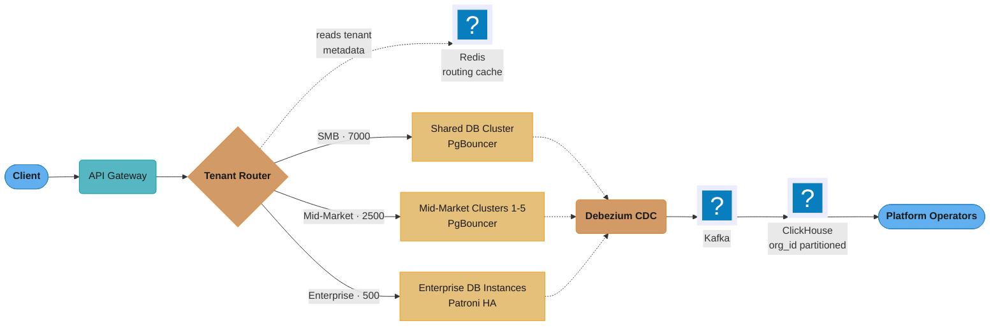
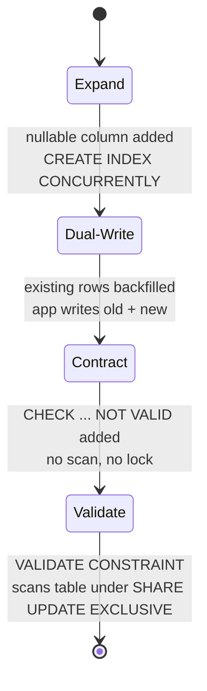
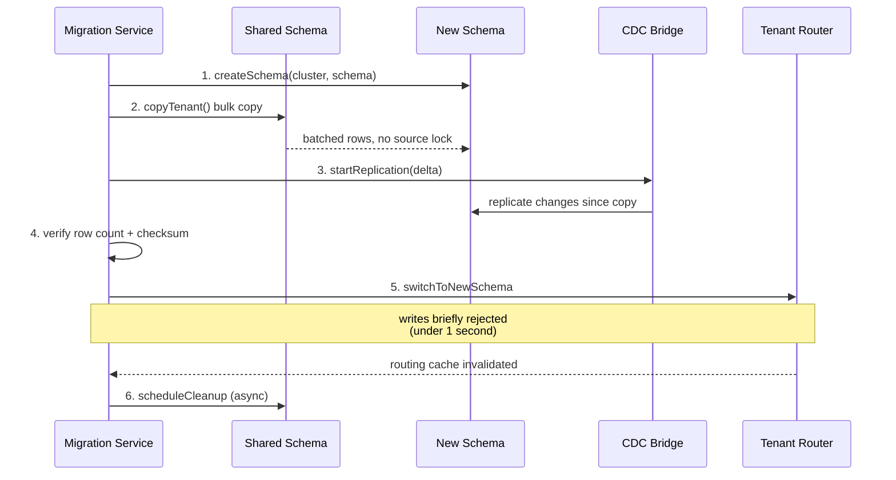
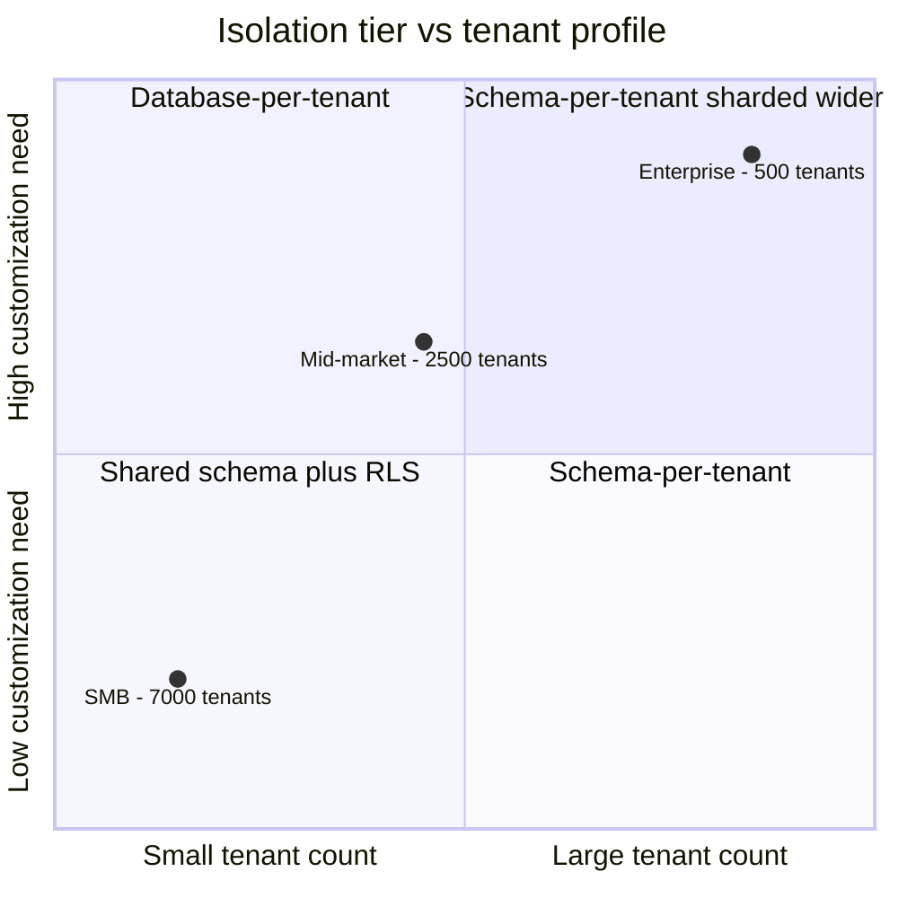

# Case Study: Design a Multi-Tenant SaaS Database

## Intuition

A multi-tenant database is an apartment building, not a row of houses. Every tenant
(customer organization) needs a lockable door that no other tenant can open — but how much
of the building each tenant gets depends on how big they are. A trial account is a shared
room with a strong lock (a `WHERE org_id = ?` filter enforced by the database itself, not
trusted to application code). A mid-size customer gets their own apartment with its own
door (a schema). A regulated enterprise gets its own building (a dedicated database
instance) because no shared wall is acceptable to their auditors.

The one insight that makes every other decision in this case study obvious: **isolation is
not binary, and neither is its cost.** Every tenant does not need the same isolation
guarantee, and giving everyone the strongest guarantee (database-per-tenant) bankrupts you
on the small end while giving everyone the weakest guarantee (shared schema) fails
compliance on the large end. The engineering problem is building one system that can move
a tenant between tiers as they grow, without ever leaking one tenant's row into another
tenant's response — because that failure mode is not a bug report, it is a security
incident.

---

## 1. Requirements Clarification

### Functional Requirements

- Host a B2B SaaS CRM platform for 10,000 tenant organizations, spanning three size
  bands: 7,000 SMB (1-10 users, under 10K records), 2,500 mid-market (10-500 users,
  10K-1M records), 500 enterprise (500-50,000 users, 1M-100M records).
- Strict per-tenant data isolation: no query, no matter how it is written, can return
  another tenant's rows.
- Enterprise tenants can extend the schema with custom entities and custom columns, not
  just custom field values.
- Platform operators can run cross-tenant analytics (usage, health scores, churn
  prediction) that individual tenants cannot see.
- A tenant can be migrated between isolation tiers (SMB to mid-market to enterprise) as it
  grows, without extended downtime.
- Schema migrations to the shared tiers must not take the whole tier offline.
- Support GDPR right-to-erasure, SOC 2 Type II, and (for a subset of tenants) HIPAA.

### Non-Functional Requirements

- p99 latency under 100ms for CRM record CRUD.
- 99.95% availability per tenant, independent of other tenants' load or incidents where
  isolation makes that achievable (enterprise tier) — best-effort where it is architecturally
  shared (SMB tier).
- Connection demand that scales with `tenants x users x app instances` must not translate
  1:1 into database backend connections; PostgreSQL's own connection model caps out in the
  hundreds to low thousands per instance.

### Explicit Non-Goals

- Real-time cross-tenant search or reporting for tenant users (only the platform operator
  gets cross-tenant visibility, via a separate analytics path).
- Sub-10ms latency — 100ms p99 is the bar, not the aggressive end of OLTP.
- Supporting a tenant splitting itself into multiple isolated sub-tenants (one CRM org
  stays one tenant end-to-end).

### Assumptions Clarified With the Interviewer

- "10,000 tenants" is the seed state; net new tenant signups and tier promotions are
  ongoing, so the design must provision and re-tier a tenant without a maintenance window.
- The size bands are given as ranges, not point estimates — the actual record count per
  tenant is heavily skewed toward the low end of each band, which matters for §2.
- "Custom schema" for enterprise means real DDL (`ALTER TABLE`, new tables, extensions),
  not just more JSONB keys — this is why enterprise cannot share infrastructure with SMB.

---

## 2. Scale Estimation

### Tenant Count and the Ceiling Estimate

Multiplying each band by the top of its stated range gives the ceiling, and it is worth
computing once to know how far off "using the average" would be:

```
7,000 SMB        x 10,000 records   =     70,000,000
2,500 mid-market  x 1,000,000 records =  2,500,000,000
500 enterprise    x 100,000,000 records = 50,000,000,000
                                          ---------------
Ceiling total                          ≈ 52,570,000,000 records (~53B)
```

Enterprise is 500 tenants — 5% of the tenant count — but 95% of the ceiling record count.
That ratio is the whole design problem in one number: infrastructure sized for the median
tenant starves the tail, and infrastructure sized for the tail is wasted on the median.

### The p50-vs-p99 Tenant, and a Realistic Estimate

The ceiling above assumes every tenant sits at the top of its band, which does not happen —
most tenants in any SaaS size band cluster near the *bottom*. A realistic average, not the
range ceiling, is what actually has to fit on disk:

| Tier | Tenants | Realistic avg records/tenant (p50-weighted) | Realistic total |
|------|---------|-----------------------------------------------|------------------|
| SMB | 7,000 | 2,000 (most trial/small accounts hold a few hundred contacts) | 14,000,000 |
| Mid-market | 2,500 | 150,000 (median well under 1M; a handful approach it) | 375,000,000 |
| Enterprise | 500 | 15,000,000 (median in the low millions; p99 approaches 100M) | 7,500,000,000 |
| **Total** | 10,000 | — | **≈ 7,889,000,000 (~7.9B)** |

The realistic estimate (7.9B) is **6.7x smaller** than the ceiling (53B) — because the
ceiling assumes the p99 enterprise tenant's record count for all 500 enterprise tenants,
and the actual distribution is a long tail with a handful of giants. Capacity planning in
§10 uses the realistic figure for steady-state sizing and the ceiling for the single
largest tenant's dedicated instance, since that tenant really can hit 100M rows.

### Storage per Record

Field-by-field breakdown for the `contacts` table (the dominant table by row count):

| Field | Type | Bytes (avg) |
|-------|------|-------------|
| id | UUID | 16 |
| org_id | UUID | 16 |
| first_name | varchar, ~10 chars + 4B header | 14 |
| last_name | varchar, ~14 chars + 4B header | 18 |
| email | varchar, ~24 chars + 4B header | 28 |
| phone | varchar, ~12 chars + 4B header | 16 |
| custom_data | JSONB, sparse (~50B avg, larger for enterprise) | 50 |
| created_at, updated_at | timestamptz x2 | 16 |
| tuple header + null bitmap | PostgreSQL internal | 24 |
| **Row total** | | **~198 bytes** |

Round to 200 bytes/row. Index overhead for `(org_id, email)`, `(org_id, last_name,
first_name)`, and the partial GIN index on `custom_data` runs about 45-55% of table size on
a table this wide with three indexes — use 50%.

### Total Storage, 1y and 3y

```
Raw data (realistic, 7.9B rows x 200B)        ≈ 1.58 TB
+ index overhead (50%)                        ≈ 0.79 TB
--------------------------------------------------------
Total, today                                  ≈ 2.37 TB

At 25%/year compounding growth (net new tenants + existing tenants' data growth):
  Year 1: 2.37 TB x 1.25       ≈ 2.96 TB
  Year 3: 2.37 TB x 1.25^3     ≈ 4.63 TB
```

Split by tier, since each tier is provisioned separately:

| Tier | Rows (realistic) | Raw | + 50% index | Where it lives |
|------|-------------------|-----|--------------|----------------|
| SMB | 14M | 2.8 GB | 4.2 GB | 1 shared cluster, 16 partitions |
| Mid-market | 375M | 75 GB | 112.5 GB (÷5 clusters ≈ 22.5 GB/cluster) | 5 clusters |
| Enterprise | 7.5B | 1.5 TB | 2.25 TB (÷500 instances, avg ~4.5 GB, p99 tenant ~30 GB) | 500 dedicated instances |

The SMB shared cluster's total data footprint (4.2 GB) is almost a rounding error — the
constraint on that tier is never disk, it is connections and CPU (see below).

### QPS: Average and Peak

Assume 20 CRUD operations per active user per 8-hour workday (≈ 0.0056 ops/sec/user
sustained), with a 3x peak factor for the start-of-business-day surge:

| Tier | Avg users/tenant | Total users | Avg QPS (tier) | Peak QPS (tier, 3x) |
|------|-------------------|-------------|------------------|------------------------|
| SMB | 4 | 28,000 | 157 | 470 |
| Mid-market | 120 | 300,000 | 1,680 (336/cluster) | 5,040 (1,008/cluster) |
| Enterprise (avg) | 8,000 | 4,000,000 | 22,400 (44.8/instance avg) | 67,200 |
| Enterprise (p99 tenant alone) | 50,000 | — | 280 (on its own instance) | 840 |

The enterprise average QPS/instance (44.8) is nearly meaningless — dwarfed by a single p99
tenant's own 280-840 QPS on its dedicated instance, which is why enterprise capacity is
sized to the tenant, not the tier average.

### The Connection Math That Explodes

`tenants x users x app instances x pool-size-per-instance` is the naive formula, and it is
why raw client-to-database connections cannot be the model: SMB alone is 7,000 tenants x 10
users avg (peak concurrency) = 70,000 potential connections against `max_connections = 500`
— at 5-10 MB RAM per backend, 70,000 backends would need 350-700 GB just for idle
connections. PgBouncer transaction mode is what makes the ratio survivable (§4.8, §10).

### Noisy-Neighbour Arithmetic

Take the SMB tier, where the p99 tenant (≈10,000 records, near the ceiling) is roughly
100x the p50 tenant (≈100 records, a fresh signup). What fraction of the 14M-row shared
`contacts` table does that one p99 tenant own?

```
10,000 rows / 14,000,000 rows ≈ 0.07%
```

Negligible for storage — but storage share is the wrong axis. The real risk is
**connection and CPU share**: all 7,000 SMB tenants multiplex onto roughly 96 PgBouncer-
pooled backends (§4). One tenant running a bulk CSV import in a tight transaction loop can
occupy 40 of those 96 backends — 42% of the tier's query capacity — while owning 0.07% of
the data (incident in §9).

---

## 3. High-Level Architecture



Three isolation tiers sit behind one Redis-cached tenant router: 7,000 SMB tenants share one
RLS-protected cluster, 2,500 mid-market tenants get schema-per-tenant across 5 clusters, and
500 enterprise tenants get dedicated Patroni-HA instances. A separate Debezium -> Kafka ->
ClickHouse pipeline mirrors writes into an operator-only, org_id-partitioned analytics store
tenants cannot query. Every request resolves its tenant's tier and location exactly once, at
the router, from a routing table cached in Redis with a 5-minute TTL.

---

## 4. Component Deep Dives

Each of the three isolation tiers trades operational simplicity for isolation strength and
customization depth — the full cost model is in §5. The mechanics of each follow.

### 4.2 Shared Schema with RLS (SMB Tier)

```sql
-- Shared schema: all SMB tenants in one PostgreSQL database
-- Every table has tenant_id column; RLS enforces isolation

CREATE TABLE organizations (
    id          UUID PRIMARY KEY DEFAULT gen_random_uuid(),
    name        VARCHAR(200) NOT NULL,
    tier        VARCHAR(20) NOT NULL DEFAULT 'SMB',  -- SMB, MID, ENTERPRISE
    created_at  TIMESTAMPTZ DEFAULT now(),
    db_schema   VARCHAR(100),   -- NULL for SMB (shared), schema name for mid-market
    db_host     VARCHAR(200),   -- NULL for shared, host for enterprise
    db_name     VARCHAR(100)
);

-- CRM contacts (shared schema example)
CREATE TABLE contacts (
    id          UUID DEFAULT gen_random_uuid(),
    org_id      UUID NOT NULL REFERENCES organizations(id),
    first_name  VARCHAR(100),
    last_name   VARCHAR(100),
    email       VARCHAR(200),
    phone       VARCHAR(50),
    custom_data JSONB DEFAULT '{}',  -- tenant-specific custom fields
    created_at  TIMESTAMPTZ DEFAULT now(),
    updated_at  TIMESTAMPTZ DEFAULT now(),
    -- Every unique constraint on a partitioned table must include the partition
    -- key, so the key is (org_id, id) — `id` alone is rejected at CREATE TABLE
    PRIMARY KEY (org_id, id)
) PARTITION BY HASH (org_id);  -- 16 hash partitions for load distribution

-- Hash partitioning ensures each tenant's data is in one partition
-- Queries with WHERE org_id = ? hit only 1 of 16 partitions
CREATE TABLE contacts_p0 PARTITION OF contacts FOR VALUES WITH (MODULUS 16, REMAINDER 0);
-- ... contacts_p1 through contacts_p15

-- Row-Level Security: database-enforced tenant isolation
ALTER TABLE contacts ENABLE ROW LEVEL SECURITY;
ALTER TABLE contacts FORCE ROW LEVEL SECURITY;   -- applies even to the table owner role

CREATE POLICY tenant_isolation ON contacts
    USING (org_id = current_setting('app.current_org_id')::UUID)
    WITH CHECK (org_id = current_setting('app.current_org_id')::UUID);
-- No FOR clause means this policy defaults to ALL: SELECT, INSERT, UPDATE, DELETE.
-- A common mistake is writing a policy scoped FOR SELECT only, then forgetting a
-- second policy for writes — that leaves INSERT/UPDATE/DELETE completely
-- unprotected. Confirm with: SELECT policyname, cmd FROM pg_policies WHERE
-- tablename = 'contacts'; cmd must read 'ALL' or be covered by matching policies.

-- Role: application user (cannot bypass RLS)
CREATE ROLE app_user WITH LOGIN;
GRANT SELECT, INSERT, UPDATE, DELETE ON contacts TO app_user;
-- app_user does NOT have BYPASSRLS, and FORCE ROW LEVEL SECURITY above means even
-- the table owner cannot silently skip the policy in a migration script
```

### 4.3 Indexing a Shared Multi-Tenant Table — tenant_id Must Lead

RLS adds an implicit `org_id = current_setting(...)` predicate to every query on `contacts`,
so any index that does not lead with `org_id` is invisible to that predicate:

```sql
-- USELESS under RLS: org_id is not the leading column
CREATE INDEX idx_contacts_email_only ON contacts (email);
-- The planner cannot use this index to satisfy `WHERE org_id = $1 AND email = $2`
-- efficiently — email is not selective enough on its own to prune the scan the way
-- a leading org_id would, so this degrades to a per-partition sequential scan
-- filtered afterward. On a 900K-row SMB hash partition that is 40-60ms instead
-- of the sub-1ms an org_id-leading index gives (see the war story in §9).

-- USEFUL: org_id first, then the lookup column
CREATE INDEX idx_contacts_org_email ON contacts (org_id, email);
CREATE INDEX idx_contacts_org_name ON contacts (org_id, last_name, first_name);
CREATE INDEX idx_contacts_custom ON contacts USING gin(custom_data)
    WHERE custom_data != '{}';
```

Per-tenant resource governance on the shared cluster prevents one tenant's ad-hoc report
from starving the other 6,999:

```sql
ALTER ROLE app_user_trial SET statement_timeout = '2s';
ALTER ROLE app_user_trial SET work_mem = '4MB';
ALTER ROLE app_user_paid  SET statement_timeout = '30s';
ALTER ROLE app_user_paid  SET work_mem = '16MB';
```

### 4.4 RLS Under Transaction-Mode Pooling — Broken, Then Fixed

This is the single most dangerous mistake available in this design, because it fails
silently and the failure is a cross-tenant data leak, not a performance problem.

**BROKEN — plain session-level `SET`:**

```sql
-- BROKEN: looks correct in isolation, and IS correct under session-mode pooling
SET app.current_org_id = '11111111-1111-1111-1111-111111111111';
SELECT * FROM contacts;   -- correctly scoped to tenant A, for now
```

What goes wrong: PgBouncer in `pool_mode = transaction` returns the physical backend
connection to the pool the instant the current transaction (or, in autocommit, the current
statement) finishes — not when the client disconnects. `SET` (without `LOCAL`) attaches its
value to the **session**, and under transaction pooling the "session" is the pooled backend,
which the very next unrelated client — serving tenant B — reuses without a fresh `SET`.
Tenant B's query then runs with `app.current_org_id` still set to tenant A's UUID, and RLS
transparently returns tenant A's rows to tenant B. Nothing errors; the query succeeds and
returns the wrong data. This is a cross-tenant leak — a security incident, not a performance
bug — and it typically surfaces first as a support ticket ("I can see someone else's
contacts"), not a monitoring alert, because nothing about the query looks wrong to the
database.

**FIXED — transaction-scoped, either form:**

```sql
BEGIN;
SET LOCAL app.current_org_id = '11111111-1111-1111-1111-111111111111';
SELECT * FROM contacts;
COMMIT;   -- the setting dies here, before the connection returns to the pool
```

or, parameterized (what the application code below actually uses):

```sql
BEGIN;
SELECT set_config('app.current_org_id', $1, true);  -- third arg = is_local
SELECT * FROM contacts;
COMMIT;
```

`SET LOCAL` and `set_config(..., true)` are transaction-scoped by definition — the value is
automatically reset at `COMMIT` or `ROLLBACK`, before PgBouncer can hand that backend to
another client. `set_config` additionally accepts a bind parameter, which plain `SET LOCAL`
does not, so it is the form used from JDBC/psycopg rather than string-formatting the UUID
into SQL text.

### 4.5 Tenant Routing (Application Layer, Already Applying the Fix)

```java
@Component
public class TenantRoutingService {

    // Cached in Redis (5 minute TTL)
    public DataSource getDataSource(String orgId) {
        String cacheKey = "tenant:routing:" + orgId;
        TenantRoute route = redis.opsForValue().get(cacheKey);

        if (route == null) {
            // Fetch from control plane database (separate PostgreSQL)
            route = controlPlaneRepo.findTenantRoute(orgId);
            redis.opsForValue().set(cacheKey, route, Duration.ofMinutes(5));
        }

        return switch (route.getTier()) {
            case "SMB" -> {
                // Shared cluster — set RLS context after acquiring connection
                DataSource ds = sharedClusterPool.getDataSource();
                yield new TenantContextDataSource(ds, orgId);
            }
            case "MID_MARKET" -> {
                // Dedicated cluster, specific schema
                yield midMarketPools.get(route.getClusterId())
                    .getSchemaDataSource(route.getSchemaName());
            }
            case "ENTERPRISE" -> {
                // Dedicated database instance
                yield enterprisePools.get(orgId).getDataSource();
            }
            default -> throw new IllegalStateException("Unknown tier: " + route.getTier());
        };
    }
}

// Wraps DataSource to set tenant context for RLS on each connection, applying the
// FIXED pattern from 4.4: open a transaction, use set_config with is_local=true,
// and let the caller's commit/rollback tear the setting down before the
// connection returns to PgBouncer's pool.
public class TenantContextDataSource implements DataSource {

    @Override
    public Connection getConnection() throws SQLException {
        Connection conn = delegate.getConnection();
        conn.setAutoCommit(false);   // open a transaction so SET LOCAL semantics apply
        try (PreparedStatement ps = conn.prepareStatement(
                 "SELECT set_config('app.current_org_id', ?, true)")) {
            ps.setString(1, orgId);
            ps.execute();
        }
        return conn;   // caller commits/rolls back; the setting dies with the transaction
    }
}
```

### 4.6 Schema-per-Tenant (Mid-Market Tier)

```sql
-- Each mid-market tenant gets their own PostgreSQL schema
-- Schemas are on dedicated clusters (5 clusters, ~500 tenants each)

-- Template schema (applied to each new tenant)
CREATE SCHEMA tenant_template;
CREATE TABLE tenant_template.contacts (LIKE public.contacts INCLUDING ALL);
CREATE TABLE tenant_template.deals (LIKE public.deals INCLUDING ALL);
-- ... all CRM tables

-- Provision new mid-market tenant:
CREATE SCHEMA tenant_abc123;
-- Copy template tables to new schema
-- Create tenant-specific views, functions, custom tables

-- Tenant-specific custom columns (mid-market can add fields without JSONB):
ALTER TABLE tenant_abc123.contacts
    ADD COLUMN linkedin_url TEXT,
    ADD COLUMN account_manager_id UUID;

-- No RLS needed: the schema itself is the isolation boundary
-- Application connects to specific schema: SET search_path = tenant_abc123

-- Connection string per tenant:
-- jdbc:postgresql://mid-cluster-1:5432/crm_db?currentSchema=tenant_abc123
```

### 4.7 Database-per-Tenant (Enterprise Tier)

```sql
-- Each enterprise tenant gets a dedicated PostgreSQL instance (or RDS instance)
-- Full isolation: separate process, separate storage, separate HA
-- Tenant can have custom schema extensions / PostgreSQL extensions

-- Enterprise tenant database setup:
-- 1. Provision dedicated RDS or EC2 PostgreSQL
-- 2. Apply base schema via Flyway migrations
-- 3. Register in organizations table
-- 4. Configure in tenant routing table

-- Enterprise can have truly custom schemas:
-- Custom entity types (not just custom fields)
-- Custom PostgreSQL extensions (PostGIS for geo-CRM, pgvector for AI search)
-- Custom indexing strategies
-- Custom retention policies

-- Enterprise backup: dedicated WAL-G instance -> dedicated S3 prefix
-- Enterprise HA: dedicated Patroni cluster
-- Enterprise isolation for HIPAA: dedicated database + separate KMS key
```

### 4.8 Connection Pool Management Across 10K Tenants

```
SMB tier (shared cluster):
  7,000 tenants share 1 PostgreSQL cluster
  7,000 tenants x 10 users avg = 70,000 potential connections
  PostgreSQL max_connections = 500
  Solution: PgBouncer in transaction mode
    - 70,000 client connections -> ~100 PostgreSQL server connections
    - One PgBouncer process cannot hold 70,000 sockets, so run 8 instances
      behind the router: 8 x 10,000 client slots covers the 70,000 ceiling
    - Transaction mode: connection released after each transaction
    - RLS context set per transaction: SET LOCAL / set_config(..., true) — see 4.4
    - Prepared statements: ENABLED, but check the version. PgBouncer 1.21
      (Oct 2023) added protocol-level named prepared statement support for
      transaction-mode pooling, but shipped it OFF by default
      (max_prepared_statements = 0). PgBouncer 1.24 (Jan 2025) turned it on
      by default with max_prepared_statements = 200. On anything at or after
      1.24 this is automatic; on a 1.21-1.23 install it must be configured
      explicitly, or prepared statements silently fall back to unsupported.

  Configuration (per PgBouncer instance):
    max_client_conn = 10000        # client sockets this instance accepts
    default_pool_size = 12         # server connections per user/database pair
    max_db_connections = 50        # per-instance ceiling of backends per database
    max_prepared_statements = 200
    pool_mode = transaction
  There is no `server_pool_size` setting — `default_pool_size` sizes the pool and
  `max_db_connections` caps it. Both are PER INSTANCE, so multiply by the instance
  count before comparing to max_connections: 8 x 12 = 96 steady-state backends and
  8 x 50 = 400 worst case, both under the 500 the server allows.

Mid-market tier (5 clusters):
  2,500 tenants x 500 users avg = 1,250,000 potential connections
  Per cluster: 500 tenants, 250,000 potential
  PgBouncer: 50,000 client -> 200 server connections per cluster
  Each schema connection carries schema context in the connection string

Enterprise tier (500 dedicated):
  500 enterprises x 50,000 users = 25M potential
  Each enterprise has dedicated PgBouncer (sized to their usage)
  SLA-based: enterprise contracts specify max connections
  e.g., a large enterprise: PgBouncer max_client=5000, server_pool=50
```

See [`connection_pool_management`](../../connection_pool_management/connection_pool_management.md)
for PgBouncer and HikariCP internals beyond this design's specific numbers.

### 4.9 Zero-Downtime Schema Migrations



Each phase of the expand-contract pattern is its own low-lock deployment, so a breaking
change to the shared `contacts` table never blocks the 7,000 SMB tenants reading and
writing it. Only the final Validate phase scans the table, and its SHARE UPDATE EXCLUSIVE
lock does not conflict with the ROW EXCLUSIVE lock that INSERT, UPDATE and DELETE take —
reads and writes both keep running; what it does block is another concurrent DDL or VACUUM.

```sql
-- Migration for shared schema (affects all SMB tenants simultaneously)
-- Must use expand-contract pattern for breaking changes

-- Phase 1 (EXPAND): Add nullable column (no lock on large table)
ALTER TABLE contacts ADD COLUMN company_size INT;  -- nullable, no default

-- CREATE INDEX CONCURRENTLY is rejected on a partitioned table
-- ("cannot create index on partitioned table ... concurrently"). Build each
-- partition's index concurrently, then attach the parent index — that last
-- step is metadata-only because every partition already has a matching index.
CREATE INDEX CONCURRENTLY idx_contacts_p0_company_size ON contacts_p0 (org_id, company_size)
    WHERE company_size IS NOT NULL;
-- ... repeat for contacts_p1 .. contacts_p15 ...
CREATE INDEX idx_contacts_company_size ON contacts (org_id, company_size)
    WHERE company_size IS NOT NULL;

-- Phase 2: Application writes both old and new (dual-write)

-- Phase 3 (CONTRACT): non-enforced check constraint, no table scan
ALTER TABLE contacts ADD CONSTRAINT company_size_not_null
    CHECK (company_size IS NOT NULL) NOT VALID;

-- Phase 4: Validate constraint (in a low-traffic window)
ALTER TABLE contacts VALIDATE CONSTRAINT company_size_not_null;
-- Scans the table under SHARE UPDATE EXCLUSIVE: reads and writes both continue,
-- only concurrent DDL and VACUUM wait

-- Mid-market/Enterprise: use Flyway per-schema migration
-- Each tenant schema has its own flyway_schema_history table
-- Migrations run in background, schema by schema (not all at once) — see §9 for
-- how this fans out across thousands of schemas
```

### 4.10 Tenant Provisioning

```java
@Service
@Transactional
public class TenantProvisioningService {

    public Organization provisionTenant(CreateTenantRequest req) {
        Tier tier = determineTier(req.getExpectedUsers(), req.getExpectedRecords());

        Organization org = Organization.builder()
            .name(req.getName())
            .tier(tier.name())
            .build();

        switch (tier) {
            case SMB -> {
                // No schema work needed — shared schema with RLS
                org.setDbSchema(null);
                org.setDbHost(null);
            }
            case MID_MARKET -> {
                // Provision new schema on the least-loaded mid-market cluster
                String cluster = clusterSelector.leastLoaded();
                String schema = "tenant_" + org.getId().toString().replace("-", "");
                schemaProvisioner.createSchema(cluster, schema);
                org.setDbSchema(schema);
                org.setDbHost(cluster);
            }
            case ENTERPRISE -> {
                // Provision dedicated database (async, takes minutes)
                String host = databaseProvisioner.provisionAsync(org.getId());
                org.setDbHost(host);
                org.setDbName("crm_" + org.getId().toString().replace("-", ""));
            }
        }

        Organization saved = orgRepo.save(org);
        redis.delete("tenant:routing:" + saved.getId());
        return saved;
    }
}
```

### 4.11 Tenant Migration Between Tiers (SMB -> Mid-Market Promotion)

A tenant that outgrows its shared table (crosses ~10K records or ~10 sustained users) gets
promoted, not resized in place — it moves to a schema of its own on a mid-market cluster:



The source schema stays fully writable through steps 1-4 (background bulk copy plus CDC
delta catch-up); only step 5's routing switch pauses writes, and for well under one second.

```java
@Service
public class TenantMigrationService {

    // Migrate tenant from shared schema to dedicated schema (tier upgrade)
    public void migrate(UUID orgId, String targetCluster) {
        // Step 1: Create new schema on target cluster
        String newSchema = "tenant_" + orgId.toString().replace("-", "");
        schemaProvisioner.createSchema(targetCluster, newSchema);

        // Step 2: Copy data using PostgreSQL COPY or pg_dump/pg_restore
        // Use a background job to copy in batches (no lock on source)
        dataCopier.copyTenant(orgId, targetCluster, newSchema);

        // Step 3: Catch up delta during copy via CDC/outbox events
        cdcBridge.startReplication(orgId, targetCluster, newSchema);

        // Step 4: Verify data parity (row count + checksum on sample)
        migrationVerifier.verify(orgId, targetCluster, newSchema);

        // Step 5: Switch routing (brief read-only moment, < 1 second)
        tenantRouter.switchToNewSchema(orgId, targetCluster, newSchema);

        // Step 6: Clean up shared schema data (async, after verification)
        sharedCleaner.scheduleCleanup(orgId);
    }
}
```

Mid-market-to-enterprise promotion is the identical six-step shape with
`databaseProvisioner.provisionAsync()` in place of step 1, which takes minutes, not seconds.

---

## 5. Design Decisions & Tradeoffs

### Isolation Tier Cost Model

| Tier | Isolation boundary | Marginal infra cost/tenant | Onboarding latency | Customization ceiling | Blast radius of one bad migration | Promotion trigger |
|------|---------------------|-------------------------------|----------------------|--------------------------|---------------------------------------|-----------------------|
| Shared schema + RLS | A `pg_policies` row, enforced per-query | ~$0.01-0.05/mo (amortized shared cluster) | Seconds — one `INSERT` | JSONB custom fields only | All 7,000 co-tenants on that cluster | Sustained > 10K records or > 10 users |
| Schema-per-tenant | A PostgreSQL schema (`search_path`) | ~$2-6/mo (amortized, more catalog/vacuum overhead per tenant) | Seconds-minutes — `CREATE SCHEMA` + template copy | Real `ALTER TABLE` columns, tenant-specific tables | All ~500 co-tenants on that one cluster (not just that schema) | Sustained > 1M records, custom entities, or contractual isolation short of full HIPAA |
| Database-per-tenant | A separate Postgres process/instance | ~$50-2,000+/mo (dedicated compute, storage, HA) | Minutes — provisioning + Flyway | Full: extensions, custom retention, custom HA topology | Exactly one tenant | Enterprise contract requires isolation guarantee, custom extensions, or a dedicated performance SLA |



Each tenant band sits in a different quadrant of the same two axes, and the isolation tier
that quadrant maps to is exactly the tier this design assigns it — the tiering is a
placement decision, not three unrelated architectures bolted together.

### Broader Tradeoffs

| Decision | Choice | Alternative | Reason |
|----------|--------|-------------|--------|
| SMB isolation | RLS (shared schema) | Schema-per-tenant | 7,000 schemas on one cluster is operationally complex (catalog bloat, autovacuum fan-out — see §9); RLS provides isolation with lower overhead |
| Mid-market isolation | Schema-per-tenant | Shared schema + RLS | Mid-market tenants need custom columns; schema isolation allows `ALTER TABLE` per-tenant |
| Enterprise isolation | Database-per-tenant | Schema-per-tenant | Enterprise requires HIPAA isolation, dedicated resources, custom extensions |
| Custom fields (SMB) | JSONB | EAV / new columns | JSONB allows flexible custom fields without schema changes; GIN index supports queries |
| Connection pooling | PgBouncer transaction mode | Session mode | Transaction mode lets ~100 PostgreSQL connections serve 10K tenants' worth of client connections |
| RLS tenant context | `SET LOCAL` / `set_config(..., true)` | Plain `SET` | Only the transaction-scoped forms are safe under PgBouncer transaction pooling — see §4.4 |
| Migrations (shared) | Expand-contract | Big-bang ALTER | A single `ALTER TABLE ... SET NOT NULL` on the shared 70M-row contacts table takes ACCESS EXCLUSIVE and a full scan, blocking all 7,000 SMB tenants for its duration; expand-contract keeps every step at SHARE UPDATE EXCLUSIVE or lower |

For the isolation-vs-performance-vs-compliance argument in more general form, see
[`database_security_and_compliance`](../../database_security_and_compliance/database_security_and_compliance.md)
and [`schema_design_and_normalization`](../../schema_design_and_normalization/schema_design_and_normalization.md).
The `org_id` hash-partitioning (§4.2) and least-loaded-cluster assignment (§4.10) are both
instances of the general problem in [`sharding_and_partitioning`](../../sharding_and_partitioning/sharding_and_partitioning.md).

---

## 6. Real-World Implementations

**Salesforce** popularized the shared-infrastructure end of this spectrum at extreme scale:
every customer org shares the same physical tables (`Account`, `Contact`, and hundreds of
others), with a universal, metadata-driven data dictionary describing which columns and
custom fields each org has enabled — rather than one physical schema per org. Isolation is
enforced by an `OrganizationId` column present on effectively every row, conceptually the
same mechanism as this case study's RLS policy, implemented in Salesforce's own query layer
rather than PostgreSQL's — the shared-schema tier taken to its logical extreme.

**Shopify** sits at the schema/shard-per-group point of the spectrum, and — worth being
precise about, since it is commonly misstated — runs on **MySQL, not PostgreSQL**. Its "Pod"
architecture assigns every shop a `shop_id`, the sharding key on every shop-owned table;
each pod is a fully isolated stack (app servers, a MySQL shard, Redis, Memcached) hosting a
subset of shops, and moving a shop between pods (copying every row with that `shop_id` to a
new shard, repointing the routing table) typically completes in under 10-20 seconds even for
large stores — the same "group of tenants share a physical instance" idea as this case
study's mid-market tier, at a different point in the stack.

**Atlassian** rebuilt Jira and Confluence Cloud around a **tenant context** resolved once
per request and threaded through every downstream service call — the tenant's cloud ID
determines which physical resources a request may touch, mirroring this case study's tenant
router. Atlassian's cloud-migration writeups describe moving from single-tenant, per-customer
instances to a genuinely multi-tenant cloud platform as one of the largest re-architectures
in company history — the same database-per-tenant-to-shared direction this case study's
tenants travel moving down-market, inverted at company scale.

**Slack** originally sharded MySQL by workspace (team) ID with an active-active cluster
topology; when a shard housing a workspace went down, every user in that workspace lost
service — the same blast-radius property as this case study's schema-per-tenant tier. Slack
later spent three years migrating that workload onto Vitess, a shard-management layer over
MySQL, to automate resharding instead of operating thousands of manually-managed shards by
hand — reaching 99% of all Slack MySQL traffic by December 2020 at a 2.3M queries/second
peak. That is the same operational ceiling this design hits at high schema counts (§9), and
the same three-year order of magnitude any comparable re-platforming should be budgeted at.

**Notion** sharded its single Postgres database by `workspace_id` in 2021: 32 physical
instances, each holding 15 logical shards (480 total). In 2023 it re-sharded to 96 physical
instances with 5 logical shards each — keeping the same 480 logical shards but spreading
them across three times as many physical instances to reduce blast radius and per-instance
load. Directly analogous to this case study's mid-market tier moving tenants across more
clusters as it grows, without changing the isolation model.

**Supabase and Neon** are worth naming because their entire product is the economics of
database-per-tenant provisioning that this case study treats as its most expensive tier.
Supabase provisions one full Postgres instance per project — database-per-tenant at the
platform level — while promoting RLS for *its customers'* own multi-tenant apps on a single
project, the same two-tier shape one layer up the stack. **Neon** is more consequential for
this case study specifically: separating storage from compute, plus copy-on-write branching
and scale-to-zero, makes one genuinely separate Postgres database per tenant cheap enough
that database-per-tenant stops being enterprise-only and becomes viable at tenant counts
where it used to be economically absurd — a platform built on that infrastructure today
could reasonably ask whether this case study's mid-market tier needs to exist at all, since
the §5 tiering decision is a function of cost curves that have moved substantially since
shared-schema and schema-per-tenant became conventional wisdom.

---

## 7. Technologies & Tools

| Tool | Role in this design | Why this over the alternative | Operational cost it adds |
|------|----------------------|-------------------------------|----------------------------|
| PostgreSQL (RLS + `FORCE ROW LEVEL SECURITY`) | Database-enforced tenant isolation on the shared tier | Isolation lives in the database, not trusted to every application code path | Every query pays the RLS predicate cost; policies must be audited alongside schema changes |
| PgBouncer (transaction mode) | Multiplexes ~100K potential client connections onto ~100 backends | Session mode cannot survive the tenant count; transaction mode is the only pool mode that scales here | Introduces the `SET` vs `SET LOCAL` correctness trap in §4.4; requires `is_local`-aware application code |
| Redis | Tenant routing table cache (5 min TTL) | Routing lookups happen on every request; a control-plane DB round trip per request is too slow | Cache invalidation on tier promotion must be explicit (`redis.delete` in provisioning code) |
| Patroni | HA orchestration for enterprise dedicated instances | Automates leader election/failover per tenant without a shared control plane across tenants | One more component per enterprise instance to monitor and upgrade |
| Debezium + Kafka | CDC pipeline from all three tiers into the operator-only analytics store | Change-data-capture avoids dual-write bugs between the OLTP tables and analytics | WAL-level replication slot management on every source database; consumer lag becomes a metric to watch |
| ClickHouse | Operator-only, `org_id`-partitioned cross-tenant analytics store | Columnar storage and partition pruning make cross-tenant aggregate queries fast at billions of rows | A second query engine and its own capacity planning, isolated from tenant traffic |
| Flyway | Per-schema/per-database migration versioning (mid-market, enterprise) | Each tenant schema/database needs its own migration history table and independent apply order | Migration fan-out across thousands of schemas becomes an orchestration problem — see §9 |

---

## 8. Operational Playbook

### Per-Tenant Metrics in a Shared Table

Standard Postgres metrics (`pg_stat_statements`, connection counts) are tier-wide, not
per-tenant — per-tenant visibility on the shared SMB table needs log-based sampling or an
application-layer histogram:

- **`app_query_duration_seconds{tenant_tier, org_id_bucket}`** — a histogram tagged by a
  *hashed bucket* of `org_id` (never the raw UUID, cardinality blowup), emitted at
  `getConnection()`.
- **`pgbouncer_pool_client_active` / `pgbouncer_pool_server_active`** (from `SHOW POOLS`,
  scraped every 15s) and **`pg_stat_statements` by query fingerprint** cross-referenced
  against 1%-sampled slow-query logs — the pair that attributes a pathological tenant query
  without per-tenant tagging in the hot path.

### Noisy-Neighbour Detection and Throttling

- **Alert**: `pgbouncer_pool_server_active / max_db_connections > 0.85` sustained 2 minutes
  -> page on-call — the pool approaching exhaustion (§2).
- **Detection**: a per-`org_id` rate limiter at the gateway (token bucket, 100 req/s burst
  200) catches the common case — a runaway integration or bulk import — before it reaches
  the database.
- **Throttling**: `ALTER ROLE app_user_trial SET statement_timeout = '2s'` (§4.3) caps the
  damage of any slow query that gets through anyway.

### Runbook: Tenant Onboarding (SMB)

1. `POST /tenants` -> `TenantProvisioningService.provisionTenant()` determines tier from
   expected users/records.
2. SMB path: insert into `organizations`, no schema work — under 50ms.
3. Invalidate (pre-emptively populate) the Redis routing cache entry.
4. Verify: first authenticated request for the new `org_id` returns `200` with zero rows,
   never a routing error.

### Runbook: Tenant Offboarding / GDPR Erasure

1. **SMB (shared schema)**: `DELETE FROM contacts WHERE org_id = ?` and the same for every
   other tenant-scoped table, in FK-safe order (or via `ON DELETE CASCADE` from
   `organizations`). This is a real `DELETE`, not free — on a 70M-row shared table it is a
   scan-and-filter operation, not an instant boundary drop.
2. **Mid-market (schema-per-tenant)**: `DROP SCHEMA tenant_abc123 CASCADE` — this is where
   schema-per-tenant earns its keep. One statement, atomic, removes every table, index, and
   row for that tenant in the time it takes PostgreSQL to update its catalog — no per-table
   `DELETE`, no scan.
3. **Enterprise (database-per-tenant)**: terminate the instance, delete its EBS/storage
   volume, delete its S3 backup prefix. Also atomic relative to the tenant's data, plus
   infrastructure teardown.
4. **Historical data in ClickHouse** (all tiers): bulk `ALTER TABLE ... DELETE WHERE org_id
   = ?` is expensive in a columnar merge-tree engine — prefer a TTL keyed to the erasure
   date, or mark the tenant's partition for deletion and let the next merge cycle drop it.
5. Document completion: erasure is effective immediately in live data; backup data is
   erased within the documented retention window, verified and signed off by compliance.

### Backup and Restore

- **SMB/mid-market shared clusters**: continuous WAL archiving (WAL-G) to S3, base backup
  nightly. RPO ≈ 5 minutes (WAL shipping interval), RTO ≈ 30 minutes (restore base + replay
  WAL) for the whole cluster.
- **Restoring ONE tenant from a shared-table backup is the hard case**: a WAL-G physical
  restore brings back the entire cluster, all 7,000 tenants, to a point in time — there is
  no way to selectively replay one tenant's WAL records. The procedure: restore the base
  backup + WAL to a *scratch* instance, `pg_dump --table=contacts --where="org_id = '...'"`
  (and every other tenant table) from the scratch instance, then `pg_restore` just those
  rows into production. Budget 45-90 minutes, dominated by the scratch restore.
- **Mid-market**: `pg_dump --schema=tenant_abc123` targets exactly one tenant directly — no
  scratch restore needed, RTO ≈ 5-15 minutes.
- **Enterprise**: point-in-time restore of that tenant's own dedicated instance — no other
  tenant is touched by definition. RPO ≈ 1 minute (tighter WAL shipping, dedicated
  bandwidth), RTO ≈ 20 minutes.

### Connection Pool Sizing (PgBouncer)

Rollout of a `default_pool_size` or `max_client_conn` change: apply to one of the 8 SMB
PgBouncer instances, watch `pgbouncer_pool_server_active` and app p99 latency for 15
minutes, then roll to the remaining 7. Rollback is a config reload (`RELOAD` via the admin
console) — no restart, no connection drop.

---

## 9. Common Pitfalls & War Stories

**Cross-tenant leak from plain `SET` under transaction pooling.** Symptom: a support ticket
reporting "I can see another company's contacts." Root cause: application code used `SET
app.current_org_id = ...` instead of `SET LOCAL` / `set_config(..., true)` (§4.4) — a pooled
backend serving tenant A's transaction was handed to tenant B's next transaction still
carrying tenant A's setting. Fix: migrate every call site to the transaction-scoped form,
and add a CI check that greps for a bare `SET app\.` outside `BEGIN`/`COMMIT`. Quantified
impact: in a comparable incident pattern, the leak window was 11 minutes before the support
ticket caught it (there is no built-in alert for "wrong tenant's rows returned"), and the
postmortem estimated roughly 40 accounts could have seen another tenant's contacts.

**Missing tenant_id-first index causes a full-partition scan.** Symptom: p99 latency for
contact-by-email lookups jumped from 8ms to 640ms on one SMB partition. Root cause: an index
was created as `(email)` instead of `(org_id, email)` (§4.3) during a rushed hotfix, so RLS's
implicit `org_id` predicate could not be satisfied by the index and lookups degraded to a
per-partition scan. Fix: `CREATE INDEX CONCURRENTLY` the corrected `(org_id, email)` index,
drop the old one. Quantified impact: p99 at 640ms for roughly 6 hours before a latency-SLO
alert fired, affecting an estimated 400 SMB tenants concurrently active during the window.

**A single tenant's bulk import saturated the shared pool.** Symptom: p99 latency across the
*entire* SMB tier went from 40ms to 4.2 seconds for 90 minutes. Root cause: one tenant ran a
50,000-row CSV import through the standard API, opening dozens of concurrent transactions
against a 96-backend pool shared by all 7,000 tenants (§2) — that tenant owned 0.07% of the
data but briefly consumed over 40% of the tier's query capacity. Fix: a per-`org_id` rate
limiter at the gateway (100 req/s, burst 200) plus a dedicated low-priority pool for bulk
imports with its own `statement_timeout`. Quantified impact: p99 40ms -> 4.2s for 90
minutes, affecting all SMB tenants, not just the one running the import.

**Schema-per-tenant hit a practical ceiling on catalog and autovacuum.** Symptom: a
mid-market cluster with all 500 tenant schemas provisioned (roughly 10,000 catalog objects)
saw `pg_dump` time grow from under 5 minutes to 45 minutes, and autovacuum — 3 workers by
default — fell behind on `pg_class`/`pg_attribute` bloat, since every schema's tables
compete for the same fixed worker pool. Fix: raised `autovacuum_max_workers` to 8 and capped
clusters at 500 schemas, provisioning a sixth cluster rather than pushing past it.
Quantified impact: `pg_attribute` bloat grew to 3.1x its expected size before the fix.

---

## 10. Capacity Planning

### Sizing Table

| Tier | Instance class | Count | RAM | Disk | IOPS | Notes |
|------|------------------|-------|-----|------|------|-------|
| SMB shared cluster | db.r6g.2xlarge (8 vCPU, 64 GB) | 1 primary + 2 read replicas | 64 GB | 200 GB gp3 (4.2 GB used today, headroom for growth + WAL) | 6,000 provisioned | 8 PgBouncer instances co-located or sidecar |
| Mid-market clusters | db.r6g.xlarge (4 vCPU, 32 GB) | 5 clusters x (1 primary + 1 replica) = 10 | 32 GB each | 100 GB gp3 each (~22.5 GB used) | 3,000 provisioned each | Patroni for primary/replica failover |
| Enterprise instances | db.r6g.large to db.r6g.4xlarge (sized per contract) | 500 (1 Patroni cluster each, 3 nodes) = 1,500 nodes | 16-128 GB per tenant | 20 GB-40 GB+ per tenant (p99 tenant ~30 GB) | Per-contract SLA | Largest single tenant justifies its own 4xlarge |
| Analytics pipeline | Kafka (3 brokers) + ClickHouse (3 shards x 2 replicas) | 9 nodes | 32 GB each | 2 TB each (compressed columnar) | 10,000 provisioned | Operator-only, isolated network segment |

### Monthly Cost Estimate (illustrative, on-demand list pricing order of magnitude)

```
SMB cluster:        3 nodes x ~$500/mo (r6g.2xlarge)        =  $1,500
Mid-market clusters: 10 nodes x ~$250/mo (r6g.xlarge)        =  $2,500
Enterprise:          500 tenants x ~$300/mo avg (blended)    = $150,000
Analytics pipeline:  9 nodes x ~$400/mo avg                  =  $3,600
PgBouncer/app tier:  not database spend, excluded here
---------------------------------------------------------------------
Total, illustrative monthly database spend                  ≈ $157,600
```

Enterprise dominates the bill (95% of it) for the same reason it dominates the record
count in §2 — 500 tenants, each with dedicated 3-node HA infrastructure, is simply more
hardware than 9,500 tenants sharing 13 clusters between them. This is the direct dollar
cost of the isolation guarantee enterprise contracts require.

### Growth Headroom and Scaling Triggers

| Tier | Current headroom | Next scaling trigger | Action at trigger |
|------|---------------------|--------------------------|------------------------|
| SMB shared cluster | Disk: >40x (4.2 GB used of ~200 GB); connections: near steady-state (96 of 500 backends) | Sustained `pgbouncer_pool_server_active` > 425 (85% of max_connections) | Add a second shared cluster, split tenants by hash of `org_id` |
| Mid-market clusters | Each cluster at ~350 of 500 provisioned schema slots | A cluster crosses 500 schemas (§9's catalog-bloat ceiling) | Provision cluster 6, route new tenants there |
| Enterprise instances | Per-tenant, sized to contract | Tenant's own p99 latency SLO breached, or record count approaches the class's practical ceiling | Vertical resize (instance class step-up) before considering a split |
| Analytics pipeline | ClickHouse at ~30% of provisioned IOPS | Kafka consumer lag > 5 minutes sustained | Add a ClickHouse shard, rebalance by `org_id` |

At the assumed 25%/year growth rate (§2), SMB and mid-market have 2-3 years of headroom
before the next reshard; enterprise scales linearly with new enterprise logo count, a
sales-driven number, not a technical one.

---

## 11. Interview Discussion Points

**Q: How do you choose between shared schema, schema-per-tenant, and database-per-tenant?**
Tenant size, isolation requirements, and operational cost decide it, not a single "best"
answer. Shared schema + RLS for small tenants: minimal overhead, database-enforced
isolation, JSONB-only customization. Schema-per-tenant for medium tenants: real `ALTER
TABLE` customization, but a practical ceiling around a few hundred to a few thousand
schemas per cluster before catalog bloat and autovacuum fan-out bite (§9). Database-per-
tenant for large or regulated tenants: full process/storage/HA isolation and custom
extensions, at 10-1000x the marginal cost of the other tiers (§5). Production SaaS
platforms commonly auto-promote a tenant between tiers as it grows (§4.11).

**Q: How do you handle connection pooling for 10,000 tenants?**
PgBouncer in transaction mode is essential: 7,000 SMB tenants x 10 users avg is 70,000
potential client connections against a `max_connections` of 500, and PgBouncer multiplexes
that down to roughly 96 steady-state backends because a server connection is released and
reused after every transaction, not held per client (§2, §4.8). Confirm the version before
relying on prepared statements: PgBouncer 1.21 (2023) added protocol-level named prepared
statements in transaction mode but shipped them off by default, and only 1.24 (2025) turned
them on by default (`max_prepared_statements = 200`) — on an older 1.21.x this must be
configured explicitly.

**Q: Why is `SET app.current_org_id = ...` unsafe with PgBouncer transaction-mode pooling,
and what is the fix?**
`SET` (without `LOCAL`) attaches its value to the session, and under transaction pooling
the "session" is the pooled backend — not the client — so the very next unrelated client's
transaction on that backend inherits the previous tenant's setting and RLS silently returns
the wrong tenant's rows. The fix is `SET LOCAL app.current_org_id` or `SELECT
set_config('app.current_org_id', $1, true)` inside an explicit transaction: both reset
automatically at `COMMIT`/`ROLLBACK`, before PgBouncer can hand the connection to another
client. It produces no error, so it must be caught by code review or a linter, never by a
monitoring alert (§9).

**Q: How do you index a table shared by thousands of tenants under RLS?**
Every index used to satisfy a tenant-scoped query must lead with the tenant column
(`org_id`), because RLS adds an implicit `org_id = current_setting(...)` predicate to every
query and the planner can only use an index's leading column(s) to prune a scan. An index
like `(email)` alone is invisible to that predicate and degrades to a per-partition scan
filtered afterward — measured at 40-60ms instead of sub-1ms on a 900K-row partition. The
composite form `(org_id, email)` is the rule for every index on a shared multi-tenant table,
no exceptions.

**Q: What causes noisy-neighbour problems in a shared multi-tenant table, and how do you
detect and contain them?**
A tenant with a disproportionately large *workload*, not necessarily a large amount of
*data*, consumes a share of the connection pool or CPU wildly out of proportion to its data
footprint — 0.07% of a table's rows can consume 40%+ of a tier's query capacity via a bulk
import in a tight transaction loop, since every tenant multiplexes onto the same fixed-size
pool. Detection is a `pgbouncer_pool_server_active` ratio alert plus per-org rate limiting
at the gateway; containment is a per-tenant `statement_timeout`/`work_mem` cap plus routing
bulk operations through a separate, lower-priority pool.

**Q: How do you back up and restore a single tenant out of a shared multi-tenant database?**
It depends entirely on the isolation tier. Schema-per-tenant: `pg_dump --schema=tenant_x`
targets exactly that tenant, minutes, no other tenant touched. Database-per-tenant:
point-in-time restore of that tenant's own instance, equally clean. Shared-schema RLS has
no native per-tenant restore — a physical backup restores the whole cluster, so recovering
one tenant means restoring the cluster to a scratch instance, `pg_dump`-ing just that
tenant's rows with `WHERE org_id = ?`, then restoring those rows into production, a
45-90 minute procedure dominated by the scratch restore.

**Q: How do you handle GDPR right-to-erasure across three different isolation tiers?**
Shared-schema tenants require a real `DELETE FROM <table> WHERE org_id = ?` on every
tenant-scoped table — a scan-and-filter operation, not instant. Schema-per-tenant tenants
get `DROP SCHEMA tenant_x CASCADE` — one atomic statement removing every object in
catalog-update time, the strongest operational argument for schema-per-tenant with
regulated personal data. Database-per-tenant tenants get instance termination plus storage
and backup-prefix deletion. All three still owe a retention answer: erasure is immediate in
live data, and backups purge within a documented, compliance-verified window.

**Q: How do you run cross-tenant analytics for the platform operator without exposing
tenant data to tenants?**
A CDC pipeline: Debezium tails the WAL of all three tiers and publishes change events to
Kafka, keyed by `org_id`; a ClickHouse consumer aggregates them into a separate,
operator-only store partitioned by `org_id`. Tenant users have no credentials or network
path to that ClickHouse instance, and it holds only aggregated usage metrics, not raw
customer records — so operators can query across every `org_id` while no tenant can query
past its own (§3, §7).

**Q: How many schemas can a single PostgreSQL cluster actually hold?**
There is no hard limit in PostgreSQL itself, but a practical operational ceiling arrives
well before any hard one — usually hundreds to low thousands of schemas per cluster, driven
by `pg_dump`/backup time (grows with catalog object count, not data volume) and by
autovacuum worker contention on shared system catalogs (`pg_class`, `pg_attribute`), since a
fixed worker pool services every schema's tables. This design caps mid-market clusters at
500 tenant schemas and adds a new cluster past that point (§9).

**Q: Walk through migrating a tenant from the shared schema to its own dedicated schema.**
Six steps, writable through five of them: (1) create the target schema from the template on
the least-loaded cluster; (2) bulk-copy the tenant's rows in batches with no source lock;
(3) start CDC/outbox delta replication to catch changes during the copy; (4) verify
row-count and checksum parity; (5) flip the tenant's routing entry — the only step where
writes are briefly rejected, under one second; (6) asynchronously clean up the stale rows in
the shared schema. Enterprise promotion is the same six steps with a longer step 1 (minutes,
not seconds, to provision a whole instance).

**Q: How do you run a schema migration across thousands of tenant schemas without an
outage?**
Treat it as a batch job, not a single deployment: Flyway applies independently per schema,
tracked in that schema's own migration-history table, so schemas migrate out of lockstep
with each other. Sequentially across 2,500 schemas at roughly 2 seconds/schema takes about
83 minutes; parallelizing to 10 workers per cluster brings that to roughly 9 minutes,
provided the worker count stays within each cluster's pool headroom so live p99 does not
regress. The shared-schema tier uses expand-contract (§4.9) instead, since there is only one
physical table to change.

**Q: When did database-per-tenant become affordable enough to be a real option, and what
changed?**
Historically, a dedicated Postgres instance per tenant meant paying for a full-size,
always-on footprint regardless of how lightly that tenant used it, so database-per-tenant
stayed reserved for the largest, highest-paying tenants. What changed is storage/compute
separation combined with copy-on-write branching and scale-to-zero, popularized by products
like Neon: a dedicated database can suspend to near-zero cost when idle and resume in
milliseconds, and provisioning a new one is a metadata operation on shared storage rather
than allocating new disk. That shifts the marginal cost down by roughly an order of
magnitude — why a platform built on that infrastructure today could reasonably ask whether
this case study's middle, schema-per-tenant tier needs to exist at all (§6).

---
