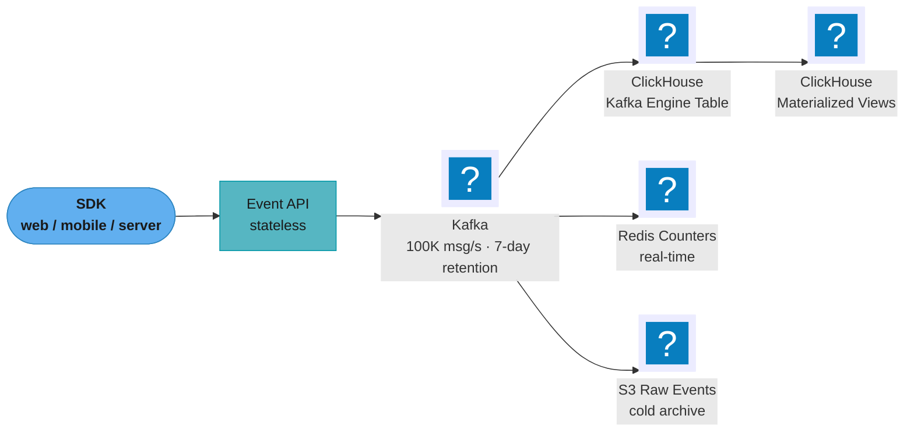
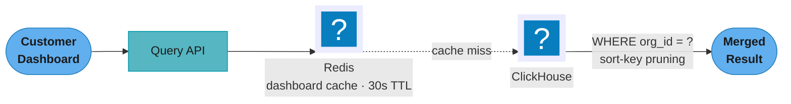
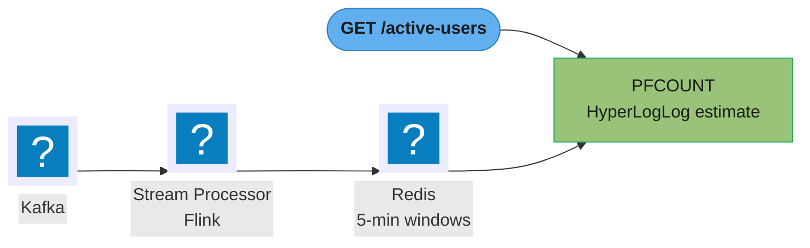
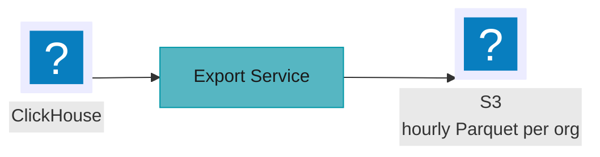
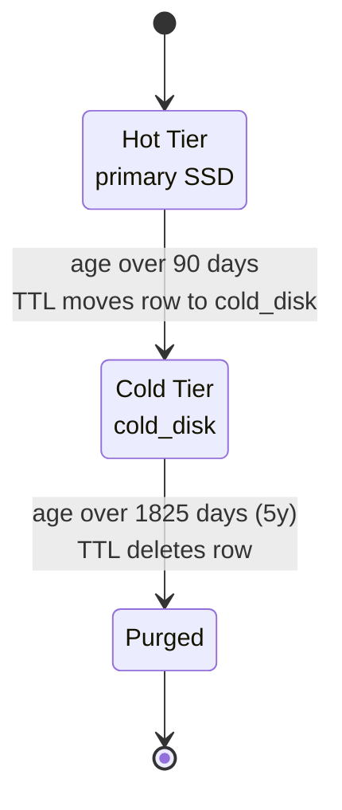
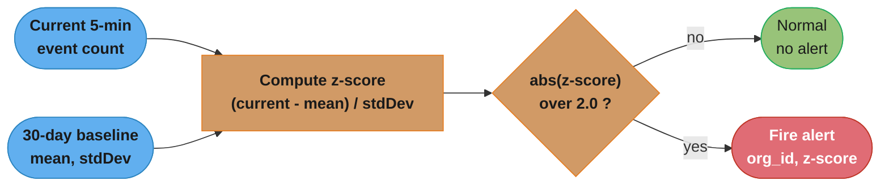

# Case Study: Design a Real-Time Analytics Platform

## Intuition

A real-time analytics platform is a printing press that never stops for the ledger to close. Every event is written once, column-major, so a dashboard asking "clicks per day for the last 30 days" reads only the `event_name` and `timestamp` columns off disk and never touches `properties`, `user_agent`, or the other 90% of each row it does not need. The mental model is three speed tiers stacked on top of one durable log: Kafka absorbs bursty writes and gives you a replay window; ClickHouse's columnar merge tree answers anything that fits in seconds by scanning compressed columns instead of rows; Redis answers anything that must be instant by never scanning at all, trading an exact count for a HyperLogLog sketch it can union in microseconds.

The one insight that makes the rest of this design obvious: at 1 billion events a day, an *exact* answer computed from raw rows is a fantasy for any query wider than the last few hours. Everything past that boundary is either pre-aggregated (a materialized view built once, read many times) or approximated (a sketch that trades a known, bounded error for four orders of magnitude less I/O). Once that trade is accepted up front, the rest of the architecture — what gets pre-computed, what gets sketched, what stays exact — falls out of which SLA each query type has to hit.

---

## 1. Requirements Clarification

### Functional requirements

- Ingest **1 billion events/day** from web, mobile, and server-side SDKs: page views, clicks, API calls, purchases, and arbitrary custom events.
- Dashboards: **sub-second** for the last 24 hours, **< 5 seconds** for the last 30 days, **< 30 seconds** for the last 365 days.
- Real-time counters: active users in the **last 5 minutes**, events-per-second, and a live top-events leaderboard.
- Ad-hoc dashboard queries: customer-defined dimensions, metrics, and filters — not a fixed report set.
- Anomaly detection: alert when a metric deviates **more than 2σ** from its 30-day baseline.
- Hourly export of each customer's own events to that customer's own S3 bucket.
- **10,000 customer organizations**, each able to query only its own data.

### Non-functional requirements

- **90-day hot retention**, online and queryable at dashboard speed; **5-year cold archive**, queryable but not held to the same latency SLA.
- Ingest must never lose an accepted event, even during a downstream (ClickHouse, Redis) outage — the write path and the storage path are decoupled for exactly this reason.
- Strict tenant isolation: no query may ever return another org's rows, and no single tenant's query load may degrade another tenant's dashboard.
- Cost-effective at this event volume: a pay-per-scanned-byte warehouse (BigQuery, Snowflake) would make every dashboard refresh a metered cost; a self-hosted columnar store amortizes hardware instead.

### Explicit non-goals

- **Not a transactional OLTP system.** No cross-event ACID guarantees are required; events are immutable facts, not mutable business records.
- **Not exactly-once ingestion at any cost.** Clarified with the interviewer: at-least-once delivery from Kafka plus idempotent aggregation downstream (`ReplacingMergeTree` + query-time dedup, §4.2) is acceptable — chasing exactly-once end-to-end would add a distributed-transaction layer this workload does not need.
- **Not millisecond freshness everywhere.** Only the "last 5 minutes" counters need sub-minute freshness; the 30-day and 365-day dashboards are explicitly allowed to read data that is minutes old.
- **No cross-org rollups or benchmarking features.** A "how do we compare to similar customers" feature is out of scope — it would require breaking the tenant-isolation boundary this design treats as inviolable.

### Assumptions

- Peak-to-average ratio is derived, not assumed round: 100,000 events/s peak against 11,500 events/s average is an **8.7x** peak factor (derived in §2).
- "Real-time" for the active-users and EPS counters means end-to-end freshness in the low tens of seconds is acceptable; it does not mean sub-second.
- Anomaly alerts are best-effort and delivered on the 5-minute window boundary, not synchronously with the event that caused the deviation.

---

## 2. Scale Estimation

### Event rate

```
1,000,000,000 events/day / 86,400 s/day = 11,574 events/s average  (~11.5K/s, matches the brief)
100,000 events/s peak / 11,574 events/s average = 8.7x peak factor
```

### Bytes per event — field by field (Avro-encoded, matches the §4 schema)

| Field | Type | Assumed size |
|---|---|---|
| `org_id` | UUID | 16 bytes (binary) |
| `user_id` | string | 20 bytes avg |
| `session_id` | string | 20 bytes avg |
| `event_type` | string (4 values) | 10 bytes avg |
| `event_name` | string | 20 bytes avg |
| `properties` | map, ~5 pairs x (~15-byte key + ~20-byte value) | 175 bytes |
| `timestamp_ms` | int64 | 8 bytes |
| `ip_address` | string | 15 bytes avg |
| `user_agent` | string | 100 bytes avg |
| **Total** | | **≈ 384 bytes/event logical** |

Avro binary framing adds a small constant overhead per record; call the wire size on Kafka **≈ 420 bytes/event**. (A JSON encoding of the same fields — field names, quotes, delimiters — would run 2-3x larger; Avro is why the SDKs are not just posting JSON.)

### Ingest bandwidth and Kafka footprint

```
Daily wire volume:      1e9 events x 420 bytes           = 420 GB/day (uncompressed on the wire)
LZ4 on Avro (~2x):      420 GB / 2                        = 210 GB/day retained in Kafka
Kafka footprint:        210 GB/day x 7-day retention x RF3 = 4.41 TB across the cluster

Average ingest bandwidth: 210e9 bytes x 8 bits / 86,400 s  ≈ 19.4 Mbps
Peak ingest bandwidth:    19.4 Mbps x 8.7 (peak factor)    ≈ 169 Mbps
```

Both are trivial for a modern NIC — ingest bandwidth is never the bottleneck here; part count and merge throughput are (§4.2).

### ClickHouse compression — per column, not one blended number

A single "10x compression" line hides that a MergeTree table compresses wildly differently column by column, because `ORDER BY (org_id, event_type, timestamp, user_id)` (§4.2) makes some columns nearly sorted and others not at all:

| Column | Why it compresses this way | Assumed ratio |
|---|---|---|
| `event_type`, `event_name` | `LowCardinality(String)` — dictionary-encoded, a handful of distinct values repeated a billion times | ~20-50x |
| `org_id` | fixed 16-byte UUID, and it **leads** the sort key, so identical values run together for long stretches — LZ4/ZSTD compress runs cheaply | ~8-10x |
| `timestamp` | `DateTime64(3)`, delta-encoded (`Delta`/`DoubleDelta` codec) — within one org's granule, timestamps are close to monotonic | ~10-20x |
| `user_id`, `session_id` | high-cardinality strings, not sorted, low repetition | ~3-4x |
| `properties` | free-text `Map(String, String)`, the least compressible column | ~2-3x |

Weighted by each column's share of the 384-byte row (`properties` alone is ~46% of the row), the blended ratio comes out around **7x** — that is the assumption this section carries forward, and it is an assumption, not a measurement:

```
Daily logical bytes:     1e9 events x 384 bytes           = 384 GB/day
Daily compressed (÷7):   384 GB / 7                        ≈ 55 GB/day (hot tier, per replica)

90-day hot tier:         55 GB/day x 90                    ≈ 4.95 TB
1-year:                  55 GB/day x 365                   ≈ 20 TB
3-year:                  55 GB/day x 1,095                 ≈ 60 TB
5-year (full retention): 55 GB/day x 1,825                 ≈ 100 TB

With RF=2 replication for HA, double every figure above:
90-day hot tier at RF=2: ≈ 9.9 TB actually stored
```

Sparse-index and mark overhead is negligible: at `index_granularity = 8192`, 1B rows/day produces only ~122,000 index entries/day, a few MB — call it +5% on top of the compressed data for marks and metadata combined.

### Query working set

Dashboards hit the pre-aggregated views (§4.3), never raw events, for anything past 24 hours:

```
events_hourly rows/day:  10,000 orgs x ~20 event_names x 24 hours = 4,800,000 rows/day
one org's 24h query:     20 event_names x 24 hours               = 480 matching rows

events_daily rows total: 10,000 orgs x ~20 event_names x 365 days = 73,000,000 rows
one org's 365-day query: 20 event_names x 365 days                = 7,300 matching rows
```

A 365-day dashboard query touches ~7,300 rows out of a billion raw events a day — this is why the 30-second SLA is comfortable rather than aspirational.

### Node count

Hot tier needs ~9.9 TB at RF=2 (above). A ClickHouse node class with several TB of attached NVMe (sized concretely in §10) needs on the order of **3 shards x 3 replicas = 9 nodes** to hold that comfortably with headroom for merges and growth — the full sizing table with instance classes, cost, and the scaling trigger for adding a 4th shard is in §10.

---

## 3. High-Level Architecture

The system is four independent paths fed by one Kafka topic: durable storage, real-time counters, cold archive, and (downstream of storage) customer export. No path blocks another — a Redis outage does not stop events from landing in ClickHouse, and a ClickHouse outage does not stop Redis counters from updating, because each consumer group reads the topic independently.


*Ingest path — one Kafka topic (100 partitions, 100K msg/s peak) fans out to three independent consumers: the ClickHouse Kafka Engine table for durable storage, Redis for real-time counters, and S3 for a raw cold archive.*


*Query path — dashboards hit the 30-second Redis cache first; on a miss, ClickHouse serves the query, but every query is required to filter on `org_id`, the leading column of the sorting key, which prunes the scan to that tenant's granules.*


*Real-time counters — Flink `PFADD`s each minute's user ids into a per-org, per-minute HyperLogLog; a read `PFCOUNT`s the last five buckets at once, which Redis answers as the union cardinality with a 0.81% standard error.*


*Export — hourly batch jobs read ClickHouse and write one Parquet file per org directly to that customer's S3 bucket.*

---

## 4. Component Deep Dives

### 4.1 Ingest: Kafka as the write buffer

```
Kafka configuration:
  Topics: events (100 partitions — one per event_type + hash of org_id)
  Replication factor: 3
  Retention: 7 days (replay window for re-processing)
  Compression: LZ4 (CPU-efficient, ~2x on already-binary Avro records)
  Batch size: 1MB (producer batches for throughput)
  Linger.ms: 10 (wait 10ms to accumulate batch)
  Max poll records: 10000 (consumer batch size)

Event schema (Avro + Schema Registry):
{
  "org_id": "uuid",
  "user_id": "string",
  "session_id": "string",
  "event_type": "page_view|click|purchase|custom",
  "event_name": "string",
  "properties": {"key": "value"},
  "timestamp_ms": "long",
  "ip_address": "string",
  "user_agent": "string"
}

Producer SDK pattern:
  1. Validate event (required fields, size < 64KB)
  2. Add server-side timestamp, org_id (from API key)
  3. Produce to Kafka (async, fire-and-forget from client's perspective)
  4. Return 202 Accepted immediately (no wait for Kafka ack)
```

### 4.2 ClickHouse: the MergeTree lifecycle, the sparse index, and a broken insert pattern

Every `INSERT` into a `MergeTree` table writes a new immutable **part** — a self-contained directory of column files, one sparse index, and metadata. A background merge scheduler continuously combines same-partition parts into fewer, larger ones, which is what keeps query-time part count (and therefore the number of files ClickHouse must open per query) bounded. Reads always see the union of whatever parts currently exist; merges never block reads or writes, only reduce future work.

**The sparse primary index and granule skipping.** `ORDER BY (org_id, event_type, timestamp, user_id)` at `index_granularity = 8192` means ClickHouse stores one index mark every 8,192 rows *within a part*, recording that granule's first row's key values — not a mark per row, the way a B-tree would. A query filtering `org_id` can binary-search this sparse index to find the contiguous run of granules that could contain that org, and skips decompressing everything else:

```
ORDER BY (org_id, event_type, timestamp, user_id)   index_granularity = 8192

sparse index marks (one row of index per 8192-row granule):

 mark 0   mark 1   mark 2   mark 3   ...  mark 122,069  (1B rows / 8192)
 [org A]  [org A]  [org B]  [org B]  ...  [org Z]
   |        |        |        |              |
   v        v        v        v              v
 rows      rows     rows     rows           rows
 0-8191  8192-16383 ...      ...          (last granule)

query: WHERE org_id = B
  binary search on the sorted marks -> jumps straight to mark 2
  reads granules 2..N where org_id == B, skips everything else

org B has ~100,000 rows/day / 8192 rows-per-granule ~= 13 granules
13 granules x 8192 rows = 106,496 rows decompressed
      vs 1,000,000,000 rows/day with no matching sort-key prefix
      -> ~9,390x fewer rows read
```
*If the sort key did not lead with `org_id`, a per-tenant filter could not binary-search the index at all — ClickHouse would decompress every granule in the time range and filter row-by-row in `PREWHERE`, touching the full day's billion rows instead of ~106K. That gap is why "which column leads `ORDER BY`" is the single highest-leverage schema decision in this design.*

**BROKEN — one `INSERT` per event.** A naive ingest path calls `INSERT INTO events VALUES (...)` synchronously for every single event as it arrives:

```sql
-- BROKEN: one row, one INSERT, at up to 11,500 calls/second
INSERT INTO events (org_id, event_type, event_name, user_id, session_id, timestamp, properties)
VALUES ('...', 'click', 'button_press', 'u123', 's456', now64(3), map('k','v'));
```

Every `INSERT` creates a new part, so this creates parts at the *event* rate, not a batched rate: 11,500 parts/second at average load. ClickHouse's default `parts_to_throw_insert = 3000` — once a partition holds more than 3,000 active parts, further inserts are rejected outright with `Too many parts (N). Merges are processing significantly slower than inserts`. At 11,500 parts/second this threshold is blown through in a fraction of a second, and because background merges are O(part count) work running at maybe tens of merges/second, the merge scheduler cannot possibly catch up — this is not a transient blip, it is a sustained write outage that gets worse the longer the naive path runs.

```sql
-- FIXED: the Kafka Engine + materialized view pattern already in this design
-- (see the events_kafka table below) batches automatically: ClickHouse's Kafka
-- consumer flushes at most kafka_max_block_size rows (default 65536) or its poll
-- interval, whichever comes first — never one row at a time.
```

For direct application writes that bypass Kafka (e.g., a backfill script), the fix is `async_insert = 1` with `wait_for_async_insert = 0`, which buffers rows for up to `async_insert_busy_timeout_ms` (default ~200ms) and flushes one part per buffer window instead of one part per call.

```
At 11,500 events/s through Kafka's own 65,536-row flush size:
  11,500 / 65,536 ≈ 0.18 flushes/sec needed just to keep pace per consumer thread
  with kafka_num_consumers = 16, that is at most ~16 parts every few seconds —
  orders of magnitude under the 3,000-part throw threshold, even at the 100K/s peak.
```

**Main events table:**

```sql
-- Main events table (ClickHouse)
CREATE TABLE events (
    org_id          UUID,
    event_type      LowCardinality(String),  -- compresses repeated values efficiently
    event_name      LowCardinality(String),
    user_id         String,
    session_id      String,
    timestamp       DateTime64(3),
    properties      Map(String, String),      -- flexible key-value properties
    date            Date MATERIALIZED toDate(timestamp)  -- computed column for partitioning
)
ENGINE = ReplacingMergeTree(timestamp)  -- deduplicates rows sharing the ORDER BY key
PARTITION BY toYYYYMM(date)  -- month only; see the note below on why NOT org_id
ORDER BY (org_id, event_type, timestamp, user_id)  -- primary index = clustered sort
SETTINGS index_granularity = 8192;    -- one sparse index entry per 8192 rows

-- Do NOT add org_id to the partition key. With 10,000 orgs and a 90-day hot
-- window that is 30,000 live partitions, and any INSERT block spanning more than
-- max_partitions_per_insert_block (default 100) orgs is rejected outright:
--   "Too many partitions for single INSERT block (more than 100) ... Recommended
--    total number of partitions for a table is under 1000..10000 ... partitioning
--    is not intended to speed up SELECT queries (ORDER BY key is sufficient)."
-- Tenant pruning is already handled by org_id leading the ORDER BY key: the sparse
-- primary index seeks straight to that org's granules. Partitioning exists for bulk
-- data manipulation (DROP PARTITION, TTL moves), not for per-tenant scan reduction.

-- TTL: automatically move data between storage tiers
ALTER TABLE events MODIFY TTL
    date + INTERVAL 90 DAY TO DISK 'cold_disk',    -- after 90 days: move to cold SSD
    date + INTERVAL 1825 DAY DELETE;               -- after 5 years: delete

-- Kafka Engine table: reads directly from Kafka.
-- Its columns must mirror the Avro record on the wire, NOT the target table:
-- every column the materialized view selects has to exist here, and each type has
-- to be the type the format decodes to, or the view fails to create.
CREATE TABLE events_kafka (
    org_id       String,
    event_type   String,
    event_name   String,
    user_id      String,
    session_id   String,
    timestamp_ms Int64,
    properties   Map(String, String)
) ENGINE = Kafka()
SETTINGS
    kafka_broker_list = 'kafka:9092',
    kafka_topic_list = 'events',
    kafka_group_name = 'clickhouse-consumer',
    kafka_format = 'Avro',
    kafka_num_consumers = 16;   -- 16 threads consuming 100 partitions

-- Materialized view: move from Kafka engine to main table.
-- `date` is deliberately absent: it is a MATERIALIZED column on `events`, and
-- selecting it here fails with "Cannot insert column date, because it is
-- MATERIALIZED column" — ClickHouse recomputes it from timestamp on insert.
CREATE MATERIALIZED VIEW events_mv TO events AS
SELECT
    toUUID(org_id)                         AS org_id,
    event_type,
    event_name,
    user_id,
    session_id,
    fromUnixTimestamp64Milli(timestamp_ms) AS timestamp,
    properties
FROM events_kafka;
```


*The `MODIFY TTL` clause above drives every row through the same lifecycle automatically — 90 days on primary SSD for sub-second dashboards, then `cold_disk` until the 5-year (1825-day) mark, then deletion, with no manual archival job required.*

**`ReplacingMergeTree` and why `FINAL` is expensive.** `ReplacingMergeTree(timestamp)` deduplicates rows sharing the `ORDER BY` key, keeping the one with the highest `timestamp` — but only when the parts holding those rows actually get merged, which happens asynchronously and is never guaranteed to have happened by the time a query runs (a replayed Kafka offset can insert the same logical row twice, and both copies are visible until a merge reconciles them). `SELECT ... FROM events FINAL` forces ClickHouse to merge every part touching the query's key range *at query time*, guaranteeing dedup — but that turns work that would otherwise be amortized once across many future queries into foreground work paid by every single query. On a 30-day dashboard query that can mean merging tens of millions of rows synchronously, costing seconds instead of milliseconds. The cheaper alternative is query-time dedup with `argMax`, which needs no merge at all:

```sql
-- Read-time dedup without FINAL: argMax picks the row with the highest version
-- (timestamp) per group, which is exactly what FINAL would have produced —
-- without forcing a merge of every part in the scanned range.
SELECT
    org_id,
    event_name,
    argMax(properties, timestamp) AS latest_properties
FROM events
WHERE org_id = 'customer-uuid'
GROUP BY org_id, event_name;
```

### 4.3 Pre-aggregated materialized views for dashboard speed

```sql
-- Hourly event counts (pre-aggregated for fast dashboard queries).
--
-- Engine choice is load-bearing. SummingMergeTree adds numbers on merge, which is
-- right for a count and WRONG for a distinct count: one user seen in three
-- separate insert blocks yields three partial rows of unique_users = 1, and the
-- merge sums them to 3. AggregatingMergeTree stores the sketch itself, so
-- uniqMerge() unions the three partials back to the true 1.
CREATE MATERIALIZED VIEW events_hourly
ENGINE = AggregatingMergeTree()
PARTITION BY toYYYYMM(hour)
ORDER BY (org_id, event_type, event_name, hour)
AS SELECT
    org_id,
    event_type,
    event_name,
    toStartOfHour(timestamp) AS hour,
    countState()             AS event_count,
    uniqState(user_id)       AS unique_users,
    uniqState(session_id)    AS unique_sessions
FROM events
GROUP BY org_id, event_type, event_name, hour;

-- Query dashboard (last 24 hours by hour):
SELECT
    hour,
    event_name,
    countMerge(event_count) AS events,
    uniqMerge(unique_users) AS users
FROM events_hourly
WHERE org_id = 'customer-uuid'
  AND hour >= now() - INTERVAL 24 HOUR
GROUP BY hour, event_name
ORDER BY hour ASC;
-- Reads at most 24 hours x event_name rows for one org: tens of milliseconds,
-- against 10-30s for the same aggregation over raw events

-- Daily aggregates for 365-day queries
CREATE MATERIALIZED VIEW events_daily
ENGINE = AggregatingMergeTree()
PARTITION BY toYear(day)
ORDER BY (org_id, event_type, event_name, day)
AS SELECT
    org_id,
    event_type,
    event_name,
    toDate(timestamp)  AS day,
    countState()       AS event_count,
    uniqState(user_id) AS unique_users
FROM events
GROUP BY org_id, event_type, event_name, day;

-- Query dashboard (last 365 days):
SELECT day, event_name, countMerge(event_count) AS events
FROM events_daily
WHERE org_id = 'customer-uuid'
  AND day >= today() - 365
GROUP BY day, event_name
ORDER BY day;
-- Hits daily aggregates: < 1 second for 365 days
```

### 4.4 Redis for real-time counters

```
Real-Time Active Users (last 5 minutes):
  Redis owns the sketch; Flink only feeds it. PFADD takes ELEMENTS, not a
  serialized HLL, so there is no way to compute an HLL in Flink and push it in
  (PFMERGE is the only command that combines existing sketches).

  Flink (reading from Kafka):
    - Tumbling window: 1 minute, keyed by org_id
    - PFADD active_users:{org_id}:{minute_bucket} {user_id} {user_id} ...
    - EXPIRE active_users:{org_id}:{minute_bucket} 600 (10 minutes)

  API:
    GET /api/active-users →
      PFCOUNT active_users:{org}:{m-4} ... active_users:{org}:{m}
    Multi-key PFCOUNT returns the cardinality of the UNION of the five one-minute
    buckets — exactly "active in the last 5 minutes" — with a 0.81% standard
    error. Note the cost: single-key PFCOUNT is O(1) off a cached estimate, but
    multi-key merges on the fly, cannot cache, and lands in the millisecond range.
    Every bucket is 12 KB dense, so the whole window is 60 KB per org.

Events Per Second (EPS):
  Flink: INCR events_per_second:{org_id}:{epoch_second}
         EXPIRE events_per_second:{org_id}:{epoch_second} 120
  API: GET events last 60 seconds → sum of 60 keys
       MGET events_per_second:{org_id}:{epoch-59} ... events_per_second:{org_id}:{epoch}

Real-Time Top Events (last 5 minutes):
  Flink: ZINCRBY top_events:{org_id}:{window_key} 1 {event_name}
  API: ZRANGE top_events:{org_id}:{current_window} 0 9 REV
  Window key = epoch_seconds / 300 (5-minute buckets)
```

### 4.5 Tenant isolation

```sql
-- Multi-tenant isolation in ClickHouse:
-- Every query MUST include org_id in WHERE clause
-- org_id leads the ORDER BY key, so:
--   SELECT ... WHERE org_id = ? AND date >= ? AND date < ?
--   → Primary-key index seek: only that org's granules are read
--   → date range then prunes months via the partition key
--   → Other tenants' rows are never decompressed
-- This is index pruning, not physical separation. Two tenants share the same
-- parts on disk, so isolation here is a query-shape guarantee that the
-- application must enforce — it is not a storage-level boundary.

-- Application enforcement:
-- QueryAPI validates that org_id in JWT matches org_id in query
-- No query executes without a bound org_id parameter

-- Row-level: ClickHouse does not have RLS natively
-- Application layer enforces: every query builder prepends WHERE org_id = ?
-- Regular security audit: scan query logs for queries missing org_id filter

-- Quota enforcement: per-org query limits
-- Redis key: query_quota:{org_id}:{date} with daily limits
-- Rate limit by: max_queries_per_hour, max_rows_scanned_per_day
```

### 4.6 Hourly export to customer-managed S3

The export requirement is the one place tenant data leaves the platform, and doing it from the application layer would mean streaming a billion rows a day through a JVM. ClickHouse writes Parquet directly to the customer's bucket instead:

```sql
-- One hour, one org, one Parquet object, written by ClickHouse itself.
INSERT INTO FUNCTION s3(
    'https://{customer_bucket}.s3.amazonaws.com/events/dt={date}/hour={hh}/part.parquet',
    '{scoped_access_key}', '{scoped_secret}', 'Parquet')
SELECT org_id, event_type, event_name, user_id, session_id, timestamp, properties
FROM events
WHERE org_id   = {org_id:UUID}
  AND timestamp >= {hour_start:DateTime64(3)}
  AND timestamp <  {hour_start:DateTime64(3)} + INTERVAL 1 HOUR
SETTINGS s3_truncate_on_insert = 1;   -- reruns overwrite, so retries stay idempotent
```

Three details make this safe to operate:

- **Credentials are the customer's, scoped to one prefix.** The exporter assumes a role the customer granted (`sts:AssumeRole` with an external ID), so a compromised exporter cannot reach any other tenant's bucket, and revocation is the customer's to perform.
- **The hour must be closed before it is exported.** Kafka lag means events for 13:59 can land at 14:02, so the job for hour H runs at H+1 plus a watermark delay, not on the hour. Exporting early silently ships short files.
- **`s3_truncate_on_insert = 1` makes a rerun idempotent.** Without it a retried export appends, and the customer's next load double-counts the hour.

Failed exports are retried with backoff and surfaced on the customer's own status page — a silent export failure is indistinguishable from an hour with no traffic.

### 4.7 Application code

**Event ingest API:**

```java
@RestController
@RequestMapping("/v1/events")
public class EventIngestController {

    @PostMapping("/batch")
    @ResponseStatus(HttpStatus.ACCEPTED)  // 202: accepted, not yet processed
    public void ingestBatch(@RequestHeader("X-API-Key") String apiKey,
                            @RequestBody List<EventDto> events) {
        // Validate API key → get org_id (cached in Redis, 60s TTL)
        String orgId = apiKeyService.getOrgId(apiKey);

        // Validate events (max 1000/batch, max 64KB/event)
        validateBatch(events);

        // Add server-side fields (timestamp, org_id)
        List<AnalyticsEvent> enriched = events.stream()
            .map(e -> AnalyticsEvent.builder()
                .orgId(orgId)
                .timestamp(Instant.now())
                .eventType(e.getEventType())
                .eventName(e.getEventName())
                .userId(e.getUserId())
                .properties(e.getProperties())
                .build())
            .collect(toList());

        // Async Kafka produce (fire-and-forget; client gets 202 immediately)
        kafkaProducer.send(new ProducerRecord<>("events", orgId, enriched));
        // Returns immediately — no wait for Kafka acknowledgment
    }
}
```

**Dashboard query service:**

```java
@Service
public class DashboardQueryService {

    public DashboardResult query(QueryRequest req) {
        // Validate org_id from JWT matches request
        String orgId = securityContext.getOrgId();

        // Build ClickHouse query (parameterized — no SQL injection)
        String sql = buildQuery(req, orgId);

        // Check query cache (Redis, 30s TTL for dashboards)
        String cacheKey = "dashboard:" + orgId + ":" + hashQuery(sql, req.getParams());
        DashboardResult cached = redis.opsForValue().get(cacheKey);
        if (cached != null) return cached;

        // Execute against ClickHouse
        DashboardResult result = clickhouseClient.query(sql, req.getParams());

        // Cache for 30 seconds (dashboards refresh every 30s)
        redis.opsForValue().set(cacheKey, result, Duration.ofSeconds(30));
        return result;
    }

    private String buildQuery(QueryRequest req, String orgId) {
        // Select the appropriate pre-aggregated table based on time range
        String table = switch (req.getGranularity()) {
            case HOUR -> req.getDays() <= 7 ? "events_hourly" : "events_daily";
            case DAY  -> "events_daily";
            case RAW  -> "events";  // Only allowed for < 24 hour range
        };

        // Always include org_id — tenant isolation enforced here
        return """
            SELECT {dimensions}, {metrics}
            FROM {table}
            WHERE org_id = {orgId}
              AND {time_filter}
              AND {custom_filters}
            GROUP BY {dimensions}
            ORDER BY {order_by}
            LIMIT {limit}
            """.formatted(/* params */);
    }
}
```

**Anomaly detection:**


*Every 5-minute window's event count is compared against its 30-day baseline; a z-score beyond ±2σ — the `Math.abs(zScore) > 2.0` check below — fires an alert instead of silently folding into the baseline.*

```java
// Flink stream: compare current 5-min window vs 30-day baseline
public class AnomalyDetector extends ProcessWindowFunction<EventCount, Alert, String, TimeWindow> {

    @Override
    public void process(String key, Context ctx, Iterable<EventCount> events, Collector<Alert> out) {
        EventCount current = events.iterator().next();
        String orgId = extractOrgId(key);
        String eventName = extractEventName(key);

        // Fetch 30-day baseline from Redis (pre-computed by nightly job)
        BaselineStats baseline = redis.opsForValue().get("baseline:" + key);
        if (baseline == null) return;

        double zScore = (current.getCount() - baseline.getMean()) / baseline.getStdDev();
        if (Math.abs(zScore) > 2.0) {
            out.collect(Alert.anomaly(orgId, eventName, current.getCount(),
                baseline.getMean(), zScore));
        }
    }
}
```

---

## 5. Design Decisions & Tradeoffs

| Decision | Choice | Alternative | Reason |
|----------|--------|-------------|--------|
| Analytics DB | ClickHouse | PostgreSQL, BigQuery | ClickHouse 10-100x faster for aggregations; self-hosted; column compression |
| Ingest buffer | Kafka | Direct ClickHouse write | Kafka absorbs burst traffic; provides replay; decouples ingest from storage |
| Real-time counters | Redis HyperLogLog | Exact COUNT DISTINCT | HLL holds any cardinality in a fixed 12 KB with a 0.81% standard error; an exact count would have to store every user_id seen in the window |
| Pre-aggregation | Materialized views | Ad-hoc on raw | Raw queries on 1B events/day are too slow for dashboards; pre-aggregation provides sub-second latency |
| Cold storage tier | ClickHouse TTL → cold disk | S3 Parquet | ClickHouse can query cold disk transparently; S3 requires Athena or separate read path |
| Tenant isolation | org_id first in the ORDER BY key + mandatory `WHERE org_id` | RLS, or partition by org_id | ClickHouse has no RLS, and partitioning by org_id would create ~30,000 live partitions and trip `max_partitions_per_insert_block`; the sorting key prunes per tenant at no such cost |

Each of these is a rejected-alternative argument, not just a pick:

- **ClickHouse over Postgres/BigQuery.** Postgres row storage means a `GROUP BY event_name` reads every byte of every row, including `properties` and `user_agent` it never uses — fine at millions of rows, ruinous at a billion a day. BigQuery's columnar engine solves the scan problem but bills per byte scanned; at this event volume, every dashboard refresh becomes a metered query, and a self-hosted ClickHouse cluster amortizes the same hardware cost across unlimited queries instead.
- **Kafka over direct writes.** Direct writes from thousands of SDK clients would mean either a ClickHouse connection per client (expensive) or a load balancer fronting a write path with no buffer — any ClickHouse hiccup becomes dropped events. Kafka's 7-day retention is also the replay window this design leans on whenever the ClickHouse schema changes and history needs reprocessing.
- **Materialized views over ad-hoc aggregation.** A materialized view pays the aggregation cost once, on insert; an ad-hoc `GROUP BY` over raw events pays it on every dashboard load. At 10,000 tenants refreshing dashboards, the difference is between a background job and a thundering herd.
- **Sort-key pruning over partitioning by tenant.** Partitioning is the intuitive tenant-isolation mechanism, but ClickHouse partitions are a bulk-manipulation unit (`DROP PARTITION`, TTL moves), not a scan-pruning unit — that job already belongs to `ORDER BY`, and asking partitioning to do it too multiplies part count for no query-speed benefit.

---

## 6. Real-World Implementations

- **Cloudflare** operates one of the most-cited public ClickHouse deployments for exactly this class of problem: large-scale HTTP request, DNS, and firewall event analytics feeding both internal dashboards and the customer-facing Cloudflare Analytics product. Cloudflare has written publicly about migrating this pipeline off a Citus (distributed Postgres) cluster to ClickHouse, citing compression and aggregation-query speed at their event volumes as the driver — the same columnar-vs-row tradeoff argued in §5, at a scale where it stopped being theoretical.
- **Uber** runs Apache Pinot for real-time operational dashboards — marketplace health, driver/rider metrics — where many internal users hit the same small set of dashboards concurrently and need consistent sub-second p99 latency. For ad-hoc, exploratory analyst queries over the broader data warehouse, Uber uses Presto instead. That split mirrors this case study's own two-speed design: a pre-aggregated, latency-bounded path for known dashboard shapes (Pinot here, `events_hourly`/`events_daily` in this design) versus a general-purpose engine for arbitrary ad-hoc queries (Presto there, raw `events` scans here, deliberately restricted to the sub-24-hour window).
- **Netflix** uses Apache Druid for real-time operational analytics — streaming health metrics and A/B test analysis dashboards. Druid's architecture (segments analogous to ClickHouse parts, time-partitioned, served by a distributed historical/broker tier) solves the same columnar-scan and time-range-pruning problem this design solves with MergeTree parts and TTL tiers, with a segment-serving topology purpose-built for high dashboard concurrency.
- **eBay and ByteDance** have both published about running ClickHouse at very large internal scale for observability and product analytics: high-cardinality event ingestion, materialized-view rollups for known query shapes, and per-tenant or per-team resource isolation via ClickHouse's quota and workload scheduling primitives — the same shape as the `CREATE QUOTA` mechanism used in §4.5 and §8, applied across internal teams instead of external customers.
- **LinkedIn** is where Apache Pinot originated, built for products like "Who Viewed My Profile" — a workload shape that differs from this case study's mostly analyst-facing dashboards: LinkedIn needed very high QPS, low-latency point lookups plus light aggregation from a huge number of concurrent end users, not a smaller number of analysts running heavier ad-hoc aggregations. That is why Pinot leans harder into per-segment pre-built indexes for point lookups, while ClickHouse's strength — leaned on throughout this design — is general-purpose scan-and-aggregate over arbitrary dimension combinations.
- **Amplitude and Mixpanel** are, from the outside, exactly the product this case study designs: funnels, retention curves, and cohort dashboards computed per-customer with strict tenant isolation. Both have written about columnar storage and pre-aggregation strategies conceptually in this family (rollup tables computed ahead of query time, approximate cardinality for large user counts) — the specific numbers behind their production systems are not public and are not asserted here; only the architectural shape is comparable.

---

## 7. Technologies & Tools

| Tool | Role in this design | Why over the alternative | Operational cost it adds |
|---|---|---|---|
| ClickHouse | Analytics engine — durable storage, pre-aggregation, ad-hoc queries | 10-100x faster than row stores for aggregation at this scan volume; no per-byte metering unlike BigQuery/Snowflake | Cluster operations, merge/part monitoring, async mutations, ZooKeeper/Keeper for replication coordination |
| Kafka | Ingest buffer, replay window, fan-out to three consumers | Absorbs burst traffic; decouples ingest availability from every downstream system | Broker operations, partition rebalancing, Schema Registry governance |
| Redis | Real-time counters (HLL), dashboard result cache | Sub-millisecond reads; HLL bounds memory regardless of cardinality | Memory sizing, persistence/eviction tuning, cluster failover |
| Flink | Stream processing for HLL population and anomaly detection | Exactly-once state semantics and windowing that Kafka Streams/Spark Streaming make more awkward at this scale | JVM operations, checkpoint storage, state-backend sizing |
| S3 | Cold archive target, customer-facing hourly export destination | No cheaper or more universally integrable durable object store exists for customer-managed delivery | Per-request and storage cost, cross-account IAM (`AssumeRole`) complexity |
| Avro + Schema Registry | Event wire format and schema governance | Compact binary encoding vs JSON; enforces backward-compatible evolution before it reaches Kafka | Schema Registry availability becomes a producer-path dependency; evolution review overhead |

---

## 8. Operational Playbook

### Metrics to dashboard

| Metric | Source | Unit | Why it matters |
|---|---|---|---|
| Active parts per partition | `system.parts` (`active = 1`) | count | Leading indicator for the too-many-parts failure mode (§4.2, §9) |
| Merge queue depth | `system.merges` | count | Rising queue means merges are losing to insert rate |
| Insert latency p99 | app-side ingest metric | ms | Detects the batching path degrading toward row-at-a-time |
| Query p50 / p99 per tenant | `system.query_log` | ms | Per-tenant, not global — a slow global p99 can hide one noisy tenant |
| Peak memory per query | `system.query_log.memory_usage` | bytes | Leading indicator for the OOM pitfall (§9) |
| Kafka consumer lag | `kafka-consumer-groups --describe` | messages | Freshness of both `events_kafka` and the real-time counter path |
| Redis memory used % | `INFO memory` | percent | Eviction risk for HLL buckets and the dashboard cache |
| Export job success rate | export service | percent/hour | A silent export failure is invisible to the customer otherwise |

### Alert thresholds

| Condition | Level | Action |
|---|---|---|
| Active parts/partition > 1,000 (33% of the 3,000 throw limit) | warn | Page on-call to check merge queue depth and recent insert pattern |
| Active parts/partition > 2,500 | page | Ingest is close to being rejected; escalate immediately |
| Kafka consumer lag > 60s-equivalent messages | warn | Freshness risk to the "last 5 minutes" SLA |
| Kafka consumer lag > 300s-equivalent, sustained 2+ intervals | page | Real-time counters are stale enough to breach SLA |
| Query p99 > 2x rolling baseline for 5 min | warn | Possible noisy-neighbor query or missing `org_id` filter |
| `system.mutations` pending rows > 50 | warn | A schema-change mutation is stuck behind merge/insert contention |

### Runbook — too-many-parts / insert rejection

1. Check `SELECT partition, count() FROM system.parts WHERE active GROUP BY partition ORDER BY count() DESC LIMIT 10` to find the hot partition.
2. Check the ingest path for a regression to row-at-a-time inserts (a bad deploy, a backfill script bypassing the Kafka Engine) — this is almost always the root cause.
3. If merges are simply behind (no code regression), temporarily raise `parts_to_throw_insert` on that table to buy headroom while merges drain, and confirm `background_pool_size` has capacity to absorb more concurrent merges.
4. Once the offending write path is fixed, monitor part count back under 500/partition before considering the incident closed.

### Runbook — Kafka consumer lag growing

1. Check `kafka-consumer-groups --describe --group clickhouse-consumer` for per-partition lag distribution — even lag across partitions points at ClickHouse-side slowness (merge backlog, disk saturation); lag on a few partitions points at a Kafka-side hot partition (skewed `org_id` hashing).
2. Check `system.merges` and disk I/O utilization on the ClickHouse nodes consuming that topic; if merges are the bottleneck, this is the same remediation as the too-many-parts runbook.
3. If it is a genuine throughput ceiling, scale `kafka_num_consumers` and confirm partition count on the topic can support the added parallelism.

### Runbook — materialized view stopped populating after a schema change

1. Compare `max(hour) FROM events_hourly WHERE org_id = ?` against `now()` — a growing gap confirms the MV, not the base table, has stalled.
2. Check the MV's `SELECT` list against the current `events_kafka` schema for a renamed or removed source column; a schema drift here fails every insert block silently in some engine configurations rather than raising a visible error.
3. Fix the MV definition, then backfill the gap: `INSERT INTO events_hourly SELECT ... FROM events WHERE hour >= '<gap start>' GROUP BY ...` re-derives the missing aggregates from the durable base table, since raw events were never lost — only the pre-aggregation of them.

### Rollout / rollback for schema changes

`ALTER TABLE ... ADD COLUMN` is metadata-only and fast for reads of new rows, but backfilling a `MATERIALIZED` column onto existing rows is an asynchronous **mutation** that rewrites whole parts — not a synchronous update. Monitor `system.mutations` for `is_done = 0` and `latest_fail_reason`; run backfills off-peak, since a mutation competes with normal merges for the same background thread pool and can itself trigger the part-backlog alert. Because mutations are not cleanly reversible once applied broadly, the safe rollout pattern is additive-only (new nullable/materialized columns), canaried on one low-traffic org first; rolling back a materialized view is a `DROP` + recreate + backfill, not an `ALTER` reversal.

### Backup / restore posture

- **ClickHouse:** `ReplicatedMergeTree` + Keeper gives RPO ≈ 0 for single-replica or single-node loss (another replica already has the data). For cluster-level disaster, nightly `clickhouse-backup` snapshots to S3 give **RPO ≈ 24h**; restore time depends on data volume but budget **RTO of a few hours** for a full-cluster restore from S3.
- **Kafka:** RF=3 gives RPO ≈ 0 for single-broker loss. The 7-day retention window is the replay buffer that lets ClickHouse reprocess anything lost more recently than 7 days — combined with the nightly ClickHouse backup, effective RPO for the whole pipeline is bounded by whichever is smaller.

### Resource limits

- `max_memory_usage = 10GB` per query by default, tightened lower in per-tenant quota profiles to prevent one query from starving node memory (§9's OOM war story is what this setting exists to prevent).
- `max_execution_time = 30s` on the dashboard query profile, matching the 365-day dashboard SLA exactly; a separate, higher-limit profile is used for the hourly export jobs, which are batch work, not user-facing latency.
- `max_rows_to_read` set per query profile so a single runaway query cannot consume an entire tenant's hourly quota in one shot (§4.5's `CREATE QUOTA` caps the hour; this caps the query).

---

## 9. Common Pitfalls & War Stories

**Too-many-parts insert storm.** *Symptom:* ingest error rate jumps from 0% and app logs fill with `Too many parts`. *Root cause:* a backfill script wrote directly to `events` with one `INSERT` per row instead of going through the batched Kafka Engine path (§4.2). *Fix:* route all writes through the Kafka Engine / MV pattern, or set `async_insert = 1` for any direct-write path. *Impact:* ingest error rate hit 40% for 20 minutes during the backfill, and the resulting merge backlog took roughly 6 hours to drain back under 500 parts/partition even after the bad script was killed.

**`GROUP BY` on a high-cardinality column OOMing a node.** *Symptom:* a query dies with `Memory limit (for query) exceeded`, and other tenants' concurrent dashboard queries on the same node slow down at the same time. *Root cause:* an analyst ran `GROUP BY user_id` across 90 days with no `LIMIT`, forcing ClickHouse to hold a hash-table entry per distinct `user_id` — tens of millions of partial aggregates — in memory at once. *Fix:* cap `max_memory_usage` per query profile, and redirect this query shape to `uniqCombined`-based approximation or a `SAMPLE` clause instead of an exact `GROUP BY`. *Impact:* one query consumed 28GB against a 64GB node budget, evicted OS page cache, and dropped concurrent-tenant query p99 on that node from 200ms to 4.8s for the following 12 minutes.

**A `JOIN` broadcasting the right-hand table to every shard.** *Symptom:* a dashboard query joining `events` against a 50M-row `dim_customers` table took 40 seconds instead of the expected ~2. *Root cause:* distributed ClickHouse's default `JOIN` behavior broadcasts the entire right-hand table to every shard unless that table is small enough to be a `Dictionary`. *Fix:* load `dim_customers` as a ClickHouse `Dictionary`, turning the join into an in-memory `dictGet` lookup on each node instead of a distributed shuffle. *Impact:* query time dropped from 40s to 1.8s, and per-query cross-shard network transfer fell from roughly 2GB to near zero.

**Partitioning by day at 3-year retention.** *Symptom:* after roughly a year in production, insert latency crept upward and background merge I/O stayed pinned high. *Root cause:* an earlier schema partitioned `events` by day (`PARTITION BY toDate(timestamp)`) rather than month; parts never merge across partition boundaries, so a 3-year retention window under daily partitioning accumulates 1,000+ live partitions, each carrying its own part-merge overhead. *Fix:* repartition to month (`PARTITION BY toYYYYMM(date)`, as used in §4.2), cutting partition count roughly 30x for the same time span. *Impact:* partition count fell from 1,140 to 38 across the 3-year window, and the sustained merge backlog dropped from ~4,000 pending parts to under 400.

**A materialized view that silently stopped populating.** *Symptom:* `events_hourly` dashboard numbers flatlined at a stale value while raw ingestion kept climbing normally. *Root cause:* a source-side schema rename in `events_kafka` broke `events_mv`'s `SELECT` list, and the MV's insert failures did not surface as a Kafka Engine consumption failure — raw ingestion into `events` continued fine while the MV simply stopped advancing. *Fix:* alert on MV freshness directly (`max(hour)` in `events_hourly` compared to `now()`), independent of raw-table ingestion health, and treat any MV as needing the same schema-change review as its base table. *Impact:* three days passed before an analyst noticed, during which every customer-facing sub-24-hour dashboard silently served flat, incorrect numbers.

---

## 10. Capacity Planning

### Sizing table

| Tier | Instance class | Count | RAM (ea) | Disk (ea) | Notes |
|---|---|---|---|---|---|
| ClickHouse (hot) | i4i.4xlarge-class (16 vCPU, NVMe) | 9 (3 shards x 3 replicas) | 128 GB | 3.75 TB NVMe | 9 x 3.75TB = 33.75TB raw against ~9.9TB needed at RF=2 (§2) — deliberate headroom |
| ClickHouse (cold) | S3-backed `cold_disk` | — | — | effectively unbounded | No added node count; cost is S3 storage pricing, not compute |
| Kafka | i3en.xlarge-class (4 vCPU, NVMe) | 6 | 32 GB | 2.5 TB NVMe | 6 x 2.5TB = 15TB against ~4.41TB needed at RF3/7-day retention (§2) |
| Redis | r6g.xlarge-class | 3 (1 primary + 2 replica) | 32 GB | — | Working set is small: 60KB/org x 10,000 orgs ≈ 600MB for counters, plus dashboard cache |
| Flink | m6i.xlarge-class | 4 | 16 GB | — | Sized for HLL windowing + anomaly detection at 100K events/s peak |

### Monthly cost estimate (rough, on-demand list-price arithmetic — reserved/spot pricing would be materially lower)

```
ClickHouse: 9 x $1.15/hr x 730 hr/mo  ≈ $7,555/mo
Kafka:      6 x $0.34/hr x 730 hr/mo  ≈ $1,489/mo
Redis:      3 x $0.25/hr x 730 hr/mo  ≈   $548/mo
Flink:      4 x $0.19/hr x 730 hr/mo  ≈   $555/mo
S3 cold (year-1, ~20TB @ ~$0.0125/GB-mo Standard-IA) ≈ $256/mo, growing toward
S3 cold (year-3, ~60TB)                              ≈ $768/mo

Year-1 rough total: ≈ $10,400/mo
Year-3 rough total: ≈ $10,900/mo (S3 growth is the only line that meaningfully climbs)
```

### Growth headroom and scaling triggers

Provisioned hot-tier disk (33.75TB) against actual need (~9.9TB at RF=2) gives roughly **3x headroom** — enough to grow from 10,000 to ~30,000 orgs at the same per-org event rate, or extend hot retention well past 90 days, before a 4th shard is required.

| Tier | Scaling trigger |
|---|---|
| ClickHouse | Add a shard when hot-tier disk utilization sustains > 70%, or merge-thread CPU sustains > 80% |
| Kafka | Add brokers/partitions when the consumer-lag alert (§8) fires repeatedly at peak, or per-broker disk crosses 70% |
| Redis | Add cluster nodes when memory utilization crosses 75% or `PFCOUNT` p99 latency degrades |
| Flink | Add task managers when backpressure metrics on the anomaly-detection job stay sustained above zero |

---

## 11. Interview Discussion Points

**Q: How does ClickHouse achieve sub-second query performance on billions of events?** ClickHouse uses a columnar storage format where each column is stored separately on disk. For a query aggregating `event_count` by `event_name` over 30 days, ClickHouse reads only the `event_name`, `timestamp`, and `org_id` columns — skipping all other columns entirely. This reduces I/O by 90%+ compared to row storage. Additionally: (1) Sparse primary index (one entry per 8192 rows) allows instant range skipping, as walked in §4.2's granule-math example. (2) Data is sorted by the ORDER BY key, so range queries on `timestamp` are sequential reads (no random I/O). (3) Vectorized execution: rows move through the pipeline in blocks of tens of thousands (`max_block_size` defaults to 65,409), so the per-column inner loops are tight enough for the compiler to emit SIMD instructions and the per-row interpreter overhead of a row engine disappears. (4) Pre-aggregated materialized views collapse the working set: 10,000 orgs x roughly 20 distinct event names x 24 hours is about 5M hourly rows per day, against 1B raw events.

**Q: Why use Kafka as an intermediate layer instead of writing directly to ClickHouse?** Direct ClickHouse writes from 100K events/second across thousands of SDK clients would create: (1) Connection overhead (ClickHouse connection per SDK is expensive). (2) Write amplification (small inserts trigger merges frequently — ClickHouse prefers large batches, and §4.2 shows exactly how badly this fails). (3) No replay capability — if ClickHouse is down or the schema needs changing, events are lost. Kafka provides: (1) A write buffer that absorbs burst traffic up to 7-day retention. (2) Consumer groups for multiple downstream systems (ClickHouse + Redis + S3). (3) Replay capability for re-processing events when the ClickHouse schema changes. (4) Decoupling: SDK clients return 202 Accepted immediately; Kafka absorbs the writes asynchronously.

**Q: How do you handle schema evolution as new event properties are added?** ClickHouse's `Map(String, String)` column for properties allows flexible key-value pairs without schema changes. New properties appear as new keys in the map — no ALTER TABLE needed. For properties that need to be filterable as first-class dimensions (high-cardinality attributes added later), add materialized columns:

```sql
ALTER TABLE events
ADD COLUMN country LowCardinality(String)
MATERIALIZED properties['country'];
```

`properties` is a `Map(String, String)`, so it is subscripted, not parsed. Reaching for `JSONExtractString(properties, 'country')` here is a trap worth knowing: the `ALTER` is accepted, and the failure only surfaces on the next `SELECT` that touches the column, as `ILLEGAL_TYPE_OF_ARGUMENT ... illegal type: Map(String, String)`. A missing key yields `''`, not NULL, so filter on `country != ''` rather than `isNotNull(country)`.

The materialized column is computed from the existing properties map for new rows and can be backfilled — as an asynchronous mutation, per §8's schema-change procedure. For the Avro schema registry: backward-compatible additions (new optional fields with defaults) allow old consumers to continue processing new events.

**Q: How do you prevent one tenant's heavy queries from impacting others?** ClickHouse resource quotas: `CREATE QUOTA tenant_{org_id} FOR INTERVAL 1 HOUR MAX queries = 1000, read_rows = 10000000000 TO tenant_role`. Each tenant's queries are assigned to their quota profile. When a tenant exceeds their quota, ClickHouse returns an error to their API requests rather than degrading service for others. Additionally: (1) Query complexity limits: the quota above already caps a tenant at 10B rows read per hour, so add a per-query `max_rows_to_read` (§8) so one runaway query cannot burn the whole hourly budget in a single shot. (2) Materialized views ensure most dashboard queries hit pre-aggregated data, not raw events. (3) Query caching (Redis): repeated identical queries serve from cache without hitting ClickHouse again.

**Q: When does columnar storage lose to row storage?** Columnar wins when a query touches few columns across many rows (exactly this platform's dashboard workload); row storage wins when a query needs most or all columns of a small number of specific rows, such as "fetch this one event by its ID to show in a support ticket." A `SELECT *` for a single event by primary key on a columnar store means opening and seeking into every column file separately — more I/O operations than a row store's single sequential read of one row. This platform sidesteps the problem by never exposing single-event lookups as a first-class query pattern; the raw archive (Kafka's 7-day window, then S3) is the fallback for the rare "find this exact event" support request, not ClickHouse.

**Q: Why ClickHouse over Druid, Pinot, or Snowflake for this workload — and when would that answer flip?** ClickHouse fits best here because the query shape is broad, ad-hoc aggregation over customer-defined dimensions, and the team wants to self-host rather than pay per query. Druid and Pinot both trade some of that generality for lower, more predictable latency under very high query *concurrency* from many simultaneous end users hitting a narrower set of known dashboard shapes — Uber's Pinot usage and LinkedIn's origin case for it (§6) are exactly that shape, and if this platform's query pattern shifted from "10,000 analysts occasionally querying" to "10 million end users hitting a fixed set of dashboards constantly," Pinot or Druid would become the stronger fit. Snowflake or BigQuery flip the answer the other direction: if query volume were low and unpredictable relative to data volume, paying per scanned byte beats operating a cluster sized for peak load that sits idle most of the time.

**Q: Exactly-once or at-least-once ingestion — and how do you dedup?** This design accepts at-least-once delivery end-to-end rather than building exactly-once, because a Kafka consumer offset replay (after a rebalance or crash) can reprocess events that already landed. Deduplication happens at the storage layer instead: `ReplacingMergeTree(timestamp)` (§4.2) collapses rows sharing the `ORDER BY` key on merge, and query-time `argMax` gives the same guarantee without waiting for a merge or paying for `FINAL`. The tradeoff is that a query run between the duplicate insert and the eventual merge can transiently overcount unless it explicitly dedups — acceptable here because dashboards refresh every 30 seconds and a few seconds of transient overcounting self-heals, which would not be acceptable for, say, a billing pipeline built on the same events.

**Q: How is ClickHouse's sparse index different from a B-tree index?** A B-tree indexes every row (or close to it), trading index size for the ability to seek to any single row directly; ClickHouse's sparse primary index stores one entry per 8,192-row granule (§4.2), trading per-row precision for an index small enough to fit fully in memory even over billions of rows. The consequence is that ClickHouse cannot answer "does this exact row exist" cheaply — it can only narrow a scan down to the granule that would contain it, then decompress and scan that whole granule. This is the right trade for an analytics workload that always aggregates ranges of rows and never fetches a single row by exact key; it is the wrong trade for an OLTP workload doing point lookups, which is what B-tree-indexed stores like PostgreSQL are built for.

**Q: Materialized views or query-time aggregation — how do you decide which dashboards get one?** A materialized view pays its aggregation cost once per insert and is read cheaply forever after; query-time aggregation pays the cost on every read. The decision is about query shape stability: `events_hourly` and `events_daily` exist because "events by hour" and "events by day" are fixed, high-frequency query shapes hit by every tenant's dashboard. A one-off ad-hoc query with a customer-chosen filter combination that will likely never repeat is not worth a dedicated materialized view — it runs against raw `events` (restricted to the sub-24-hour window in §4.7's `buildQuery`) or the closest existing rollup, accepting the slower path because pre-building a view for every possible filter combination is combinatorially impossible.

**Q: How does tenant isolation actually work in a shared cluster, and what are its limits?** Isolation here is logical, not physical: every org's rows live in the same parts on the same disks, and separation is enforced by the `org_id`-leading sort key (which bounds what a correct query can even read) plus application-layer enforcement that no query executes without a validated `org_id` filter (§4.5). The limit is that this is a query-shape guarantee, not a storage-level boundary — a bug in the query builder that omits the `org_id` predicate, or a raw ad-hoc query run by an internal operator, could technically scan another tenant's granules, which is why the design also includes a query-log audit (§4.5) as a second line of defense rather than trusting the sort key alone. A regulatory or contractual requirement for true physical isolation would instead need per-tenant (or per-tenant-tier) clusters, at proportionally higher operational cost.

**Q: What error does HyperLogLog introduce, and why is it acceptable for an active-users counter?** Redis's `PFCOUNT`/`PFADD` HyperLogLog implementation carries a standard error of 0.81% regardless of the true cardinality, because the sketch's size (12KB dense) and error bound are fixed by its register count, not by how many distinct elements were added. For "active users in the last 5 minutes," a viewer does not need the exact count to the person — a dashboard reading 10,081 instead of 10,000 users is indistinguishable from correct at a glance, and the error is bounded and known rather than an unbounded approximation. ClickHouse's `uniqCombined` uses the same category of sketch (HyperLogLog++ with small-cardinality correction) for exact-feeling distinct counts inside the materialized views, with a similarly small, bounded error — the same trade made twice in this design, once in Redis and once in ClickHouse, for the same reason.

**Q: How do you handle events that arrive late relative to their own timestamp?** An event timestamped 13:59 can physically arrive at 14:02 because of client-side buffering, network retries, or clock skew on the SDK's device. The hourly export job (§4.6) handles this by never exporting an hour until H+1 plus a watermark delay, so late arrivals within that window are captured before the file is written. The real-time counters (§4.4) accept a looser tradeoff: a `PFADD` into the correct minute bucket works as long as the bucket's 10-minute `EXPIRE` has not yet passed, but an event arriving after that window is silently dropped from the real-time count — acceptable because the SLA on that feature is "roughly now," not "eventually consistent." The materialized views (§4.3) self-correct on their own schedule since they simply reflect whatever is currently in `events` when queried; a late arrival just shows up in a later read, no special handling required.

**Q: When is a Postgres materialized view still the right answer instead of all of this?** When event volume is low enough that a nightly or hourly `REFRESH MATERIALIZED VIEW` over a Postgres table comfortably finishes inside its refresh window, and the dashboard SLA does not require sub-second freshness on billions of rows a day — a startup at 10,000 events/day, not 1 billion, gets none of the benefit of a Kafka-plus-ClickHouse pipeline and pays real operational cost for it: a second database system to run, a stream processor, a schema registry. The architecture in this case study earns its complexity specifically at the event volume, tenant count, and latency SLA given in §1; the same requirements at three orders of magnitude lower scale point straight back to a single Postgres instance with a well-chosen materialized view refreshed on a cron.
