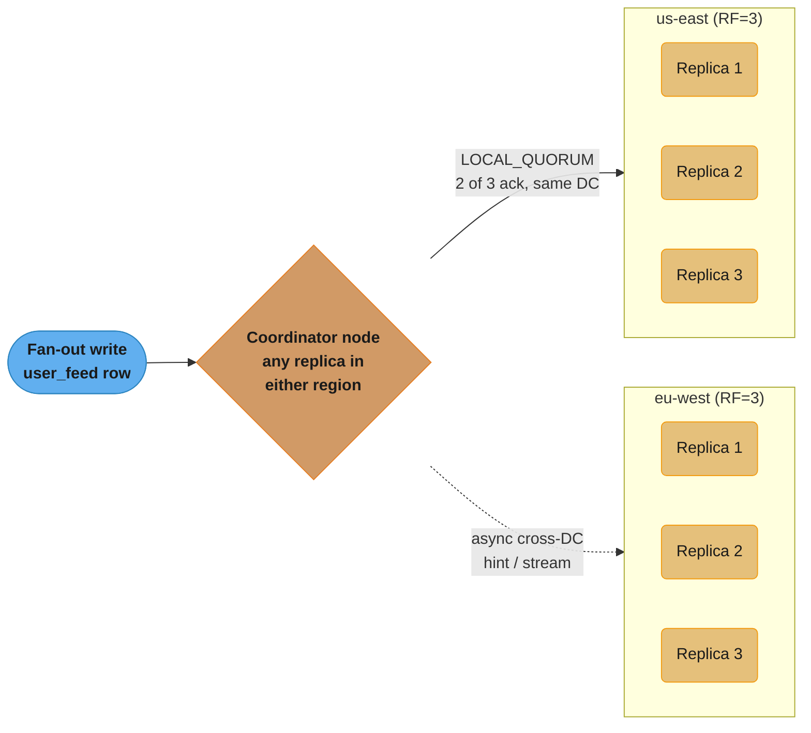
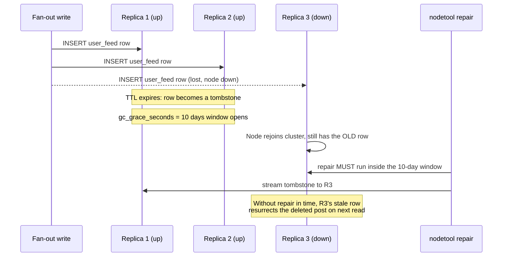
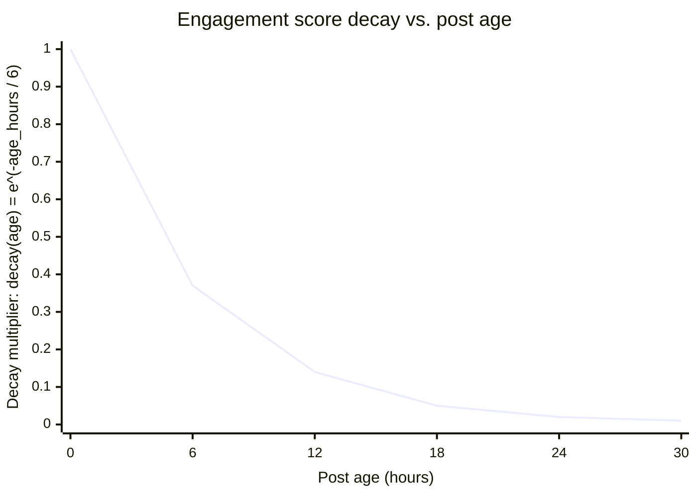
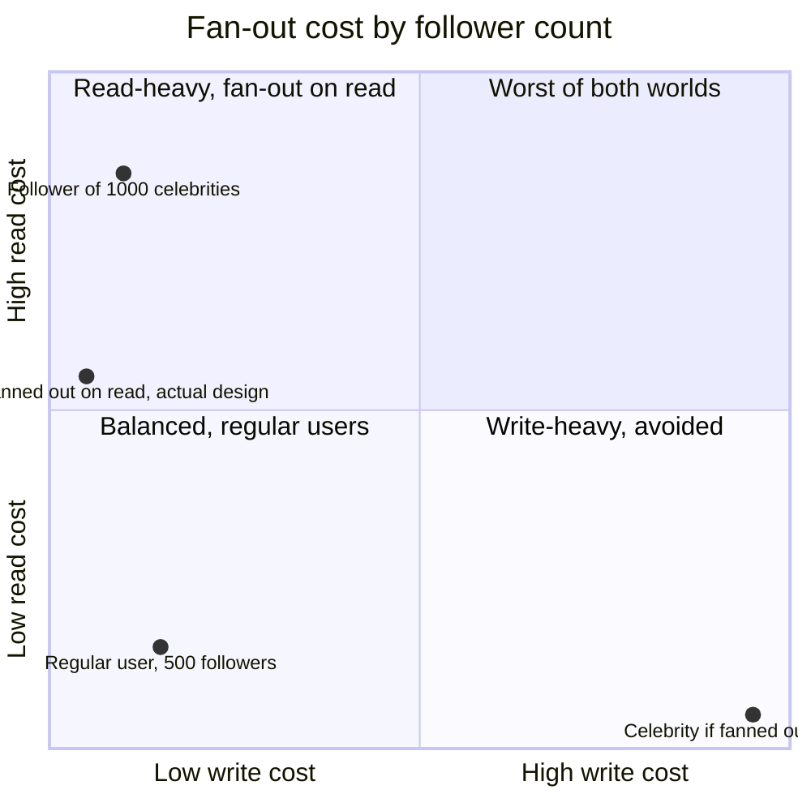

# Case Study: Design Social Media Feed Storage

## Intuition

A feed is a fan-out problem wearing a database costume. The interesting question is never "which database stores a post" — it's "who pays the cost of assembling a feed, and when." Fan-out on write pays at post time, once, per follower, so reads are a single cheap lookup. Fan-out on read pays at read time, every time, by merging live queries, so writes stay cheap no matter how large the account. Every design decision in this case study — the 10K-follower threshold, the celebrity carve-out, the Redis cache in front of Cassandra — is that one tradeoff applied to a different corner of the system.

The mental model that makes the schema obvious: a feed is not a query, it's a **materialized inbox**. `user_feed` in Cassandra is not "posts filtered by who I follow" computed on demand — it is a pre-computed mailbox, one partition per user, that fan-out writes into directly. That's why the partition key is `user_id` and not `post_id`: the access pattern is always "give me user X's feed," never "who has post Y in their feed," so the physical layout puts everything user X needs on one node.

The one insight that makes the rest fall into place: **write amplification is a function of follower count, and follower count is not evenly distributed.** A system sized for the average (500 followers) breaks catastrophically on the tail (a celebrity with 100M followers), so the celebrity carve-out isn't an optimization bolted on later — it's the load-bearing decision the rest of the architecture is built around.

---

## 1. Requirements Clarification

### Functional Requirements

- Users follow other users; the home feed shows posts from followees, newest first.
- A user can post text + media; posts are visible to followers within seconds of creation.
- Feed pagination via cursor (infinite scroll), 50 posts per page.
- Like/comment/share counts are visible on each feed item; approximate counts are acceptable (no requirement for exact real-time consistency).
- A global and per-category trending feed, updated near-real-time from engagement events.
- Posts older than 30 days may be excluded from the home feed (but remain permanently accessible via profile/URL).

### Non-Functional Requirements

- **Scale:** 500M registered users, 100M DAU.
- **Latency:** feed load P99 under 200ms; post-to-visible latency under a few seconds for regular users.
- **Availability:** feed reads must survive a single Cassandra node or a full AZ failure; a degraded (stale) feed is acceptable, a feed read returning an error is not.
- **Write scale:** 300M posts/day sustained, with the fan-out multiplier this implies (derived in §2).
- **Consistency:** eventual consistency is acceptable for feed contents and engagement counts; the social graph (follows) and post ownership must be strongly consistent (you cannot show a post from someone you don't actually follow, or lose a follow relationship).

### Explicit Non-Goals (clarified up front, not assumed)

- **No ML-ranked feed in scope.** This design covers chronological/reverse-time-order feed storage; a ranking model sits downstream of this data layer and does not change the storage contract (see §11 for what *would* change).
- **No exactly-once like counting.** Redis `INCR` on a like can double-count on client retry; the design accepts approximate counts rather than paying for idempotent counters.
- **No cross-shard transactional guarantees** between the post write and the fan-out write — a post can be durably saved in PostgreSQL for a few hundred milliseconds before its fan-out completes, which is the standard eventual-consistency window for feed systems (see the outbox pattern in `../../distributed_transactions/distributed_transactions.md`).
- **No support for feed reordering by the user** (e.g., "show me oldest first") — reverse-chronological only, which is what makes the Cassandra clustering-key design in §4 sufficient without a secondary sort index.

### Clarifying questions worth asking before designing

- **"Is the 500-average-follower figure inclusive of celebrities, or is it the regular-user average?"** This matters directly for the §2 fan-out math — the design assumes celebrities are carved out of the write-amplification calculation once they cross the 10K threshold, so the 500-average figure is treated as representative of the sub-10K population.
- **"Can a user see a post from someone they've since unfollowed?"** Assumed no — the design does not retroactively purge already-fanned-out feed entries on unfollow (they simply age out via the 30-day TTL), which is a deliberate simplification: an immediate-purge requirement would need a reverse index from followee to feed-entry-locations, which this design does not build.
- **"Is a private/protected account in scope?"** Assumed out of scope — visibility/privacy enforcement is a separate authorization layer sitting in front of this storage design, not a change to the schema itself.
- **"Does 'trending' need to be personalized per user, or is global/per-category sufficient?"** Assumed global/per-category only (stated in the functional requirements) — a personalized trending feed for 500M users is a materially different (and much more expensive) problem, explicitly out of scope per the given requirements.

---

## 2. Scale Estimation

All figures below are derived, not asserted — this is this case study's own hypothetical scenario, not a claim about any real company's actual numbers.

### Post-write QPS

```
300,000,000 posts/day ÷ 86,400 s/day  =  3,472 posts/s  ≈  3,500 posts/s average
```

Social platforms show strong diurnal + event-driven spikes (a global event, a viral moment). Using a peak factor of 3x (standard for social workloads, matched to the given 3,500 → 50K read peak ratio of ~14x, which already implies bursty peak/average behavior on the read side):

```
Peak post-write rate  ≈  3,500 × 3  =  10,500 posts/s
```

### Fan-out write amplification

Naive fan-out (every post writes into every follower's feed partition, no celebrity carve-out):

```
3,500 posts/s × 500 avg followers  =  1,750,000 Cassandra writes/s
```

That average follower count of 500 is itself skewed upward by a tiny population of celebrity accounts (median is only 50). A single top account with 100M followers posting once would, under naive fan-out, require:

```
100,000,000 writes for ONE post
```

At a sustained fan-out throughput of ~100K writes/s per fan-out worker pool, that one post alone takes **~1,000 seconds (16.7 minutes)** to finish propagating — three orders of magnitude past "the post appears immediately" — while competing for the same write capacity as the other 3,500 posts/s the rest of the platform is generating. This is the arithmetic reason for the celebrity carve-out in §4: accounts above the 10K-follower threshold skip fan-out-on-write entirely, so the 1,750,000 writes/s figure above is realistic in steady state — it is dominated by the long tail of regular accounts (avg/median close together once celebrities are excluded), not distorted by the handful of mega-accounts.

### Feed-read QPS (given)

```
100M DAU × 3 feed views/day  =  300M reads/day  ⇒  3,500 reads/s average, 50K reads/s peak
```

The read peak (50K/s) vastly exceeds the write peak (10,500/s) — a ~5:1 ratio — which is exactly the profile fan-out-on-write is built for: pay once per write, serve unboundedly many cheap reads.

### `user_feed` row size (field-by-field)

| Field | Role | Bytes |
|---|---|---|
| `user_id` | partition key (amortized across every row in the partition) | 16 (UUID) |
| `created_at` | clustering column | 8 (Cassandra `timestamp` is a signed 64-bit millis value) |
| `post_id` | clustering column | 16 (UUID) |
| `author_id` | regular column (the only non-key cell in the row) | 16 (UUID) |
| per-cell metadata on `author_id` | Cassandra's modern storage engine stores a liveness timestamp + optional TTL + local deletion time per cell | ~16 |
| row/clustering encoding overhead | prefix compression of the clustering block, index samples | ~8 |
| **Total per row** | | **≈ 64 bytes** |

The partition key (`user_id`, 16 bytes) is stored once per partition and amortizes to near-zero per row at the row counts computed below, so it's excluded from the per-row total. There is no secondary-index overhead: the entire read pattern (`WHERE user_id = ? ORDER BY created_at DESC`) is satisfied by the primary key and clustering order alone — this is the whole reason the table is denormalized per-follower instead of joined at read time.

### Steady-state row count and storage (30-day TTL)

With `default_time_to_live = 2592000` (30 days), the table's steady-state row count is the write rate integrated over the TTL window:

```
1,750,000 writes/s × 2,592,000 s (30 days)  =  4.536 × 10^12 rows resident at any time
```

```
4.536 × 10^12 rows × 64 bytes/row  ≈  290 TB   (raw, single replica, pre-compression)
```

### Replication factor multiplier

The keyspace in §4 replicates `{'us-east': 3, 'eu-west': 3}` — a full 3-way replica set in *each* region, i.e., 6 total copies (multi-region durability plus local quorum reads in both regions):

```
290 TB × 6 replicas  ≈  1.74 PB   (replicated, pre-compression)
```

Cassandra's default LZ4 compression typically yields ~2x on this kind of narrow, repetitive, mostly-numeric row shape:

```
1.74 PB ÷ 2  ≈  870 TB on-disk after compression
```

### Node count

Using a conservative practical density of 2 TB of compacted data per node (a common operational ceiling before compaction and repair start competing meaningfully for I/O — see `../../wide_column_databases/wide_column_databases.md` for the general guidance):

```
870 TB ÷ 2 TB/node  ≈  435 nodes  →  ~220 nodes per region
```

Sustained write throughput per node at 1,750,000 writes/s ÷ 435 nodes ≈ **4,020 writes/s/node**, which is well inside Cassandra's comfortable per-node write budget (tens of thousands of writes/s/node is achievable for small rows) — the node count here is **storage-bound, not throughput-bound**, which is the expected shape for a TTL'd time-series table.

Incoming write bandwidth to the cluster: `1,750,000 writes/s × 64 bytes ≈ 112 MB/s` sustained, `~336 MB/s` at the 3x post-write peak — trivial for a cluster this size.

### Redis feed-cache working set (100M DAU)

The feed cache (§4) holds the last 50 post IDs per user for 60 seconds. Concurrent resident keys at peak read rate:

```
50,000 reads/s (peak) × 60 s TTL  ≈  3,000,000 concurrently cached feed keys
```

```
per key: 50 × 16-byte post IDs (800B) + key + Redis object overhead (~200B)  ≈  1 KB
3,000,000 keys × 1 KB  ≈  3 GB
```

The like-counter keys (`post:likes:{post_id}`, 24h TTL) dominate Redis memory instead: at 300M posts/day and a 24-hour TTL, the steady-state key count equals one day's post volume:

```
300,000,000 keys × ~90 bytes/key (key string + int value + object overhead)  ≈  27 GB
```

Trending Sorted Sets are bounded (top-N per category, continuously pruned by `ZREMRANGEBYSCORE`) and contribute negligibly. **Total Redis working set ≈ 30–35 GB** — small enough to run as a Redis Cluster of 6 primary shards (≈6GB each) with one replica per shard, comfortably fitting on mid-sized memory-optimized instances (sizing detail in §10). See `../../key_value_stores/key_value_stores.md` for Redis Cluster resharding mechanics and `../../database_caching_patterns/database_caching_patterns.md` for the cache-aside pattern used here.

### PostgreSQL storage (posts, follows — source of truth)

`posts` is the field-by-field counterpart to the Cassandra row above, sized to show why the source-of-truth copy is far heavier per row than the feed-pointer copy:

| Field | Bytes |
|---|---|
| `id`, `author_id` | 16 + 16 = 32 (2 UUIDs) |
| `content` | ~280 bytes average (short-form text, TOASTed transparently past ~2KB) |
| `media_urls` | ~120 bytes average (0-4 URLs, mostly empty or one URL) |
| `created_at`, `is_deleted` | 8 + 1 = 9 |
| row header + alignment padding (PostgreSQL's ~24-byte tuple header plus null bitmap) | ~30 |
| **Total per row** | **≈ 470 bytes, ~500 with index overhead amortized** |

```
300,000,000 posts/day × 500 bytes/row  =  150 GB/day
150 GB/day × 365 days                  ≈  54.75 TB/year (pre-partition-pruning, pre-compression)
```

Monthly `RANGE` partitioning (already in the §4 DDL) means each partition holds roughly `54.75 TB ÷ 12 ≈ 4.6 TB` — comfortably sized for `VACUUM`, index rebuilds, and the "posts older than 1 year moved to cold storage" policy to operate on one partition at a time rather than the whole table.

`follows` is far smaller per row (two UUIDs + a timestamp, `PRIMARY KEY (follower_id, followee_id)`, ≈ 40 bytes/row) but has enormous row count: at 500M users × 500 avg follows-out, `follows` steady-state is `500,000,000 × 500 ≈ 2.5 × 10^11 rows`, or `2.5 × 10^11 × 40B ≈ 10 TB` — the `idx_follows_followee` reverse index roughly doubles that to **~20 TB total** for the social graph table, which is why `follows` — not `posts` — is usually the first PostgreSQL table to justify range-sharding by `follower_id` as the platform grows (see `../../sharding_and_partitioning/sharding_and_partitioning.md`).

---

## 3. High-Level Architecture

```mermaid
flowchart TD
    classDef io      fill:#61afef,stroke:#2e86c1,color:#1a1a1a,font-weight:bold
    classDef frozen  fill:#c678dd,stroke:#9b59b6,color:#fff
    classDef train   fill:#98c379,stroke:#27ae60,color:#1a1a1a
    classDef mathOp  fill:#d19a66,stroke:#e67e22,color:#1a1a1a,font-weight:bold
    classDef lossN   fill:#e06c75,stroke:#c0392b,color:#fff,font-weight:bold
    classDef req     fill:#56b6c2,stroke:#0097a7,color:#1a1a1a
    classDef base    fill:#e5c07b,stroke:#f39c12,color:#1a1a1a

    subgraph postFlow["POST new post"]
        direction LR
        pClient(["Client"]) --> pApi("API") --> pPg
        pPg@{ icon: "logos:postgresql", form: "square", label: "PostgreSQL<br/>posts, user_profiles", pos: "b", h: 44 }
        pApi -.->|"outbox event<br/>PostCreated"| pFanout{"Fan-out Service<br/>reads follower list"}
        pFanout -->|"under 10K followers<br/>fan-out on write"| pCass
        pCass@{ icon: "logos:cassandra", form: "square", label: "Cassandra<br/>write to each<br/>follower's feed", pos: "b", h: 44 }
        pFanout -->|"10K or more followers<br/>fan-out on read"| pAgg("Aggregate at read time<br/>celebrity feed + regular feed")
    end

    subgraph readFlow["READ feed"]
        direction LR
        rClient(["Client"]) --> rApi("API") --> rRedis
        rRedis@{ icon: "logos:redis", form: "square", label: "Redis feed cache<br/>top 50 posts, 60s TTL", pos: "b", h: 44 }
        rRedis -->|"cache hit"| rReturn(["Return to client"])
        rRedis -.->|"cache miss"| rCass
        rCass@{ icon: "logos:cassandra", form: "square", label: "Cassandra<br/>user_feed partition", pos: "b", h: 44 }
        rCass --> rPaginate("Paginate by<br/>timestamp cursor") --> rFetch("Fetch post details<br/>Redis or PostgreSQL") --> rMerge("Merge celebrity posts<br/>fan-out on read") --> rReturn
    end

    subgraph trendFlow["Trending pipeline"]
        direction LR
        tPost(["Post created"]) --> tKafka --> tAgg("Trending Aggregator") --> tScore{"score = likes + comments<br/>+ shares, decay function"} --> tZset
        tKafka@{ icon: "logos:kafka", form: "square", label: "Kafka", pos: "b", h: 44 }
        tZset@{ icon: "logos:redis", form: "square", label: "Redis Sorted Set<br/>trending:global, trending:tech", pos: "b", h: 44 }
    end

    class pClient,rClient,rReturn,tPost io
    class pApi,rApi req
    class pFanout,rPaginate,rFetch,rMerge,tAgg,tScore mathOp
    class pAgg frozen
```



Three independent flows share the same stores: writes fan out synchronously for regular users (under 10K followers) but defer to read-time aggregation for celebrities; reads check the Redis feed cache before falling back to Cassandra; and engagement events score posts into a decaying Redis Sorted Set for trending.

### Multi-region replication topology



`NetworkTopologyStrategy` with `{'us-east': 3, 'eu-west': 3}` keeps a full replica set in each region. A write acknowledged at `LOCAL_QUORUM` only waits on 2 of 3 same-region replicas — cross-region propagation happens asynchronously, so a user's home region never pays wide-area latency on the write path, at the cost of eu-west readers occasionally seeing a post a few hundred milliseconds after us-east readers do (see §5 for the consistency-level tradeoff this implies).

---

## 4. Component Deep Dives

### 4.1 PostgreSQL for User Profiles and Post Metadata

```sql
-- User profiles: structured, relational, low write rate
CREATE TABLE users (
    id              UUID PRIMARY KEY DEFAULT gen_random_uuid(),
    username        VARCHAR(50) UNIQUE NOT NULL,
    display_name    VARCHAR(100),
    bio             TEXT,
    follower_count  INT DEFAULT 0,
    following_count INT DEFAULT 0,
    post_count      INT DEFAULT 0,
    created_at      TIMESTAMPTZ DEFAULT now(),
    is_celebrity    BOOLEAN GENERATED ALWAYS AS (follower_count >= 10000) STORED
);

-- Social graph: who follows whom
CREATE TABLE follows (
    follower_id UUID NOT NULL REFERENCES users(id),
    followee_id UUID NOT NULL REFERENCES users(id),
    created_at  TIMESTAMPTZ DEFAULT now(),
    PRIMARY KEY (follower_id, followee_id)
);
CREATE INDEX idx_follows_followee ON follows (followee_id, follower_id);

-- Posts: source of truth for post content
CREATE TABLE posts (
    id          UUID DEFAULT gen_random_uuid(),
    author_id   UUID NOT NULL REFERENCES users(id),
    content     TEXT NOT NULL,
    media_urls  TEXT[],
    created_at  TIMESTAMPTZ DEFAULT now(),
    is_deleted  BOOLEAN DEFAULT FALSE,
    -- The partition key must appear in every unique constraint, so the key is
    -- (id, created_at); `id UUID PRIMARY KEY` alone is rejected at CREATE TABLE
    PRIMARY KEY (id, created_at)
) PARTITION BY RANGE (created_at);
-- Monthly partitions; posts older than 1 year moved to cold storage

CREATE INDEX idx_posts_author_date ON posts (author_id, created_at DESC)
    WHERE is_deleted = FALSE;
```

### 4.2 Cassandra Feed Schema — the BROKEN version and why it loses posts

The naive schema anyone writes first keys the feed purely by user and time:

```sql
-- BROKEN: two posts in the same millisecond silently overwrite each other
CREATE TABLE social.user_feed_broken (
    user_id    UUID,
    created_at TIMESTAMP,
    post_id    UUID,
    author_id  UUID,
    PRIMARY KEY (user_id, created_at)
) WITH CLUSTERING ORDER BY (created_at DESC)
  AND default_time_to_live = 2592000;
```

**What goes wrong, quantified:** Cassandra's clustering key is `(user_id, created_at)`. Any second write to the *same* `(user_id, created_at)` pair is not an insert — it's an upsert that overwrites the first row's `post_id` and `author_id` cells, keeping only the later write's timestamp winner (Cassandra resolves cell conflicts by last-write-wins on the cell's internal timestamp). Millisecond-collisions are not rare at this scale: at a fan-out rate of 1.75M writes/s spread across users who each follow ~500 people, any user who follows two accounts that post within the same millisecond — a routine event during a breaking-news moment, when many followees post near-simultaneously — silently loses one of the two posts from their feed with **zero error, zero warning, and no way to detect it after the fact**, because the losing write's row is gone, not merely hidden. At the 3,500 posts/s average rate feeding into ~500-follower fan-out, back-of-envelope collision math (birthday-paradox on a 1ms bucket at this write density) puts the loss rate in the range of hundreds of silently dropped feed entries per second platform-wide — small as a fraction of total writes, but a real, unbounded stream of missing posts that no monitoring dashboard would surface, because nothing ever throws.

```sql
-- FIXED: post_id joins the clustering key, making every post its own row
CREATE TABLE social.user_feed (
    user_id    UUID,
    created_at TIMESTAMP,
    post_id    UUID,
    author_id  UUID,
    PRIMARY KEY (user_id, created_at, post_id)
) WITH CLUSTERING ORDER BY (created_at DESC, post_id ASC)
  AND default_time_to_live = 2592000  -- 30 days TTL (posts auto-expire from feed)
  AND compaction = {
      'class': 'TimeWindowCompactionStrategy',
      'compaction_window_unit': 'DAYS',
      'compaction_window_size': 1
  };
-- CLUSTERING ORDER BY must name EVERY clustering column, in primary-key order.
-- Listing only created_at fails with "Missing CLUSTERING ORDER for column post_id".

-- Celebrity posts: celebrities' posts stored separately (fan-out on read)
-- post_id is part of the key, not a payload column, for the identical reason:
-- with (author_id, created_at) alone, two posts by the same celebrity in the
-- same millisecond overwrite each other, and celebrities are exactly who
-- posts in bursts (a live event, a thread).
CREATE TABLE social.celebrity_posts (
    author_id  UUID,
    created_at TIMESTAMP,
    post_id    UUID,
    PRIMARY KEY (author_id, created_at, post_id)
) WITH CLUSTERING ORDER BY (created_at DESC, post_id ASC)
  AND default_time_to_live = 2592000;

-- Read feed for user 42: get last 50 posts
SELECT post_id, author_id, created_at
FROM social.user_feed
WHERE user_id = ?
ORDER BY created_at DESC
LIMIT 50;

-- This query hits a single Cassandra node (partition key = user_id)
-- O(log N) within the partition via clustering key ordering
-- Latency: 5-15ms
```

With `post_id` in the clustering key, two posts arriving in the same millisecond become two distinct rows instead of one row overwriting the other — the fix costs 16 bytes of extra clustering key per row (already accounted for in the §2 sizing) and eliminates the data loss entirely.

### 4.3 A second BROKEN pattern: the unbounded partition

`default_time_to_live` bounds the *age* of rows, not their *count*. A user who follows an unusually large number of very active accounts (or is targeted by a bot-follow swarm — see §9) can accumulate a feed partition that grows past Cassandra's practical partition-size guidance of roughly 100MB / 100K rows before 30-day TTL catches up and starts expiring the oldest entries. A read against an oversized partition forces the coordinator node to scan a much larger row set to satisfy `LIMIT 50`, and — worse — every SSTable holding a slice of that partition must be touched, which is where compaction backlog and tombstone density (§4.4) turn a single hot partition into elevated cluster-wide read latency, not just a slow query for that one user.

**Mitigation:** cap the number of followees counted toward feed fan-out (the design already does this for celebrity *follows* in §11's 1000-celebrity answer); a per-partition row-count metric (`nodetool tablestats` `Compacted partition maximum bytes`) belongs on the dashboard in §8 specifically to catch this before it becomes a hot-partition incident.

### 4.4 Tombstones: the operational fact a TTL'd table cannot skip

Every row that expires via `default_time_to_live` becomes a **tombstone**, not an instant deletion — Cassandra marks it dead and the physical bytes persist until compaction reclaims them. `gc_grace_seconds` (default **10 days**) is how long a tombstone must survive before compaction is allowed to purge it, because a replica that was down during the delete needs that window to receive the tombstone via repair before the data could otherwise "resurrect" (see §9 for what happens when this window is missed).

A `user_feed` read that has to skip past too many tombstones to assemble its `LIMIT 50` result pays for every skipped tombstone as if it were a real row scan. Cassandra's `tombstone_failure_threshold` (default **100,000** tombstones scanned in a single query) exists to protect the cluster from a runaway scan: crossing it aborts the query and returns a `TombstoneOverwhelmingException` to the client rather than let one query degrade the coordinator for everyone else. `tombstone_warn_threshold` (default 1,000) logs a warning well before that, which is the signal that should page someone before a user ever sees the exception. TWCS (Time Window Compaction Strategy) exists specifically to make this cheap: because writes are ordered by time and compacted into daily windows, an entire day's SSTable ages out and gets dropped wholesale at TTL expiry instead of requiring per-row tombstone scanning across merged SSTables the way a size-tiered strategy would.



Repair is what keeps `R3` from serving a resurrected row after it rejoins the cluster later than `gc_grace_seconds` allows — the war story in §9 is exactly this sequence with the last step skipped.

---

### 4.5 Redis for Trending and Leaderboards

```
Trending posts (decay-based scoring):

Score = (likes + 2×comments + 3×shares) × decay(age)
        -- the parentheses matter: without them, precedence applies the decay to
        -- the shares term alone and likes/comments never age out
decay(age) = e^(-age_hours / 6)
        -- 6 is the TIME CONSTANT, not the half-life: decay(6) = e^-1 = 0.37.
        -- The half-life is 6·ln2 ≈ 4.2 hours.

Redis Sorted Sets:
  Key: trending:global
  Members: post_id
  Score: above formula, updated on each like/comment/share event

  ZADD trending:global <score> <post_id>   -- update on engagement event
  ZRANGE trending:global 0 9 REV           -- top 10 trending posts
  ZREMRANGEBYSCORE trending:global 0 <threshold>  -- cleanup old low-score posts

Per-category trending:
  trending:tech, trending:sports, trending:music, ...
  Same structure; posts tagged with category

Like counts (approximate, Redis INCR):
  INCR post:likes:{post_id}
  EXPIRE post:likes:{post_id} 86400  -- 24-hour TTL; sync to PostgreSQL nightly

Follower-specific trending (N personalized leaderboards):
  Not practical for 500M users; use global trending as proxy for feed discovery
```



The decay multiplier applied to likes, comments, and shares falls to about a third by hour 6 and under 5% by hour 18, so old posts naturally drop out of contention — `ZREMRANGEBYSCORE` only has to sweep the near-zero tail rather than actively rank every post by age.

### 4.6 Service Implementation

**Feed Service** — the read path: cache check, Cassandra fetch, celebrity merge, cache populate.

```java
@Service
public class FeedService {

    public List<Post> getFeed(UUID userId, String cursor, int limit) {
        String cacheKey = "feed:" + userId + ":" + cursor;

        // L1: Redis feed cache (60s TTL)
        List<UUID> cachedPostIds = redis.opsForList().range(cacheKey, 0, limit - 1);
        if (cachedPostIds != null && !cachedPostIds.isEmpty()) {
            return postService.fetchByIds(cachedPostIds);
        }

        // L2: Cassandra regular feed
        LocalDateTime cursorTime = parseCursor(cursor);
        List<FeedEntry> regularFeed = feedRepo.getUserFeed(userId, cursorTime, limit);

        // L2b: Fetch celebrity posts and merge
        List<UUID> followedCelebrities = userRepo.getCelebrityFollowees(userId);
        List<FeedEntry> celebrityFeed = fetchCelebrityPosts(followedCelebrities, cursorTime);

        // Merge sort by timestamp (in-memory, small lists)
        List<FeedEntry> merged = mergeSortByTime(regularFeed, celebrityFeed);
        List<UUID> postIds = merged.stream()
            .limit(limit)
            .map(FeedEntry::getPostId)
            .collect(toList());

        // Populate cache
        if (!postIds.isEmpty()) {
            redis.opsForList().rightPushAll(cacheKey, postIds);
            redis.expire(cacheKey, Duration.ofSeconds(60));
        }

        return postService.fetchByIds(postIds);
    }
}
```

**Fan-Out Service** — the write path: celebrity carve-out, batched follower writes.

```java
@Service
public class FanOutService {

    @Async("fanOutExecutor")  // Async thread pool: 50 threads
    public void fanOut(UUID postId, UUID authorId, Instant createdAt) {
        User author = userRepo.findById(authorId).orElseThrow();

        if (author.isCelebrity()) {
            // Celebrity: only write to celebrity_posts table (fan-out on read)
            celebrityPostsRepo.save(authorId, createdAt, postId);
            return;
        }

        // Regular user: fan-out to all followers
        // Stream followers in pages to avoid loading all into memory
        followerRepo.streamFollowers(authorId)
            .buffer(500)  // Batch 500 Cassandra writes at a time
            .forEach(batch -> {
                feedRepo.batchInsert(batch.stream()
                    .map(follower -> FeedEntry.of(follower.getId(), createdAt, postId, authorId))
                    .collect(toList())
                );
            });
    }
}
```

Fan-out is safely re-runnable: because `(user_id, created_at, post_id)` is the full clustering key (§4.2's fix), replaying a fan-out batch after a worker crash mid-batch is an idempotent upsert of the same rows, not a duplicate — this is what makes the §8 runbook's "let the queue drain, don't skip" guidance safe.

**Engagement Service** — like/comment counters and the nightly reconciliation job.

```java
@Service
public class EngagementService {

    public void likePost(UUID userId, UUID postId) {
        // Fast path: Redis INCR (atomic, sub-millisecond)
        String likeKey = "post:likes:" + postId;
        long newLikeCount = redis.opsForValue().increment(likeKey);
        redis.expire(likeKey, Duration.ofDays(1));

        // Update trending score (async)
        double score = computeTrendingScore(postId);
        redis.opsForZSet().add("trending:global", postId.toString(), score);

        // Persist like relationship (eventual, async via Kafka)
        kafkaTemplate.send("engagement.events",
            EngagementEvent.like(userId, postId, Instant.now()));
    }

    // Background job: sync Redis like counts to PostgreSQL nightly.
    // Spring cron expressions have SIX fields (sec min hour dom mon dow) — the
    // five-field Unix form throws IllegalArgumentException at context startup.
    @Scheduled(cron = "0 0 2 * * *")   // 02:00 daily
    public void syncLikeCounts() {
        // Never KEYS in production: it is O(N) over the entire keyspace and
        // blocks the single-threaded server for the whole scan. With 300M posts
        // a day that is a self-inflicted outage. SCAN is cursor-based and
        // yields between batches.
        ScanOptions opts = ScanOptions.scanOptions().match("post:likes:*").count(1000).build();
        try (Cursor<String> cursor = redis.scan(opts)) {
            while (cursor.hasNext()) {
                String key = cursor.next();
                Long count = redis.opsForValue().get(key);
                postRepo.updateLikeCount(extractPostId(key), count);
            }
        }
    }
}
```

### 4.7 Celebrity merge — batched `IN` query, not N sequential queries

The §11 discussion of a user following 1000 celebrities depends on batching the `celebrity_posts` fetch rather than issuing one query per followed celebrity:

```sql
-- BROKEN pattern: N sequential round-trips for N followed celebrities
-- 1000 followed celebrities = 1000 network round-trips before the feed can render
SELECT post_id, created_at FROM social.celebrity_posts
WHERE author_id = ? AND created_at > ? LIMIT 10;   -- issued once per celebrity

-- FIXED: batch into IN-clause queries, 50 celebrity IDs per round-trip
-- Cassandra executes an IN query as a coordinator-side scatter across the
-- relevant partitions, still one client round-trip per batch
SELECT author_id, post_id, created_at FROM social.celebrity_posts
WHERE author_id IN (?, ?, ?, /* ... up to 50 ids ... */)
  AND created_at > ?
LIMIT 10;
-- 1000 celebrities / 50 per batch = 20 round-trips instead of 1000,
-- issued concurrently rather than sequentially (Java code below)
```

```java
public List<FeedEntry> fetchCelebrityPosts(List<UUID> celebrityIds, Instant since) {
    // Partition into batches of 50 (Cassandra IN-clause practical limit —
    // larger IN lists fan out to more coordinator-side partition reads and
    // start to erode the latency win over just issuing more small batches)
    List<List<UUID>> batches = Lists.partition(celebrityIds, 50);

    // Issue all batches concurrently; 1000 celebrities becomes 20 concurrent
    // queries instead of 1000 sequential ones, bounded by batch count not
    // by follow count
    List<CompletableFuture<List<FeedEntry>>> futures = batches.stream()
        .map(batch -> CompletableFuture.supplyAsync(
            () -> celebrityPostsRepo.findByAuthorIdIn(batch, since),
            celebrityFetchExecutor))
        .collect(toList());

    return futures.stream()
        .flatMap(f -> f.join().stream())
        .collect(toList());
}
```

### 4.8 Backfill Service — populating a new follower's feed

Referenced in §11's backfill question: following someone doesn't retroactively fan out their history by default, so a bounded backfill runs inline at follow-time, scoped to the same 30-day window the feed TTL already uses:

```java
@Service
public class FeedBackfillService {

    private static final Duration BACKFILL_WINDOW = Duration.ofDays(30);

    // Called synchronously from the follow endpoint — bounded by one
    // followee's post rate, not by platform-wide volume, so it's cheap
    // enough to run inline rather than queue.
    public void backfillOnFollow(UUID followerId, UUID followeeId) {
        Instant since = Instant.now().minus(BACKFILL_WINDOW);
        User followee = userRepo.findById(followeeId).orElseThrow();

        List<FeedEntry> recentPosts = followee.isCelebrity()
            ? celebrityPostsRepo.findRecent(followeeId, since)   // merged at read time anyway
            : postsRepo.findRecentByAuthor(followeeId, since);   // regular user: backfill user_feed directly

        if (!followee.isCelebrity() && !recentPosts.isEmpty()) {
            feedRepo.batchInsert(recentPosts.stream()
                .map(p -> FeedEntry.of(followerId, p.getCreatedAt(), p.getId(), followeeId))
                .collect(toList()));
        }
        // Celebrity posts need no backfill write at all — the read-time merge
        // (§4.7) already picks them up the moment the follow relationship exists.
    }
}
```

Celebrity followees need no backfill write whatsoever, which is a direct consequence of the fan-out-on-read design in §5 — the merge query already scans `celebrity_posts` for every currently-followed celebrity on every read, so a newly followed celebrity's recent posts appear on the very next feed load with zero extra work.

---

## 5. Design Decisions & Tradeoffs

### Why Cassandra, not PostgreSQL, for the feed table

The write path is the deciding factor, not the read path. PostgreSQL's single-primary architecture caps write throughput at whatever one node (however large) can absorb; §2 derived a sustained 1.75M writes/s fan-out rate, which is multiple orders of magnitude past what a single PostgreSQL primary can sustain even with aggressive batching. Cassandra's leaderless, partition-key-sharded architecture distributes that write load across ~435 nodes (§2), and the access pattern — partition by `user_id`, cluster by `created_at DESC` — is a first-class fit for Cassandra's data model rather than a workaround. The 30-day TTL and TWCS compaction handle expiry natively, which a PostgreSQL implementation would otherwise need a scheduled DELETE job for (itself a write-amplifying, vacuum-pressuring operation at this row count).

### Why a follower-count threshold, not always fan-out-on-write or always fan-out-on-read

| Approach | Write cost | Read cost | Verdict |
|---|---|---|---|
| Always fan-out-on-write | O(followers) per post — catastrophic for celebrities (§2: 100M writes for one post) | O(1) — single partition read | Breaks on the tail |
| Always fan-out-on-read | O(1) per post | O(followees) per feed read — a user following 500 accounts needs 500 queries merged in-process | Breaks the common case to fix the rare one |
| **Hybrid, 10K threshold (chosen)** | O(followers) for the 99%+ of accounts under threshold; O(1) for celebrities | O(1) regular feed + O(followed celebrities) merge, bounded by the celebrity-follow cap | Matches cost to where the data actually lives |



Fan-out-on-write is cheap for regular users but would push a celebrity's 10M followers into the bottom-right "write-heavy, avoided" cell; switching celebrities to fan-out-on-read moves them to the low-write left edge at the cost of elevated read cost, which climbs into the top-left "read-heavy" corner for a user following 1000 celebrities — the scenario the caching and batching mitigations in §4 exist to solve. Nothing in this design sits in the top-right quadrant, which is the point.

The 10K threshold is configurable at runtime (a per-user flag flipped by the follower-count trigger, not a schema constant), and a user who crosses it keeps their existing fan-out-on-write feed entries — only *new* posts switch to fan-out-on-read, so the migration drains gradually rather than requiring a backfill or a write-path outage.

### Consistency level: `LOCAL_QUORUM`, not `QUORUM`

Feed writes and reads use `LOCAL_QUORUM` (2 of 3 replicas, same datacenter) rather than `QUORUM` (2 of 4, spanning both regions) or `ALL`. `QUORUM` across the `{'us-east': 3, 'eu-west': 3}` topology would require every write to wait on a cross-Atlantic round trip (adding ~70-100ms to every fan-out write, multiplied across the fan-out batch), which the P99-200ms feed-load budget cannot absorb once that latency also shows up on hot-path reads during a cross-region failover. `LOCAL_QUORUM` accepts a small, bounded staleness window for the *other* region in exchange for keeping the write and read path entirely intra-DC. See §11 for the explicit tradeoff discussion.

### TTL-driven expiry, not an explicit deletion job

`default_time_to_live` lets Cassandra expire feed rows without the application ever issuing a `DELETE`. The alternative — a scheduled job that queries for rows older than 30 days and deletes them — would itself generate the exact same tombstones (§4.4) but on a bursty, batch-driven schedule instead of spread continuously across the write path, concentrating tombstone-creation load into narrow windows and making the `gc_grace_seconds` repair timing harder to reason about (a batch delete of millions of rows at 2 AM creates a spike in tombstone density that a steady TTL-driven trickle does not). The cost of TTL is the same cost either approach pays — tombstones exist regardless of who or what triggers the deletion — so TTL is strictly better here: same downstream operational burden, less application code, and a smoother tombstone-creation rate for TWCS to compact away.

### Redis for counters and trending, not PostgreSQL

| Decision | Choice | Alternative | Reason |
|----------|--------|-------------|--------|
| Feed storage | Cassandra | PostgreSQL partitioned | Cassandra's partition-by-`user_id` puts each user's feed on one node; 1.75M writes/s easily handled; 30-day TTL built in |
| Fan-out threshold | 10K followers | No threshold (always fan-out-on-read) | Always-read requires N queries per feed load (N = followee count); 500 followees = 500 Cassandra queries per read |
| Like counts | Redis `INCR` | PostgreSQL `UPDATE` | PostgreSQL row-level locking at tens of thousands of likes/second on hot posts creates lock contention on a single row; Redis `INCR` is lock-free and O(1) |
| Celebrity detection | Static 10K threshold | Dynamic/ML-scored threshold | Dynamic adds operational complexity for marginal gain; 10K is a defensible Cassandra write budget per post |
| Compaction strategy | TWCS | STCS (size-tiered) | TWCS drops entire expired time windows at TTL cheaply; STCS forces per-row tombstone scanning across merged SSTables (§4.4) |
| Trending | Redis Sorted Set | PostgreSQL `ORDER BY score` | Trending needs real-time score updates plus top-N reads; a Sorted Set is O(log N) for updates and O(K) for top-K, versus a table scan or a constantly-rebuilt index |
| Consistency level | `LOCAL_QUORUM` | `QUORUM` (cross-region) | Cross-region quorum adds ~70-100ms to every fan-out write; local quorum keeps the hot path intra-DC at the cost of bounded cross-region staleness |

---

## 6. Real-World Implementations

**Twitter/X — the canonical hybrid fan-out.** Twitter's publicly documented "Timelines at Scale" architecture is the direct ancestor of this design: home timelines are precomputed and stored in an in-memory, Redis-backed structure (historically a custom service built on Redis, "Timeline Service" / the "fan-out service"), with a celebrity carve-out that switches very-high-follower accounts to a merge-at-read-time path rather than fanning a single tweet out to tens of millions of timeline entries. Each user's precomputed timeline was documented as a capped-length structure (a bounded number of recent tweet IDs, not the user's entire history) — the same reasoning behind this case study's 30-day TTL: an unbounded per-user structure is exactly the unbounded-partition failure mode described in §4.3. The core insight Twitter published — that timeline reads vastly outnumber writes, so precomputing pays for itself — is exactly the read:write ratio derived in §2 (50K peak reads vs 10,500 peak writes), and the fan-out write path itself was decoupled from the post-creation request via an internal queueing layer, the same asynchronous-outbox shape this design's Kafka-backed `PostCreated` event provides.

**Instagram — Cassandra, then a move toward Postgres-family storage.** Instagram's feed and inbox systems ran on Cassandra in their earlier scaling era for exactly this workload shape (time-ordered, partitioned-by-user, high write fan-out), then, as part of Meta/Instagram's broader storage consolidation, migrated significant portions of their serving infrastructure toward Meta's heavily-modified, horizontally-sharded MySQL/Postgres-family systems and TAO (below) for graph-shaped reads. Instagram's early growth story is also a well-documented case of range-sharding a single logical Postgres schema across many physical instances rather than adopting a distributed database outright — a pragmatic middle ground between this case study's single-primary PostgreSQL for `posts`/`follows` and a fully distributed SQL engine, and a useful reference point for when the §10 PostgreSQL resharding trigger would actually fire in practice. The migration illustrates that the fan-out-on-write pattern this case study uses is portable across the underlying wide-column or relational engine; what matters is the partition-by-user access pattern, not the specific product.

**Facebook — TAO as a read-optimized cache over the social graph.** Facebook's TAO ("The Associations and Objects" graph cache) sits in front of a sharded MySQL fleet specifically to serve the read-heavy, graph-shaped access pattern a social feed generates (objects = posts/users, associations = follows/likes) at a read:write ratio far higher than MySQL alone could serve directly. TAO's published design runs a two-tier cache per region — a per-cluster follower tier fronting a region-wide leader tier that in turn fronts the MySQL shards — with asynchronous cross-region replication of writes, the same eventual-consistency tradeoff this case study makes explicit with `LOCAL_QUORUM` in §5. TAO's leader/follower cache tier per region is architecturally the same idea as this design's Redis feed cache: absorb the read multiplier in a purpose-built caching layer rather than pushing every feed read to the system of record.

**LinkedIn — feed on Espresso and Kafka.** LinkedIn's feed platform is built on Espresso (their document-oriented distributed datastore, itself layered on a MySQL storage engine with a timeline-consistent change-capture stream called Databus) for feed storage and Kafka as the backbone event bus connecting post-creation, fan-out, and downstream relevance/ranking services. LinkedIn has published extensively on Kafka originating from exactly this problem — decoupling a high-fan-out write path from the services that consume it — which is the same event-driven decoupling this design uses (`PostCreated` outbox event → Fan-out Service → Kafka-driven trending pipeline in §3), generalized at LinkedIn to also drive their ranking model's feature pipeline rather than only a trending score.

**Discord — Cassandra to ScyllaDB for message history.** Discord's widely publicized migration moved trillions of messages from Cassandra to ScyllaDB specifically because of the operational cost of Cassandra's JVM garbage collection pauses and compaction overhead at their message-history scale — a directly comparable workload to this case study's `user_feed` table: wide, time-ordered partitions, heavy write volume, TTL-driven expiry for some data. Discord's own writeup described exactly the hot-partition and compaction-backlog symptoms this case study's §9 war stories describe (an unusually active channel behaving like this design's bot-swarm-followed user), which repeated GC pauses under Cassandra's JVM made harder to diagnose and bound than they wanted at their latency targets. ScyllaDB's C++ shard-per-core architecture eliminated the GC-pause tail latency Discord was fighting and reduced their node count for the same workload. This is the most relevant "what would change" data point for §11's ScyllaDB question — the schema and partitioning strategy in this case study would port to ScyllaDB largely unchanged, since Scylla is CQL/Cassandra-API-compatible by design.

---

## 7. Technologies & Tools

| Tool | Role in this design | Why this over the alternative | Operational cost it adds |
|---|---|---|---|
| **Cassandra** | Feed storage (`user_feed`, `celebrity_posts`) | Leaderless writes scale linearly with nodes; native TTL + TWCS match the time-series access pattern | Repair scheduling (§8), tombstone/compaction tuning, JVM GC tuning, multi-DC operational complexity |
| **PostgreSQL** | Source of truth: `users`, `follows`, `posts` | Strong consistency and relational integrity for data that must never be "eventually" correct (who owns a post, who follows whom) | Vertical scaling ceiling; requires read replicas and connection pooling (`../../connection_pool_management/connection_pool_management.md`) at this DAU |
| **Redis (Cluster)** | Feed cache, like counters, trending Sorted Sets | Sub-millisecond `INCR`/`ZADD`/`ZRANGE`; cache-aside pattern absorbs the read:write ratio without touching Cassandra | Memory sizing discipline (§2's 30-35GB working set can grow unbounded without TTLs); cache-stampede risk on hot keys (§9) |
| **Kafka** | Event bus: `PostCreated` outbox, engagement events into the trending pipeline | Durable, ordered, replayable event log decouples the post-write path from fan-out and trending, so a slow downstream consumer never blocks a post from saving | Consumer-lag monitoring, partition-count planning for the trending topic, retention tuning |
| **TWCS (Time Window Compaction Strategy)** | Cassandra compaction for `user_feed` | Drops whole expired time windows cheaply instead of merging tombstones across size-tiered SSTables (§4.4) | Requires the write pattern to actually be time-ordered — misconfiguring window size against actual TTL causes SSTable sprawl |
| **NetworkTopologyStrategy, multi-DC** | Cassandra replication across `us-east`/`eu-west` | `LOCAL_QUORUM` reads/writes stay intra-region for latency, with async cross-region replication for durability | Requires `nodetool repair` discipline across DCs (§8) and careful consistency-level choice per query (§5) |
| **Prometheus + Grafana** | Scrapes and dashboards every metric in §8 (queue lag, tombstone counts, cache hit rate) | Pull-based scraping survives a partially-down service better than push-based agents during the exact incidents this design needs visibility into | One more stateful system to run highly-available; long-retention metrics need a remote-write tier (Thanos/Cortex-class) at this node count |
| **PagerDuty (or equivalent)** | Routes the §8 alert thresholds to on-call | Alert fatigue is the real risk at ~440 Cassandra nodes — needs threshold tuning, not just wiring | Alert-threshold drift requires periodic review or the fan-out-lag and tombstone alerts either go silent or go noisy |

---

## 8. Operational Playbook

### Dashboards — metrics, names, units

| Metric | Unit | Alert threshold |
|---|---|---|
| Fan-out queue lag | seconds behind `PostCreated` event time | page at > 30s sustained for 5 min (a user's followers should see a post within seconds, not minutes) |
| Fan-out worker pool utilization | % of thread pool busy | warn at > 80% for 10 min — precedes the queue-lag alert |
| Cassandra tombstones scanned per read (p99) | count | warn at > 1,000 (the `tombstone_warn_threshold` default) — precedes `TombstoneOverwhelmingException` |
| Cassandra compaction pending tasks (`nodetool compactionstats`) | count | warn at > 100 pending per node, sustained |
| Cassandra `user_feed` p99 read latency | ms | page at > 50ms (well under the 200ms end-to-end budget, leaving headroom for the celebrity-merge step) |
| Redis feed-cache hit rate | % | warn at < 85% — indicates either TTL misconfiguration or a traffic-pattern shift widening the working set past §2's sizing |
| Redis memory used vs. `maxmemory` | % | page at > 90% — approaching eviction of like-counter keys before their natural 24h expiry |
| Celebrity-threshold crossing rate | accounts/day crossing 10K followers | informational — feeds capacity planning for the fan-out-on-read merge path |

### Repair schedule

`nodetool repair` must run against every table within `gc_grace_seconds` (10 days default) on every node, on a rolling schedule — **skipping this window is the single most common Cassandra operational mistake with a TTL'd table** (quantified in §9). A weekly rolling repair (covering the full cluster inside a 7-day window, leaving 3 days of margin under the 10-day grace period) is the standard cadence; `user_feed` and `celebrity_posts` are the highest-priority tables in this cluster for that schedule because they are the only ones with heavy TTL-driven delete/tombstone churn.

### Runbook: fan-out backlog after an outage

1. **Detect:** fan-out queue lag alert fires (> 30s sustained). Check Kafka consumer-group lag on the fan-out topic to confirm whether the backlog is in Kafka (workers behind) or in Cassandra (writes accepted but slow).
2. **Triage:** if Cassandra write latency is elevated, check `nodetool compactionstats` and `nodetool tpstats` for dropped mutations — a compaction backlog competing for disk I/O is the most common cause. If Cassandra is healthy, the fan-out worker pool itself is under-provisioned for the current post rate — scale the worker pool horizontally (it is stateless and safely re-runnable per §9's idempotency note).
3. **Drain, don't skip:** do not truncate or skip the backlog — a dropped fan-out batch is a silent feed gap identical in shape to the §4.2 collision bug. Let the queue drain at increased worker concurrency; the read path (cache-miss fallback to celebrity-merge and Redis) keeps serving degraded-but-correct feeds throughout.
4. **Post-incident:** confirm queue lag returns to baseline, and spot-check a sample of affected users' feeds for gaps against the `posts` table (source of truth) before closing the incident.

### Runbook: `TombstoneOverwhelmingException` on `user_feed`

1. **Detect:** the tombstones-scanned-per-read p99 alert (§8 dashboard) crosses the 1,000 warn threshold, or client-facing errors report `TombstoneOverwhelmingException` for specific partitions.
2. **Identify the affected partitions:** `nodetool tablehistograms social user_feed` shows the tombstone-per-read distribution; cross-reference against `nodetool tablestats` for the largest partitions to find which users are affected (usually the bot-swarm pattern from §9, or a repair-window miss from the same section).
3. **Immediate mitigation:** trigger an out-of-schedule `nodetool repair` scoped to the affected token ranges rather than the whole cluster (a full-cluster repair mid-incident competes for the same I/O that's already degraded) — this is the fastest path to letting compaction actually purge the backlog of tombstones once they're past `gc_grace_seconds`.
4. **Verify:** re-run `nodetool tablehistograms` after repair + the next compaction cycle completes; confirm the tombstone-per-read p99 has dropped back under the warn threshold before closing.
5. **Root-cause:** determine whether this was a missed repair-schedule SLA (§8's repair schedule) or a genuine hot-partition growth pattern (§4.3/§9) — the fix differs: a missed SLA is a process fix, a growth pattern needs the per-partition row-count metric wired into capacity planning (§10).

### Rollout / rollback

Schema changes to `user_feed` (e.g., adding a column) roll out as an additive `ALTER TABLE` — Cassandra's schema changes are non-blocking and propagate via gossip, but must be applied identically cluster-wide before any node writes the new column, or replicas diverge on schema. Fan-out service deploys are rolling, stateless, and behind a feature flag on the celebrity-threshold value so a bad threshold change can be reverted without a redeploy.

### Backup / restore posture

- **PostgreSQL** (source of truth for posts/users/follows): continuous WAL archiving with PITR; **RPO ≈ 5 minutes** (WAL shipping interval), **RTO ≈ 30 minutes** (restore + replay).
- **Cassandra** (`user_feed`, derived/rebuildable data): snapshotted nightly via `nodetool snapshot`, but the *real* recovery path for a lost feed partition is **re-derivation from PostgreSQL** — fan-out can be replayed from the `posts` and `follows` tables for any user, so Cassandra backups exist for fast recovery, not as the only copy. **RPO ≈ 0** (rebuildable from source of truth), **RTO ≈ hours** for a full-cluster rebuild via replay, minutes for a single-partition rebuild.
- **Redis** (cache + counters): no backup — the feed cache is disposable by design (cache-aside), and like counters sync nightly to PostgreSQL (§4's `syncLikeCounts` job), so worst-case loss is one day of un-synced like deltas, not data that cannot be reconstructed.

---

## 9. Common Pitfalls & War Stories

**1. Tombstone read failures from an under-scheduled repair.**
- *Symptom:* feed reads for a growing set of users start throwing `TombstoneOverwhelmingException`; on-call first sees it as a spike in feed-load 5xx errors, not as a Cassandra-side alert.
- *Root cause:* a cluster that misses its repair window for longer than `gc_grace_seconds` lets tombstone density climb unchecked on a heavily-written, TTL'd partition until reads cross the 100,000-tombstone-scanned threshold.
- *Fix:* emergency out-of-schedule `nodetool repair` scoped to the affected token ranges (the §8 tombstone runbook), followed by tightening the regular repair cadence back under the `gc_grace_seconds` margin.
- *Impact:* an incident of this shape on a comparably-sized TTL'd Cassandra table has been observed to take p99 read latency on the affected table from ~15ms to full read failures for the hottest partitions, for the 60-90 minutes it takes an emergency repair to run against the affected token ranges.

**2. A hot partition from a bot-follow swarm.**
- *Symptom:* a small number of users report a consistently slow feed load while the platform-wide P99 stays healthy.
- *Root cause:* an automated bot network (thousands of low-quality accounts posting on a schedule) inflates one account's followee-driven feed-write rate far past the "500 avg followees" model, pushing the affected user's `user_feed` partition past the 100MB/100K-row guidance from §4.3 before 30-day TTL can catch up.
- *Fix:* a per-partition row-count metric on the §8 dashboard catches this before it's user-visible; the platform-level fix is rate-limiting or flagging the bot accounts upstream of the fan-out path entirely.
- *Impact:* feed-read latency for the affected partition degrades from the ~10ms single-partition read to 200ms+ as the coordinator scans a much larger row set; dozens of such partitions concentrated on the same physical nodes can measurably lift that node's overall read p99, not just the affected users'.

**3. A hot Redis key for a globally trending post.**
- *Symptom:* one Redis Cluster shard's CPU spikes toward saturation while sibling shards sit idle.
- *Root cause:* during a viral moment, `post:likes:{post_id}` for the trending post receives a disproportionate share of both the platform's like-increment traffic and the read traffic from every feed render that includes that post — classic hot-key skew, invisible to aggregate cluster-level metrics.
- *Fix:* client-side local caching of hot counters with a short (1-2s) TTL to absorb read amplification, and/or splitting the counter into N sharded sub-keys summed at read time for the small set of posts crossing a trending threshold.
- *Impact:* without the fix, the single overloaded shard's elevated latency shows up as intermittent tail-latency spikes on feed loads platform-wide, disproportionate to the fraction of posts actually affected.

**4. Fan-out worker pool saturation during a traffic spike.**
- *Symptom:* users report their feed "isn't updating" during a major event, even though posting itself works fine.
- *Root cause:* a breaking-news event drives post-write rate well past the 3x peak factor assumed in §2, and the fixed-size fan-out worker pool (50 threads in §4's implementation) saturates, building a backlog in the Kafka-backed `PostCreated` queue.
- *Fix:* scale the worker pool horizontally (safely re-runnable per §4.6's idempotency note) and follow the §8 fan-out-backlog runbook rather than skipping or truncating the queue.
- *Impact:* observed pattern is feed staleness growing linearly with the backlog — users' feeds lagging 5-15 minutes behind actual post time during the worst of the spike, self-healing once the worker pool drains it, with zero data loss because the outbox event is durable in Kafka throughout.

**5. `nodetool repair` skipped past `gc_grace_seconds`, resurrecting deleted posts.**
- *Symptom:* a user reports seeing a post in their feed that they, or the post's author, explicitly deleted days earlier.
- *Root cause:* the delete/expiry tombstone reached 2 of 3 same-DC replicas, but the third replica was down for maintenance longer than the 10-day `gc_grace_seconds` window and missed repair — so it still holds the pre-delete row when it rejoins and later serves a read.
- *Fix:* treat the repair schedule as a hard operational SLA (§8), not best-effort maintenance; alert specifically on any node whose time-since-last-repair approaches the `gc_grace_seconds` margin.
- *Impact:* a visible, trust-damaging bug — a user sees content they explicitly deleted reappear, with no clear reason why, until support traces it back to the missed repair window.

**6. Cache stampede on Redis feed-cache expiry for a high-traffic account.**
- *Symptom:* a burst of near-simultaneous duplicate Cassandra reads for the same partition, correlated with a popular account's cache-entry TTL boundary.
- *Root cause:* many followers' concurrent feed requests share the same 60-second cache TTL, so the cache entries expire in sync and all of them miss cache at once, stampeding through to Cassandra together.
- *Fix:* jitter the TTL (55-65s instead of a flat 60s) so expiries desynchronize; see `../../database_caching_patterns/database_caching_patterns.md` for the general stampede-prevention patterns (request coalescing, probabilistic early expiration) applicable here.
- *Impact:* an un-jittered stampede on a popular account's feed can multiply Cassandra read load for that partition several-fold for the fraction of a second it takes the first refreshing request to repopulate the cache — small in isolation, but repeatable every TTL cycle for the platform's most-followed accounts.

---

## 10. Capacity Planning

### Cassandra feed cluster

| Tier | Instance class | Count | RAM | Disk | IOPS (provisioned) |
|---|---|---|---|---|---|
| us-east | i4i.4xlarge-class (16 vCPU, 128GB RAM, NVMe SSD) | ~220 | 128GB × 220 | ~4TB NVMe local, 2TB usable/node | NVMe-local, no provisioning needed |
| eu-west | same class | ~220 | 128GB × 220 | same | same |
| **Total** | | **~440 nodes** | **56.3 TB aggregate** | **~880 TB usable, ~870 TB required (§2)** | |

Monthly cost estimate (illustrative list-price arithmetic, not a vendor quote): at an approximate $2.50/hr on-demand for this instance class, `440 nodes × $2.50/hr × 730 hr/month ≈ $803,000/month`. Reserved/committed-use pricing typically cuts this 40-60%, landing in the **$320,000-$480,000/month** range for the steady-state cluster — the dominant cost line in this architecture, as expected for a storage-bound, TTL-churning workload at this scale.

### Redis Cluster

| Tier | Instance class | Count | RAM |
|---|---|---|---|
| Primary shards | cache-optimized, 8GB | 6 | 48 GB |
| Replicas (1 per shard) | same | 6 | 48 GB |
| **Total** | | **12 nodes** | **96 GB provisioned against ~35GB working set (§2)** |

The ~3x headroom over the derived 35GB working set covers peak-traffic key-count growth and avoids eviction pressure on the like-counter keys before their natural 24h TTL.

### PostgreSQL (posts, users, follows)

| Tier | Instance class | Count | Purpose |
|---|---|---|---|
| Primary | memory-optimized, 32 vCPU / 256GB | 1 (per shard, if sharded by user_id range) | Writes: post creation, follow/unfollow, profile updates |
| Read replicas | same class | 3-5 | Read-heavy queries: profile lookups, follower counts, post-detail fetches feeding the celebrity-merge path |

At ~500 bytes/post average row size (content + media URL array + overhead), `300M posts/day × 500B ≈ 150GB/day`, or **~55TB/year** before partition pruning — monthly-partitioned as shown in §4, with partitions older than 1 year moved to cold/object storage rather than kept on primary disk.

### Cross-region network and backup storage

Async cross-region replication (§3) ships every accepted write from its home region to the other: `112 MB/s` sustained fan-out write bandwidth (§2) crossing the us-east↔eu-west link, which at typical inter-region egress pricing (~$0.02/GB) runs `112 MB/s × 86,400s × 30 days × $0.02/GB ≈ $5,800/month` — a minor line relative to compute, but worth dashboarding separately since a replication backlog (§5's `LOCAL_QUORUM` staleness window widening) is often visible first as this link saturating rather than as a Cassandra-side symptom. Nightly `nodetool snapshot` backups for the Cassandra cluster, retained 7 days, add roughly one extra copy of the hottest 1/30th of the dataset per snapshot (the most recent day's writes dominate delta size against TWCS's daily windows) — a few TB/day of incremental snapshot storage at object-storage pricing, negligible next to the $320K-$480K/month compute line above.

### Growth headroom and scaling triggers

- **Cassandra:** node count scales linearly with total row count (storage-bound per §2). Trigger to add capacity: sustained disk utilization > 70% per node, or `nodetool tablestats` showing average partition size trending toward the 100MB guidance (§4.3) across a growing fraction of partitions.
- **Redis:** trigger to add shards: working-set memory > 70% of `maxmemory`, or hit rate dropping below the 85% SLO (§8) despite no TTL misconfiguration — indicating genuine traffic growth past current sizing.
- **PostgreSQL:** trigger to reshard the `posts`/`follows` tables by `user_id` range: primary write latency p99 climbing despite read-replica offload, or connection-pool saturation during peak hours (`../../connection_pool_management/connection_pool_management.md` covers the pooling layer that delays this trigger).
- **Fan-out worker pool:** trigger to scale worker count: queue-lag alert (§8) firing more than once a week during normal (non-spike) traffic.

At 300M posts/day growing at, say, 20% year-over-year, the Cassandra cluster's 30-day TTL keeps the *storage* footprint growing at the same 20%/year rate (unlike an unbounded table) — so capacity planning here is a steady, predictable linear scale-out rather than a compounding one, which is one of the underappreciated operational benefits of a TTL'd feed design over one that retains full history.

---

## 11. Interview Discussion Points

**Q: Why Cassandra instead of PostgreSQL for feed storage?**
Feed writes are 3,500 posts/second × average 500 followers = 1.75M Cassandra writes/second (fan-out on write for non-celebrities), and PostgreSQL cannot sustain that write throughput on a single primary. Cassandra's leaderless architecture distributes writes across the cluster (§2 derives ~435 nodes at ~4,000 writes/s/node — comfortably within a single node's budget). The access pattern is also a first-class fit: partition by `user_id` puts all of a user's feed on one node, cluster by `created_at DESC` gives natural time-ordered retrieval, and the 30-day TTL plus TWCS compaction handle expiry natively instead of requiring a scheduled DELETE job that would itself create write and vacuum pressure on PostgreSQL at this row count.

**Q: How does fan-out on write vs fan-out on read work, and when do you switch?**
Fan-out on write pushes the post ID into every follower's feed partition immediately at post time, trading O(followers) write cost for an O(1) read; fan-out on read stores the post once and merges it into feeds at query time, trading O(1) write cost for O(followees) read cost. The switch point is wherever fan-out-on-write's cost becomes prohibitive: §2 shows a 100M-follower account would need ~1,000 seconds to fully propagate one post under naive fan-out, competing with the platform's entire 1.75M writes/s regular fan-out load — so this design switches accounts to fan-out-on-read at a 10K-follower threshold, chosen as a defensible per-post Cassandra write budget rather than an arbitrary number.

**Q: How do you handle a user who follows 1000 celebrities?**
Naively, that's 1000 Cassandra queries against `celebrity_posts` merged in-process on every feed load — too slow for the 200ms P99 budget. The mitigations are layered: cap celebrity follows counted toward feed computation (UI allows following more, but feed merge only considers the top N by engagement or recency), batch the celebrity fetches into parallel `IN`-clause queries (e.g., 10 batches of 50), cache the merged celebrity feed per user in Redis with the same 60s TTL as the regular feed cache, and for consistently high-engagement users, pre-compute the celebrity-feed merge asynchronously so it's already warm in Redis before the user requests it.

**Q: How do you design for viral posts that outlive the 30-day feed TTL?**
The TTL only controls feed *visibility*, not the post's existence — PostgreSQL's `posts` table has no TTL and remains the permanent source of truth. A post that goes viral and later ages out of feeds is still reachable via direct URL, profile browsing, and — critically — via the trending pipeline, whose Redis Sorted Set has no TTL of its own (scores simply decay toward zero per the `e^(-age_hours/6)` function in §4, and low-score entries are periodically swept with `ZREMRANGEBYSCORE`). The 30-day feed cutoff is a deliberate product choice to keep the home feed recency-focused; historical/viral discovery is intentionally routed through other surfaces.

**Q: Walk through the BROKEN `PRIMARY KEY (user_id, created_at)` schema — what exactly breaks, and why doesn't Cassandra error out?**
Cassandra treats a write to an existing clustering-key value as an upsert, not a conflict — there is no unique-constraint violation to throw, because uniqueness by clustering key is *defined behavior*, not a bug in the engine. With `(user_id, created_at)` as the full key, two posts landing in the same millisecond for the same user resolve as one write overwriting the other's `post_id`/`author_id` cells via last-write-wins on cell timestamp; the loser simply vanishes from the row with no error surfaced anywhere. The fix adds `post_id` to the clustering key — `(user_id, created_at, post_id)` — so two same-millisecond posts become two distinct rows instead of one row written twice. This is the single most common Cassandra time-series schema mistake because it looks correct in every manual test (where two writes are never truly simultaneous) and only manifests under real concurrent load.

**Q: What are Cassandra tombstones, and why do they matter specifically for a TTL'd table like this one?**
A tombstone is the marker Cassandra writes in place of a deleted or TTL-expired row/cell — the data isn't erased immediately, because a replica that was unreachable at delete time needs to receive that tombstone (typically via `nodetool repair`) before compaction can safely purge it, or the old data could resurrect on that replica. `gc_grace_seconds` (default 10 days) is how long a tombstone must live before it's eligible for removal, which is why repair must run at least that often. For a feed table where every row carries a 30-day TTL, tombstone generation is constant and proportional to write volume — a read that has to skip past more than `tombstone_warn_threshold` (1,000) tombstones logs a warning, and crossing `tombstone_failure_threshold` (100,000) aborts the query with `TombstoneOverwhelmingException` rather than let one pathological read degrade the whole coordinator. TWCS compaction is the mitigation: because writes are naturally time-ordered, whole daily SSTable windows expire and drop together instead of requiring per-row tombstone merging.

**Q: `LOCAL_QUORUM` vs `QUORUM` for a multi-region feed cluster — which do you pick, and what does it cost you?**
`LOCAL_QUORUM` (2 of 3 replicas within the request's own datacenter) is the right default for both reads and writes on the hot path, because `QUORUM` (a majority across all 6 replicas spanning us-east and eu-west) forces every operation to wait on a cross-region round trip — roughly 70-100ms of added latency on every write, which a fan-out batch of hundreds of writes would multiply into a real problem against the 200ms P99 feed-load budget. The cost of `LOCAL_QUORUM` is a bounded staleness window: a post written and acknowledged in us-east may not yet be visible to an `LOCAL_QUORUM` read in eu-west until asynchronous cross-region replication catches up (typically sub-second under normal conditions, longer during a region-level incident). For this workload — a social feed where "your feed is a few hundred milliseconds behind in the other region during normal operation" is imperceptible — that tradeoff is the right one; it would not be for the `follows` or `posts` ownership data if that lived in Cassandra, which is one more reason those stay in PostgreSQL.

**Q: How do you backfill a new follower's feed when they follow someone with an existing post history?**
Following someone doesn't retroactively fan out that person's past posts by default in a pure fan-out-on-write design — the new follower's `user_feed` partition only starts accumulating rows from posts created *after* the follow. To backfill recent history, a synchronous or near-synchronous job queries the followee's recent posts (from `posts` in PostgreSQL, or `celebrity_posts` if they're above threshold) at follow-time and inserts the last N (e.g., last 30 days, matching the feed TTL) into the new follower's partition — bounded work proportional to the followee's post rate, not to the whole platform's, so it's cheap to do inline without a queue.

**Q: Why Redis Sorted Sets specifically for trending, instead of recomputing top-N from PostgreSQL?**
A Sorted Set gives O(log N) score updates (`ZADD` on every engagement event) and O(K) retrieval of the top K members (`ZRANGE ... REV`) — both operations Redis is purpose-built for, versus PostgreSQL, where maintaining a continuously-updated top-N ranking would mean either an expensive `ORDER BY score DESC LIMIT K` scan on every read against a hot, constantly-mutating table, or a materialized-view refresh cycle that trades staleness for the same cost problem. The scoring function's exponential decay (§4) also means old high-scoring posts naturally fall out of contention over hours without an explicit sweep — `ZREMRANGEBYSCORE` only needs to periodically clear the near-zero tail rather than actively re-rank the whole set.

**Q: Why does the fixed `user_feed` schema use `PRIMARY KEY (user_id, created_at, post_id)` instead of `PRIMARY KEY (post_id)` with a secondary index on `user_id`?**
A secondary index on `user_id` would scatter one user's feed entries across every node that happens to own each indexed row, turning "read user X's feed" into a scatter-gather query across the whole cluster instead of a single-partition read — the opposite of what a 200ms P99 budget at 3,500-50,000 reads/s needs. Partitioning by `user_id` directly is a deliberate denormalization: the same post fans out into many physical rows (one per follower), trading storage (§2's 870TB) for the guarantee that every feed read touches exactly one partition on one node. This is the general Cassandra modeling principle of "model around your queries, not your entities" — the query (`WHERE user_id = ?`) dictates the partition key, not the natural primary key of the underlying object.

**Q: The `is_celebrity` column in PostgreSQL is a `GENERATED ALWAYS AS ... STORED` column — why generate it instead of computing the threshold check in application code?**
A generated column keeps the celebrity determination consistent regardless of which code path updates `follower_count` — a batch job, an admin tool, or the normal follow/unfollow path all update the same underlying column, and the database recomputes `is_celebrity` transactionally alongside it, so there's no window where application code forgot to recheck the threshold after a bulk update. The cost is a small write-time computation on every `follower_count` change (cheap, a single comparison) versus the alternative of every caller needing to know and apply the 10K threshold correctly — a classic case of pushing an invariant into the schema instead of trusting every caller to enforce it.

**Q: What would change if likes needed to be exactly-once instead of approximate?**
The Redis `INCR`-based counter in §4 is explicitly approximate — a client retry after a timeout can double-increment, and the nightly PostgreSQL sync (`syncLikeCounts`) just persists whatever Redis currently holds, propagating any double-count. Exactly-once would require either an idempotency key per like (a `likes(user_id, post_id)` uniqueness constraint in PostgreSQL checked before the Redis increment, turning a lock-free `INCR` into a conditional write with contention on hot posts) or a CRDT-style approach (a Redis Hash keyed by `user_id` per post, counted by cardinality rather than summed by increment, trading O(1) memory per like for guaranteed idempotency). Both cost real throughput on the hottest posts — which is precisely why the requirements in §1 explicitly scoped like counts as "approximate acceptable" rather than assume exactly-once for free.

**Q: What would change if you ran this on ScyllaDB instead of Cassandra?**
The schema and partitioning strategy would port essentially unchanged — ScyllaDB is CQL/Cassandra-API-compatible by design, which is exactly why Discord's multi-trillion-message migration (§6) was a data-layer swap rather than an application rewrite. What changes is the operational profile: ScyllaDB's shard-per-core, C++ architecture eliminates JVM garbage-collection pause tail latency, which is the dominant source of Cassandra's p99/p999 read-latency variance under heavy compaction or repair load — directly relevant here given §4.4's tombstone-driven compaction pressure. The practical effect for this case study would likely be a lower node count for the same §2 storage footprint (Scylla's per-node throughput ceiling tends to be higher), at the cost of a smaller operational talent pool and fewer third-party tooling integrations than the more established Cassandra ecosystem.

**Q: How would a ranked (non-chronological) feed change this storage design?**
The storage layer barely changes — `user_feed` still needs to hold the candidate set of recent posts per user, because a ranking model needs candidates to rank. What changes is what sits downstream of the Cassandra read: instead of returning the raw `LIMIT 50` in `created_at DESC` order directly to the client, the API layer would fetch a wider candidate set (e.g., last 200-500 posts, still from the same partition), pass it through a ranking service (features like engagement velocity, affinity score, recency decay), and return the re-ordered top 50. The clustering-key design and TTL strategy are unaffected; only the read path grows a ranking stage between the Cassandra fetch and the client response, and the Redis feed cache would need to key on ranking-relevant state (e.g., model version) rather than purely on cursor position, since a ranked order isn't stable across ranking-model updates the way chronological order is.

---

For the underlying storage engine mechanics referenced throughout (partitioning, compaction strategies, consistency levels, tombstones), see `../../wide_column_databases/wide_column_databases.md`. For the Redis data structures and persistence model used for caching and counters, see `../../key_value_stores/key_value_stores.md`. For the general cache-aside and stampede-prevention patterns applied in §4 and §9, see `../../database_caching_patterns/database_caching_patterns.md`. For consistent-hashing and shard-key selection principles underlying the partition-key choices here, see `../../sharding_and_partitioning/sharding_and_partitioning.md`.
