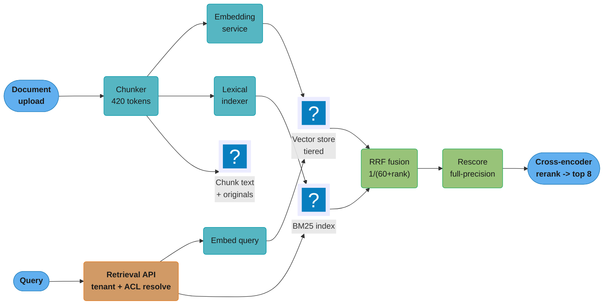
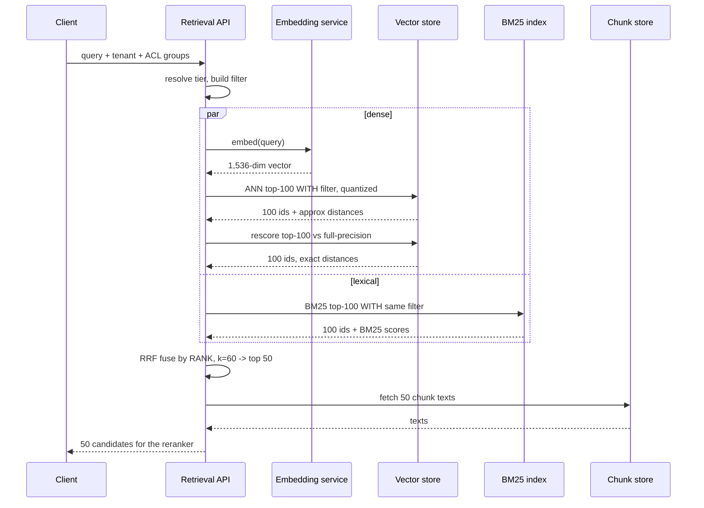

# Case Study: Design a Vector Search Platform

## Intuition

A vector search platform is a memory-budget problem wearing a machine-learning costume. The
recall numbers, the embedding models and the index algorithms are all real, but the decision
that determines the architecture is arithmetic you can do before writing a line of code:
**dimensions times bytes-per-number times vector count, plus graph overhead, versus the RAM you
are willing to pay for.** 200 million chunks at 1,536 dimensions in float32 is 1.23 TB of raw
vectors before a single index edge exists. Everything interesting in this design — quantization,
disk-resident graphs, tenant partitioning, the choice between Postgres and a dedicated store —
is a different answer to that one number.

The second thing that shapes the design is that **nobody actually wants nearest-neighbour
search**. They want relevant results. A pure dense retriever confidently fails on the query
"error code E4021" because an exact rare token is exactly what an embedding smooths away, while
BM25 nails it and fails on "why does my deploy hang" where the dense retriever shines. Hybrid
retrieval is not a refinement to add later; it is the baseline, and reciprocal rank fusion
exists because the two scoring scales — an unbounded BM25 score and a cosine similarity in
[-1, 1] — cannot be added together in any meaningful way.

The third is the one people discover in production: **filtering is harder than searching**. A
naive implementation guarantees tenant isolation by searching first and filtering after — which,
for a selective filter, returns nothing at all while reporting success. Filtered ANN is the real
2026 production problem, and where the engine choice actually bites.

---

## 1. Requirements Clarification

### Functional requirements

- **Enterprise document search and RAG retrieval** over customer-uploaded corpora: PDFs, wikis,
  tickets, code, chat transcripts.
- **12,000 tenant organizations**, from a 200-document startup to a 40-million-document
  enterprise. Strict isolation: no query may ever return another tenant's chunk.
- **200 million chunks total** at launch, growing 15% per quarter.
- **Hybrid retrieval**: lexical (BM25) and dense (embedding) results fused into one ranking.
- **Metadata filtering** on every query: tenant, document collection, ACL group, date range,
  document type, language.
- **Freshness**: a newly uploaded document must be searchable within **60 seconds**.
- **Deletes and updates**: a revoked document must disappear from results within **5 seconds** —
  this is a compliance requirement, not a UX one.
- Top-`k` of 50 candidates returned to a reranker, which returns 8 to the LLM.

### Non-functional requirements

- **p95 retrieval latency under 200 ms** end to end, excluding the reranker and the LLM.
- **Recall@50 ≥ 95%** measured against exact search on a held-out query set.
- **3,000 queries/second** at peak, with a long tail: the top 200 tenants generate 70% of it.
- Cost per tenant must scale sub-linearly — a 200-document tenant must not cost what a
  40-million-document tenant costs.
- Index rebuilds must not take the platform offline.

### Explicit non-goals

- **Not the embedding model's problem.** Choosing or evaluating the model is upstream; a model
  change is treated as a migration event (§9).
- **Not the reranker.** A cross-encoder over the top 50 is assumed to exist; the platform's job
  is to hand it a good 50.
- **Not image or multimodal search.** Text only, so a single embedding space.
- **Not sub-10 ms retrieval.** The consumer is an LLM call measured in seconds, so spending
  150 ms on better candidates is a good trade and the design leans on it.

### Assumptions

- Chunks average **420 tokens**, roughly 1,700 characters, producing about **2.1 KB** of stored
  text per chunk.
- Query distribution is heavily skewed: **the top 200 tenants are 70% of QPS**, and 9,000 of the
  12,000 tenants issue fewer than 10 queries a day.
- Filters are usually **very selective**: a typical query restricts to one tenant (average 16,600
  chunks) and often to one collection within it. This is the single most important property of
  the workload and it drives the §4.4 decision entirely.
- Embeddings are generated by a hosted model at **1,536 dimensions**, with Matryoshka truncation
  available (§5.2).

---

## 2. Scale Estimation

### The memory budget, derived first

```
Raw vectors, float32:
  1,536 dims x 4 bytes            = 6,144 bytes = 6.0 KB per vector
  200,000,000 x 6,144 bytes       = 1,228,800,000,000 B = 1.23 TB

HNSW graph overhead on top (M = 16):
  layer 0 holds 2M bidirectional links x 4 bytes/link = 8M = 128 bytes/node
  higher layers add ~M x 4 = 64 bytes/node, amortized over the layer
  hnswlib's own rule of thumb is ~M x 8-10 bytes/element all-in
    -> 16 x 9 = ~144 bytes/node
  200e6 x 144 bytes               = 28.8 GB

Payload/metadata (tenant_id, doc_id, collection, ACL, dates, offsets):
  ~120 bytes/chunk indexed        = 24 GB

TOTAL RESIDENT, float32 + HNSW:  1.23 TB + 29 GB + 24 GB  =  1.28 TB
```

**That number decides the architecture.** At roughly **$5 per GB of RAM per month** on
memory-optimized on-demand instances in `us-east-1` (mid-2026 list pricing; an `r7g.2xlarge` at
$0.4284/hour works out to about $4.88/GB-month), 1.28 TB resident is:

```
1,280 GB x $5/GB-month  =  $6,400/month  for ONE copy, before replication.
With RF=2 for availability:  $12,800/month, before the query nodes'
                             CPU headroom, before storage, before anything else.
```

Now apply the quantization ladder to the same 200M vectors:

```
                            bytes/vector   200M total   +HNSW+meta   $/month (RF=2)
  float32                        6,144       1.23 TB      1.28 TB      $12,800
  float16 (halfvec)              3,072       614 GB       667 GB        $6,670
  int8 scalar quantization       1,536       307 GB       360 GB        $3,600
  binary (1 bit/dim)               192        38 GB        91 GB          $910
  MRL-truncated to 768, int8       768       154 GB       207 GB        $2,070
  MRL to 768 + binary               96        19 GB        72 GB          $720

  Binary quantization is ~32x smaller than float32 and ~14x cheaper here.
  It is also the option that CANNOT be used alone -- see §4.5.
```

**The whole cost argument of this platform lives in that table**, and every row is a recall
tradeoff rather than a free win.

### Query load and per-node capacity

```
Peak:      3,000 QPS
Skew:      top 200 tenants = 70%  ->  2,100 QPS across ~5.5M chunks of hot data
           remaining 11,800 tenants = 900 QPS across ~194M chunks

Per-query work at ef_search = 100, HNSW:
  ~100-300 distance computations per layer descent, x ~4 layers
  1,536-dim float32 dot product ~ 1,536 FLOPs, SIMD-vectorized
  -> ~0.4-1.2 ms of pure compute per query on one core
  plus graph traversal memory latency, which dominates: HNSW is a
  pointer-chasing workload, so it is BOUND BY RANDOM MEMORY ACCESS,
  not by FLOPs. Budget ~2-4 ms per single-shard ANN query in RAM.

A 16-vCPU node, leaving 4 cores for ingest and housekeeping:
  12 cores / 3 ms per query = ~4,000 QPS theoretical
  at 60% utilization for tail-latency headroom: ~2,400 QPS per node
  3,000 QPS / 2,400 = 2 query nodes minimum, 4 with RF=2.

  -> QPS is NOT the constraint. MEMORY is. The cluster is sized by
     bytes resident, and the resulting core count is free capacity.
```

### Ingest

```
Growth: 15%/quarter on 200M = 30M chunks/quarter = ~3.9 chunks/s average

Bulk onboarding, a 40M-document enterprise arriving at once:
  40M docs x ~9 chunks/doc = 360M chunks -- nearly doubles the corpus
  embedding: 360e6 x 420 tokens = 151 billion tokens
             at $0.02 per 1M tokens (1,536-dim small model) = $3,024
  the bottleneck is API throughput, not indexing:
             at 2M tokens/minute provisioned -> 52 days
  -> onboarding is a scheduled, rate-limited, resumable pipeline, and the
     quote to the customer says weeks.

HNSW build, for sizing the rebuild window:
  ~O(N log N) distance computations, the most expensive operation here.
  Vendor benchmarks on 50M x 768-dim report 3-11 hours on one 16-vCPU node.
  -> a full 200M rebuild is a multi-day, multi-node job. Design so you
     never need one (§4.7).
```

### Storage beyond the vectors

```
Chunk text (needed to return to the LLM):
  200e6 x 2.1 KB  =  420 GB   -> object storage or Postgres TOAST, NOT RAM
Lexical (BM25) index:
  inverted index typically 20-35% of raw text  ->  ~120 GB
Original documents:
  22M documents x ~400 KB avg  =  8.8 TB   -> S3 Standard at $0.023/GB-month
                                             = ~$202/month. Irrelevant next to RAM.
```

The asymmetry is the point: **8.8 TB of documents costs $202/month and 1.28 TB of vectors
$12,800/month** — 6,000x more per byte, because vectors must be resident.

---

## 3. High-Level Architecture



*Two retrievers run in parallel against the same chunks and are fused by rank, not by score.
Rescore exists because the store returns quantized-distance candidates that must be re-ranked
against full-precision vectors before fusion.*

### The tiering decision — the architecture's spine

Twelve thousand tenants with a 200,000x size spread cannot all live in one index shape. The
platform runs **three tiers**, and a tenant moves between them automatically on a size
threshold:

| Tier | Tenant size | Storage | Index | Isolation | Cost driver |
|---|---|---|---|---|---|
| **Small** | < 50,000 chunks (9,100 tenants, ~4% of corpus) | shared Postgres + pgvector | HNSW, `halfvec`, partitioned by tenant | partial index per tenant | shared, near-zero marginal |
| **Medium** | 50,000 - 5,000,000 chunks (2,700 tenants, ~46%) | shared dedicated vector store | filterable HNSW, int8 quantized | payload index on `tenant_id` | shared, sub-linear |
| **Large** | > 5,000,000 chunks (200 tenants, ~50%) | dedicated collection/namespace | HNSW or disk-resident graph, binary + rescore | physical collection | dedicated, linear |

**Why three and not one.** A dedicated collection per tenant is unaffordable at 12,000 (§5.3); a
single shared index fails the large tenants, whose 40M-chunk filter selects 20% of the index and
makes filtering useless. The *right* isolation mechanism genuinely changes with tenant size, and
pretending otherwise costs either money or correctness.

### Query flow



*The two retrievers are independent and concurrent, so p95 is the slower of the two plus fusion,
not their sum. Both apply the identical filter — a filter applied to only one arm is a
cross-tenant leak.*

---

## 4. Component Deep Dives

### 4.1 The small tier: pgvector, and exactly where its ceiling is

For 9,100 tenants averaging 8,700 chunks each, a dedicated vector store is absurd. They live in
Postgres beside their own relational data, which removes an entire class of consistency problem:
a chunk and its ACL row commit in the same transaction.

```sql
CREATE EXTENSION IF NOT EXISTS vector;   -- pgvector 0.8.6

CREATE TABLE chunks (
  id           BIGSERIAL PRIMARY KEY,
  tenant_id    BIGINT      NOT NULL,
  doc_id       BIGINT      NOT NULL,
  collection   TEXT        NOT NULL,
  acl_group    TEXT        NOT NULL,
  lang         TEXT        NOT NULL,
  created_at   TIMESTAMPTZ NOT NULL DEFAULT now(),
  body         TEXT        NOT NULL,
  embedding    halfvec(1536) NOT NULL          -- float16: half the RAM of vector()
) PARTITION BY HASH (tenant_id);

-- 64 hash partitions: each partition's HNSW graph is 1/64 the size, so an
-- index build or rebuild is a bounded operation rather than a whole-table event.
-- Partition pruning also means a tenant's query only ever touches one graph.
CREATE TABLE chunks_p00 PARTITION OF chunks FOR VALUES WITH (MODULUS 64, REMAINDER 0);
-- ... p01 .. p63

CREATE INDEX ON chunks_p00 USING hnsw (embedding halfvec_cosine_ops)
  WITH (m = 16, ef_construction = 64);
-- m = 16 and ef_construction = 64 are pgvector's defaults and are the right
-- starting point; raising ef_construction improves recall at a steep build cost.

CREATE INDEX ON chunks (tenant_id, collection, acl_group);
```

**Three pgvector facts that decide whether this tier works:**

1. **Dimension limits.** HNSW indexes `vector` up to **2,000 dimensions** and `halfvec` up to
   **4,000**. At 1,536 both work; a 3,072-dimension model would force `halfvec`. This is a hard
   limit, not a tuning knob.
2. **`halfvec` halves the memory** for a recall cost that is usually under half a point at these
   dimensions, because embedding coordinates carry far less than 24 bits of useful precision.
   It is close to a free 2x.
3. **`hnsw.ef_search` defaults to 40**, which is low. Recall@50 with `ef_search = 40` is
   typically well under the 95% target; 100-200 is the working range. It is a per-session GUC,
   so it is set per query class rather than globally.

**The security fact that belongs in any pgvector design:** **CVE-2026-3172**, a CVSS 8.1
integer-wraparound buffer overflow in **parallel HNSW index builds**, affects pgvector **0.6.0
through 0.8.1** and is fixed in **0.8.2** (February 2026). A user able to build or reindex an
HNSW index with parallel workers could read data from unrelated relations or crash the server.
Anything older than 0.8.2 must be patched; the interim mitigation is
`SET max_parallel_maintenance_workers = 0`. On a multi-tenant platform where index maintenance
may be triggerable by tenant activity, this is not a theoretical exposure.

**Where the tier ends.** Not a vector count but the RAM the graph and vectors occupy relative to
`shared_buffers` and the page cache: a 128 GB node holds roughly 15 million `halfvec(1536)`
vectors plus graph and payload before queries start hitting disk with random I/O and p95 degrades
by an order of magnitude. **Promote before that point** — the degradation is cliff-shaped.

### 4.2 The overfiltering trap — the bug that returns nothing and reports success

The single most important mechanism in the design, and subtle enough that it ships to production
regularly.

```sql
-- BROKEN. Looks obviously correct. Returns 3 rows when you asked for 50.
SET hnsw.ef_search = 100;

SELECT id, body, embedding <=> $1 AS distance
FROM chunks
WHERE tenant_id = 4711
  AND collection = 'engineering-wiki'
  AND acl_group = ANY($2)
ORDER BY embedding <=> $1
LIMIT 50;
```

What actually happens: the HNSW index scan walks the graph and produces `ef_search = 100`
candidates **from the whole partition, ignoring the WHERE clause**, because the graph knows
nothing about `collection` or `acl_group`. Postgres then applies the filter to those 100 rows.
If this tenant's `engineering-wiki` collection is 3% of the partition, roughly **3 of the 100
survive**. The query returns 3 rows, no error, no warning — and to the application it is
indistinguishable from "there were only 3 relevant chunks".

```sql
-- FIXED, option A: iterative index scan (pgvector 0.8.0+).
-- The scanner resumes the graph walk and pulls MORE candidates until it has
-- enough post-filter rows or hits its bound.
SET hnsw.ef_search = 100;
SET hnsw.iterative_scan = 'relaxed_order';   -- or 'strict_order'
SET hnsw.max_scan_tuples = 20000;            -- the safety bound

SELECT id, body, embedding <=> $1 AS distance
FROM chunks
WHERE tenant_id = 4711 AND collection = 'engineering-wiki' AND acl_group = ANY($2)
ORDER BY embedding <=> $1
LIMIT 50;
```

```sql
-- FIXED, option B: make the filter part of the physical layout so it costs nothing.
-- Hash partitioning by tenant_id already does this for tenant_id.
-- For a high-value tenant's hot collection, a partial index does it for the rest:
CREATE INDEX ON chunks_p13 USING hnsw (embedding halfvec_cosine_ops)
  WITH (m = 16, ef_construction = 64)
  WHERE tenant_id = 4711 AND collection = 'engineering-wiki';
-- Now the graph contains ONLY matching rows. Every candidate survives the filter.
-- Cost: one index per (tenant, collection). Viable for tens, not thousands.
```

**The rule that generalizes past pgvector:** every engine either filters *during* the graph walk
or *after* it, and the difference is invisible until a selective filter exposes it.

| Engine | Filtering strategy | What that means here |
|---|---|---|
| **Qdrant** | filterable HNSW — a payload index extends the graph so filter conditions are checked *during* traversal, single pass; the planner falls back to a plain payload scan when the filter is very selective | the strongest answer for this workload; no overfiltering by construction |
| **Weaviate, Milvus** | pre-filter into an allow-list from an inverted/attribute index, consulted during traversal | good; the allow-list must be built first, which costs on very large filters |
| **Elasticsearch** | pre-filter integrated into the `knn` search | good; the filter and BM25 share the same index |
| **pgvector** | post-filter, with `iterative_scan` to compensate | works with the settings above; the *default* behaviour is the trap |

### 4.3 Hybrid retrieval and reciprocal rank fusion

BM25 and cosine similarity live on incompatible scales — an unbounded positive score against a
value in [-1, 1] — so there is no correct way to add or average them, and normalizing requires
knowing each corpus's score distribution. RRF sidesteps the problem entirely by throwing away
the scores and fusing **ranks**.

```
RRF(d) = sum over retrievers r of  1 / (k + rank_r(d))

Cormack, Clarke & Buttcher, SIGIR 2009. k = 60 is their empirically tuned
constant on TREC data, and it has stuck as the default across implementations.

Worked example, k = 60:
  doc      BM25 rank   dense rank   RRF score
  A            1            8        1/61 + 1/68 = 0.01639 + 0.01471 = 0.03110
  B            9            1        1/69 + 1/61 = 0.01449 + 0.01639 = 0.03088
  C            3            4        1/63 + 1/64 = 0.01587 + 0.01563 = 0.03150   <- wins
  D            2          none       1/62                            = 0.01613

  C ranks first despite topping neither list. That is the point: k = 60 flattens
  the head of each list so a document that is GOOD IN BOTH beats one that is
  EXCELLENT IN ONE. Lower k sharpens toward the winners of each list; higher k
  flattens further and favours consensus.
```

```python
def rrf_fuse(rankings: list[list[str]], k: int = 60, top: int = 50) -> list[str]:
    """Fuse ranked id lists. rankings[i] is retriever i's list, best first."""
    scores: dict[str, float] = {}
    for ranked in rankings:
        for rank, doc_id in enumerate(ranked, start=1):
            scores[doc_id] = scores.get(doc_id, 0.0) + 1.0 / (k + rank)
    return sorted(scores, key=scores.get, reverse=True)[:top]


def retrieve(query: str, tenant: int, acl: list[str], top: int = 50) -> list[str]:
    filt = {"tenant_id": tenant, "acl_group": {"$in": acl}}
    # Both arms run concurrently and BOTH carry the identical filter.
    dense, lexical = run_parallel(
        lambda: vector_store.search(embed(query), filter=filt, limit=100),
        lambda: bm25.search(query, filter=filt, limit=100),
    )
    return rrf_fuse([[h.id for h in dense], [h.id for h in lexical]], top=top)
```

**Two operational notes.** `k = 60` is a default, not a law — tune it against your own relevance
set (lower k trusts each retriever's top hits more). And **both arms must carry the same
filter**: applying the ACL filter only to the dense arm is a cross-tenant leak that passes every
functional test, because the lexical results are plausible enough that nobody checks whose they
are.

Native RRF as of 2026: Elasticsearch ships an `rrf` retriever (Retrievers GA in **8.16**),
OpenSearch has hybrid normalization processors, Weaviate exposes `rankedFusion`, and Qdrant's
Query API offers RRF as a fusion method. **pgvector has none**, so on the small tier fusion
happens in application code exactly as above.

### 4.4 Multi-tenancy: three mechanisms, one per tier

```python
# Small tier: hash-partitioned shared table. Isolation is a WHERE clause backed
# by partition pruning, plus RLS as the second line of defence.
"""
ALTER TABLE chunks ENABLE ROW LEVEL SECURITY;
ALTER TABLE chunks FORCE ROW LEVEL SECURITY;
CREATE POLICY tenant_isolation ON chunks
  USING (tenant_id = current_setting('app.tenant_id')::bigint);
"""
# The trap that belongs here: under PgBouncer transaction pooling, a plain
# `SET app.tenant_id` leaks to the NEXT tenant on the same server connection.
# Use SET LOCAL / set_config(..., true) so it is transaction-scoped.

# Medium tier: one shared collection, tenant_id as an INDEXED payload field so
# the filter participates in the graph walk rather than following it.
client.create_payload_index(
    collection_name="shared_medium",
    field_name="tenant_id",
    field_schema="integer",
)

# Large tier: a physical collection per tenant. Isolation is structural.
client.create_collection(
    collection_name=f"tenant_{tenant_id}",
    vectors_config={"size": 1536, "distance": "Cosine"},
)
```

**Why the small tier is not simply "filter by tenant_id in one giant index".** With 9,100 tenants
in one index a tenant filter selects roughly 0.01% of the vectors — the §4.2 worst case, where the
graph walk must pull tens of thousands of candidates to find 50 belonging to the right tenant.
Hash partitioning fixes it physically: the query touches one partition's graph, where every
candidate is already 1-of-142 tenants. **Partitioning converts a filtering problem into a routing
problem**, the general move whenever a filter is selective and known in advance.

**Why the large tier does not use filters at all.** A 40-million-chunk tenant *is* the index:
nothing to filter against, tuning per tenant, and a rebuild blast radius of one customer. The
fixed per-collection overhead that makes this absurd at 9,100 tenants is negligible at 200.

### 4.5 The quantization ladder, and why binary is never used alone

```
float32   1,536 x 4 = 6,144 B   baseline, recall@50 ~99.5% at ef_search=200
float16   1,536 x 2 = 3,072 B   2x smaller, recall loss typically < 0.5 pt
int8      1,536 x 1 = 1,536 B   4x smaller, recall loss ~1-2 pt, rescore recovers it
binary    1,536 / 8 =   192 B   32x smaller, recall alone is UNUSABLE (~60-75%)
```

Binary quantization compresses each dimension to one bit — the sign — and replaces the dot
product with a XOR plus popcount, which is enormously faster and 32x smaller. It also destroys
most of the distance information. It is only viable in a **two-phase search**:

```
Phase 1: search the binary index with an OVERSAMPLING factor.
         want top 50? retrieve top 50 x oversampling (typically 2-4x) = 100-200
         cost: 32x less memory traffic, XOR/popcount instead of float multiply

Phase 2: RESCORE those 100-200 candidates against the FULL-PRECISION vectors,
         which live on disk or in a separate store, and re-sort.
         cost: 200 random reads of 6 KB = 1.2 MB. Trivial.

Result: ~32x memory reduction with recall within ~1 point of exact,
        because phase 1 only has to get the right documents into the
        candidate set -- phase 2 fixes the ordering.
```

This pattern is now standard rather than exotic. Elasticsearch ships it as **BBQ** (Better Binary
Quantization) — tech preview in **8.16**, GA in the **9.0**/Lucene 9.0 generation, and the
**default for dense vectors of 384 dimensions or more in 9.1**, with rescoring integral rather
than optional. Qdrant exposes the same shape through an explicit `oversampling` parameter
(`oversampling = 2.4` with `limit = 100` pre-selects 240, rescores, returns 100) and recommends
binary quantization **only** with rescoring enabled.

**The design decision here:** the large tier uses binary + rescore, because it is 50% of the
corpus and the memory saving is $10,000+/month. The medium tier uses int8, which needs no
rescore infrastructure. The small tier uses `halfvec`, because at that size the savings do not
justify any additional moving part.

### 4.6 Matryoshka truncation — the other axis

Modern embedding models are trained with **Matryoshka Representation Learning**, front-loading
information into the leading dimensions so a vector truncates and renormalizes with graceful
rather than catastrophic degradation. OpenAI's `text-embedding-3` exposes a `dimensions`
parameter, Nomic Embed v1.5 supports 64-768, Jina v3 truncates 1024 to 32, Cohere's embed-v4
emits 256/512/1024/1536, and Google's `gemini-embedding-001` spans 128-3072.

```
Same model, same corpus, 200M chunks, int8 quantized:

  1,536 dims -> 1,536 B/vec ->  307 GB   recall@50 baseline
    768 dims ->   768 B/vec ->  154 GB   typically -1 to -2 points
    512 dims ->   512 B/vec ->  102 GB   typically -3 to -5 points
    256 dims ->   256 B/vec ->   51 GB   typically -8 to -15 points

Truncation and quantization COMPOSE:
  768 dims + binary = 96 B/vec = 19 GB for the whole 200M corpus.
  That is a 64x reduction from float32/1,536 -- and with rescore against
  full-precision 1,536-dim vectors on disk, recall stays usable.
```

**Truncation is usually cheaper than quantization per point of recall lost**, because it removes
the dimensions the model deliberately made least informative while quantization degrades every
one equally. Test both on your own relevance set — a day of work against a five-figure bill.

### 4.7 Deletes, updates, and the graph-degradation problem

HNSW is a graph. Deleting a node does not remove its edges — most implementations mark it as
deleted and filter it out at search time, leaving the edges in place as navigational structure.
That is fine at a 1% delete rate and pathological at 30%: the graph fills with "tombstone hops"
that cost traversal time and return nothing, so recall and latency both degrade with no obvious
cause.

The 5-second revocation requirement makes this worse, because it forbids the obvious answer
("rebuild nightly").

```python
# Two-layer answer: a hard filter for correctness, a rebuild for performance.

# 1. CORRECTNESS, immediately. A revocation list checked at query time.
#    Sub-millisecond, applies within one Redis round trip of the revoke call.
revoked = redis.smembers(f"revoked:{tenant_id}")          # small, TTL 24h
hits = [h for h in vector_store.search(vec, filter=filt, limit=120)
        if h.id not in revoked][:50]
# Over-fetch 120 to absorb the ones the revocation list removes.

# 2. PERFORMANCE, eventually. Track the tombstone ratio; rebuild when it crosses.
def maybe_rebuild(collection: str) -> None:
    stats = vector_store.collection_info(collection)
    ratio = stats.deleted_vectors / max(stats.total_vectors, 1)
    if ratio > 0.20:
        rebuild_in_place(collection)     # build a shadow, atomic alias swap
```

```
Rebuild strategy, by tier:
  Small  : REINDEX one hash partition CONCURRENTLY. Bounded: 1/64 of the table.
  Medium : rebuild the shared collection shard by shard behind an alias.
  Large  : build a shadow collection, dual-write during the build, atomic
           alias swap at the end. This is the only tier where a rebuild is
           a multi-hour operation, and it is why the tier exists separately.
```

**Updates are deletes plus inserts**, so an actively-edited corpus accumulates tombstones fastest;
debouncing re-embedding to once per N minutes per document drops the rate by an order of
magnitude.

---

## 5. Design Decisions & Tradeoffs

### 5.1 Postgres + pgvector versus a dedicated vector store

This is the question every team asks, and the honest answer is "both, at different sizes" —
which is what the tiering in §3 implements.

| | pgvector | Dedicated store (Qdrant/Milvus/Weaviate) |
|---|---|---|
| Transactional consistency with metadata | **yes** — one commit | no — two systems, eventual |
| Joins to relational data | native SQL | application-side |
| Filtered ANN | post-filter + `iterative_scan` | in-graph or allow-list pre-filter |
| Operational surface | one system you already run | a second stateful system |
| Native hybrid/RRF | no | mostly yes |
| Quantization options | `halfvec`, `bit` + `binary_quantize` | int8/PQ/binary + oversampling, tuned |
| Scale ceiling per node | RAM-bound, cliff-shaped when the graph stops fitting | disk-resident options push past RAM |
| Cost at small scale | ~free (already running) | a cluster's fixed cost |
| Cost at large scale | more nodes than necessary | tuned, better $/vector |

**The decision rule the platform actually uses is a threshold, not an opinion:** stay in Postgres
while the tenant's vectors and graph fit comfortably in the node's cache alongside everything
else Postgres is doing, and move out before that stops being true. The trigger is a measurable
one — index cache hit ratio and p95 — not a vector count, because the count that matters depends
on dimensions, quantization and what else shares the node.

**Disk-resident graphs are the third option and they change the ceiling.** DiskANN (Subramanya
et al., **NeurIPS 2019**) and its Vamana graph put a single flat graph on SSD with one read per
hop, keeping only compressed vectors in memory; `pgvectorscale` brings a streaming variant to
Postgres. Its vendor benchmark is instructive in both directions: on **50 million 768-dimension
Cohere Wikipedia embeddings**, on an **AWS `r6id.4xlarge` (16 vCPU, 128 GB, 950 GB NVMe)**, at a
**99% recall threshold**, StreamingDiskANN reached **471.57 QPS against Qdrant's 41.47 QPS —
11.4x**. Two caveats belong with that number every time: it is a **vendor benchmark** by the
extension's authors, and **in the same benchmark Qdrant showed 39-48% lower p95/p99 latency and
built its index in roughly 3.3 hours against pgvectorscale's 11.1**. A design quoting only the
throughput number has cherry-picked its own source.

### 5.2 Dimension and quantization strategy per tier

| Tier | Dims | Precision | Rescore | Bytes/vector | Rationale |
|---|---|---|---|---|---|
| Small | 1,536 | `halfvec` (fp16) | no | 3,072 | savings do not justify a rescore path at 8,700 chunks/tenant |
| Medium | 1,536 | int8 | no | 1,536 | 4x saving, ~1-2 pt recall, no extra infrastructure |
| Large | 1,536 | binary + oversample 3x | **yes** | 192 resident | 32x saving on 50% of the corpus; rescore against full-precision on NVMe |

Truncation to 768 is held in reserve as the next lever if growth outruns budget, because it is a
re-embedding event for the affected tier and therefore a scheduled migration rather than a
configuration change.

### 5.3 Why not one dedicated collection per tenant everywhere

It is the cleanest isolation story available, and it is rejected because 12,000 collections
carry 12,000 fixed overheads — per-collection graph entry structures, segment metadata,
background maintenance threads, monitoring cardinality — for 9,100 tenants whose entire corpus
would fit in one segment. Hash partitioning plus row-level security buys those tenants the same
guarantee at a fraction of the cost, and the dedicated-collection budget goes to the 200 tenants
where it buys something real.

### 5.4 Hybrid retrieval as the baseline, not an enhancement

A dense-only retriever is measurably worse on the queries enterprise users actually type: exact
identifiers — error codes, SKUs, ticket numbers, function names — are precisely what an embedding
generalizes away, and BM25 fails completely on the paraphrase that enterprise search is full of.
Running both and fusing by rank costs one extra parallel call and a few microseconds of fusion,
which is not a close decision. The implementation cost is bounded: a second index to keep in
sync, and the discipline that **the filter must be applied identically to both arms**.

---

## 6. Real-World Implementations

- **Spotify** open-sourced **Voyager** in October 2023, an HNSW-based library built on `hnswlib`
  that serves **hundreds of millions of nearest-neighbour queries per day** in production. Their
  published comparison against their own earlier **Annoy** library — roughly **10x the speed at
  equal recall with 4x lower memory** — is the clearest public statement of why graph indexes
  displaced tree indexes for this workload, and it comes from the team that wrote the tree
  index.
- **Pinterest** serves **over 6 billion searches a month** through **Manas**, an HNSW-based ANN
  system, with embeddings from **PinSage** (a graph-convolutional model over the pin-board graph)
  and **OmniSearchSage** (a multi-task, multi-entity two-tower model published in 2024). The
  structural lesson is the two-stage shape this design also uses: a fast ANN candidate generator
  feeding a heavier ranker, because you cannot afford the good model over the whole corpus.
- **Instacart** published a two-tower embedding search model whose A/B test showed **+4.1%
  cart-adds-per-search and +1.5% GMV** alongside a ~10% relative Recall@20 gain offline. Cite it
  as *historical* evidence — the paper is from September 2022 — that embedding retrieval moves
  commercial metrics and not only offline ones, which is the argument this platform has to win
  with a business stakeholder.
- **Elastic** made **BBQ** the default for dense vectors of 384 dimensions and above in
  Elasticsearch **9.1**, which is the strongest available signal that binary-quantization-plus-
  rescore has moved from a technique to a default. A platform choosing float32 in 2026 is
  choosing to pay roughly 32x for memory it does not need.
- **Redis 8** added **vector sets** as a native data type (`VADD`/`VSIM`) with `NOQUANT`, `Q8`
  and `BIN` quantization options — the same ladder, in a store nobody thinks of as a vector
  database. It is the right answer for a small, hot, latency-critical vector set that already
  sits beside a Redis cache; see
  [Redis Internals](../../redis_internals/redis_internals.md).

---

## 7. Technologies & Tools

| Tool | Role in this design | Why over the alternative | Operational cost it adds |
|---|---|---|---|
| PostgreSQL + pgvector 0.8.6 | Small tier: vectors beside relational data | One transaction for chunk + ACL + metadata; no second system for 9,100 tenants | HNSW build memory, `ef_search` tuning per query class, patching discipline (CVE-2026-3172) |
| Qdrant | Medium and large tiers | Filterable HNSW checks predicates *during* traversal, which is exactly this workload's hard problem | A second stateful system: snapshots, replication, capacity planning |
| pgvectorscale | Evaluated for the medium tier | StreamingDiskANN pushes past the RAM ceiling on Postgres | Rejected here on index build time (11 h vs 3.3 h in the vendor's own benchmark) versus rebuild-window requirements |
| Elasticsearch | BM25 arm of hybrid retrieval | Mature lexical scoring, native `rrf` retriever, filters shared with the dense arm | Cluster ops, shard sizing, index lifecycle |
| Redis | Revocation list, query cache, embedding cache | Sub-millisecond membership test is what makes 5-second revocation possible without a rebuild | Memory sizing, eviction policy, failover |
| S3 | Chunk text and original documents | $0.023/GB-month against $5/GB-month for RAM — the 6,000x asymmetry that shapes the design | Request cost on the rescore path, lifecycle policies |
| Hosted embedding API | Query and document embeddings | Avoids operating GPU inference for a workload that is bursty by nature | Rate limits become an ingest bottleneck; a model change is a full re-embed |
| Kafka | Ingest pipeline between chunking, embedding and indexing | Absorbs bulk-onboarding bursts and makes the pipeline resumable | Broker ops, consumer lag monitoring |

---

## 8. Operational Playbook

### Metrics to dashboard

| Metric | Source | Unit | Why it matters |
|---|---|---|---|
| Recall@50 against a golden set | scheduled eval job | percent | **The only metric that says the system works.** Everything else is a proxy |
| Result-count distribution per query | app-side histogram | count | A spike at "fewer than `k` results" is the overfiltering signature (§4.2) |
| p95 latency, split by tier | app-side, tagged | ms | Tiers degrade for different reasons; a blended p95 hides all of them |
| Tombstone ratio per collection | store stats | percent | Leading indicator for graph degradation; latency follows it |
| Index cache hit ratio (small tier) | `pg_statio_user_indexes` | percent | The pgvector cliff: below ~99% the graph is hitting disk |
| Rescore fetch latency (large tier) | app-side | ms | Binary + rescore is only viable while phase 2 is cheap |
| Embedding API error and throttle rate | client metrics | rate | Ingest freshness SLA depends on it entirely |
| Dense/lexical arm agreement (Jaccard of top-50) | app-side | ratio | A sudden divergence means one arm broke or lost its filter |
| Revocation-list size and age | Redis | count / s | An unbounded list means rebuilds are not keeping up |

### Alert thresholds

| Condition | Level | Action |
|---|---|---|
| Recall@50 < 93% on the golden set | page | Something changed in indexing, quantization or the model. Stop deploys |
| > 2% of queries return fewer than `k` results | page | Overfiltering. Check `iterative_scan`, `ef_search`, and filter selectivity |
| Tombstone ratio > 20% on any collection | warn | Schedule a rebuild before latency degrades |
| Tombstone ratio > 35% | page | Recall is already degrading; rebuild now |
| Small-tier index cache hit ratio < 99% | warn | A tenant is outgrowing the tier; promote it |
| p95 > 200 ms for 10 min on any tier | warn | Check `ef_search` drift, rescore latency, and node memory pressure |
| Dense/lexical top-50 Jaccard < 0.05 for 5 min | page | Almost always one arm has lost its filter or its index |
| pgvector version < 0.8.2 anywhere | page | CVE-2026-3172 is unpatched |

### Runbook — "search returns too few results"

1. Check the result-count histogram. If the mass has shifted below `k`, it is overfiltering, not
   a relevance regression.
2. Confirm `hnsw.iterative_scan` is set on the query path — a connection-pool configuration
   change or a new service can silently drop a session GUC.
3. Measure the filter's selectivity: `SELECT count(*) FROM chunks WHERE <the filter>` against
   the partition size. Below ~1% and the filter needs to be structural (partition or partial
   index), not applied after the fact.
4. If the filter genuinely selects a tiny set, consider whether an exact scan is simply better —
   under a few thousand candidate vectors, brute force beats ANN and is exactly correct.

### Runbook — recall regression

1. Diff the golden-set evaluation against the last known-good run **per query type**. A uniform
   drop points at the index; a drop confined to exact-identifier queries points at the lexical
   arm; a drop on paraphrase queries points at the dense arm or the model.
2. Check whether the embedding model version changed — a mixed-model index is silently broken
   (§9, pitfall 2).
3. Check `ef_search`. Someone lowering it from 150 to the 40 default to "improve latency" is the
   most common cause, and the latency graph will corroborate it.
4. Check the tombstone ratio. Graph degradation produces a slow recall decline that looks like a
   relevance problem and is a maintenance problem.

### Runbook — embedding-model migration

The highest-risk routine operation in this platform, because it invalidates every vector.

1. **Never mix models in one index.** The failure is silent and the results look reasonable.
2. Provision a **shadow index** and re-embed into it. Budget from §2: 151 billion tokens, weeks
   of provisioned throughput, roughly $3,000 at small-model pricing.
3. Dual-write new documents to both indexes so the shadow never falls behind.
4. Evaluate the shadow on the golden set — a newer model is not automatically better on *your*
   corpus, and this is the gate.
5. Cut over per tier, smallest first, rollback being an alias swap. Retire the old index only
   after a full recall evaluation at full traffic.

---

## 9. Common Pitfalls & War Stories

**Pitfall 1 — the overfiltering silent failure.** Mechanism in §4.2; it is first because it
produces **no error**. *War story shape:* a platform shipped tenant-scoped search with a shared
HNSW index and post-filtering. Recall on the internal test corpus (one tenant, 40,000 chunks) was
97%. In production, tenants averaging 0.3% of the index got a median of **4 results for a
`LIMIT 50` query**, and the tickets said "search is bad" — which routed to the ML team, who spent
**three weeks** evaluating embedding models. `hnsw.iterative_scan` plus hash partitioning took
median results from 4 to 50 and recall@50 from an effective **~8% to 96%** overnight.
**Dashboard the result-count distribution.**

**Pitfall 2 — mixing embedding models.** Query embedded with model B, documents with model A.
Cosine similarity is still perfectly well-defined between vectors from different spaces, so no
error is raised and the results are superficially plausible — they are simply meaningless.
*Quantified:* a partial re-embed that stalled at 60% left a corpus in two spaces; recall@50 on
the affected tenants measured **31%** while every system-health metric was green, and it was
found only because a customer escalated. **Version the model in the index metadata and refuse
queries whose query-model version does not match.**

**Pitfall 3 — `ef_search` left at its default.** pgvector's `hnsw.ef_search` defaults to **40**,
which is tuned for latency, not recall. At `k = 50` a search that only ever tracks 40 candidates
cannot reliably return the true top 50. *Quantified:* raising it from 40 to 150 on one platform
moved recall@50 from 84% to 97% and p95 from 11 ms to 26 ms — 13 points of recall for 15 ms,
against a 200 ms budget. The reverse mistake is more common and more damaging: someone tunes it
down during a latency push and nobody re-measures recall.

**Pitfall 4 — binary quantization without rescoring.** 32x memory reduction is compelling and the
failure mode is invisible in a smoke test, because the *right neighbourhood* still comes back.
*Quantified:* recall@50 measured **68%** with binary quantization alone and **97.6%** with 3x
oversampling plus full-precision rescore, same index, same queries. Vendor documentation is
explicit (§4.5) and it is still skipped regularly.

**Pitfall 5 — HNSW graph degradation from deletes.** Deleted nodes stay in the graph as
navigational structure and are filtered at search time. *Quantified:* a corpus with a 34%
tombstone ratio after six months of heavy editing showed p95 up **2.4x** and recall@50 down
**9 points**, with no configuration change and no traffic change — a slow decline that looked
like a relevance problem and was a maintenance problem. **Track the tombstone ratio and rebuild
at 20%.** Debounce re-embedding on edited documents, because an update is a delete plus an
insert.

**Pitfall 6 — the index build that will not fit.** HNSW construction needs the vectors and the
growing graph in memory simultaneously. *Concretely:* 10 million 1,536-dimension float32 vectors
is 61 GB before graph edges, and a build on a 64 GB node either OOMs or swaps into uselessness.
On Postgres the lever is `maintenance_work_mem`; the structural fix is to partition so no single
build is ever whole-corpus. The **3-11 hours** for 50M vectors (§2) sets the rebuild window and
therefore the tombstone threshold.

**Pitfall 7 — filtering only one arm of a hybrid query.** The ACL filter is applied to the dense
retriever and forgotten on the BM25 retriever. Every functional test passes, because the lexical
results are plausible; they simply belong to another tenant. This is a **security incident**, not
a bug, and the defence is structural: build the filter once and pass the same object to both
arms, and assert in an integration test that a query from tenant A returns zero documents owned
by tenant B across a corpus deliberately seeded with near-duplicate content in both tenants.

**Pitfall 8 — trusting a benchmark that is not your workload.** ANN-Benchmarks' datasets (SIFT,
GloVe, GIST) run **100-960 dimensions**, well below the 768-3072 modern embedding models produce,
and it measures unfiltered search. VectorDBBench covers filtering and concurrency but is
maintained by Zilliz, the company behind Milvus. Neither is neutral ground truth. *The
operational form:* choosing an engine on a published QPS number and discovering that your
workload's defining characteristic — a 0.3% selective filter — is what the benchmark did not
measure.

**Pitfall 9 — running an unpatched pgvector.** **CVE-2026-3172** (§4.1) is the one pitfall here
with no performance symptom at all: an unpatched 0.6.0-0.8.1 lets a tenant who can trigger a
parallel index build read memory from unrelated relations. Patch to 0.8.2, or set
`max_parallel_maintenance_workers = 0` until you can.

---

## 10. Capacity Planning

### Memory sizing, tier by tier

```
SMALL TIER  -- 9,100 tenants, 8M chunks, halfvec(1536)
  vectors:  8e6 x 3,072 B                        = 24.6 GB
  HNSW:     8e6 x 144 B                          =  1.2 GB
  payload:  8e6 x 120 B                          =  1.0 GB
  BM25 + heap + everything else Postgres does    ~ 40 GB
  -> 2 x r7g.2xlarge (64 GB) primary + replica.  Comfortable, room to grow.

MEDIUM TIER -- 2,700 tenants, 92M chunks, int8
  vectors:  92e6 x 1,536 B                       = 141 GB
  HNSW:     92e6 x 144 B                         =  13 GB
  payload:  92e6 x 120 B                         =  11 GB
  -> 165 GB resident, RF=2                       = 330 GB
  -> 6 x r7g.2xlarge (64 GB), 3 shards x 2 replicas

LARGE TIER  -- 200 tenants, 100M chunks, binary + rescore
  binary vectors: 100e6 x 192 B                  = 19.2 GB
  HNSW:           100e6 x 144 B                  = 14.4 GB
  payload:        100e6 x 120 B                  = 12.0 GB
  -> 46 GB resident (!), RF=2                    = 92 GB
  full-precision for rescore: 100e6 x 6,144 B    = 614 GB on NVMe, not RAM
  -> 4 x r7gd.2xlarge (64 GB RAM + local NVMe), 2 shards x 2 replicas

  The large tier holds HALF the corpus in a QUARTER of the medium tier's
  memory. That single line is the return on the quantization work.
```

### Cost, and where it actually goes

```
Memory (the dominant term), at ~$5/GB-month on-demand list, us-east-1, mid-2026:
  small     128 GB (2 x 64)                  ~   $640/month
  medium    384 GB (6 x 64)                  ~ $1,920/month
  large     256 GB (4 x 64)                  ~ $1,280/month
                                             ------------------
  subtotal                                   ~ $3,840/month

Storage:
  chunk text + originals, 9.2 TB S3 Standard @ $0.023  ~   $212/month
  large-tier NVMe for rescore vectors        (included in r7gd)

Embedding API:
  steady state 3.9 chunks/s x 420 tokens x 86,400 x 30
    = 4.2 billion tokens/month at $0.02/1M  ~    $85/month
  query embeddings: 3,000 QPS x ~12 tokens  ~ negligible

Elasticsearch (BM25 arm), ~120 GB index     ~ $1,100/month
Redis, Kafka, app tier                      ~   $900/month
                                            ------------------
  TOTAL                                     ~ $6,140/month for 200M chunks
                                            = $0.031 per 1,000 chunks/month

COUNTERFACTUAL -- the same platform on float32, no quantization, no tiering:
  1.28 TB resident x RF=2 = 2.56 TB @ $5/GB  ~$12,800/month for vectors alone
  plus the same $2,300 of everything else    ~$15,100/month

  The quantization and tiering work is worth ~$9,000/month, or ~60%,
  and it costs one rescore path and one promotion job.
```

### Growth to 1 billion chunks

```
5x growth at the current tier mix:
  small   40M  halfvec ->  123 GB      medium 460M int8   -> 707 GB
  large  500M  binary  ->   96 GB (+3.1 TB NVMe for rescore)
  + graph and payload  -> ~1,070 GB resident, RF=2 = 2.14 TB  ~$10,700/month

Two levers, in order of preference:
  1. Medium tier int8 -> binary + rescore: 707 GB -> 88 GB, saves ~$6,200/month.
     Costs a rescore path that tier lacks today, plus NVMe.
  2. Truncate to 768 dims (Matryoshka): halves everything again, for a full
     re-embed (a scheduled migration, §8) and 1-2 recall points.

They compose; together, 1 billion chunks lands near today's bill. Neither is a
configuration change -- start evaluating at 400M, not at 900M.
```

---

## 11. Interview Discussion Points

**Q: How do you size a vector search platform, and what is the first number you compute?**
Dimensions times bytes-per-number times vector count, plus graph overhead — before anything
else, because it decides the architecture and the bill. Two hundred million chunks at 1,536
dimensions in float32 is 1.23 TB of raw vectors; HNSW at `M = 16` adds roughly 144 bytes per node
(the hnswlib rule of thumb, dominated by layer 0's `2M` links at 4 bytes each), so about 29 GB;
payload adds 24 GB. That is 1.28 TB that must be **resident**, and at roughly $5 per GB of RAM
per month one copy is $6,400 a month and two are $12,800. Query throughput almost never binds
first — a 16-vCPU node serves a few thousand QPS because HNSW is bound by random memory access
rather than FLOPs — so the cluster is sized by bytes and the cores come free. Everything else in
the design is a way of making that first number smaller.

**Q: What is overfiltering and why is it the most dangerous bug in this space?** An ANN index
walks a graph that knows nothing about your metadata, so it returns `ef_search` candidates from
the whole index and the filter is applied afterwards. If the filter selects 3% of the index,
roughly 3 of 100 candidates survive and a `LIMIT 50` query returns 3 rows — **with no error and
no way for the application to distinguish it from "there were only 3 relevant documents"**. That
silence is what makes it dangerous: it presents as a relevance complaint and routes to whoever
owns the embedding model, not the index. Three fixes in order of preference: make the filter
structural so it costs nothing (partition by tenant, or a partial index per hot collection); use
an engine that filters *during* traversal, which is Qdrant's filterable HNSW; or use pgvector's
`hnsw.iterative_scan` (0.8.0+). And dashboard the result-count distribution — the one metric
that catches this on day one.

**Q: Why fuse hybrid results with RRF instead of combining the scores?** Because the scores are
not commensurable. BM25 produces an unbounded positive score whose scale depends on corpus
statistics; cosine similarity produces a value in [-1, 1]. Adding them is meaningless, and
normalizing requires each retriever's score distribution on this corpus for this query, which
changes per query. Reciprocal rank fusion throws the scores away and fuses **ranks**:
`score(d) = Σ 1/(k + rank_r(d))`, from Cormack, Clarke and Büttcher at SIGIR 2009, `k = 60` being
their empirically tuned constant. The constant does real work: a large `k` flattens the head of
each list so a document ranked 3rd and 4th beats one ranked 1st and unranked, favouring
**consensus over any single retriever's confidence** — exactly what you want when one retriever
is better at identifiers and the other at paraphrase. Tune it against your own relevance set
rather than inheriting 60 unexamined.

**Q: When does pgvector stop being the right answer?** Not at a vector count — at the point where
the graph and vectors stop fitting comfortably in the node's cache alongside everything else
Postgres is doing. That is a measurable trigger (index cache hit ratio, p95) rather than a
number, because it depends on dimensions, on whether you used `halfvec`, and on what else shares
the machine. The degradation is **cliff-shaped, not gradual**: cached, traversal is random memory
access; uncached, it is random disk I/O and p95 moves by an order of magnitude. What you give up
is worth naming — transactional consistency between a chunk and its ACL row, joins to relational
data, one fewer stateful system. What you gain is filtering during the graph walk rather than
after it, tuned quantization with oversampling, and disk-resident options. A third path is
staying in Postgres with `pgvectorscale`'s StreamingDiskANN, trading index build time for a much
higher per-node ceiling.

**Q: Walk me through the quantization ladder and where each rung is appropriate.** float32 at
1,536 dimensions is 6,144 bytes per vector, the baseline. `halfvec`/float16 halves it for
typically under half a point of recall, because embedding coordinates do not carry 24 bits of
useful precision — close to a free 2x. int8 scalar quantization is 4x smaller for one to two
points, recoverable by rescoring. Binary is 1 bit per dimension, 32x smaller, replacing the dot
product with XOR and popcount — and is **unusable alone**, around 60-75% recall, because it
destroys the distance information. It works only in two phases: search the binary index with
2-4x oversampling, then rescore those candidates against full-precision vectors on disk, which
recovers recall to within about a point of exact. This is now the industry default — BBQ became
Elasticsearch's default for vectors of 384 dimensions and up in 9.1, with rescoring built in.

**Q: What is Matryoshka truncation and how does it compare with quantization?** Matryoshka
Representation Learning trains the model so information is front-loaded into the leading
dimensions, which means you can keep the first 768 of 1,536 and renormalize, with graceful rather
than catastrophic degradation. OpenAI's `text-embedding-3` exposes it as a `dimensions`
parameter, Cohere's embed-v4 emits 256/512/1024/1536, Nomic v1.5 spans 64-768, and Jina v4
truncates 2048 to 128. It is usually **cheaper per point of recall lost than quantization**,
because it discards the dimensions the model deliberately made least informative, whereas
quantization degrades every dimension equally. And the two compose multiplicatively: 768
dimensions plus binary is 96 bytes per vector, a 64x reduction from float32 at 1,536. The
operational difference is that changing quantization is a re-index and changing dimensions is a
**re-embed**, which costs API tokens and weeks of throughput — so truncation is a planned
migration, not a knob.

**Q: How do you handle deletes when the index is a graph?** Carefully, and in two layers, because
HNSW does not really delete. Removing a node would sever the edges other nodes navigate through,
so implementations mark it deleted and filter it at search time — leaving "tombstone hops" that
cost traversal and return nothing. At a 1% delete rate that is fine; at 30% it degrades recall
and latency with no configuration change to blame, reading as a relevance problem and being a
maintenance one. So: **correctness immediately** via a revocation set checked at query time (a
Redis membership test, with the retrieval over-fetching to absorb removals), which is what makes
a 5-second compliance SLA achievable without touching the index; and **performance eventually**
by tracking the tombstone ratio and rebuilding at ~20% into a shadow index with an atomic alias
swap. Updates are deletes plus inserts, so debouncing re-embedding per document is a cheap
order-of-magnitude improvement.

**Q: How do you do multi-tenancy across 12,000 tenants with a 200,000x size spread?** With three
mechanisms, not one, because the right isolation genuinely changes with size. For the 9,100 small
tenants, a shared table hash-partitioned by `tenant_id` plus row-level security: partitioning
turns the filtering problem into a **routing** problem, so a query touches one partition's graph
where the tenant is 1-of-142 rather than 1-of-9,100 — the difference between working and
overfiltering. For the middle 2,700, a shared collection with `tenant_id` as an **indexed payload
field** so the filter participates in the graph walk. For the 200 largest, a **dedicated
collection** each — a 40-million-chunk tenant *is* the index, there is nothing to filter against,
and the rebuild blast radius should be one customer. Dedicated collections for all 12,000 is the
clean answer, rejected on fixed per-collection overhead; one shared index for all 12,000 is the
cheap answer, failing the small tenants (overfiltering) and the large ones alike.

**Q: A tenant reports that search quality dropped. How do you triage?** Start with the
result-count distribution, not with relevance — if the mass has shifted below `k`, it is
overfiltering and the model is innocent. Then diff the golden-set evaluation **per query type**:
a uniform drop points at the index, a drop confined to exact-identifier queries at the lexical
arm, a drop on paraphrase queries at the dense arm or the model. Then the three configuration
causes in order of frequency: was `ef_search` lowered during a latency push (the most common, and
the latency graph corroborates it); did the model version change, leaving query and document
vectors in different spaces; has the tombstone ratio crossed 20%. Only after those does it become
a modelling question — and by then you have eliminated four causes cheaper to fix than a model
change.

**Q: Why is hybrid retrieval the baseline rather than an enhancement?** Because dense and lexical
retrieval fail on disjoint query classes, and enterprise search contains both. An embedding
generalizes, which is precisely why it loses exact rare tokens: "error code E4021" and "SKU
TK-9910" are where BM25's exact-term matching is unbeatable and a dense retriever returns
semantically-adjacent documents about errors in general. Conversely BM25 fails completely on "why
does my deploy hang" against a document titled "troubleshooting stuck pipelines", sharing no
terms. Running both concurrently costs one extra parallel call and microseconds of fusion — not a
close decision. The costs are bounded: a second index to keep in sync, and the discipline that
**both arms must carry the identical filter**, since applying the ACL filter to only the dense arm
is a cross-tenant leak that passes every functional test.

**Q: What happens when you need to change the embedding model?** It is the highest-risk routine
operation in the platform, because it invalidates every vector: query embeddings from the new
model against document embeddings from the old are still perfectly well-defined under cosine
similarity and are meaningless, so the failure is **silent**. The procedure is a shadow index —
re-embed the corpus into a parallel index, dual-write new documents to both so the shadow never
falls behind, evaluate on the golden set before cutting over (a newer model is not automatically
better on *your* corpus), then cut over per tier with an alias swap as the rollback. Budget it
honestly: 200 million chunks at 420 tokens is about 84 billion tokens, roughly $1,700 at
small-model pricing and weeks of provisioned throughput — the bottleneck is the embedding API's
rate limit, not indexing. And version the model in the index metadata so a mismatched query is
refused rather than answered.

**Q: You have a $6,000/month budget and a corpus growing 5x. What do you change first?** Nothing
architectural — two compression levers, in order. First, move the medium tier from int8 to binary
plus rescore: at 460 million chunks that is 707 GB down to 88 GB, roughly $6,200 a month saved,
and the cost is a rescore path the tier does not have today plus NVMe for full-precision vectors.
Second, truncate to 768 dimensions with Matryoshka, which halves everything again for one to two
points of recall — but that is a full re-embed and therefore a scheduled migration rather than a
configuration change. They compose, and applied together a billion chunks lands near today's
bill. The judgment worth stating is the timing: start evaluating at 400 million, not 900 million,
because the second lever takes weeks of embedding throughput and you do not want to be
discovering that under budget pressure.

**Q: When would you not build any of this?** When exact search is fast enough, which is more often
than people expect. Under roughly 100,000 vectors a brute-force SIMD scan is single-digit
milliseconds and **exactly correct** — no recall tradeoff, no index build, no tombstones, no
`ef_search` to get wrong. The same applies inside a very selective filter: narrow to 2,000
candidates and scanning all 2,000 beats approximate search on both latency and accuracy, and a
good engine makes that switch for you. And if the queries are genuinely keyword queries —
identifiers, codes, exact phrases — BM25 alone is better than either. The general shape is the
one that applies to a materialized view versus a warehouse: build the simplest thing that meets
the requirement, and let a measured threshold rather than an anticipated one trigger the next
step.
