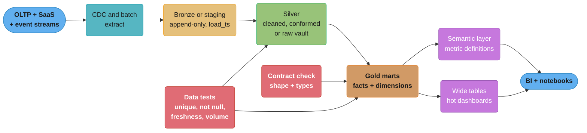
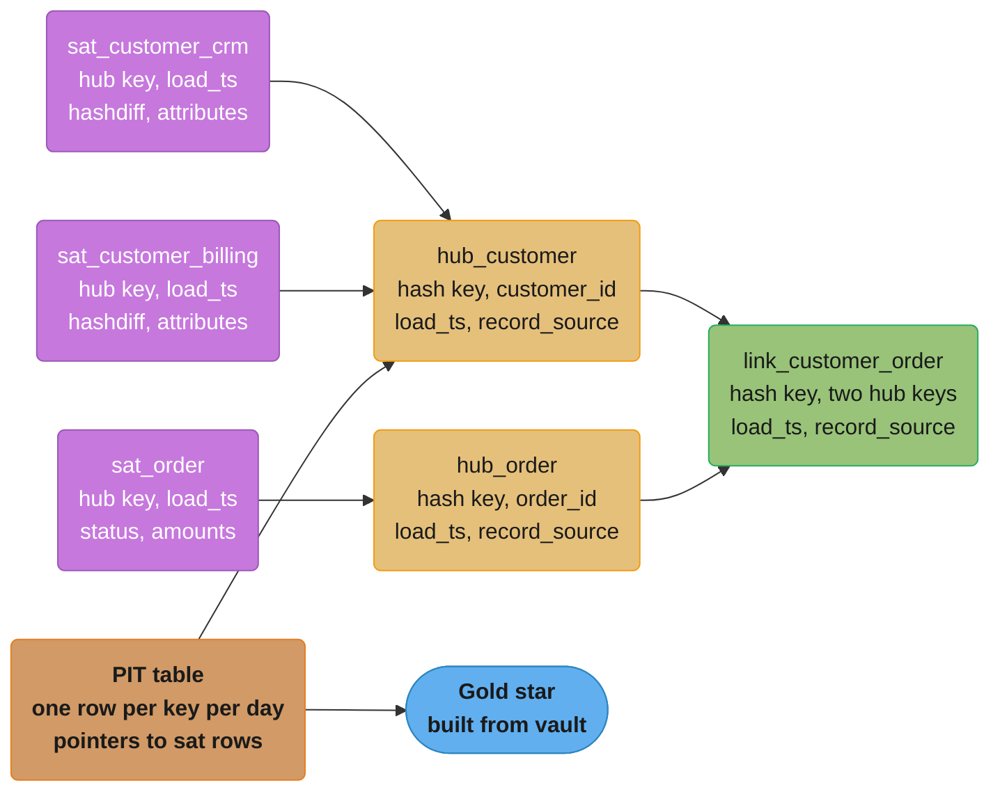

# Data Warehouse Modeling

> **Version anchor (November 2026).** Methodology sources: Kimball Group's "Dimensional
> Modeling Techniques" (drawn from *The Data Warehouse Toolkit, Third Edition*), which names
> slowly changing dimension types 0 through 7; Dan Linstedt's data vault (first published
> 2000; Data Vault 2.0 is the current open specification); Databricks' medallion architecture
> page (updated 19 Nov 2026). Tooling: **dbt Core 1.12.7** (12 Nov 2026; YAML snapshot
> configuration and `hard_deletes` since 1.9; `data_tests:` is the current key, `tests:` an
> alias); **Open Data Contract Standard v3.2.0** (Bitol, `apiVersion: v3.2.0`,
> `kind: DataContract`); **PostgreSQL 18** for the runnable SQL. Cross-links: the engines
> that run these models live in
> [Analytical Databases and OLAP](../analytical_databases_and_olap/analytical_databases_and_olap.md);
> the table formats under the lake layers live in
> [Lakehouse and Table Formats](../lakehouse_and_table_formats/lakehouse_and_table_formats.md),
> [Apache Iceberg](../../technologies/apache_iceberg/apache_iceberg.md) and
> [Trino](../../technologies/trino/trino.md); valid-time and transaction-time history lives
> in [Temporal and Bitemporal Data](../temporal_and_bitemporal_data/temporal_and_bitemporal_data.md).
> This module owns the **methodology**: how to shape the tables, not which engine scans them.

> **See also:** [Design a Data Warehouse and Semantic Layer](../case_studies/design_data_warehouse_and_semantic_layer/design_data_warehouse_and_semantic_layer.md) (case study: order-line-grain star schema, SCD2 dimensions and one governed metric layer).

## 1. Concept Overview

Data warehouse modeling is the discipline of deciding **what shape analytical data takes**
between the operational sources and the people asking questions of it. The engine
(ClickHouse, Snowflake, BigQuery, Trino over Iceberg) decides how fast a scan runs. The
model decides whether the answer is *correct*, whether two teams get the *same* answer, and
whether a question about last year can still be answered after a customer moves city.

Four bodies of method dominate, and they answer different questions:

| Method | Core unit | Optimized for | Owner of the idea |
|---|---|---|---|
| Dimensional (Kimball) | star schema: one fact table at a declared grain, surrounded by denormalized dimensions | query simplicity and consistent business metrics | Ralph Kimball, *The Data Warehouse Toolkit* (1996) |
| Normalized enterprise warehouse (Inmon) | 3NF integrated model, marts derived from it | single integrated source of truth across the enterprise | Bill Inmon |
| Data vault | hubs (business keys), links (relationships), satellites (history of attributes) | auditable, append-only integration of many changing sources | Dan Linstedt (2000) |
| Wide table / one big table (OBT) | one denormalized table per use case | columnar scan speed, minimal joins | practitioner pattern, enabled by cheap columnar storage |

On top of the method sits a **layering** convention. Databricks' medallion architecture names
three layers: bronze (raw ingestion), silver (cleaning and validation), gold (dimensional
modeling and aggregation). dbt projects commonly use staging, intermediate and marts. Both
say the same thing: raw data is kept immutable, cleaned data is reusable, and modeled data is
shaped for one audience.

Around the model sit two governance mechanisms that turned from "nice to have" into
table stakes:

- **Data contracts** declare what a producer promises (schema, semantics, freshness, quality
  rules, owner). The Open Data Contract Standard (ODCS) v3.2.0 is the vendor-neutral YAML
  format; dbt model contracts enforce the shape at build time.
- **Data quality checks** assert the content after it lands: uniqueness, non-null keys,
  referential integrity, accepted values, freshness, volume and distribution.

**Boundary.** This page does not re-teach columnar storage, vectorized execution or
MergeTree internals (see
[Analytical Databases and OLAP](../analytical_databases_and_olap/analytical_databases_and_olap.md)),
nor snapshot isolation in table formats (see
[Lakehouse and Table Formats](../lakehouse_and_table_formats/lakehouse_and_table_formats.md)),
nor bitemporal storage (see
[Temporal and Bitemporal Data](../temporal_and_bitemporal_data/temporal_and_bitemporal_data.md)).
OLTP normalization lives in
[Schema Design and Normalization](../schema_design_and_normalization/schema_design_and_normalization.md);
the surrogate-key argument at OLTP scale lives in its sub-file
[Surrogate vs Natural Keys](../schema_design_and_normalization/surrogate_vs_natural_keys.md).

---

## 2. Intuition

**One-line analogy.** A source system is a shop's till roll: every sale, in order, with
codes only the till understands. A star schema is the accountant's ledger built from it:
one line per sale, with the customer, product, store and date written out in words, and a
rule for what the customer's address was *on the day of the sale*.

**Mental model: a fact table is a verb, a dimension is a noun.** "Customer 42 *bought* 3
units of SKU 9 at store 7 on 3 March for 120.00." The verb (bought, with its numbers) is one
fact row. Every noun in the sentence (customer, product, store, date) is a foreign key to a
dimension row that holds the descriptive words analysts filter and group by.

**Why it matters.** The two most expensive analytics bugs are not slow queries. They are
**double counting** (a join fans out and revenue is reported 1.8x) and **history rewriting**
(an overwrite of a customer's segment silently moves last year's revenue into this year's
segment). The first is a grain bug. The second is a slowly-changing-dimension bug. Both
produce plausible numbers, both pass "the query ran", and both are prevented only by
modeling decisions made before the first table is created.

**Key insight.** *Declare the grain first and refuse to mix grains in one table.* Every
other decision (which facts are additive, which dimensions attach, how history is kept)
follows from "one row in this table represents exactly one ___". A fact table whose grain
cannot be stated in one sentence is already wrong.

---

## 3. Core Principles

### 3.1 The four-step dimensional design process

Kimball's design process, in order:

1. **Select the business process** (taking an order, shipping it, paying an invoice). Model
   processes, not departments.
2. **Declare the grain** (one row per order line). The grain is a business statement, not a
   column list.
3. **Identify the dimensions** (date, customer, product, store, promotion). A dimension
   attribute is anything true at the grain.
4. **Identify the facts** (quantity, net amount, discount). A fact is a number measured at
   the grain.

Skipping step 2 is the root cause of most fan-out bugs. Steps 3 and 4 are mechanical once the
grain is fixed.

### 3.2 Additivity decides which aggregates are legal

| Class | Can be summed across | Example | Correct roll-up |
|---|---|---|---|
| Additive | every dimension | `quantity`, `net_amount` | `SUM` |
| Semi-additive | some dimensions, never time | account `balance`, `inventory_on_hand` | `SUM` across accounts, then last value or average across days |
| Non-additive | no dimension | `unit_price`, `margin_pct`, ratios | recompute from additive parts: `SUM(margin) / SUM(revenue)` |

Store the additive components and compute ratios at query time. A stored `margin_pct`
averaged across rows is the arithmetic mean of percentages, which is not the margin.

### 3.3 Surrogate keys in dimensions

Every dimension row gets a warehouse-owned integer **surrogate key**. The source's identifier
becomes the **natural key** (or the *durable key* in Kimball's terms) and is kept as an
attribute. Three reasons:

- **History.** Slowly changing dimension type 2 creates several rows for one customer. Only
  a surrogate key can tell them apart and let a fact point at the version in force.
- **Integration.** Two sources with colliding identifiers (`customer_id = 42` in the CRM and
  in billing) map to different surrogates.
- **Unknown members.** A fact whose dimension is missing points at a reserved row
  (`Unknown`) instead of a null foreign key that disappears in an inner join.

### 3.4 Conformed dimensions and the bus matrix

A **conformed dimension** means the same thing, with the same keys and attribute values,
in every fact table that uses it. If `dim_customer` in the orders star and in the support
star disagree on `segment`, "revenue per support ticket by segment" cannot be computed. The
**bus matrix** is the planning artifact: business processes as rows, dimensions as columns,
an X where a process uses a dimension. It is the cheapest way to see, before building, which
dimensions must be shared.

### 3.5 History is a per-attribute decision

Slowly changing dimension (SCD) handling is chosen **per attribute**, not per table. A
customer's `name` correction is a type 1 overwrite (nobody wants revenue split by the typo).
The same customer's `segment` is type 2 (last year's revenue must stay in last year's
segment). The decision belongs to the business owner of the metric, and it must be written
down, because it changes reported numbers.

### 3.6 Raw is immutable, modeled is rebuildable

Keep the landed source data (bronze, staging) append-only and keyed by load time. Every
modeled table should be rebuildable from it. This is what turns a modeling bug into a
re-run instead of a data loss incident, and it is what a data vault formalizes.

### 3.7 Contracts at the boundary, tests on the content

A contract is enforced **before** consumers read (shape, types, required columns). A data
test runs **after** the build and returns failing rows. dbt's own docs draw the line: the
contract defines the shape of the returned dataset, and data tests validate the content.
Use both; neither replaces the other.

---

## 4. Types / Architectures / Strategies

### 4.1 Modeling methodologies compared

| Dimension | Kimball star | Snowflaked star | Inmon 3NF EDW | Data vault | Wide table (OBT) |
|---|---|---|---|---|---|
| Joins per typical query | 1 hop to each dimension | 2-3 hops | many | many, plus point-in-time logic | 0 |
| History of attributes | SCD types per attribute | same | in the EDW, often effective dating | every satellite row is history | rebuilt per load; history only if snapshotted |
| Absorbing a new source | conform it into dimensions | same | remodel integrated 3NF | add hubs, links, satellites; nothing existing changes | rebuild the table |
| Audit trail to source | weak unless kept separately | weak | medium | strong: record source and load date on every row | none |
| Best consumer | BI tools and analysts | BI with very large dimensions | enterprise integration | the integration layer feeding marts | dashboards and ML features |
| Main failure mode | grain mixing, SCD bugs | join cost, confusion | slow delivery | query complexity, row explosion | duplicated logic, inconsistent metrics |

The common modern shape combines them: a vault or normalized silver layer for integration and
audit, Kimball stars in gold for consumption, and a handful of wide tables built from the stars
for the hottest dashboards.

### 4.2 Fact table types

| Type | Grain | Row lifecycle | Example |
|---|---|---|---|
| Transaction | one row per event | insert only | order line, card authorization |
| Periodic snapshot | one row per entity per period | insert one row per period | daily account balance, month-end inventory |
| Accumulating snapshot | one row per process instance with milestone dates | updated as milestones complete | order: placed, paid, shipped, delivered dates and lags |
| Factless | one row per event with no numeric measure | insert only | student attended class, promotion was active for product on day |

A periodic snapshot's facts are usually semi-additive. An accumulating snapshot is the only
type whose rows are updated, which matters on engines where updates are rewrites.

### 4.3 Slowly changing dimension types 0 to 7

The names are Kimball Group's; the mechanics column is what each one does to rows.

| Type | Kimball name | Mechanic | History kept | Typical attribute |
|---|---|---|---|---|
| 0 | Retain original | never change after first load | original only | `original_credit_score`, `signup_channel` |
| 1 | Overwrite | update in place | none | name spelling, phone |
| 2 | Add new row | close current row, insert new version with new surrogate key | full | segment, region, sales territory |
| 3 | Add new attribute | `current_x` and `prior_x` columns | one prior value | sales territory during a realignment |
| 4 | Add mini-dimension | move fast-changing attributes to a separate small dimension referenced by the fact | full, via the mini-dimension | age band, income band, score band |
| 5 | Add mini-dimension and type 1 outrigger | type 4 plus a type 1 reference to the current mini-dimension row from the base dimension | full plus current | banded demographics needing "as of now" too |
| 6 | Add type 1 attributes to type 2 dimension | type 2 rows also carry a `current_x` column overwritten on all rows for the durable key | full plus current on every row | segment: report "as was" and "as is" from one join |
| 7 | Dual type 1 and type 2 dimensions | fact carries both the surrogate key and the durable key; join to type 2 for "as was", to a current view for "as is" | full plus current | the same, without overwriting history rows |

Types 1 and 2 cover most real attributes. Type 6 and type 7 exist because analysts
eventually ask both "revenue by the segment the customer was in at the time" and "revenue
by the segment the customer is in now" in the same dashboard.

### 4.4 Layering conventions

| Convention | Layer 1 | Layer 2 | Layer 3 | Note |
|---|---|---|---|---|
| Medallion (Databricks) | bronze: raw ingestion, no cleanup | silver: cleaning and validation | gold: dimensional modeling and aggregation | Databricks calls it a recommended practice, not a requirement |
| dbt project | staging: one model per source table, renames and casts | intermediate: joins and business logic | marts: facts and dimensions per consumer | naming convention, not enforced by dbt |
| Vault-based | landing / persistent staging | raw vault, then business vault | information marts (stars) | the vault is the system of record for history |

Pick one vocabulary per platform and stick to it. Three naming schemes in one warehouse is
a reliable sign that three teams each built a silver layer.

### 4.5 Where history lives

| Strategy | Storage cost | Query cost | Answers "as was"? | Answers "as known on date X"? |
|---|---|---|---|---|
| Overwrite only (type 1) | lowest | lowest | no | no |
| SCD2 dimension | grows with change rate | range or surrogate join | yes | no, unless load time is also kept |
| Daily full snapshots | rows x days | trivial filter on snapshot date | yes, at day granularity | yes, at day granularity |
| Table-format time travel | retained files | engine-specific | only within retention | only within retention, and only engine time |
| Bitemporal table | highest | highest | yes | yes |

The last row is the subject of
[Temporal and Bitemporal Data](../temporal_and_bitemporal_data/temporal_and_bitemporal_data.md).
Time travel in Snowflake defaults to 1 day (up to 90 days on Enterprise for permanent
tables) and in BigQuery to 7 days (configurable from 2 to 7): an operational recovery window,
not a modeling strategy.

---

## 5. Architecture Diagrams

### 5.1 Layered warehouse, sources to consumers



*Contracts guard the boundary a consumer reads from; tests run on every layer that has
consumers. Bronze is never edited, which is what makes every layer above it rebuildable.*

### 5.2 A star schema at order-line grain

This stays ASCII: the point is the fan of foreign keys around one fact table, and the
alignment carries it.

```
                         +-------------------+
                         | dim_date          |
                         | date_key (PK)     |
                         | date, month, qtr  |
                         | is_weekend        |
                         +---------+---------+
                                   |
 +-------------------+   +---------+------------------+   +-------------------+
 | dim_customer      |   | fact_order_line            |   | dim_product       |
 | customer_key (PK) +---+ date_key        (FK)       +---+ product_key (PK)  |
 | customer_id (NK)  |   | customer_key    (FK)       |   | sku (NK)          |
 | segment  [SCD2]   |   | product_key     (FK)       |   | category  [SCD1]  |
 | city     [SCD2]   |   | store_key       (FK)       |   | brand     [SCD1]  |
 | valid_from/to     |   | order_id, line_no  (DD)    |   +-------------------+
 +-------------------+   | quantity        additive   |
                         | net_amount_minor additive  |   +-------------------+
                         | unit_price      non-add.   +---+ dim_store         |
                         +----------------------------+   | store_key (PK)    |
                                                          | region   [SCD2]   |
   Grain: one row per order line.                         +-------------------+
   DD = degenerate dimension (order_id has no dimension table of its own).
```

*Every arrow is many-to-one from the fact. If any join from the fact goes one-to-many, the
grain is broken and every additive fact is over-counted by that join's fan-out.*

### 5.3 SCD type 2 versus type 1 on one customer

```
Customer 42 moves from segment SMB to Enterprise on 2026-04-01.
Fact rows: order A on 2026-02-10 (100.00), order B on 2026-05-20 (300.00).

TYPE 1 (overwrite)                     TYPE 2 (new row per version)
dim_customer                           dim_customer
 key  id  segment                       key  id  segment     valid_from  valid_to
 901  42  Enterprise                    901  42  SMB         2025-06-01  2026-04-01
                                        977  42  Enterprise  2026-04-01  9999-12-31
fact: A->901, B->901
                                       fact: A->901, B->977
Revenue by segment, 2026:
  SMB          0.00                    Revenue by segment, 2026:
  Enterprise 400.00  <- order A moved    SMB        100.00
                                         Enterprise 300.00
```

*Type 1 rewrites history: order A, placed while the customer was SMB, is now reported as
Enterprise revenue. Type 2 keeps it where it happened, because the fact row points at the
version that was current on the order date.*

### 5.4 Data vault core shape



*Hubs hold only business keys, links hold only relationships, satellites hold every
version of the descriptive attributes, one satellite per source. A new source adds a
satellite; nothing existing is altered. The PIT table pre-computes "which satellite row was
current on day D" so marts do not repeat that range logic.*

---

## 6. How It Works — Detailed Mechanics

The SQL below runs on PostgreSQL 18 in file order. The same patterns translate to Snowflake,
BigQuery and Databricks SQL with dialect changes.

### 6.1 Dimension and fact DDL

```sql
CREATE TABLE dim_customer (
    customer_key  bigint GENERATED ALWAYS AS IDENTITY PRIMARY KEY,
    customer_id   text        NOT NULL,              -- natural / durable key
    name          text        NOT NULL,              -- SCD1
    segment       text        NOT NULL,              -- SCD2
    city          text        NOT NULL,              -- SCD2
    row_hash      text        NOT NULL,              -- hash of SCD2 attributes
    valid_from    timestamptz NOT NULL,
    valid_to      timestamptz NOT NULL DEFAULT 'infinity',
    is_current    boolean     NOT NULL DEFAULT true,
    CHECK (valid_from < valid_to)
);

-- At most one current version per customer: the cheapest guard against double loads.
CREATE UNIQUE INDEX dim_customer_one_current
    ON dim_customer (customer_id) WHERE is_current;

-- Reserved unknown member, so a late or missing customer never drops a fact row.
INSERT INTO dim_customer (customer_id, name, segment, city, row_hash, valid_from)
SELECT '-1', 'Unknown', 'Unknown', 'Unknown', 'n/a', '-infinity'
WHERE NOT EXISTS (SELECT 1 FROM dim_customer WHERE customer_id = '-1');

CREATE TABLE dim_date (
    date_key   int  PRIMARY KEY,          -- 20260320
    full_date  date NOT NULL UNIQUE,
    month_num  int  NOT NULL,
    quarter    int  NOT NULL,
    is_weekend boolean NOT NULL
);

INSERT INTO dim_date
SELECT to_char(d, 'YYYYMMDD')::int, d::date, extract(month FROM d)::int,
       extract(quarter FROM d)::int, extract(isodow FROM d) IN (6, 7)
FROM generate_series('2025-01-01'::date, '2027-12-31'::date, interval '1 day') AS d;

CREATE TABLE fact_order_line (
    date_key          int    NOT NULL REFERENCES dim_date (date_key),
    customer_key      bigint NOT NULL REFERENCES dim_customer (customer_key),
    order_id          text   NOT NULL,     -- degenerate dimension
    line_no           int    NOT NULL,
    quantity          int    NOT NULL,
    net_amount_minor  bigint NOT NULL,     -- money in minor units, additive
    PRIMARY KEY (order_id, line_no)        -- the grain, enforced
);
```

The primary key on `(order_id, line_no)` is the grain written as a constraint. On engines
that do not enforce primary keys (dbt's docs note most platforms only enforce `not_null`),
the same rule becomes a uniqueness data test on the combination.

### 6.2 SCD type 2 load: close, then insert, in one transaction

The staging table holds one row per customer per extract.

```sql
CREATE TABLE stg_customer (
    customer_id  text        NOT NULL PRIMARY KEY,
    name         text        NOT NULL,
    segment      text        NOT NULL,
    city         text        NOT NULL,
    extracted_at timestamptz NOT NULL
);

INSERT INTO stg_customer VALUES
    ('42', 'Acme Ltd', 'SMB', 'Pune', '2025-06-01 00:00+00');

-- Load procedure. Run it as many times as you like: it is idempotent.
BEGIN;

-- Step 1: SCD1 attribute (name) overwrites every version of the customer.
UPDATE dim_customer d
SET    name = s.name
FROM   stg_customer s
WHERE  d.customer_id = s.customer_id
  AND  d.name IS DISTINCT FROM s.name;

-- Step 2: close the current version when an SCD2 attribute changed.
UPDATE dim_customer d
SET    valid_to = s.extracted_at,
       is_current = false
FROM   stg_customer s
WHERE  d.customer_id = s.customer_id
  AND  d.is_current
  AND  d.row_hash <> md5(s.segment || '|' || s.city);

-- Step 3: insert a new current version for changed and brand-new customers.
INSERT INTO dim_customer (customer_id, name, segment, city, row_hash, valid_from)
SELECT s.customer_id, s.name, s.segment, s.city,
       md5(s.segment || '|' || s.city), s.extracted_at
FROM   stg_customer s
LEFT JOIN dim_customer d
       ON d.customer_id = s.customer_id AND d.is_current
WHERE  d.customer_id IS NULL;

COMMIT;
```

Three properties make this production-safe:

- **The change timestamp comes from the source extract**, not `now()`. Re-running a failed
  load on Tuesday for Monday's extract produces Monday's `valid_from`, not Tuesday's.
- **Change detection is a hash of the SCD2 columns only.** A type 1 change (name) does not
  create a version. A hash also makes the comparison one column instead of N nullable ones;
  for nullable columns use `coalesce` and a separator that cannot appear in the data.
- **The partial unique index** turns a double insert (two loader processes, one re-run
  without step 2) into a constraint error instead of two current rows that double every
  fact joined to them.

Now the customer changes segment:

```sql
TRUNCATE stg_customer;
INSERT INTO stg_customer VALUES
    ('42', 'Acme Ltd', 'Enterprise', 'Pune', '2026-04-01 00:00+00');

BEGIN;
UPDATE dim_customer d SET name = s.name
FROM stg_customer s
WHERE d.customer_id = s.customer_id AND d.name IS DISTINCT FROM s.name;

UPDATE dim_customer d SET valid_to = s.extracted_at, is_current = false
FROM stg_customer s
WHERE d.customer_id = s.customer_id AND d.is_current
  AND d.row_hash <> md5(s.segment || '|' || s.city);

INSERT INTO dim_customer (customer_id, name, segment, city, row_hash, valid_from)
SELECT s.customer_id, s.name, s.segment, s.city, md5(s.segment || '|' || s.city), s.extracted_at
FROM stg_customer s
LEFT JOIN dim_customer d ON d.customer_id = s.customer_id AND d.is_current
WHERE d.customer_id IS NULL;
COMMIT;

-- Two versions of customer 42, back to back, no gap, no overlap.
SELECT customer_key, segment, valid_from, valid_to, is_current
FROM   dim_customer WHERE customer_id = '42' ORDER BY valid_from;
```

### 6.3 Loading facts: surrogate lookup at the event time

The fact row is bound to the dimension version **in force when the event happened**, once,
at load time. Queries then join on the integer key and never repeat the range logic.

```sql
CREATE TABLE stg_order_line (
    order_id     text        NOT NULL,
    line_no      int         NOT NULL,
    customer_id  text        NOT NULL,
    ordered_at   timestamptz NOT NULL,
    quantity     int         NOT NULL,
    net_amount_minor bigint  NOT NULL
);

INSERT INTO stg_order_line VALUES
    ('A', 1, '42', '2026-02-10 09:00+00', 1, 10000),
    ('B', 1, '42', '2026-05-20 11:30+00', 3, 30000),
    ('C', 1, '77', '2026-05-21 08:00+00', 1,  5000);   -- customer 77 not loaded yet

INSERT INTO fact_order_line
SELECT to_char(o.ordered_at AT TIME ZONE 'UTC', 'YYYYMMDD')::int,
       coalesce(c.customer_key,
                (SELECT customer_key FROM dim_customer WHERE customer_id = '-1')),
       o.order_id, o.line_no, o.quantity, o.net_amount_minor
FROM   stg_order_line o
LEFT JOIN dim_customer c
       ON  c.customer_id = o.customer_id
       AND o.ordered_at >= c.valid_from
       AND o.ordered_at <  c.valid_to
ON CONFLICT (order_id, line_no) DO NOTHING;

-- Revenue by segment as it was at the time of each order.
SELECT c.segment, sum(f.net_amount_minor) / 100.0 AS revenue
FROM   fact_order_line f
JOIN   dim_customer c USING (customer_key)
GROUP  BY c.segment ORDER BY c.segment;
-- Enterprise 300.00, SMB 100.00, Unknown 50.00
```

The range predicate is **half-open**: `>= valid_from AND < valid_to`. With a closed
interval (`BETWEEN`), an order placed exactly at `2026-04-01 00:00` matches both versions
and is counted twice.

Order C points at the unknown member. Two ways to repair it once customer 77 arrives:

- **Inferred member** (Kimball's late-arriving dimension technique): when the fact load sees
  an unseen natural key, insert a placeholder dimension row for `customer_id = '77'` with
  `Unknown` attributes, bind the fact to it, and let the next dimension load overwrite the
  placeholder's attributes as type 1.
- **Re-key**: re-run the fact load for the affected window after the dimension catches up.
  Simpler, but every downstream aggregate for that window must be rebuilt too.

### 6.4 Two consumer views from one type 2 dimension (type 7)

```sql
-- "As is": every version of a customer shows today's attributes.
CREATE VIEW dim_customer_current AS
SELECT d.customer_key, cur.segment AS current_segment, cur.city AS current_city
FROM   dim_customer d
JOIN   dim_customer cur
       ON cur.customer_id = d.customer_id AND cur.is_current;

SELECT dc.current_segment, sum(f.net_amount_minor) / 100.0 AS revenue
FROM   fact_order_line f
JOIN   dim_customer_current dc USING (customer_key)
GROUP  BY dc.current_segment ORDER BY dc.current_segment;
-- Enterprise 400.00, Unknown 50.00
```

The same fact table answers "as was" through `dim_customer` and "as is" through the view.
Kimball's type 7 achieves this by carrying the durable key on the fact as well; the view
above derives it through the surrogate, which is equivalent and keeps the fact narrower.

### 6.5 Semi-additive facts: the balance snapshot

```sql
CREATE TABLE fact_account_balance_daily (
    date_key       int    NOT NULL REFERENCES dim_date (date_key),
    account_id     text   NOT NULL,
    balance_minor  bigint NOT NULL,
    PRIMARY KEY (date_key, account_id)
);

INSERT INTO fact_account_balance_daily VALUES
    (20260330, 'acc1', 100000), (20260331, 'acc1', 120000),
    (20260330, 'acc2',  50000), (20260331, 'acc2',  40000);

-- BROKEN: sums balances across days. Reports 310,000 for March.
SELECT sum(balance_minor) AS march_balance FROM fact_account_balance_daily;

-- FIX: sum across accounts on the period-end day, never across days.
SELECT sum(balance_minor) AS march_end_balance
FROM   fact_account_balance_daily
WHERE  date_key = (SELECT max(date_key) FROM fact_account_balance_daily
                   WHERE date_key BETWEEN 20260301 AND 20260331);
-- 160,000
```

Average daily balance is the other legal roll-up: `sum(balance) / count(DISTINCT date_key)`
per account, then summed across accounts.

### 6.6 The same SCD2 in dbt: snapshot, incremental fact, contract, tests

```yaml
# snapshots/customers_snapshot.yml  (dbt 1.9+ YAML snapshot config)
snapshots:
  - name: customers_snapshot
    relation: source('crm', 'customers')
    config:
      schema: snapshots
      unique_key: customer_id
      strategy: check
      check_cols: ['segment', 'city']
      hard_deletes: new_record          # keep a row recording the deletion
      dbt_valid_to_current: "to_date('9999-12-31')"
```

Two strategy choices, and the trade between them:

| Strategy | Detects change by | Fails when |
|---|---|---|
| `timestamp` | a source `updated_at` column moving forward | the source updates rows without bumping `updated_at`, or bumps it on no-op writes |
| `check` | comparing the listed `check_cols` | `check_cols: all` on a wide table: every irrelevant column change creates a version |

`hard_deletes` defaults to `ignore`, which leaves a deleted source row "current" forever.
`invalidate` closes it; `new_record` adds an explicit deletion row with a `dbt_is_deleted`
column. A snapshot is the bronze-to-silver history step; it does not belong in gold.

```sql
-- models/marts/fct_order_line.sql  (dbt model, Jinja-templated SQL)
{{ config(
    materialized = 'incremental',
    unique_key   = ['order_id', 'line_no'],
    on_schema_change = 'fail'
) }}

select
    o.order_id,
    o.line_no,
    coalesce(c.customer_sk, '-1')          as customer_sk,
    o.quantity,
    o.net_amount_minor,
    o.ordered_at
from {{ ref('stg_order_lines') }} o
left join {{ ref('dim_customer') }} c
       on  c.customer_id = o.customer_id
       and o.ordered_at >= c.valid_from
       and o.ordered_at <  c.valid_to

-- reprocess a 3-day window so late events and late dimension rows are picked up
where o.ordered_at >= (select max(ordered_at) - interval '3 days' from {{ this }})

```

```yaml
# models/marts/_marts.yml
models:
  - name: fct_order_line
    config:
      contract:
        enforced: true
    columns:
      - name: order_id
        data_type: varchar
        constraints:
          - type: not_null
      - name: line_no
        data_type: integer
      - name: customer_sk
        data_type: varchar
        data_tests:
          - relationships:
              to: ref('dim_customer')
              field: customer_sk
      - name: quantity
        data_type: integer
      - name: net_amount_minor
        data_type: bigint
      - name: ordered_at
        data_type: timestamp
    data_tests:
      - dbt_utils.unique_combination_of_columns:
          combination_of_columns: ['order_id', 'line_no']
```

With `contract.enforced: true`, dbt runs a preflight check that the query returns exactly
these column names and types, and puts the types and constraints into the DDL. An
incremental model needs `on_schema_change: fail` or `append_new_columns` for contracts to
apply. The `unique_combination_of_columns` test is how the grain is enforced on a warehouse
that does not enforce primary keys.

### 6.7 Data vault: hubs, satellites and hash keys

```sql
CREATE TABLE hub_customer (
    customer_hk    char(32)    PRIMARY KEY,         -- md5(upper(trim(customer_id)))
    customer_id    text        NOT NULL,
    load_ts        timestamptz NOT NULL,
    record_source  text        NOT NULL
);

CREATE TABLE sat_customer_crm (
    customer_hk    char(32)    NOT NULL REFERENCES hub_customer,
    load_ts        timestamptz NOT NULL,
    hashdiff       char(32)    NOT NULL,            -- md5 of descriptive columns
    segment        text,
    city           text,
    record_source  text        NOT NULL,
    PRIMARY KEY (customer_hk, load_ts)
);

-- Hub load: insert business keys never seen before. Order-independent and parallel-safe,
-- because the key is computed from the business key, not looked up from a sequence.
INSERT INTO hub_customer
SELECT DISTINCT md5(upper(trim(s.customer_id))), s.customer_id, s.extracted_at, 'crm'
FROM   stg_customer s
ON CONFLICT (customer_hk) DO NOTHING;

-- Satellite load: insert only when the descriptive payload changed since the latest row.
INSERT INTO sat_customer_crm
SELECT md5(upper(trim(s.customer_id))), s.extracted_at,
       md5(s.segment || '|' || s.city), s.segment, s.city, 'crm'
FROM   stg_customer s
LEFT JOIN LATERAL (
    SELECT hashdiff FROM sat_customer_crm x
    WHERE  x.customer_hk = md5(upper(trim(s.customer_id)))
    ORDER  BY x.load_ts DESC LIMIT 1
) last ON true
WHERE  last.hashdiff IS DISTINCT FROM md5(s.segment || '|' || s.city)
ON CONFLICT DO NOTHING;
```

Hash keys let hub, link and satellite loads run in parallel without waiting for a surrogate
lookup, which is the vault's main operational argument. The cost: every consumer query
resolves "latest satellite row per key as of date D", which is why vault designs add
point-in-time (PIT) and bridge tables before building stars.

### 6.8 A data contract in ODCS v3.2.0

```yaml
apiVersion: v3.2.0
kind: DataContract
id: 7c1f6a2e-orders-gold
name: fct_order_line
version: 2.1.0
status: active
domain: commerce
description:
  purpose: Order-line revenue at the grain of one row per order line.
  limitations: Net of discounts, gross of refunds. Refunds live in fct_refund.
schema:
  - name: fct_order_line
    properties:
      - name: order_id
        logicalType: string
        required: true
      - name: line_no
        logicalType: integer
        required: true
      - name: net_amount_minor
        logicalType: integer
        required: true
        description: Minor units of the order currency.
    quality:
      - type: sql
        description: Grain holds.
        query: |
          SELECT count(*) FROM (
            SELECT order_id, line_no FROM fct_order_line
            GROUP BY 1, 2 HAVING count(*) > 1) d
        mustBe: 0
slaProperties:
  - property: latency
    value: 4
    unit: h
```

The value of a contract is not the YAML. It is that a producer's CI fails when a change would
break it, and that the version number gives consumers a migration path (minor version for
additive columns, major version for a removed or retyped one), exactly like an API.

### 6.9 Data quality: a check taxonomy with thresholds

| Check | Question | Typical implementation | Example threshold |
|---|---|---|---|
| Schema | did the shape change? | contract enforcement, `on_schema_change: fail` | any change fails |
| Uniqueness | does the grain hold? | `unique`, `unique_combination_of_columns` | 0 duplicates |
| Completeness | are keys present? | `not_null` | 0 nulls on keys |
| Referential | does every FK resolve? | `relationships` | 0 orphans (unknown member allowed) |
| Validity | are values in the domain? | `accepted_values`, range checks | 0 outside domain |
| Freshness | is the data recent? | source freshness on `loaded_at` | warn at 6 h, error at 24 h (assumption) |
| Volume | did row count move abnormally? | today's count vs trailing 28-day median | outside 0.5x to 2x (assumption) |
| Reconciliation | does the warehouse agree with the source? | `count(*)` and `sum(amount)` per day, both sides | difference 0 for money |

Reconciliation is the check most teams skip and the one auditors ask for. A warehouse whose
revenue disagrees with the ledger by 0.3% is not "mostly right"; it is unexplained.

### 6.10 Sizing an SCD2 dimension

Illustrative arithmetic, with assumptions labeled:

```
customers                        = 20,000,000
SCD2 attribute change rate       = 2% of customers per month   (assumption)
new versions per year            = 20M x 0.02 x 12 = 4.8M
rows after 5 years               = 20M + 5 x 4.8M  = 44M
row width (compressed, columnar) ~ 60 bytes        (assumption)
storage                          ~ 44M x 60 B      ~ 2.6 GB
```

The dimension stays small. The cost shows up elsewhere: put a fast-changing attribute
(`last_login_at`, a daily score) in type 2 and the change rate goes from 2% per month to 100%
per day, which is 20M new rows a day and 7.3B rows a year. That is the case for a type 4
mini-dimension or for moving the attribute into a periodic snapshot fact.

---

## 7. Real-World Examples

- **Databricks' reference medallion layout.** The documentation's example puts bronze,
  silver and gold in separate schemas of one catalog (`ops.bronze`, `ops.silver`,
  `ops.gold`). Silver joins cleaned customers and transactions into `customer_transactions`
  and quarantines invalid records; gold exposes few, business-shaped datasets
  (`customer_spending`, `account_performance`, `business_summary`). The pattern to copy is
  the shrinking table count per layer: gold has fewer datasets than silver.
- **dbt's `orders` snapshot example.** The dbt docs use an `orders` table whose `status`
  is overwritten from `pending` to `shipped`. Without a snapshot, the time the order spent in
  `pending` is lost; with one, each status gets a row with `dbt_valid_from` and
  `dbt_valid_to`. This is SCD2 applied to a source that never kept history.
- **SQL Server's own use-case list for temporal tables** includes "maintaining a slowly
  changing dimension for decision support applications". System versioning gives
  transaction-time history for free on the source; the warehouse still has to decide the
  business-time grain (see the temporal module).
- **Lakehouse gold tables in Iceberg queried by Trino.** A common open stack lands bronze as
  Iceberg tables, transforms with dbt on Trino or Spark, and serves gold stars from the same
  Iceberg tables to BI through Trino. The table-format and engine mechanics are in
  [Apache Iceberg](../../technologies/apache_iceberg/apache_iceberg.md) and
  [Trino](../../technologies/trino/trino.md); the modeling choices on this page are
  identical whichever engine runs them.
- **Regulated finance.** Reporting marts in banks and brokers are built from history that
  must be reproducible years later. That requirement pushes the integration layer toward a
  data vault or a bitemporal store, and the reporting marts toward periodic snapshots
  frozen at each filing. See
  [Regulatory Reporting and Audit Trails](../../fintech/regulatory_reporting_and_audit_trails/regulatory_reporting_and_audit_trails.md)
  for the retention and audit-trail rules those marts must meet.

---

## 8. Tradeoffs

### 8.1 Star vs data vault vs wide table

| Concern | Star schema | Data vault | Wide table |
|---|---|---|---|
| Time to first dashboard | weeks | months (vault, then marts) | days |
| Analyst SQL difficulty | low | high (needs PIT logic) | lowest |
| Change in a source schema | rework the affected dimension | add a satellite | rebuild |
| Auditability | medium | highest | lowest |
| Storage | moderate | highest (every version, every source) | high (denormalized, repeated) |
| Metric consistency across teams | high if dimensions conform | depends on marts | low: each table re-implements logic |

### 8.2 SCD1 vs SCD2 vs snapshots

| Concern | SCD1 | SCD2 | Daily full snapshot |
|---|---|---|---|
| Rows | N | N x (1 + versions) | N x days |
| "As was" answers | no | yes, exact to change time | yes, at day granularity |
| Load complexity | trivial | close-and-insert, idempotency care | trivial append |
| Query complexity | trivial | surrogate join or range join | filter on snapshot date |
| Late-arriving corrections | overwrite | need a back-dated version (hard) | re-snapshot the day |

### 8.3 Snowflaking a dimension

| Normalize `dim_product` into `dim_brand`, `dim_category`? | Benefit | Cost |
|---|---|---|
| Large dimension, attributes shared by millions of rows | less storage, one place to update a brand | extra joins in every query, harder BI modeling |
| Small dimension (under 10^6 rows) | negligible | the same extra joins for nothing |

On columnar engines a repeated low-cardinality string dictionary-encodes to a few bytes,
which removes most of the storage argument for snowflaking.

### 8.4 Contracts: strict vs advisory

| Mode | Producer cost | Consumer protection | Use when |
|---|---|---|---|
| Enforced at build (dbt contract, CI gate) | every change needs a version bump | breaking change never ships silently | gold tables with external consumers |
| Advisory (documented, monitored) | low | detection after the fact | internal intermediate models |
| None | zero | none | exploration, staging |

---

## 9. When to Use / When NOT to Use

**Use a dimensional model when:**

- Business users and BI tools query the data directly and need consistent metrics.
- The same dimensions (customer, product, date) are shared by several business processes.
- "As was" questions matter: revenue by the territory the account belonged to at the time.

**Use a data vault when:**

- Ten or more sources feed the same business entities and change independently.
- Auditability is a requirement: every value must trace to a source and load time.
- The integration layer must absorb new sources without remodeling existing tables.

**Do NOT use a data vault when:**

- There are two or three sources and one team. The hub-link-satellite overhead costs more
  than it saves; a staged, snapshotted silver layer gives the history with a fraction of
  the tables.

**Use wide tables when:**

- A single dashboard or ML feature pipeline needs sub-second scans and the logic is
  owned in one place (built *from* the star, not instead of it).

**Do NOT build a warehouse model at all when:**

- Data volume fits an OLTP replica, questions are operational ("orders stuck in pending
  now") and nobody needs history. A read replica and a few views are enough.

**Do NOT use SCD2 for:**

- Attributes that change daily (scores, last-login). Use a mini-dimension or a periodic
  snapshot fact; SCD2 will grow the dimension by its full row count per change cycle.

---

## 10. Common Pitfalls

### 10.1 Fan-out: joining two facts at different grains

An analyst joins orders to shipments to report "revenue and shipped units per order".

```sql
CREATE TABLE fact_shipment_line (
    order_id text NOT NULL, shipment_id text NOT NULL, shipped_qty int NOT NULL
);
INSERT INTO fact_shipment_line VALUES ('B', 'S1', 2), ('B', 'S2', 1);

-- BROKEN: order B has two shipments, so its revenue row is repeated twice.
SELECT f.order_id, sum(f.net_amount_minor) AS revenue_minor, sum(s.shipped_qty) AS shipped
FROM   fact_order_line f
JOIN   fact_shipment_line s USING (order_id)
GROUP  BY f.order_id;
-- B | 60000 | 3     <- revenue doubled

-- FIX: drill across. Aggregate each fact to the shared grain, then join.
WITH rev AS (
    SELECT order_id, sum(net_amount_minor) AS revenue_minor
    FROM fact_order_line GROUP BY order_id
), shp AS (
    SELECT order_id, sum(shipped_qty) AS shipped
    FROM fact_shipment_line GROUP BY order_id
)
SELECT rev.order_id, rev.revenue_minor, shp.shipped
FROM   rev JOIN shp USING (order_id);
-- B | 30000 | 3
```

The war story shape (illustrative): a quarterly board deck reported revenue 1.4x the ledger
for orders with split shipments; it was caught only by the finance reconciliation, three
weeks after the deck shipped. The fix is structural, not a `DISTINCT`: `sum(DISTINCT amount)`
drops legitimate equal amounts.

### 10.2 Joining facts to an SCD2 dimension on the natural key

```sql
-- BROKEN: customer 42 has two versions, so every 42 fact row is counted twice.
SELECT c.segment, sum(f.net_amount_minor)
FROM   fact_order_line f
JOIN   dim_customer c ON c.customer_id = '42'
WHERE  f.order_id IN ('A', 'B')
GROUP  BY c.segment;

-- FIX: join on the surrogate key bound at load time (or on current rows only).
SELECT c.segment, sum(f.net_amount_minor)
FROM   fact_order_line f
JOIN   dim_customer c USING (customer_key)
WHERE  f.order_id IN ('A', 'B')
GROUP  BY c.segment;
```

This bug appears the day the first type 2 change lands, often months after the model
shipped, which is why it is so often found by an executive rather than a test. A
`relationships` test does not catch it; a reconciliation of `sum(revenue)` against the
source does.

### 10.3 `now()` as the version start

An SCD2 load stamps `valid_from = now()`. A failed Monday load is re-run on Wednesday, and
two days of orders are bound to the previous version. The fix is to take the timestamp from
the source change (`updated_at`, CDC commit time) or the extract, never from the loader's
clock.

### 10.4 Summing a semi-additive fact across time

Shown in 6.5: a sum of daily balances over a month is about 30x the real balance. Mark
semi-additive measures in the semantic layer so a BI tool cannot apply `SUM` over the date
dimension.

### 10.5 `check_cols: all` on a wide source

A dbt snapshot on a 120-column CRM table with `check_cols: all` and a source that rewrites
`last_synced_at` hourly creates a new version of every row every hour. At 5M rows that is
120M snapshot rows a day. List the columns that carry business meaning.

### 10.6 Contracts that check shape but not meaning

A producer renames nothing but changes `amount` from major units to minor units. The
contract (`bigint`, not null) passes; every revenue chart is 100x. Contracts must carry
semantics in the description and a quality rule that would catch it (a sum against a
reference, or a range check on `amount`).

### 10.7 Mixing grains in one fact table

Order headers (shipping fee) and order lines (item amount) in one table with a nullable
`line_no` look convenient. Every `SUM(amount)` mixes header and line amounts. Allocate
header-level facts down to lines (Kimball's "allocated facts") or keep a separate header
fact.

---

## 11. Technologies & Tools

| Tool | Role in modeling | Notes |
|---|---|---|
| dbt Core | SQL transformation framework: models, snapshots (SCD2), incremental models, model contracts, data tests, unit tests | 1.12.7 (12 Nov 2026); snapshots configured in YAML since 1.9 |
| Snowflake | cloud warehouse | Time Travel 1 day default, up to 90 days on Enterprise for permanent tables |
| Google BigQuery | serverless warehouse | time travel 7 days default, configurable 2 to 7 |
| Databricks | lakehouse platform | names the medallion architecture |
| Apache Iceberg | open table format for bronze through gold | see [Apache Iceberg](../../technologies/apache_iceberg/apache_iceberg.md) |
| Trino | SQL engine over the lake and federated sources | see [Trino](../../technologies/trino/trino.md) |
| Apache Airflow | orchestration of load order and backfills | see [Apache Airflow](../../technologies/apache_airflow/apache_airflow.md) |
| Debezium | CDC into bronze with source commit timestamps | see [Debezium](../../technologies/debezium_change_data_capture/debezium_change_data_capture.md) |
| Great Expectations | data quality assertions in Python | expectation suites and checkpoints |
| Soda Core | data quality checks in YAML | checks for freshness, volume, schema |
| Open Data Contract Standard | YAML data contract format | v3.2.0, `kind: DataContract` |
| PostgreSQL | small marts, and the reference SQL on this page | 18 |

---

## 12. Interview Questions with Answers

**Q: What is the grain of a fact table, and why is it the first decision?**
**Short:** The grain is what one row represents, such as one order line; every dimension, fact and aggregate rule depends on it, and mixing grains causes double counting.

The grain is a business statement ("one row per order line", "one row per account per day"),
not a list of columns. It is decided first because it fixes which dimensions can attach
(anything single-valued at that grain), which facts are measured (numbers true at that
grain) and which joins are safe (many-to-one only). A table whose grain cannot be said in
one sentence will double count the moment someone joins it. Write the grain as a primary
key or a `unique_combination_of_columns` test so it is enforced, not just documented.

**Q: Your revenue report is 40% higher than finance's number. Where do you look first?**
**Short:** At joins that fan out: a fact joined to another fact, or to a dimension with several rows per key, typically an SCD2 dimension joined on the natural key.

Check every join from the fact table for one-to-many behaviour. The two usual culprits are
fact-to-fact joins at different grains (orders to shipments) and natural-key joins to a type
2 dimension that now has several versions per customer. Compare `count(*)` before and after
each join. Fix with drill-across (aggregate each fact to the shared grain first) or by joining
on the surrogate key bound at load time. `DISTINCT` is not a fix: it drops legitimate rows
with equal amounts.

**Q: What is the difference between SCD type 1 and type 2, and who decides which to use?**
**Short:** Type 1 overwrites the attribute and loses history; type 2 adds a row per change so facts keep the value in force when they happened; the metric owner decides per attribute.

Type 1 is right for corrections (a misspelled name) where history is noise. Type 2 is right
when reports must attribute past facts to past values (revenue by the territory an account
belonged to then). The choice changes reported numbers, so it belongs to the business owner of
the metric, recorded per attribute. One table can mix both: overwrite `name` on all versions,
version `segment`.

**Q: How do SCD types 6 and 7 differ, and why do they exist?**
**Short:** Both answer "as was" and "as is" together; type 6 stores a current-value column on every type 2 row, type 7 gives the fact a durable key to join a current view.

Analysts eventually want revenue by the segment at the time and by today's segment in one
report. Type 6 adds `current_segment` to the type 2 dimension and overwrites it on every row
of the durable key when it changes, so one join answers both, at the cost of updating history
rows. Type 7 leaves history rows untouched: the fact carries the durable key (or it is derived
through the surrogate) and joins to a current-only view for "as is". Type 7 is friendlier to
append-only engines.

**Q: Why use surrogate keys in dimensions instead of the source system's ID?**
**Short:** Surrogates distinguish type 2 versions, isolate the warehouse from source key changes and collisions, and allow a reserved unknown member instead of null foreign keys.

A natural key identifies the customer; a type 2 dimension has several rows per customer, so
only a warehouse-owned key can identify the version a fact points at. Surrogates also let two
sources with colliding IDs coexist, and they let a fact with a missing dimension point at an
`Unknown` row so an inner join does not silently drop it. Keep the natural key as an
attribute for lookups and debugging.

**Q: How do you bind a fact row to the correct SCD2 version?**
**Short:** At load time, look up the dimension row whose half-open validity interval contains the event time, and store that surrogate key on the fact.

The lookup is `event_ts >= valid_from AND event_ts < valid_to` on the natural key. Doing it
once at load means every query joins on an integer key and never repeats the range logic.
Use a half-open interval: with `BETWEEN`, an event exactly at a boundary matches two versions.
Take `valid_from` from the source change time, not the loader's clock, or re-runs bind facts to
the wrong version.

**Q: What is a late-arriving dimension and how do you handle it?**
**Short:** A fact arrives before its dimension row; bind it to an inferred placeholder row for that natural key, then let the dimension load fill in the attributes.

Inserting an "inferred member" (natural key known, attributes `Unknown`) keeps the fact
loaded and joinable. When the real dimension row arrives, overwrite the placeholder's
attributes (type 1 for the inferred row) rather than creating a version, so the early facts
are attributed correctly. The alternative, binding to a global unknown member and re-keying
later, also works but forces a rebuild of every aggregate for the window.

**Q: What makes a fact additive, semi-additive or non-additive, and why does it matter?**
**Short:** Additive facts sum over every dimension, semi-additive ones like balances must not be summed over time, and ratios cannot be summed at all.

Quantity and net amount are additive. Balances and inventory levels are semi-additive: sum
across accounts on one day, but take the last value or the average across days. Unit price and
margin percent are non-additive: store the additive parts and compute the ratio after
aggregation. BI tools apply `SUM` by default, so mark semi-additive measures in the semantic
layer or the monthly balance comes out about 30 times too high.

**Q: What is a conformed dimension, and what breaks without one?**
**Short:** A dimension with identical keys and attribute values in every star that uses it; without it, metrics from two business processes cannot be compared or combined.

If the sales star and the support star each build their own `customer` with different
segment rules, "revenue per support ticket by segment" mixes two definitions and produces a
number nobody can defend. The bus matrix (processes by dimensions) is the planning tool that
shows which dimensions must be shared before anyone builds them.

**Q: Kimball, Inmon or data vault: how do you choose?**
**Short:** Kimball stars for consumption, and a vault or normalized layer underneath when many changing sources and audit matter; mature platforms usually combine them.

They answer different questions. A star optimizes query simplicity and consistent metrics. An
Inmon 3NF warehouse optimizes enterprise integration. A data vault optimizes absorbing many
changing sources with full audit. With two or three sources, go straight to staged silver
plus stars. With many sources, regulated audit and frequent change, put a vault underneath
and keep stars as the consumption layer.

**Q: Explain hubs, links and satellites in a data vault.**
**Short:** Hubs hold unique business keys, links hold relationships between hubs, and satellites hold time-versioned descriptive attributes, each row stamped with load time and record source.

Separating keys, relationships and attributes means a new source adds a satellite without
altering existing tables, and every value traces to its source and load time. Hash keys
computed from business keys let hubs, links and satellites load in parallel without sequence
lookups. The price is query complexity: consumers need point-in-time tables to find which
satellite row was current on a date, so analysts query marts built from the vault, not the
vault itself.

**Q: What is the medallion architecture, and is it a modeling method?**
**Short:** It is a layering convention of bronze raw data, silver cleaned and validated data and gold modeled aggregates; it says where models live, not how to design them.

Databricks describes it as a recommended pattern, not a requirement. Bronze keeps the raw
source state for reprocessing and audit, silver cleans and validates, gold holds dimensional
models and aggregates. You still choose stars, vaults or wide tables for the layers. The
mistake is treating "we have three layers" as a model: a gold layer of undocumented grain is
still broken.

**Q: How does a dbt snapshot implement SCD2, and what are its traps?**
**Short:** It compares the source with the last captured state on each run and writes versions with dbt_valid_from and dbt_valid_to, detecting change by timestamp or by checked columns.

The `timestamp` strategy trusts the source's `updated_at`; it misses changes that do not bump
it and versions no-op writes that do. The `check` strategy compares listed columns; `all` on a
wide, frequently synced table creates a version per sync. Deletes are ignored by default, so a
deleted customer stays current until you set `hard_deletes` to `invalidate` or `new_record`.
A snapshot only captures what it sees when it runs: two changes between runs collapse into
one.

**Q: What does a dbt model contract enforce, and what does it not?**
**Short:** It enforces column names, data types and supported constraints at build time; it does not check content such as uniqueness on most warehouses, or the meaning of a value.

With `contract.enforced: true`, dbt checks the query's output columns and types before
building and writes them into the DDL. Constraints are only as strong as the platform: dbt's
docs note most platforms enforce only `not_null`, so primary and unique keys are metadata.
Content rules (grain, referential integrity, ranges) remain data tests. A unit change from
major to minor currency units passes any shape contract.

**Q: What should a data contract contain beyond a schema?**
**Short:** Owner, semantics of each field, the grain, quality rules, freshness and latency service levels, and a version with rules for breaking versus additive changes.

ODCS v3.2.0 has sections for schema, data quality, service levels, team, roles and support
channels. The parts that prevent incidents are the semantic descriptions (units, currency,
inclusion of refunds), the quality rules that encode the grain, and the versioning rule:
additive columns are a minor bump, removed or retyped columns are a major bump with a
deprecation window. A contract nobody's CI checks is documentation.

**Q: Which data quality checks would you put on a revenue fact table, in priority order?**
**Short:** Grain uniqueness, non-null and resolvable keys, a daily reconciliation of count and sum against the source, then freshness and volume anomaly checks.

Uniqueness on the grain catches double loads. Referential checks catch orphaned facts.
Reconciliation of `count(*)` and `sum(amount)` per day against the source ledger is the check
that catches fan-out, unit changes and silent drops, and for money the tolerance is zero.
Freshness and volume checks catch stalled or truncated loads. Distribution checks come last
and need tuning to avoid alert fatigue.

**Q: When would you snapshot a whole table daily instead of using SCD2?**
**Short:** When the table is small or the questions are about state on a day, such as balances or reference data, because a daily snapshot is trivial to load and query at day granularity.

Snapshots cost rows times days but are append-only, idempotent and easy to reason about,
and they answer "what did we know on day D" for every column without per-attribute
decisions. SCD2 is cheaper for large, slowly changing dimensions and exact to the change
time. For a 10,000-row reference table, daily snapshots are simpler. For a 20M-row customer
dimension, SCD2.

**Q: How do you make an incremental fact load correct when events arrive late?**
**Short:** Reprocess a lookback window on every run, upsert on the grain key, and size the window from measured lateness rather than guesswork.

An incremental model that filters `> max(event_ts)` loses every event that arrives after a
newer one was loaded. Reprocess a window (for example the last 3 days) and upsert on the grain
key so rows are replaced, not duplicated. Measure the lateness distribution (p99.9 of arrival
minus event time) and set the window above it, with a periodic full rebuild of recent
partitions as a backstop.

**Q: Where should business metric definitions live?**
**Short:** In one governed semantic layer or metrics definition built on the gold models, not re-implemented in each dashboard or wide table.

When "active customer" is defined in five dashboards it has five definitions. Put the metric
(numerator, denominator, filters, allowed dimensions, additivity) in one place that BI tools
query, and build wide tables from it rather than beside it. Version metric definitions like
contracts, because changing one changes historical reports.

---

## 13. Best Practices

- **Write the grain as a constraint or a test**, in the same commit as the table.
- **Keep bronze immutable** and every downstream model rebuildable from it.
- **Take version timestamps from the source** (CDC commit time, `updated_at`, extract time),
  never from the loader's clock.
- **Use half-open intervals** (`[valid_from, valid_to)`) for every validity range, with a far
  future or `infinity` end for current rows.
- **Guard SCD2 with a partial unique index** (or a uniqueness test) on the natural key where
  `is_current`.
- **Reserve an unknown member** in every dimension; never load a fact with a null foreign key.
- **Store additive components, compute ratios late**, and flag semi-additive measures.
- **Decide SCD type per attribute with the metric owner** and record the decision.
- **Prefer a mini-dimension or a periodic snapshot** for attributes that change daily.
- **Reconcile money daily** against the source of truth, with zero tolerance.
- **Enforce contracts on gold tables with external consumers**, and version them like APIs.
- **Build wide tables from the star**, never as a parallel source of logic.

---

## 14. Case Study

**Scenario (illustrative).** A subscription business with 6M customers, 4 source systems
(CRM, billing, product events, support) and a finance team that closes the books monthly.
The analytics team shipped a gold layer in a quarter: one `fct_revenue` table and one
`dim_account` built with type 1 overwrites everywhere. Eight months later sales operations
re-assigned 30,000 accounts to new territories, and the Q1 territory revenue report that the
board had already seen changed overnight.

**Diagnosis.** `dim_account.territory` was type 1. The re-assignment overwrote it, so every
historical fact for the moved accounts now reported under the new territory. Nothing failed:
the pipeline was green, tests passed, and the numbers were plausible.

```sql
-- BROKEN: the dimension the team shipped. Territory is overwritten in place.
CREATE TABLE dim_account_v1 (
    account_id  text PRIMARY KEY,
    territory   text NOT NULL
);
INSERT INTO dim_account_v1 VALUES ('acc9', 'West');

CREATE TABLE fct_revenue_v1 (
    account_id   text   NOT NULL,
    revenue_date date   NOT NULL,
    amount_minor bigint NOT NULL
);
INSERT INTO fct_revenue_v1 VALUES ('acc9', '2026-02-15', 500000);

-- The re-assignment in June rewrites Q1.
UPDATE dim_account_v1 SET territory = 'Central' WHERE account_id = 'acc9';

SELECT a.territory, sum(r.amount_minor)
FROM   fct_revenue_v1 r JOIN dim_account_v1 a USING (account_id)
WHERE  r.revenue_date < '2026-04-01'
GROUP  BY a.territory;
-- Central | 500000   <- Q1 revenue now credited to a territory that did not own it
```

```sql
-- FIX: territory becomes SCD2, facts bind to the version at the revenue date.
CREATE TABLE dim_account_v2 (
    account_key bigint GENERATED ALWAYS AS IDENTITY PRIMARY KEY,
    account_id  text        NOT NULL,
    territory   text        NOT NULL,
    valid_from  timestamptz NOT NULL,
    valid_to    timestamptz NOT NULL DEFAULT 'infinity',
    is_current  boolean     NOT NULL DEFAULT true
);
CREATE UNIQUE INDEX dim_account_v2_cur ON dim_account_v2 (account_id) WHERE is_current;

-- Backfill: history reconstructed from the CRM's territory-assignment audit log.
INSERT INTO dim_account_v2 (account_id, territory, valid_from, valid_to, is_current) VALUES
    ('acc9', 'West',    '2025-01-01', '2026-06-01', false),
    ('acc9', 'Central', '2026-06-01', 'infinity',   true);

CREATE TABLE fct_revenue_v2 (
    account_key  bigint NOT NULL REFERENCES dim_account_v2,
    revenue_date date   NOT NULL,
    amount_minor bigint NOT NULL
);
INSERT INTO fct_revenue_v2
SELECT a.account_key, r.revenue_date, r.amount_minor
FROM   fct_revenue_v1 r
JOIN   dim_account_v2 a
       ON  a.account_id = r.account_id
       AND r.revenue_date >= a.valid_from
       AND r.revenue_date <  a.valid_to;

SELECT a.territory, sum(r.amount_minor)
FROM   fct_revenue_v2 r JOIN dim_account_v2 a USING (account_key)
WHERE  r.revenue_date < '2026-04-01'
GROUP  BY a.territory;
-- West | 500000     <- Q1 stays where it was earned
```

**What else changed.**

1. **History source.** The CRM kept a territory-assignment audit log, which made the backfill
   possible. For the attributes with no audit log, the team added dbt snapshots on the CRM
   source from that day on and accepted that history before it is unrecoverable. This is the
   lesson that hurts: history not captured at ingestion cannot be rebuilt later.
2. **Per-attribute SCD decisions.** A one-page table, signed by the revenue operations owner:
   `territory`, `segment`, `plan_tier` are type 2; `account_name`, `billing_email` are type 1;
   `signup_channel` is type 0. Type 7 via a current view for "as is" reporting.
3. **Contract and tests on `fct_revenue`.** Enforced contract (columns and types), a
   uniqueness test on the grain (`invoice_line_id`), and a daily reconciliation test of
   `sum(amount_minor)` per day against the billing ledger with zero tolerance.
4. **Frozen reporting snapshots.** Board-reported quarters are written to a periodic
   snapshot table at close, so a later correction shows up as a documented restatement, not
   a silent change. When corrections to the past must themselves be auditable ("what did we
   report, and what do we now know"), the right tool is a bitemporal store, covered in
   [Temporal and Bitemporal Data](../temporal_and_bitemporal_data/temporal_and_bitemporal_data.md).

**Numbers after the change (illustrative).** `dim_account` grew from 6.0M rows to 6.9M over
the first year (about 15% of accounts changed a type 2 attribute). Query latency on the
territory report was unchanged, because facts join on the integer surrogate key. The cost was
one engineer-week for the backfill and the SCD2 loads, against a board restatement that had
already cost a quarter's credibility with finance.
